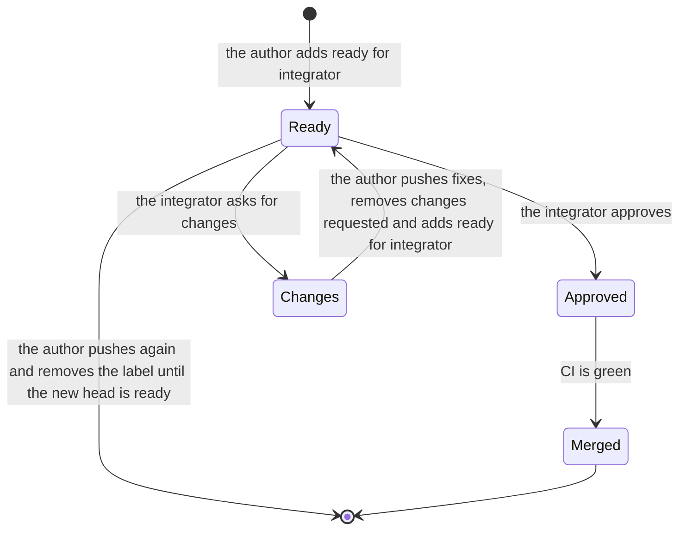

# Contributing

Postbox is planned in GitHub issues. An issue’s assignee, labels and links say whether it’s free to pick up. Read them before you start, so two people don’t build the same thing.

## Pick up work that’s ready

An issue is **ready** when it’s open, has a priority label, and none of these apply:

| Signal | What it means |
|---|---|
| An assignee | Someone has claimed it, and is working on it in an open pull request or a running session. Its comments name the PR. |
| `needs decision` label | It waits on the maintainer’s decision. Its comments say which decision. |
| Blocked by an open issue (GitHub’s “Blocked by” in the sidebar) | It builds on another issue that hasn’t landed. |

The `in progress` label is retired as a claim. The assignee says who has the issue, which the label never did. Issues that already carry the label stay claimed until they close, so the searches below skip them too. Don’t add the label to new claims.

Saved searches:
- [Ready to pick up, P1 first](https://github.com/HJeon139/postbox/issues?q=is%3Aissue+is%3Aopen+no%3Aassignee+-is%3Ablocked+-label%3A%22in+progress%22+-label%3A%22needs+decision%22+sort%3Acreated-asc+label%3AP1%2CP2) uses `is:open no:assignee -is:blocked -label:"in progress" -label:"needs decision" label:P1,P2`.
- [Unassigned](https://github.com/HJeon139/postbox/issues?q=is%3Aissue+is%3Aopen+no%3Aassignee) uses `is:open no:assignee`.
- [Mine](https://github.com/HJeon139/postbox/issues?q=is%3Aissue+is%3Aopen+assignee%3A%40me) uses `is:open assignee:@me`.
- [Assigned, with no pull request yet](https://github.com/HJeon139/postbox/issues?q=is%3Aissue+is%3Aopen+assignee%3A*+-linked%3Apr) uses `is:open assignee:* -linked:pr`. These are claims that have gone quiet, or work not started.
- [Waiting on a decision](https://github.com/HJeon139/postbox/issues?q=is%3Aissue+is%3Aopen+label%3A%22needs+decision%22)
- [Blocked](https://github.com/HJeon139/postbox/issues?q=is%3Aissue+is%3Aopen+is%3Ablocked)

## Claim it, then build it

1. **Claim it, in two places.** Assign the issue to yourself and comment that you’re taking it. Do both before you write code. The assignee is what the searches read, and the comment says what you plan to do.
   ```bash
   gh issue edit <n> --add-assignee @me
   gh issue comment <n> --body "Taking this."
   ```
   If you can’t assign yourself (GitHub lets only people with triage access or above assign others, and outside contributors often don’t have it), comment that you’re taking it and ask the maintainer to assign you. Until then the issue isn’t claimed, so wait for the assignment before you build. One assignee per issue; a second person comments first and the maintainer decides.
2. **Name it in the pull request.** Put `Fixes #n` in the PR body, not only in a commit, so GitHub links the two.
3. **Follow the project's rules.** The same rules apply to everyone, people and agent sessions alike:
   - `AGENTS.md`, and the `AGENTS.md` in each folder you change: the rules, short, with the design section each comes from. Claude Code, Codex, Kiro and Antigravity read them on their own (#315).
   - `designs/engineering-practices.md`
   - `designs/developing.md`
   - `designs/prompts/README.md`: ports, `--data`, length limits, the gate, scope and hand-off
4. **When it merges,** the issue closes and the claim ends with it. If you stop before then, unassign yourself (`gh issue edit <n> --remove-assignee @me`) and comment where you got to. The maintainer may unassign a stale claim, one with no pull request and no word for a while, and says so in a comment.

## Get your pull request reviewed

Three labels on a pull request say where its review stands. Each one is about the PR’s current head, the commit it ends on, so a new push makes the label out of date.

| Label | Who adds it | What it means |
|---|---|---|
| `ready for integrator` | The author | The head is ready for the integrator’s review: it passes the gate (`AGENTS.md`, “The gate”), its body says why, what changed, how it was verified and what’s not done, and you’ve checked it against `designs/review-guide.md`, the guide the integrator reviews by. |
| `changes requested` | The integrator | The integrator reviewed this head and asked for changes, in a review on the PR. |
| `integrator approved` | The integrator | The integrator approved this head. The integrator merges it once CI is green. |



1. **Mark it ready.** Add `ready for integrator` only when the head is ready, not while you’re still pushing. A draft pull request isn’t ready.
   ```bash
   gh pr edit <n> --add-label "ready for integrator"
   ```
2. **Push again, and the label is out of date.** Nothing removes it for you: remove it yourself when you push to a head that’s labeled, and add it again once the new head is ready.
3. **Answer a review.** The integrator posts the verdict as a GitHub review, with a comment on each line that has to change, and replaces `ready for integrator` with `changes requested` or `integrator approved`. Fix what blocks, push, then swap `changes requested` for `ready for integrator`. Points that don’t block go into new issues, not into this PR.
   ```bash
   gh pr edit <n> --remove-label "changes requested" --add-label "ready for integrator"
   ```
4. **Leave the merge to the integrator.** An approved pull request is brought up to date with `main` and merged once CI is green. Don’t merge it yourself, and don’t add `integrator approved` to your own PR.

If you can’t add labels (GitHub lets only people with triage access or above change them, and outside contributors often don’t have it), comment on the PR that it’s ready for review, or that you’ve answered one, and the maintainer sets the label.

Saved searches:
- [Ready for the integrator](https://github.com/HJeon139/postbox/pulls?q=is%3Apr+is%3Aopen+label%3A%22ready+for+integrator%22) uses `is:pr is:open label:"ready for integrator"`.
- [Changes requested](https://github.com/HJeon139/postbox/pulls?q=is%3Apr+is%3Aopen+label%3A%22changes+requested%22) uses `is:pr is:open label:"changes requested"`.
- [Approved, waiting on CI](https://github.com/HJeon139/postbox/pulls?q=is%3Apr+is%3Aopen+label%3A%22integrator+approved%22) uses `is:pr is:open label:"integrator approved"`.
