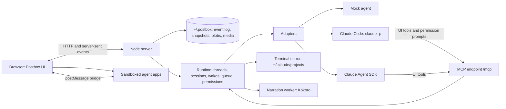

# Postbox

A chat room for directing several AI agents at once. You message them, wake them when needed, and each one can reply with software it writes on the spot (an explainer, a data explorer, a review surface) that runs live in the conversation.


## Status

- **Stage 1, mockups: done.** The approved design is in [`mockups/`](mockups/), and the reasoning is in [designs/intent.md](designs/intent.md).
- **Stage 2, the app: done.** It runs offline with a mock agent that can show every block type and every error state.
- **Stage 3, real agents: done.** Agents run on Claude Code or the Claude Agent SDK, ask before risky tool calls, and can be attached from a terminal session. Agent apps can read aloud with a local voice. Linting, type checks and accessibility checks run in CI. The engineering decisions are in [designs/architecture.md](designs/architecture.md). The practices every change is held to, and the gate, are in [designs/engineering-practices.md](designs/engineering-practices.md).

## Run it

Postbox needs Node 22 or later. It runs with no dependencies at all. From a clone:

```bash
npm start
```

**As a package.** Postbox isn’t published to npm yet, so pack it from a clone and install the file it makes, which gives you a `postbox` command:

```bash
npm pack
```

```bash
npm install -g ./postbox-<version>.tgz
```

```bash
postbox
```

A global install brings the optional packages too (the Agent SDK and Kokoro, several hundred MB); add `--omit=optional` to a project install to leave them out. `postbox --help` lists its flags: `--port`, `--data`, `--fresh`, `--demo` and `--move-data`. The package holds only what runs (`bin/`, `app/`, `server/` and `shared/`), and its build line under **Personas** shows the commit it was packed from. Upgrading or uninstalling it leaves your conversations alone, since they’re in `~/.postbox`, not in the package.

Open <http://127.0.0.1:4173/>. Postbox listens only on this machine. Your conversations are kept in `~/.postbox` as an event log, so they survive a restart and an upgrade. Set `POSTBOX_HOME` to keep them somewhere else, or pass `--data <folder>` for one run. Add `--fresh` to start over.

**A clone that ran an earlier version.** Earlier versions kept everything in the clone’s `data/` folder. A clone whose `data/` has conversations keeps using it, unless `POSTBOX_HOME` is set, and says so when it starts. To move it to `~/.postbox`, stop Postbox and run `npm start -- --move-data`: it moves the folder and leaves a link in its place, so paths your conversations recorded still work. An agent that works in its own workspace folder starts a new Claude Code session on its next turn, since its folder moved; its conversation in Postbox stays. Postbox never moves it without being asked.

One Postbox runs on a data folder at a time: a second one on the same folder refuses to start, and says which process has it.

A project’s own Postbox data, such as the datasets agents load, goes in the project, under `<project>/.postbox/`.

A fresh install starts with three general-purpose agents and no projects or conversations: @researcher finds and cites sources, @developer changes code and verifies it, and @critic reviews code and documents. Their instructions are in [`server/personas/`](server/personas/). Make a project for a folder you work in, start a conversation with any of them, and add agents of your own from **New agent**. They run on Claude Code if it’s installed and signed in (`claude --version` works), and on the mock otherwise. Agents from an earlier run keep their backend; change it under **Personas**, in **Runs on**.

To start with agents of your own instead, put an `agents.json` in the data folder before the first run: an array of personas such as `[{ "handle": "reviewer", "description": "Reviews my drafts.", "instructions": "…" }]`. It replaces the seeded agents, with or without `--demo`.

`--demo` seeds the demo’s book-corpus agents (@librarian, @indexer, @researcher and @critic), two projects and the sample conversations below, and always uses the mock, for the scripted tour. To use the Agent SDK, read aloud and run the development checks, install the optional packages once:

```bash
npm install
```

To watch the demo, which plays every block type and every error state on the mock (it starts its own Postbox in demo mode), run this and open the same address:

```bash
node tools/demo.mjs
```

Keep the page open while it plays: agent-written apps are checked in your browser before they’re shown.

Things to try in the demo’s conversations (`node server/index.mjs --demo --fresh --data data/demo`, which keeps them apart from your own):

| Conversation | Ask | You’ll see |
|---|---|---|
| Corpus explorer | Build me an explorer for my corpus | An agent-written app searching six books, and a v2 after you send passages |
| Catalog tour | Show me every kind of block you can send | One of each catalog block, all live |
| ReAct, step by step | Explain ReAct with something I can try · Walk me through ReAct, out loud · then **Reply in thread** under the explainer | Citations with hover cards, a diagram, math, a glossary term and a practice app · slides that follow a local voice · a topic thread with a forked agent, and Summarize back |
| Corpus schema spec | Review my corpus schema line by line | Markdown, code and app reviews, then a revision shown as a diff |
| Index the shelf | Index the shelf · Rebuild without the prefaces · Show it as a timeline · Show me the shelf map · Show me a dashboard · Clear the old index cache · Draw the whole indexing pipeline | Progress, subagents and a compaction · a failed reply with Retry · blocks Postbox can’t show · a crashed app · an app that fails its check and gets fixed · a permission card · a diagram too wide to read, flagged by the diagram linter and redrawn |
| Corpus planning | @indexer check the editions with the researcher, in a loop | Agents waking each other in a side thread until the limit asks you |
| Citation fixes | Fix the citation script · then Try a faster parser · then **Work** in the top bar, and its full-screen icon | Every file the agent changed with its diff and a copy from before, flagged changes, the commands as they ran, an issue it filed, and a turn that left nothing lasting |

## Conversations and threads

The **Postbox** menu in the top bar goes to any project, from anywhere, and Postbox opens on the conversation you were last in. In a project, the rail lists its **conversations**: direct messages with one agent, and rooms with several (**+** beside Rooms starts one with two or more agents). Each agent in a conversation has one session, and everything said there is shared: each turn starts with what the agent missed since its last one, so an agent you bring into a room knows what was discussed. ⌘\ hides the sidebar. The **⋯** beside a conversation’s title renames it, adds an agent, or deletes it, with 10 seconds of Undo.

Any message can start a **topic thread**, as in Slack: choose **Reply in thread** under it. The thread opens in the panel beside the conversation, and its agent is a fork of the agent’s session at that message. It remembers the conversation up to there, and the conversation never sees the thread. That’s the point: you decide what each agent keeps in its context. To bring something back, choose **Send to conversation** under a reply, or **Summarize back** to have the thread’s agent post a short summary. The conversation’s agents read it at the start of their next turn. The rail’s **Threads** entry lists a project’s topic threads.

## Work

Each conversation has a **Work** view, opened with **Work** in the top bar: everything its agents’ work touched, and what it took ([#132](https://github.com/HJeon139/postbox/issues/132)). It covers every session in the conversation, side and topic threads included, so you never have to ask an agent to recount what it did.

- **Files** each agent’s edits changed, each with its diff, its lines added and deleted, and where it stands in git: uncommitted, committed or pushed. Lines are counted from the diff against the file before the agents’ first change, so five edits that end where they began count as nothing. A change outside the project, or to a file that existed before and git doesn’t track, is flagged. Postbox keeps a copy of each file from before, so **Restore** can put it back.
- **Version control:** branches made, commits with their files and lines from git, and pushes.
- **Outside Postbox:** issues, pull requests and comments written with `gh` or a connector, with links.
- **Commands** exactly as they ran, with their exit, duration and all their output, background commands included.
- **Effort:** turns, wall time, tool calls, tokens and spend, by agent, with what they produced, and the turns that left nothing lasting.

It opens in the right pane, beside a thread if one is open, in a compact form: what needs review, files by where they stand, commands and how many failed, what was written outside Postbox, spend, and each turn’s line. Its full-screen icon shows all of the above over the whole window, as a thread’s does for the thread. Under each reply, a line such as “3 files +40 −12 · 2 commands · $0.31” opens the pane at that turn. It’s built from the turn’s tool calls; changes a command makes, such as a formatter’s, aren’t seen. Git is only read, without its optional locks, so an agent’s own git never waits on Postbox.

## How it fits together



- **No front-end framework and no build step.** It’s plain HTML, one stylesheet ([`app/workbench.css`](app/workbench.css)) and native ES modules.
- **Agents never send HTML to Postbox itself.** A reply is Markdown plus blocks from a fixed catalog that Postbox validates and renders with its own code. Anything richer is an agent-written app that runs in a sandboxed iframe with no network access.
- **Everything is a numbered event.** The browser loads the state once, then applies events from a server-sent event stream with the same reducer the server uses ([`shared/state.mjs`](shared/state.mjs)). After a dropped connection it resumes from the last number it saw, so nothing is lost or applied twice.

## The block catalog

A block is JSON naming one component. Agents send it with the `show_block` tool. Every block has these fields:

| Field | Required | Notes |
|---|---|---|
| `id` | Yes | Letters, digits and `- _ . :`. Sending the same id with `update_block` replaces the block; one that asks again (a choice, form, confirm or review) moves to the newest point, with a line where it was. An id names one block of its agent’s in a conversation, so `show_block` refuses an id that agent already showed there. |
| `type` | Yes | One of the components below. |
| `version` | Yes | The component version. This app reads version 1 of each. |
| `title` | No | Up to 200 characters. |
| `fallback` | Yes | Plain text shown if the block can’t be rendered. Write it so the person can still answer in the chat. |

Every block is validated before it’s shown ([`shared/catalog.mjs`](shared/catalog.mjs)). An unknown type, a newer version, a missing field or a misspelled field gets the fallback text and a collapsed **Show the raw block**. It never fails silently and never breaks the transcript. Objects are strict, so an unknown field is an error.

| Component | Fields | Your action → the event’s `action` and `values` |
|---|---|---|
| `choice` | `options: [{ id, label }]` (1–24), `prompt?`, `multiple?`, `max?`, `other?: { label, placeholder? }`, `display?: chips \| buttons`, `submitLabel?` | `choose` → `{ selected: [ids], other? }` |
| `form` | `fields: [{ id, label, kind: text \| longtext \| number \| select \| toggle \| date, required?, placeholder?, help?, min?, max?, step?, maxLength?, options?, default? }]`, `prompt?`, `submitLabel?` | `submit` → `{ [fieldId]: value }`, already checked: numbers are numbers, dates are `YYYY-MM-DD`, selects are option ids |
| `table` | `columns: [{ id, label, kind?: text \| number, sortable? }]`, `rows: [{ id, cells: { [columnId]: value } }]` (up to 5,000), `rowAction?: { id, label }` | `<rowAction.id>` → `{ rowId }` |
| `progress` | `steps: [{ id, label, state: pending \| running \| done \| failed, detail?, duration? }]` | None. Move it on with `update_block`. |
| `card` | `body?`, `facts?: [{ label, value }]`, `actions?: [{ id, label }]` (up to 3) | `<action.id>` → `{}` |
| `confirm` | `statement` (say exactly what will happen), `confirmLabel`, `cancelLabel?` | `confirm` or `cancel` → `{}` |
| `image` | `src` (https from an allowed origin), `alt` (required), `caption?`, `width?`, `height?` | None |
| `code` | `code`, `language?`, `filename?` | None. A Copy button is built in. |
| `review` | `format: markdown \| code \| app`, `content` (markdown and code), `appId` (app), `previous?` (shows a diff; Postbox counts revisions), `threads?: [{ id, line? \| anchor?, status: open \| resolved, comments: [{ author, text }] }]`, `language?`, `filename?` | `submit` → `{ verdict: comment \| approve \| request_changes, comments: [{ line? \| anchor?, text }] }` |
| `app` | `code` (HTML with inline script and style), `permissions?: [tool names]` | Whatever the app sends (see below) |

Long text fields (`prompt`, `body`, `statement`, review content) are Markdown. Short labels are plain text.

**Answering.** A `choice`, `form`, `confirm` or `review` turns read-only once you answer, and shows what you chose. Only a new block, or an update to the same id, can ask again. An update that sets `outcome` (Markdown, up to 500 characters) on an answered `choice`, `form` or `confirm` doesn’t ask: it reports the result as a line under your answer, the block stays answered, and its agent doesn’t need you. Your action also appears in the transcript as a short line in your voice, such as “Chose: weekly · Monday 9:00”. Your answer is for the revision you saw: if the agent changed the block while you were answering, Postbox refuses the answer, keeps what you entered, and shows what changed, so you answer again. And an update over an answer the agent hasn’t read yet (it waits while the agent works), whether it asks again or sets `outcome`, is refused, so your answer stays and no result lands under it unread. An open asking block makes its agent **need you**: its ring pulses and you get a notification.

**Safety.** Markdown is rendered by [`shared/markdown.mjs`](shared/markdown.mjs), which escapes everything. Raw HTML is shown as text, links are checked and open in a new tab with `rel="noopener noreferrer"`, and nothing an agent sends becomes a tag, an attribute name or a style.

## The event shape

When you act in a block or an app, the agent receives one message:

```json
{ "kind": "event", "event": { "blockId": "start-book", "revision": 1, "action": "choose", "values": { "selected": ["walden"] } } }
```

The event is built and checked by [`shared/events.mjs`](shared/events.mjs) before it’s sent. `revision` is the revision of the block you answered: 1 when it’s shown, and one more with each `update_block`. Apps’ events have none. A form with mistakes doesn’t produce an event: you see a message under each field instead (“Enter a number from 5 to 200.”). These are all the messages an agent can receive:

| `kind` | When | Fields |
|---|---|---|
| `user` | You wrote to the agent | `text`, `attachments` |
| `event` | You acted in a block or an app | `event: { blockId, revision, action, values }` |
| `agent` | Another agent woke it | `from: "@handle"`, `text` |
| `wake` | A wake-up it scheduled | `note` |
| `app-check` | An app it wrote failed the pre-display check | `appId`, `problems: [{ code, message }]` |
| `lint` | Its reply used terms it never defined | `undefinedTerms: [{ term, key }]` |
| `notice` | Something Postbox wants it to know, such as a wake you didn’t allow | `text` |

## Agent-written apps

`show_app({ id, title, code, permissions })` shows an app inline at the thread’s full width. The app runs in an iframe whose page is served with the policy `sandbox allow-scripts`, so it gets an opaque origin and no same-origin access. (The policy is a response header rather than the iframe’s `sandbox` attribute, because some embedded browsers refuse frames with the attribute. Postbox’s bridge only answers frames with an opaque origin.) Its content-security policy allows its own inline code, the kit and bundled libraries, and nothing else: no fetch, no websockets, no forms, no nested frames. The page is served by [`server/sandbox.mjs`](server/sandbox.mjs).

Inside the sandbox, the kit ([`app/kit/kit.js`](app/kit/kit.js)) provides:

| Call | What it does |
|---|---|
| `postbox.ready` | Resolves to `{ state, theme, appId }` once Postbox says hello |
| `postbox.query(tool, args)` | Asks the host for data. It works only for tools in the app’s `permissions` that its agent also holds, such as `corpus.search`, `corpus.read` and `corpus.stats`. |
| `postbox.file(name)` | A data file the agent attached to this version with `files`, as text (#54). |
| `postbox.send(action, values, summary)` | Sends one event to the agent. `summary` is the line you see in your voice. |
| `postbox.saveState(obj)`, `postbox.restoreState()` | Saved state survives unloading, reloading and new versions |
| `postbox.anchors({ name: element })` | Parts you can pin review comments to |
| `postbox.on('theme', fn)` | Light and dark tokens update by themselves; redraw canvas or D3 output here |
| `postbox.load('d3' \| 'katex' \| 'mermaid')` | Loads a bundled library |
| `postbox.charts.line / scatter / stacked / heatmap / table` | Charts built to the design rules, each with a Chart and Table view |
| `postbox.narration(el, passages, opts)` | A player that reads passages aloud with a local voice, with a transcript that follows along. Needs `narrate.speak`. |
| `postbox.narrate(text, opts)` | One clip, as `{ url, ms }` |

The stylesheet is preloaded, so apps use the same classes and tokens as Postbox, on the cool app stage.

**Images.** An app loads images from `data:` URLs, or from `/media/<name>`. That serves the media bundled with Postbox, then the `media/` folder in your data folder (`~/.postbox/media/`), where agents copy the images their apps show (PNG, JPEG, GIF, WebP, AVIF or SVG). Agents find it in `$POSTBOX_MEDIA`. Nothing an agent adds goes into Postbox’s own folder, which an upgrade replaces.

**The pre-display check.** Before you see an app, your browser loads it in two hidden frames, at 375 and 1280 px. It checks for:
- sideways overflow
- fields and buttons without labels
- images without alt text
- positive `tabindex`
- low-contrast text
- script errors

The first failure goes back to the agent as an `app-check` message. If the next version still fails, the app is shown with a note. A script error shows a “stopped working” card with Reload and Ask to fix.

**Lifecycle.** An app reloads from its saved state as you approach it, and unloads when it’s well off screen. A same-size placeholder keeps the transcript from jumping. A new version brings the app to the newest point in the conversation, beside the agent’s note about it, and leaves one line where it was that leads to it. It’s the same app, with its saved state, and older versions stay in its version menu.

## Run real agents

A persona runs on one of five backends. Pick one in the new-agent sheet, under **Backend**. Three of them can also run on another computer: see “Run agents on a remote host” below.

| Backend | What it runs | Needs |
|---|---|---|
| Claude Code | The `claude` CLI you’re signed in to, in print mode. Each thread is one Claude Code session, resumed every turn. | Claude Code installed (`claude --version` works), or `POSTBOX_CLAUDE_BIN` pointing at it |
| Agent SDK | `query()` from `@anthropic-ai/claude-agent-sdk`, inside Postbox’s server | `npm install` |
| Kiro CLI | The `kiro-cli` you’re signed in to, headless (`kiro-cli chat --agent-engine v3 --output-format stream-json`). Each thread is one Kiro session, resumed every turn. | Kiro CLI installed (`kiro-cli --version` works), or `POSTBOX_KIRO_BIN` pointing at it |
| Antigravity CLI | The `agy` CLI you’re signed in to, headless (`agy --output-format stream-json --print`), with Gemini models. Each thread is one conversation, resumed every turn. | Antigravity CLI installed (`agy --version` works), or `POSTBOX_AGY_BIN` pointing at it |
| Codex | The `codex app-server` you’re signed in to. Postbox starts and resumes an app-server thread for each conversation. | Codex CLI installed (`codex --version` works) and signed in, or `POSTBOX_CODEX_BIN` pointing at it |
| Mock agent | The scripted agent the demo uses | Nothing |

Postbox never reads, stores or asks for an API key. The Claude backends use Claude Code’s own sign-in, or `ANTHROPIC_API_KEY` if your environment already sets it; the Kiro CLI uses its own sign-in, or `KIRO_API_KEY`; the Antigravity CLI uses its own sign-in. Postbox starts each backend only if it can run here; the server’s first lines list the ones it found. `POSTBOX_BACKENDS=mock` turns the real ones off.

**Model.** New agents use `claude-opus-5-5`. Any model name Claude Code accepts works; change it per persona under **Personas**.

**Permissions.** Each persona has one of four modes:

| Mode | The agent… |
|---|---|
| Auto (the default) | runs routine actions without asking: Claude Code’s safety classifier approves them. When it can’t decide, the agent asks you, the same way as Ask me. |
| Ask me | asks before it runs a command or changes a file. Postbox shows the exact command in a card in the thread, the agent needs you, and the tool call waits for **Allow** or **Don’t allow**. Stop answers no. |
| Accept edits | edits files in its folders freely, and asks before it runs commands |
| Run everything | never asks. Use it only in a folder you can lose. |

Postbox always passes the mode explicitly, so a default from your own Claude Code settings never changes it. A change to a persona’s mode, or to where it runs, reaches its conversations from their next turn.

**Folders.** An agent works in its project’s root folder, or in the folder its persona names, or, if neither is set, in `workspaces/<name>` in the data folder. If its persona names a folder, it can also read the project’s. Its permission mode decides what it may change. Postbox’s own tools (show_block and the rest) never ask; they only show things in the thread.

**The Kiro CLI.** Each turn, Postbox writes a Kiro custom agent with the guide as its prompt, Postbox’s MCP server and the persona’s rules, and removes it when the turn ends ([`server/adapters/kiro-cli.mjs`](server/adapters/kiro-cli.mjs)). What differs from Claude Code:
- **It can’t ask you.** A headless Kiro run treats every ask as a refusal, so there’s no permission card: a call that would need asking shows as a denied step. Ask me and Auto both mean Kiro’s defaults plus reads in the agent’s folders; Accept edits adds writes there; Run everything is `--trust-all-tools`, and unticked Tools stay denied. Claude Code rules (the permissions panel, Allow once) don’t apply.
- **Topic threads start fresh.** Kiro can’t fork a session, so an agent in a topic thread starts with the message the thread is about.
- **Your setup.** With **Uses your Kiro setup**, it runs with your Kiro home (`KIRO_HOME`, else `~/.kiro`): your steering, skills, settings and MCP servers load, and the turn’s agent file is written to its `agents` folder for the turn. Off, it runs with `kiro-home` in the data folder, and a deny rule turns off every MCP server but Postbox’s, including one a managed install adds to Kiro’s agent files by itself. A `.kiro` folder in the agent’s working folder loads either way.
- **Models** are Kiro’s (`kiro-cli chat --list-models`), and the model field suggests the ones your sign-in offers, Claude’s and others such as GPT and DeepSeek. Postbox’s names become Kiro’s: `claude-opus-5-5` runs as `claude-opus-5.5`.

**The Antigravity CLI.** agy has no flag for an MCP server or a system prompt, so each turn writes a plugin into the agent’s folder, `.agents/plugins/postbox/`, with Postbox’s MCP server and the guide as its rules, and removes it when the turn ends ([`server/adapters/antigravity-cli.mjs`](server/adapters/antigravity-cli.mjs)). In a git repository, that path goes in `.git/info/exclude`. Two Antigravity agents that share a folder take turns, since each turn’s plugin holds its own conversation. What differs from Claude Code:
- **One line in your agy settings.** Headless, agy refuses every tool call it would ask about, Postbox’s own included. So the first turn adds `mcp(postbox_postbox/*)` to `permissions.allow` in `~/.gemini/antigravity-cli/settings.json`, and keeps the rest of the file. Only Postbox’s plugin names that server, and it exists only while a turn runs.
- **It can’t ask you.** A call that would need asking shows as a denied step. agy ends the turn there, so Postbox resumes the conversation once for the agent to say what was refused and carry on. Ask me is agy’s default mode; Auto is `--mode auto`, agy’s sandbox and safety check, where your account offers it (otherwise agy runs it as Ask me); Accept edits is `--mode accept-edits`; Run everything is `--dangerously-skip-permissions`. Claude Code rules don’t apply.
- **Tools are a request.** agy reads deny rules only from your own settings, which every agy session shares, so a persona’s unticked Tools can’t be turned off for one agent. The agent is told not to use them.
- **Always your setup.** agy reads its config from `~/.gemini` and has no setting to move it, so there’s no Isolated mode: your rules, skills, plugins and MCP servers load, as in your terminal.
- **Topic threads start fresh**, as on the Kiro CLI.
- **Models** are agy’s (`agy models`): Gemini’s, and others such as Claude and GPT-OSS. A persona that names no model runs `gemini-3.8-flash-high`. Effort is part of some model ids (`gemini-3.8-flash-low`), so it’s passed only to a model that takes it, such as `gemini-3.8-flash` (up to High).

**Codex.** Postbox uses the local `codex app-server` JSON-RPC protocol, with Codex’s own sign-in and configuration; it does not ask for an API key. It adds Postbox’s session-specific MCP endpoint to the Codex server, streams Codex text and tool activity, resumes each saved thread on the next turn, and forks topic threads from a completed-turn checkpoint. Stop sends `turn/interrupt` and then stops the child process if needed. Model suggestions come from app-server’s `model/list` catalog.

Codex permission modes map to its sandbox and approval policy: **Ask me** uses read-only, **Auto** and **Accept edits** use workspace-write with network access off and approvals on request, and **Run everything** uses full access with approvals disabled. Codex cannot distinguish Auto from Accept edits in this integration, so the UI says so. Its approval requests appear as Postbox permission cards. The Codex app-server does not honor Postbox’s per-agent Tools checklist or Claude Code permission rules; those controls are marked unavailable. Codex reads its usual local configuration, including any MCP servers already configured there.

**Attach a Claude Code session.** Choose **+**, then **Attach a Claude Code session**, to bring in one you started in a terminal. It joins as an agent working in that session’s folder, with its recent history. When you write to it, Postbox resumes that same session. When you type in the terminal, your turn and the agent’s reply appear in the thread, marked “from terminal”. Let a terminal turn finish before you write to it from Postbox.

**Your own adapter.** All model access goes through one interface, in [`server/adapters/adapter.mjs`](server/adapters/adapter.mjs):

```js
export class MyAdapter {
  name = 'my-backend';                      // a persona’s `backend` picks its adapter
  capabilities = { fork: false, permissions: 'none' }; // optional: topic threads start fresh; no Claude Code rules
  async deliver(session, message, ctx) {    // one turn; resolve when it ends, throw to fail it
    ctx.status({ state: 'think', ctx: 12 }); // ring state and % of context used
    ctx.activity({ id: 't1', label: 'Read schema.md', state: 'running' });
    ctx.text('Streaming **Markdown**…');     // reply text, in chunks
    const ok = await ctx.askPermission({ tool: 'Bash', summary: 'run a command', detail: 'npm test' });
    // Blocks, apps, glossary terms and wakes go through the UI tools:
    //   in-process: ctx.tools.show_block({ block }), or over MCP at ctx.mcpUrl
    if (ctx.signal.aborted) return;          // Stop aborts the signal
  }
}
```

The two real adapters share a system prompt that teaches the catalog, the kit and the [recipes](designs/recipes.md) ([`server/adapters/guide.mjs`](server/adapters/guide.mjs)), and a mapper from Claude Code’s stream to the turn context ([`server/adapters/claude-stream.mjs`](server/adapters/claude-stream.mjs)).

**MCP.** The UI tools are served over JSON-RPC 2.0 at `POST /mcp?session=<session id>&turn=<token>` ([`server/mcp.mjs`](server/mcp.mjs)). Postbox gives each turn it starts its own token, and a tool call without the running turn’s token is refused (#54), so only an agent turn Postbox started can call them, not a script that knows a session id. A large app goes by `codePath`, a file in the agent’s folder, and an app’s data files by `files`, which the app reads with `postbox.file(name)`. The tools:
- `show_block`, `update_block`, and `review_block`, which comments on another agent’s review block, line by line or on a selection, with a verdict; each comment becomes a thread on the draft, its agent hears them, and the block still waits on you (#133)
- `show_app`, `update_app`, and `retire_app`, which leaves an app that’s no longer needed as one line in its place, with a link to what replaced it and its versions (#193)
- `define_term`
- `propose_agent`
- `schedule_wake`, `wake_agent`
- `ask_for_tool`, which asks you on a card to turn on a tool that’s turned off for the agent
- `corpus_search`, and `add_dataset`, which loads a JSON Lines file from the project’s `.postbox/datasets/` folder into the corpus with no restart. A dataset is searched only when a search names it in `books`, and it’s loaded again after a restart (#47).
- `read_conversation`, the conversation’s history (each turn already starts with what happened since the agent’s last one). A block comes with what it holds: a review, card or code block’s content, a choice or form’s prompt, options or fields and your answer, an app’s title. Both cut an item at 2,000 characters, saying how much they kept and giving its id.
- `read_message`, one item in full by that id or a block’s id, 40,000 characters at a time
- `react`, a reaction on a message, block or app by its id, as you react (#270): the agent whose message it is hears it at its next turn, and calling it again takes it back
- `permission_prompt`, which Claude Code calls before a tool that needs your OK

Every tool except `permission_prompt` returns at once. When you answer a block, your answer arrives later as an `event` message.

## Run agents on a remote host

An agent’s turns can run on another computer you reach with `ssh`, such as a build machine or a cloud desktop, while Postbox stays on this one (#120). Only the agent’s process moves. The conversation, its cards, the store and Postbox’s API stay here, and Postbox drives the host over an `ssh` it starts itself. Nothing on the host reaches back: no port is opened or forwarded on either machine, and nothing there gets a route to Postbox on this computer. Claude Code, Kiro CLI and Codex can run on a host; the Agent SDK and the Antigravity CLI can’t. The design is in [designs/architecture.md](designs/architecture.md), “Remote hosts”.

**What the host needs**
- **Linux.** Postbox relies on `/proc`, the boot ID and, where logind ends processes at logout, systemd.
- **`ssh` from this computer with no prompt.** Postbox runs your own `ssh` with `BatchMode=yes`, which turns off password and host-key prompts ([ssh_config(5)](https://man.openbsd.org/ssh_config)), so it fails rather than wait. That means a key in your ssh agent or a valid certificate, and the host’s key already in your known hosts. Your `~/.ssh/config` still applies: aliases, `ProxyJump`, certificates and the user. To check, run `ssh -o BatchMode=yes host.example.com true` in a terminal: if it exits without asking anything, Postbox can connect.
- **Node 22 or later there.** Postbox looks on `PATH`, then under `~/.nvm`, `~/.local/share/mise` and `~/.volta`, then in `/usr/local/bin` and `/usr/bin`. For one anywhere else, set **Node’s path** in the host’s settings.
- **The harness, installed and signed in on the host** as your user: `claude` (2.1.187 or later, or 2.1.259 or later with denyPrompts on), `kiro-cli` or `codex`. Postbox looks on `PATH` and in the folders their installers use, such as `~/.local/bin`, and says where it looked when it finds none. Postbox never copies a credential to the host.
- **An ordinary user.** The daemon refuses to run as root.

**Set it up**
1. **Settings → Hosts → Add a host.** Type the SSH destination as you would after `ssh`: an alias from `~/.ssh/config`, a host name, or `user@host.example.com`.
2. **Install…** The confirm says what it writes outside Postbox’s folder, on both computers, and shows the commands `ssh` runs there:
   - Postbox’s host program (`server/remote/host/` and the `shared/` modules it imports) in `~/.postbox-remote/<version>/` on the host, readable only by you (folders `0700`, files `0600`, and the launcher `0700`), each checked against a SHA-256 manifest that comes in the same archive: that catches a broken copy, not a tampered one.
   - The daemon’s token in `~/.postbox-remote/token` there (`0600`), and a copy on this computer in `data/remote-tokens/<host id>` (`0600`), outside what the page reads.
   - With **Node’s path** set, a `node-path` file beside the code that names it.

   Nothing runs as root, and nothing outside `~/.postbox-remote` changes on the host. Postbox connects when a turn there needs it. From then on, the host’s card lists the Node and the harnesses its daemon found, each with its version and path, or where it looked.
3. **Edit settings → Project folders on this host.** Where each project’s agents work there: an absolute path. Left empty, an agent works in `~/postbox-work/<handle>` on the host.
4. **Runs on.** In a persona’s settings, or the new-agent sheet, pick the host under **Runs on**. Its agents run there from their next turn. Postbox refuses a host whose daemon didn’t find that persona’s CLI, and an agent can’t move while a turn of its runs.

**What you see**
- **Where it runs.** The agent’s row and its ring say where it runs and how the connection stands, such as “On host.example.com · Connected · last heard from 2 min ago”. The connection is Connected, Reconnecting, Disconnected (working) when a turn runs there while Postbox can’t reach it, or Disconnected (idle). A dead connection is dropped after about 45 seconds of missed keepalives. Postbox reconnects with backoff while a turn runs there or a prompt waits, and as soon as this computer wakes. The turn goes on on the host meanwhile, and what it wrote arrives on reconnect, each line once.
- **Permission cards** work as they do here. A prompt waits on the host, even while this computer sleeps, for up to the host’s permissionWaitMax, then it’s denied and the card says it expired.
- **Sign-in needed on host.example.com:** the harness’s sign-in on the host ran out (Postbox recognizes Claude Code’s). Sign in there, then press **Resume**. With a signInCheck set, Postbox resumes on its own once the check passes, and warns before a turn when it fails.
- **Interrupted on host.example.com:** the agent’s process there ended without finishing its turn, such as after a reboot. Postbox resumes on its own once the host is back, up to three times in a row, then waits for **Resume**. A resumed Claude Code turn continues the turn that was cut off, and every resumed turn starts with a line telling the agent why.
- **Hung:** “Stopped: no output for 15 min (the last at 14:02)”. A turn with no output for the host’s stallTimeout, no card open and, for Kiro, no tool call open, is stopped. Time while Postbox can’t reach the host doesn’t count.
- **Lost: Postbox can’t reach host.example.com, and the turn may still run there.** Postbox gave up reconnecting during a turn. It attaches to the turn again once the host is back.
- **Stop** goes through the host’s daemon, and the agent reads “Stopping on host.example.com” until the host confirms it. A remote turn’s Stop is always a plain stop: its background jobs stop with it, and when it has any, Stop says so before you press it.
- **A Postbox restart** doesn’t stop a remote turn. The new Postbox finds it running and replays it from the start, replacing the partial reply.
- **The Work view** records the commands, commits, pushes and effort a remote turn’s stream shows. Files on a host aren’t recorded, and it says so.
- **`!` commands** run on this computer, not the host, and their output says so.
- **Kiro CLI** takes its message as a command-line argument, so each remote Kiro turn shows a step saying other users on the host can read it, and a message over 128 KiB is refused before the turn starts.

**The settings worth knowing.** Each host’s **Edit settings** has the full list, with ranges.

| Setting | Default | What it does |
|---|---|---|
| stallTimeout (“Stop a quiet turn after”) | 15 min | How long a turn may go with no output before it’s stopped as hung. Raise it when tools or models stay quiet for longer |
| permissionWaitMax (“Longest wait for a permission answer”) | 24 h | How long a prompt waits on the host before it’s denied |
| denyPrompts | Off | On, Claude Code denies what it would ask about (`--permission-prompts none`) instead of waiting on a card, for unattended runs |
| signInCheck | None | A command that exits 0 while the host’s sign-in is good, one argument per line, run without a shell: such as `klist` and `-s`. With one, a turn stopped for its sign-in resumes once it passes; without one, the turn waits for you |
| idleTimeout (“Daemon’s idle time”) | 30 min | The daemon on the host exits after this long with no turn running and no Postbox connected. Postbox closes its own connection 2 minutes after nothing needs it |
| How turns detach | Own session, and a user scope | “Own session only” for a host without systemd |
| forwardAgent (“Forward your ssh agent”) | Off | Lets turns sign in to other machines with the keys in this computer’s ssh agent |

**Forwarding your ssh agent** doesn’t copy your private keys to the host. But while Postbox is connected, any process running as your user there, including the agent and the commands it runs, can use this computer’s ssh agent to sign in to other machines. So turn it on only for a host you trust that needs it. [ssh_config(5)](https://man.openbsd.org/ssh_config) says the same under ForwardAgent: “Agent forwarding should be enabled with caution. Users with the ability to bypass file permissions on the remote host (for the agent’s Unix-domain socket) can access the local agent through the forwarded connection. An attacker cannot obtain key material from the agent, however they can perform operations on the keys that enable them to authenticate using the identities loaded into the agent.” With **Use a connection of its own** off, Postbox’s session rides your existing shared connection. Agent forwarding still follows this setting for Postbox’s session, but any port forwards that connection opened stay open, and its host key was checked as you opened it.

**Lingering, on systemd hosts.** Where logind kills a user’s processes at logout (`KillUserProcesses`, which “defaults to yes”, per [logind.conf(5)](https://www.freedesktop.org/software/systemd/man/latest/logind.conf.html)), each turn also goes into a systemd user scope, and without lingering that scope ends at your last logout from the host. Postbox’s own connection is one of your sessions while it’s open. When lingering is off there, the host’s card warns, from the first connection, “Turns on host.example.com end when your last session there does” and gives the command, `loginctl enable-linger`, run on the host. Lingering keeps your user manager “around after logouts”, and with no argument it’s for the user who runs it ([loginctl(1)](https://www.freedesktop.org/software/systemd/man/latest/loginctl.html)).

**Remove.** On the host’s card, **Remove…**, then **Remove Postbox from host.example.com**. Postbox stops every turn still running there, has the daemon delete `~/.postbox-remote` on the host (its code, token, logs and turn records), and only then forgets the host here: its settings, its project folders and its token. If the host can’t be reached, doesn’t confirm, or a turn there won’t stop, nothing is forgotten and you can try again. Agents placed on it can’t start a turn until you pick another place for them. Each harness’s own sessions and sign-in on the host stay.

## Narration

Agent apps can read text aloud with `postbox.narration(el, passages)`, a player whose transcript follows the voice, or `postbox.narrate(text)` for one clip. The app needs the `narrate.speak` permission, and its agent the tool.

The voice is [Kokoro](https://github.com/hexgrad/kokoro) (via `kokoro-js`). It runs on this computer in a child process, so its native packages stay out of the server. The model, about 100 MB, downloads into `models/` in the data folder the first time anything is read aloud. After that, a passage takes a second or two, and the same text is never synthesized twice. See the narrated walkthrough in [designs/recipes.md](designs/recipes.md).

## Tests and tools

```bash
npm run check
```

That runs, in order:
- **Biome:** lint and formatting.
- **TypeScript:** types from JSDoc in `shared/` and `server/`, with no build.
- **Project rules:**
  - `lint-tokens`: no raw colors outside the token blocks
  - `lint-dom`: no unsafe HTML or agent-named attributes and styles
  - `lint-copy`: American spelling and curly quotes
- **Contrast:** every token pair in both modes.
- **Unit tests** (`npm test`): the `node:test` files in `tests/`. Each loads [`tests/guard.mjs`](tests/guard.mjs) first, which fails any test that touches the network or starts a process.
- **Integration tests** (`npm run test:integration`): the files in [`tests/integration/`](tests/integration/), which run the remote host’s programs as real local processes over pipes and Unix sockets, never the network. Where a test stands in for ssh, it runs the remote command on this machine with `/bin/sh -c` and a temporary home folder, so nothing touches your own `~/.postbox-remote`. A test that needs Linux (`/proc`, logind) skips elsewhere and says why.

They cover:
- the block validator, the Markdown renderer and the event builder
- mentions, finished-sentence announcements, URL checks and BM25 search
- the store: the event log, crash recovery, snapshots and blobs
- the runtime: queueing, Stop, failures and Retry, needs-you, the wake limit, side threads, topic threads with forked sessions, delete with undo, app permissions, the check-and-fix loop, permission cards and MCP
- both real adapters, replaying streams recorded from real Claude Code turns ([`tests/fixtures/claude-code/`](tests/fixtures/claude-code/))
- the work ledger: line counts against git’s, recorded turns that edit, commit, push and run background commands, where git says each change stands, and Restore
- the diagram linter, against text sizes measured in Chrome
- attaching and mirroring Claude Code sessions, narration, and the lint rules themselves
- remote hosts, in the integration tests: the install script and the `host` launcher; the daemon, the turn runner and the stdio shim; and a remote Claude Code turn through the whole pipeline, with only ssh replaced, across an ssh drop, a killed daemon, a Postbox restart, Stop, an expired prompt and an interrupted turn. Also the idle exit and Remove, after which nothing of Postbox’s own is left on the host (the agents’ working folders stay), and no TCP listener on either side during a turn

Continuous integration ([`.github/workflows/check.yml`](.github/workflows/check.yml)) runs the same check on every pull request, then plays the demo in headless Chrome and runs axe-core on every scene. It also checks that a pull request’s commit messages follow Conventional Commits, and that every change on main is released.

| Command | What it does |
|---|---|
| `postbox [--port 4173] [--data <folder>] [--fresh] [--demo]` | The same as `npm start` or `node server/index.mjs` in a clone. Runs Postbox, with its data in `~/.postbox` unless `POSTBOX_HOME` or `--data` says otherwise. A fresh install seeds three agents: @researcher, @developer and @critic. `--demo` seeds the demo’s agents, projects and conversations instead, enables the demo controls and uses the mock only. |
| `node tools/demo.mjs [--port] [--speed]` | Plays every block and error state on a fresh Postbox |
| `node tools/shoot-app.mjs [--baseline]` | Plays the demo in headless Chrome and screenshots every scene at 375 and 1280 px in both modes. axe-core checks the same scenes in `tests/browser/demo-a11y.spec.mjs` |
| `node tools/shoot.mjs [--baseline]` | Screenshots the static mockups |
| `node tools/contrast.mjs [css]` | Checks WCAG contrast for every token pair, in both modes and on the app stage (`app/workbench.css` unless you name another) |
| `npm run format` | Applies Biome’s formatting and safe fixes |
| `npm run test:integration` | Runs only the integration tests in `tests/integration/` |
| `npm run test:coverage` | Runs the tests with coverage for `shared/`, `server/` and the lint rules |
| `npm run release [-- --dry-run]` | Releases the next semantic version from the commits since the last tag: package.json, CHANGELOG.md, a release commit and a tag. CI runs it after each merge to main (`.github/workflows/release.yml`) |
| `npm run lint:commits [range]` | Checks commit messages against Conventional Commits |
| `npm run hooks` | Checks each commit message as you write it (`.githooks/commit-msg`) |

The demo’s screenshots go to `screenshots/latest/`, which git ignores, and aren’t committed. For the current ones, open the `screenshots` artifact of the latest `check` run on `main`, or run `node tools/shoot-app.mjs`.

## Versions

Postbox uses [semantic versioning](https://semver.org/), from [Conventional Commits](https://www.conventionalcommits.org/en/v1.0.0/): a breaking change moves the major version, a feature the minor version, and a fix the patch version. The sidebar shows the running build under Personas, as `vX.Y.Z · commit`. Each release is in [CHANGELOG.md](CHANGELOG.md), and the rules are in [designs/engineering-practices.md](designs/engineering-practices.md), “Commits and versions”.

## Known limits

- **Each open tab holds one connection.** Browsers allow 6 connections per host over HTTP/1.1, so with about six Postbox tabs open, new requests wait. Postbox closes its stream when a tab is put away, but it doesn’t yet share one stream across tabs.
- **The pre-display check is approximate.** It finds overflow, missing labels and alt text, positive tabindex, low contrast and script errors. It doesn’t yet detect every keyboard trap or verify that saved state restores correctly.
- **Semantic search is a stub.** It uses a small table of related words until your own index is connected. Lexical search (BM25) is real.
- **There’s no sign-in.** Postbox is for one person on one machine, and it refuses requests from other hosts and other sites.
- **An attached session has two writers.** If you write to it from Postbox while a terminal turn is still running, both resume the same session. Postbox can’t see that a terminal is busy.
- **Each Claude Code turn starts a new process.** Resuming a session adds a second or two before the first token. A long-lived process per session would remove it.
- **Kokoro’s dependencies have open advisories** (`sharp`, and `sprintf-js` through `onnxruntime-node`) with no fixed versions yet. They run only in the narration process, never in the server.
- **There’s no search across threads yet.**
- **Remote hosts are Linux only.** Postbox needs a Linux host with `/proc`, and relies on the boot ID there. It uses systemd only when **How turns detach** is left on its default (`detach` is `auto`) and logind kills user processes at logout; “Own session only” works without systemd.
- **A Kiro agent’s messages on a host can be read by other users there,** since Kiro CLI takes its message as an argument and `/proc` shows every process’s arguments unless it’s mounted with `hidepid=1` or higher; the default is `0` ([proc(5)](https://man7.org/linux/man-pages/man5/proc.5.html)). Postbox doesn’t check the mount, so it warns on every remote Kiro turn.
- **Files you attach for an agent on a host are limited to 3 MB each and 3.5 MB per message,** since they go to the host with the turn; a message over either is refused before the turn starts. The host’s copy is deleted when the turn ends, so a later turn can’t read it again: attach it again.
- **`add_dataset` isn’t available to an agent on a host.** It loads a file on this computer, which an agent there can’t name; the agent is told so.
- **A host you can’t reach can’t be forgotten yet.** Remove waits for the host to confirm it deleted `~/.postbox-remote`, and there’s no “forget it anyway”.
- **Only Claude Code’s sign-in expiry is recognized on a host.** A Kiro CLI or Codex turn whose sign-in there ran out fails as an ordinary error, not as Sign-in needed with Resume.
- **`!` commands run on this computer,** even in a conversation whose agent runs on a host.

## Repository layout

```text
app/          the browser app: index.html, workbench.css (the one stylesheet), js/ modules, kit/ for app sandboxes
server/       Node server, runtime, store, blobs, MCP, sandbox pages, corpus
  adapters/   mock, Claude Code, Agent SDK, the shared guide and stream mapper, the terminal mirror
  narration/  the Kokoro narrator and its worker process
  mock/       the mock agent’s apps
shared/       pure modules used by both sides: catalog, Markdown, events, state, BM25, text helpers
tests/        node:test suites, and fixtures recorded from real Claude Code turns
tools/        demo, screenshot tools, contrast checker, project lint rules, static server
designs/      product intent, architecture decisions, engineering practices, recipes and work prompts
mockups/      the approved Stage 1 mockups
screenshots/  generated pictures (git ignores them, but the README’s)
```

Third-party code shipped with the app is limited to the vendored libraries in `app/kit/vendor/` (Mermaid, KaTeX and D3, each with its license). The optional packages (the Agent SDK and Kokoro) and the development tools (Biome, TypeScript and axe-core) install with `npm install` and are never needed to run the mock. The books in `server/corpus/books/` are Project Gutenberg texts, kept with their license headers.

## License

[Apache License 2.0](LICENSE)
