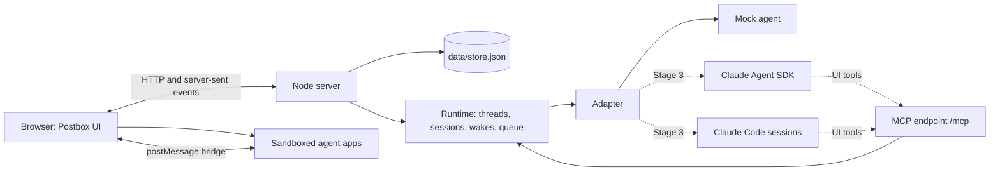

# Postbox

A chat room for directing several AI agents at once. You message them, wake them when needed, and each one can reply with software it writes on the spot (an explainer, a data explorer, a review surface) that runs live in the conversation.


## Status

- **Stage 1, mockups: done.** The approved design is in [`mockups/`](mockups/) and [`screenshots/`](screenshots/), and the reasoning is in [designs/intent.md](designs/intent.md).
- **Stage 2, the app: done.** It runs offline with a mock agent that can show every block type and every error state. Real models connect through one adapter interface and an MCP server.
- **Stage 3: next.** Adapters for the Claude Agent SDK and Claude Code sessions, and narration.

## Run it

Postbox needs Node 22 or later and nothing else: there are no dependencies to install and no build step.

```bash
node server/index.mjs
```

Open <http://127.0.0.1:4173/>. Postbox listens only on this machine. Your conversations are kept in `data/store.json`, so they survive a restart. Add `--fresh` to start over.

To watch the demo, which plays every block type and every error state, run this and open the same address:

```bash
node tools/demo.mjs
```

Keep the page open while it plays: agent-written apps are checked in your browser before they’re shown.

Things to try in a fresh Postbox:

| Thread | Ask | You’ll see |
|---|---|---|
| Corpus explorer | Build me an explorer for my corpus | An agent-written app searching six books, and a v2 after you send passages |
| Catalog tour | Show me every kind of block you can send | One of each catalog block, all live |
| ReAct, step by step | Explain ReAct with something I can try | Citations with hover cards, a diagram, math, a glossary term and a practice app |
| Corpus schema spec | Review my corpus schema line by line | Markdown, code and app reviews, then a revision shown as a diff |
| Index the shelf | Index the shelf · Rebuild without the prefaces · Show it as a timeline · Show me the shelf map · Show me a dashboard | Progress, subagents and a compaction · a failed reply with Retry · blocks Postbox can’t show · a crashed app · an app that fails its check and gets fixed |
| Corpus planning | @indexer check the editions with the researcher, in a loop | Agents waking each other in a side thread until the limit asks you |

## How it fits together



- **No front-end framework and no build step.** It’s plain HTML, one stylesheet ([`app/workbench.css`](app/workbench.css)) and native ES modules.
- **Agents never send HTML to Postbox itself.** A reply is Markdown plus blocks from a fixed catalog that Postbox validates and renders with its own code. Anything richer is an agent-written app that runs in a sandboxed iframe with no network access.
- **Everything is a numbered event.** The browser loads the state once, then applies events from a server-sent event stream with the same reducer the server uses ([`shared/state.mjs`](shared/state.mjs)). After a dropped connection it resumes from the last number it saw, so nothing is lost or applied twice.

## The block catalog

A block is JSON naming one component. Agents send it with the `show_block` tool. Every block has these fields:

| Field | Required | Notes |
|---|---|---|
| `id` | Yes | Letters, digits and `- _ . :`. Sending the same id with `update_block` replaces the block in place. |
| `type` | Yes | One of the components below. |
| `version` | Yes | The component version. This app reads version 1 of each. |
| `title` | No | Up to 200 characters. |
| `fallback` | Yes | Plain text shown if the block can’t be rendered. Write it so the person can still answer in the chat. |

Every block is validated before it’s shown ([`shared/catalog.mjs`](shared/catalog.mjs)). An unknown type, a newer version, a missing field or a misspelled field gets the fallback text and a collapsed **Show the raw block**. It never fails silently and never breaks the transcript. Objects are strict, so an unknown field is an error.

| Component | Fields | Your action → the event’s `action` and `values` |
|---|---|---|
| `choice` | `options: [{ id, label }]` (1–24), `prompt?`, `multiple?`, `max?`, `other?: { label, placeholder? }`, `display?: chips \| buttons`, `submitLabel?` | `choose` → `{ selected: [ids], other? }` |
| `form` | `fields: [{ id, label, kind: text \| longtext \| number \| select \| toggle \| date, required?, placeholder?, help?, min?, max?, step?, maxLength?, options?, default? }]`, `prompt?`, `submitLabel?` | `submit` → `{ [fieldId]: value }`, already checked: numbers are numbers, dates are `YYYY-MM-DD`, selects are option ids |
| `table` | `columns: [{ id, label, kind?: text \| number, sortable? }]`, `rows: [{ id, cells: { [columnId]: value } }]` (up to 5,000), `rowAction?: { id, label }` | `<rowAction.id>` → `{ rowId }` |
| `progress` | `steps: [{ id, label, state: pending \| running \| done \| failed, detail?, duration? }]` | None. Move it on with `update_block`. |
| `card` | `body?`, `facts?: [{ label, value }]`, `actions?: [{ id, label }]` (up to 3) | `<action.id>` → `{}` |
| `confirm` | `statement` (say exactly what will happen), `confirmLabel`, `cancelLabel?` | `confirm` or `cancel` → `{}` |
| `image` | `src` (https from an allowed origin), `alt` (required), `caption?`, `width?`, `height?` | None |
| `code` | `code`, `language?`, `filename?` | None. A Copy button is built in. |
| `review` | `format: markdown \| code \| app`, `content` (markdown and code), `appId` (app), `previous?` (shows a diff), `revision?`, `threads?: [{ id, line? \| anchor?, status: open \| resolved, comments: [{ author, text }] }]`, `language?`, `filename?` | `submit` → `{ verdict: comment \| approve \| request_changes, comments: [{ line? \| anchor?, text }] }` |
| `app` | `code` (HTML with inline script and style), `permissions?: [tool names]` | Whatever the app sends (see below) |

Long text fields (`prompt`, `body`, `statement`, review content) are Markdown. Short labels are plain text.

**Answering.** A `choice`, `form`, `confirm` or `review` turns read-only once you answer, and shows what you chose. Only a new block, or an update to the same id, can ask again. Your action also appears in the transcript as a short line in your voice, such as “Chose: weekly · Monday 9:00”. An open asking block makes its agent **need you**: its ring pulses and you get a notification.

**Safety.** Markdown is rendered by [`shared/markdown.mjs`](shared/markdown.mjs), which escapes everything. Raw HTML is shown as text, links are checked and open in a new tab with `rel="noopener noreferrer"`, and nothing an agent sends becomes a tag, an attribute name or a style.

## The event shape

When you act in a block or an app, the agent receives one message:

```json
{ "kind": "event", "event": { "blockId": "start-book", "action": "choose", "values": { "selected": ["walden"] } } }
```

The event is built and checked by [`shared/events.mjs`](shared/events.mjs) before it’s sent. A form with mistakes doesn’t produce an event: you see a message under each field instead (“Enter a number from 5 to 200.”). These are all the messages an agent can receive:

| `kind` | When | Fields |
|---|---|---|
| `user` | You wrote to the agent | `text`, `attachments` |
| `event` | You acted in a block or an app | `event: { blockId, action, values }` |
| `agent` | Another agent woke it | `from: "@handle"`, `text` |
| `wake` | A wake-up it scheduled | `note` |
| `app-check` | An app it wrote failed the pre-display check | `appId`, `problems: [{ code, message }]` |
| `lint` | Its reply used terms it never defined | `undefinedTerms: [{ term, key }]` |
| `notice` | Something Postbox wants it to know, such as a wake you didn’t allow | `text` |

## Agent-written apps

`show_app({ id, title, code, permissions })` shows an app inline at the thread’s full width. The app runs in `<iframe sandbox="allow-scripts">`, without same-origin access, so it gets an opaque origin. Its content-security policy allows its own inline code, the kit and bundled libraries, and nothing else: no fetch, no websockets, no forms, no nested frames. The page is served by [`server/sandbox.mjs`](server/sandbox.mjs).

Inside the sandbox, the kit ([`app/kit/kit.js`](app/kit/kit.js)) provides:

| Call | What it does |
|---|---|
| `postbox.ready` | Resolves to `{ state, theme, appId }` once Postbox says hello |
| `postbox.query(tool, args)` | Asks the host for data. It works only for tools in the app’s `permissions` that its agent also holds, such as `corpus.search`, `corpus.read` and `corpus.stats`. |
| `postbox.send(action, values, summary)` | Sends one event to the agent. `summary` is the line you see in your voice. |
| `postbox.saveState(obj)`, `postbox.restoreState()` | Saved state survives unloading, reloading and new versions |
| `postbox.anchors({ name: element })` | Parts you can pin review comments to |
| `postbox.on('theme', fn)` | Light and dark tokens update by themselves; redraw canvas or D3 output here |
| `postbox.load('d3' \| 'katex' \| 'mermaid')` | Loads a bundled library |
| `postbox.charts.line / scatter / stacked / heatmap / table` | Charts built to the design rules, each with a Chart and Table view |

The stylesheet is preloaded, so apps use the same classes and tokens as Postbox, on the cool app stage.

**The pre-display check.** Before you see an app, your browser loads it in two hidden frames, at 375 and 1280 px. It checks for:
- sideways overflow
- fields and buttons without labels
- images without alt text
- positive `tabindex`
- low-contrast text
- script errors

The first failure goes back to the agent as an `app-check` message. If the next version still fails, the app is shown with a note. A script error shows a “stopped working” card with Reload and Ask to fix.

**Lifecycle.** An app reloads from its saved state as you approach it, and unloads when it’s well off screen. A same-size placeholder keeps the transcript from jumping. A new version replaces the app in place, and older versions stay in its version menu.

## Plug in a real agent

All of Postbox’s model access goes through one interface, in [`server/adapters/adapter.mjs`](server/adapters/adapter.mjs):

```js
export class MyAdapter {
  name = 'agent-sdk';                       // a persona’s `backend` picks its adapter
  async deliver(session, message, ctx) {    // one turn; resolve when it ends, throw to fail it
    // message: one of the kinds above
    ctx.status({ state: 'think', ctx: 12 }); // ring state and % of context used
    ctx.activity({ id: 't1', label: 'read schema.md', state: 'running' });
    ctx.activity({ id: 't1', label: 'read schema.md', state: 'done', ms: 310 });
    ctx.text('Streaming **Markdown**…');     // reply text, in chunks
    // Blocks, apps, glossary terms and wakes go through the UI tools:
    //   in-process: ctx.tools.show_block({ block })
    //   or over MCP: the agent connects to ctx.mcpUrl
    if (ctx.signal.aborted) return;          // Stop aborts the signal
  }
}
```

Register it in [`server/index.mjs`](server/index.mjs) next to the mock (`new AdapterRegistry().register(new MockAdapter()).register(new MyAdapter())`). Then create a persona with that `backend`. You can do that in the UI, or seed it in `data/agents.json` before the first run; the seed uses the same fields as `DEFAULT_PERSONAS` in [`server/seed.mjs`](server/seed.mjs).

**MCP.** The UI tools are served over JSON-RPC 2.0 at `POST /mcp?session=<session id>` ([`server/mcp.mjs`](server/mcp.mjs)):
- `show_block`, `update_block`
- `show_app`, `update_app`
- `define_term`
- `propose_agent`
- `schedule_wake`, `wake_agent`
- `corpus_search`

Every tool returns at once and never blocks. When you answer, your answer arrives later as an `event` message. A Claude Code session can add Postbox as an MCP server with that URL, and an Agent SDK agent can list it in its MCP servers. Stage 3 wires both up automatically.

## Tests and tools

```bash
node --test tests/*.test.mjs
```

The 60 tests cover:
- the block validator, the Markdown renderer and the event builder
- mentions, finished-sentence announcements, URL checks and BM25 search
- the runtime: queueing, Stop, failures and Retry, needs-you, the wake limit, side threads, delete with undo, app permissions, the check-and-fix loop, and MCP

| Command | What it does |
|---|---|
| `node server/index.mjs [--port 4173] [--data ./data] [--fresh] [--demo]` | Runs Postbox. `--demo` enables the demo controls. |
| `node tools/demo.mjs [--port] [--speed]` | Plays every block and error state on a fresh Postbox |
| `node tools/shoot-app.mjs [--baseline]` | Plays the demo in headless Chrome and screenshots every scene at 375 and 1280 px in both modes, with the approved mockup beside each |
| `node tools/shoot.mjs [--baseline]` | Screenshots the static mockups |
| `node tools/contrast.mjs [css]` | Checks WCAG contrast for every token pair, in both modes and on the app stage |
| `node tools/serve.mjs` | Serves the repository statically, for the mockups |

`package.json` has the same commands as `npm run` scripts, with no dependencies. Approved screenshots live in `screenshots/` and `screenshots/app/`. Working retakes go to `screenshots/latest/`, which git ignores.

## Known limits

- **Each open tab holds one connection.** Browsers allow 6 connections per host over HTTP/1.1, so with about six Postbox tabs open, new requests wait. Postbox closes its stream when a tab is put away, but it doesn’t yet share one stream across tabs.
- **The pre-display check is approximate.** It finds overflow, missing labels and alt text, positive tabindex, low contrast and script errors. It doesn’t yet detect every keyboard trap or verify that saved state restores correctly.
- **Semantic search is a stub.** It uses a small table of related words until your own index is connected. Lexical search (BM25) is real.
- **There’s no sign-in.** Postbox is for one person on one machine, and it refuses requests from other hosts and other sites.
- **There’s no search across threads yet.**

## Repository layout

```text
app/          the browser app: index.html, workbench.css (the one stylesheet), js/ modules, kit/ for app sandboxes
server/       Node server, runtime, store, MCP, sandbox pages, adapters (mock), mock scripts and apps, corpus
shared/       pure modules used by both sides: catalog, Markdown, events, state, BM25, text helpers
tests/        node:test suites
tools/        demo, screenshot tools, contrast checker, static server
designs/      design intent and decisions
mockups/      the approved Stage 1 mockups
screenshots/  approved screenshots of the mockups and the app
```

Third-party code is limited to the vendored libraries in `app/kit/vendor/` (Mermaid, KaTeX and D3, each with its license). The books in `server/corpus/books/` are Project Gutenberg texts, kept with their license headers.

## License

[Apache License 2.0](LICENSE)
