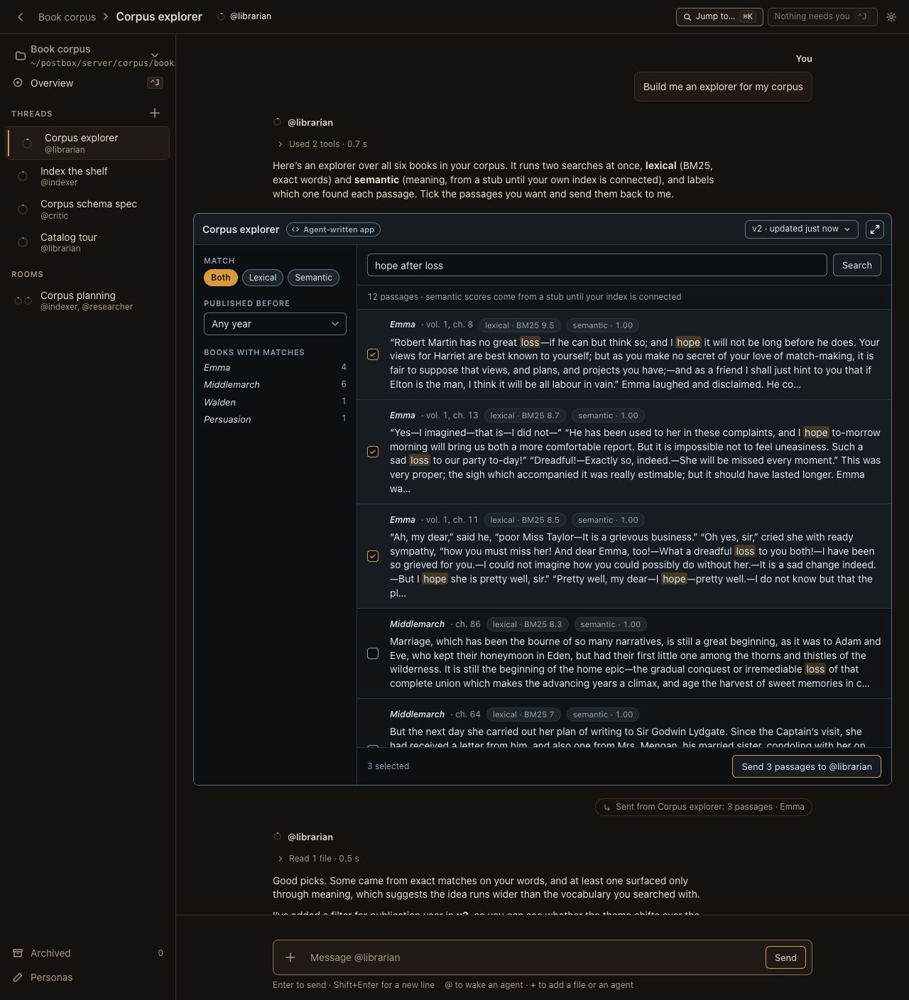
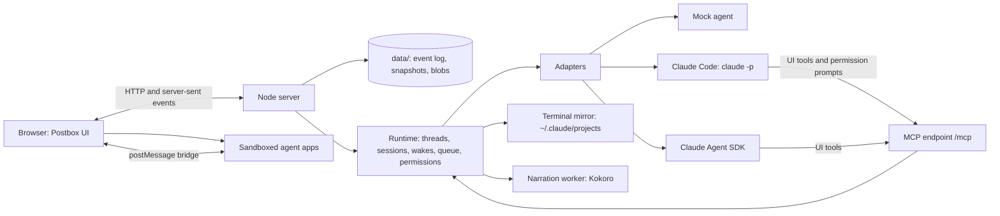

# Postbox

A chat room for directing several AI agents at once. You message them, wake them when needed, and each one can reply with software it writes on the spot (an explainer, a data explorer, a review surface) that runs live in the conversation.



## Status

- **Stage 1, mockups: done.** The approved design is in [`mockups/`](mockups/) and [`screenshots/`](screenshots/), and the reasoning is in [designs/intent.md](designs/intent.md).
- **Stage 2, the app: done.** It runs offline with a mock agent that can show every block type and every error state.
- **Stage 3, real agents: done.** Agents run on Claude Code or the Claude Agent SDK, ask before risky tool calls, and can be attached from a terminal session. Agent apps can read aloud with a local voice. Linting, type checks and accessibility checks run in CI. The engineering decisions are in [designs/architecture.md](designs/architecture.md).

## Run it

Postbox needs Node 22 or later. It runs with no dependencies at all:

```bash
node server/index.mjs
```

Open <http://127.0.0.1:4173/>. Postbox listens only on this machine. Your conversations are kept in `data/` as an event log, so they survive a restart. Add `--fresh` to start over.

On first run, the sample agents use Claude Code if it’s installed and signed in (`claude --version` works), and the mock otherwise. Agents from an earlier run keep their backend; change it under **Personas**, in **Runs on**. `--demo` always uses the mock, for the scripted tour. To use the Agent SDK, read aloud and run the development checks, install the optional packages once:

```bash
npm install
```

To watch the demo, which plays every block type and every error state on the mock (it starts its own Postbox in demo mode), run this and open the same address:

```bash
node tools/demo.mjs
```

Keep the page open while it plays: agent-written apps are checked in your browser before they’re shown.

Things to try in a fresh Postbox:

| Conversation | Ask | You’ll see |
|---|---|---|
| Corpus explorer | Build me an explorer for my corpus | An agent-written app searching six books, and a v2 after you send passages |
| Catalog tour | Show me every kind of block you can send | One of each catalog block, all live |
| ReAct, step by step | Explain ReAct with something I can try · Walk me through ReAct, out loud · then **Reply in thread** under the explainer | Citations with hover cards, a diagram, math, a glossary term and a practice app · slides that follow a local voice · a topic thread with a forked agent, and Summarize back |
| Corpus schema spec | Review my corpus schema line by line | Markdown, code and app reviews, then a revision shown as a diff |
| Index the shelf | Index the shelf · Rebuild without the prefaces · Show it as a timeline · Show me the shelf map · Show me a dashboard · Clear the old index cache · Draw the whole indexing pipeline | Progress, subagents and a compaction · a failed reply with Retry · blocks Postbox can’t show · a crashed app · an app that fails its check and gets fixed · a permission card · a diagram too wide to read, flagged by the diagram linter and redrawn |
| Corpus planning | @indexer check the editions with the researcher, in a loop | Agents waking each other in a side thread until the limit asks you |

## Conversations and threads

The **Postbox** menu in the top bar goes to the overview or any project, from anywhere. In a project, the rail lists its **conversations**: direct messages with one agent, and rooms with several (**+** beside Rooms starts one with two or more agents). Each agent in a conversation has one session, and everything said there is shared: each turn starts with what the agent missed since its last one, so an agent you bring into a room knows what was discussed. ⌘\ hides the sidebar. The **⋯** beside a conversation’s title renames it, adds an agent, or deletes it, with 10 seconds of Undo.

Any message can start a **topic thread**, as in Slack: choose **Reply in thread** under it. The thread opens in the panel beside the conversation, and its agent is a fork of the agent’s session at that message. It remembers the conversation up to there, and the conversation never sees the thread. That’s the point: you decide what each agent keeps in its context. To bring something back, choose **Send to conversation** under a reply, or **Summarize back** to have the thread’s agent post a short summary. The conversation’s agents read it at the start of their next turn. The rail’s **Threads** entry lists a project’s topic threads.

## How it fits together



- **No front-end framework and no build step.** It’s plain HTML, one stylesheet ([`app/workbench.css`](app/workbench.css)) and native ES modules.
- **Agents never send HTML to Postbox itself.** A reply is Markdown plus blocks from a fixed catalog that Postbox validates and renders with its own code. Anything richer is an agent-written app that runs in a sandboxed iframe with no network access.
- **Everything is a numbered event.** The browser loads the state once, then applies events from a server-sent event stream with the same reducer the server uses ([`shared/state.mjs`](shared/state.mjs)). After a dropped connection it resumes from the last number it saw, so nothing is lost or applied twice.

## The block catalog

A block is JSON naming one component. Agents send it with the `show_block` tool. Every block has these fields:

| Field | Required | Notes |
|---|---|---|
| `id` | Yes | Letters, digits and `- _ . :`. Sending the same id with `update_block` replaces the block in place. |
| `type` | Yes | One of the components below. |
| `version` | Yes | The component version. This app reads version 1 of each. |
| `title` | No | Up to 200 characters. |
| `fallback` | Yes | Plain text shown if the block can’t be rendered. Write it so the person can still answer in the chat. |

Every block is validated before it’s shown ([`shared/catalog.mjs`](shared/catalog.mjs)). An unknown type, a newer version, a missing field or a misspelled field gets the fallback text and a collapsed **Show the raw block**. It never fails silently and never breaks the transcript. Objects are strict, so an unknown field is an error.

| Component | Fields | Your action → the event’s `action` and `values` |
|---|---|---|
| `choice` | `options: [{ id, label }]` (1–24), `prompt?`, `multiple?`, `max?`, `other?: { label, placeholder? }`, `display?: chips \| buttons`, `submitLabel?` | `choose` → `{ selected: [ids], other? }` |
| `form` | `fields: [{ id, label, kind: text \| longtext \| number \| select \| toggle \| date, required?, placeholder?, help?, min?, max?, step?, maxLength?, options?, default? }]`, `prompt?`, `submitLabel?` | `submit` → `{ [fieldId]: value }`, already checked: numbers are numbers, dates are `YYYY-MM-DD`, selects are option ids |
| `table` | `columns: [{ id, label, kind?: text \| number, sortable? }]`, `rows: [{ id, cells: { [columnId]: value } }]` (up to 5,000), `rowAction?: { id, label }` | `<rowAction.id>` → `{ rowId }` |
| `progress` | `steps: [{ id, label, state: pending \| running \| done \| failed, detail?, duration? }]` | None. Move it on with `update_block`. |
| `card` | `body?`, `facts?: [{ label, value }]`, `actions?: [{ id, label }]` (up to 3) | `<action.id>` → `{}` |
| `confirm` | `statement` (say exactly what will happen), `confirmLabel`, `cancelLabel?` | `confirm` or `cancel` → `{}` |
| `image` | `src` (https from an allowed origin), `alt` (required), `caption?`, `width?`, `height?` | None |
| `code` | `code`, `language?`, `filename?` | None. A Copy button is built in. |
| `review` | `format: markdown \| code \| app`, `content` (markdown and code), `appId` (app), `previous?` (shows a diff), `revision?`, `threads?: [{ id, line? \| anchor?, status: open \| resolved, comments: [{ author, text }] }]`, `language?`, `filename?` | `submit` → `{ verdict: comment \| approve \| request_changes, comments: [{ line? \| anchor?, text }] }` |
| `app` | `code` (HTML with inline script and style), `permissions?: [tool names]` | Whatever the app sends (see below) |

Long text fields (`prompt`, `body`, `statement`, review content) are Markdown. Short labels are plain text.

**Answering.** A `choice`, `form`, `confirm` or `review` turns read-only once you answer, and shows what you chose. Only a new block, or an update to the same id, can ask again. Your action also appears in the transcript as a short line in your voice, such as “Chose: weekly · Monday 9:00”. An open asking block makes its agent **need you**: its ring pulses and you get a notification.

**Safety.** Markdown is rendered by [`shared/markdown.mjs`](shared/markdown.mjs), which escapes everything. Raw HTML is shown as text, links are checked and open in a new tab with `rel="noopener noreferrer"`, and nothing an agent sends becomes a tag, an attribute name or a style.

## The event shape

When you act in a block or an app, the agent receives one message:

```json
{ "kind": "event", "event": { "blockId": "start-book", "action": "choose", "values": { "selected": ["walden"] } } }
```

The event is built and checked by [`shared/events.mjs`](shared/events.mjs) before it’s sent. A form with mistakes doesn’t produce an event: you see a message under each field instead (“Enter a number from 5 to 200.”). These are all the messages an agent can receive:

| `kind` | When | Fields |
|---|---|---|
| `user` | You wrote to the agent | `text`, `attachments` |
| `event` | You acted in a block or an app | `event: { blockId, action, values }` |
| `agent` | Another agent woke it | `from: "@handle"`, `text` |
| `wake` | A wake-up it scheduled | `note` |
| `app-check` | An app it wrote failed the pre-display check | `appId`, `problems: [{ code, message }]` |
| `lint` | Its reply used terms it never defined | `undefinedTerms: [{ term, key }]` |
| `notice` | Something Postbox wants it to know, such as a wake you didn’t allow | `text` |

## Agent-written apps

`show_app({ id, title, code, permissions })` shows an app inline at the thread’s full width. The app runs in an iframe whose page is served with the policy `sandbox allow-scripts`, so it gets an opaque origin and no same-origin access. (The policy is a response header rather than the iframe’s `sandbox` attribute, because some embedded browsers refuse frames with the attribute. Postbox’s bridge only answers frames with an opaque origin.) Its content-security policy allows its own inline code, the kit and bundled libraries, and nothing else: no fetch, no websockets, no forms, no nested frames. The page is served by [`server/sandbox.mjs`](server/sandbox.mjs).

Inside the sandbox, the kit ([`app/kit/kit.js`](app/kit/kit.js)) provides:

| Call | What it does |
|---|---|
| `postbox.ready` | Resolves to `{ state, theme, appId }` once Postbox says hello |
| `postbox.query(tool, args)` | Asks the host for data. It works only for tools in the app’s `permissions` that its agent also holds, such as `corpus.search`, `corpus.read` and `corpus.stats`. |
| `postbox.send(action, values, summary)` | Sends one event to the agent. `summary` is the line you see in your voice. |
| `postbox.saveState(obj)`, `postbox.restoreState()` | Saved state survives unloading, reloading and new versions |
| `postbox.anchors({ name: element })` | Parts you can pin review comments to |
| `postbox.on('theme', fn)` | Light and dark tokens update by themselves; redraw canvas or D3 output here |
| `postbox.load('d3' \| 'katex' \| 'mermaid')` | Loads a bundled library |
| `postbox.charts.line / scatter / stacked / heatmap / table` | Charts built to the design rules, each with a Chart and Table view |
| `postbox.narration(el, passages, opts)` | A player that reads passages aloud with a local voice, with a transcript that follows along. Needs `narrate.speak`. |
| `postbox.narrate(text, opts)` | One clip, as `{ url, ms }` |

The stylesheet is preloaded, so apps use the same classes and tokens as Postbox, on the cool app stage.

**The pre-display check.** Before you see an app, your browser loads it in two hidden frames, at 375 and 1280 px. It checks for:
- sideways overflow
- fields and buttons without labels
- images without alt text
- positive `tabindex`
- low-contrast text
- script errors

The first failure goes back to the agent as an `app-check` message. If the next version still fails, the app is shown with a note. A script error shows a “stopped working” card with Reload and Ask to fix.

**Lifecycle.** An app reloads from its saved state as you approach it, and unloads when it’s well off screen. A same-size placeholder keeps the transcript from jumping. A new version replaces the app in place, and older versions stay in its version menu.

## Run real agents

A persona runs on one of three backends. Pick one in the new-agent sheet, under **Runs on**.

| Backend | What it runs | Needs |
|---|---|---|
| Claude Code | The `claude` CLI you’re signed in to, in print mode. Each thread is one Claude Code session, resumed every turn. | Claude Code installed (`claude --version` works), or `POSTBOX_CLAUDE_BIN` pointing at it |
| Agent SDK | `query()` from `@anthropic-ai/claude-agent-sdk`, inside Postbox’s server | `npm install` |
| Mock agent | The scripted agent the demo uses | Nothing |

Postbox never reads, stores or asks for an API key. Both real backends use Claude Code’s own sign-in, or `ANTHROPIC_API_KEY` if your environment already sets it. Postbox starts each backend only if it can run here; the server’s first lines list the ones it found. `POSTBOX_BACKENDS=mock` turns the real ones off.

**Model.** New agents use `claude-opus-5-5`. Any model name Claude Code accepts works; change it per persona under **Personas**.

**Permissions.** Each persona has one of four modes:

| Mode | The agent… |
|---|---|
| Auto (the default) | runs routine actions without asking: Claude Code’s safety classifier approves them. When it can’t decide, the agent asks you, the same way as Ask me. |
| Ask me | asks before it runs a command or changes a file. Postbox shows the exact command in a card in the thread, the agent needs you, and the tool call waits for **Allow** or **Don’t allow**. Stop answers no. |
| Accept edits | edits files in its folders freely, and asks before it runs commands |
| Run everything | never asks. Use it only in a folder you can lose. |

Postbox always passes the mode explicitly, so a default from your own Claude Code settings never changes it. A change to a persona’s mode, or to where it runs, reaches its conversations from their next turn.

**Folders.** An agent works in its project’s root folder, or in the folder its persona names, or, if neither is set, in `data/workspaces/<name>`. If its persona names a folder, it can also read the project’s. Its permission mode decides what it may change. Postbox’s own tools (show_block and the rest) never ask; they only show things in the thread.

**Attach a Claude Code session.** Choose **+**, then **Attach a Claude Code session**, to bring in one you started in a terminal. It joins as an agent working in that session’s folder, with its recent history. When you write to it, Postbox resumes that same session. When you type in the terminal, your turn and the agent’s reply appear in the thread, marked “from terminal”. Let a terminal turn finish before you write to it from Postbox.

**Your own adapter.** All model access goes through one interface, in [`server/adapters/adapter.mjs`](server/adapters/adapter.mjs):

```js
export class MyAdapter {
  name = 'my-backend';                      // a persona’s `backend` picks its adapter
  async deliver(session, message, ctx) {    // one turn; resolve when it ends, throw to fail it
    ctx.status({ state: 'think', ctx: 12 }); // ring state and % of context used
    ctx.activity({ id: 't1', label: 'Read schema.md', state: 'running' });
    ctx.text('Streaming **Markdown**…');     // reply text, in chunks
    const ok = await ctx.askPermission({ tool: 'Bash', summary: 'run a command', detail: 'npm test' });
    // Blocks, apps, glossary terms and wakes go through the UI tools:
    //   in-process: ctx.tools.show_block({ block }), or over MCP at ctx.mcpUrl
    if (ctx.signal.aborted) return;          // Stop aborts the signal
  }
}
```

The two real adapters share a system prompt that teaches the catalog, the kit and the [recipes](designs/recipes.md) ([`server/adapters/guide.mjs`](server/adapters/guide.mjs)), and a mapper from Claude Code’s stream to the turn context ([`server/adapters/claude-stream.mjs`](server/adapters/claude-stream.mjs)).

**MCP.** The UI tools are served over JSON-RPC 2.0 at `POST /mcp?session=<session id>` ([`server/mcp.mjs`](server/mcp.mjs)):
- `show_block`, `update_block`
- `show_app`, `update_app`
- `define_term`
- `propose_agent`
- `schedule_wake`, `wake_agent`
- `corpus_search`
- `read_conversation`, the conversation’s history (each turn already starts with what happened since the agent’s last one)
- `permission_prompt`, which Claude Code calls before a tool that needs your OK

Every tool except `permission_prompt` returns at once. When you answer a block, your answer arrives later as an `event` message.

## Narration

Agent apps can read text aloud with `postbox.narration(el, passages)`, a player whose transcript follows the voice, or `postbox.narrate(text)` for one clip. The app needs the `narrate.speak` permission, and its agent the tool.

The voice is [Kokoro](https://github.com/hexgrad/kokoro) (via `kokoro-js`). It runs on this computer in a child process, so its native packages stay out of the server. The model, about 100 MB, downloads into `data/models/` the first time anything is read aloud. After that, a passage takes a second or two, and the same text is never synthesized twice. See the narrated walkthrough in [designs/recipes.md](designs/recipes.md).

## Tests and tools

```bash
npm run check
```

That runs, in order:
- **Biome:** lint and formatting.
- **TypeScript:** types from JSDoc in `shared/` and `server/`, with no build.
- **Project rules:**
  - `lint-tokens`: no raw colors outside the token blocks
  - `lint-dom`: no unsafe HTML or agent-named attributes and styles
  - `lint-copy`: American spelling and curly quotes
- **Contrast:** every token pair in both modes.
- **Tests:** 127 `node:test` tests. Each file loads [`tests/guard.mjs`](tests/guard.mjs) first, which fails any test that touches the network or starts a process, so the suite runs in under a second.

They cover:
- the block validator, the Markdown renderer and the event builder
- mentions, finished-sentence announcements, URL checks and BM25 search
- the store: the event log, crash recovery, snapshots and blobs
- the runtime: queueing, Stop, failures and Retry, needs-you, the wake limit, side threads, topic threads with forked sessions, delete with undo, app permissions, the check-and-fix loop, permission cards and MCP
- both real adapters, replaying streams recorded from real Claude Code turns ([`tests/fixtures/claude-code/`](tests/fixtures/claude-code/))
- the diagram linter, against text sizes measured in Chrome
- attaching and mirroring Claude Code sessions, narration, and the lint rules themselves

Continuous integration ([`.github/workflows/check.yml`](.github/workflows/check.yml)) runs the same check on every pull request, then plays the demo in headless Chrome and runs axe-core on every scene.

| Command | What it does |
|---|---|
| `node server/index.mjs [--port 4173] [--data ./data] [--fresh] [--demo]` | Runs Postbox. `--demo` enables the demo controls and uses the mock only. |
| `node tools/demo.mjs [--port] [--speed]` | Plays every block and error state on a fresh Postbox |
| `node tools/shoot-app.mjs [--baseline]` | Plays the demo in headless Chrome, screenshots every scene at 375 and 1280 px in both modes, and checks each with axe-core (`AXE=0` skips it) |
| `node tools/shoot.mjs [--baseline]` | Screenshots the static mockups |
| `node tools/contrast.mjs [css]` | Checks WCAG contrast for every token pair, in both modes and on the app stage |
| `npm run format` | Applies Biome’s formatting and safe fixes |
| `npm run test:coverage` | Runs the tests with coverage for `shared/`, `server/` and the lint rules |

Approved screenshots live in `screenshots/` and `screenshots/app/`. Working retakes go to `screenshots/latest/`, which git ignores.

## Known limits

- **Each open tab holds one connection.** Browsers allow 6 connections per host over HTTP/1.1, so with about six Postbox tabs open, new requests wait. Postbox closes its stream when a tab is put away, but it doesn’t yet share one stream across tabs.
- **The pre-display check is approximate.** It finds overflow, missing labels and alt text, positive tabindex, low contrast and script errors. It doesn’t yet detect every keyboard trap or verify that saved state restores correctly.
- **Semantic search is a stub.** It uses a small table of related words until your own index is connected. Lexical search (BM25) is real.
- **There’s no sign-in.** Postbox is for one person on one machine, and it refuses requests from other hosts and other sites.
- **An attached session has two writers.** If you write to it from Postbox while a terminal turn is still running, both resume the same session. Postbox can’t see that a terminal is busy.
- **Each Claude Code turn starts a new process.** Resuming a session adds a second or two before the first token. A long-lived process per session would remove it.
- **Kokoro’s dependencies have open advisories** (`sharp`, and `sprintf-js` through `onnxruntime-node`) with no fixed versions yet. They run only in the narration process, never in the server.
- **There’s no search across threads yet.**

## Repository layout

```text
app/          the browser app: index.html, workbench.css (the one stylesheet), js/ modules, kit/ for app sandboxes
server/       Node server, runtime, store, blobs, MCP, sandbox pages, corpus
  adapters/   mock, Claude Code, Agent SDK, the shared guide and stream mapper, the terminal mirror
  narration/  the Kokoro narrator and its worker process
  mock/       the mock agent’s apps
shared/       pure modules used by both sides: catalog, Markdown, events, state, BM25, text helpers
tests/        node:test suites, and fixtures recorded from real Claude Code turns
tools/        demo, screenshot tools, contrast checker, project lint rules, static server
designs/      product intent, architecture decisions and recipes
mockups/      the approved Stage 1 mockups
screenshots/  approved screenshots of the mockups and the app
```

Third-party code shipped with the app is limited to the vendored libraries in `app/kit/vendor/` (Mermaid, KaTeX and D3, each with its license). The optional packages (the Agent SDK and Kokoro) and the development tools (Biome, TypeScript and axe-core) install with `npm install` and are never needed to run the mock. The books in `server/corpus/books/` are Project Gutenberg texts, kept with their license headers.

## License

[Apache License 2.0](LICENSE)
