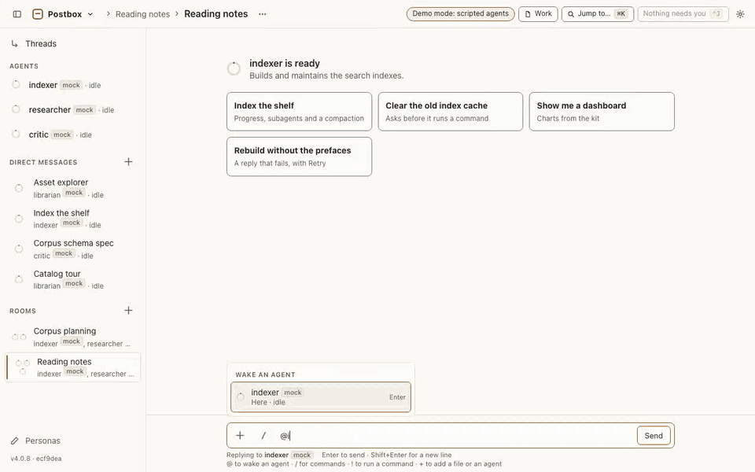
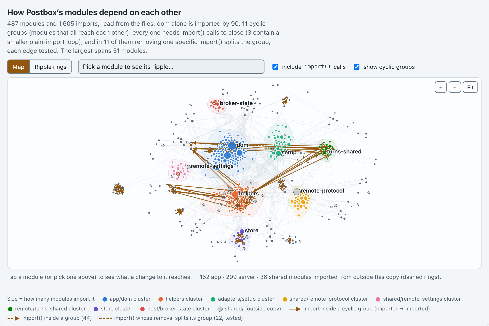
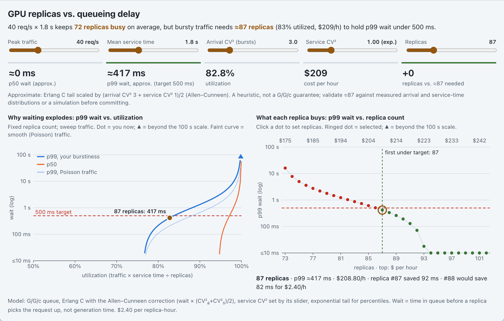

# Postbox

**Direct a small team of AI agents from one chat, on your own computer.**



A replay of a real session: you ask once, then @builder (Claude Code, `claude-opus-5-5`) answers with a live app, @critic (Codex, `gpt-6.1-sol`) pins comments to its parts, and @builder ships v2, all without another message from you. The review then waits for you to approve it. [How it was recorded](tools/demo/showcase/README.md).

[Quick start](#quick-start) · [Running Postbox](designs/running.md) · [Real agents](designs/backends.md) · [Remote hosts](designs/remote-hosts.md) · [Agent apps](designs/agent-apps.md)

## Why Postbox

- **One person, two to four agents.** Message them in direct messages and rooms, @-mention one to wake it, and each conversation keeps one session per agent, so what you said there is what it remembers.
- **Agents work together without waiting on you.** They wake each other, hand work across, and queue your next message while they’re busy. Postbox asks you only for decisions only you can make.
- **Agents answer with software.** Beside Markdown and a fixed catalog of blocks (choices, forms, reviews, charts, progress), an agent can write an app that runs live in the conversation, sandboxed, and checked before you see it.
- **See what they did.** The Work view lists every file changed with its diff, every command with its output, what was published outside Postbox, and what each turn cost.
- **Your agents, your harnesses.** Agents run on Claude Code, the Claude Agent SDK, Codex, the Kiro CLI or the Antigravity CLI, with the sign-in you already have. Postbox never asks for an API key.
- **Start work on a host, come back when it’s done.** An agent’s turns can run on a machine you reach with `ssh` while Postbox stays here, and keep running when your laptop sleeps.

Two more apps from the recorded sessions, each @builder’s v2 after @critic’s review: Postbox’s own module graph, computed from its imports, and a GPU capacity plan you can drive:





## Quick start

Postbox needs Node 22 or later, and no other dependencies.

```bash
git clone https://github.com/HJeon139/postbox.git && cd postbox
npm start -- --demo --fresh --data ~/postbox-demo
```

Open <http://127.0.0.1:4173/>. The demo’s agents are scripted, so you can try every feature with no agent account. Run `npm start` alone to work with real agents: they run on Claude Code when it’s installed and signed in.

## Learn more

- [**Running Postbox**](designs/running.md): installing the package, flags, the data folder, settings, upgrades and known limits.
- [**Conversations, threads and Work**](designs/conversations.md): how you talk to agents, and see what they did.
- [**Run real agents**](designs/backends.md): the five backends, permission modes, and your own adapter.
- [**Remote hosts**](designs/remote-hosts.md): setting up a host and working with agents there.
- [**Agent apps and the block catalog**](designs/agent-apps.md): what agents send, and how their apps run.
- [**Tests, tools and the repository**](designs/tests-and-tools.md): the gate and the tools.
- [**Design intent**](designs/intent.md) and [**architecture**](designs/architecture.md): why it works the way it does.
- [**Contributing**](CONTRIBUTING.md), [**security**](SECURITY.md) and the [**changelog**](CHANGELOG.md).

## License

[Apache License 2.0](LICENSE)
