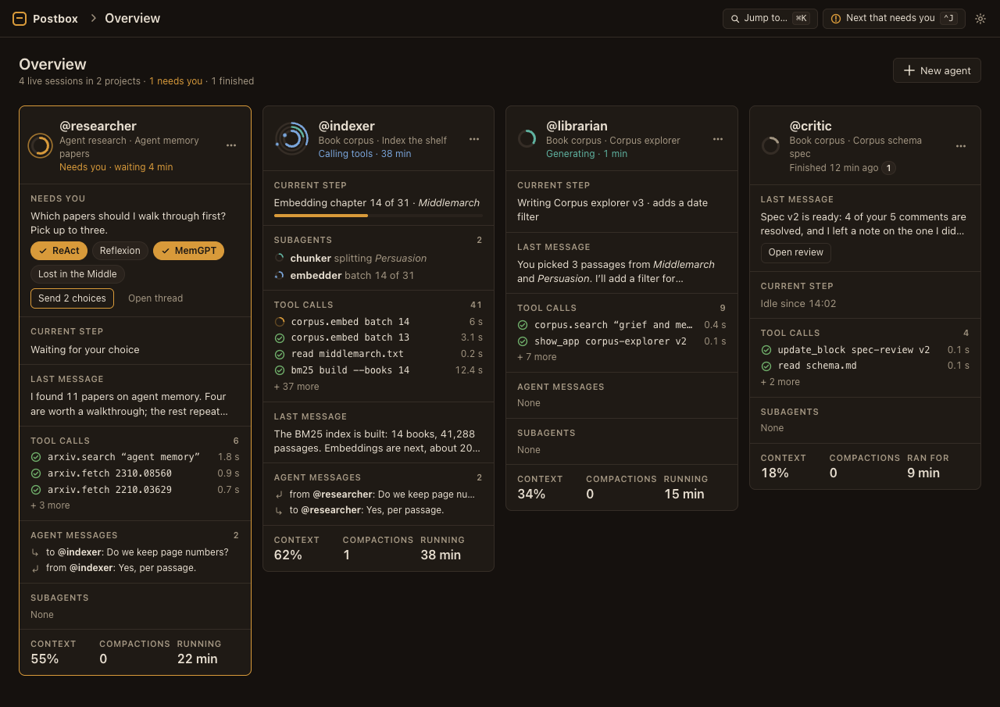
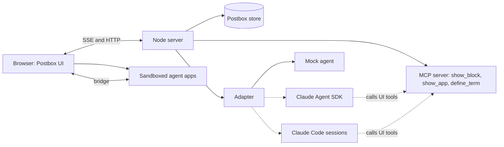

# Postbox

A chat room for directing several AI agents at once. You message them, wake them when needed, and each one can reply with software it writes on the spot (an explainer, a data explorer, a review surface) that runs live in the conversation.



## Status

**Stage 1, mockups: done.** Static pages show every screen, state and color token in light and dark modes, at phone and desktop widths. They are the reference for the build.

**Stage 2, the app: next.** It will be a working app with a mock agent that runs offline, an MCP server for the UI tools, and one adapter interface where a real model connects. Adapters for the Claude Agent SDK and Claude Code come after that.

The reasoning behind the design is in [designs/intent.md](designs/intent.md).

## Look at the mockups

The mockups use ES modules, so they need a local server rather than `file://`. With Node 22 or later:

```bash
node tools/serve.mjs
```

Then open <http://127.0.0.1:4173/mockups/>. Add `?theme=light` or `?theme=dark` to any page; without it, pages follow your system setting.

| Page | Shows |
|---|---|
| [Palette](mockups/00-palette.html) | Every color token with live contrast ratios, the agent-app stage, and the status rings |
| [Overview](mockups/01-overview.html) | One column per live session; one blocked, one finished |
| [Conversation](mockups/03-thread.html) | Two agents, a streaming reply, the activity line, compaction, a queued message |
| [Corpus explorer](mockups/04-corpus-app.html) | An agent-written app running inline |
| [Explainer](mockups/05-explainer.html) | Citations, glossary terms, a diagram, math and a practice exercise |
| [Block catalog](mockups/06-catalog.html) | Every catalog block, plus one already answered |
| [Review](mockups/07-review.html) | Line-by-line comments on Markdown, code and an app, then the diff |
| [Chart kit](mockups/14-charts.html) | Line, area, scatter, stacked bar, heatmap, diverging bar and stat tiles |

The [mockup index](mockups/index.html) lists all 15 pages. Screenshots of every page, in both modes and at 375 and 1280 px, are in [`screenshots/`](screenshots/). The review sheets in `screenshots/sheets/` put all four versions of a page side by side.

## How it fits together



- **No front-end framework and no build step.** It’s plain HTML, one stylesheet and native ES modules.
- **The server needs only Node.** It serves the app, streams over server-sent events, and keeps the conversation in Postbox’s own store.
- **Agents never send HTML.** A message is Markdown plus blocks from a fixed catalog that Postbox validates and renders. Anything richer is an agent-written app that runs in a sandboxed iframe with no network access. It reaches data only through a narrow bridge.
- **One MCP server exposes the UI tools to every backend.** The tools return at once. When you act on a block, your answer reaches the agent as a new message: `{ blockId, action, values }`.

## Tools

| Command | What it does |
|---|---|
| `node tools/serve.mjs [port]` | Serves the repository at `http://127.0.0.1:4173/` |
| `node tools/contrast.mjs` | Checks the WCAG contrast of every token pair in both modes; exits non-zero on a failure |
| `node tools/shoot.mjs [page …]` | Screenshots each mockup at 375 and 1280 px in both modes with headless Chrome, and builds the review sheets. Set `CHROME` to point at Chrome if it isn’t in the default macOS location. |

None of them have dependencies beyond Node.

## Repository layout

```text
designs/      design intent and decisions
mockups/      Stage 1 pages, workbench.css (all tokens), mock.js (rings and rail)
screenshots/  every page at 375 and 1280 px, dark and light, plus review sheets
tools/        server, contrast checker, screenshot script
```

## License

[Apache License 2.0](LICENSE)
