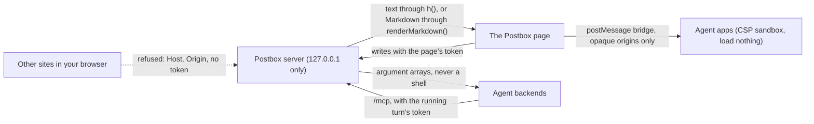

# Security

Postbox runs on your own computer, as you, for one person. It directs AI agents that can read and change your files, so what keeps it safe is a small set of boundaries. This page says what they are, how to report a hole in one, and how the repository keeps new holes out.

## Reporting a vulnerability

Report it privately, through GitHub’s [private vulnerability reporting](https://github.com/HJeon139/postbox/security/advisories/new). Don’t open a public issue, pull request or discussion for it.

Include:
- the version (the sidebar shows it under Personas as `vX.Y.Z · commit`), your OS and the backend involved
- what an attacker needs: a web page you visit, an agent’s output, a file in your project, or access to your computer
- the steps to reproduce it, and what happened compared with what should have

You’ll get an answer in the advisory. Once a fix is released, the advisory is published with credit to you, unless you’d rather not be named.

## Supported versions

Every merge to `main` is released (designs/engineering-practices.md, “Commits and versions”), and only the latest release gets fixes. Update to it before you report, if you can.

## What Postbox defends

These are the boundaries, from designs/developing.md, “Security”, and designs/architecture.md. A report that crosses one is in scope:
- **It answers this computer alone.** The server listens on 127.0.0.1. It refuses a `Host` other than `127.0.0.1:<port>` or `localhost:<port>`, and a write with a cross-site `Origin`. Every write from the page needs the page’s token, compared in constant time. An agent’s calls to `/mcp` need its running turn’s token instead (architecture.md, “Writes need the page’s token”).
- **Agent content is data.** It reaches the DOM as text through `h()`, and as HTML only from `renderMarkdown()`. Agent apps and diagrams run in pages sandboxed by their `Content-Security-Policy` header that load nothing from a URL (architecture.md, “Sandboxed pages that load nothing”).
- **Every input is untrusted,** including an agent’s own tool call. The rule is to refuse rather than clean up: a URL with control characters is refused, and so is a path that resolves outside its folder (designs/developing.md, “Security”). Whether every route and tool follows it is being audited in #351.
- **Processes start with an argument array, never a shell string.** The one exception is a `!` command, which runs your own text, as you, only on loopback.
- **Postbox never reads, stores or sends an API key.** Every backend is its harness’s own CLI, which signs in on its own, with your sign-in or a key in your environment. The CLI inherits that environment, as any program you start does. Postbox doesn’t look at it.

**Out of scope:**
- What an agent does with the permissions you gave it. That’s the backend’s permission model, which Postbox shows you as cards (architecture.md, “Permissions: a card in the thread, and an explicit mode”).
- Someone who can already run code as you on your computer.
- Postbox reached from another machine. It doesn’t support that, and it refuses such requests.
- An advisory in an optional dependency that Postbox can’t reach, such as an image decoder in narration’s child process. Report it anyway if you can show a path to it.

## How the repository keeps it that way

**Automated:**
- **CodeQL** (GitHub’s default setup) analyzes every pull request. The `protect-main` ruleset blocks a merge that adds a CodeQL alert of high severity or above.
- **Dependabot alerts** watch `package-lock.json`. Secret scanning and push protection are on.
- **`npm run check`** runs Biome, the types, the project lints and the unit tests. `tests/guard.mjs` blocks the network and process spawning in tests.

**Rules for code, each from a class of alert this repository has had:**
- **Values go into page code through `js()`.** A browser check that splices a value into `page.evaluate` or `page.waitFor` code uses `js()` from `tools/cdp.mjs`, not `JSON.stringify`: it also escapes `<`, `>`, U+2028 and U+2029 (#343). Playwright specs pass a function and its arguments instead.
- **No regular expression is built from agent text.** Match with a fixed pattern, then compare, as `closesFence` does (#344). A pattern that has to include outside text goes through `escapeRe()` (`shared/permission-match.mjs`).
- **Tags are stripped with `stripTags()`** (`shared/markdown-inline.mjs`), which repeats until none is left (#345). HTML is built with `escapeHtml()`, never by stripping.
- **An escaper escapes its escape character first.** A Markdown table cell goes through `cell()` (`tools/uat/trigger-facts.mjs`), which escapes `\` along with `|` (#346).
- **Randomness comes from `node:crypto`:** `randomBytes` for a token, `randomInt` for a pick, never a byte modulo a length (#347).
- **Optional dependencies stay patched,** with an npm `overrides` entry when a parent pins an old version. Each override says why it exists and when it goes (#348).

**Alerts:** an open alert is fixed, not left to pile up, because a pile hides the next real one. One is dismissed only with GitHub’s reason (“false positive”, “used in tests” or “won’t fix”), a comment saying why, and an issue when there’s work left. A class that keeps coming back gets a lint or a test, as above.
