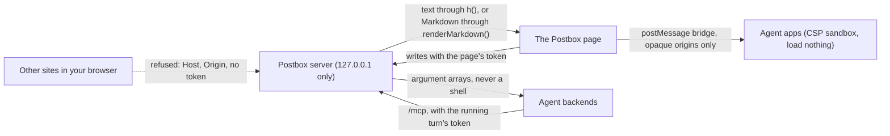

# Security

Postbox runs on your own computer, as you, for one person. It directs AI agents that can read and change your files, so what keeps it safe is a small set of boundaries. This page says what they are, how to report a hole in one, and how the repository keeps new holes out.

## Reporting a vulnerability

Report it privately, through GitHub’s [private vulnerability reporting](https://github.com/HJeon139/postbox/security/advisories/new). Don’t open a public issue, pull request or discussion for it.

Include:
- the version (the sidebar shows it under Personas as `vX.Y.Z · commit`), your OS and the backend involved
- what an attacker needs: a web page you visit, an agent’s output, a file in your project, or access to your computer
- the steps to reproduce it, and what happened compared with what should have

You’ll get an answer in the advisory. Once a fix is released, the advisory is published with credit to you, unless you’d rather not be named.

## Supported versions

Every merge to `main` is released (designs/engineering-practices.md, “Commits and versions”), and only the latest release gets fixes. Update to it before you report, if you can.

## What Postbox defends

These are the boundaries, from designs/developing.md, “Security”, and designs/architecture.md. A report that crosses one is in scope:
- **It answers this computer alone.** The server listens on 127.0.0.1. It refuses a `Host` other than `127.0.0.1:<port>` or `localhost:<port>`, and a write with a cross-site `Origin`. Every write from the page needs the page’s token, compared in constant time. An agent’s calls to `/mcp` need its running turn’s token instead (architecture.md, “Writes need the page’s token”).
- **Agent content is data.** It reaches the DOM as text through `h()`, and as HTML only from `renderMarkdown()`. Agent apps and diagrams run in pages sandboxed by their `Content-Security-Policy` header that load nothing from a URL (architecture.md, “Sandboxed pages that load nothing”).
- **Every input is untrusted,** including an agent’s own tool call. The rule is to refuse rather than clean up: a URL with control characters is refused, and so is a path that resolves outside its folder (designs/developing.md, “Security”). Whether every route and tool follows it is being audited in #351.
- **Processes start with an argument array, never a shell string.** The exceptions: a `!` command, which runs your own text, as you, only on loopback; and on a remote host, the command `ssh` asks the host to run, which the host’s login shell runs, as `ssh` always does. That command, and the install script it carries in single quotes, are fixed strings built only from a checked version (`server/remote/ssh-args.mjs`, `server/remote/install.mjs`), and the destination comes after `--`.
- **On a remote host, the boundary is your OS user there** (#120; architecture.md, “Remote hosts”). Postbox reaches a host only with your own `ssh`, one way. On its own connection, the default, nothing listens on TCP on either machine: it turns off the forwards, X11, `LocalCommand` and tunnels a `~/.ssh/config` could add, and requires a known, unchanged host key. With “Use a connection of its own” off, it shares your multiplexed connection instead, and whatever port forwards that connection opened stay open: that mode gives up these two guarantees, by your choice. On the host, everything of Postbox’s is under `~/.postbox-remote`, in `0700` folders of `0600` files (the launcher, `0700`). What this accepts:
  - Each turn’s shim proves that turn’s own token, so one turn’s shim can’t speak for another’s by mistake. But any process running as your user on the host can read `~/.postbox-remote/token`, and a turn’s token in its folder, connect to the daemon (with `takeover`, replacing Postbox’s connection), and answer the permission prompts of the turns there. The token keeps out other users and accidental connections, not your own processes.
  - Forwarding your ssh agent is off unless you turn it on for a host. On, it copies no private key, but while Postbox is connected any process running as your user there can use your agent to sign in elsewhere. With “Use a connection of its own” off, the port forwards your shared connection opened stay open.
  - A Kiro CLI turn’s message is in its arguments, which other users on the host can read in the process list unless the host hides it.
  - Each installed file is checked against a SHA-256 manifest that ships in the same archive, so a broken copy is caught, not a tampered one. The archive comes from this computer, over your `ssh`.
- **Postbox never reads, stores or sends an API key.** Every backend is its harness’s own CLI, which signs in on its own, with your sign-in or a key in your environment. The CLI inherits that environment, as any program you start does. Postbox doesn’t look at it.

**Out of scope:**
- What an agent does with the permissions you gave it. That’s the backend’s permission model, which Postbox shows you as cards (architecture.md, “Permissions: a card in the thread, and an explicit mode”).
- Someone who can already run code as you on your computer, or as your user on a host you added.
- Postbox reached from another machine. It doesn’t support that, and it refuses such requests.
- An advisory in an optional dependency that Postbox can’t reach, such as an image decoder in narration’s child process. Report it anyway if you can show a path to it.

## How the repository keeps it that way

**Automated:**
- **CodeQL** (GitHub’s default setup) analyzes every pull request. The `protect-main` ruleset blocks a merge that adds a CodeQL alert of high severity or above.
- **Dependency review** (`.github/workflows/dependency-review.yml`) refuses a pull request that adds or changes a dependency with a known vulnerability of moderate severity or worse.
- **The prompt-surface gate** holds a pull request that changes what agents read until the maintainer approves it, with the rendered diff and a SkillSpector scan beside it (“Prompt changes”, below).
- **Dependabot alerts** watch `package-lock.json`. Secret scanning and push protection are on.
- **`npm run check`** runs Biome, the types, the project lints and the unit tests. Its `tools/lint-security.mjs` holds the code to the rules below that a pattern can find. It flags a regular expression built from anything but constants or `escapeRegExp()`; a one-pass tag strip; a `JSON.stringify` splice in a browser check's page code; a `===` or `!==` comparison of a name ending in “token”; and git run outside `runGit()`. A deliberate exception carries `lint-allow <rule>: <reason>`. `tests/guard.mjs` blocks the network and process spawning in tests.

**Rules for code, each from a class of alert this repository has had:**
- **Values go into page code through `js()`.** A browser check that splices a value into `page.evaluate` or `page.waitFor` code uses `js()` from `tools/cdp.mjs`, not `JSON.stringify`: it also escapes `<`, `>`, U+2028 and U+2029 (#343). Playwright specs pass a function and its arguments instead.
- **No regular expression is built from agent text.** Match with a fixed pattern, then compare, as `closesFence` does (#344). A pattern that has to include outside text passes it through `escapeRegExp()` (`shared/regex.mjs`), which escapes every character a regular expression gives a meaning.
- **Tags are stripped with `stripTags()`** (`shared/markdown-inline.mjs`), which repeats until none is left (#345). HTML is built with `escapeHtml()`, never by stripping.
- **An escaper escapes its escape character first.** A Markdown table cell goes through `cell()` (`tools/uat/trigger-facts.mjs`), which escapes `\` along with `|` (#346).
- **Randomness comes from `node:crypto`:** `randomBytes` for a token, `randomInt` for a pick, never a byte modulo a length (#347).
- **Tokens are compared in constant time,** through `sameToken()` (`server/helpers.mjs`), never with `===` (#351).
- **Git runs through `runGit()`** (`server/ledger-git.mjs`), which sets the read-only safeguards for every repository it reads (#351).
- **Optional dependencies stay patched,** with an npm `overrides` entry when a parent pins an old version. Each override says why it exists and when it goes (#348).

**Alerts:** an open alert is fixed, not left to pile up, because a pile hides the next real one. One is dismissed only with GitHub’s reason (“false positive”, “used in tests” or “won’t fix”), a comment saying why, and an issue when there’s work left. A class that keeps coming back gets a lint or a test, as above.

## Prompt changes

What Postbox tells its agents is code too: a persona that loosens “show a review block before a write” changes what an agent will do as much as a change to `server/` does. So a pull request that changes what agents read is reviewed as a security change.

- **The prompt surface** is listed in [`.github/prompt-surface-paths.txt`](.github/prompt-surface-paths.txt): the guide and each backend’s hand-off (`server/adapters/`), the MCP tool descriptions (`server/mcp.mjs`), the personas and boilerplates, the AGENTS.md files and session prompts, and the gate itself.
- **The gate** ([`prompt-surface-gate.yml`](.github/workflows/prompt-surface-gate.yml)) holds a pull request that touches one until the maintainer approves it in the `prompt-security-review` environment. It runs on `pull_request_target`, so the workflow and the list come from `main` and a pull request can’t change its own verdict. It never checks out the pull request.
- **The diff** ([`prompt-surface-scan.yml`](.github/workflows/prompt-surface-scan.yml)) renders what agents read for the base and the pull request (`tools/prompt-surface.mjs`), and puts the difference in the job summary. Review that, not the code that builds it: the guide fills in limits and settings that its source doesn’t show. It warns when the text changed but no listed file did, so the list can’t fall behind.
- **SkillSpector** ([NVIDIA/SkillSpector](https://github.com/NVIDIA/SkillSpector), static rules only) scans the rendered text, and the job fails on a high or critical finding the pull request adds. In a test of 14 seeded threats, it caught 9: overrides, hidden directives, exfiltration, credential paths, pipe-to-shell and anti-refusal. It missed all 5 that reword one of Postbox’s own rules: skipping the review or confirm block, treating data as instructions, approving its own refused call, and persistence through a shell profile. Those are why the maintainer reads the diff.

**What the gate doesn’t cover:**
- **What the runtime says to agents while they work:** tool results, refusals and Postbox’s messages built in `server/runtime.mjs` and its modules. The render covers the guide, the personas and the tool descriptions, and `tests/prompt-gate.test.mjs` keeps the list in step with the modules those come from, not with the whole server.
- **Injection that arrives while an agent works,** from a web page, a file or another agent’s message. The boundaries above handle that.
- **A check that imitates the gate’s.** A ruleset matches a required check by its name and app, and every workflow job is the GitHub Actions app. So the gate refuses a pull request whose workflows name a job “Prompt surface reviewed”, and any change under `.github/` needs approval. A name built from an expression would get past the first. The second is why it can’t pass unseen.
- **An edit asks again.** The gate runs on every edit to a pull request into `main`, its title and description included, so a retarget to `main` can’t keep a pass from another branch’s copy. A pull request that touches the prompt surface then needs approval again.
