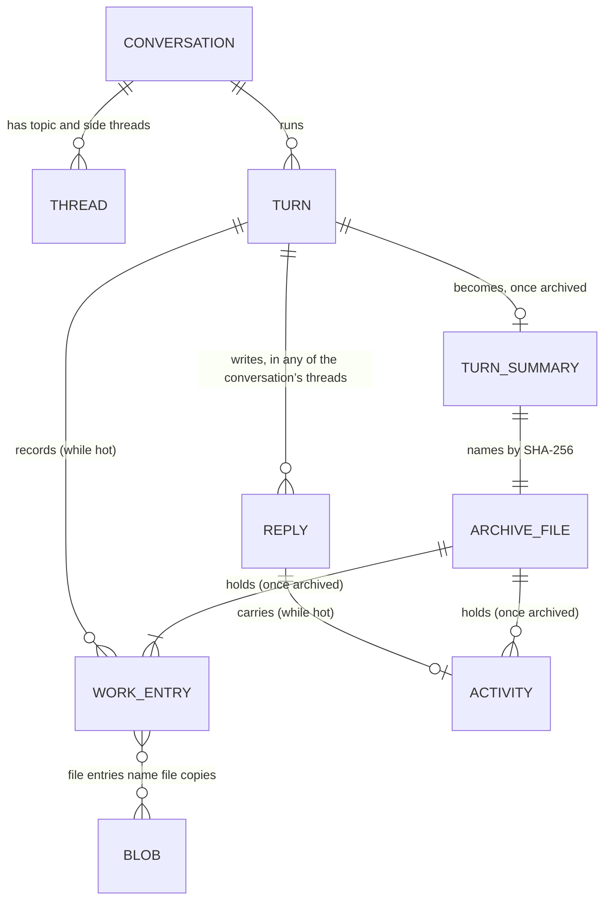

# Design: old turns’ work and activity leave the in-memory state (#305)

| | |
|---|---|
| **Status** | Draft 9, 7 November 2026. Design only; not yet approved. On 3 November the person kept #305 parked until a measurement on a large room, taken once client-side virtualization is in, shows that load time or the state’s size is what misses PF-1 (#615, the integrator’s answer on the slice order; `designs/508/execution-plan.md`, “Where it stands”). On 6 November the person brought #305 into sprint 4 (the person’s decision in the room, not yet recorded on #305). Virtualization (#712a) hasn’t merged, and `designs/508/measurement.md`, “Not met, and what comes next”, says PF-1 waits on it. Draft 8 brings the design up to `main` at v1.35.0 (`edf3c134`): steps 1 and 2 of “Rollout” are done, the reducer lands early and unused (“Why the reducer lands early”), the readers are the ones on `main` today, and the sizes wait for a rerun (“Context: what the state holds today”). Draft 9 answers a review of draft 8: the oldest release a person can go back to is step 3’s, the early `EVENTS` entry is a security change with tests of its own, the late cost patches are a stated limit, and five of the open questions are decided. Its line numbers are on `main` at v1.35.1 (`9ba4c3e4`) |
| **Reviewers** | a design-time read before the pass is built; the store’s owner; the person and the integrator; critic |
| **Relates to** | #305, #508; `designs/508/storage-design.md` (“Snapshots and pruning”, “Performance and budgets”, “The writer”, “`commit`”, “Rollout and compatibility”); `designs/508/601-held-view.md` (the pending read, #601); `designs/508/609-reducer-throw.md` (a rejected event, #609); `designs/architecture.md` (“The store: an event log with snapshots, not a database”, and its “Attachments” paragraph); `designs/intent.md`, principle 7 (deleting a conversation ends it, which decides “Deletion”) |
| **Code** | Not in this PR. The blob store fix (#613) and the `endWork` catch (#614) are merged. The reducer, the pass and the readers are on two unmerged branches: `fix/305-archive-turns` (head `8ed5f56f`) and `fix/305-readers` (head `678b6e14`). Step 3 is built from `fix/305-readers` (“Rollout”) |

## Summary

Two collections hold most of a long room’s state, though nobody reads them after their turn unless the person opens an old turn:

- **the work ledger** (`state.work[conversationId]`, #132): every command, file change, read and publish an agent made;
- **the activity steps** on agent replies (`item.activity.steps`, #452).

This design keeps **each agent’s last two turns** of both in memory (and any turn still running), and moves every older turn into one immutable **archive file** in the blob store. A **turn summary entry** takes the turn’s place in the work list, and an archived reply keeps only a **count** of its steps. The person opens an old turn on demand. Every reader that needs old detail goes through one lookup.

**Sizes.** On 1 November 2026, on a 13.85 MB copy of this project’s store, the chosen policy took the snapshot to about **4.3 MB** and its `JSON.stringify` from **19.2 ms to about 6 ms** (`tools/measure-archive-policies.mjs`, “Context: what the state holds today”). Those are the only measured figures here, and they are labeled with their date and commit where they appear. Since then the person has reported a **72 MB** snapshot of five rooms (#305, the comment of 5 November); that is the person’s figure, not a measurement taken for this design. On the measured side, the snapshot stall on the real copy was 26.03 ms before #712b and 26.72 ms after, the median of 10 passes, against the storage design’s 50 ms budget (`designs/508/measurement.md`, “The snapshot stall”). The policy figures will be rerun with `tools/measure-archive-policies.mjs` on the real-shape seed before the code PR quotes any size.

**This is headroom, not a fix for a stall that has been measured:** the slow room was painting (#565, v1.3.0), PF-1’s misses are on the page’s style and layout (`designs/508/measurement.md`, “PF-1: a key press to the next frame”), and `/api/state` was timed only on a generated 2.0 MB state (18.1 ms at 10×, the same section’s “Reads and writes by id”). The size is the reason to do it (`architecture.md` already says old turns move out of state before anything is sharded); the “Alternatives” section says what each cheaper option would buy instead.

## Requirements and design this rests on

This design adds no requirement of its own. It meets requirements already approved, and works inside the high-level design #508 already has. Requirement ids are from `designs/508/requirements.md`; storage design sections are from `designs/508/storage-design.md`, named by title.

| Source | What it asks | How this design meets it |
|---|---|---|
| **#305**, factors 1, 2, 3, 5 and 7 | `/api/state` sends every work entry; the snapshot stringifies the whole state; activity updates resend a turn’s whole `steps`; a reply keeps every step; the work ledger grows per conversation | Old turns’ entries and steps leave the state, so all five shrink together (“Context: what the state holds today”) |
| **#305**, factor 18 | Blobs live beside the store, not in it | Archive files are blobs; `blobs/` becomes part of the durable data set (“Security and the operator”) |
| **PF-1** | A large room is as responsive as a small one | Old turns leave the snapshot and `/api/state`. PF-1 is about the page; what was measured as unresponsive was painting (#565) and layout (`measurement.md`), so this meets PF-1’s memory and transfer part, not its painting part. The size it saves is to be rerun (“Summary”) |
| **ST-1** | An older value’s shape is lifted on read; no migration run | An archived reply’s `{ archived, count }` and a turn summary entry are new shapes readers accept beside the old; old data is archived by ordinary events, not migrated (“Existing data”) |
| **ST-4** | A commit is fsynced before it counts | `turn.archive` is a commit (storage design, “`commit`”), and the archive file is fsynced before it (I1) |
| **SR-5** | The data folder’s files are private | Archive files are `0600` in `0700` folders (I7) |
| **PF-9** | No new runtime dependency | None added |
| **CX-2** | An agent reads any earlier item, in order, without loss | Unchanged: the read tools read items, not work or activity (access pattern A8) |
| Storage design, “Snapshots and pruning” and “Performance and budgets” | S2 starts only if a stall still passes 50 ms after old turns leave memory | This is that change; S2 stays unneeded on the measured copy |
| Storage design, “The writer” and “`commit`” | One-line commits, the function form, held emits, opIds kept only since the latest snapshot | The pass commits in the function form (I8), one event per commit, with opId `turn.archive:<convId>:<turnId>`; the reducer’s idempotence covers a repeat after a snapshot |
| Storage design, “Rollout and compatibility” | An older build meeting a multi-event (array) line skips it silently | No array commits: each `turn.archive` is a plain one-event line, which every build from the reducer’s release on applies (“Compatibility and downgrade”) |
| `designs/508/601-held-view.md` and `server/store-held.mjs` | A pending read is exact only while no commit touches the list it reads; such a commit is placed in `tests/store-held-guard.test.mjs` | `turn.archive` is the first production commit to touch `work` and `items`, so the pass is placed there (“Held emits and the pending read”) |
| `designs/508/609-reducer-throw.md` | An event the reducer throws on is numbered, written and held as rejected, and the store loads | Decides the downgrade story (“Compatibility and downgrade”) and why the reducer lands early (“Rollout”) |
| `architecture.md`, “The store: an event log with snapshots, not a database”, and “Attachments” | The log and snapshot hold the state; files live in content-addressed blobs | Summaries in the state, details in blobs |
| `intent.md`, principle 7 | Deleting a conversation ends it | Archive files are deleted with their conversation (“Deletion”) |

**Non-goals**
- The transcript’s items themselves (the B1 to B3 window, #531 to #533) and their virtualization (#712a).
- Command outputs, which are already capped and fetched on demand (`output` in `server/ledger-answers.mjs`).
- A second writer (ST-2, deferred).

## Context: what the state holds today

Measured 1 November 2026 on v1.9.0 (`fd60393e`), on the 13.85 MB copy used for the storage design’s budgets, with `tools/measure-archive-policies.mjs` as committed in `c2572b01` (`5c70e424` on this branch; run it on a `snapshot.json`). The tool is on this design’s branch only, not on `main` or either code branch; it lands with this PR. **These figures are kept as a record, not as today’s sizes:** they will be rerun with the same tool on the real-shape seed before the code PR quotes any size. **The real-shape seed** (decided on the review of draft 8): the bench’s seed (`seedRoomFolder` in `tools/bench-room.mjs`, the big-room seed) writes items with no work entries or activity today; step 3’s first PR extends it to write work entries and reply activity in this room’s proportions (the researcher’s room-shape profile, which isn’t in the repo), and to write a `snapshot.json` from the seeded store for `tools/measure-archive-policies.mjs`, so the figures come before any size is quoted. `main` has since added the `edit` and `restore` kinds (“Records”), and the person reports a 72 MB snapshot (“Summary”).

| Part | MB | Share | Read after its turn by |
|---|---|---|---|
| `items` (2,452) | 7.41 | 53.5% | the page, catch-up, the read tools |
| of which `item.activity` (12,924 steps on 916 replies) | 3.94 | 28.4% | the activity line when opened |
| `work` (6,480 entries) | 6.03 | 43.5% | the Work view when opened; diff, file, output, restore routes |
| of which `command` entries (4,573) | 5.24 | 37.8% | (the command line is 3.22 MB of it; output 0.38 MB) |
| everything else | 0.41 | 3.0% | |

### Which turns stay hot

`tools/measure-archive-policies.mjs`, run once on that copy on 1 November 2026 (2 conversations, 6,480 work entries; the three kept kinds of draft 7, `branch`, `commit` and `push`, stay in the state in every row; draft 8 adds `external` create entries, “Which entries stay hot”). These are single-run figures. A second run, on a 29.54 MB live store of 2,149 turns, gave the same shape: the chosen policy 68% smaller, the skeleton 37% smaller, and a larger hot count 0.3% to 1.2% larger:

| Policy | Snapshot | `JSON.stringify` |
|---|---|---|
| today, nothing archived | 13.85 MB | 19.2 ms |
| last 2 turns of the conversation | 4.06 MB | 5.7 ms |
| last 5 turns of the conversation | 4.11 MB | 5.9 ms |
| last 10 turns of the conversation | 4.17 MB | 5.9 ms |
| **each agent’s last 2 turns** | **4.34 MB** | **6.2 ms** |
| each agent’s last 5 turns | 4.44 MB | 6.2 ms |

**Why per agent, not per conversation (the integrator’s review of #603, on the hot-turn policy).** A conversation-wide count of two is less than one round when two to four agents work at once. If agent A starts a long turn while agents B and C start and finish short ones, the pass archives agent A’s turn the moment it ends, and its reply’s steps become `{ archived, count }`: the turn the person most wants to open. The size barely depended on the number in the 1 November run (4.06 MB for 2 turns, 4.17 MB for 10), so the policy is chosen for what the person reads, not for bytes. Keeping **each agent’s last two turns** cost 0.28 MB more than a conversation-wide two (7%) in that run, and with four agents it keeps at most eight turns. A turn that is still running is always hot, as I4 says. The count per agent is a constant, `HOT_TURNS_PER_AGENT`, so it can change without changing the design.

### Which entries stay hot

Some entries of an archived turn stay in the state, because a reader that decides something reads the whole conversation’s list of them:
- **`branch`, `commit` and `push`**, as in draft 7: the version-control readers and the ledger’s own commit tracking (`server/ledger-commands.mjs`, `server/ledger-git.mjs`) read and patch them after their turn.
- **`external` entries for `gh pr create` and `gh issue create`.** The write judge’s `madeBy` (`server/write-intent.mjs`) reads every such entry of the conversation, done, through `ledger.entries`, and the request floor (`itemOnRequest` in `server/request-floor.mjs`) uses their URLs and numbers to let a turn comment on or edit an item this conversation made. Archiving them would bring a permission card back for the conversation’s own older PRs. They stay hot, like branch, commit and push; the summary carries no second copy of their URLs.

The summary lists the ids of the entries it moves; every other entry of the turn stays where it is.

## Data model

### Entities and relationships



- **A turn** has no record of its own today. It exists as the `turnId` on its work entries and replies. This design keeps it so.
- **Work entries are keyed by conversation**, but **replies are keyed by thread**. A turn in a topic or side thread writes its replies under that thread’s id, while its work goes to the conversation. Every operation here crosses both keys.
- **A hot turn** is one whose entries and activity are in the state. An **archived turn** is one whose summary entry is in the state and whose detail is in its archive file, except the entries that stay hot (“Which entries stay hot”).
- **A turn with no work entries** (a reply-only turn) is still a turn: it counts toward its agent’s last two, and archiving it moves only its replies’ activity. Its summary goes into the work list in time order by `at` (the end, if it is the newest).

### Records

**Work entry** (existing, unchanged; `shared/work.mjs`, `server/ledger.mjs`, `Ledger.base`):

| Field | Type | Notes |
|---|---|---|
| `id` | string | unique in its conversation |
| `turnId`, `threadId`, `sessionId`, `handle` | string | the turn and agent that made it |
| `kind` | `command` \| `file` \| `read` \| `publish` \| `commit` \| `push` \| `external` \| `branch` \| `change` \| `turn` \| `edit` \| `restore` | `edit` is a file an agent on a remote host edited (`hostEdit` in `server/ledger-remote.mjs`, #120), with a `turnId`; it is archived with its turn. `restore` is conversation-level, with no `turnId` (`restore` in `server/ledger-answers.mjs`), so it never moves |
| `at`, `startedAt` | number | |
| `state`, `exit`, `ms` | | `state: 'running'` until a command ends |
| kind-specific fields | | `command`, `output`; file `changes` naming blob SHA-256s |

**Turn summary entry** (new; a work entry of kind `turn-archive`):

| Field | Type | Notes |
|---|---|---|
| `id` | string | `wa_<turnId>` |
| `kind` | `'turn-archive'` | an older build’s Work view skips an unknown kind (“Compatibility and downgrade”) |
| `turnId` | string | |
| `at` | number | the first archived entry’s `at`, or the first reply’s for a reply-only turn, so the list stays in time order |
| `sha256` | string | the archive file, `^[a-f0-9]{64}$` |
| `entryIds` | string[] | the entries it moved; the ones that stay hot aren’t listed (“Which entries stay hot”) |
| `counts` | object | `files`, `lines {added, removed}`, `edits`, `commands`, `failed`, `reads`, `publishes`, `steps`; computed once from the turn’s entries. `edits` is what `summarize` (`shared/work.mjs`) counts from `edit` entries, so the turn line keeps “edited on a host” |
| `effort` | object | `turns`, `ms`, `toolCalls`, `costUsd`, `tokens`, from the turn’s `turn` entry, so the conversation’s totals keep it |
| `handles` | string[] | the agents in the turn |

**Archived reply activity** (new shape of `item.activity`):

| Field | Type | Notes |
|---|---|---|
| `archived` | string | the archive file’s SHA-256 |
| `count` | number | how many steps it had. Not `steps`: the page reads `activity.steps` as a list (`kiroStep` in `app/js/thread-host.mjs`, `steps ?? []`, which `activityParts` in `app/js/activity-paint.mjs` calls), so an archived reply draws no steps |

**Archive file** (new; one blob per archived turn, JSON):

| Field | Type | Notes |
|---|---|---|
| `v` | `1` | the format version |
| `convId`, `turnId` | string | must match the summary that names it |
| `work` | WorkEntry[] | the turn’s moved entries, as they were in the state |
| `activity` | `{ [threadId]: { [itemId]: Activity } }` | each reply’s activity, keyed by thread then reply |

**Event `turn.archive`** (new; its handler in `shared/state-archive.mjs`, its entry in `EVENTS`):

| Field | Type | Notes |
|---|---|---|
| `convId`, `turnId` | string | |
| `sha256` | string | the archive file |
| `summary` | TurnSummary | the entry to insert |
| `items` | `{ threadId, id }[]` | the replies whose activity is archived |

Since #630, each event type is an entry in the `EVENTS` table in `shared/state.mjs`, with its `apply` and its `public` flag; `PUBLIC_EVENT_TYPES` is built from it and feeds the page, and `server/public-state.mjs` does the projection. `turn.archive` is one more entry, `'turn.archive': { apply: applyTurnArchive, public: true }`. There is no `case` in a switch and no list to edit in `app/js/client.mjs`, but the entry is not invisible: the tests that list every event type change with it, and it is reviewed as a security change (“Rollout”, step 3a).

### Where each lives

| Data | Store | Written by | Durability |
|---|---|---|---|
| Hot entries and activity | the state, the log, the snapshot | the ledger and the runtime, as today | a commit is fsynced; an emit as today |
| Turn summary, archived activity | the state, the log, the snapshot | the `turn.archive` event | a commit, opId `turn.archive:<convId>:<turnId>` |
| Archive file | `<data>/blobs/<aa>/<rest>` | `Blobs.put` | draft, fsync, rename, folder fsync; `0600` (#613) |

## Invariants

- **I1. Order.** A durable `turn.archive` never names an archive file that isn’t durable: the file is published (synced and renamed into place) before the event is committed.
- **I2. Whole or nothing.** A reader of the blob store sees an archive file whole under its name, or no file. A short file under the name is replaced on the next put (`write` in `server/blobs.mjs`).
- **I3. One home.** At any time, a moved entry or a step is in the state or in exactly one archive file named by a summary in the state, never neither. (Both is allowed only between I1’s two steps, and only the state copy is visible.)
- **I4. Only finished turns.** A turn is archived only if it has ended (its `turn` entry’s `status` isn’t `running`, and the runtime doesn’t list it as live), none of its jobs is kept, every entry in it is in a final state, and it is not one of the last two turns of the agent that ran it. The open states are the ones the ledger can still move an entry out of: `running` until it ends; `background` until its task ends (in `server/ledger.mjs`, the job update); and `unknown`, which Stop’s keep choice turns back into `background` (the Stop keep choice), and which the turn end and a restart set. Every other state (`done`, `failed`, `stopped`, `denied`) is final. A turn that fails I4 is passed over, not waited on: an old command left `unknown` keeps its own turn hot and blocks nothing after it. On the real-room copy on 1 November, the turns with an entry left open held 0.24 MB of the 6.02 MB of work, of 930 turns (`tools/measure-archive-policies.mjs`).
- **I5. The file holds exactly what the event removes.** Just before the commit, the pass serializes again the entries and activity the event will remove, exactly as it serialized them for the file; if the SHA-256 differs from the file’s, it abandons. There is no list of fields to forget, which a design-time read asked for.
- **I6. Validated reads.** A read of an archive file takes its SHA-256 from a summary in the state, never from a request, and checks that the file’s `convId` and `turnId` match it.
- **I7. Private.** Archive files are `0600`, in folders created `0700`.
- **I8. Checked where it is sequenced.** I5 is evaluated inside the commit’s function form, against the state the store hands it when the commit is sequenced, so nothing applied between the file’s write and the commit can be removed unseen. If it fails, the function returns `[]` and nothing is written.

## Write path

### When the pass runs

After a turn’s ledger work ends (`ledger.endTurn`, called from `Runtime.endWork`), the runtime runs the archive pass for that turn’s conversation. `endWork` then stores the turn’s line on its last reply (`turnLine` from `shared/work.mjs`, #195), and its `catch` logs a failure with `console.error` (#614). Passes for one conversation run one at a time, through one promise chain per conversation that the turn-end pass and the one-time pass both join, so the two never archive the same conversation at once; passes for different conversations may overlap. After start, a one-time pass walks every conversation (“Existing data”).

**Built against 1a only.** The pass commits through `store.commit`. There is no `emit` path: it would be a second code path whose event isn’t fsynced.

### One pass

```mermaid
sequenceDiagram
  participant R as Runtime
  participant P as Archive pass
  participant B as Blob store
  participant S as Store
  R->>P: turn ended in conversation C
  P->>S: read state: C’s turns in order
  Note over P: oldest turn older than its agent’s last two that meets I4, or stop
  P->>P: serialize the turn’s moved entries and replies’ activity (all threads of C)
  P->>B: put(archive file JSON)
  Note over B: draft, fsync, rename, folder fsync
  B-->>P: sha256
  P->>S: commit(state => ...), opId turn.archive:convId:turnId
  Note over S: when sequenced, re-serialize the payload from that state (I8)
  alt hash differs from the file’s (I5)
    S-->>P: [] returned, nothing written
    P-->>R: give up; try at the next turn’s end
  else unchanged
    Note over S: write turn.archive, fsync, then apply and broadcast
    S-->>P: seq (or duplicate)
    P->>P: repeat while C has an older turn that can go
  end
```

- **Turn order** is the order of each turn’s first entry or first reply in the state.
- **“Unchanged”** is I5’s rule: the hash of the payload the event will remove, compared with the file’s hash just before the commit. A late `work.patch` (a background command finishing), a new step, or any other change to a removed field changes it.
- **A repeat after a crash** returns `duplicate` while 1a still holds the `opId`, which it keeps only for commits newer than the latest snapshot. After a snapshot, a repeat writes again; the reducer’s idempotence is the real guard (T-12).
- **A patch held behind the archive commit** (a condition of the design-time read). While the archive commit waits for its fsync, the store holds every emit and applies it afterwards, so a `work.patch` emitted in that window lands after `turn.archive` has removed its entry. The design rules this out at the source and keeps a backstop. *At the source:* the ledger’s `work.patch` sites patch either entries in an open state (in `server/ledger.mjs`: the command and job updates, the turn end and the restart sweep), which I4 never archives, or entries that stay hot or are never archived: `commit` entries (`server/ledger-commands.mjs`, `server/ledger-git.mjs`), a host `edit` during its own running turn (`hostEdit` in `server/ledger-remote.mjs`), and restore’s patch of a `file` entry, which has no `turnId` (below). Two more sites patch a turn’s `turn` entry after the turn has ended, and that entry is archived: the thread summary adds `summaryCostUsd` after a Haiku call that can be slow (`server/thread-summary.mjs:217–219`), and the write judge adds `judgeCostUsd` “even for a turn stopped meanwhile” (`server/write-intent.mjs:199–205`). Nothing reads either field today (`git grep` on `main` finds only those two writes). A turn is archived only once it is older than its agent’s last two, so these patches have almost always landed by then, and one that has is in the archived entry. One that comes after the turn is archived is dropped, with the cost it carries: the summary’s `effort` takes `costUsd` from the `turn` entry when the turn is archived and is never patched (a stated limit, below). *Backstop:* the reducer’s `work.patch` drops a patch for an entry it doesn’t hold (`patchWork` in `shared/state.mjs`, unchanged), so a patch that slips through is lost, not resurrected as a half entry. T-19 pins both.
- **Restore after archiving.** `restore` (`server/ledger-answers.mjs`) patches the `file` entry with `restored: { at }` and adds a `restore` entry. Both are conversation-level: a `file` entry has no `turnId` (`recordChange` in `server/ledger.mjs`; it lists its turns in `turns`), and neither does a `restore` entry, so the pass never moves them. Only the turn’s `change` entries go to the archive. The archive file is never written again, and restore needs nothing from it. T-19 restores a file whose only change was archived.
- **Effort stays in the totals.** Each turn’s `turn` entry carries its time, tool calls, cost and tokens, which `summarize` (`shared/work.mjs`) adds into the conversation’s effort. The summary keeps them as `effort { turns, ms, toolCalls, costUsd, tokens }`, so the totals don’t shrink when a turn is archived (T-14). **Stated limit:** a `summaryCostUsd` or `judgeCostUsd` patch that arrives after its turn is archived is dropped, so that cost is lost; nothing reads either field today (“One pass”).
- **A closed store** (after 1b, a write failed) rejects the commit. The pass gives up with no retry loop; the published file is a harmless orphan, and the next turn’s end tries again.

### Held emits and the pending read

While a commit is queued or in flight, the store holds every `emit` and applies it once the commit settles (#588; `server/store-held.mjs`). Since #601, in-process code whose decision would be wrong on a superseded list reads the pending view (`store.pending`, and `ledger.entries`, which uses it), and every reader is placed in `tests/store-held-guard.test.mjs`. `server/store-held.mjs` states the limit: the pending view applies held emits without the commit in front of them, so it is exact “only while no commit touches the list read: none does today”, and a commit kind that touches items or work is placed in the guard beside those readers.

`turn.archive` is that commit kind: the first production commit to touch `work` and `items`. The two production commits on `main` today, `writeAsset` in `server/assets.mjs` and `sweepAssets` in `server/asset-orphans.mjs`, touch only the asset lists (the guard’s `COMMITS` table). So, during an archive commit’s window, a pending read of `work` or `items` still shows the turn’s moved entries and full `activity`, with held emits applied on top. The design needs `pending.work` and `pending.items` to stay exact for every pending reader during that window. **Proposed (the reviewer’s answer to draft 8):** the pending view takes the archive commit’s events into account, so the decision lives in one place, the store; a reader-by-reader proof in the guard would hold only until the next reader is added. This waits on the store’s owner, who owns the pending view (“Open questions”). Either way, the code PR:
- places the pass’s commit in the guard’s `COMMITS` table, with a comment naming `work` and `items` as the lists it touches (the table has no field for them: each entry is a file and its committing functions, with a comment, as `writeAsset`’s and `sweepAssets`’s are);
- places the lookup helper and the archive routes in the guard as published readers, since what they read leaves the process as an HTTP answer;
- adds a spec per pending reader of `work` or `items` that emits or reads during a held archive commit and gets what it expects (T-16).

### What the reducer does

On `turn.archive` (`applyTurnArchive`, in `shared/state-archive.mjs`), idempotently:
1. If `state.work[convId]` has no summary for the turn, build a new array without the entries in `summary.entryIds`, with the summary at the first removed entry’s index, or, for a reply-only turn, in time order by `at`, and **assign it** to `state.work[convId]`. It must replace the array, never splice the old one in place: the work index (`shared/work-index.mjs`, #618) assumes a conversation’s entries “only grow” and is kept per array, so a new array makes it rebuild, while an in-place splice would leave it pointing at entries that are gone.
2. For each `{ threadId, id }`, find the reply through the item index (`itemOf` from `shared/item-index.mjs`, #712b), not a linear `find`, and replace its `activity` with `{ archived, count }` if it isn’t archived already.

**A late step for an archived reply.** On `main`, a step patch (`item.patch` with `activityStep`) on an activity with no steps throws in `applyItemPatch` (`shared/state.mjs`), and since #609 that is a rejected data error, held as rejected, not a crash (`tests/store-reject.test.mjs`). `main`’s rule holds (decided on the review of draft 8): a late step for an archived reply is a rejected data error. `fix/305-readers` carries `08a38b41`, which makes the reducer ignore such a step instead, written when a throw made the log unloadable; the rewrite drops it.

## Read paths and access patterns

### Access patterns

| # | Pattern | Who | Key | Source | Cost | How often |
|---|---|---|---|---|---|---|
| A1 | List a conversation’s work | the Work view (`mountWork` in `app/js/work.mjs`) and its full-screen window (`app/js/work-window.mjs`, #618), from `/api/state` | `convId` | state | as today, smaller | every open of the Work view |
| A1b | A turn’s line under its reply | `workList` in `app/js/work-list.mjs`, from `client.state.work` and the reply’s `work` and `workTurn`, which `endWork` stores (#195) | `convId`, `turnId` | state; the reply’s own `work` line once the turn is archived | as today | every reply drawn |
| A2 | Open an old turn’s detail | the Work view, and a turn line’s row, which opens Work at an entry id | `convId`, `turnId` or `entryId` | archive file via `GET /api/threads/:id/work/turns/:turnId`; an archived entry id resolves to its turn through the lookup helper | one blob read and parse: the largest turn’s work on the real-room copy on 1 November was 243 KB, the median 0.6 KB (`tools/measure-archive-policies.mjs`) | when the person clicks |
| A3 | Show an old reply’s steps | the activity line (`activityParts` in `app/js/activity-paint.mjs`, through `kiroStep` in `app/js/thread-host.mjs`) | `threadId`, `itemId` | archive file via `GET /api/threads/:id/items/:itemId/activity` | one blob read | when the person opens it |
| A4 | Diff, file, output, restore of an entry | `fileDiff`, `output` and `restore` in `server/ledger-answers.mjs`, which read the published state only (#601), reached through the runtime’s work routes (`server/runtime.mjs`) | `convId`, `entryId` | published state, else the archive file whose summary’s turn holds it | state lookup, else one blob read | when the person clicks |
| A5 | Telemetry over a window | `workOf` in `server/telemetry-record.mjs` | `convId`, `since` | state, plus archive files of summaries whose `at` falls in the window | one blob read per archived turn in the window, read one at a time; the worst case is every archived turn | per report |
| A6 | Items this conversation made, for the write judge | `madeBy` in `server/write-intent.mjs`, used by `itemOnRequest` in `server/request-floor.mjs` | `convId` | the pending state: every `external` `gh pr create` and `gh issue create` entry of the conversation, done | as today: those entries stay hot (“Which entries stay hot”) | per tool call the judge reads |
| A7 | UAT checks on a run | `server/room-checks.mjs` (the step ids), `server/room-checks-work.mjs` (`ledgerEntries`), `server/room-checks-agy.mjs` and `server/room-checks-backends.mjs` (refused steps), `server/block-use.mjs` (a turn’s steps) | thread | state, plus archive files through the same lookup | per check | per UAT run |
| A8 | Catch-up, `read_conversation`, `read_message` | the agents | thread | items only | unchanged | per turn |

A2 to A5 and A7 go through one helper, `archived(state, convId, { turnId | entryId | itemId })`, which enforces I6: the SHA-256 comes from the summary in the state; anything that doesn’t resolve is a 404 with a sentence, never a path built from the request. In A4 the archived fallback goes in `server/ledger-answers.mjs` and reads published, as the hot path does.

**Page caches.** Two page modules keep caches that `item.*` events clear: the open asks (`CHANGES_BLOCKS` in `app/js/open-asks.mjs`) and the reply rings (`sessionOf` in `app/js/reply-rings.mjs`), both #826. `turn.archive` isn’t an `item.*` event, so each listener adds it, and an archive clears them.

### Opening an old turn

```mermaid
sequenceDiagram
  participant Pg as Work view
  participant H as Server route
  participant L as Lookup helper
  participant B as Blob store
  Pg->>H: GET /api/threads/T/work/turns/t7
  H->>L: archived(state, conv(T), turnId t7)
  L->>L: find summary for t7 in state.work (I6)
  L->>B: get(summary.sha256)
  B-->>L: bytes, checked against the hash
  L->>L: parse; check convId and turnId match
  L-->>H: the turn’s entries
  H-->>Pg: 200 entries, drawn like a live turn
```

On a missing or damaged file, the route answers 410 with “This turn’s details couldn’t be read”, and the page keeps the summary’s counts.

### A diff in an archived turn

`fileDiff` (`server/ledger-answers.mjs`) looks the file entry up in the published state; if absent, it asks the helper for the archived entry with that id, then reads its blobs exactly as it does for a hot entry. An `edit` entry is refused as it is today (a host keeps no copy). Output and restore do the same.

## Existing data

On the first start of a build with the switch on, after the server is listening, a pass walks the conversations one at a time and archives each down to each agent’s last two turns, oldest first.

- **It doesn’t hold the stream for long.** Each turn’s archive file is written and synced first, outside any commit, so that work holds nothing. The turns’ `turn.archive` commits are then queued in chunks: each is a plain one-event commit, and commits queued together share one fsync (storage design, “The writer”), so a chunk holds live emits for about one fsync. The pass yields between chunks so held emits drain. There are no multi-event array commits: one event per turn keeps each archive whole on its own, and a loader from before 1a skips an array line and reuses its sequence numbers (storage design, T-27).
- **Estimate (measured on 1 November, not assumed):** the real-room copy then had about 930 turns. On disk, the integrator archived 516 turns of a 518-turn room in 7.8 s, which is 15 ms a turn, measured twice; at 930 turns that is about 14 s, almost all of it outside a commit. The cost is one file fsync and one folder fsync per turn, plus the serialization. A quit during the pass waits at most `ARCHIVE_STOP_MS` (3 s) and leaves a consistent prefix, so the pass resumes at the next start. At 20 commits per chunk, about 45 chunks each hold emits for one fsync. A 72 MB store has more turns; the rerun (“Context: what the state holds today”) gives the count.
- **The chunk size is set from T-9’s measurement**, which records the total time and the longest hold, so that **the longest hold stays under 26 ms**, the snapshot stall already on record for the real copy (26.03 ms before #712b and 26.72 ms after, `designs/508/measurement.md`, “The snapshot stall”). T-9 passes or fails against that bound.
- **A crash** leaves a consistent prefix of whole turns (the reducer is per turn), and the next start continues.

## Compatibility and downgrade

Since #609 and #610 (`8b767b2b`, 2 November), an older build doesn’t refuse a log line it can’t apply: the reducer throws “Unknown store event”, the replay holds the line as rejected (`replayEvent` in `server/store-replay.mjs`, `server/store-reject.mjs`), and the store loads, with a warning: `server/store-recover.mjs:93–95` logs how many events it couldn’t apply. `8b767b2b` first shipped in v1.12.1 (`git tag --contains 8b767b2b`); a build older than that still refuses to load such a log. So, from v1.12.1 on, refusing to load is no longer a protection.

What protects a person who goes back is a release that both applies `turn.archive` and reads what it leaves behind: **step 3’s release, with the reducer and every reader** (“Rollout”). The switch’s `BREAKING CHANGE` note names step 3’s release as the oldest a person can go back to. The reducer’s own release, which comes earlier (“Why the reducer lands early”), is not one: it applies a `turn.archive` line on replay but has none of the readers.

What a downgrade loses, by what the older build meets:

| An older build meets… | What happens | What the person loses |
|---|---|---|
| a log line `turn.archive` (not yet pruned by a snapshot), on a build older than v1.12.1 | the store refuses to load | **nothing from the data**, but that build can’t open the folder |
| a log line `turn.archive`, on v1.12.1 or later, before the reducer’s release | the line is held as rejected and the store loads, with a warning (#609) | **nothing:** the entries the line would have archived are still there, from their own `work.add` lines or the older snapshot, and the replies keep their steps |
| a log line `turn.archive`, on the reducer’s release (before step 3’s) | the reducer applies the line on replay; the Work view meets `kind: 'turn-archive'` it doesn’t know and skips it; replies hold `{ archived, count }` | **old turns go missing** from its Work view, and old replies draw no activity line. `tools/unarchive-turns.mjs` restores them |
| a snapshot the new build wrote after archiving entries away (the events pruned), on any build without the readers | the Work view skips `kind: 'turn-archive'`; replies hold `{ archived, count }` | **old turns go missing** from its Work view, and old replies draw no activity line (`kiroStep` reads `steps ?? []`). The details are still in the archive files, and `tools/unarchive-turns.mjs` puts them back |

The switch’s release note says so, with a `BREAKING CHANGE` footer naming step 3’s release as the oldest to go back to, and `tools/unarchive-turns.mjs` rehydrates every summary from its archive file into a copy of the folder.

## Failure modes and crash points

| Killed or failed… | On disk | Next start or next pass | The person sees |
|---|---|---|---|
| before the archive file’s draft is written | nothing new | the turn is still hot; the next pass archives it | nothing |
| during the draft | a `*.draft` beside the blob | a failure before the rename removes its draft (#613); a kill leaves it, and the next put writes a new one | nothing |
| after rename, before the folder sync, then a power cut | maybe no file | the event wasn’t committed (I1), so the turn is still hot | nothing |
| after the file, before the event | an orphan archive file | the next pass publishes the same bytes (no change) and commits | nothing |
| after the event | file and event | replays; a repeat commit returns `duplicate` | the summary |
| a `work.patch` lands during the put | a published file | the commit function sees the changed payload (I5, I8), returns `[]`; the file is an orphan | nothing |
| a missing or damaged archive file at read time | | 410 with a sentence | “This turn’s details couldn’t be read”, with the counts |
| a remote turn’s entries arrive after its end | | I4: a running entry blocks archiving | nothing |
| the store is closed (1b) when the pass commits | a published file | the commit rejects; the pass gives up with no retry; next turn’s end tries again | nothing |
| `blobs/` missing or not copied with the data folder | the log and snapshot, no archive files | the lookup finds no file | 410 with the counts kept: “This turn’s details couldn’t be read” |

## Security and the operator

- **Trust boundary.** Archive files hold command lines and output, which can contain secrets the person typed. They are `0600` in `0700` folders (I7). Known limits: blob files and folders that already exist keep their mode, and a `*.draft` left by a kill is never swept.
- **`blobs/` is part of the durable data set.** Once a snapshot prunes the old segments, archived details exist only there. Anything that copies or backs up the data folder must include it: a person’s backup, the UAT room copies and `postbox.restart` fixtures, the real-room copy in T-9, and `tools/unarchive-turns.mjs`. The release note says so.
- **A file damaged after it was written** with its size unchanged is still caught: `Blobs.get` checks the SHA-256 on every read, so the lookup helper refuses it and the route answers 410.
- **Deletion (adopted; the person’s choice, 31 October 2026).** A deleted conversation’s archive files would otherwise outlive it; `intent.md` principle 7 says deleting a conversation ends it. Blobs are deleted in two places on `main` today: `Blobs.settle` removes the fresh blob of a refused staged put (#780, #825), with guards against a put of the same bytes in flight (`held`, `kept`, `writing` and `dropping` in `server/blobs.mjs`); and the asset folder’s files are deleted only at load, “since deleting while Postbox runs could race a write of the same bytes” (`server/asset-orphans.mjs`). **Archive files are deleted only at load, as assets are,** so they need none of `Blobs.settle`’s staged-put guards. Archive files share `<data>/blobs` with file copies and attachments, unlike assets, which have a store of their own, and content addressing can share bytes between any of them. So the rule is: at load, a SHA-256 is deleted only if a committed release record names it, and it is named by nothing in the state (no summary, no file entry’s `changes`, no attachment). **The evidence is a committed release record**, as `assetReleases` is for assets (`server/asset-orphans.mjs`), not the absence of a reference (decided on the review of draft 8): the conversation’s `remove` commits a release of its summaries’ hashes, and the load deletes those files, then drops their hashes from the record in one commit, as `sweepAssets` does. A failure is logged and leaves the file. File copies stay a stated limit, since other entries may name them.
- **Disk.** Archive files hold what the snapshot held, once each; the snapshot shrinks by the same amount.

## Test plan, each written to fail first

| # | Test | Status |
|---|---|---|
| T-1 | Ending a third turn archives the first; the file holds its entries and activity byte for byte | written, red then green on the held series |
| T-2 | Replay of the log gives the same state; a second pass changes nothing | to write |
| T-3 | A running turn, a running entry or a kept job is never archived | written, green on the held series |
| T-4 | A crash after the file and before the event: a restart archives once | to write |
| T-5 | `…/work/turns/:turnId` returns the turn; diff, file, output and restore work for an archived entry; a turn line’s row opens Work at an archived entry id | to write |
| T-6 | An old reply’s activity loads on demand; a missing or altered file gives 410, not an empty list | to write |
| T-7 | Telemetry over a window spanning an archived turn equals the report before archiving | to write |
| T-8 | `--recheck` of a saved run folder after archiving finds the same findings | to write |
| T-9 | The one-time pass on the real-shape seed: two turns left per agent; every entry and step reachable; the snapshot shrinks as the rerun measured; how long it takes, and the longest hold, which fails the test at 26 ms or more (“Existing data”) | to write |
| T-10 | Downgrade, characterization on `main` after #609: a build without the reducer replays a log holding a `turn.archive` line, holds it as rejected, loads, and keeps every entry and step the line names. With the reducer: the same log applies it | to write; none exists on `main` |
| T-11 | A reply in a topic thread is archived with its turn | written, red then green on the held series |
| T-12 | The archive file is published before the commit that names it, with opId `turn.archive:<convId>:<turnId>`; a repeat after a snapshot is harmless because the reducer is idempotent | written, red then green on the held series |
| T-13 | A change to any removed field during the put (a `work.patch`, a step’s text) stops the archive | written; fails with the hash check removed, on the held series |
| T-13b | A `work.patch` queued behind the archive commit: the commit function sees it and writes nothing | to write |
| T-14 | Characterization on `main`: the Work view skips an unknown `kind`, and the activity line draws nothing for `{ archived, count }`; with this change, the Work view’s totals (`shared/work.mjs`) add a summary’s `counts` once and never against hot entries, and keep counting the entries that stay hot | written on `fix/305-readers` (`1ef3f93c`, `e48d277e`) |
| T-15 | Blob store: a truncated file is replaced; no draft left; `0600` and `0700`; a folder sync failing with `EIO` rejects, an unsupported one doesn’t | merged with #613 (`tests/blobs-durable.test.mjs`) |
| T-16 | Each pending reader of `work` or `items` (“Held emits and the pending read”) emits or reads during a held archive commit and gets what it expects; the pass, the helper and the routes are placed in `tests/store-held-guard.test.mjs` | to write |
| T-17 | A reply-only turn: archived with its replies’ activity; its summary goes in time order by `at`, not at the end of the list; it counts toward its agent’s last two | to write |
| T-18 | Deletion at load: a deleted conversation’s released archive files are removed, except one that anything in the state still names (another summary, a file copy, an attachment); a hash with no release record is never deleted; nothing is deleted while Postbox runs | to write |
| T-19 | A `work.patch` held behind the archive commit, for an entry the commit removes, is dropped and resurrects nothing; a restore of a file whose only change was archived lands on the hot `file` entry | written, green on the held series |
| T-20 | I4’s open states: a command left `running`, `background` or `unknown`, or a `turn` entry still running, keeps its turn hot, and later ended turns are archived past it | written, red then green on the held series |
| T-21 | Per-agent policy: agent A’s long turn stays hot while agents B and C each finish three short ones; only B’s and C’s older turns are archived | to write |
| T-22 | `config.archiveTurns === true` turns the passes on, and nothing else does; the tests set `enabled` directly today, so this goes through the `config` that `server/index.mjs` passes to `new Runtime` | to write |
| T-23 | `turn.archive` is in `EVENTS` as public, so it is in `PUBLIC_EVENT_TYPES` and reaches the page: the two exact lists of event types in `tests/public-state.test.mjs` (`:40` and `:52`) gain it, not a new file; with the `state-events` case and the `VALID` payload, it lands in step 3a | to write |
| T-24 | The kept kinds: an archived turn’s `branch`, `commit`, `push` and `external` create entries stay in the state, and `madeBy` finds a PR the conversation created in an archived turn | to write |
| T-25 | Reducer: the new `state.work[convId]` is a new array, and the work index (`shared/work-index.mjs`) finds the summary and no moved entry; the replies are found through `itemOf` | to write |
| T-26 | The page caches in `app/js/open-asks.mjs` and `app/js/reply-rings.mjs` are cleared by a `turn.archive` event | to write |
| Browser | The Work view’s summary row and “Show details”; the full-screen window; a turn line under an archived reply; a reply’s steps on demand; at 1280 and 375 px, normally and with `POSTBOX_STREAM_LAG=300` | to write |

## Rollout

Staged so that nothing ships that cannot be used, and the event type’s readers ship before the switch (the integrator’s review of #603, §4).

| Step | What ships | Depends on | State |
|---|---|---|---|
| 1 | Blob store whole-file publish, modes, draft cleanup and folder sync | nothing | **done**, #613 (1 November) |
| 2 | The `endWork` catch: a rejected `ledger.endTurn` is logged, not an unhandled rejection | nothing | **done**, #614 (1 November) |
| — | This design, as a draft | — | this PR |
| 3a | The reducer’s own release: `applyTurnArchive` and its `EVENTS` entry, with nothing emitting it (“Why the reducer lands early”). It isn’t invisible: the entry joins `PUBLIC_EVENT_TYPES` (`shared/state.mjs:168`), so the page subscribes to it and runs the reducer in the browser (`app/js/client.mjs:16`, `:67`). It carries T-23 and T-25; a case in `tests/state-events.test.mjs`, whose check (`:194–201`) needs one for every type not in `ADDED_SINCE`; a `VALID` payload in `tests/state-reject-contract.test.mjs:24`; and both updates to `tests/public-state.test.mjs` (`:40` and `:52`). **Reviewed as a security change:** root `AGENTS.md`, “Security boundaries”, says “What reaches the browser is decided by the `public` flag in `EVENTS`” | steps 1 and 2; #588, #598, #601, #609, #630, #712b (merged) | to build, from `fix/305-readers` (“Branches”) |
| 3, first PR | The pass with the Work view, first, in the integrator’s order of 3 November (#615): the real-shape seed and its `snapshot.json` (“Context: what the state holds today”), the pass, the lookup helper, the work routes, the Work view and its totals, the per-agent policy, the guard entries | step 3a | after step 3a |
| 3, second PR | The remaining readers and the page: the turn line, telemetry, room checks, `block-use`, the activity route and line, the page caches, deletion at load, `tools/unarchive-turns.mjs`; with the first PR, T-1 to T-26. Its release is the oldest a person can go back to | step 3’s first PR | after it |
| 4 | The switch (`archiveTurns` on), a `BREAKING CHANGE` footer naming step 3’s release, and the release note | step 3 | after step 3, and only past the bar for switching on |

**Why the reducer lands early.** Draft 7 held the reducer back so that an older build would refuse a `turn.archive` line it didn’t know. Since #609 (v1.12.1) an older build loads, with a warning, instead (“Compatibility and downgrade”), so holding it back no longer protects anyone. Landing it early doesn’t protect anyone either: the reducer’s release applies a `turn.archive` line on replay but has none of the readers, so a person who goes back to it from the switch’s release loses old turns from the Work view, which `tools/unarchive-turns.mjs` restores. That is why the switch’s `BREAKING CHANGE` note names step 3’s release, not the reducer’s. The reducer lands early for two other reasons: the event’s `public` flag is a security boundary, and a release of its own lets it be reviewed as one, apart from the pass; and once that release is out the event’s shape is fixed, so its fields (“Records”) are settled before the pass and readers are built on them.

**Bar for switching on (the precedent of #560).** A hot and cold split of the same shape was closed because the measured lag was gone. This one switches on when there is a measured stall, or a measured `/api/state` load time, that archiving would fix, not before. The 3 November decision set that measurement on a large room after virtualization (#712a); the 6 November decision brought the work into sprint 4 ahead of it. **Recommended (the reviewer’s answer to draft 8):** keep the bar: build step 3 now, and switch on only with a measured stall or `/api/state` load time that archiving fixes, as with #560. The decision is the person’s (“Open questions”).

### Branches

| Branch | Head | Base | Behind `main` (`edf3c134`) | Ahead | A merge with `main` |
|---|---|---|---|---|---|
| `fix/305-readers` | `678b6e14` | `fd60393e` (v1.9.0) | 914 | 25 | conflicts in 7 files: `app/js/client.mjs`, `server/blobs.mjs`, `server/ledger.mjs`, `server/runtime.mjs`, `shared/state.mjs`, `shared/work.mjs`, `tests/blobs-durable.test.mjs` (add/add) |
| `fix/305-archive-turns` | `8ed5f56f` | `25ad0ffb` (v1.8.0, before #598) | 988 | 14 | conflicts in 5 files |

Step 3 is `fix/305-readers` rewritten onto today’s `main`. It carries its own rebased copies of the reducer and the pass from `fix/305-archive-turns`, on a later base (it is not stacked on `8ed5f56f`), and the two totals commits, `1ef3f93c` and `e48d277e`, which exist on no other branch. When it is rewritten, its own copies of the blob commits are dropped, since #613 merged them; they cause the `server/blobs.mjs` and `tests/blobs-durable.test.mjs` conflicts. `fix/305-archive-turns` keeps `8ed5f56f`’s bounded shutdown wait, which the rewrite takes over. The conflicts in `shared/state.mjs` and `app/js/client.mjs` go away with the `EVENTS` entry (“Records”), and the reducer is rewritten to the rules in “What the reducer does”.

**Line budget.** Biome caps each file’s lines (`biome.json`, the #625 ratchet). On `main` (`9ba4c3e4`), `server/ledger.mjs` is exactly at its cap of 628 and `server/runtime.mjs` exactly at its cap of 2,748: Biome passes each, and fails each with a line or two added (“too many lines (2749)”). `server/thread-erase.mjs` records that `server/runtime.mjs` “is at its size”. The branch moves most of its code out, into `server/archive-runtime.mjs`, `server/turn-end-work.mjs`, `server/work-archive.mjs`, `server/work-archive-read.mjs` and `shared/work-archived.mjs`, and is net zero in `server/ledger.mjs` (4 lines added, 4 removed). It is not nothing in `server/runtime.mjs`: it is 8 lines more there (15 added, 7 removed, against its base). The rewrite must be net zero in `server/runtime.mjs`, for example by moving `endWork` out into `server/turn-end-work.mjs`.

## Alternatives

Measured 1 November 2026 with `tools/measure-archive-policies.mjs` on the real-room copy (13.85 MB then); to be rerun on the real-shape seed with the rest (“Context: what the state holds today”). The integrator asked for these to be weighed (the review of #603, §3).

| Option | Snapshot | What it buys over the chosen design, and why not |
|---|---|---|
| **Chosen: archive old turns, each agent’s last 2 hot** | 4.34 MB | Reference. Costs a file per turn, a hash-checked commit, one chain per conversation and the readers in step 3 |
| **A. Skeleton entries: keep every entry, move the heavy text (a command’s line, a step’s detail) behind the blob route, as `output` already is** | **8.47 MB (39% smaller)** | No reducer, no pass, no archive files, and `summarize`, the ledger’s de-duplication, the room checks and telemetry keep working unchanged. **It did not reach what was estimated (5 to 6 MB):** what was left was the 5.5 MB of transcript items (which nothing here touches), 2.0 MB of command entries without their line (an id, a state, an exit, `output`, ~430 bytes each, 4,573 of them) and 2.0 MB of step labels. About 4 MB more than the chosen design, and it keeps growing with every command, because entries are never removed. **Worth doing first if the readers in step 3 prove too costly:** it needs only a blob route for a command line and a step detail |
| B. Skeleton, then archive each agent’s old turns | 4.12 MB | 0.22 MB under the chosen design, by dropping command lines in the hot turns too. Not worth a second mechanism for 5% |
| C. A public projection of the state (`server/public-state.mjs`, #630) | unchanged in memory and on disk | Shrinks what `/api/state` sends, not the snapshot or the process. Complementary, not a substitute |
| D. Build a reply’s step tree only when it is opened (`activityParts` in `app/js/activity-paint.mjs`) | unchanged | About 10 lines, no data change. It removes the DOM cost of steps, which is the part the page pays on every load; it does nothing for memory, `/api/state` or the snapshot. **Do this regardless**; it is outside #305’s state change |
| E. A larger hot count (5 or 10 per conversation) | 4.11 to 4.17 MB | Changed the size by 1 to 3%. The count is not the lever; who it counts is (“Which turns stay hot”) |
| S2, the sharded snapshot | n/a | Splits the same bytes across files; memory and `/api/state` keep carrying them |
| Drop old activity and command lines | n/a | Loses what the person can open today |
| Keep N entries, not N turns | n/a | Splits a turn across memory and archive; the Work view groups by turn |
| A file per turn under its own folder | n/a | Its own naming, publishing and verification, which the blob store now gives |
| Archive by time (the last day) | n/a | A day of a busy room holds many turns, and a quiet room’s turns would never leave |

**What the chosen design bought over A was 4 MB more, and it stops the state growing at all** (A’s entries accumulate). **What it costs over A** is the whole of step 3. If the bar for switching on (“Rollout”) is met by a stall that A would also fix, A is the cheaper first step and the chosen design can follow; this document keeps both on the table, as the integrator’s answer of 3 November does.

## Sources

The publish order rests on these; their wording hasn’t been re-checked in this session.
- Node.js, `fs`: [`fsPromises.rename`](https://nodejs.org/api/fs.html#fspromisesrenameoldpath-newpath), [`filehandle.sync()`](https://nodejs.org/api/fs.html#filehandlesync), [`fsPromises.open` flags](https://nodejs.org/api/fs.html#file-system-flags).
- POSIX: [`rename()`](https://pubs.opengroup.org/onlinepubs/9799919799/functions/rename.html), atomic replacement of the new path; [`fsync()`](https://pubs.opengroup.org/onlinepubs/9799919799/functions/fsync.html).
- `designs/508/storage-design.md`: the one-line commit, the function form, held emits and the repeated-`opId` contract.
- `designs/508/609-reducer-throw.md`: a rejected event is held and the store loads.

## Open questions

The review of draft 8 answered seven questions. Five are decided and are now in the body: the chunk size (“Existing data”), a late step for an archived reply (“What the reducer does”), what tells the load an archive file may go (“Security and the operator”), the real-shape seed (“Context: what the state holds today”) and step 3 as two PRs (“Rollout”). Two stay open:

1. **Keeping the pending view exact during an archive commit** (“Held emits and the pending read”). Proposed: the pending view takes the archive commit’s events into account, so the decision lives in one place. **Waiting on lead-state, who owns the store’s pending view (QS-1).**
2. **The bar for switching on** (“Rollout”). Recommended: keep the bar, build step 3 now, and switch on only with a measured stall or `/api/state` load time that archiving fixes, as with #560. **For the person to decide.**
