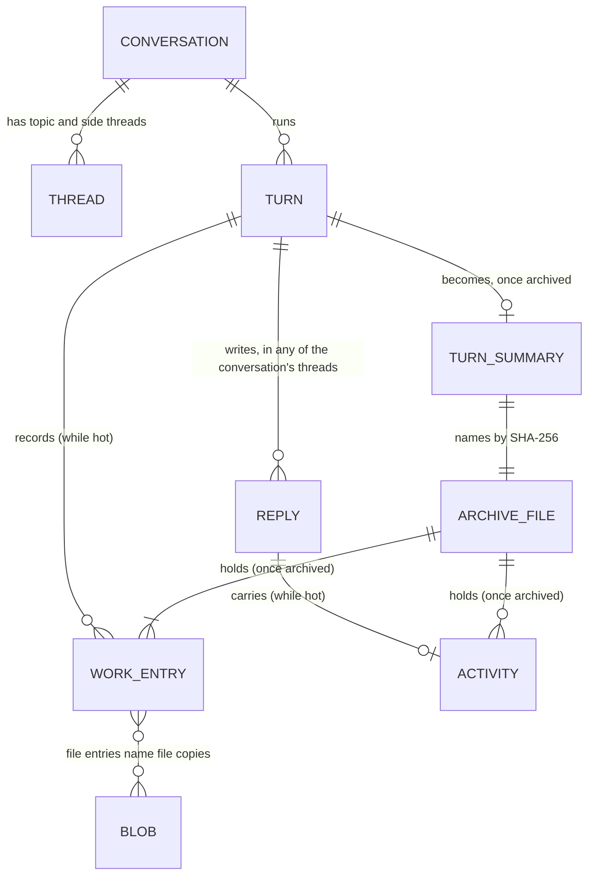

# Design: old turns’ work and activity leave the in-memory state (#305)

| | |
|---|---|
| **Status** | Draft 6, 31 October 2026; draft 5 approved by the person. Draft 6 names the ledger’s open states in I4, passes over a turn that can’t go yet, settles a patch held behind the archive commit and a restore after archiving (critic, developer), keeps each turn’s effort in its summary, and adopts deletion with the conversation (the person’s choice) |
| **Author** | engineer |
| **Reviewers** | critic (design-time read, before the pass is built); developer (senior developer, the store and 1a); the person and the integrator |
| **Relates to** | #305, #508; `designs/508/storage-design.md` on #580 (“Snapshots and pruning”, “Performance and budgets”, the one-line commit of 1a, #588); `designs/architecture.md` (“The store”, “Attachments”); `designs/intent.md`, principle 7 (deleting a conversation ends it, which decides “Deletion”) |
| **Branch** | `fix/305-archive-turns`, rebased on #588’s head `9959c79f` until #588 merges; built so far: the reducer (`8635d0ab`, `0183d64e`), the blob store’s whole-file publish (`29b9cc8b`, `c5fc18ff`) and the archive pass (`284d63b4`, `ec4b57eb`) |

## Summary

Two collections hold most of a long room’s state, though nobody reads them after their turn unless the person opens an old turn:

- **the work ledger** (`state.work[conversationId]`, #132): every command, file change, read and publish an agent made;
- **the activity steps** on agent replies (`item.activity.steps`, #452).

This design keeps each conversation’s **last two turns** of both in memory and moves every older turn into one immutable **archive file** in the blob store. A **turn summary entry** takes the turn’s place in the work list, and an archived reply keeps only a **count** of its steps. The person opens an old turn on demand. Every reader that needs old detail goes through one lookup.

On a 13.85 MB copy of this project’s store, the snapshot falls to about **4.0 MB** and its `JSON.stringify` from **20.1 ms to about 6 ms** (“Context: what the state holds today”). The storage design’s budget is the whole event-loop block, which is about **37 ms** today (the stringify plus converting the text to bytes); scaled by the same ratio it falls to about **11 ms**, so the whole-state snapshot stays far under the 50 ms budget, and the sharded snapshot (S2) is not needed.

## Requirements and design this rests on

This design adds no requirement of its own. It meets requirements already approved, and works inside the high-level design #508 already has. Requirement ids are from `designs/508/requirements.md` (rev 4.5, on #580); storage design sections are from `designs/508/storage-design.md` (draft 9, on #580).

| Source | What it asks | How this design meets it |
|---|---|---|
| **#305**, factors 1, 2, 3, 5 and 7 | `/api/state` sends every work entry; the snapshot stringifies the whole state; activity updates resend a turn’s whole `steps`; a reply keeps every step; the work ledger grows per conversation | Old turns’ entries and steps leave the state, so all five shrink together (“Context: what the state holds today”) |
| **#305**, factor 18 | Blobs live beside the store, not in it | Archive files are blobs; `blobs/` becomes part of the durable data set (“Security and the operator”) |
| **PF-1** | A large room is as responsive as a small one | The snapshot’s event-loop block falls from about 37 ms to about 11 ms, and `/api/state` from 13.85 MB to about 4 MB, on the real-room copy |
| **ST-1** | An older value’s shape is lifted on read; no migration run | An archived reply’s `{ archived, count }` and a turn summary entry are new shapes readers accept beside the old; old data is archived by ordinary events, not migrated (“Existing data”) |
| **ST-4** | A commit is fsynced before it counts | `turn.archive` is a commit (storage design, “`commit`”), and the archive file is fsynced before it (I1) |
| **SR-5** | The data folder’s files are private | Archive files are `0600` in `0700` folders (I7) |
| **PF-9** | No new runtime dependency | None added |
| **CX-2** | An agent reads any earlier item, in order, without loss | Unchanged: the read tools read items, not work or activity (access pattern A8) |
| Storage design, “Snapshots and pruning” and “Performance and budgets” | S2 starts only if a stall still passes 50 ms after old turns leave memory | This is that change; S2 stays unneeded on the measured copy |
| Storage design, “The writer” and “`commit`” | One-line commits, the function form, held emits, opIds kept only since the latest snapshot | The pass commits in the function form (I8), one event per commit, with opId `turn.archive:<turnId>`; the reducer’s idempotence covers a repeat after a snapshot |
| Storage design, “Rollout and compatibility” | An older build meeting a multi-event (array) line skips it silently | No array commits: each `turn.archive` is a plain one-event line, so an older build fails visibly at it (“Compatibility and downgrade”) |
| `architecture.md`, “The store” and “Attachments” | The log and snapshot hold the state; files live in content-addressed blobs | Summaries in the state, details in blobs |
| `intent.md`, principle 7 | Deleting a conversation ends it | The open question on deleting archive files with their conversation |

**Non-goals**
- The transcript’s items themselves (the B1 to B3 window, #531 to #533).
- Command outputs, which are already capped and fetched on demand (`ledger.output`, `server/runtime.mjs:2326`).
- A second writer (ST-2, deferred).

## Context: what the state holds today

Measured on the 13.85 MB copy used for the storage design’s budgets. The script is `/tmp/dev2/size-breakdown.mjs`, and its output is `/tmp/dev2/size-breakdown.txt`. critic and gemini measured the live store separately and got the same shares.

| Part | MB | Share | Read after its turn by |
|---|---|---|---|
| `items` (2,452) | 7.41 | 53.5% | the page, catch-up, the read tools |
| of which `item.activity` (12,924 steps on 916 replies) | 3.94 | 28.4% | the activity line when opened |
| `work` (6,480 entries) | 6.03 | 43.5% | the Work view when opened; diff, file, output, restore routes |
| of which `command` entries (4,573) | 5.24 | 37.8% | (the command line is 3.22 MB of it; output 0.38 MB) |
| everything else | 0.41 | 3.0% | |

Keeping the last K turns of each conversation (`/tmp/dev2/size-after.mjs`):

| Kept | Snapshot | `JSON.stringify` |
|---|---|---|
| everything (today) | 13.85 MB | 20.1 ms |
| last 5 turns | 4.10 MB | 6.4 ms |
| **last 2 turns** | **4.01 MB** | **5.9 ms** (whole block about 11 ms, by the ratio to today’s 37 ms; to be measured with `tools/bench-snapshot-stall.mjs` in T-9) |
| last 1 turn | 3.98 MB | 6.1 ms |

## Data model

### Entities and relationships



- **A turn** has no record of its own today. It exists as the `turnId` on its work entries and replies. This design keeps it so.
- **Work entries are keyed by conversation**, but **replies are keyed by thread**. A turn in a topic or side thread writes its replies under that thread’s id, while its work goes to the conversation. Every operation here crosses both keys.
- **A hot turn** is one whose entries and activity are in the state. An **archived turn** is one whose summary entry is in the state and whose detail is in its archive file.
- **A turn with no work entries** (a reply-only turn) is still a turn: it counts toward the last two, and archiving it moves only its replies’ activity. Its summary goes into the work list in time order by `at` (the end, if it is the newest).

### Records

**Work entry** (existing, unchanged; `shared/work.mjs`, `server/ledger.mjs:169`):

| Field | Type | Notes |
|---|---|---|
| `id` | string | unique in its conversation |
| `turnId`, `threadId`, `sessionId`, `handle` | string | the turn and agent that made it |
| `kind` | `command` \| `file` \| `read` \| `publish` \| `commit` \| `push` \| `external` \| `branch` \| `change` \| `turn` | |
| `at`, `startedAt` | number | |
| `state`, `exit`, `ms` | | `state: 'running'` until a command ends |
| kind-specific fields | | `command`, `output`; file `changes` naming blob SHA-256s |

**Turn summary entry** (new; a work entry of kind `turn-archive`):

| Field | Type | Notes |
|---|---|---|
| `id` | string | `wa_<turnId>` |
| `kind` | `'turn-archive'` | an older build’s Work view skips an unknown kind (“Compatibility and downgrade”) |
| `turnId` | string | |
| `at` | number | the first archived entry’s `at`, or the first reply’s for a reply-only turn, so the list stays in time order |
| `sha256` | string | the archive file, `^[a-f0-9]{64}$` |
| `counts` | object | `files`, `lines {added, removed}`, `commands`, `failed`, `reads`, `publishes`, `steps`; computed once from the turn’s entries |
| `effort` | object | `turns`, `ms`, `toolCalls`, `costUsd`, `tokens`, from the turn’s `turn` entry, so the conversation’s totals keep it |
| `handles` | string[] | the agents in the turn |

**Archived reply activity** (new shape of `item.activity`):

| Field | Type | Notes |
|---|---|---|
| `archived` | string | the archive file’s SHA-256 |
| `count` | number | how many steps it had. Not `steps`: an older page reads `activity.steps` as a list (`app/js/activity-paint.mjs:14-15`) |

**Archive file** (new; one blob per archived turn, JSON):

| Field | Type | Notes |
|---|---|---|
| `v` | `1` | the format version |
| `convId`, `turnId` | string | must match the summary that names it |
| `work` | WorkEntry[] | the turn’s entries, as they were in the state |
| `activity` | `{ [threadId]: { [itemId]: Activity } }` | each reply’s activity, keyed by thread then reply |

**Event `turn.archive`** (new; `shared/state-archive.mjs`):

| Field | Type | Notes |
|---|---|---|
| `convId`, `turnId` | string | |
| `sha256` | string | the archive file |
| `summary` | TurnSummary | the entry to insert |
| `items` | `{ threadId, id }[]` | the replies whose activity is archived |

### Where each lives

| Data | Store | Written by | Durability |
|---|---|---|---|
| Hot entries and activity | the state, the log, the snapshot | the ledger and the runtime, as today | as today (after 1a, a commit is fsynced) |
| Turn summary, archived activity | the state, the log, the snapshot | the `turn.archive` event | a commit (after 1a), opId `turn.archive:<turnId>` |
| Archive file | `<data>/blobs/<aa>/<rest>` | `Blobs.put` | draft, fsync, rename, folder fsync (`6716d07b`); `0600` |

## Invariants

- **I1. Order.** A durable `turn.archive` never names an archive file that isn’t durable: the file is published (synced and renamed into place) before the event is committed.
- **I2. Whole or nothing.** A reader of the blob store sees an archive file whole under its name, or no file. A short file under the name is replaced on the next put.
- **I3. One home.** At any time, an entry or a step is in the state or in exactly one archive file named by a summary in the state, never neither. (Both is allowed only between I1’s two steps, and only the state copy is visible.)
- **I4. Only finished turns.** A turn is archived only if it has ended (its `turn` entry’s `status` isn’t `running`, and the runtime doesn’t list it as live), none of its jobs is kept, every entry in it is in a final state, and it is not one of its conversation’s last two turns. The open states are the ones the ledger can still move an entry out of: `running` until it ends; `background` until its task ends (`server/ledger.mjs:434`); and `unknown`, which Stop’s keep choice turns back into `background` (`:453`), and which the turn end (`:506-511`) and a restart (`:699`) set. Every other state (`done`, `failed`, `stopped`, `denied`) is final. A turn that fails I4 is passed over, not waited on: an old command left `unknown` keeps its own turn hot and blocks nothing after it. On the real-room copy that is 7 of 930 turns, 254 KB of 6.3 MB (`/tmp/dev2/305-unknown-measure.txt`).
- **I5. The file holds exactly what the event removes.** Just before the commit, the pass serializes again the entries and activity the event will remove, exactly as it serialized them for the file; if the SHA-256 differs from the file’s, it abandons. No list of fields to forget (critic’s design-time review).
- **I6. Validated reads.** A read of an archive file takes its SHA-256 from a summary in the state, never from a request, and checks that the file’s `convId` and `turnId` match it.
- **I7. Private.** Archive files are `0600`, in folders created `0700`.
- **I8. Checked where it is sequenced.** I5 is evaluated inside the commit’s function form, against the state the store hands it when the commit is sequenced, so nothing applied between the file’s write and the commit can be removed unseen. If it fails, the function returns `[]` and nothing is written.

## Write path

### When the pass runs

After a turn’s ledger work ends (`ledger.endTurn`, `server/runtime.mjs:964`), the runtime runs the archive pass for that turn’s conversation. Passes for one conversation run one at a time, through one promise chain per conversation that the turn-end pass and the one-time pass both join, so the two never archive the same conversation at once (critic); passes for different conversations may overlap. After start, a one-time pass walks every conversation (“Existing data”).

**Built against 1a only.** The pass commits through `store.commit`, so it ships after #588 merges. There is no `emit` path: it would be a second code path whose event isn’t fsynced (developer’s review).

### One pass

```mermaid
sequenceDiagram
  participant R as Runtime
  participant P as Archive pass
  participant B as Blob store
  participant S as Store
  R->>P: turn ended in conversation C
  P->>S: read state: C's turns in order
  Note over P: pick the oldest turn before the last two that meets I4, or stop
  P->>P: serialize the turn's entries and replies' activity (all threads of C)
  P->>B: put(archive file JSON)
  Note over B: draft, fsync, rename, folder fsync
  B-->>P: sha256
  P->>S: commit(state => ...), opId turn.archive:turnId
  Note over S: when sequenced, the function re-serializes the payload from that state (I8)
  alt hash differs from the file's (I5)
    S-->>P: [] returned, nothing written
    P-->>R: give up; try at the next turn's end
  else unchanged
    Note over S: write turn.archive, fsync, then apply and broadcast
    S-->>P: seq (or duplicate)
    P->>P: repeat while C has more than two hot turns
  end
```

- **Turn order** is the order of each turn’s first entry or first reply in the state.
- **“Unchanged”** is I5’s rule: the hash of the payload the event will remove, compared with the file’s hash just before the commit. A late `work.patch` (a background command finishing), a new step, or any other change to a removed field changes it.
- **A repeat after a crash** returns `duplicate` while 1a still holds the `opId`, which it keeps only for commits newer than the latest snapshot. After a snapshot, a repeat writes again; the reducer’s idempotence is the real guard (T-12).
- **A patch held behind the archive commit** (critic’s condition; developer’s first option). While the archive commit waits for its fsync, 1a holds every emit and applies it afterwards, so a `work.patch` emitted in that window lands after `turn.archive` has removed its entry. The design rules this out at the source and keeps a backstop. *At the source:* the ledger’s `work.patch` sites patch only entries in an open state (`ledger.mjs:294`, `:296`, `:360-367`, `:434`, `:453`, `:506-511`, `:699`), and I4 never archives a turn holding one. The one patch of an entry outside an open state is restore’s, and it patches a `file` entry, which has no `turnId` and is never archived (below). *Backstop:* the reducer’s `work.patch` drops a patch for an entry it doesn’t hold (`shared/state.mjs:120-123`, unchanged), so a patch that slips through is lost, not resurrected as a half entry. T-19 pins both.
- **Restore after archiving** (critic). `ledger.restore` (`:675-692`) patches the `file` entry with `restored: { at }` and adds a `restore` entry. Both are conversation-level: a `file` entry has no `turnId` (`:569-590`; it lists its turns in `turns`), and neither does a `restore` entry, so the pass never moves them. Only the turn’s `change` entries go to the archive. The archive file is never written again, and restore needs nothing from it. T-19 restores a file whose only change was archived.
- **Effort stays in the totals.** Each turn’s `turn` entry carries its time, tool calls, cost and tokens, which `summarize` (`shared/work.mjs:150`) adds into the conversation’s effort. The summary keeps them as `effort { turns, ms, toolCalls, costUsd, tokens }`, so the totals don’t shrink when a turn is archived (T-14).
- **A closed store** (after 1b, a write failed) rejects the commit. The pass gives up with no retry loop; the published file is a harmless orphan, and the next turn’s end tries again.

### Held emits: the audit 1a hands to the first caller of `commit`

While a commit’s fsync is pending, 1a holds every `emit` and applies it afterwards (#588, INV-12), so code that emits and then reads the state within that window sees the old state. This pass is the first caller of `commit` on `main`, so it owns the audit #588 names. The window is the pass’s own commit, about one fsync (4 to 6 ms). The sites that could emit inside it:

| Site | Emits | Reads back right after? | Spec |
|---|---|---|---|
| `server/ledger.mjs:90` (`work.add`) and its `work.patch` sites, a background command finishing | `work.add`, `work.patch` | to be read in the PR: list each read of `state.work` that follows an emit in the same call | T-16: an emit from each site during a held commit, then the site’s read-back |
| `server/runtime.mjs` turn end (`endTurn`, `:971`, `patchItem` of the turn’s replies) | `item.patch` | the same | T-16 |

The PR body lists every site with its line, and either a spec or why it doesn’t read back.

### What the reducer does

On `turn.archive` (`shared/state-archive.mjs`), idempotently:
1. If `state.work[convId]` has no summary for the turn, remove the turn’s entries and insert the summary at the first removed entry’s index, or, for a reply-only turn, in time order by `at`.
2. For each `{ threadId, id }`, replace that reply’s `activity` with `{ archived, count }` if it isn’t archived already.

## Read paths and access patterns

### Access patterns

| # | Pattern | Who | Key | Source | Cost | How often |
|---|---|---|---|---|---|---|
| A1 | List a conversation’s work | the Work view (`app/js/work.mjs:82`, `:813`), from `/api/state` | `convId` | state | as today, smaller | every open of the Work view |
| A2 | Open an old turn’s detail | the Work view | `convId`, `turnId` | archive file via `GET /api/threads/:id/work/turns/:turnId` | one blob read and parse: the largest turn’s work on the real-room copy is 243 KB, the median 0.6 KB (`/tmp/dev2/size-breakdown.txt`) | when the person clicks |
| A3 | Show an old reply’s steps | the activity line (`app/js/activity-paint.mjs`) | `threadId`, `itemId` | archive file via `GET /api/threads/:id/items/:itemId/activity` | one blob read | when the person opens it |
| A4 | Diff, file, output, restore of an entry | `runtime.mjs:2319-2333`, `ledger.fileDiff`, `ledger.output`, `ledger.restore` | `convId`, `entryId` | state, else the archive file whose summary’s turn holds it | state lookup, else one blob read | when the person clicks |
| A5 | Telemetry over a window | `server/telemetry-record.mjs:227` | `convId`, `since` | state, plus archive files of summaries whose `at` falls in the window | one blob read per archived turn in the window, read one at a time; the worst case is every archived turn, about 9.8 MB on the real-room copy (13.85 less 4.0) | per report |
| A6 | Recent URLs for permission judging | `server/write-intent.mjs:94` | `convId` | state (current turn) | as today | per tool call |
| A7 | UAT checks on a run | `server/room-checks.mjs:852`, `server/block-use.mjs:157` | thread | state, plus archive files through the same lookup | per check | per UAT run |
| A8 | Catch-up, `read_conversation`, `read_message` | the agents | thread | items only | unchanged | per turn |

A2 to A5 and A7 go through one helper, `archived(state, convId, { turnId | entryId | itemId })`, which enforces I6: the SHA-256 comes from the summary in the state; anything that doesn’t resolve is a 404 with a sentence, never a path built from the request.

### Opening an old turn

```mermaid
sequenceDiagram
  participant Pg as Work view
  participant H as Server route
  participant L as Lookup helper
  participant B as Blob store
  Pg->>H: GET /api/threads/T/work/turns/t7
  H->>L: archived(state, conv(T), turnId t7)
  L->>L: find summary for t7 in state.work (I6)
  L->>B: get(summary.sha256)
  B-->>L: bytes, checked against the hash
  L->>L: parse; check convId and turnId match
  L-->>H: the turn's entries
  H-->>Pg: 200 entries, drawn like a live turn
```

On a missing or damaged file, the route answers 410 with “This turn’s details couldn’t be read”, and the page keeps the summary’s counts.

### A diff in an archived turn

`ledger.fileDiff(convId, fileId)` looks the file entry up in the state; if absent, it asks the helper for the archived entry with that id, then reads its blobs exactly as it does for a hot entry. Output and restore do the same.

## Existing data

On the first start of a build with this change, after the server is listening, a pass walks the conversations one at a time and archives each down to two turns, oldest first.

- **It doesn’t hold the stream for long.** Each turn’s archive file is written and synced first, outside any commit, so that work holds nothing. The turns’ `turn.archive` commits are then queued in chunks: each is a plain one-event commit, and commits queued together share one fsync (storage design, “The writer”), so a chunk holds live emits for about one fsync. The pass yields between chunks so held emits drain. There are no multi-event array commits: an older build skips an array line silently (storage design, T-27), which would turn a visible downgrade failure into a silent one.
- **Estimate:** the real-room copy has about 930 turns, and about 930 less two per conversation to archive. Each archive file costs a file and a folder fsync (about 4 to 5 ms each, critic’s and developer’s measurements of `fsync` on this Mac), so roughly 8 to 10 s in all, almost all of it outside a commit. At, say, 20 commits per chunk, about 45 chunks each hold emits for one fsync.
- **The batch size is set from T-9’s measurement** on the real-room copy, which records the total time and the longest hold.
- **A crash** leaves a consistent prefix of whole turns (the reducer is per turn), and the next start continues.

## Compatibility and downgrade

| An older build meets… | What happens | What the person sees |
|---|---|---|
| a log line `turn.archive` (not yet pruned by a snapshot) | `load()` throws “Unknown store event” (pinned by T-10 on `main`) | Postbox doesn’t start, and says why |
| a snapshot with summaries (the event pruned) | the Work view meets `kind: 'turn-archive'` it doesn’t know | old turns missing from its Work view (pinned by a characterization test on `main`’s `work-list.mjs`) |
| a reply with `{ archived, count }` | `activity.steps` is undefined, so no steps | old replies with no activity line (pinned on `main`’s `activity-paint.mjs`) |

The release note says so, with a `BREAKING CHANGE` footer, and `tools/unarchive-turns.mjs` rehydrates every summary from its archive file into a copy of the folder.

## Failure modes and crash points

| Killed or failed… | On disk | Next start or next pass | The person sees |
|---|---|---|---|
| before the archive file’s draft is written | nothing new | the turn is still hot; the next pass archives it | nothing |
| during the draft | a `*.draft` beside the blob | the draft is ignored and never swept (a known limit); the next put writes a new one | nothing |
| after rename, before the folder sync, then a power cut | maybe no file | the event wasn’t committed (I1), so the turn is still hot | nothing |
| after the file, before the event | an orphan archive file | the next pass publishes the same bytes (no change) and commits | nothing |
| after the event | file and event | replays; a repeat commit returns `duplicate` | the summary |
| a `work.patch` lands during the put | a published file | the commit function sees the changed payload (I5, I8), returns `[]`; the file is an orphan | nothing |
| a missing or damaged archive file at read time | | 410 with a sentence | “This turn’s details couldn’t be read”, with the counts |
| a remote turn’s entries arrive after its end | | I4: a running entry blocks archiving | nothing |
| the store is closed (1b) when the pass commits | a published file | the commit rejects; the pass gives up with no retry; next turn’s end tries again | nothing |
| `blobs/` missing or not copied with the data folder | the log and snapshot, no archive files | the lookup finds no file | 410 with the counts kept: “This turn’s details couldn’t be read” |

## Security and the operator

- **Trust boundary.** Archive files hold command lines and output, which can contain secrets the person typed. They are `0600` in `0700` folders (I7). Known limits: blob files and folders that already exist keep their mode, and a `*.draft` left by a crash is never swept (nothing removes it; the next put of the same bytes writes a new draft).
- **`blobs/` is part of the durable data set.** Once a snapshot prunes the old segments, archived details exist only there. Anything that copies or backs up the data folder must include it: a person’s backup, the UAT room copies and `postbox.restart` fixtures, the real-room copy in T-9, and `tools/unarchive-turns.mjs`. The release note says so.
- **A file damaged after it was written** with its size unchanged is still caught: `Blobs.get` checks the SHA-256 on every read, so the lookup helper refuses it and the route answers 410.
- **Deletion (adopted; the person’s choice, 31 October 2026).** Blobs are never deleted today, so a deleted conversation’s archive files would outlive it; `intent.md` principle 7 says deleting a conversation ends it. After the `remove` of a conversation is committed, delete each SHA-256 named by that conversation’s summaries and by no remaining summary (content addressing can share a file between two turns with identical bytes); a failure is logged and leaves the file. File copies stay a stated limit, since other entries may name them.
- **Disk.** Archive files hold what the snapshot held, once each; the snapshot shrinks by the same amount.

## Test plan, each written to fail first

| # | Test | Status |
|---|---|---|
| T-1 | Ending a third turn archives the first; the file holds its entries and activity byte for byte | written, red then green (`/tmp/dev2/305-pass-red.txt`, `284d63b4`) |
| T-2 | Replay of the log gives the same state; a second pass changes nothing | to write |
| T-3 | A running turn, a running entry or a kept job is never archived | written, green (`284d63b4`) |
| T-4 | A crash after the file and before the event: a restart archives once | to write |
| T-5 | `…/work/turns/:turnId` returns the turn; diff, file, output and restore work for an archived entry | to write |
| T-6 | An old reply’s activity loads on demand; a missing or altered file gives 410, not an empty list | to write |
| T-7 | Telemetry over a window spanning an archived turn equals the report before archiving | to write |
| T-8 | `--recheck` of a saved run folder after archiving finds the same findings | to write |
| T-9 | The one-time pass on the real-room copy: two turns left per conversation; every entry and step reachable; the snapshot shrinks as measured; how long it takes | to write |
| T-10 | Characterization on `main`: a build that doesn’t know an event refuses to load a log holding one, and writes nothing | written, green on `main` by design |
| T-11 | A reply in a topic thread is archived with its turn | written, red then green (`284d63b4`) |
| T-12 | The archive file is published before the commit that names it, with opId `turn.archive:<turnId>`; a repeat after a snapshot is harmless because the reducer is idempotent | written, red then green (`284d63b4`) |
| T-13 | A change to any removed field during the put (a `work.patch`, a step’s text) stops the archive | written; fails with the hash check removed (`/tmp/dev2/305-i5-red.txt`) |
| T-13b | A `work.patch` queued behind the archive commit: the commit function sees it and writes nothing | to write |
| T-14 | Characterization on `main`: the Work view skips an unknown `kind`, and the activity line draws nothing for `{ archived, count }`; with this change, the Work view’s totals (`shared/work.mjs`) add a summary’s `counts` once and never against hot entries | to write |
| T-15 | Blob store: a truncated file is replaced; no draft left; `0600` and `0700`; a folder sync failing with `EIO` rejects, an unsupported one doesn’t | written, passing (`6716d07b`, `0ec34450`) |
| T-16 | Each held-emit site in “Held emits” emits during a held commit and reads back what it expects | to write |
| T-17 | A reply-only turn: archived with its replies’ activity; its summary goes in time order; it counts toward the last two | to write |
| T-18 | Deletion: a deleted conversation’s archive files are removed, except one another summary still names | to write |
| T-19 | A `work.patch` held behind the archive commit, for an entry the commit removes, is dropped and resurrects nothing; a restore of a file whose only change was archived lands on the hot `file` entry | written, green (`ec4b57eb`) |
| T-20 | I4’s open states: a command left `running`, `background` or `unknown`, or a `turn` entry still running, keeps its turn hot, and later ended turns are archived past it | written, red then green (`/tmp/dev2/305-i4-red.txt`, `ec4b57eb`) |
| Browser | The Work view’s summary row and “Show details”; a reply’s steps on demand; at 1280 and 375 px, normally and with `POSTBOX_STREAM_LAG=300` | to write |

## Rollout

| Step | What ships | Depends on |
|---|---|---|
| 1 | Blob store whole-file publish and modes | nothing (done) |
| 2 | Reducer, archive pass, lookup helper, routes, one-time pass | step 1 |
| 3 | Work view and activity line on demand | step 2 |
| 4 | `tools/unarchive-turns.mjs`, release note | step 2 |
| — | The pass ships after 1a (#588) merges; it uses `commit` only | 1a |

## Alternatives

| Option | Why not |
|---|---|
| S2, the sharded snapshot | Splits the same bytes across files; memory and `/api/state` keep carrying them |
| Drop old activity and command lines | Loses what the person can open today |
| Keep N entries, not N turns | Splits a turn across memory and archive; the Work view groups by turn |
| A file per turn under its own folder | Its own naming, publishing and verification, which the blob store now gives |
| Archive by time (the last day) | Two turns is simple and measured; a day of a busy room holds many turns |

## Sources

The publish order rests on these; their wording hasn’t been re-checked in this session.
- Node.js, `fs`: [`fsPromises.rename`](https://nodejs.org/api/fs.html#fspromisesrenameoldpath-newpath), [`filehandle.sync()`](https://nodejs.org/api/fs.html#filehandlesync), [`fsPromises.open` flags](https://nodejs.org/api/fs.html#file-system-flags).
- POSIX: [`rename()`](https://pubs.opengroup.org/onlinepubs/9799919799/functions/rename.html), atomic replacement of the new path; [`fsync()`](https://pubs.opengroup.org/onlinepubs/9799919799/functions/fsync.html).
- The storage design on #580: the one-line commit, the function form, held emits and the repeated-`opId` contract.

## Open questions

1. **The one-time pass’s chunk size:** set from T-9’s measurement of total time and longest hold.
