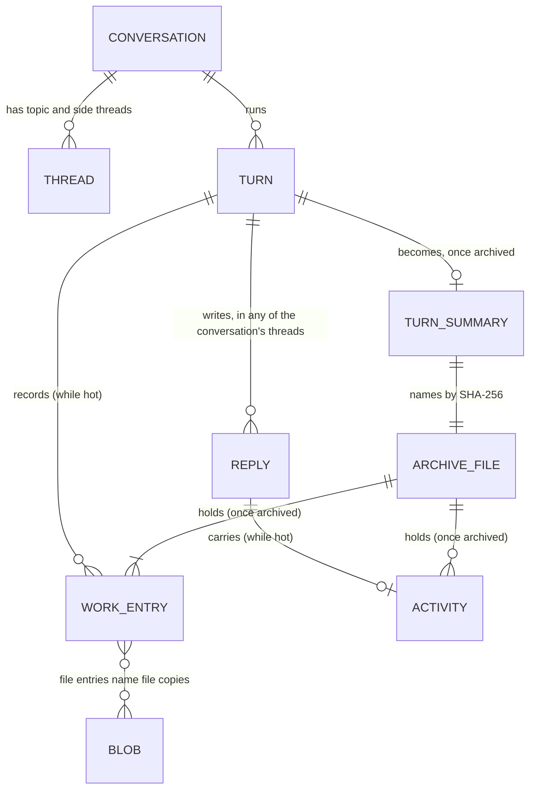

# Design: old turns’ work and activity leave the in-memory state (#305)

| | |
|---|---|
| **Status** | Draft 3, 31 October 2026. Replaces drafts 1 (approved) and 2 (changes requested: not a design). Folds in the pre-mortem (approved) and critic’s design-time review (go with conditions) |
| **Author** | engineer |
| **Reviewers** | critic (design-time read, before the pass is built); developer (senior developer, the store and 1a); the person and the integrator |
| **Relates to** | #305, #508; `designs/508/storage-design.md` on #580 (“Snapshots and pruning”, “Performance and budgets”, the one-line commit of 1a, #588); `designs/architecture.md` (“The store”, “Attachments”); `designs/intent.md`, principle 7 (deleting a conversation ends it, which bears on “Open questions”) |
| **Branch** | `fix/305-archive-turns` from `main` v1.7.0; built so far: the reducer (`6093206a`, `74d35f07`) and the blob store’s whole-file publish (`6716d07b`, `0ec34450`) |

## Summary

Two collections hold most of a long room’s state, though nobody reads them after their turn unless the person opens an old turn:

- **the work ledger** (`state.work[conversationId]`, #132): every command, file change, read and publish an agent made;
- **the activity steps** on agent replies (`item.activity.steps`, #452).

This design keeps each conversation’s **last two turns** of both in memory and moves every older turn into one immutable **archive file** in the blob store. A **turn summary entry** takes the turn’s place in the work list, and an archived reply keeps only a **count** of its steps. The person opens an old turn on demand. Every reader that needs old detail goes through one lookup.

On a 13.85 MB copy of this project’s store, the snapshot falls to about **4.0 MB** and its `JSON.stringify` from **20.1 ms to about 6 ms** (“Context: what the state holds today”), so the whole-state snapshot stays far under the storage design’s 50 ms budget, and the sharded snapshot (S2) is not needed.

## Goals and non-goals

**Goals**
- G1. Memory, `/api/state` and the snapshot hold only the last two turns’ work entries and activity steps of each conversation.
- G2. Nothing the person could open before is lost: every archived entry and step stays readable, with the same detail, through the same views and routes.
- G3. The log alone rebuilds the state: replay gives the same work lists and replies.
- G4. A failure at any step leaves either the turn fully in memory, or the turn fully in its archive file with a durable event naming it; never a durable event that names a missing file.
- G5. An older build fails visibly or shows less; it never corrupts the folder or crashes the page.

**Non-goals**
- The transcript’s items themselves (the B1 to B3 window, #531 to #533).
- Command outputs, which are already capped and fetched on demand (`ledger.output`, `server/runtime.mjs:2326`).
- A second writer (ST-2, deferred).

## Context: what the state holds today

Measured on the 13.85 MB copy used for the storage design’s budgets. The script is `/tmp/dev2/size-breakdown.mjs`, and its output is `/tmp/dev2/size-breakdown.txt`. critic and gemini measured the live store separately and got the same shares.

| Part | MB | Share | Read after its turn by |
|---|---|---|---|
| `items` (2,452) | 7.41 | 53.5% | the page, catch-up, the read tools |
| of which `item.activity` (12,924 steps on 916 replies) | 3.94 | 28.4% | the activity line when opened |
| `work` (6,480 entries) | 6.03 | 43.5% | the Work view when opened; diff, file, output, restore routes |
| of which `command` entries (4,573) | 5.24 | 37.8% | (the command line is 3.22 MB of it; output 0.38 MB) |
| everything else | 0.41 | 3.0% | |

Keeping the last K turns of each conversation (`/tmp/dev2/size-after.mjs`):

| Kept | Snapshot | `JSON.stringify` |
|---|---|---|
| everything (today) | 13.85 MB | 20.1 ms |
| last 5 turns | 4.10 MB | 6.4 ms |
| **last 2 turns** | **4.01 MB** | **5.9 ms** |
| last 1 turn | 3.98 MB | 6.1 ms |

## Data model

### Entities and relationships



- **A turn** has no record of its own today. It exists as the `turnId` on its work entries and replies. This design keeps it so.
- **Work entries are keyed by conversation**, but **replies are keyed by thread**. A turn in a topic or side thread writes its replies under that thread’s id, while its work goes to the conversation. Every operation here crosses both keys.
- **A hot turn** is one whose entries and activity are in the state. An **archived turn** is one whose summary entry is in the state and whose detail is in its archive file.

### Records

**Work entry** (existing, unchanged; `shared/work.mjs`, `server/ledger.mjs:169`):

| Field | Type | Notes |
|---|---|---|
| `id` | string | unique in its conversation |
| `turnId`, `threadId`, `sessionId`, `handle` | string | the turn and agent that made it |
| `kind` | `command` \| `file` \| `read` \| `publish` \| `commit` \| `push` \| `external` \| `branch` \| `change` \| `turn` | |
| `at`, `startedAt` | number | |
| `state`, `exit`, `ms` | | `state: 'running'` until a command ends |
| kind-specific fields | | `command`, `output`; file `changes` naming blob SHA-256s |

**Turn summary entry** (new; a work entry of kind `turn-archive`):

| Field | Type | Notes |
|---|---|---|
| `id` | string | `wa_<turnId>` |
| `kind` | `'turn-archive'` | an older build’s Work view skips an unknown kind (“Compatibility and downgrade”) |
| `turnId` | string | |
| `at` | number | the first archived entry’s `at`, so the list stays in time order |
| `sha256` | string | the archive file, `^[a-f0-9]{64}$` |
| `counts` | object | `files`, `lines {added, removed}`, `commands`, `failed`, `reads`, `publishes`, `steps`; computed once with `shared/work.mjs`’s totals |
| `handles` | string[] | the agents in the turn |

**Archived reply activity** (new shape of `item.activity`):

| Field | Type | Notes |
|---|---|---|
| `archived` | string | the archive file’s SHA-256 |
| `count` | number | how many steps it had. Not `steps`: an older page reads `activity.steps` as a list (`app/js/activity-paint.mjs:14-15`) |

**Archive file** (new; one blob per archived turn, JSON):

| Field | Type | Notes |
|---|---|---|
| `v` | `1` | the format version |
| `convId`, `turnId` | string | must match the summary that names it |
| `work` | WorkEntry[] | the turn’s entries, as they were in the state |
| `activity` | `{ [threadId]: { [itemId]: Activity } }` | each reply’s activity, keyed by thread then reply |

**Event `turn.archive`** (new; `shared/state-archive.mjs`):

| Field | Type | Notes |
|---|---|---|
| `convId`, `turnId` | string | |
| `sha256` | string | the archive file |
| `summary` | TurnSummary | the entry to insert |
| `items` | `{ threadId, id }[]` | the replies whose activity is archived |

### Where each lives

| Data | Store | Written by | Durability |
|---|---|---|---|
| Hot entries and activity | the state, the log, the snapshot | the ledger and the runtime, as today | as today (after 1a, a commit is fsynced) |
| Turn summary, archived activity | the state, the log, the snapshot | the `turn.archive` event | a commit (after 1a), opId `turn.archive:<turnId>` |
| Archive file | `<data>/blobs/<aa>/<rest>` | `Blobs.put` | draft, fsync, rename, folder fsync (`6716d07b`); `0600` |

## Invariants

- **I1. Order.** A durable `turn.archive` never names an archive file that isn’t durable: the file is published (synced and renamed into place) before the event is committed.
- **I2. Whole or nothing.** A reader of the blob store sees an archive file whole under its name, or no file. A short file under the name is replaced on the next put.
- **I3. One home.** At any time, an entry or a step is in the state or in exactly one archive file named by a summary in the state, never neither. (Both is allowed only between I1’s two steps, and only the state copy is visible.)
- **I4. Only finished turns.** A turn is archived only if it has ended, every entry in it is final (no `state: 'running'`), none of its jobs is kept, and it is not one of its conversation’s last two turns.
- **I5. The file holds exactly what the event removes.** Just before the commit, the pass serializes again the entries and activity the event will remove, exactly as it serialized them for the file; if the SHA-256 differs from the file’s, it abandons. No list of fields to forget (critic’s design-time review).
- **I6. Validated reads.** A read of an archive file takes its SHA-256 from a summary in the state, never from a request, and checks that the file’s `convId` and `turnId` match it.
- **I7. Private.** Archive files are `0600`, in folders created `0700`.

## Write path

### When the pass runs

After a turn’s ledger work ends (`ledger.endTurn`, `server/runtime.mjs:964`), the runtime runs the archive pass for that turn’s conversation. Passes for one conversation run one at a time (a promise chain per conversation); passes for different conversations may overlap. At start, a one-time pass walks every conversation (“Existing data”).

### One pass

```mermaid
sequenceDiagram
  participant R as Runtime
  participant P as Archive pass
  participant B as Blob store
  participant S as Store
  R->>P: turn ended in conversation C
  P->>S: read state: C's turns in order
  Note over P: pick the oldest turn that meets I4, or stop
  P->>P: serialize the turn's entries and replies' activity (all threads of C)
  P->>B: put(archive file JSON)
  Note over B: draft, fsync, rename, folder fsync
  B-->>P: sha256
  P->>S: read state again
  alt payload hash differs from the file's (I5)
    P-->>R: give up; try at the next turn's end
  else unchanged
    P->>S: commit turn.archive, opId turn.archive:turnId
    Note over S: fsync, then apply and broadcast
    S-->>P: seq (or duplicate)
    P->>P: repeat while C has more than two hot turns
  end
```

- **Turn order** is the order of each turn’s first entry or first reply in the state.
- **“Unchanged”** is I5’s rule: the hash of the payload the event will remove, compared with the file’s hash just before the commit. A late `work.patch` (a background command finishing), a new step, or any other change to a removed field changes it.
- **Until 1a merges**, the commit is an `emit` issued after the file is published; I1 still holds because the file is synced first. With 1a, it is `store.commit([...], { opId })`, so a repeat after a crash returns `duplicate`.

### What the reducer does

On `turn.archive` (`shared/state-archive.mjs`), idempotently:
1. If `state.work[convId]` has no summary for the turn, remove the turn’s entries and insert the summary at the first removed entry’s index.
2. For each `{ threadId, id }`, replace that reply’s `activity` with `{ archived, count }` if it isn’t archived already.

## Read paths and access patterns

### Access patterns

| # | Pattern | Who | Key | Source | Cost | How often |
|---|---|---|---|---|---|---|
| A1 | List a conversation’s work | the Work view (`app/js/work.mjs:82`, `:813`), from `/api/state` | `convId` | state | as today, smaller | every open of the Work view |
| A2 | Open an old turn’s detail | the Work view | `convId`, `turnId` | archive file via `GET /api/threads/:id/work/turns/:turnId` | one blob read and parse: the largest turn’s work on the real-room copy is 243 KB, the median 0.6 KB (`/tmp/dev2/size-breakdown.txt`) | when the person clicks |
| A3 | Show an old reply’s steps | the activity line (`app/js/activity-paint.mjs`) | `threadId`, `itemId` | archive file via `GET /api/threads/:id/items/:itemId/activity` | one blob read | when the person opens it |
| A4 | Diff, file, output, restore of an entry | `runtime.mjs:2319-2333`, `ledger.fileDiff`, `ledger.output`, `ledger.restore` | `convId`, `entryId` | state, else the archive file whose summary’s turn holds it | state lookup, else one blob read | when the person clicks |
| A5 | Telemetry over a window | `server/telemetry-record.mjs:227` | `convId`, `since` | state, plus archive files of summaries whose `at` falls in the window | one blob read per archived turn in the window | per report |
| A6 | Recent URLs for permission judging | `server/write-intent.mjs:94` | `convId` | state (current turn) | as today | per tool call |
| A7 | UAT checks on a run | `server/room-checks.mjs:852`, `server/block-use.mjs:157` | thread | state, plus archive files through the same lookup | per check | per UAT run |
| A8 | Catch-up, `read_conversation`, `read_message` | the agents | thread | items only | unchanged | per turn |

A2 to A5 and A7 go through one helper, `archived(state, convId, { turnId | entryId | itemId })`, which enforces I6: the SHA-256 comes from the summary in the state; anything that doesn’t resolve is a 404 with a sentence, never a path built from the request.

### Opening an old turn

```mermaid
sequenceDiagram
  participant Pg as Work view
  participant H as Server route
  participant L as Lookup helper
  participant B as Blob store
  Pg->>H: GET /api/threads/T/work/turns/t7
  H->>L: archived(state, conv(T), turnId t7)
  L->>L: find summary for t7 in state.work (I6)
  L->>B: get(summary.sha256)
  B-->>L: bytes, checked against the hash
  L->>L: parse; check convId and turnId match
  L-->>H: the turn's entries
  H-->>Pg: 200 entries, drawn like a live turn
```

On a missing or damaged file, the route answers 410 with “This turn’s details couldn’t be read”, and the page keeps the summary’s counts.

### A diff in an archived turn

`ledger.fileDiff(convId, fileId)` looks the file entry up in the state; if absent, it asks the helper for the archived entry with that id, then reads its blobs exactly as it does for a hot entry. Output and restore do the same.

## Existing data

On the first start of a build with this change, after the store loads and before turns start, a pass walks each conversation and archives turns down to two, one turn per event, oldest first. A crash leaves a consistent prefix (each turn is independent), and the next start continues. If measuring T-9 on the real-room copy shows it takes over about a second, it runs after the server is listening instead.

## Compatibility and downgrade

| An older build meets… | What happens | What the person sees |
|---|---|---|
| a log line `turn.archive` (not yet pruned by a snapshot) | `load()` throws “Unknown store event” (pinned by T-10 on `main`) | Postbox doesn’t start, and says why |
| a snapshot with summaries (the event pruned) | the Work view meets `kind: 'turn-archive'` it doesn’t know | old turns missing from its Work view (pinned by a characterization test on `main`’s `work-list.mjs`) |
| a reply with `{ archived, count }` | `activity.steps` is undefined, so no steps | old replies with no activity line (pinned on `main`’s `activity-paint.mjs`) |

The release note says so, with a `BREAKING CHANGE` footer, and `tools/unarchive-turns.mjs` rehydrates every summary from its archive file into a copy of the folder.

## Failure modes and crash points

| Killed or failed… | On disk | Next start or next pass | The person sees |
|---|---|---|---|
| before the archive file’s draft is written | nothing new | the turn is still hot; the next pass archives it | nothing |
| during the draft | a `*.draft` beside the blob | the draft is ignored and never swept (a known limit); the next put writes a new one | nothing |
| after rename, before the folder sync, then a power cut | maybe no file | the event wasn’t committed (I1), so the turn is still hot | nothing |
| after the file, before the event | an orphan archive file | the next pass publishes the same bytes (no change) and commits | nothing |
| after the event | file and event | replays; a repeat commit returns `duplicate` | the summary |
| a `work.patch` lands during the put | a published file | I5 fails; the pass gives up; the file is an orphan until a later pass names it or not | nothing |
| a missing or damaged archive file at read time | | 410 with a sentence | “This turn’s details couldn’t be read”, with the counts |
| a remote turn’s entries arrive after its end | | I4: a running entry blocks archiving | nothing |

## Security and the operator

- **Trust boundary.** Archive files hold command lines and output, which can contain secrets the person typed. They are `0600` in `0700` folders (I7). Known limits: blob files and folders that already exist keep their mode, and a `*.draft` left by a crash is never swept.
- **A file damaged after it was written** with its size unchanged is still caught: `Blobs.get` checks the SHA-256 on every read, so the lookup helper refuses it and the route answers 410.
- **Deletion (open: see “Open questions”).** Blobs are never deleted today. A deleted conversation’s archive files would outlive it.
- **Disk.** Archive files hold what the snapshot held, once each; the snapshot shrinks by the same amount.

## Test plan, each written to fail first

| # | Test | Status |
|---|---|---|
| T-1 | Ending a third turn archives the first; the file holds its entries and activity byte for byte | written, red |
| T-2 | Replay of the log gives the same state; a second pass changes nothing | to write |
| T-3 | A running turn, a running entry or a kept job is never archived | written (guard until the pass exists) |
| T-4 | A crash after the file and before the event: a restart archives once | to write |
| T-5 | `…/work/turns/:turnId` returns the turn; diff, file, output and restore work for an archived entry | to write |
| T-6 | An old reply’s activity loads on demand; a missing or altered file gives 410, not an empty list | to write |
| T-7 | Telemetry over a window spanning an archived turn equals the report before archiving | to write |
| T-8 | `--recheck` of a saved run folder after archiving finds the same findings | to write |
| T-9 | The one-time pass on the real-room copy: two turns left per conversation; every entry and step reachable; the snapshot shrinks as measured; how long it takes | to write |
| T-10 | Characterization on `main`: a build that doesn’t know an event refuses to load a log holding one, and writes nothing | written, green on `main` by design |
| T-11 | A reply in a topic thread is archived with its turn | written, red |
| T-12 | The archive file is published before the commit that names it, with opId `turn.archive:<turnId>` | written, red |
| T-13 | A change to any removed field during the put (a `work.patch`, a step’s text) stops the archive | to write |
| T-14 | Characterization on `main`: the Work view skips an unknown `kind`, and the activity line draws nothing for `{ archived, count }` | to write |
| T-15 | Blob store: a truncated file is replaced; no draft left; `0600` and `0700`; a folder sync failing with `EIO` rejects, an unsupported one doesn’t | written, passing (`6716d07b`, `0ec34450`) |
| Browser | The Work view’s summary row and “Show details”; a reply’s steps on demand; at 1280 and 375 px, normally and with `POSTBOX_STREAM_LAG=300` | to write |

## Rollout

| Step | What ships | Depends on |
|---|---|---|
| 1 | Blob store whole-file publish and modes | nothing (done) |
| 2 | Reducer, archive pass, lookup helper, routes, one-time pass | step 1 |
| 3 | Work view and activity line on demand | step 2 |
| 4 | `tools/unarchive-turns.mjs`, release note | step 2 |
| — | Switch the pass’s `emit` to `commit` | 1a (#588) merging |

## Alternatives

| Option | Why not |
|---|---|
| S2, the sharded snapshot | Splits the same bytes across files; memory and `/api/state` keep carrying them |
| Drop old activity and command lines | Loses what the person can open today (G2) |
| Keep N entries, not N turns | Splits a turn across memory and archive; the Work view groups by turn |
| A file per turn under its own folder | Its own naming, publishing and verification, which the blob store now gives |
| Archive by time (the last day) | Two turns is simple and measured; a day of a busy room holds many turns |

## Open questions

1. **Deleting a conversation:** delete its archive files with it (nothing else names them), or state the limit, shared with file copies, that blobs are kept? `intent.md` principle 7 says deleting a conversation ends it, which argues for deleting. For the person or the integrator.
2. **The one-time pass:** at start before turns run, or after the server listens? Decided by T-9’s measurement.
