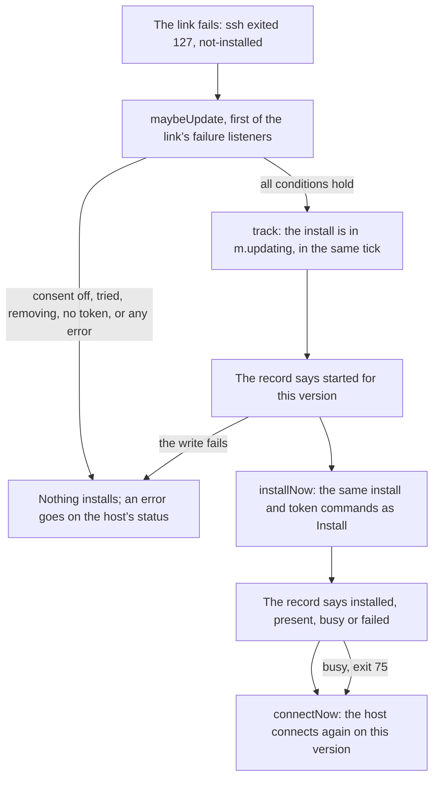

# #464-b: keeping a host’s Postbox up to date, with the person’s standing consent

| | |
|---|---|
| **Status** | Revision 4, approved by the reviewers (“go for b2a”), with the later conditions listed under “Where things stand”. Slice b1 is built (#736); slice b2a is built (#755); b2b is built on its branch and described here as it is; b3 is designed and not built. Every citation was read at the b2a branch’s head, `541fdb60`. |
| **Issue** | #464, “Updating Postbox should not strand agents on remote hosts” |

## What it’s for

Postbox runs agents on remote hosts over ssh, and each Postbox version installs its own copy of the host program there. After the person upgrades Postbox on their computer, a host still has only the older version, so the next attach finds nothing to run, and today the person must notice and press Install… (see “What Postbox does without it”). With this change, a host the person has opted in gets this Postbox’s version by itself, once per version, and Postbox connects again. Nothing installs on a host where the person hasn’t said so.

## Where things stand

- **b1, the UAT runner’s option** to stage an older Postbox on a test host (`--stage-host-version <tag>`, `tools/uat/hosts-options.mjs:7`, `:59`): built, #736.
- **b2a, this branch:** the rule, the record, the consent’s route, the UAT trigger `host-auto-installed` and the check `auto-install-repeated`. Built, with these conditions the reviewers added after revision 4:
  - removing a host deletes its record (`forget()`, `server/remote/hosts.mjs:229-244`; test “forget() removes the host’s record with its token, so a later host with the same ID has no consent”);
  - every write to one host’s record goes through one promise chain (`afterWrites`, `server/remote/install-record.mjs:158-167`);
  - Remove doesn’t install on the host it’s removing (`server/remote/hosts-update.mjs:94-95`);
  - a record file over 8 KB is refused unread (`install-record.mjs:24`, `:110`);
  - the record is read through one `O_NOFOLLOW | O_NONBLOCK` open, checked with `fstat`, and read up to that bound (`install-record.mjs:106-122`);
  - a records folder that’s a symbolic link is refused on read and on write (`install-record.mjs:84`, `:142`);
  - turning the consent on connects a stopped host once (`hosts-update.mjs:204-206`).
- **b2b, built on its branch:** the waiting caller, the card’s states, the turn’s line and the host editor’s toggle (see “What b2b adds”).
- **b3, after b2b:** the reinstall with a new token, and its card (see “What b3 adds”).
- **D6,** turns started under the old version, is to be filed as its own issue (see “Turns started under the old version”).

## Decisions taken

| Decision | What | By |
|---|---|---|
| D1 | Scope: the standing consent only. The fallback with no consent is #732. | scrum-master and critic |
| D2 | Whether a version was tried is kept in a 0600 file per host, in Postbox’s data folder. | scrum-master and critic |
| D3 | Downgrades are allowed: an install adds only its own version’s folder. | the person |
| D4 | A host with no `~/.postbox-remote` but a token on this computer is reinstalled, with a new host token (slice b3). | the person |
| D5 | Only exit status 127 (`not-installed`) starts an install. A `version` failure, a 126 and the rest don’t. | scrum-master and critic |
| D6 | Turns started under the old version stay out of #464-b, as their own issue. | critic, revision 4 |
| D7 | The consent is kept in the record file, set through its own route, not in the host’s settings. | critic, revision 4 |

## What Postbox does without it

- Postbox always runs its own version’s launcher on the host (`remoteCommand`, `server/remote/ssh-args.mjs:12-17`). Each version has its own folder, daemon socket and start lock there (`shared/remote-protocol-files.mjs:21-35`).
- A missing launcher makes ssh exit 127, which is classified `not-installed` (`server/remote/ssh-failures.mjs:150`), a kind that doesn’t retry (`:13`). The reconnector emits `'failure'` and then stops, since the kind doesn’t retry (`server/remote/ssh-reconnect.mjs:111-120`: the emit at `:115`, `stopped` at `:118`), from inside `connect()`’s rejection handler (`:140-142`). The link relays it (`server/remote/link.mjs:148`).
- A caller waiting in `ensureWelcome` then rejects (`nextWelcome`, `server/remote/hosts-links.mjs:235-253`), a later one throws at once (`:197`), and the host’s card offers Install… (`app/js/hosts-status.mjs:83`).
- Every caller that needs the host goes through `ensureWelcome` (`hosts-links.mjs:194-208`): a turn’s start (`server/remote/turns-start.mjs:78`), a reattach after a restart (`turns-resume.mjs:111`), a stop (`turns-stops.mjs:104`), the sign-in check (`hosts-requests.mjs:62`, and its second welcome at `:68`), removing Postbox from the host (`hosts-requests.mjs:116`), `refresh()` (`hosts.mjs:255`) and the computer waking (`wake()`, `hosts.mjs:260-278`). The `turns-*` callers reach it through `hosts.mjs:131`. Retry and Reconnect use `connectNow` (`hosts-links.mjs:218-232`) on the same link.
- `wake()` tries every configured host with a token and every host with a link (`hosts.mjs:262-267`), but skips a link that’s already stopped (`:273`).
- Only the person’s Install… runs the installer: `POST /api/hosts/:id/install` (`server/hosts-routes.mjs:23`) → `installHost` (`server/remote/host-status.mjs:103-115`) → the manager’s `install` (`hosts.mjs:221-226`). The installer ships the code with a fixed command over Postbox’s own ssh, checks every file against the manifest and renames the folder into place (`server/remote/install.mjs:9-21`), then runs `host token` and keeps the token on this computer (`installHost`, `install.mjs:244-268`, the token stored at `:266`).
- The host’s settings can’t carry anything new: `sshArgs` checks the whole stored settings object (`ssh-args.mjs:48`), and `checkHostSettings` refuses any key it doesn’t know (`shared/remote-settings.mjs:140-141`). New hosts are saved with every default key (`server/remote/host-admin.mjs:35`). So a new key in a host’s settings would make an older Postbox, after a rollback, throw on every attach and Install… for that host.
- The token file on the host is shared by all versions (`remote-protocol-files.mjs:36`), and the token step of an upgrade reuses it (`ensureToken`, `server/remote/host/daemon-files.mjs:82-111`).

## How it works

### The consent

- It’s `keepUpdated`, a field of the host’s record file on this computer (see “The record”), and false when there’s no file (`install-record.mjs:89`). It isn’t in the host’s settings, so an older Postbox never sees it (D7, and “What Postbox does without it”).
- It’s set through `PUT /api/hosts/:id/keep-updated` (`server/hosts-routes.mjs:25`), which takes exactly `{ on: true }` or `{ on: false }`, and refuses anything else with a 422 (`setHostKeepUpdated`, `server/remote/host-status.mjs:51-59`). A host that isn’t configured is refused before any record is written (`hostOf`, `hosts-update.mjs:201`; test “the consent’s route on a host that isn’t there is a 404, and writes no record”).
- The host’s status carries `keepUpdated`, and `update`, the newest try’s version, time, outcome and error, never a token or a path (`host-status.mjs:33-34`, `updateOf`, `install-record.mjs:224-229`).
- Turning it on for a host whose link is stopped connects once, so the rule sees a fresh failure (`hosts-update.mjs:204-206`): `wake()` skips a stopped link, so nothing else would (`hosts.mjs:273`). Turning it off doesn’t connect (test “turning the consent off for a host stopped on a 127 doesn’t connect it again”).

### The rule

`maybeUpdate(m, id, failure)` (`hosts-update.mjs:88-103`) is called for every failure of a host’s link, through `m.onFailure` (`hosts.mjs:111`). The listener is the first one `follow` attaches (`hosts-links.mjs:80`), and `follow` runs in `makeLink` (`:71`) before anyone else can listen, so it runs before any caller’s listener. It starts an install only if all of these hold, in this order:

- the failure is `not-installed` with exit status 127 (`hosts-update.mjs:90`), so a real ssh exit, not the “no token here” failure `linkOf` makes, which has no exit status (`hosts-links.mjs:141-143`);
- the record’s consent is on, and this version isn’t tried (`hosts-update.mjs:92`);
- no install of this host is under way (`:93`);
- the host isn’t being removed (`:95`): Remove connects to stop its turns, and a 127 then is no reason to install;
- the host is still configured, and this computer has its token (`:96-97`).

It is synchronous until the install is in `m.updating`: the record is read with synchronous calls and kept in memory (`recordOf`, `install-record.mjs:129-135`), and `track` puts the entry in the map at once and starts the job in the next microtask (`hosts-update.mjs:39-55`). So a caller that hears the same failure already finds the install there.

It never throws: the body is in a `try`, and any error becomes the host’s `update.error` (`hosts-update.mjs:100-102`). A throw there would be inside the reconnector’s handler, and the link would never reach `stopped`.

### The record

- One file per host, `<data folder>/remote-installs/<host id>`, 0600 in a 0700 folder, written to a temporary file and renamed, as a token is (`writeRecordFile`, `install-record.mjs:138-151`; `storeToken`, `server/remote/install-token.mjs:24-35`). It holds `{ keepUpdated, installs }`: the tries, newest first, at most 16, each `{ version, at, outcome }` (`install-record.mjs:1-5`, `:22`).
- **Written before the install starts,** with `outcome: "started"` (`noteStarted`, `hosts-update.mjs:146-161`), and rewritten with how it ended: `installed`, `present`, `busy` or `failed` (`noteEnd`, `:167-179`). b3 adds `reinstalled`; it is already an accepted outcome (`install-record.mjs:26`).
- **No record, no install.** If the first write fails, nothing installs, and the status says “Postbox couldn’t note the install in its data folder (<error code>), so it didn’t install by itself. Install it from here.” (`hosts-update.mjs:155`).
- **Tried:** a version is tried when the newest entry is that version’s (`isTried`, `install-record.mjs:214-216`). So one version installs once, however often its folder disappears. But a rollback from A to B and back to A installs A again, once, which matters because B’s daemon may have retired A’s folder (`retire`, `server/remote/host/cleanup-root.mjs:45-71`).
- **The read fails closed** (`readRecord`, `install-record.mjs:80-92`). A records folder that isn’t a real folder, a file that isn’t a regular file, one over 8 KB, bad JSON, or any shape but exactly `{ keepUpdated: boolean, installs: [{ version, at, outcome }] }` (`parseRecord`, `:61-71`, with the version rule from `shared/remote-protocol-checks.mjs:12`) is no consent, and nothing installs. The status says “Postbox couldn’t read its note of installs on this host, so it won’t install by itself.” (`install-record.mjs:28`). Saving the consent again rewrites the file whole (`setKeepUpdated`, `hosts-update.mjs:199-207`).
- **One open:** the file is opened once with `O_NOFOLLOW | O_NONBLOCK`, checked with `fstat` on what was opened, and read up to 8 KB (`readSmallFile`, `install-record.mjs:106-122`). So a symbolic link fails the open, and a FIFO can’t block the failure’s tick.
- **One write chain per host:** each write applies its change to the record as the write before it left it, so the consent and an install’s notes never overwrite each other (`changeRecord`, `install-record.mjs:176-186`; test “the consent turned off during an automatic install stays off after the install’s last write”).
- **Cost:** each failure costs a few `Map` lookups, plus one read of a file under 8 KB the first time for each host. `m.installRecords`, `m.updating` and `m.recordWrites` hold at most one entry per host, and the last two drop theirs when they settle (`hosts-update.mjs:44-47`, `install-record.mjs:163-165`).

### One install at a time, and exit 75

- The person’s Install… and the rule share `m.updating`: a call while an install runs gets that install’s outcome (`install`, `hosts.mjs:221-226`). The commands, manifest check and lock are the button’s own (`installNow`, `hosts-update.mjs:63-81`).
- An entry’s `done` never rejects. It resolves to `{ ok: true, result }` or `{ ok: false, failure }` (`hosts-update.mjs:48-53`), so a failed install with nobody waiting settles quietly into the record and the status. That matters because the server has no `unhandledRejection` handler; only the host’s daemon has one (`server/remote/host/daemon-main.mjs:198`).
- **Exit 75** means another attach or install holds this version’s lock (`server/remote/install-script.mjs:78-79`). It’s noted `busy`, and the host connects once more (`afterBusy`, `hosts-update.mjs:117-120`). If the other one installed the version, the host connects. If not, the 127 comes back, the version is tried, and nothing more installs by itself.

### Closing Postbox, and removing a host

- Each install has an `AbortController` beside its promise (`hosts-update.mjs:40`). `close()` aborts every one (`hosts.mjs:285`), and the installer’s `run()` kills its ssh child with SIGKILL, as at its timeout (`install.mjs:101-108`). The record stays `started` (`hosts-update.mjs:135`), so the next Postbox doesn’t try that version again by itself.
- `forget()` waits for the host’s install under way, then drops the link, the token and the record (`hosts.mjs:229-244`). The install’s own last writes skip a host that’s gone (`hosts-update.mjs:74`, `:150`, `:171`).

## What b2b adds: the waiting caller, the card and the toggle

In b2a, the caller that heard the 127 still fails as it does today (`ensureWelcome` is unchanged there), and the host connects again after the install (`hosts-update.mjs:79`). So the first turn fails and the next one runs. b2b changes that, in `ensureWelcome` (`hosts-links.mjs`), which every caller in the class table goes through; Retry, Reconnect and Install…’s own connect use `connectNow` instead:

- **The waiting caller.** At both of `ensureWelcome`’s failure exits (a stopped link on entry, and an attempt that rejects), if `m.updating` has the host, it awaits that install’s `done`. On `ok`, it calls itself again from the top, at most once per call: `linkOf` again, so it gets a new link after a dropped one; `connected` is checked first, so it can’t miss a welcome that arrived meanwhile; and on a stopped link it calls `retry()` itself rather than count on `installNow`’s `connectNow`. On a failure, it throws the installer’s failure, with its next step, not the 127.
- **Its bound:** at most the install’s timeout plus the token step’s (5 and 2 minutes, `install.mjs:56`, `:58`), plus one welcome. Meanwhile the turn’s status line says “Installing Postbox <version> on <host>…”.
- **Removing Postbox from the host doesn’t wait** for an install (`runRemove`, `hosts-requests.mjs:117`): that caller passes `{ waitForInstall: false }`, and goes ahead on the current link or fails with the 127. Forgetting the host (`forget()`) still waits (see “Closing Postbox, and removing a host”).
- **A busy install** (exit 75) doesn’t fail the waiter: the host connects once more after it (`afterBusy`), and the waiter tries once more with it.
- **Why it failed, on the status.** A failed install’s own reason and next step go on the host’s status as `update.error`, in the words Install… would show, kept in memory only and cleared by the record’s next write. An error that isn’t the installer’s `SshFailure` (an error keeping the token, say) may name a path on this computer, so it puts nothing there, and the card says to install by hand to see why.
- **The card** shows “Installing Postbox <version>…”, then “Postbox installed <version> here by itself”, or the installer’s failure with Install… beside it. The host is named by its display name only.
- **The toggle** in the host editor: “Keep Postbox up to date on this host: install this Postbox’s version here when it’s missing, once per version.” It calls the route b2a adds.

## What b3 adds: the reinstall with a new token (D4)

When `~/.postbox-remote` is gone but this computer has a token, the attach exits 127 and the rule runs:

- The installer makes the folder again (`install-script.mjs:112-115`), and `host token` makes a new token, since none is left (`daemon-files.mjs:82-111`).
- b2a already replaces this computer’s token and drops a link made with a different one (`hosts-update.mjs:75-77`; test “an install whose token differs from the link’s replaces the link made with the old token”). b3 compares the old token with the new one before overwriting it, returns `tokenChanged`, and notes the outcome `reinstalled`.
- The card then says: “Postbox wasn’t on <host> any more, so it installed <version> there again and made a new token. Turns that ran there before are gone.” A browser spec checks it at 375 and 1280 px, and that it never shows the token.
- No loop: the version is tried, so if the folder disappears again under the same version, nothing installs by itself.

## Invariants

- **I1. Consent.** No install starts by itself unless the host’s record says `keepUpdated: true` when the failure arrives (`hosts-update.mjs:92`). Turning it off stops the next one; one under way finishes.
- **I2. Once per version change.** For one host, an automatic install of version V starts at most once until another version is tried there after it. It holds across restarts, retries and concurrent callers, because the record is written before ssh runs, `m.updating` joins concurrent callers, and there’s no install without a record (see “The record”).
- **I3. Same code, same checks.** An automatic install runs exactly the button’s install and token commands, with the manifest check, the per-version lock and the refusal of symbolic links (`installNow`, `hosts-update.mjs:63-81`; `install-script.mjs:77`).
- **I4. Additive.** An install writes only `~/.postbox-remote/<this version>/`, the locks folder and, if missing, the token. Removing another version’s folder stays with the host’s cleanup (`cleanup-root.mjs:45-71`).
- **I5. No loop.** A failed or interrupted automatic install leaves the host stopped, with a failure only the person can clear. The reconnect loop stops on any kind that doesn’t retry (`ssh-reconnect.mjs:118`), 127 included (`ssh-failures.mjs:13`).
- **I6. Nothing private leaves, and nothing reaches an older version.** The record and the status carry versions, times, outcomes and error codes. The host’s settings don’t change. Logs, tests and the page name a host by its display name or a placeholder.
- **I7. Same tick.** `m.updating` has the host before any other `'failure'` listener of that link runs (test “m.updating has the host in the failure’s own tick, before any other failure listener of the link runs”).
- **I8. The listener can’t break the link.** `maybeUpdate` returns normally whatever happens, and the reconnector always reaches `stopped` (test “maybeUpdate returns normally when its state is broken or hostOf throws”).
- **I9. No install outlives its manager,** and no install’s outcome is a rejection that nothing handles (see “Closing Postbox, and removing a host”).

## Failure table

What’s on disk, what a concurrent reader sees and what the person sees after a kill or a failure at each step. The host’s steps are in `INSTALL_SCRIPT` (`install-script.mjs:63-159`). “Kill” means the host shell’s EXIT trap (`:110-111`) didn’t run. The person’s column is b2a’s card, the failure and Install…, unless it says b2b.

| Step | On disk after a kill | A concurrent reader | The person |
|---|---|---|---|
| This computer: `maybeUpdate` hits an error (record unreadable, host removed) | nothing new | the link reaches `stopped` (I8) | the 127’s message, `update.error`, Install… |
| This computer: the first record write fails | nothing new | — | “Postbox couldn’t note the install…”, Install…; no install |
| This computer: record says `started`, ssh not yet run | the record says tried | a second caller joins `m.updating`; after a restart, nothing installs | the newest try, `started`; Install… |
| Postbox closes during the install | record stays `started` | ssh is killed (I9) | after a restart, as the row above |
| Host: `.install-<v>-<pid>` made or partly unpacked (`:71-72`, `:114-116`) | a leftover `.install-*`; no version folder changed | an attach of this version still exits 127 | as the row above |
| Host: the manifest check fails (`:131`, exit 66) | a leftover `.install-*` | as above | “failed”, with the installer’s next step; no retry |
| Host: the version’s lock is held (`:137-149`, or a running daemon or turn, `:152-153`; exit 75) | nothing changed | the holder goes on | `busy`, then one connect: Connected if the other one installed it, else Install… |
| The person presses Install… during an automatic install | — | the button joins `m.updating` | one install, one outcome |
| The person removes the host during an automatic install | the install runs to its end; its last writes skip | `forget()` waits for it | the host is gone, with no token or record left |
| Host: the old same-version folder moved aside, the new one not yet in (`:155-157`) | **this version’s folder is missing**; `.old-*` and `.install-*` left | an attach of this version exits 127 | tried, so nothing more by itself; Install… works |
| Host: renamed into place (`:156`) | installed | an attach starts this version’s daemon | the kept token still matches (the token file is shared) |
| This computer: the token step fails (`tokenOutcome`, `install.mjs:208-230`) | code installed, record `failed` | — | the installer’s token message; no retry |
| This computer: token kept, record `installed` | done | the host connects again (`hosts-update.mjs:79`); in b2b the waiter goes on | Connected; in b2b, the caller starts on the new version |
| A half-written record file | never seen: a temporary file, then a rename | only the renamed file is read | — |
| Postbox upgraded again | a new version, so a new entry, and one install | — | the same as the first upgrade |
| Rollback, A to B to A (D3) | B’s daemon may have retired A, since only older versions are retired, and only by the newest (`cleanup-root.mjs:53-54`); A isn’t tried, since B came after it, so it installs once more | — | Connected on A |
| An older Postbox after a rollback | the host’s settings unchanged, so its `sshArgs` accepts them; it doesn’t read `remote-installs/` | — | its own behavior: Install… as before |

Three gaps predate this change:

- Leftover `.install-*` and `.old-*` folders are never cleaned, since the cleanup matches only version names (`server/remote/host/cleanup-files.mjs:30`). `.old-*` is left only when the script dies between `:155` and `:157`, since the EXIT trap removes only the temporary folder and the locks (`install-script.mjs:110`).
- What SIGHUP does to the trap depends on the login shell. Unverified.
- Pre-release version folders are never retired (`cleanup-files.mjs:30`).

## The class table: neighbors and what each gets

| Neighbor | Today | With b2a | With b2b | Test |
|---|---|---|---|---|
| A turn’s start (`turns-start.mjs:78`) | rejects with the 127 | rejects; the host installs and connects, so the next turn runs | waits, re-enters, starts | b2a: “a 127 with the consent on and a token here installs once…”; b2b: to come |
| A caller after the link stopped (`hosts-links.mjs:197`) | throws at once | throws at once | waits for the install under way | b2b |
| A reattach after a restart (`turns-resume.mjs:111`) | rejects; tries again at the host’s next status | as today, then reattaches once connected | waits, then reattaches | b2b |
| A stop, the sign-in check and its second welcome, `refresh()` (`turns-stops.mjs:104`, `hosts-requests.mjs:62`, `:68`, `hosts.mjs:255`) | through `ensureWelcome` | starts or joins the install | waits: each needs the new version’s daemon | one test for the shared path, b2b |
| Removing Postbox from the host (`hosts-requests.mjs:117`) | through `ensureWelcome` | starts or joins the install | doesn’t wait (`waitForInstall: false`) | b2b |
| Removing the host (Remove, then `forget()`) | — | doesn’t install first (`hosts-update.mjs:95`); `forget()` waits for an install under way | the same | “removing a host whose version is missing doesn’t install on it first, consent or not”; “forget() during an automatic install waits for it…” |
| The computer waking (`hosts.mjs:260-278`) | tries hosts not stopped | a fresh start after an upgrade installs where the link isn’t stopped | the same | none yet; b2b adds one |
| The consent turned on while stopped | — | one connect (`hosts-update.mjs:206`) | the same | “turning the consent on for a host already stopped on a 127 connects once, and that installs” |
| Retry or Reconnect (`connectNow`) | the same link’s failure | the rule runs | the same | the main path |
| The person’s Install… during an automatic one | two installs, one exits 75 | joins the one under way | the same | “two 127s in quick succession, and the person’s Install… during the automatic one, give one ssh install” |
| The reconnect loop (`ssh-reconnect.mjs:118`) | a 127 stops it | unchanged | unchanged | “tried: the same version failing 127 again after its install gets no second install” |
| Postbox closing during an install | the install’s ssh child isn’t stopped | killed; record stays `started` | the same | “close() during an automatic install kills its ssh child, and the record stays started” |
| Two hosts at once | — | one install each, per host | the same | none yet; b2b adds one |
| An older Postbox reading this data folder | — | the host’s settings unchanged | the same | “the consent’s route needs the page’s token, takes only { on: boolean }, and never reaches the host’s settings” |
| Local turns | not affected | not affected | not affected | — |
| Each agent backend | the change is in the host manager, in no adapter | — | — | UAT on Claude Code only |

## Security boundaries

- **The page’s token.** The consent changes only through its route. Every request that isn’t a GET or HEAD needs the page’s token, except `/mcp` (`server/index.mjs:219-227`), after the Host and Origin checks (`:214-218`). `/mcp` is where agents call Postbox’s tools, and no tool edits hosts or the consent (`shared/mcp-tools.mjs` has none). So I1’s only source is the page (tests “the consent’s route needs the page’s token…” and “every write route in server/index.mjs has a case in the token test”, `tests/server-token.test.mjs`).
- **What runs on the host:** the same two commands as Install…, built only from the validated version (`install.mjs:9-21`), spawned with an argument list (`install.mjs:92`), over the ssh options Postbox already uses.
- **The consent:** per host, off by default, kept only on this computer, never sent to the host (`helloSettings`, `ssh-args.mjs:87`, builds only from settings), and forgotten after a rollback (I6).
- **The record read:** fails closed, through one open that can’t follow a link or wait on a FIFO, bounded at 8 KB, in a folder that must be real (see “The record”). A write over a linked folder is refused rather than changing what it points to (`install-record.mjs:141-142`; test “a records folder that’s a link to elsewhere is no consent, and a write never changes its target”).
- **What can start an install:** the server starts one only from an ssh exit status it saw itself. **But anything with a shell on the host can cause one,** an agent running there included: removing `~/.postbox-remote/<version>` makes the next attach exit 127, and in b3 removing `~/.postbox-remote` causes a reinstall that makes a new token. Any 127 counts: on a host with no usable Node, a missing `sed` makes the launcher exit 127 (`server/remote/host/host:147`), which reads as `not-installed`. The harm is bounded by I2 and I3: only this Postbox’s own checked code, at most once per version change. Something with a shell on the host can already do far more.
- **Secrets and private data:** the token stays in `remote-tokens/`. The record and the status carry no token and no path (`install-record.mjs:218-229`).

## Tests

b2a’s tests failed first on the branch (`2603222a`), and each guard has a test that fails without it. They’re in `tests/remote-hosts-update*.test.mjs`, using the fake ssh in `tests/remote-hosts-update-fixtures.mjs`, and in `tests/server-token.test.mjs`:

- **The main path:** “a 127 with the consent on and a token here installs once, and the record says installed for this version”.
- **The rule’s guards:** no install with the consent off, with no record file, with no token, for a 126, a `version` failure, the synthetic “no token here” failure, or a host removed first; a record read that throws (`EACCES`) is caught.
- **The record:** it says `started` before ssh; a failing first write installs nothing; a try left `started` by a kill installs nothing; the same version twice installs once; A, then B, then A installs A once more; a 17th try keeps 16 on disk; 0600 in 0700; queued writes run in order; a failed write leaves the kept record as it was.
- **The strict read** refuses each of: a symbolic link, a directory, bad JSON, an extra key, 17 installs, an unknown outcome, a bad version, a version that isn’t one, a time that isn’t a number, a non-boolean consent, and a valid record padded past 8 KB (`tests/remote-hosts-update-record.test.mjs`).
- **Running it:** one ssh install for concurrent callers; exit 75 records `busy` and connects once; a failed install with nobody waiting rejects nothing unhandled; `close()` kills the child; the installer’s signal kills its child, and one fired first spawns nothing.
- **The route:** it needs the page’s token, takes only `{ on: boolean }` (422 for a null, number or array body), is a 404 for a host that isn’t there, and never reaches the host’s settings or its hello.

b2b adds tests for the waiting caller (a slowed record write, a welcome before the last record write, a replaced link, an install whose own connect already failed, a busy install, a failure other than the 127 while the person’s Install… runs, at most one re-entry, Remove not waiting, the consent off), for the failure’s reason on the status, and browser specs for the toggle, the card’s states and the turn’s line at 375 and 1280 px. A reattach after a restart, the computer waking and two hosts at once have no test yet; the fixture shares one fake daemon between its hosts, so the last needs that changed first. b3 adds `tokenChanged` both ways, with a mutation that compares the tokens after they were overwritten.

## UAT

- **b1’s option** `--stage-host-version <tag>` installs an older release on the test host before the run (`tools/uat/hosts-stage.mjs`), trigger `host-staged-older` (`tools/uat/triggers-host.mjs`).
- **b2a:** the runner turns the staged host’s consent on through the page’s route (`keepUpdated`, `tools/uat/driver-hosts.mjs:81-83`). The trigger `host-auto-installed` fires when the host installed the run’s version by itself exactly once and a turn then ran there (`triggers-host.mjs:205-210`), and the check `auto-install-repeated` reports a second automatic install of one version on one host (`tools/uat/host-installs.mjs:39`). Both are tested on recorded data (`tests/uat-hosts-autoinstall.test.mjs`).
- **The phase** is phase 4 of `tests/uat/e2e/scenarios/remotehosts.md` (“Phase 4: An older Postbox on the host”). Until b2b, its first turn may fail, and the runner waits for Connected before the second.
- **b3:** trigger `host-reinstalled`, in a new phase where the runner removes the host’s `~/.postbox-remote` between two turns.
- **Agent backends:** UAT runs on Claude Code only. The Agent SDK, Codex, Kiro and Antigravity on a host are unverified; the change is in the host manager, in no adapter.

## Turns started under the old version (D6)

What happens today, with or without this change, since Install… has the same effect:

- Turn folders are shared by all versions (`remote-protocol-files.mjs:37-41`), so the new daemon lists an old turn, and Postbox reattaches it; its output replays and goes on live, and Stop works.
- **But its tool calls go to the old daemon:** the old turn’s shim uses its own version’s socket (`server/remote/host/shim-link.mjs:34`), and no Postbox attaches to that daemon any more. Its Postbox tool calls are answered but never reach the conversation (`server/remote/host/broker.mjs:10-12`); its questions fail (`:13-14`); its permission prompts are denied with no card (`:31`).
- The old folder goes once that turn ends and the old daemon exits (`server/remote/host/cleanup.mjs:25-29`).

That differs from #464’s acceptance (“A turn running under the older daemon continues”). It is to be filed as its own issue with this evidence, asking for a line on the turn itself.

## Pre-mortem

- **A login shell or launcher that exits 127 for another reason** gets one install that doesn’t help, then stops (I2). The status’s newest try reads `present`, which tells the person the code is there.
- **A home folder that’s reset often,** such as a container’s, reinstalls once per version change, then stops.
- **After a rollback, the consent is gone,** since no older Postbox reads the record. Coming back to this version reads it again.

## Files

| File | What | Lines (`wc -l`) |
|---|---|---|
| `server/remote/hosts-update.mjs` | the rule, one install per host, the consent | 207 |
| `server/remote/install-record.mjs` | the record: read, write, tried | 229 |
| `server/remote/hosts.mjs` | `install`, `forget`, `close` | 289 |
| `server/remote/hosts-links.mjs` | the first failure listener | 253 |
| `server/remote/hosts-status.mjs` | the status’s `keepUpdated` and `update` | 170 |
| `server/remote/host-status.mjs` | the route’s body and the page’s status | 149 |
| `server/hosts-routes.mjs` | the hosts’ routes, moved out of `server/index.mjs` with no change of behavior (`013e09ca`), then the consent’s | 29 |

No shared protocol file and no host settings file changes.

## What’s next

1. b2a’s pull request, from this branch.
2. b2b: the waiting caller, the card’s states and the toggle, with the tests listed under “Tests”.
3. b3: the reinstall with a new token, and its card.
4. File D6 as its own issue, and the leftover `.install-*` and `.old-*` folders as another.
5. Open: whether the first install’s confirm should also offer the consent, as #464 suggests. For now it stays with the host editor’s toggle.
