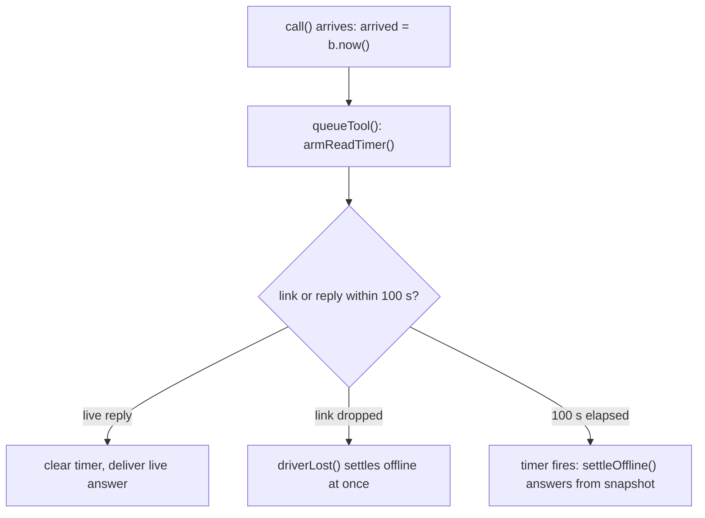

# #582, deadline: remote read execution timeout and replay

An agent on a remote host calls `read_conversation` or `read_message`. If Postbox is slow or the link stalls without dropping, the call can wait indefinitely. Kiro's client-side request timeout is 120 s (`requestTimeout: 120000`, sourced from [Kiro MCP configuration reference](https://kiro.dev/docs/custom-agents/configuration-reference); not re-opened in this session). This file covers the host broker's 100 s deadline: when it fires, how arrival times are tracked and replayed, and how timers are clamped. How an offline answer is produced is in `settle.md`, and transport link loss is in `link.md`.

## Decisions

- **`REMOTE_READ_TIMEOUT_MS = 100_000`** in `shared/limits.mjs`. A 100 s deadline leaves a 20 s safety margin under Kiro's 120 s client timeout. This 20 s margin is an assumed engineering estimate that has not been measured or benchmarked in production; it is intended as headroom for JSON-RPC framing, wire delivery, and in-memory formatting. A cold read of `snapshot.json` (for example, on a cache miss after daemon restart if the host disk is slow or hung) is not covered by this margin and remains bound by disk I/O.
- **Arrival timestamped at `call()` entry.** In `broker-tools.mjs`, `call()` captures `arrived = b.now()` on line 1, before any admission wait (`refusal()`, `prepare()`, or `queueTool()`). Pre-admission queue time counts toward the 100 s deadline.
- **Recorded in `tools.jsonl`.** The `call` record stores `at: t.arrived`. On daemon restart, `loadTurn()` in `broker-replay.mjs` restores `arrived` from `r.at` if it is a non-negative safe integer; otherwise it defaults safely to `b.now()`.
- **Pre-send expiry on hello.** After a restart or reconnection, `onHello()` in `broker-postbox.mjs` checks each unsettled read. If elapsed time (`b.now() - t.arrived`) is at least 100 s, it is settled offline immediately and never resent over the wire. If elapsed time is under 100 s, it is sent to Postbox and its timer is armed for the remaining duration.
- **Two-sided clock clamping.** Because host wall clocks can step forward or backward (NTP adjustments or VM resume):
  - Elapsed time is clamped against backward clock jumps: `Math.max(0, b.now() - t.arrived)`.
  - Remaining timer duration is clamped to at most 100 s: `Math.min(REMOTE_READ_TIMEOUT_MS, Math.max(0, REMOTE_READ_TIMEOUT_MS - elapsed))`.
  A timer duration never goes negative and never exceeds 100 s.
- **Timer lifecycle.** The timer is armed in `armReadTimer(b, t)` during `queueTool()` or `onHello()`. The timer is cleared when `settleOffline` claims the call, when `onReply` acknowledges a live reply (`t.replied = true`), or when the broker closes (`b.close()`).

## Invariants

- **Strict upper bound:** Every admitted read is settled within at most 100 s of its arrival on the host clock.
- **No timer leak:** Every armed timer is cleared on live reply, on offline settlement, or during broker shutdown. Default timers are `unref()`'d.
- **Safe replay:** Replaying an unsettled read across a daemon restart anchors its remaining deadline to the recorded `at` timestamp, preventing timer resets on host restart.

## Specs

In `tests/remote-read-deadline.test.mjs`, covering fake clock advancement, replay, clamping, and leak prevention:

| Spec | What it checks |
|---|---|
| T02 | 100 s deadline expiration via fake clock triggers `settleOffline` and returns snapshot text with the offline notice |
| T10 | Restart replay after failed reply write: resends if under 100 s; settles offline immediately without sending if 100 s or older |
| T11 | Replayed unsettled read arms timer anchored on `at`. Corrupted/negative `at` defaults safely to `b.now()`. Backward clock jump clamps remaining time to at most 100 s |
| T13 | Live reply at 50 ms clears timer and delivers without offline notice; exact result frame count verified |
| T14 | Zero leaked timers across live reply, expiry, and broker teardown |
