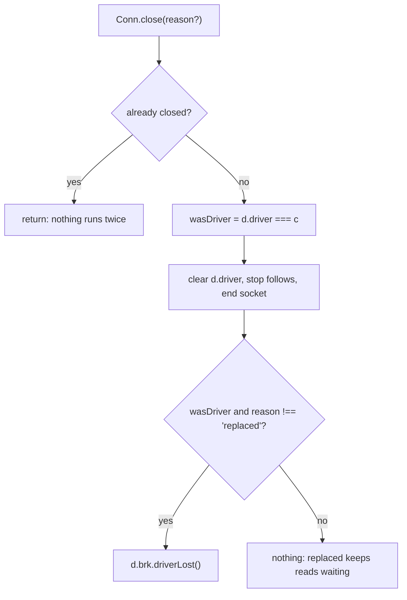

# #582 Part 2: link loss (when the driving Postbox goes away)

Owner: engineer. Scope: `close(reason)` in `daemon-conn.mjs`, the replacement and takeover branches in `daemon-hello.mjs`, and a new `driverLost(b)` on the broker. Not here: how a read is settled (Part 3, `settleOffline`), the 100 s timer and replay (Part 1). Every line number is on `main` at `fd60393e`.

## What `main` does today

| Fact | Where |
|---|---|
| `Conn.close()` takes no argument. It sets `c.closed`, then `if (d.driver === c) d.driver = null`. Nothing tells the broker. | `daemon-conn.mjs:31-36` |
| Every caller closes with no reason: the wrapper, `input.on('end'/'error')`, and the socket's `end`, `error` and `close`. | `:55`, `:116-118`, `:141-148` |
| A hello from a second Postbox, when `d.driver` is set and open, computes `same = old.instance === m.instance`. Not `same` and no `m.takeover`: refused `busy`, old driver untouched. | `daemon-hello.mjs:39-43` |
| `same`: logs the replacement. Otherwise logs the takeover and `fail(old, 'taken-over', …)`, a message to the old socket. Both then call `old.close()`. | `:44-49` |
| `d.driver = c; c.ready = true` follow with no `await` in between. Awaits start after (`findPrograms`, `scan`, `send welcome`), then `d.brk.hello(...)`. | `:51-62` |
| The broker learns Postbox is gone only by polling `attached(d)`, which is `d.driver && !d.driver.closed && d.driver.ready`. A read parked on a dead link is answered only if the shim sends it again. | `daemon-reply.mjs:28`, `broker-tools.mjs:192,201` |
| `onHello` re-sends every tool with `!t.replied` to the new driver. This is what keeps a read alive across a same-instance replacement. | `broker-postbox.mjs:55` |

Revision 17's `d.opts.onClose(c, wasDriver, reason)` does not exist. This part adds it.

## Contract

- **`close(reason?: 'replaced' | 'taken-over')`.** `undefined` means the socket ended. It is a typed argument: the socket-close paths don't know they are being replaced, and a field set beforehand could leak to the next close.
- **`wasDriver` is read before `d.driver` is cleared**, in the same synchronous step.
- **`driverLost` runs after the connection is fully closed**, so `attached()` is already false when `settleOffline` starts.
- **`driverLost(b): void`** (broker, `broker-state.mjs`/`broker.mjs`) calls `settleOffline(b, t)` for every `t` with `t.route === 'read'` and `!settled(t)`, in one synchronous loop. It does not await. It touches no field of `t`: Part 3 owns `replied`, `replying`, `result`.
- **`reason === 'replaced'` is S3a.** The hello's `old.close('replaced')` is followed in the same tick by `d.driver = c`, and `onHello` re-sends the unsettled calls to `c`. The reads were never lost; they were on the old socket's wire.
- **`reason === 'taken-over'`.** The old driver is gone and the next one is a different Postbox. `old.close('taken-over')` calls `driverLost`, so the reads settle offline before the new driver's `onHello` runs. That is the S3b rule developer set; this part implements it.
- **Order decides, S3a versus S2b.** If the hello arrives before the old socket's close, `d.driver` is still the old connection and the replacement branch runs (S3a). If the close arrives first, `d.driver` is already null, `driverLost` has run, the reads are settled offline (S2b), and the later hello finds nothing to resend. Both are correct. Neither order may settle a read twice or send it to the new driver after the claim: Part 3's `settled(t)` guard in the resend loop covers that.

## Edge cases

1. **A shim connection closes.** `wasDriver` is false: no `driverLost`.
2. **A refused hello (`busy`).** The old driver is not touched and `driverLost` does not run.
3. **Double close.** The `c.closed` guard returns first, so `driverLost` runs once per connection.
4. **A driver closes before `ready`.** `d.driver = c` and `c.ready = true` are one synchronous step, so `wasDriver` implies `ready`.
5. **Reads arriving between `d.driver = c` and the welcome.** `attached()` is already true, so they are sent to `c`. Not changed by this part.
6. **`ask` and `queue` calls on link loss.** Unchanged: `driverLost` touches reads only. An `ask` waits for the reconnect and is re-sent by `onHello`.

## Specs, each written to fail first on `main`

| ID | What | Fails on `main` because |
|---|---|---|
| L1 | The driver's socket ends: a parked read is answered from the snapshot at once, with no further call (T01) | nothing settles it until the shim sends again |
| L2 | A shim's socket ends: no read is settled | passes; a guard |
| L3 | Same-instance hello before the old socket's close: the read stays waiting, is re-sent once, and is answered by the live reply (T03, S3a) | passes in part; asserts no `driverLost` ran |
| L4 | The old socket's close before the hello (S2b): the read settles offline once, and the hello re-sends nothing | `driverLost` doesn't exist |
| L5 | Takeover hello: the old driver's reads settle offline before the new driver's resend (T04) | `close()` has no reason, so the cases can't differ |
| L6 | A `busy` hello leaves the driver and its reads alone | passes; a guard |
| L7 | Two closes of one driver call `driverLost` once | `driverLost` doesn't exist |
| L8 | `ask` and `queue` calls are untouched by `driverLost` (T12) | passes; a guard |

L1, L4, L5 and L7 are the failing ones. `close(reason)` is also type-checked by `npm run check` (the JSDoc types).

## What this part needs from the others

- **Part 3:** `settleOffline(b, t)` is safe to call for a call that is already claimed, and `settled(t)` is `t.replied || !!t.replying`. `driverLost` calls `settled` first, and the resend loop at hello uses it too.
- **Part 1:** none. `driverLost` and the deadline timer both call `settleOffline`; whichever claims first wins, and the other returns.

## Open for developer

1. Takeover settles reads offline before the new driver attaches (as above), rather than leaving them for the new Postbox to answer live. I recommend settling, because the new Postbox is a different workstation with a different view of the conversation.
