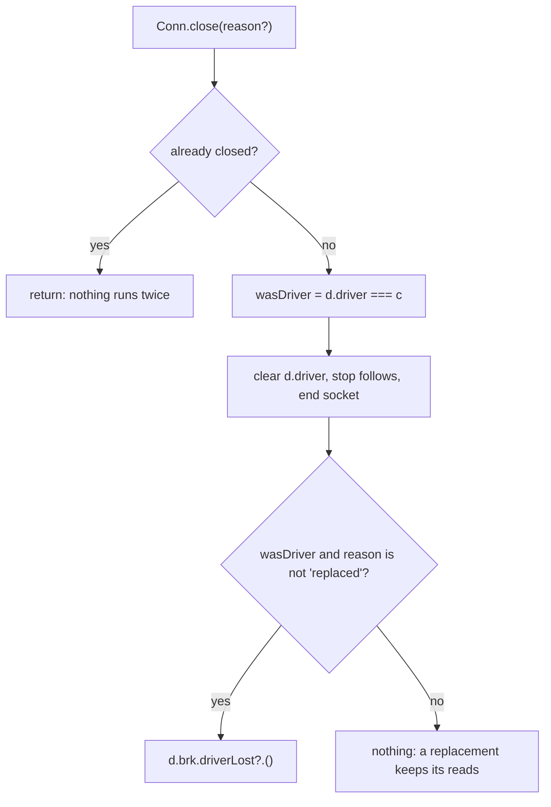

# #582, link loss: answering a read when the driving Postbox goes away

A read that is waiting for Postbox when the link drops is answered from the host's snapshot at once, not when the agent next asks. This file covers the connection side: how the daemon learns that its driver is gone, and what it tells the broker. How a read is answered is in `settle.md`, and the 100 s deadline is in `deadline.md`.

## Why it needs a change

- `Conn.close()` in `daemon-conn.mjs` takes no argument. It clears `d.driver` and tells no one.
- The broker learns Postbox is gone only by asking `attached(d)` when a call arrives. A read parked on a dead link is answered only if the shim sends it again.
- A hello from a second Postbox (`daemon-hello.mjs`) closes the old driver with `old.close()`. A takeover and the same Postbox coming back are told apart by `same`, but the close does not say which.
- After a same-instance hello, `onHello` sends every unsettled tool to the new driver again. That is what keeps a read alive across a replacement: its tool frame was on the old socket's wire.

## The change

- **`close(reason?: 'replaced' | 'taken-over')`** is a typed argument, because the socket-close paths do not know they are being replaced and a field set beforehand could leak to the next close. No reason means the socket ended.
- **`wasDriver` is read before `d.driver` is cleared**, in the same step.
- **`driverLost` is called inside `close()`, in the same tick, after the connection is fully closed**, so `attached()` is already false when `settleOffline` starts. It is never deferred: on a takeover, `old.close('taken-over')`, the assignment of the new driver and the claims in `settleOffline` have no `await` between them, so every unsettled read is claimed before the new driver exists. Its hello then skips them (`settled`), and the new Postbox, a different workstation, never answers the old session's reads.
- **The call is `d.brk.driverLost?.()`**, because `brk` may be a test's broker, as the daemon's `d.brk.hello?.(` already assumes.
- **`driverLost(b)`** answers each unsettled read through `settleOffline`, and does nothing once the broker is closed (the daemon closes it before its connections).
- **A hello from the same Postbox** closes the old driver with `'replaced'`: no `driverLost`, and the reads are sent again. **A takeover** closes with `'taken-over'`.
- **Which comes first decides.** If the replacement's hello arrives before the old socket's close, the old driver is still `d.driver`, the replacement branch runs, and the reads stay. If the close arrives first, `d.driver` is already null, `driverLost` has run, the reads are answered offline, and the later hello finds nothing to send. Neither order may answer a read twice.

## Edge cases

- A shim's connection closing is not the driver's: `wasDriver` is false.
- A hello refused as busy leaves the driver and its reads alone.
- Closing twice calls `driverLost` once.
- `ask` and `queue` calls are untouched. After a takeover the new Postbox is still sent the old session's unsettled ones, as before this change (#612).
- A timer on a read that `driverLost` settles is cleared by `settleOffline`, not here.

## Specs

In `tests/remote-link-loss.test.mjs`, an in-process daemon with a shim on its socket. Negative checks wait on a positive signal (the live reply, the broker's hello counter, a second read answered after the first), not a sleep.

| Spec | What it checks |
|---|---|
| L1 | The driver's socket ends: a parked read is answered from the snapshot at once |
| L2 | A shim's socket ends: the driver's parked reads are left alone |
| L3 | The same Postbox says hello before its old socket ends: the read stays, is sent again, and the live reply answers it |
| L4 | The old socket ends before the same Postbox's hello: one offline answer, and the hello sends nothing |
| L5 | A takeover: the old driver's read is answered offline, the new driver is sent nothing, and `driverLost` ran inside `Conn.close` in `daemon-conn.mjs` |
| L6 | A hello refused as busy leaves the driver and its read alone |
| L7 | A driver's socket closing twice settles the read once |
| L8 | A `queue` call is answered once as queued and sent again to the next driver. An `ask` call has no spec of its own; `settleOffline` returns at once for anything but a read |

Not written: that the claim is visible right after `old.close('taken-over')` returns. The claim is internal to the broker and no seam shows it; L5's stack check and the hello counter stand in for it.

Each of these mutations of the change fails a spec: `driverLost` deferred with `setImmediate` (L5); `driverLost` also on `'replaced'` (L3); the hello passing no reason (L3); `wasDriver` read after `d.driver` is cleared (L1, L4, L5, L7, L8). A `driverLost` on a closed broker is covered in `tests/remote-driver-lost.test.mjs`.
