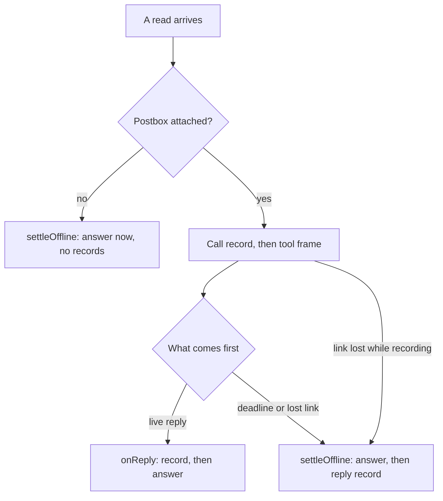

# #582 Part 3: one settle path for reads that can't reach Postbox

**Status:** implemented in this PR. **Base:** `main` at `fd60393e`. Code: `server/remote/host/broker-tools.mjs` unless a file is named.

## Scope

Every read that can't be answered live is answered by one function, `settleOffline`. This part owns:
- `settleOffline(b, t)` and the claim that makes it answer at most once per call;
- `settled(t)`, the test of whether a call is taken, and `t.offline`, the mark of an offline claim;
- what a read writes to the turn's journal (`tools.jsonl`);
- admission for a fresh read (`take`, `queueTool`, `queueFull`), and the `io` seam its specs use.

Not in this part: the deadline timer and the arrival time (`deadline.md`), and the connection's close reasons and `driverLost` (`link.md`). Both call `settleOffline`, and neither writes a field this part owns.

## Contract

```
settled(t): boolean                // t.replied || !!t.replying
settleOffline(b, t): Promise<void>
```

- It is safe to call any number of times. The first call claims the read, and later calls return at once.
- It never throws to its caller. A failure becomes a result with `ok: false`, or a log line.
- It answers every shim of the turn through `toShims` (`broker-state.mjs`), so the caller's connection need not still be open.
- It returns at once for a call that isn't a read. An `ask` or `queue` call is never answered from the snapshot.

## Invariants

1. **One answer per call.** Whichever of `settleOffline` and a live reply (`onReply`) claims a call first answers it. The other sees `settled(t)` and returns. Each sets its claim before any `await`.
2. **No journal write is awaited before the shim hears an offline answer.** That covers the call record, the reply record and the journal size check. It doesn't mean the answer never touches a disk: `readLocal` reads `snapshot.json` through `b.io.readFile` when the snapshot isn't cached (after a restart, say), and a hung disk holds that read. `deadline.md` states the same limit.
3. **A reply record, when one is written, follows its call record. A fresh detached read writes neither.** A read has no side effect, and the snapshot is the turn's start, so a resend after a restart gets the same text by reading it again.

## Which path answers a read



## The settle path

`settleOffline(b, t)`, in order:
1. **Claim.** Return if the call isn't a read, or if `settled(t)`. Otherwise set `t.replying` and `t.offline`, before any `await`. `t.offline` is never cleared: a claimed read is answered, or its call record failed and `queueTool` dropped it from `b.tools`.
2. **Clear the timer**, if `armReadTimer` set one.
3. **Read the snapshot.** `readLocal(…, true)` appends the offline notice, and a read that throws becomes `{ ok: false, text }`. `offlineText` cuts an answer longer than `REMOTE_LIMITS.replyChars` and keeps the notice at its end. The shim, the cached result and the reply record then carry the same text, and replay restores it (`broker-replay.mjs` drops a reply text longer than `replyChars`).
4. **Answer.** Set `t.result` and `t.replied`, then send the result to every shim of the turn. A shim whose write fails logs it in its own `send` (`broker-shim.mjs`), and the others still get the answer.
5. **Record, best-effort.** Only if the call has a call record (`t.saved` resolved to `''`), append the reply record. A failed or slow append is logged, and changes nothing the shim saw.
6. **Release** `t.replying` in a `finally`.

## Live replies and the claim

`onReply` drops a reply for a settled call at once, with `no-tool`, without waiting. Otherwise it claims the call, writes the reply record, then answers, as `main` does: Postbox's reply to an asked call is kept with its text for a resend after a restart.

If that write fails, the claim is released and the call stays open:
- with the link down, `onReply` calls `settleOffline`. A `driverLost` that ran during the write saw the claim and returned, so nothing else would settle the read.
- with the link up, it calls `armReadTimer`. If the deadline fired during the write, its `settleOffline` saw the claim and returned; the re-arm then finds no time left and settles at once.

## Admission

- **`take`.** A read with no Postbox attached skips `queueFull`: no waiting-call limit, no waiting-byte limit and no journal size check, since nothing is queued for Postbox and nothing is written. It is still registered in `b.tools`, so a resend finds its answer.
- **`queueTool`.** A detached read goes straight to `settleOffline` and writes no call record. Any other call writes its call record with `at` set to the arrival time stamped at the top of `call()` (`deadline.md` anchors replay on it), and waits for it. Then:
  - if the record failed, the call is dropped, and the failure is answered only if the call isn't already settled;
  - if the call was settled meanwhile, it returns;
  - if the link dropped meanwhile, a read goes to `settleOffline`;
  - otherwise the timer is armed for a read, and the tool frame is sent.
- **A resend of a known call.** A read with a kept result is answered from memory at once, without waiting on its call record. Otherwise the resend waits as on `main`.
- `main`'s two inline offline answers in `call()` are gone. Every offline answer goes through `settleOffline`.

**The journal budget after admission.** `queueFull` checks the journal's size only at admission. A reply record written later, for a read that was attached, can take the journal slightly past `REMOTE_LIMITS.callRecordBytes`. It lands, or its failure is logged, and the shim's answer doesn't change.

## The hello and link loss

- **The hello's resend** skips a call with `t.replied || t.offline`, not `settled(t)`. A live reply's write in flight also sets `t.replying`. If that write fails, nothing else would send the call again, which matters most for an `ask` or `queue` call.
- **`driverLost`** (`link.md`) and the deadline timer call `settleOffline`, and skip a call that is `settled(t)`.

## Restarts and the crash window

- A fresh detached read left no records. After a restart, its resend is a fresh read.
- A read that was sent to Postbox has a call record. If it was settled offline and its reply record landed, replay restores the answer, and a resend gets it.
- **The crash window.** If the daemon stops after the shim heard an offline answer but before the reply record landed, replay finds the call open. The hello sends it to Postbox again, or the deadline settles it again. The shim already has an answer, so the second result is dropped. See "Known wire duplicates".

## Known wire duplicates (accepted)

A shim settles on the first result for a call id and drops any later one (`shim-link.mjs`), so the agent sees one answer. Two cases send a second result line:
- **A resend after a live reply.** When a live reply wins and the call is then resent from a connection still registered on the turn, that connection gets the kept result twice, with the same text: once from the broadcast, once as the answer to its resend. Suppressing it would need the broker to track which connection heard which call, which is more state for no visible difference.
- **The crash window**, described above. The second result may come from Postbox or from the snapshot, and the shim drops it either way.

## Specs

- `tests/remote-settle.test.mjs`: a fresh detached read is answered once and writes no record; an ask call is never answered from the snapshot; a long answer is cut and keeps the notice; a detached read is answered at the waiting-call limit (T19) and on a full journal (T20).
- `tests/remote-settle-offline.test.mjs`: with every journal append held, a fresh detached read is answered and appends nothing; an attached read that loses its link is answered before its reply record; a call record that fails after the offline answer adds no second result; after a restart, a fresh detached read is answered from the snapshot again, and a read with no reply record replays open and is sent again.
- `tests/remote-settle-races.test.mjs`: a live reply during the snapshot read is refused (T07); an offline settle during a live write returns (T08); a failed reply append still answers the shim (T09); a link lost while the call record is written answers offline with no tool frame (T17); a takeover hello during a settle doesn't resend the call (T21); a late live reply gets `no-tool` (T22); a shim whose send throws doesn't stop the others (T25).
- `tests/remote-settle-resend.test.mjs`: a reconnect while a live reply is being written sends the ask, queue or read call again.
- `tests/remote-read-write-failure.test.mjs`: a live write that fails after the deadline has passed settles the read at once; one that fails with the deadline still ahead waits for it (T24).

## Test seam

The broker takes an `io` option (`appendFile`, `readFile`, `stat`), defaulting to `fs/promises`, as `Store` does (`server/store.mjs`). It covers three calls: the journal append in `record()`, the snapshot read in `snapshotOf`, and the journal size check in `queueFull`. The broker's other file calls aren't covered. The race specs hold or fail these calls to put the other side inside a window, so nothing sleeps.
