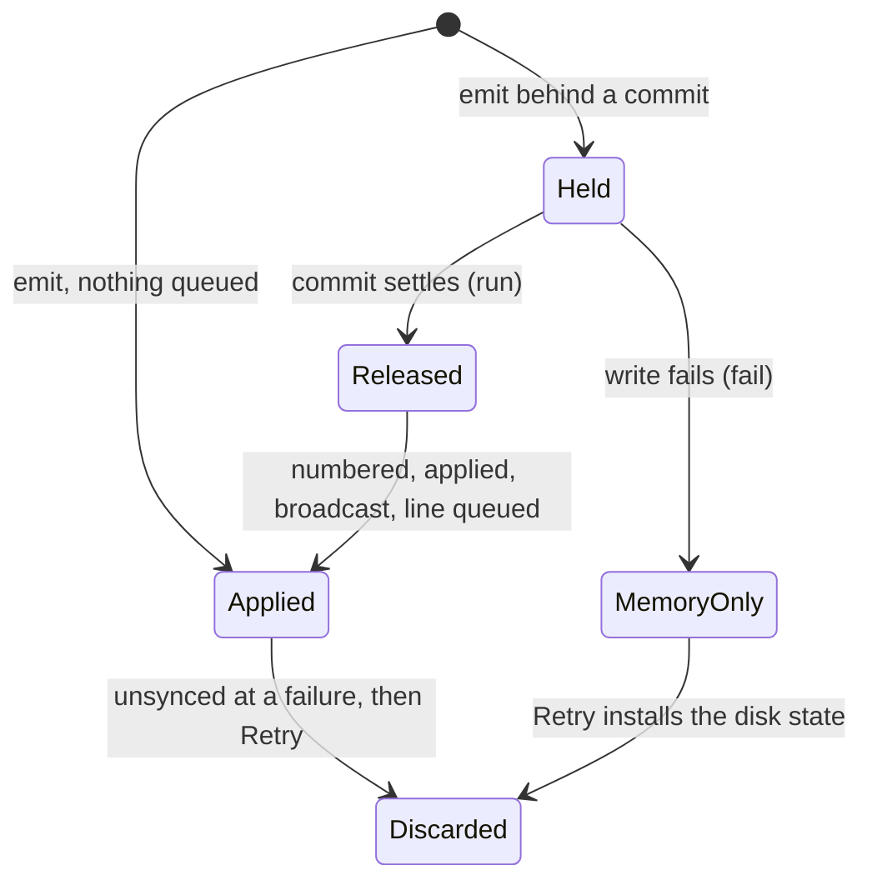
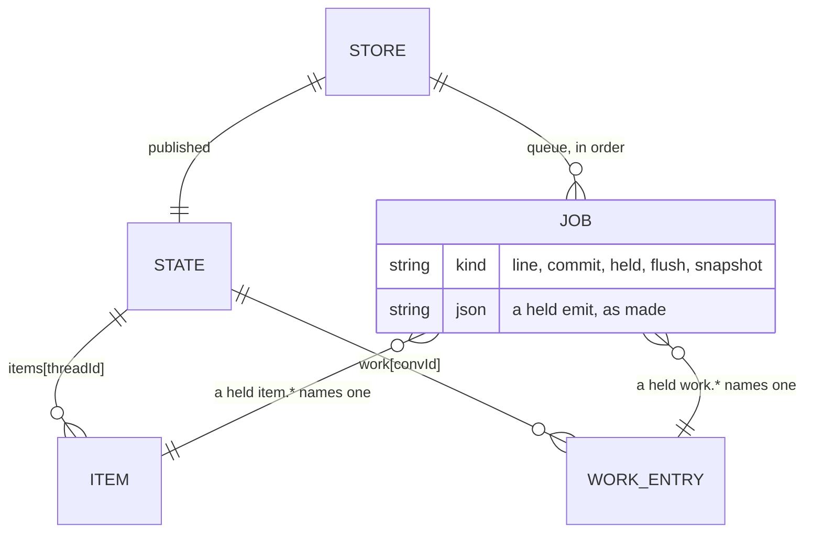

# #601: an in-process read of uncommitted writes

| | |
|---|---|
| **Status** | Revision 8, after the integrator’s second review of #611, on 2 November 2026. Revision 6 was approved by the person on 1 November 2026, after critic’s and gpt’s reads. Amends `storage-design.md` §6.3 |
| **Issue** | #601, part of #508 |

**Revision 8**, after the integrator’s second review (2 November 2026), which asked for the change’s structure to follow the rule:
- **Each module now makes one kind of read.** `show_block`’s and `show_app`’s bodies moved out of `Runtime.toolsFor`, to `server/block-show.mjs` and `server/apps.mjs`. The ledger’s answers to the page, `fileDiff`, `output` and `restore`, moved to `server/ledger-answers.mjs`, which reads one published entry through `published()`. Recording, in `ledger.mjs`, reads pending.
- **`restore` reads published.** The person aims it at one file they see. It read pending, so a change the agent made behind a held commit, which the page didn’t show yet, was removed or overwritten. Now it refuses, as for any change after the one the person saw (`tests/ledger-answers.test.mjs`). Its read-back of its own patch stays pending.
- **The guard fails a store, its pending reads or the ledger bound to a local,** and a list read called on anything else (`const st = rt.store; st.items(t)` passed it).

**Revision 7**, after the integrator’s first review of #611 (1 November 2026), which found readers the sweep missed:
- **The rule is now by what a read decides, not by whose write it reads back.** A read whose result decides a write reads pending. A read whose result leaves the process (the page, a read tool, a prompt, an HTTP answer), or a write the person aims at one item they can see, reads published. Revision 6’s rule, “reads back its own writes”, missed three kinds:
  - a reader that follows a pending read in the same operation: `bringForward`, after `update_block` found a held block, so the update was lost while `update_block` said “Updated”;
  - read-backs of apps: `show_app` threw, and `update_app` and `retire_app` refused, while a commit was held;
  - sweeps that write back: `bumpSideLink`, `archiveForks`, `purgeSession`, `reattach`, an app’s open sends, `settleToolAsks`, `runningProgress` and `openCards`.
- **Apps have a pending read:** `store.pending.app(id)` and `store.pending.apps()` (§5, §7).
- **Two more cases the rule found:** `agentWake` posted a held reply’s mention again as a new message, and the app-check turn’s end emitted a stale app over the turn’s new version.
- **The ledger’s reads split:** its own read-backs during a turn stay pending; the Work view’s diff, output and git state read published (§8).
- **`release()`** takes its job out of `heldLog` before it records, so a store listener’s pending read doesn’t see the released event twice.
- **The guard places every reader,** published and pending, by file and function, and fails on aliases it can’t follow (§7).

**Revision 6**, after critic’s and gpt’s reads of revision 5, which the person approved:
- The read is named for what it is. It returns every held write to a list, from any writer, so “read your own writes” overclaimed it, and the uncited sources are dropped. §8 justifies each site that reads another writer’s held write.
- §5’s ordering assumption was false for A1b: its card migration and removal commits touch thread items (gpt). §5 now names the lists A1b’s commits touch and states the window.
- B1’s positions: a pending item has no `n` until its release.
- The guard is keyed by file and enclosing function, not by line.

Revision 5 answers the person’s four comments on revision 2 and critic’s read of revision 3. Its central change: revision 2’s default view (every `store.items()` read includes held emits) is withdrawn. It contradicts an approved decision it never cited. The published read stays as it is, and a separate, named, typed **pending** read serves only server code that reads back what its own turn or session just emitted. Code, not prose, describes each failure, and each one cites its spec and its output on `main` (`fd60393e`).

## 1. How this was found, and when it can happen

gpt’s peer read of the Stop fix (#602) held a commit in its fsync and emitted a reply behind it. Stop then left the reply streaming beside an empty stopped reply. Its output, from gpt’s probe on #602’s branch:

```
✖ Stop while a reply segment is held behind a commit leaves no streaming reply
  AssertionError [ERR_ASSERTION]: [["streaming","Held reply"],["stopped",""]]
```

#602 fixed Stop’s own scan by remembering the segment’s id (`turn.openSegment`). Two more readers that act at a turn’s end on what the turn emitted were filed as #601. One of them was kept as a failing `todo` (`tests/stop-reply-held.test.mjs`, “held reader 1”).

**No production path holds an emit today, so there are no production logs.** An emit is held only while a `store.commit` is queued or in flight (`Store.emit`, `server/store.mjs`). `main` has no production caller of `commit`. 1a said so, and deferred the read-after-emit audit to A1: “nothing calls `commit` in this PR, so no emit is ever held in production until A1 adds the first caller; the audit of reads right after an emit belongs to A1” (#588’s body). A1a adds the first caller, `commitRecords` (`server/record-commands.mjs` on gpt’s `feat/508-a1-record-foundation`). It is gated off by `RECORD_PRODUCERS_ENABLED = false`. #305’s archive pass (#603) is dormant too.

**So #601 is the audit 1a deferred, and it must land before A1b turns record producers on, or before #305’s pass runs.** It is not a live bug today.

## 2. The failures, as specs

Each spec holds a commit in its fsync, using `heldStore()` from `tests/stop-reply-fixture.mjs`. It makes the emit, reads, then releases. Every result below is from a run on `main` (`fd60393e`); the runs are in #601’s PR body.

```js
// tests/store-held-view.test.mjs: the store itself
h.hold();
const commit = store.commit([{ type: 'settings', data: { theme: 'system' } }]);
await h.atSync;                                   // the commit is in flight: emits now are held
store.emit('item.add', { threadId: 't1', item: { id: 'r', kind: 'agent', text: 'Held' } });
store.item('t1', 'r');                            // main: undefined. The writer has the item; no read can see it
```

| Reader (code) | Spec | On `main` |
|---|---|---|
| `endedWithoutReply` (`server/empty-reply.mjs`), called by `endTurn` | `stop-reply-held`: held reader 1 | the turn’s only reply is a held block, so it ends failed as an empty reply: `['']` |
| `endWork`, reading `ledger.entries()` | `store-held-readers`: endWork | `{ work: undefined }`: the turn’s `work.add` entries are held, so `turnLine` returns null |
| `runShellCommand`’s flush and exit | `store-held-readers`: `!` command | `{"status":"running","text":""}` for good: both return when the item isn’t found |
| `recordDenial` (`server/permission-cards.mjs`) | `store-held-readers`: recordDenial | 2 cards for one refused call |
| `addItem`’s topic count | `store-held-readers`: topic | `replies: 0` after one reply |
| `checkTurn`’s block check | `store-held-readers`: lint | `options-in-prose` though a choice block was shown |
| `stallSteps` | `store-held-readers`: stallSteps | `[]`: a running step left running |
| `shownBy`, for `update_block` (`server/blocks.mjs`) | `store-held-readers`: update_block | “There’s no block with id steps” right after `show_block` |

Every row is the same shape: **code reads back, through the published state, something its own turn or session emitted a moment before.**

## 3. The lifecycle, as designed and coded

`storage-design.md` §6.3, “The writer”, defines it. An emit made while a commit is queued, in flight or being settled “is held: it is not numbered or applied until the commit has published, then it is, in order, from the JSON line made when it was called.” It goes on: “Code that reads state right after such an emit sees the old state for up to one sync,” and the call sites are to be audited (§6.3, and the row “Read after `emit` during a commit” in §8, “Failure modes”). A commit’s events are applied “only after the sync” (§6.3). `design.md` §6.6 makes that the visibility rule: “A commit is applied, broadcast and visible to anything (the public state, `since()`, `/api/state`, the read tools, an adapter start) only after its sync.” T-31 in §10, “Test plan”, tests it for the read tools. Q4 and Q11 in §13 keep the held queue, because “the runtime reads `store.state` directly”.



In code:
- `Store.emit` holds it (`server/store.mjs`).
- `run()` releases held emits in order once the commit settles, in its loop over the queue’s head (`server/store-commit.mjs`).
- `fail()` releases each one onto memory, unwritten (`server/store-retry.mjs`).
- A Retry’s `install` puts the disk’s state in place (`server/store-recover.mjs`), discarding what was memory-only.

A held emit is therefore exactly as durable as an emit applied at call time. Both are lost if the write fails before their line is synced. It is only later to become visible.

## 4. The data, and who reads it



There are two access patterns, and they need different answers.

**Published.** A read whose result leaves the process: the page, the stream, `/api/state`, the read tools (`read_conversation`, `read_message`, the catch-up prompt), turn delivery, a host’s snapshot, and an HTTP answer such as the Work view’s diff. By `design.md` §6.6 and T-31, these must see only what was applied. A write the person aims at one item reads published too: they can only aim at an item the page shows, so nobody acts on an item the page can’t show (gpt’s and critic’s point).

**Pending: in-process and uncommitted.** A read whose result decides a write. The write is itself an emit, applied after whatever is held, so a held entry the read missed is never written: an update lost, a duplicate made, a count short, a card left open. Three shapes:
- **a read-back** of what the turn or command just emitted: the eight readers above;
- **a reader after a pending read** in the same operation, such as `bringForward` after `update_block`’s `shownBy`: it has to see what the first read saw;
- **a sweep** that settles or patches every match, such as `bumpSideLink` or `settleToolAsks`: a held match missed stays unsettled.

The read doesn’t know the writer. It returns every held write to the list, from any writer. So it is not a session guarantee, and each site that acts on another writer’s held write is justified on its own in §8.

## 5. The contract

```js
/** @typedef {'items' | 'work'} PendingList  the lists a pending read covers */
/** @typedef {'apps'} PendingCollection  the collections of whole entities it covers */
/**
 * @typedef {object} PendingReads
 * @property {(threadId: string) => readonly Item[]} items  a thread's items with its held item events applied
 * @property {(convId: string) => readonly WorkEntry[]} work  a conversation's work entries with its held work events
 * @property {(id: string) => App | undefined} app  one app with its held puts and removal applied
 * @property {() => Readonly<Record<string, App>>} apps  every app, the same way
 */
/** @type {PendingReads} */ store.pending
```

**What it promises:** the published list, with every held emit for that list applied in queue order. Each emit is applied from the JSON `release()` will apply, never from the caller’s object. Then:
- once nothing is held, it equals the published list;
- it never mutates published state;
- it never reaches the page.

**What it doesn’t promise:** it doesn’t include a commit’s events before their sync, so T-31 holds. Across a failure followed by Retry, it says nothing more than the published state does.

**Who may call it:** a read whose result decides a write (§4). The other writers it can see are justified site by site in §8. Every read of items, work and apps, published and pending, is placed in a guard (§7), so a new one is a reviewed decision.

**Check, then act** (critic’s point 5): a function-form commit decides on the published state (`storage-design.md` §6.3, “The function form”): its builder receives `state`, as `commitRecords` passes it to `buildRecordBatch`. No pending read is inside a commit builder. I checked each call site in §8, and the guard makes any new one a reviewed line.

**The commit in front.** The view applies held emits to the published state without the commit in front of them, because that commit’s events don’t exist until the writer runs its builder, and may never apply. While no commit touches the list being read, the view is exact.
- Today, no commit touches items or work: `main` has no production commit (§1). A1a’s `commitRecords` writes only `records` and `dispatches`, and is gated off. #603’s body says the archive pass leaves “active turns and kept jobs hot”.
- A1b will touch items. `a1-record-shape.md` on gpt’s branch moves “card-held content and clear[s] legacy hold in one commit” (its migration row “Held wakes and Add card”). It retires the card-held state of blocks, permissions, tool asks, app sends and hop cards (the row that names them). Its removal command accounts for an item’s owed changes (the failure row “Source/item removed with unresolved consumer”). Whether any A1b commit changes `work` is gpt’s to confirm.
- In that window, at most one sync, a pending read of such a card’s thread can show a held patch on a card the commit in front then rewrites. That is a state no published list will hold.

The rule: a commit kind that touches `items` or `work` is placed in the guard beside the pending readers of the same lists. Whoever adds one says, for each placed reader, whether the window matters. If it does, the commit must hold that reader until it settles, or the pending read must learn to apply built commit events. That decision belongs to A1b’s own design (gpt), not this PR.

**B1’s positions.** B1 assigns an item’s position `n` where `seq` is assigned, which for a held emit is at its release (`storage-design.md` §6.3, “Sequencing”, and §6.11). A pending item has no `n`. No pending reader may depend on `n`, and B1 extends the view, or places that rule in the guard, when it adds positions.

## 6. Failure modes

| Case | Disk | Pending view | The person |
|---|---|---|---|
| The commit resolves | commit, then the held emits, in order | equals the published list after the release | sees the items once broadcast |
| The commit fails, and writes close | the commit is rejected; held emits are never written | equals memory after `fail()` releases them | sees them, with the unsaved count (1b) |
| Then Retry | the disk’s state is installed | rebuilt from it: the held items are gone, and so is anything a pending reader patched from them, since those patches were emits behind the same commit | sees what the disk held, as for any unsynced emit |
| A pending reader’s effect outside the store before the failure (`tellAgent`, a lint turn) | — | — | as for any effect of an unsynced plain emit. 1b stops every running turn when writes close, so no turn acts on it afterward |

Spec: hold a commit, emit a reply, read it pending, fail the write, Retry. Neither the reply nor a patch made from the pending read survives, and the published and pending reads agree.

## 7. Types, extensibility and identity

The view lives in `server/store-held.mjs`, behind `store.pending`. A list is one entry in a typed registry, `LISTS`: its events, the key they name it by, and its entries’ id. A collection of whole entities, such as apps, is an entry in `ENTITIES`: the event that puts one whole and the `remove` kind that deletes it. Its pending read applies the held puts and removals to a copy of the published map, and is the published map itself when nothing held touches it. Adding either kind, such as records if A1b needs it, means adding an entry. There is no switch to edit.

A copy-on-write overlay over the whole state was considered and rejected. It would need proxies under the reducer, or a whole-state clone at every rebuild, and no reader needs more than one list.

The view is applied with the shared `apply`, so the reducer exists once. It is cached per list and grows as emits are held: the version `record()` bumps, plus an index into `store.heldLog`. So a long hold costs linear time: 1000 held text chunks with a read after each parse each chunk once, checked by counting `JSON.parse` calls. Each view keeps one frozen copy until its next held event, so several reads between two events share it. A read after every event still copies the list once per event: that is the cost the integrator measured, about 1.9 ms a chunk on a thread of 20,000 items, and it is paid only while a commit is held.

`release()` takes its job out of `heldLog` before it records the event. A store listener that reads pending during the release then rebuilds from a state that holds the event, and doesn’t find it held as well.

**Identity.** With nothing held, a pending read returns the published array itself, as `items()` does. While something is held it returns a fresh array, in which an item no held event touched is the published object and one that was touched is a clone. So a pending read is never the same array as the published one during a hold, and is the same one outside it (gpt). The readers in §8 compare by `id`, `turnId` and `toolUseId`, never by object identity: I read each one. A new call site is a line in the guard, so whoever adds it is reviewed on the same question.

**Guard** (`tests/store-held-guard.test.mjs`), keyed by file and enclosing function, so an edit elsewhere in a file doesn’t churn it (critic). It places every read of items, work and apps, by the rule in §4:
- each published read: `store.items()`, `item()` and `findItem()`, and each direct read of `state.items`, `state.work` or `state.apps`;
- each pending read: `store.pending`, and the ledger’s `entries()` and `entry()`, which use it;
- each production `commit` call, with the lists it touches (none on `main`; A1a’s `commitRecords`, which writes `records` and `dispatches` only, is placed when it lands).

A site added, removed or moved to another function fails it, and the failure prints the full list found, so updating it is a copy, not a hunt. Revision 6’s guard placed pending reads only, so a new published reader passed it: that is the regression #601 is about. The guard joins lines the formatter split, and fails outright on forms it can’t follow: destructuring `pending`, `items`, `work` or `apps` out of the store or the state, and reaching them by a string key. The integrator’s five bypasses each fail it.

## 8. What changes in code

| Site | Read | Why |
|---|---|---|
| `server/runtime.mjs`: `endWork`, `endTurn` (empty reply, streaming, checkpoint, Summarize), `recordStopped`, `settleJobs`, `setJobStep`, `checkTurn` (its block check, and the terms and apps it introduced), `stallSteps`, `runShellCommand` (flush and exit), `addItem`’s topic count, `pollMirror`; `showBlock` and `shownAgain` (`server/block-show.mjs`: a block id already shown; an app id already the session’s) and `showApp` (`server/apps.mjs`) | pending items and apps | each reads back what its own turn or command just emitted |
| `bringForward` (`runtime.mjs`) | pending items | it follows `update_block`’s and `update_app`’s pending read, and moves what that read found |
| `shownBy` (`update_block`), `updateApp`, `retireApp`, `askForTool`, `recordDenial`, `permission` (`permission-prompt.mjs`), `stoppedHung` and `cardOf` (`server/remote/`), `sendLint` (the apps still being checked) | pending items and apps | each reads back a card, block, app or line its own turn just made |
| `agentWake` (`side-threads.mjs`) | pending items | the reply with the mention, which the turn just emitted. Missed, it was posted again as a new message |
| the app-check turn’s end (`endTurn`) | pending apps | the turn’s new version. Read published, the app was still `fixing`, and the note it emitted landed after the release, over the new version |
| sweeps: `bumpSideLink`, `archiveForks`, `purgeSession`’s `deletedAgent`, `reattach` (`remote/turns-resume.mjs`), `release` (`app-retire.mjs`), `settleToolAsks`, `runningProgress`, `openCards` (`remote/turns-prompts.mjs`), `eraseThreads`’ apps | pending items and apps | each settles or patches every match, and a held match missed stays unsettled |
| `stillOpen` (`write-intent.mjs`) | pending items | the lines are its own turn’s, but a `stopped` on one is the person’s write. Missing a held Stop lets one more call through without a card, which is the harm Stop exists to prevent |
| `openCard` (`wake-cards.mjs`) | pending items | a hop card another wake made. Missing a held one makes a second card for the same hop |
| `endChain` (`side-threads.mjs`) | pending items | an open hop another agent made. Missing a held one ends the chain while a hop is still open |
| `ledger.mjs` `entries()`, `entry()`, `recordPublishes` | pending work, items and apps | the ledger reads back its own entries to patch them |
| the Work view’s `fileDiff`, `output` and `restore` (`ledger-answers.mjs`, through `published()`) and `gitState` (`ledger-git.mjs`) | **published** work | answers to the page, and a write the person aims at one file they see. `restore`’s read-back of its own patch is pending |
| `readMessage` (`read-message.mjs`, revision 2’s class A) | **published** | a read tool, under T-31. An agent’s own just-shown block is visible to `read_message` once released, within one sync |
| everything else | published, unchanged | §4, each placed in the guard with its reason |

For each site that reads another writer’s held write, a decision made on it that a failure and Retry then discard is discarded with it. The decision is itself an emit behind the same commit, and 1b stops every running turn when writes close.

Critic’s code notes from revision 6 hold:
- Retry’s `install` resets `heldLog` where it zeroes `held` and `queue` (`server/store-recover.mjs`);
- the views are cleared when the last held job is released;
- `PendingReads` is derived from the registry, so the lists exist once.

## Not in this change

- A pending read for other state (sessions, schedules, threads): by the rule in §4, a read of one that decides a write would need one. This audit covered items, work and apps; the rest is a follow-up, and the guard doesn’t place their reads.
- A held `remove` of a thread, which isn’t a list event: the pending items of a thread being removed show until the release.
- A held emit the reducer rejects. One can be rejected today: an `item.patch` with an `activityStep`, on an item whose `activity` has no `steps`, throws in `applyItemPatch`. The pending read applies it with the same `apply`, so it throws, every time, as the release will. A failed read drops its view, so no cached view has seen part of an event, and other lists still answer (critic; a spec in `store-held-view`). The release’s own throw, and the gap it leaves in `seq`, are #610’s, the store’s to fix at numbering.
