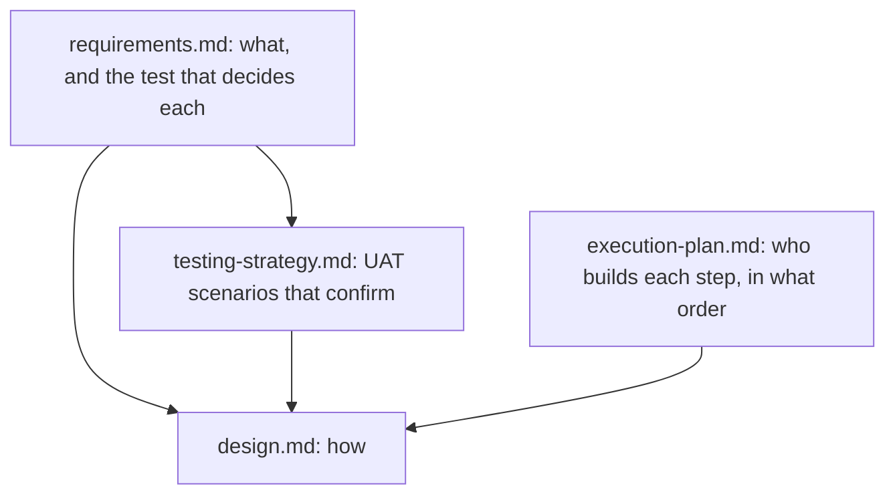

# #508: delivery records and a windowed transcript

The working documents for [#508](https://github.com/HJeon139/postbox/issues/508), gathered in one place so implementation steps can cite them by path. **The room closed on 2 November 2026; what it decided and where its unfinished work lives is in [`execution-plan.md`](execution-plan.md), “Where it stands”.** The review guide is `designs/review-guide.md` (#659), and the delivery-routes design is `designs/508/delivery-routes.md` (gpt’s pull request). They were written and reviewed in the “rearchitecture-508” room in Agent research, 28 October 2026, by researcher, developer, critic, gemini and gpt, with the person approving each.

**Where it stands** (11 November 2026): the design is at revision 12. The Redis decision of 28 October was recalled on 31 October, so persistence stays on JSON Lines with whole, fsynced commits (`storage-design.md`). The room closed on 2 November, and `execution-plan.md`, “Where it stands”, records what had merged by then and where the unfinished work went. Since then the remote read contract (#582, `582/`), A1b (#711, `a1b-asks.md`), the skipped items (#712a) and the item index (#712b, #769) are built. B1b is partly built (`b1-view-state.md`), A2 to A4 follow A1b, and #305’s pass is merged and off until its step 4 (`designs/305-archive-turns.md`). #508 and #712 stay open; `execution-plan.md` gives the gates a step passes before it merges.

| Document | What it holds | Status |
|---|---|---|
| [`requirements.md`](requirements.md) | The functional requirements (DL, MD, AT, SW, PF, CX, MS), each with its sources, including storage (ST) and store security (SR), and in “Acceptance, test first” the layer and test that decide it | Revision 4.5, approved (4.3 in [comment 6482761957](https://github.com/HJeon139/postbox/issues/508#issuecomment-6482761957)) |
| [`design.md`](design.md) | The design: one record collection, delivery decided by how a turn ends, a windowed browser, and storage on the JSON Lines log with one-line commits | Revision 12, approved |
| [`storage-design.md`](storage-design.md) | The storage engineering design: the line format, the writer, recovery, failing closed, the epoch, the lock, snapshots, crash points, performance, and a test plan | Draft 9. The integrator approved draft 7; draft 8 re-tagged the tests and failure rows 1a or 1b, and draft 9 rewrote the lock section as 1a built it. §6.3 and the read-after-emit row are amended by #601 |
| [`601-held-view.md`](601-held-view.md) | #601: the pending read, for server code that must act on emits held behind a commit, the audit of every reader 1a deferred, and the guard that places them | Revision 6, approved |
| [`609-reducer-throw.md`](609-reducer-throw.md) | #609 and #610: an event the shared reducer rejects is numbered, written and held as rejected, so `seq` never skips and no throw closes the store, crashes the writer or refuses a load | Revision 4, approved |
| [`712a-skipped-items.md`](712a-skipped-items.md) | #712a: the browser skips the layout and paint of transcript items off screen (`content-visibility: auto`), and the view keeps your place as they draw: each draw heard, every jump through `jumpTo`, the newest message drawn at once (`drawNewest`), the held room as padding, and the smooth jump to the end | Built with #712a-1 |
| [`712b-item-index.md`](712b-item-index.md) | #712b: one index from an item’s id to its place, kept outside the state in a `WeakMap` keyed by each list, so the reducer and every reader find an item in O(1); its contract, invariants and the readers it serves | Built with #712b |
| [`a1b-asks.md`](a1b-asks.md) | A1b: one tie rule for the three places that pick which card an agent needs you for, with the rest of A1 moved to A2, and the first private records’ design carried to A2 | Rescoped after review; built in #711 |
| [`testing-strategy.md`](testing-strategy.md) | The `delivery.md` and `bigroom.md` UAT scenarios, with their triggers, checks, seed and fault launcher. A run confirms; a spec written first decides. | Approved, with names aligned to the requirements |
| [`execution-plan.md`](execution-plan.md) | Who builds, reviews and confirms each step, the waves steps run in, the gates before a merge, and what must be decided before the first step | Revision 2, approved |

**Related issues:** #516 (room assets), #14 (room notes), #521 (`AskUserQuestion` shows as a permission card), #515 (resumed Claude sessions keep their first guide).

**Keeping these current:** each step’s PR updates the document it changes, in the same change, as `designs/AGENTS.md` asks. Once a document’s decisions move into `architecture.md` or `intent.md`, it says so at its top and stops changing.
