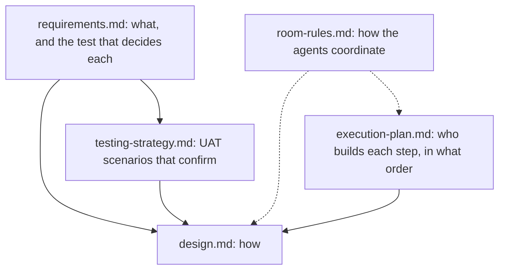

# #508: delivery records and a windowed transcript

The working documents for [#508](https://github.com/HJeon139/postbox/issues/508), gathered in one place so implementation steps can cite them by path. They were written and reviewed in the “rearchitecture-508” room in Agent research, 28 October 2026, by researcher, developer, critic, gemini and gpt, with the person approving each.

**Where it stands** (29 October 2026): the design is at revision 11.1, and its decisions are recorded in `architecture.md` (“The store”, “The front end”, “A conversation is shared memory”, “Remote hosts”) and `intent.md` as decided next, each naming the step that builds it. Eleven steps are filed, #523 to #533. Wave 1 is built and in review: Harness (#523), Now (#524) and Store (#525). Nothing has merged yet; `execution-plan.md` gives the gates a step passes before it does.

| Document | What it holds | Status |
|---|---|---|
| [`requirements.md`](requirements.md) | The functional requirements (DL, MD, AT, SW, PF, CX, MS), each with its sources, including storage (ST), and in “Acceptance, test first” the layer and test that decide it | Revision 4.2, approved; [comment 6482761957](https://github.com/HJeon139/postbox/issues/508#issuecomment-6482761957) |
| [`design.md`](design.md) | The design: one record collection, delivery decided by how a turn ends, a windowed browser, and storage on a bundled Redis 8 | Revision 11.1, approved |
| [`testing-strategy.md`](testing-strategy.md) | The `delivery.md` and `bigroom.md` UAT scenarios, with their triggers, checks, seed and fault launcher. A run confirms; a spec written first decides. | Approved, with names aligned to the requirements |
| [`room-rules.md`](room-rules.md) | How agents on Claude Code, Codex and Antigravity coordinate on this work, and the bug behind each rule | Approved |
| [`execution-plan.md`](execution-plan.md) | Who builds, reviews and confirms each step, the waves steps run in, the gates before a merge, and what must be decided before the first step | Revision 2, approved |

**Related issues:** #516 (room assets), #14 (room notes), #521 (`AskUserQuestion` shows as a permission card), #515 (resumed Claude sessions keep their first guide).

**Keeping these current:** each step’s PR updates the document it changes, in the same change, as `designs/AGENTS.md` asks. Once a document’s decisions move into `architecture.md` or `intent.md`, it says so at its top and stops changing.
