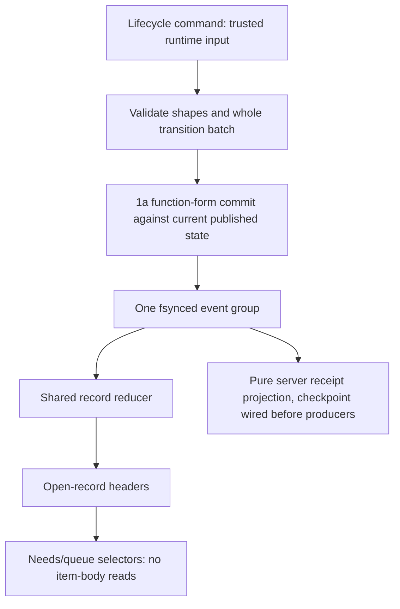
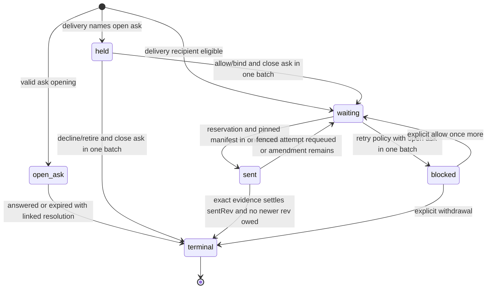

# A1 record shape and reducer

**Status:** draft 1, 1 November 2026. Design before code; critic and developer review requested. Branch `docs/508-a1-record-shape` starts at `main` `25ad0ffb` (v1.8.0, including #588). No production file changed.

**Grounds:** [requirements](requirements.md) DL-1–3, DL-6–8, AT-1–4 and AT-7; [design](design.md), “Records”, “Record lifecycles”, “Receipts” and INV-1–3, INV-10, INV-12–13; [storage](storage-design.md), “The writer”, “Recovery” and “The data-folder lock”; routes draft 6 at `b96462e0` in `/tmp/gpt508-delivery-routes/designs/508/delivery-routes.md` (person and developer approved; critic's same-head read still to be recorded). This file proposes the concrete reducer boundary; route capability evidence remains separate.

## Scope and PR sequence

**A1a, first PR on 1a:** discriminated record shapes, validation, a pure transition reducer, recipient/ask header selectors, and pure receipt/manifest projections with tests. Add the empty `records` map to state and normalization. No production producer or dispatch path starts using records in this foundation PR. Existing asks, queue and `se.needs` remain owned by their current code, so the dormant map cannot suppress them. The PR is explicitly a foundation, not completion of A1 or a fix for #470.

**A1b, following design/code review:** lifecycle-owner commands, durable startup conversion, multiple asks/held Add migration, derived needs readers and the server-only receipt checkpoint. Producers switch only when the shared reducer, receipt checkpoint and public projection land together; there is no interval of active records whose receipts disappear at a snapshot. The split avoids changing the store while the foundation's shape is being reviewed. Before code for A1b, show its migration and checkpoint failure table to both reviewers.

**Later work depending on 1b (#598):** `check_messages` and its one MCP closed-store gate, and A2's phase-bound `onReload(reconcile)` listener. They are out of A1a's first PR, not emulated with a second gate or a partial reload. The live-execution contract, A′ arbiter and native/hook integrations remain later capability-gated work. No new runtime timer or model spend is needed for A1a.

The previous local A1 prototype at `7d4cf068` is evidence of unfinished work, not an approved implementation to transplant: `applyRecord` there blindly replaces/deletes. Reuse individual header-selector tests only after this design's review, and rerun them against current main.

## Root cause and boundary

Today an attention slot (`se.needs`), held entries on a card, queued messages and pending turn input have independent ownership. Overwriting one slot can hide another request; a release path can remove a source before the next owner durably accepts it. The integrator's store and queue reviews exposed the same class: a resource's lifetime and its terminal transitions were not defined for every caller.

A record has one lifecycle owner and an explicit version. Only that owner builds record events, using 1a's function-form `commit` against the latest published state. The reducer is shared, synchronous and deterministic. No adapter, tool or reader patches a record; no generic remove event deletes one. This is the boundary A1a makes testable before any producer migrates.



## Concrete shapes

A1a validates plain JSON data and rejects unknown fields for its schema version; it does not silently repair an invalid recipient or lifecycle state. No transport token or native handle is stored in a record. Prototype-sensitive keys use the existing null-prototype maps and own-key checks.

Common header:

```javascript
{
  schema: 1,
  id: 'rec_...',
  kind: 'ask', // or delivery; discriminated below
  conversationId: 'th_root',
  threadId: 'th_where_addressed',
  sourceId: 'item_...',
  version: 1,
  rev: 1,
  at: 0
}
```

`version` is the record's mutation counter; `rev` is the latest source-content revision. They are different: reserving or binding advances version without inventing a content edit. The root conversation is fixed at opening; a thread/source move must be an explicit validated command, never an implicit recipient change.

**Ask:** `kind: ask`, `to: person`, `from: sessionId`, `state: open`, `askKind: block | permission | toolask | hop | appsend | note | blocked`, plus a bounded presentation header sufficient for the current needs-reader contract. It contains its title/summary, source location and `at`; it never needs an item body to count/order the ask. `failed` and `denial` remain session status, not asks. A blocked delivery's retry question is an ask of kind blocked, linked explicitly to that delivery.

**Delivery:** `kind: delivery`, `to: { persona: personaId, session?: sessionId }`, `from: person | postbox | sessionId`, `mode: wake | notify | interrupt`, and `state: held | waiting | sent | blocked`. `parts` holds bounded canonical source text/time/attachment references; a source without a posted item initially uses its record id as `sourceId`, then re-keys atomically when the item is posted. Keep the record id unchanged. A1a follows existing composer/tool text limits; folding sender notices is a later lifecycle command, not truncation in the reducer.

- Held requires `heldBy` naming an open ask in the same conversation, plus reason `held`. An unbound recipient cannot become sent. A later Add answer can bind the existing held delivery; joining through another valid path binds it rather than creating another copy.
- Waiting has no live attempt. Optional `notBefore`, reason `busy | scheduled | resend | amendment`, and explicit requested mode affect eligibility, not ownership. A stale timer cannot make it sent.
- Sent requires an immutable attempt: `attempt`, `sentRev`, `turnId`, `dispatchId`, canonical `route`, and route-specific `target`. Native target refinements (`backendRunId`, `inputMode`) follow the routes design and confer no capability by their presence. `route` is null without a live reservation; keep the requested delivery mode separate.
- Blocked retains its content and recipient and names its open retry ask. No automatic resend timer. Answering that ask can release once more or explicitly withdraw it; A2 owns the outcome policy.

A `sent` record's latest `parts` may change at a new source rev, but its dispatch pins the exact canonical revision at `sentRev` plus fixed metadata and `renderVersion`. A1a models and validates the manifest separately as pure data; no rendered body cache. Enforce the proposed route-design ceilings at transition validation as well as selection: 64 KiB canonical source per dispatch, 256 KiB pinned content per recipient/turn and four unresolved dispatches; a batch exceeding them is refused in full, leaving sources waiting. Wire/hook limits remain the later selector's additional constraint. Use UTF-8 byte lengths, not JavaScript character count. Do not age out a pin while its consumer remains unresolved.

## Event and reducer contract

Keep the existing planned event names `record` and `record.close`, but make the operation explicit rather than accepting unrestricted upserts:

- `record`: `{ operation, previousVersion, record }`, where operation is `open | revise | bind | release | reserve | requeue | block`. Opening expects absence and version 1. Every later transition expects exactly the old version and writes old version + 1. The complete new record is validated against the old shape and operation.
- `record.close`: `{ id, previousVersion, final, at, reason, attemptIdentity? }`. Final is `delivered | answered | expired | withdrawn | superseded`; the operation checks the allowed origin state and requires a nonempty reason for expiry, withdrawal or supersession. `folded` is a named supersession reason, retaining the source cursor under the existing fold design.

Inside the function-form commit, whole-batch validation runs against the latest published state before returning any record event to the writer. Invalid shape, duplicate open recipient/source, cross-conversation hold/bind, omitted pin, illegal terminal transition and unknown schema fail closed with an explicit error. They do not get normalized into success. A stale version or stale attempt is a no-op with an internal stale outcome; it emits no new state or receipt row. Command callers distinguish that from a successful transition and re-read; a browser reducer can apply the same event without I/O or clock access.

The pure reducer must not make a function-form store commit necessary to interpret an event. It consumes the already-built event and current state. Server command validation establishes authorization; reducer validation establishes shape and transition legality. Batch builders validate all prospective changes together, including references to asks created/closed in that same batch, before returning events to the writer. This avoids an early event taking effect before a later malformed one is discovered.

**Uniqueness:** one open record per kind and `(recipient, sourceId)` within its conversation. The canonical recipient key encodes persona and optional bound session as structured data, not delimiter-concatenated user text. Binding or source-id replacement checks both old and new keys atomically. A collision rejects the batch with both sources unchanged; only a lifecycle command may explicitly coalesce, preserving every part and closing the redundant record with a receipt. A header lookup index is derived/rebuildable, not another durable source.

**Repeats and terminal state:** replay already skips applied event seqs. Within the retained receipt projection, duplicate transition identities produce no second row. A non-open mutation cannot recreate an absent record, even when the opId cache was lost at a snapshot. Opening the same addressed source again is a lifecycle-command decision checked against the authoritative source's answer/delivery revision, not permission from a missing open-map entry or an opId miss. No API accepts a caller-chosen record id to resurrect it. A2 must supply its durable delivered-revision/receipt policy before delivery producers are enabled; A1a does not claim forever-idempotent command deduplication from a bounded receipt alone.

## Allowed transitions and atomicity



An edit while sent advances source rev/version but preserves the frozen attempt and old content. Exact attempt settlement acknowledges only `sentRev`: if rev is newer, it records that acknowledgment and leaves the amendment waiting. A late old-turn or other-recipient settlement cannot close it. A2 supplies evidence/outcome selection; A1a's reducer fixtures exercise both admitted and rejected transitions without starting adapters.

Closing an ask and resolving every delivery it holds is one commit: allow releases/binds all; decline or removal expires all with a reason. No open record may be deleted by the generic `remove` reducer branch. Delete/Undo/purge policies must operate through lifecycle commands; #597's temporary in-memory hold is not a second durable owner once A3 migrates it.

## Invariants and caller sweep

- **A1-I1, one owner:** only a validated lifecycle event changes a record. Open entries leave through an allowed close; closed/retiring Store rejects new commands. No reducer side effects, timers or backend calls.
- **A1-I2, no hidden half-release:** ask close, held delivery release/bind/expiry and cleared legacy source are validated and committed as one group. A reader sees all or none.
- **A1-I3, exact identity:** recipient/conversation/source key, version and attempt fences are independent checks. A source edit does not authorize a new recipient or settle a newer rev.
- **A1-I4, frozen consumer content:** an unresolved dispatch keeps its exact revision and renderer, within ceilings. Editing/deleting a source cannot change replay bytes.
- **A1-I5, published state only:** command construction occurs in the sequenced function; no new header/count, receipt or external action is announced before commit resolves. 1a's last-seq result is diagnostic, never the idempotence authority.
- **A1-I6, attention without transcript:** asks and failure/denial status can be ordered with items absent. The foundation does not change live needs readers before migration.
- **A1-I7, history has one event source:** pure receipt projection consumes accepted record events; stale/duplicate events add no row. Persistence/checkpoint and HTTP exclusion are mandatory before delivery producers migrate.

Neighbors to migrate in A1b, each retaining its current owner until the atomic switch:

| Family | Current owner / clean neighbor | Required change or retained behavior |
|---|---|---|
| Needs attention | `shared/needs.mjs`, open-asks/page rings, room checks | Ask header selectors replace item scans together; failed/denial status remains session-owned |
| Blocks, permissions, tool asks, app sends, hop cards, note proposals | Their resolver modules and `se.needs` writes | Open/close asks through one lifecycle owner, several may coexist, exact source identity required |
| Held wakes and Add card | `server/wake-cards.mjs`, `server/wake-requests.mjs` or current equivalent | Move card-held content and clear legacy hold in one commit; bind on Add/join, expire explicitly on decline/removal |
| Person queue and turn pending | `thread.queue`, `turn.pending`, `exiting.held` | Retain existing ownership in A1a; A3's approved migration moves source references through one arbiter, with no dual dispatch |
| Dispatch/envelope, edits and marker | `runtime.mjs`, catch-up, adapter outcome path | A2 reserves and settles exact attempts; marker advances only with admitted evidence |
| Local and remote tool-result notes | `withUrgent`, `mcp.mjs`, `remote/turns-tools.mjs` | Later ownership switch covers both consumers, never two reads of one addressed source |
| Store close/snapshot/replay | 1a writer/recovery | Clean boundary: reuse commit/seq replay, no A1 reload or second writer. New receipt checkpoint needs a separate reviewed storage integration |
| Deleting/archived sessions, persona retirement and Undo | Runtime lifecycle, #597's hold policy | Fence authorization; no silent drop or resurrection; all held sources have an explicit resolution |

Before A1b code, repeat this inventory on its main head with exact files/callers; the table is a planned boundary inventory, not a claim the migration scan is complete today.

## Failure and interleaving table

| Case | Disk and published state / concurrent reader | Action and person-visible result |
|---|---|---|
| Opening commit sync held or failed | No new published ask/delivery; 1a log may contain uncertain bytes but old view remains | No dispatch/answer success; caller receives cause. Restart may recover a landed event |
| Two opens for the same recipient/source | Writer sequences one; later command validates against installed result | One live record; second returns existing/stale outcome, not another full delivery |
| Two answers race | One batch wins exact ask version; the loser writes nothing | One resolution of every held delivery; caller re-reads final answer |
| Crash during held release/bind | One JSONL group recovers all transitions or none; no reader sees half the group | No delivery before commit. Retried source conversion is detected from state, not opId cache |
| Source edit races reservation | Ordered revision and record version choose the pinned sentRev | Latest revision stays owed; a read shows sent plus pending amendment, never falsely delivered newest content |
| Stale settlement / unknown recipient / cross-room bind | No accepted event or receipt row | Refuse/no-op as specified; no other agent loses mail |
| Pin limit reached or renderer unknown | Record remains waiting or existing sent remains pinned; no partial manifest | Report why it waits; no clipping and no alternate route handoff |
| Source/item removed with unresolved consumer | Record manifest retains its source revision; terminal command accounts for owed changes | No hidden body loss or byte-changing replay; A2 fences before recovery |
| Close begins between command construction and submission | Store retiring flag refuses commit; no new record applied | No adapter action. Existing accepted jobs drain under 1a's lock policy |
| Snapshot/restart and opId cache forgotten | Open map normalizes/replays; pure projections are deterministic; active producers still disabled until receipt checkpoint wired | Same asks/counts in reducer fixture; no claim that the foundation alone provides production migration |
| Downgrade before producers enabled | Empty/dormant map ignored by old build; existing sources unchanged | Ordinary behavior preserved. After migration, downgrade requires explicit rollback below |

## Tests that must fail first, and rollout

A1a adds semantic reducer/selector specs; the report will distinguish a baseline import failure from a behavioral counterexample. Counterexamples that mutate/remove a fence must fail, not merely mirror the implementation:

1. Two asks by one session remain distinct with no items loaded; one close leaves the other counted. Failed/denial entries remain ordered correctly.
2. Duplicate open and bind/source-rekey collision leave exactly one owner or refuse the whole batch without losing either payload.
3. Closing one ask releases/expires all its held deliveries atomically; a cross-conversation link and an orphan hold reject the group.
4. An edit while sent preserves pinned revision/attempt; valid old-rev evidence leaves an amendment; stale version/turn/route/recipient evidence changes nothing.
5. A terminal mutation cannot resurrect a record; repeated close adds no receipt row. Replay across snapshot normalization gives the same map and projection.
6. Enforce pin byte/dispatch ceilings at the reducer, including multibyte source text and an alternate producer bypassing the selector.
7. An actual 1a Store holds the sync for a valid record group: selectors see the old view before release and the whole new view after; rejected close-time commits do not change records. No adapter called by this test.
8. Unknown schema, invalid fields, prototype-sensitive ids and generic remove cannot silently delete or reinterpret a record.

**Upgrade:** A1a only adds a dormant map and pure code; no legacy source is cleared. A1b converts each source plus its asks/held deliveries through one commit and checks its authoritative source marker to make restart safe. No dual-read period: selectors and producer ownership switch in the migration PR, with old-format fixtures.

**Downgrade:** A1a is reversible while no producer is enabled. Once record migration is active, an old build reading only `se.needs`/card-held fields would hide work; it is not a supported silent rollback. A1b must ship a version/refusal guard or an explicit export/restore procedure before enabling conversion. The choice is part of that reviewed migration design, not guessed by this reducer.

**Decision log:** separate content rev from mutation version; reject unrestricted upserts; use 1a commit now; no check_messages or A2 reload listener in the first PR; no delivery producer before receipt checkpoint; preserve the approved persona/session binding and canonical routes; no native capability inferred from a record field. Open questions for review: this foundation split, the explicit versioned event envelope, and the receipt-checkpoint integration boundary. No code starts before both design reads.
