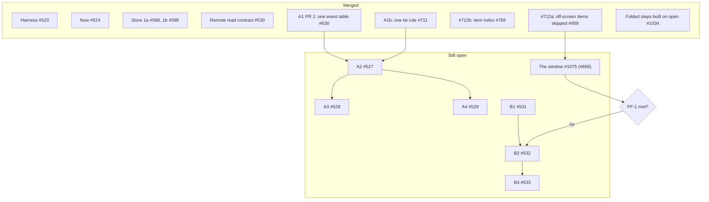

# #508 close-out: where it stands, and what follows it

The close-out of [#508](https://github.com/HJeon139/postbox/issues/508), written 10 November 2026 at the end of sprint 4. It says what #508’s steps delivered, which issues carry the rest, and the one decision left before #508 can close. **It merges only after #1075 merges and the person makes the PF-1 decision below**, since both change what it says.

## Where it stands

**Merged**, with the PR that did it:
- **Harness** (#523), **Now** (#524) and the **remote read contract** (#530), closed 30–31 October.
- **Store:** the Redis step (#525) was recalled on 31 October, and persistence stayed on JSON Lines (`storage-design.md`). Its replacement merged as Store 1a ([#588](https://github.com/HJeon139/postbox/pull/588)) and 1b ([#598](https://github.com/HJeon139/postbox/pull/598)), on 1 November.
- **A1, PR 1:** one event table decides what reaches the browser ([#630](https://github.com/HJeon139/postbox/pull/630), 2 November).
- **A1b:** one tie rule for the places that pick an agent’s card (#711, closed 7 November; `a1b-asks.md`).
- **#712b:** an item found by id in O(1) ([#769](https://github.com/HJeon139/postbox/pull/769), 5 November).
- **#712a:** the page skips the layout and paint of items off screen ([#959](https://github.com/HJeon139/postbox/pull/959), 9 November).
- **Folded steps built only when opened** ([#1034](https://github.com/HJeon139/postbox/pull/1034), 9 November). Measured on a 5,000-item room, folded steps were 68% of the page’s elements.

**In review:** the transcript window ([#1075](https://github.com/HJeon139/postbox/pull/1075), #866, W1–W3), on by default for long conversations, labeled for the integrator on 9 November.

## PF-1, the decision left

PF-1 asks that a large room’s key-to-frame p95 be within 10% of a 1× room’s (`requirements.md`, PF-1). It was not met before sprint 4: at 10×, the p95 was 6.29 and 10.75 times the 1× room’s (`measurement.md`, “PF-1: a key press to the next frame”). That note says PF-1 waits on #712a (`measurement.md`, “Not met, and what comes next”), and the 2 November decision parks the server window, B2 (#532) and B3 (#533), until a measurement shows client-side virtualization isn’t enough (`execution-plan.md`, “Where it stands”).

#712a has merged and #1075 is in review, so that measurement can be taken once #1075 merges. The decision it feeds is the person’s:
- **If PF-1 is met** at 4× and 10× with the window on, B2 and B3 stay parked, and #508 closes, with B2 and B3 left open as the record of the server window, should rooms outgrow the page.
- **If it isn’t,** B2 starts after B1 (#531), as `design.md` lays out.

Not measured yet, either way: Safari, copies of real rooms, and assistive technology (`measurement.md`, “Not met, and what comes next”).

## #526 closes as superseded

#526 (A1: ask records, held wakes as deliveries) was split, as the integrator asked on #608 (`execution-plan.md`, “Where it stands”):
- PR 1 merged as #630;
- A1b became one tie rule, and merged as #711 (`a1b-asks.md`);
- the rest of A1, #594’s case included, moved to A2 (#527).

So nothing remains under #526. It closes as superseded by #630, #711 and #527, and its requirements (AT-1 to AT-4 and AT-7) are carried by #527.

## What follows #508

| Follow-up | Issues | Waits on |
|---|---|---|
| Delivery records: deliveries decided by the turn’s outcome, then the person’s queue and scheduled wakes | A2 #527, then A3 #528 and A4 #529; Kiro’s failing-turn fixtures #591 | #591 for Kiro’s part of A2 |
| The transcript: positions and view state, then the server window | B1 #531; B2 #532 and B3 #533; the virtualization tracker #712 | the PF-1 decision above, for B2 and B3 |
| Measurement | #821, slow keys and clicks in the lag log (PR [#1145](https://github.com/HJeon139/postbox/pull/1145)); the tools’ follow-ups #813, #814 and #818 | — |
| Docs | #714, the review guide and the status’s stale lines; #750, the needs stopgap note | — |

Each of these is its own issue with its own “Done when”. When the PF-1 decision is made and #1075 has merged, #508 closes with a link to this note.
