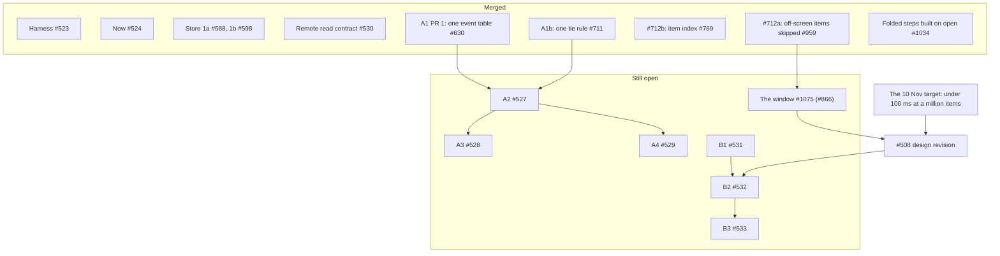

# #508 close-out: where it stands, and what follows it

The close-out of [#508](https://github.com/HJeon139/postbox/issues/508), written 10 November 2026 at the end of sprint 4. It says what #508’s steps delivered, which issues carry the rest, and what changed on 10 November: the person approved a new performance target, under 100 ms at a million items, which replaces PF-1’s budget and brings the server window back. **It merges only after #1075 merges and the person decides the #508 design revision for that target**, since both change what it says.

## Where it stands

**Merged**, with the PR that did it:
- **Harness** (#523), **Now** (#524) and the **remote read contract** (#530), closed 30–31 October.
- **Store:** the Redis step (#525) was recalled on 31 October, and persistence stayed on JSON Lines (`storage-design.md`). Its replacement merged as Store 1a ([#588](https://github.com/HJeon139/postbox/pull/588)) and 1b ([#598](https://github.com/HJeon139/postbox/pull/598)), on 1 November.
- **A1, PR 1:** one event table decides what reaches the browser ([#630](https://github.com/HJeon139/postbox/pull/630), 2 November).
- **A1b:** one tie rule for the places that pick an agent’s card (#711, closed 7 November; `a1b-asks.md`).
- **#712b:** an item found by id in O(1) ([#769](https://github.com/HJeon139/postbox/pull/769), 5 November).
- **#712a:** the page skips the layout and paint of items off screen ([#959](https://github.com/HJeon139/postbox/pull/959), 9 November).
- **Folded steps built only when opened** ([#1034](https://github.com/HJeon139/postbox/pull/1034), 9 November). Measured on a 5,000-item room, folded steps were 68% of the page’s elements.
- **The page’s lag log** records keys and clicks slower than 500 ms ([#1145](https://github.com/HJeon139/postbox/pull/1145), 10 November), the first slice of #821.

**In review:** the transcript window ([#1075](https://github.com/HJeon139/postbox/pull/1075), #866, W1–W3), on by default for long conversations, labeled for the integrator on 9 November. The person requested changes on 10 November: a stub left behind by `item.move`, which later shows twice, and two claims in its body.

## The target now: under 100 ms at a million items

**What was decided before:** PF-1 asked that a large room’s key-to-frame p95 be within 10% of a 1× room’s (`requirements.md`, PF-1). Before sprint 4 it was 6.29 and 10.75 times the 1× room’s at 10× (`measurement.md`, “PF-1: a key press to the next frame”). On 2 November the person chose client-side virtualization first, and parked the server window, B2 (#532) and B3 (#533), until a measurement showed virtualization wasn’t enough (`execution-plan.md`, “Where it stands”).

**What changed on 10 November:** the person’s Firefox profiles of 7 to 9 November found a 614,000-element page restyled whole on each new message (#1150), and a room switch spending 4.8 s of 11.6 s rebuilding review highlights (#1151). The person then approved a new target, recorded with the design revision it calls for in [#1155](https://github.com/HJeon139/postbox/issues/1155):
- every interaction paints within 100 ms, p95, from input to the next paint, in a conversation of a million items, in Firefox and Chromium;
- the page draws what can be seen plus a screen either side, about 3 to 10 items, under about 5,000 elements in all;
- the page doesn’t hold the conversation: it fetches items by range, and search and jump-to go to the server;
- the server answers from indexes, with sharded snapshots and a start-up that reads headers, not every item;
- a budget spec at 100,000 items gates every PR that touches `app/` or the store, and runs nightly at a million.

**What that means for #508:**
- **PF-1’s relative budget is replaced** by the absolute one. The measurement the 2 November decision waited for is no longer the decision: no mounted window of items can hold a million-item conversation in memory, so the server window is needed either way.
- **B1 (#531), B2 (#532) and B3 (#533) come back,** as the way the page fetches by range. Their designs predate the target, so they need the revision below before any is built.
- **The window (#1075) still merges first,** as the step toward viewport rendering, and #1150’s and #1151’s fixes are the budget spec’s first cases.
- **#305’s read side waits** on the same revision, since it decides how much of a conversation stays in memory (#305, sprint 4 hand-off).

**The order the person approved:** #1075 merges; a #508 design revision (#1155), which the person decides on; one docs PR under the light gate; then the budget spec as the first code PR.

Not measured yet: Safari, copies of real rooms, and assistive technology (`measurement.md`, “Not met, and what comes next”).

## #526 closes as superseded

#526 (A1: ask records, held wakes as deliveries) was split, as the integrator asked on #608 (`execution-plan.md`, “Where it stands”):
- PR 1 merged as #630;
- A1b became one tie rule, and merged as #711 (`a1b-asks.md`);
- the rest of A1, #594’s case included, moved to A2 (#527).

So nothing remains under #526. It closes as superseded by #630, #711 and #527, and its requirements (AT-1 to AT-4 and AT-7) are carried by #527.

## What follows #508

| Follow-up | Issues | Waits on |
|---|---|---|
| The performance target: the #508 design revision, the docs PR, then the budget spec | [#1155](https://github.com/HJeon139/postbox/issues/1155), the design revision; its first cases are #1150 (an inherited `--held` restyles the transcript) and #1151 (the review highlight rebuilt per review) | #1075; the person’s decision on the revision |
| The transcript: positions and view state, then the page fetching by range | B1 #531; B2 #532 and B3 #533; the virtualization tracker #712 | the design revision |
| Delivery records: deliveries decided by the turn’s outcome, then the person’s queue and scheduled wakes | A2 #527, then A3 #528 and A4 #529; Kiro’s failing-turn fixtures #591; the queue-order issues #1146 and #1149 | #591 for Kiro’s part of A2 |
| Measurement | #821’s next slices after #1145; the tools’ follow-ups #813, #814 and #818 | — |
| Docs | #714, the review guide and the status’s stale lines; #750, the needs stopgap note | — |

Each of these is its own issue with its own “Done when”. When #1075 has merged and the design revision is decided, #508 closes with a link to this note, and the revision carries the rest.
