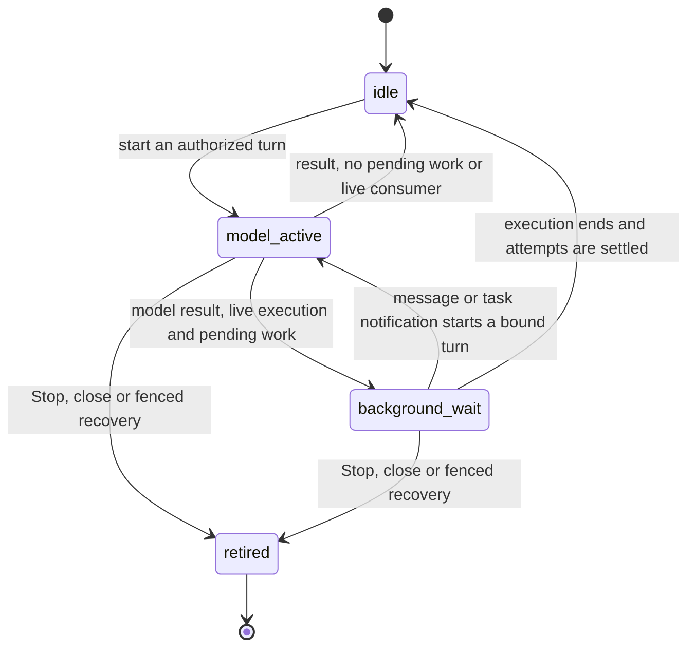
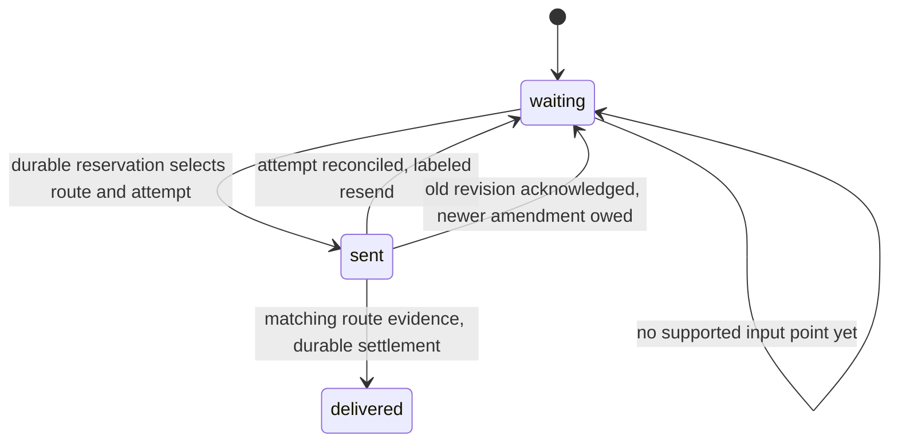
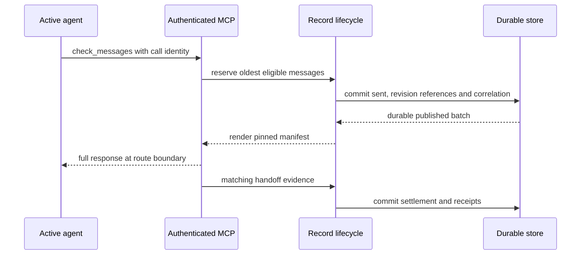

# Delivery routes: messages to a working agent

**Status:** draft 7, 3 November 2026. Draft 6 added the adapter execution seam, lifecycle split and caller sweep requested on draft 5; draft 4 was approved. critic re-read draft 6 against `main` at `48f20ccd` on 3 November 2026, on #708, and checked its code claims; this draft applies that read: the caller sweep at `48f20ccd`, line citations, and the fixtures’ location. Merging it is the person’s approval. Step names predate the split in #608: where this document gives A1 deliveries, reservations or the record queue, read A2 (`design.md`, “Rollout”); `a1b-asks.md` (“Carried to A2”) reconciles them: A1b adds no records, and where A2’s go is A2’s note’s. No implementation or backend capability is approved by this document. A1 owns the record and reservation boundary; A2 owns attempt settlement; the five-backend spike supplies route evidence before A3 enables faster delivery.

**Sources:** [#470 and its measured case](https://github.com/HJeon139/postbox/issues/470), [the native-protocol question](https://github.com/HJeon139/postbox/issues/470#issuecomment-6535834413), [#427](https://github.com/HJeon139/postbox/issues/427), [requirements](requirements.md) DL-1–3, DL-6–8, MD-1–2, INV-13 and decision “Seen”; [design](design.md), “Records”, “Delivering a turn” and “Delivering during a turn”; [the approved storage design](https://github.com/HJeon139/postbox/pull/580). New Tell it now and latency wording is being edited by researcher; requirement ids are not reassigned here.

## Problem and scope

#470 recorded a choice answer reaching a Claude Code agent 3 min 46 s later while Postbox still counted its backend execution as busy. That observation does not establish that a model turn stayed open throughout the wait. Attaching a notice to the next Postbox tool result does not fix a turn that makes no such call. Adding a check-messages tool offers another input point but cannot make the agent call it. Native input and hooks must be tested rather than inferred from an API name.

This proposal makes delivery routes share one record lifecycle. It does not implement the backend integrations, A2’s failed-turn replay, the #427 view or the modes UI. The #427 view consumes waiting records grouped by recipient, with counts and a bounded page; route changes must not create another queue for it. Its measured height bound belongs to the view design and AT-6.

The current urgent-note path consumes session context in [withUrgent](../../server/subagent-end.mjs) (`server/subagent-end.mjs:39`), called by [local MCP](../../server/mcp.mjs) (`server/mcp.mjs:97`) and [remote tool replies](../../server/remote/turns-tools.mjs) (`server/remote/turns-tools.mjs:58`). Those are existing mechanisms, not evidence that records or bounded mid-turn delivery already work. A1 replaces delivery ownership with record reservations; it must not leave both mechanisms consuming the same addressed message.

## Product contract and capability gate

- **Tell it now:** request delivery at the earliest supported input point while existing work continues. If a model turn is active, it continues; if the model is between turns in a live backend execution, an additional turn may start without restarting the process or its background work. A supported hook or native route is selected when its recorded capability meets the bound. It never secretly means Stop and restart.
- **Universal-only:** the agent can receive messages on its next Postbox tool result, including `check_messages`. The person sees “Waiting for its next Postbox tool call”. This route has no wall-clock or one-agent-step guarantee when the agent makes no Postbox call.
- **Turn ends first:** an unclaimed wake remains owed and can start a new turn; a notification waits for a later turn. A claimed message first follows A2’s settlement rules. The person’s explicit queue-for-next-turn choice is preserved.
- **During a foreground tool:** “one agent step” means the next point at which the harness can supply input to its model, not preemption of that tool. A long foreground call may have no such point until it returns (#470). “Tell it now” does not stop the call or its background jobs.

Capabilities are keyed by backend, version, local/remote transport, route, execution state and input mechanism. A verified turn-start mechanism is not evidence for active-turn steering, or vice versa. Unsupported or unverified hook/native paths stay disabled. Universal MCP is the implementation floor to verify on all five backends, not a declaration that DL-8’s new conformance tests have passed.

The spike must cover Claude Code, Agent SDK, Codex, Kiro and Antigravity, both transports, at reasoning, between short tools, during a long tool and immediately before completion. It records where input enters, whether the same turn continues, exact recipient/order, no repeated tool execution and the evidence event. Native agent-to-agent APIs are candidates only if Postbox can authenticate the recipient and correlate receipt across hosts. Reusing such APIs must not create a second mailbox or bypass records.

## Model turns and a live backend execution (A′)

**Root cause and evidence scope.** Postbox currently uses one runtime turn lifetime for two different facts: whether the model is in a turn and whether its backend process or stream is still alive. The Claude Code adapter ends stdin after writing its prompt and resolves on process exit (`server/adapters/claude-code.mjs:288`, `child.stdin.end(prompt)`, and `:283`, the `close` listener). Process liveness alone is therefore not evidence that the model is busy or has consumed a message.

I inspected the spike’s local scratch traces on 1 November: `scratch/trace-scenarioA-baseline.json` has a background `task_started` at +2,663 ms, first `result: success` at +4,027 ms, a completion notification at +7,678 ms, then a second result at +8,884 ms. Scenario B has a foreground task, completion at +6,854 ms and its first result at +7,589 ms. These are single Claude Code baseline runs, not an input-delivery capability. The spike’s committed, sanitized captures and their provenance are in [the spike’s fixtures](../../tests/fixtures/delivery-routes.md) (#631). They distinguish a state that the original draft omitted; they do not prove the original 226-second run had the same wire sequence.

**Adapter contract seam (proposed, not implemented).** Today `adapter.deliver()` returns a process-lifetime promise: the runtime assigns it to `turn.exited`, then calls `endTurn` and `turnExited` from it (`server/runtime.mjs:653–663`, adapter invocation and turn settlement). For A′, add an optional `openExecution(ctx)` capability returning an execution handle: `{ backendRunId, events, input(message, binding), exited, stop(choice) }`. Its ordered event stream must expose `modelStarted`, `modelResult`, `inputAccepted` and task notifications with execution, model-turn and input correlations; `inputAccepted` is not consumption evidence unless its tested semantics say so. `exited` remains the execution-lifetime promise, and its stop controller preserves the existing Stop/jobs choice. The input method admits one correlated turn through the arbiter, never silently spawns another process. Event-before-handle races require an ordered buffered subscription, not a late listener that can miss the first result. A mock contract test precedes adapter code.

Legacy adapters keep their existing `deliver()` promise and behavior. Without an explicit ordered model-result signal and a tested input method, a live legacy execution’s model state is `unknown`; no A′ admission is inferred from a completed assistant text block, elapsed time or process liveness. A1 can build record ownership and the arbiter seam against the mock without changing every adapter. Enabling `openExecution` is a later capability-gated adapter change after the spike and parity tests.

**A′ is a separate state:** the model is between turns, the backend execution is alive, and background work is pending. The runtime must distinguish `model-active`, `background-wait` and `idle`, with `unknown` when the harness gives no reliable boundary. Background work alone does not prove `background-wait`: require the matching model-turn completion event as well. A process-alive flag cannot replace that event. The page may continue to show background work, but it must not describe the model as actively answering or claim the message needs active-turn steering.



This is an execution read model, not additional delivery-record states. Unknown harness state keeps messages waiting with an honest reason. No heuristic based on elapsed time promotes unknown to model-idle.

**Two native mechanisms, one record lifecycle.** Keep the canonical four routes. For `native-input`, a capability names `inputMode: steer-active-turn` or `inputMode: start-turn-in-live-execution`. The former targets an existing model turn (for example a candidate active-turn steering API). The latter sends a new authorized input to the same live backend execution while its background jobs continue. It is a new model turn, not an interrupt/restart of the old one. `new-turn` remains the ordinary adapter dispatch path; reusing a live process is not evidence that this path supports A′. Keeping stdin open with stream-json input is a proposed Claude Code implementation to test, not a capability enabled by this document.

**Identity and ownership.** Give each backend execution a `backendRunId` distinct from the model’s turn id and the Postbox recipient session. A′ reservations allocate a new Postbox turn token before external input, and bind the dispatch to that token, `backendRunId`, native input correlation and `inputMode`. Correlate the harness’s new model-turn identity when its input artifact arrives; an absent or ambiguous correlation leaves the attempt uncertain. The first result settles only its own bound deliveries; keeping the process alive cannot keep those records owned by an ended model turn, and a task notification cannot settle a person’s unrelated dispatch. The lifecycle retains `waiting` / `sent` / `delivered`; these fields refine attempt correlation, not mailbox ownership.

**Settlement split.** At a matching `modelResult`, settle that model turn’s reply, its completed/aborted steps and subagent-call bookkeeping, its scheduled-wake attempt, ledger work and permission waits, and remove only that active model-turn entry from `rt.turns`. This is not proof that detached tasks or subagents died: retained background jobs keep execution/task identities, their running ledger entries and their own later completion path. Keep a separate execution registry until `exited` settles. The session ring reads `background-wait` with a background-work label rather than `think`/`gen`; permission and needs indicators still take precedence.

At execution exit, fence its input capability, settle execution-owned cleanup and held-notification bookkeeping, and end its delivery chain only after all model turns/attempts are accounted for. The existing `turnExited` process-start behavior must not run at each model result. `exiting.held` and the queue drain may become eligible after a model result, but admission while the execution lives goes through its input arbiter; neither path may start a second process beside it. Unsupported/unknown executions keep their old exit-based drain and visibly wait. Stop can address the execution when no model turn is active, applying the existing keep-or-stop background-jobs choice; it must not silently turn into a no-op because `rt.turns` has no entry.

**Existing queue ownership.** A1’s record queue is the durable source of addressed inputs; the arbiter owns admission, not a second copy of message bodies. Fold addressed `turn.pending`/`exiting.held` and `thread.queue` entries into record-backed references with their eligibility mode and original order. A person’s explicit next-turn choice remains next-turn eligible; Tell it now does not rewrite it. Sources not yet migrated keep one adapter into arbitration and one owner, with dual consumption forbidden. `storeWait` remains an activation gate containing references to owed work, not another mailbox: a closure re-reads the installed record/execution and cannot replay stale message data. Migration tests cover all three existing mechanisms and their cross-source ordering. Native task notifications retain their harness task identity and enter the same ordered admission boundary; their bodies need not become person-message records to be serialized.

**Ordering at the input boundary.** A person message and a task notification that arrive together must enter one per-execution ordered input arbiter. It assigns an observable order and admits at most one model turn at a time; both inputs remain owed until accepted, without a second delivery queue. Record-backed messages retain their existing reservation order. Preserve task/run identity and record the notification’s observed input position. If notifications start turns inside the harness, the spike must prove the harness serialization and expose enough correlation to attribute each turn. If Postbox cannot observe or control that boundary, disable this A′ mechanism for that configuration; do not promise serialization based on stdin order alone.

The selector revalidates the execution state and epoch at reservation and before dispatch. If a notification wins and the model becomes active, only a separately verified active-turn mechanism may consume the still-unclaimed message. A reservation already handed off cannot be rerouted. A native refusal that proves no input was accepted may be reconciled without claiming delivery; an ambiguous response remains `sent` until fenced recovery. Never silently retry the same message through both active steering and new-turn input.

**Evidence and pass rules.** A′ requires a model-facing user-input artifact for the new bound turn, its position relative to notification inputs, and the route’s tested consumption boundary. A process write or an end-of-turn result from the previous turn is insufficient. Refusal/framing results are separate by case. Scenario B may place input inside a tool-result context, as the dry run reported; plain text, neutral “Message from the person:” attribution and hook context must each be tested there. A′ starts an ordinary new user turn outside a tool result: neutral attribution is a precaution, not an assumed requirement, and its user-role artifact must be verified independently. An A′ pass supplies no evidence about B framing. In either case, a quoted token accompanied by refusal is not behavioral success. Distinguish not delivered, delivered-but-refused and successful requested behavior in spike results; the durable delivered boundary remains the defined handoff/consumption evidence, not a claim that the model obeyed.

Scenario A′ passes only if the model is between turns at injection with a live execution and pending job, processes the message in a new bound turn within **10 seconds** of Postbox accepting the message (the predeclared A′ acceptance bound, a proposed target rather than a measurement), leaves the background job alive, subsequently receives its completion notification, and serializes the two turns without duplicate tools. Measure the 10-second bound against the current queued-path control in the same harness. Scenario B remains active-turn delivery during a foreground call; it has a separate validity condition and pass rule. A′ success must not be reported as B steering, or vice versa. Codex and Agent SDK must answer the same process/stream-versus-model-turn question from their own traces; neither inherits Claude Code’s state interpretation. All remote A′ mechanisms remain unverified and disabled until designed and tested for that transport.

**Outage while background-wait.** The execution stays alive while writes are closed, with no input admission; `heldTurn` (`server/store-outage.mjs:190`) is the existing start gate and the arbiter checks it before input as well as process creation. A task notification during the outage stays pending as input and is correlated to its execution/task, not interpreted as a completed new model turn. Existing `stopForStore` (`server/store-outage.mjs:198`) still stops an active model turn; it must distinguish a background-wait execution from that turn, and must not call `recordStopped`/`stallLeftRunning` with a fabricated turn or retire detached execution jobs. A model result arriving during the outage is accounted for after recovery under the existing deferred-settlement policy; no result or notification may activate a turn while closed. Terminal shutdown is distinct from a recoverable outage.

**Lifecycle end states and recovery.** Stop or terminal close retires the execution and all its input capabilities before admitting another input; it does not wait for a missing model result to permit a new reservation. A late result or notification is fenced by execution id, turn token and store epoch. An input already submitted when failure/close occurs stays uncertain until its consumer is positively fenced; no flag cancels submitted I/O. Retry uses the existing awaited reconciliation seam and never activates a new input before reconciliation commits. Local execution capabilities are process-scoped and retired across a Postbox restart; A1 must preserve the existing local-process cleanup guarantee and cannot reattach one from a saved pid. No local turn-map entry after that cleanup certifies no surviving local consumer, so local attempts are reconciled as retired. This is not a reason to kill background jobs explicitly kept by the person. Only remote executions may survive and reattach through the D2 protocol; for them absence from the local turn map does not prove retirement.

### Caller sweep: one lifetime used for two facts

Inventory read against `main` at `48f20ccd` (`rg` for `turns.has/get` in `server/`, 25 files, plus the settlement/iteration users below); it was first taken at 1b `b3fe1218`, and `topic-open.mjs` is the one caller added since. These are required migration decisions, not claims that current code implements A′. Implementation repeats the scan on its chosen main head; a new runtime caller needs an explicit active-turn, execution or token policy rather than a raw busy-map lookup.

| Site / caller family | Current meaning | Policy in background-wait |
|---|---|---|
| `runtime.mjs`, send/deliver, pending batching, queue drain | Busy session and process ownership are one turn | Admit record references through the live execution; do not create a second process; preserve explicit next-turn eligibility |
| `runtime.mjs`, `endTurn` / `turnExited`, endWork, chains | Model and process settlement share one boundary | Use the settlement split above; end model work at result, execution cleanup at exit |
| `runtime.mjs`, slash command and model/effort controls | Busy refuses slash; control belongs to turn | A parity-verified slash command uses an ordered input to the existing execution; otherwise refuse visibly as unavailable during background work. Model/effort changes require the execution’s tested control; never spawn a replacement process |
| `runtime.mjs`, Stop / requestStop / job stopping; `kept-jobs.mjs` | Turn map locates process and job controller | Look up execution/task owner even with no model turn; preserve the person’s jobs choice and stale-turn fencing |
| `runtime.mjs`, delete/archive/purge; `persona-delete.mjs` | Delivery and process retirement overlap | Deleting admits no input under #597’s hold/refusal policy; Undo/purge arbitration is record-backed, and retirement uses the execution registry |
| `runtime.mjs`, mirror poll | A live turn suppresses terminal echo | Match execution/model input provenance; no duplicate transcript import during a native child turn; no tail advance while store closed |
| `queue-batch.mjs`, `message-queue.mjs` | Busy map gates eligibility and pending context | Model-active blocks new-turn admission; background-wait is eligible only through proven live input. Retiring/deleting/outage still hold inputs |
| `blocks.mjs`, `wake-cards.mjs`, `apps.mjs`, `app-retire.mjs`, `tool-ask.mjs`, `remote/turns-prompts.mjs` | Needs/ring state and pending-answer lookup | Use execution read model for ring, record references for waiting answers, active turn only for its token; do not reset a live background execution to plain idle |
| `permission-prompt.mjs`, `permission-cards.mjs`, `permissions-panel.mjs` | Backend, turn permissions, active controls | Bind waits to their actual model turn and execution; expire completed-turn waits, locate execution controls separately, never revive a retired token |
| `side-threads.mjs` | Busy checks, thread ownership and summary-in-progress | Model turn owns its thread and summary; background-wait input is ordered into the same execution with a fresh thread binding, not a parallel process |
| `thread-summary.mjs` / `busyIn` | Any live turn or pending held input suppresses summary | Check actual active model turns and owed scoped inputs; background tasks alone are not model activity; existing outage/epoch fences remain |
| `write-intent.mjs`, `review-comments.mjs`, `subagent-end.mjs` | Current-turn authorization and summary restrictions | Require a valid active model-turn token; background-wait has no old-turn tool authority. Subagent/task management resolves the explicit execution/task identity |
| `mcp.mjs` | Turn token and per-turn tools/results | Authenticate the child turn, never an execution-wide reusable token; reject completed-turn calls; delivery still uses one MCP write gate |
| `telemetry.mjs` | Receipt/control associated with running turn | Attribute by execution plus exact model-turn identity; old completion cannot settle the new input |
| `remote/placement.mjs`, `remote/turns-resume.mjs` | Busy prevents moving or restoring a live consumer | Preserve placement while execution alive, query host execution/turn state, and never restore a second consumer because local active-turn map is empty |
| `topic-open.mjs`, `post()` (`server/topic-open.mjs:120`) | Attributes a topic’s first message and its wakes to the active turn (`fromTurnId`) | Use the exact active model-turn identity, or none during background-wait; never an execution-wide id |
| `store-outage.mjs`, `scheduled-wakes.mjs` | Stop active turn, hold starts and re-arm tasks | Separate background execution from active turn; notifications remain inputs, admission waits for reopen and awaited reconciliation |
| `room-checks.mjs`, `telemetry-record.mjs` | Historical turn grouping / lost-record sets, not the runtime map | Clean neighbors: retain historical identity; do not migrate these same-spelled maps into execution liveness |

**Timer ownership.** The spike evaluates the 10-second bound from recorded timestamps. If runtime enforcement adds a `nativeInputDeadline` timer, its callback is scoped to store epoch, backendRunId, turn token and dispatch; it only disables the unhealthy route and labels uncertainty, never resends or starts work. It must be added to #598’s timer inventory/guard with writable gating and revalidation after waits. No state write while closed: defer a record reference until reopen and discard a stale invocation after reconciliation. A deadline cannot cancel an already submitted input or certify its death.

**Transport parity before enabling Claude Code stream-json.** Re-run plain prompts, resume, explicit session id, fork/checkpoint, leading `/name` slash semantics, textual attachments, images and permission prompts under the candidate input transport. Compare actual model-facing inputs, resumable identities and permission response correlation with today’s adapter; include Stop/kept jobs and process exit. No successful A′ latency result overrides a regression in these paths. Missing or failed parity keeps the transport disabled until its separate adapter design resolves it.

## Record amendment

Use these canonical route values: `next-tool-result`, `hook`, `native-input`, `new-turn`. `check_messages` is a consumer of `next-tool-result`, not a fifth route. The earlier planning aliases `tool-result` and `next-turn` should be replaced in sister documents after review.

Illustrative fields on a delivery, in addition to its existing source, parts, recipient, revisions and times:

```javascript
{
  id: 'rec_delivery',
  to: { persona: 'persona_1', session: 'session_1' },
  state: 'sent',
  rev: 3,
  sentRev: 3,
  attempt: 2,
  turnId: 'turn_1',
  route: 'next-tool-result',
  dispatchId: 'dispatch_1',
  target: { callId: 'call_9' }
}
```

This is a shape example, not a persisted event fixture. Native targets also name `inputMode` and `backendRunId`, as specified under “Model turns and a live backend execution (A′)”. `route` is null until reservation and then records the actual selected route for that attempt; it is not the person’s requested mode or a capability claim. Keep requested mode separate. `target` is route-specific: MCP call id, hook invocation id, native input id, or the new turn’s dispatch id. A remote attempt also names its host and host-turn identity. No host may supply or change the authorized session binding.

A dispatch stores a small manifest: ordered `(recordId, sentRev)` references, `renderVersion`, the route/correlation, and fixed rendering metadata such as the remaining count. It does not cache a rendered response body. The record’s latest `rev` can advance independently. Evidence must name the record, sent revision, attempt, dispatch and recipient binding. Closed receipts retain those correlations and the route, using the existing derived-receipt design. Transport handles and turn tokens are not persisted as message content.

| Identity | Names and creation | Changes and replay rule |
|---|---|---|
| `attempt` | A record’s monotonic send-attempt number, incremented by the reservation commit; `turnId` identifies its owning running turn | A labeled resend increments it. A source edit alone does not. Replaying one response keeps it |
| `dispatchId` | One reserved batch and its manifest, generated when that batch is committed; several records can share it | A labeled resend gets a new id. Replaying a response keeps it, including after a transport resumption |
| `target` | The consumer invocation: MCP session and request id, hook invocation id, native input id, or new-turn dispatch correlation | A new consumer invocation changes it. The same resumed invocation keeps it. Never transfer a live reservation to a different target |

Every evidence event must match recipient binding, `turnId`, record id, `sentRev`, `attempt`, `dispatchId` and the route’s `target`. A revision change alone changes none of those frozen fields.

**References require retained immutable content.** A manifest must never render from the source item’s latest mutable body. The dispatch pins the delivery’s own canonical `parts` at `sentRev` while a consumer can still replay it; a queued message can reuse its existing parts, and later edits retain a separate amendment. Receipt closure and snapshot pruning must preserve any revision still referenced by a replayable dispatch. Pinning includes sender/time/attachment references and renderer version; rendering does not consult today’s handle, clock or remaining count. This retains necessary original content, not a second large copy of the rendered tool result. A1 must implement and test that retention with the manifest; record ids and revision numbers alone cannot reconstruct a deleted version.

A retired consumer has no right to replay content: after its turn/session is fenced, release the pin when A2 reconciles the dispatch, retaining the normal small receipt. A dispatch whose turn never ends stays pinned until A2 reconciles it; age alone never releases its content. Local turns die with a Postbox restart and cannot replay after retirement. Renderer retention across a restart or upgrade applies to remote host turns that survive it (the D2 resume case): retain their manifest’s renderer until reconciliation. An unknown renderer refuses replay and enters labeled recovery rather than rendering different bytes.

## Invariants before implementation

1. **One owner:** for a recipient and source revision there is at most one live reservation across catch-up, new-turn dispatch, polling, normal tool results, hooks and native input. They all consult the same records and receipts (DL-2).
2. **Durable before external action:** one function-form `commit` reserves eligible records against current published state, increments their attempts, freezes revision references and rendering metadata, and binds correlations. An empty lookup reserves nothing and writes nothing. No payload leaves Postbox before that commit resolves. A failed or uncertain commit does not authorize dispatch (INV-12, storage contract).
3. **Evidence is route-specific:** building a prompt, opening a thread, writing bytes, recording a host reply or an arbitrary later output is not automatically receipt evidence. The accepted boundary for each route is specified below. “Seen” remains dropped; no claim about human-like reading is made.
4. **Settlement is fenced:** a single settlement path matches the complete attempt identity. It acknowledges only `sentRev`; a newer revision remains owed as an amendment. Old turns, other sessions and subagents cannot settle it (INV-13).
5. **No unlabeled recovery:** a crash can make external handoff uncertain. This system is at least once with labeled resends, not transport-level exactly once. A replay of the same RPC response is not a newly claimed delivery. A new attempt after uncertainty says “sent again after an uncertain delivery” (DL-1–2).
6. **Read from published state:** tools, HTTP, route selectors, schedules and the queue view cannot read a staged reservation. A listener sees the whole committed batch. Failed settlement leaves `sent` visible, not a speculative `delivered`.
7. **No destructive polling:** empty polls, response construction failures, an offline host and a route that cannot carry the full payload do not remove a message. No clipping of a full delivery is used to fit a tool response or replay cache.
8. **No concurrent fallback:** never send a `sent` record down another route merely because an acknowledgment is slow. Quiesce or fence its old channel before a labeled new attempt. Time alone does not prove that the old channel cannot deliver.



The diagram omits unchanged expiry, supersession and blocked states. A route switch changes a new reservation, not the lifecycle’s states.

## Evidence for sent to delivered

| Route | Evidence admitted | What is insufficient |
|---|---|---|
| `new-turn` | A2’s evidence from the bound turn: qualifying output, or clean completion with no output, as “Delivering a turn” specifies | Thread/session init, adapter construction, prompt construction or an unrelated turn’s output |
| `next-tool-result`, local | The authenticated active turn’s complete MCP result is handed over at the instrumented response boundary, matching its call id and immutable batch. This follows DL-3’s local mid-turn handoff rule; it does not mean “seen” | Calling the tool handler, formatting the note or reserving it before responding |
| `next-tool-result`, remote | Evidence that the waiting shim’s exact call received the full reply, plus the causally subsequent same-attempt step required by “Delivering during a turn”; the spike must demonstrate the host ordering/correlation | Postbox’s send, a daemon append acknowledgment alone, a buffered earlier event or a parallel subagent event |
| `hook` | The tested harness boundary that consumes the full hook context for the next model input, correlated to the hook invocation and attempt. Local and remote variants require separate recordings | Hook exit 0, stdout write, or a hook that can reject a tool but cannot add model context |
| `native-input` | For active steering, the existing bound model turn; for A′, the newly bound model turn and live backend execution must be identified. A tested consumer acknowledgment or model-input artifact showing the bound input was accepted into this running attempt, correlated by input id. If the native API only acknowledges queueing, keep `sent` until later correlated consumption evidence | `stdin.write`, socket drain, a transport ack that only says queued, or documentation that a method exists |

Hook/native adapters supply evidence events to the same settlement function. Their final evidence selectors are deliberately not invented here: the spike either demonstrates one or leaves that route unverified and disabled. No backend is currently certified for these routes by this draft.

Local MCP’s boundary and remote ordering must be covered by receiver-side tests. If the local connection closes or the harness’s tool timeout elapses before complete handoff, it remains uncertain. The spike must include a late result after timeout and a receiver-side counterexample: if the harness ignores it, that configuration requires causal subsequent-step evidence, as the remote route does. Returning bytes after timeout never certifies delivery. After external handoff but before durable settlement, a crash leaves `sent`; A2 reconciles it and labels any resend. Persisting evidence after the fact cannot make the external action and the store transaction atomic.

## check_messages and competing consumers

`check_messages` is a cheap, nonblocking tool, authenticated by the existing turn token. It takes an optional bounded count; the caller cannot name another session, choose a delivery id, acknowledge an arbitrary record or change its route. It returns the oldest eligible complete messages for that recipient, with stable ids, sender, time, revision and resend label, followed by remaining counts. No message text is an instruction authorizing an action on another recipient.

### Empty lookup, rate and hook budgets

`check_messages` is a writing tool at 1b’s MCP entry gate because a nonempty call reserves records. Keep it out of the read set in [the MCP entry](../../server/mcp.mjs): while closed its unavailable response is that gate’s error result with the cause, no messages and no reservation. The tool does not add a second writable check. Hook delivery uses the same write-availability policy and returns no delivery context while closed. Never degrade to an unrecorded read. Initialize/read/Stop/Retry remain governed by the storage design’s allow list. The MCP session namespace and request-id validation belong in a module beside the entry gate, rather than growing its handler past the function-length ceiling.

When no eligible record exists, answer from published state without calling `commit`, appending a line, saving a session or persisting an empty response. A retry may then find newly arrived mail: that is its first delivery, not a duplicate. A positive precheck is revalidated inside the function-form reservation; if another consumer won meanwhile, return an empty result with no event or fsync.

The zero-write claim covers wrappers too, not just the polling function. Empty and rate-limited checks bypass per-call persisted Work/activity entries and the side-effect recovery bookkeeping in [recordedTools](../../server/scheduled-wakes.mjs) (`server/scheduled-wakes.mjs:110`, called at `server/mcp.mjs:88`); backend activity mapping must recognize this cheap poll. Keep only bounded in-memory aggregate counts until ordinary turn settlement, not one event per poll. The 1,000-poll test enters through the actual MCP/adapter path and inspects the log before that later turn settlement.

Proposed explicit-poll limiter: one in-memory token bucket per active recipient/turn, burst 4 and refill 1 per second. Excess calls return `rate-limited` and `retryAfterMs`, without a timer, log append or state event. The bucket is discarded with its turn. Messages remain waiting while explicit polls are rate-limited and still arrive on the next ordinary tool result; the limiter does not apply to that delivery. An automatic hook has a read-only empty lookup, not an extra `check_messages` call before each call to that tool.

The hook’s published-state eligibility lookup has a **target, not a measured result**, of p95 at most 1 ms on a fixture with 10,000 open records. Measure process startup and local/remote round-trip separately. The end-to-end budget includes waiting in the serialized writer queue, including a periodic snapshot and earlier commits, not only this reservation’s fsync. The spike measures a reservation issued during a snapshot and behind a batch of commits; writer-queue delay consumes the harness-timeout margin. Proposed end-to-end delivery-hook deadlines are 500 ms locally and 2 s remotely, further limited by the harness timeout minus a 100 ms margin; a configuration with no positive margin stays universal-only. Empty checks perform no disk operation. A nonempty reservation is the only commit before delivery. If that commit misses the hook deadline, the callback sends no late context: keep the reservation uncertain, fence the invocation and reconcile it. Do not cancel a disk write and pretend it never landed. These budgets need the spike’s measurement before a hook is enabled.

### Request identity and transport resumption

The [MCP 2025-06-18 base protocol](https://modelcontextprotocol.io/specification/2025-06-18/basic) prohibits reusing a request id within one session. Therefore the local key is `(MCP session id, request id)`, bound server-side to the authorized Postbox recipient and turn. Those two kinds of session are not interchangeable. A new initialized MCP session has a new namespace; a fresh request must have a new id. Reposting the same RPC request is not a new poll permitted by the protocol.

A disconnected connection need not be a new session. The [Streamable HTTP transport](https://modelcontextprotocol.io/specification/2025-06-18/basic/transports) permits response-stream resumption and replay using event ids. This is response redelivery for the same invocation, not reuse of a request id for a new operation. Postbox’s current [HTTP handler](../../server/mcp.mjs) advertises this protocol version (`PROTOCOL = '2025-06-18'`, `server/mcp.mjs:34`) but does not issue `Mcp-Session-Id` or implement resumable result streams; it must not claim that capability. For delivery-affecting tools, A1 must add an initialized, turn-bound MCP session namespace and validate it on each call; no generic cross-reconnect response-replay service is required. Generate the MCP session capability with `randomBytes(32)`, encoded for the header. Bind every call to its current authorized turn token, even if the MCP session spans turns; session-wide request-id uniqueness does not reset at a turn boundary. Duplicate POST ids are rejected without claiming more mail. If a new session asks after an uncertain call, the old `sent` reservation is not stolen; A2 reconciles the old consumer before any labeled resend.

This session behavior is not yet shown for the five harness clients. The spike must verify that each HTTP client echoes `Mcp-Session-Id` and initializes a new session when the server reports the old one unknown. A stdio shim has no such HTTP header: its MCP session lasts for that shim process, and a new process initializes a new namespace.

On a host, a daemon resend retains its existing host-turn/call correlation. It is an internal transport retry, not a new MCP request from the model. The [stdio shim](../../server/remote/host/shim.mjs) must preserve its client initialization namespace and show in the spike that one result reaches the corresponding harness call. An offline host returns unavailable and consumes nothing. `check_messages` must not use the broker’s offline read fallback or repeatable snapshot-read classification.

For Claude Code, the [official hooks reference](https://code.claude.com/docs/en/hooks#add-context-for-claude) documents context insertion, timeout behavior and size-dependent handling, not the actual MCP client’s retry identity. In particular, context over 10,000 characters can become a file reference with a preview; that is insufficient evidence of full delivery. Set the hook delivery cap at 9,000 characters for the complete serialized context, including wrappers and framing, or a lower verified harness cap. Take fewer complete messages when needed; a single message that cannot fit stays owed for another proven route or the next turn. A file reference does not count as full delivery. The spike must record actual installed-version behavior, including the native/MCP input contract and late hook output. Documentation is a candidate mechanism, not conformance proof.

### Nonempty reservation and deterministic replay

The commit associates selected records with their manifest and pins the referenced revision content. A new poll gets no record already `sent` or acknowledged. Ordinary result decoration, polling, hooks and native input all use this one reservation function; `check_messages` is never decorated with a second drain. Idempotence is backed by records/correlations and receipts, not only the store’s snapshot-bounded `opId` cache.

An internal retry/resumed response renders from the same manifest and pinned revisions with its stored renderer version. Current source edits, deletion, closure and snapshots cannot alter that output. Historical renderer tests compare exact output bytes. This removes the proposed rendered-body replay cache and its old retained-reply limit, not the real wire-size limit. The host cannot render from an offline snapshot or substitute a shortened retained reply; if it needs Postbox to render, it waits for reconnection.

Proposed initial bounds: at most 20 records and 64 KiB of encoded context per dispatch, further constrained by the verified route’s full-context limit; at most four unresolved dispatches per recipient/turn. Pinned canonical source content is additionally capped at 64 KiB of serialized UTF-8 `parts` per dispatch and 256 KiB per recipient/turn across unresolved dispatches; count retained revisions, not only the latest record. Enforce the source-pin ceilings in the record reducer as well as in selection, so another producer cannot bypass them. Reserve fewer records to meet both source and wire budgets. Hitting a bound leaves remaining records waiting with their count and reason; it does not evict a live manifest or its source revision. These are proposal limits, not claims about a backend. A single message too large for the route stays owed and can use another proven route or the next turn. Include hook wrappers and framing in the measured size; never clip a delivery to fit.



Replay is permitted only for the same consumer invocation, where the backend contract treats the repeated response as the same tool result. If a backend can insert two responses for one call into model context, the spike has not proved DL-2 and that replay mode must not be enabled.

Calling a read tool later can still return historical transcript text when explicitly requested. The once-only rule applies to automatic delivery/catch-up ownership; it does not prohibit an agent deliberately rereading the conversation.

## Failure table and the reader’s view

| Failure or interleaving | Durable/public state and what readers see | External action and recovery |
|---|---|---|
| Two polls, or poll versus hook/native claim | Exactly one reservation wins in the store’s serialization boundary; the other sees `sent` | Only the winner dispatches; no independent queue is drained |
| Reservation write fails or its sync result is uncertain | Previous published `waiting` view remains; store closes according to the storage step | Do not dispatch. Restart/1b recovery may find a landed reservation; reconcile before any resend |
| Reservation sync held | Public tools/view still see `waiting`; no staged bytes leak | Nothing sent; the held-sync test includes a concurrent poll and read tool |
| Crash after reservation, before handoff | `sent`, manifest, pinned revision and correlation survive | No assertion that it was read; reconcile old attempt, then labeled resend if needed |
| Response build fails, or full response exceeds a route’s budget | No reservation for an incomplete payload; waiting count and reason remain visible | No clipped note; choose a viable route later |
| Full handoff, settlement sync fails | Public state stays `sent`; a read cannot claim `delivered` | Close writes; reconcile uncertainty. Do not emit a second unlabelled full message |
| Nonempty tool reply lost, internal transport retries | Manifest and pinned revisions or receipt remain | Re-render only the same consumer invocation; a new MCP request cannot steal it |
| Empty poll repeated after mail arrives | No persisted empty result and no previous reservation | The new eligible message may be delivered once; empty polls write zero events |
| Store closed, or Retry still loading a candidate | Old published counts remain readable; the delivery tool returns `unavailable` with the cause and no messages | No unrecorded fallback; after successful Retry a new valid call sees reconciled records |
| Source edited/deleted, receipt closed or snapshot pruned | Live manifest still pins its exact source revision and renderer | Replay identical bytes or refuse visibly if integrity fails; never substitute current text |
| Hook/native route loses health or its version changes | Capability is disabled for that configuration; the person sees degraded/universal-only status | Keep existing `sent` until old channel is fenced/reconciled, then labeled resend; a timeout alone does not authorize rerouting |
| New poll while old dispatch lacks evidence | Old record stays `sent`; new records may be claimed in order | Do not steal the old reservation or infer loss from time |
| Edit or remove races reservation | Function-form commit orders them: waiting edits precede frozen `sentRev`; later edits remain owed | A remove that lost the race reports that delivery may already be in progress, rather than claiming retraction |
| A′ message races a background completion notification | The source stays waiting or has exactly one committed reservation, with an ordered input position and new turn binding; the page distinguishes background work from model activity | One arbiter/harness serialization chooses the order; no overlapping turns or duplicate inputs. Ambiguous handoff stays sent, never simultaneous fallback |
| Model result arrives while process/background jobs remain alive | Settle only deliveries of that completed model turn; unclaimed messages remain owed and the runtime reads background-wait only with proven turn boundaries | A verified A′ route may start a new turn without restarting/killing jobs; process exit is not required for model-turn settlement |
| Turn ends while hook/native send is unresolved | `sent` remains bound to the old attempt; the next turn cannot claim it | Stop/fence old channel and settle from evidence first; host reconnect is not proof of death |
| Late evidence after a new attempt/revision | Exact identity mismatch is a no-op; latest owed revision remains | Old receipt cannot close a new send or another session’s delivery |
| Persona retired, or held Add not yet answered | Existing A1 expiry/authorization rules hold; persona-only records cannot be polled as session deliveries | No native/hook shortcut around Add, expiry or conversation binding |
| Restart or Retry while dispatch callbacks exist | Recovery follows the approved store/runtime fencing order; old public view stays readable until recovery is installed | Old callbacks cannot activate a delivery in the recovered epoch; no delivery execution before the durability barrier |

## Acceptance and implementation order

Write failing specs before record/route code. The following are additions to A1/A2 acceptance, not claims that current main passes:

- **R-1, route independence:** each route uses identical reservation and settlement invariants. Wrong route/recipient/attempt/revision evidence cannot close a record; valid evidence can.
- **R-2, competing consumers:** two simultaneous polls, two different tool results and a hook versus poll produce one reservation per revision. A new poll contains none of the first batch; an internal retry/resumed response renders exactly that batch, even after new messages arrive. Duplicate POST ids claim nothing. Reuse of a request id with the same MCP session id and a new turn’s valid token is rejected; that session’s id namespace spans turns. A stale turn token is refused even with a fresh request id.
- **R-3, durability:** hold/fail the reservation sync and assert that no adapter/hook/native payload or MCP result is sent. Hold/fail settlement sync and assert that readers still see `sent`.
- **R-4, replay and bounds:** an internal retry or supported stream resumption re-renders the manifest byte-for-byte after source edits/deletion, receipt closure and snapshot pruning, including renderer version 1 after upgrade for a surviving remote host turn. A retired local consumer cannot replay. An unended turn keeps its source pins until A2 reconciliation, and hitting the pin ceiling leaves new messages waiting. Include a body past the old retained-reply limit, full wire/pin budgets and an oversized message. One thousand empty polls append zero lines, make zero commit calls and leave `seq` unchanged, whether empty or rate-limited; a subsequent allowed poll may claim new mail, and an ordinary tool result delivers waiting mail even while explicit polls are limited. Cover the 9,000-character hook cap with framing and fewer-message selection. Assert no clipping or silent loss.
- **R-5, end/edit races:** edit during an in-flight send preserves the owed amendment; end immediately before/after handoff; stale callback after recovery; persona joins another way; independent conversations cannot steal deliveries.
- **R-6, route evidence:** recorded positive and counterexample fixtures per backend/transport. Init alone, queued-only acknowledgments, buffered events, subagent steps and a result written after its harness timeout must not prove receipt. Assert model-facing artifacts or consumed hook/input events rather than a fake server accepting a field (#585).
- **R-7, #470 UAT:** reproduce the background-job/answered-choice scenario, distinguishing A′ (between model turns, live execution) from B (active foreground tool). Record posting, model-turn boundaries, job completion, input artifact and receipt timestamps, plus both execution and model-turn identities. Use a current queued-path control; the original 3 min 46 s is historical context, not a comparable new measurement. A′ requires a new model turn within the 10-second bound without process/job restart, retained completion notification and no duplicate tools. B requires its own tested eligible input point. Universal-only keeps its honest limitation label.
- **R-8, input-state races and retirement:** race a person message with a task notification, an active-turn result, Stop, store failure and terminal close. Assert one ordered consumer at a time, one reservation per source revision, no previous-turn receipt settling a new dispatch, and no old execution token accepting input after retirement. A process that remains alive after result must not leave model-turn records stranded until exit.
- **R-9, upgrade and downgrade:** upgrade from a process-lifetime-only adapter with no pending A′ reservation; it stays universal-only until conformance passes. A downgrade that cannot interpret a live native inputMode/backendRunId refuses that route and fences/reconciles it before labeled resend; it never treats an A′ child turn as the previous active turn.
- **R-10, contract and callers:** a fake execution emits modelResult while exited remains pending; assert turn-scoped settlement once, execution/job ownership retained, fresh child token for the next input, no stale MCP authority and no second process from queue/pending/storeWait. Exercise each row in the caller sweep, including slash, Stop, deletion, permissions and ring state. Candidate stream-json transport requires the parity matrix above before enabling.

A2 supplies one reconciliation function at 1b’s `store.onReload` seam (the I8 stand-in in `tests/store-failure-policy.test.mjs`). It reads the installed state and returns events for one function-form commit: `sent` records whose old turns/channels are positively fenced and have no live consumer become `waiting` with a labeled resend. A remote turn that survives restart is not dead merely because it is absent from a local turn map. Register this function at the existing reload listener; return the promise from the phase-bound `reconcile(events, { opId })` passed to the reload listener (`server/store-retry.mjs:141–153`, with its ETIMEDOUT) and await it before activating waiting delivery work; do not retain a reconciler from an earlier Retry. The callback runs after install but before writable: read the installed `rt.s`, perform an in-memory pass and build one function-form commit. No backend/disk/network scan, `rt.deliver` call or turn start belongs inside it. It must settle within `retryBoundMs` (3 seconds by default); timeout returns ETIMEDOUT and tracks every listener lifetime, with later Retry refused until old work settles. Bound the pass to fit that contract before enabling A2; do not silently enlarge the bound or start a second reconciliation. No second recovery path or direct state mutation is introduced. If reconciliation fails, activate nothing and retain the closed-store recovery policy.

First review these invariants and the failure table. Then A1 adds the route-neutral record/correlation seam and competing-consumer specs; A2 supplies the settlement/recovery matrix; the spike enables only proven faster routes. A3 consumes the bounded queue read model and adds Tell it now without rewriting delivery state. Researcher aligns the approved terminology and requirement wording; the #427 bounded view remains a separate parallel change.

## Rollout and route health

A1 switches each addressed-message source from `withUrgent` consumption to the record reservation in one code change; no dual-read period is permitted. Unrelated subagent-stop notices retain their existing owner until migrated separately, and cannot masquerade as a message delivery. A spec runs both local MCP and `server/remote/turns-tools.mjs` with one source and proves only the selected owner consumes it. A3’s view reads that same record queue.

A version change, timeout beyond the verified evidence bound, malformed acknowledgment or failed conformance check disables that route for its exact backend/version/transport configuration. Disabling stops new reservations; it does not undo a handoff. The person sees the failure reason and universal-only fallback. Existing dispatches remain `sent` until the old channel is positively quiesced/fenced and reconciled, then return to `waiting` with a labeled resend if needed. Re-enable only after the check passes. A route timeout never by itself proves death or permission to resend.

## Questions for review

Critic accepted the canonical names, null before reservation, local handoff as the product definition of delivered, and the universal-only exception. This draft incorporates the empty fast path, identity table and closed-store behavior.

Remaining implementation gates are the pinned-revision/renderer retention tests, the local MCP initialization namespace and timeout counterexample, and spike-verified evidence selectors and hook/wire budgets. Reference-only manifests do not remove those obligations; no route is enabled on a version or transport that has not met them.

No `seen` state, backend capability certification, spending authorization or GitHub write is added by this draft.
