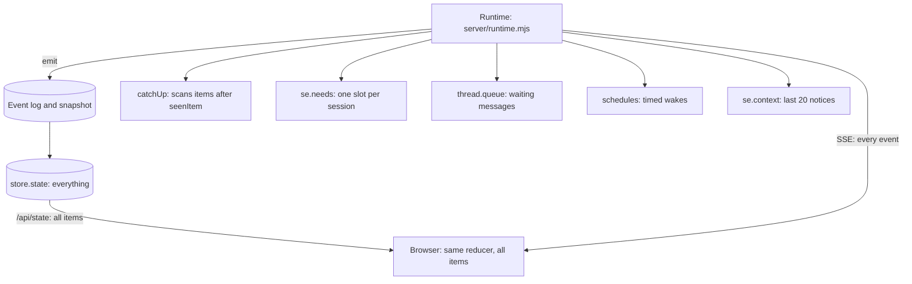
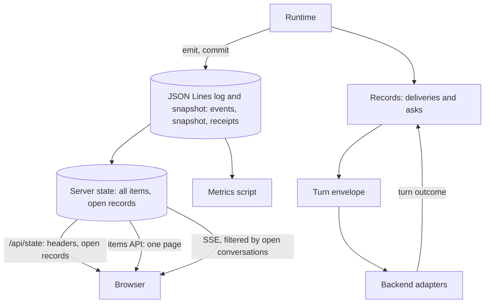
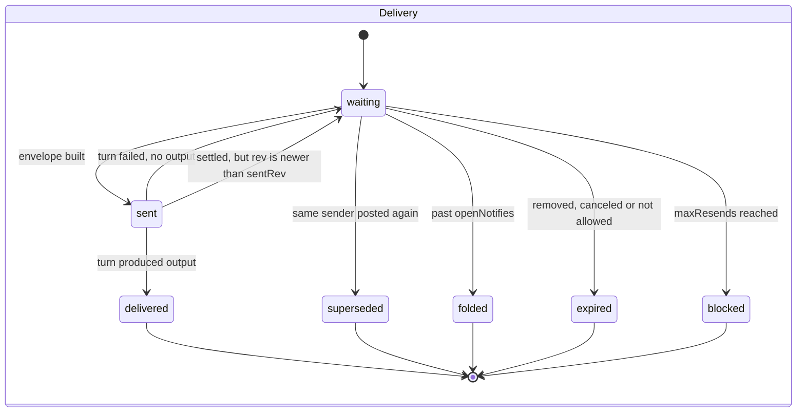
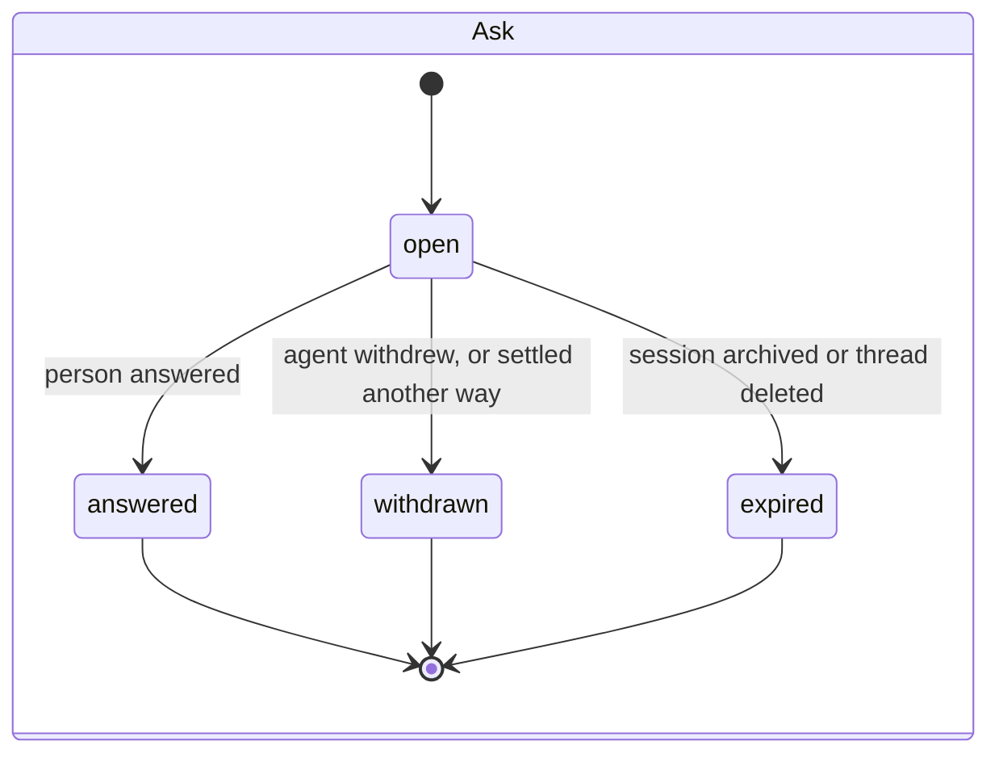
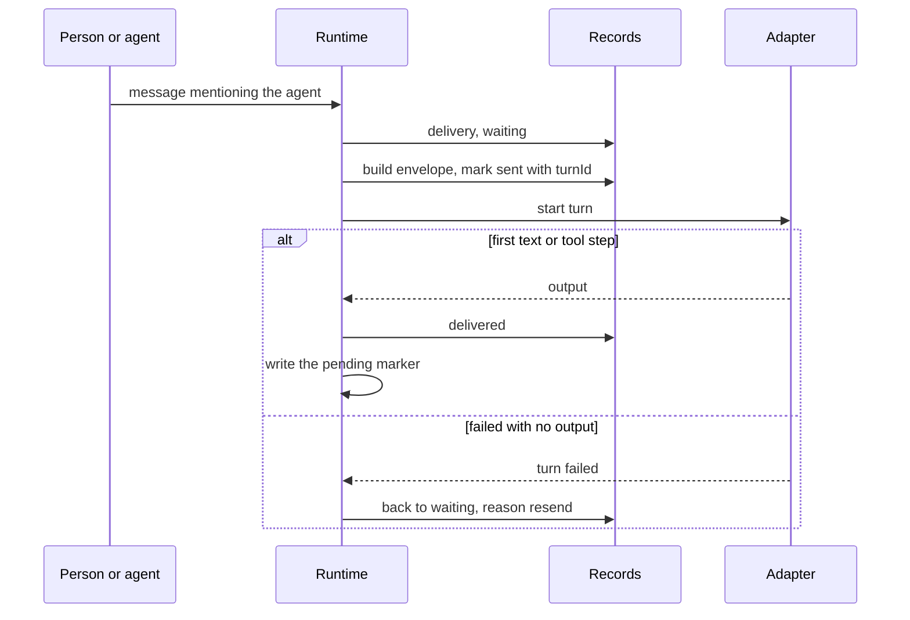
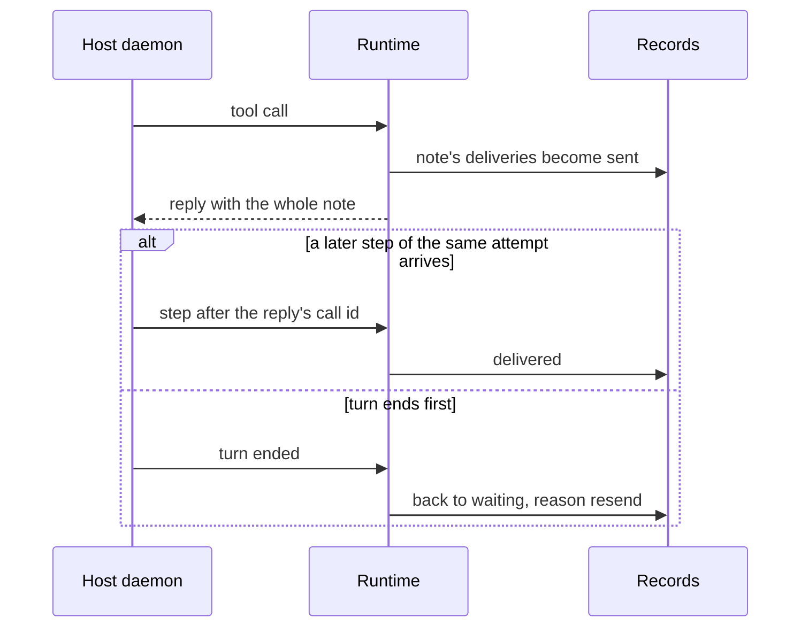
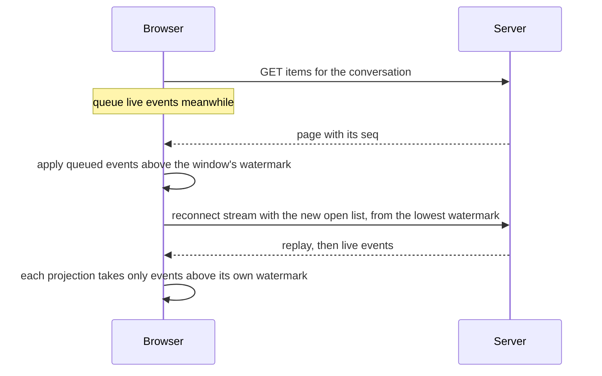
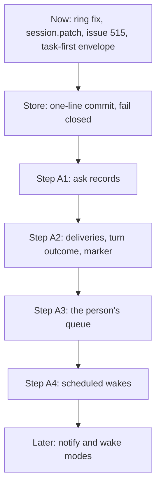
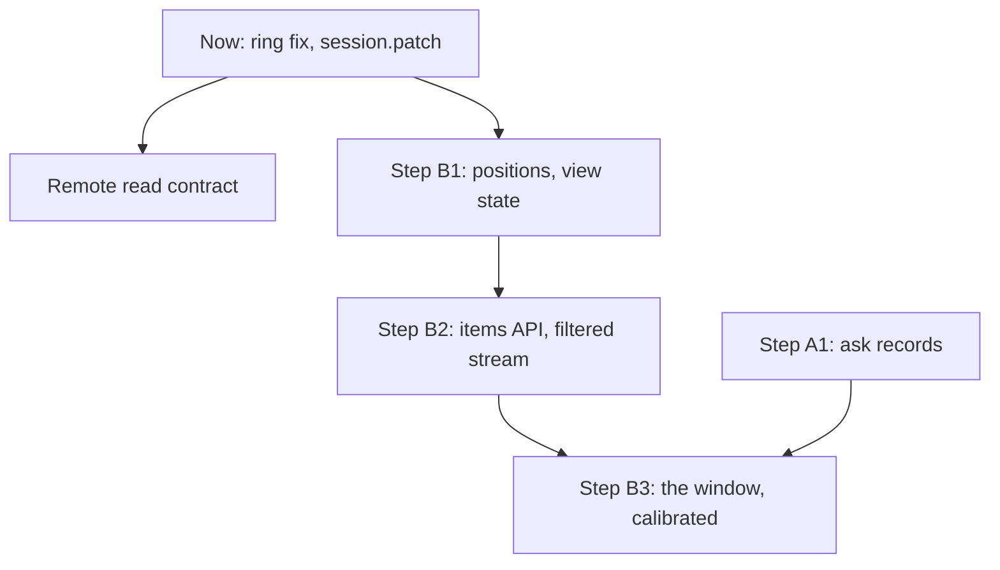

# Design: delivery records and a windowed transcript

| | |
|---|---|
| **Status** | Approved, revision 12: revision 11.2, with the Redis decision of 28 October recalled by the person on 31 October 2026 (“Storage”, §18). Persistence stays on JSON Lines, with one-line commits. Now and Harness have merged; the Store step is replaced by steps 1a, 1b and, on a budget, S2. |
| **Date** | 28 October 2026 |
| **Supersedes** | The design in #508’s description (“the approved design”), where this document differs. Its research and evidence still stand, and are cited by change number. |
| **Amends** | `designs/architecture.md`: “The store” (the store: JSON Lines with one-line commits, a sharded snapshot when the budget is exceeded, and a data-folder lock), “The front end” (the front end) and “A conversation is shared memory” (shared memory); `designs/intent.md` rows listed in “Rollout” |
| **Requirements** | The requirements comment on #508, revision 4.1 (comment 6482761957; ids DL, MD, AT, SW, PF, CX, MS). Its section “Acceptance, test first” names the test that decides each requirement. |
| **Acceptance scenarios** | Critic’s `testing-strategy.md` (approved in the room): `tests/uat/e2e/scenarios/delivery.md` and `bigroom.md`, with the triggers, checks, seed and launcher they need |
| **Reviews answered** | Integrator: comments 6481111995 and 6481619141. Critic: 6481670784, and critic’s seven findings on revision 3 in the room. Researcher’s findings on revision 3 in the room. Gemini’s nine implementation comments on revision 4 (threads gemini-1 to gemini-9). GPT’s principal-engineer review of revision 5 (threads gpt-10 to gpt-20). Critic’s request to make the UAT scenarios each step’s definition of done. Researcher’s backlog check: the prompt is saved before output on Codex and Antigravity. The room assets requirements (#516), reconciled in “Extension points for room assets” as extension points, not as scope. GPT’s storage review of revision 9 (threads gpt-21 to gpt-28). The person’s storage interview of 28 October, eight decisions, which chose a bundled Redis 8 over SQLite (“Storage”). |
| **Code baseline** | `main` at v0.42.3 (`9d049185`). Every file and line cited was read there. |

## 1. Summary

Postbox has two root problems:
- **Large rooms are slow in the browser.** The page holds and draws every item of every conversation.
- **Messages to agents are dropped, given twice or given out of order.** What was delivered, and what waits on the person, are found by scanning items and by a marker that moves before the turn has started.

This design makes four structural changes:
0. **Persistence stays on JSON Lines, with a commit written as one line** (“Storage”): a turn’s records and marker are one line with an `fsync`, so they commit together or not at all and nothing leaves the process until they have. Receipts are derived from the record events and checkpointed with the snapshot. Values carry a version and are lifted on read, so no install ever runs a migration. The 28 October decision to move onto a bundled Redis 8 was recalled on 31 October: the slow room it was not chosen for is fixed, and the second writer it was chosen for has no user yet (ST-2 is deferred).
1. **One record collection** replaces four partial mechanisms: `thread.queue`, `se.needs`, `schedules` and `se.context`. A record states what is addressed to whom, and where it is in its lifecycle.
2. **Delivery is decided by how a turn ends**, not by per-backend events. It is at least once, and every resend is labeled.
3. **The browser holds a window:** conversation headers and open records for every conversation, and a contiguous range of items for the conversations it shows. Items get server-assigned positions.

Everything else is either an existing mechanism kept as it is, or a separate feature with its own issue.

## 2. Context

### 2.1 How it works today



- **Browser load:** `/api/state` sends all of `store.state` (`server/index.mjs:292`), and the transcript mounts every item it holds (`app/js/thread.mjs:109`). In this room that is 978 items and about 70,000 DOM nodes. In Safari, 48–87% of the tab’s main thread went to painting. In Chrome, a key press takes 63 ms, against 29 ms in a small room (approved design, “Why”).
- **Catch-up:** `catchUp` sets `seenItem` to the newest item while it builds the prompt, before the backend has accepted the turn (`server/catch-up.mjs:20`; `server/runtime.mjs:1582` delegates to it). Items its caps leave out are skipped for good (#484).
- **Waiting on the person:** `se.needs` holds one request per session (`shared/needs.mjs`). A second limited wake behind an open card is held on that card in `card.held` (`holdOnCard`, `server/wake-cards.mjs:74`), up to `HELD_WAKES` (20, `shared/limits.mjs:64`); past that its sender is told to send it again. The card, not a record, is the only link between the wake and the request holding it (#439). `openAsks` scans items (`app/js/open-asks.mjs`), so it undercounts once items aren’t loaded.
- **Notices to agents:** `tellAgent` appends to `se.context` and keeps the last 20 (`server/runtime.mjs:1374-1377`, 15 call sites in `server/`). A 21st notice silently drops the oldest. Urgent notes live in the same list.

### 2.2 What already exists and is kept

| Mechanism | Where | Kept because |
|---|---|---|
| Event log, snapshots, one reducer for server and browser | `server/store.mjs`, `shared/state.mjs` | Unchanged. This design adds event types. |
| Resuming the stream from `Last-Event-ID` against the global `seq` | `server/index.mjs:509-516` | It already gives “everything after N” with a resync fallback. |
| Activity steps sent as deltas | `activityStep`, `shared/state.mjs:144-148` (#452) | Already done. The approved design’s change 4 point about this is out of date. |
| Moving a revised block to the end with a stub | `bringForward`, `server/runtime.mjs:340-360` | It keeps the item’s id; only the stub’s id is new. |
| Urgent note on a Postbox tool result | `withUrgent`, `server/subagent-end.mjs:39` | It is the mid-turn delivery path on every backend. |
| Who hears a reaction | `reactionLines`, `server/thread-summary.mjs:207` | Decision 8.5 keeps this audience. |
| Addressed messages cut at 15,000, background at 2,000 | `READING.mention`, `READING.item` (`shared/limits.mjs:45-50`, #502); `tests/catch-up-whole-mentions.test.mjs` | The envelope keeps both bounds. |
| Rerender state kept outside the DOM across live updates | `app/js/rerender-state.mjs` (#494) | The window reuses it across unmounting (“Browser”). |

**Three facts about today’s store that drove the storage decision** (`server/store.mjs`): `emit` applies and broadcasts at once, then queues the append, and an append failure is only logged (`:98-126`); a snapshot writes the projection and deletes the log segments it covers (`:131-136`); and `load` truncates a torn last line and replays the valid prefix, so an append of several lines is not all-or-nothing (gpt reproduced this: one complete event and one truncated event loaded as `seq` 1). So nothing that leaves the projection survives the next snapshot, nothing emitted is durable until written, and a multi-event write can half-apply. “Storage” is the answer.

## 3. Goals and non-goals

**Goals**
- G1: A large room costs about as much to type in and paint as a small one (PF-1, PF-2).
- G2: Every message addressed to an agent reaches it, whole up to `READING.mention` (15,000 characters, #502) with the rest readable by `read_message`, and any repeat is labeled (DL-1 to DL-3, decision 8.2). The delivery metric counts records delivered, not characters.
- G3: “Needs you” is correct whatever part of a room is loaded, and several requests can wait at once (AT-1 to AT-4).
- G4: Fewer mechanisms than today: four partial ones become one.
- G5: Every step ships alone, keeps the full browser suite green, and is decided by specs written first that fail on `main` (MS-2), with a real-agent run that confirms (“Rollout”).

**Non-goals for this design.** Each has its own issue and keeps its decisions:
- Agent search (`search_conversation`). Decided on 28 October: its scope is the conversation and its side and topic threads, its index is in memory, and it joins `REPEATABLE` on hosts.
- Standing decisions (#14). Decided: Postbox proposes, and the person approves each one.
- Probe sets, hand-labeled judgments and replays (the approved design’s change 10, probe rows).
- Notify and wake as composer modes, and removing `wake_agent` (#472, #481). The records support them; they ship later.
- AT-5, the pair limit counting only loops (#492). The limit reads records after A1, which makes it possible; it is its own issue.
- Room assets (#516): files, notes and apps as one versioned store. Its design follows its two open decisions. “Extension points for room assets” says which parts of this design it builds on, so nothing here has to be undone for it.

## 4. Constraints

| Constraint | Source |
|---|---|
| No new runtime dependencies. No npm package and no native binary is added. | `designs/engineering-practices.md`, “Keep runtime dependencies at zero” (PF-9) |
| A key/value or document model, never a relational schema with migrations | The person, 28 October: an earlier Postbox on SQLite hit schema and migration problems between versions that stopped rapid change on existing installs |
| One process and one person today; more than one is likely within a year, so nothing may assume a single writer | `designs/architecture.md`, “The store” and “Remote hosts”; the person, 28 October |
| Same reducer on server and browser | `designs/architecture.md`, “The store” |
| Five backends, local and remote: Claude Code, Agent SDK, Kiro, Codex, Antigravity | DL-8 |
| Nothing enters an agent’s context unless it reads it or the person sends it | Intent principle 7 (CX-1) |
| Tuning values are measured, not picked | Person’s decision, 28 October (MS-3, proposed) |

## 5. Architecture



| Component | Responsibility | Owns |
|---|---|---|
| Store (changed, `server/store.mjs`) | The same interface, plus `commit(events)`: authoritative transitions written as one line with an `fsync` (“Storage”). `emit` stays the optimistic path for streamed text. One serialized writer; a lock file in the data folder | The log, the snapshot and the data folder lock |
| Record store (new, in the reducer) | Holds open records; applies record events | `state.records` |
| Delivery rules (new, `shared/records.mjs`) | Pure functions: who a change reaches, de-duplication, every record transition (“Record lifecycles”), derived views (needs-you order, open asks, composer queue, scheduled wakes) | No state |
| Lifecycle owner (new, `server/records.mjs`) | The only code that emits `record` and `record.close`. Adapters report outcomes (“Delivering a turn”); they never patch a record. Asks and deliveries have separate validated shapes and transition tables. | — |
| Envelope builder (changed `catchUp`) | Builds a turn’s prompt from waiting deliveries and background; marks deliveries `sent` | The turn’s pending marker |
| Turn lifecycle (changed) | On first output, marks the turn’s deliveries `delivered` and writes the marker; on a failure with no output, returns them to `waiting` | — |
| Items API (new route) | Serves one page of a conversation’s items by position | — |
| Stream (changed) | Filters item and step events by the open-conversation list | — |
| Window (new, browser) | Holds a contiguous range per open conversation; the view state re-anchors on every DOM change | `client.windows` |
| Remote read contract (changed host tools) | Answers reads from the snapshot, else asks Postbox | — |
| Metrics script (new tool) | Computes MS-1 from the receipts (“Receipts”) of a room or a copy of its data folder | — |

## 6. Data model

**The data model is key/value and document, in memory and in the store.** The in-memory state is unchanged: collections that are maps keyed by id (`map()` in `shared/state.mjs`), kept current by the shared reducer on the server and in the browser. In the store (“Storage”) every change is an event in the JSON Lines log, and the snapshot is the state at a sequence number. The server reads the snapshot and replays the log at startup; the browser still applies events from the stream. A `record` event adds one entry to `state.records`, and `record.close` removes it. This design adds one map and one in-memory index.

| Map | Key | Value | Readers | Bound |
|---|---|---|---|---|
| `state.threads` | thread id | thread header, now with `nextN` | Everything | Number of threads |
| `state.items` | thread id | that thread’s items, sorted by `n` | The window, the items API, catch-up | Grows with history; the browser holds only windows |
| `state.sessions` | session id | session, with `seenItem` | Everything | Number of sessions |
| `state.records` | record id | one open record (“Records”) | `shared/records.mjs` | Open records only: waiting and sent deliveries, open asks |
| Item index (in memory, never stored) | item id | its thread and position | The reducer, per streamed chunk | Same as `state.items`; replaces the linear `find` (#305 factor 4) |

The same lookups are served in memory: each thread’s items are a list kept sorted by `n`, so a page is a binary search and a slice, and the id index is rebuilt on load and kept current by the reducer (“Storage”).

**Lookups**

| Lookup | How | Why that’s enough |
|---|---|---|
| A record by id | `state.records[id]` | — |
| A recipient’s open records | A scan of `state.records` filtered by `to` | Open records are few (INV-7), so a scan costs less than keeping an index current |
| The open record for `(to, sourceId)` | The same scan | As above; it enforces INV-3 |
| An item by id | The item index | Called for every streamed chunk |
| A page of items | Binary search on `n`, then a slice | The list stays sorted by `n` (“Items: position and revision”) |

- **No read needs a join or a query across history.**
- **The item index is derived.** The server and the browser rebuild it when state loads, and the reducer keeps it current. It is never migrated.
- **References are ids** inside values, such as a record’s `sourceId`, `to` and `heldBy`. Nothing enforces them as foreign keys. A record whose source item is gone stays readable, and its envelope line says the item was deleted.

### 6.1 Items: position and revision

| Field | Meaning | Set by |
|---|---|---|
| `n` | The item’s position in its conversation. Only grows. | The server, when it writes `item.add` or `item.move` |
| `rev` | Which version of the item this is | The server, on any change an agent could be told about (“What reaches agents”) |

- **A move keeps ids.** `item.move` gives the moved item the thread’s next `n`. Its stub, which has a new id, takes the item’s old `n`. Reactions, `read_message`, topic threads and Work rows keep pointing at the same id.
- **`thread.nextN`** is the counter. It lives in the thread header.
- **Old data:** when a snapshot loads, items without `n` are numbered in list order, and `nextN` is set past the last. Log events from before the upgrade are replayed by the same rule: an `item.add` without `n` takes `nextN`, and an `item.move` without `n` gives the moved item `nextN` and its stub the item’s old `n`. A replay test covers both. No versioned migration is needed.

### 6.2 Records

```
{
  id:        string,                       // rec_…
  kind:      'delivery' | 'ask',
  threadId:  string,                       // where it was addressed
  to:        sessionId | 'person',
  from:      sessionId | 'person' | 'postbox',   // 'postbox' for notices that tellAgent sends today
  sourceId:  string,                       // the item it’s about. Before the item exists it is the record’s own id;
                                           // posting the item overwrites it with the item’s id, so one key serves every lookup
  rev:       number,                       // the newest revision of the source still owed to the recipient
  sentRev?:  number,                       // the revision whose content went out in turnId; set when sent, cleared when settled
  attempt?:  number,                       // how many times this record has been sent; the label counts from 2
  mode:      'wake' | 'notify' | 'interrupt',
  state:     see “Record lifecycles”,
  reason?:   'held' | 'busy' | 'scheduled' | 'resend',
  heldBy?:   string,                       // the ask that holds it, when reason is 'held'
  urgent?:   boolean,                      // a notice for the agent mid-turn (“Delivering during a turn”)
  parts?:    [{ text, at }],               // a waiting message’s text, until its item is posted; a superseding wake keeps every part
  turnId?:   string,                       // set when sent
  notBefore?: number,                      // a scheduled wake’s time
  askKind?:  'block' | 'permission' | 'toolask' | 'hop' | 'appsend' | 'note' | 'blocked',   // 'note': a room-note proposal (#516 NT-2)
  folded?:   { count, before },            // notifications folded into this one, and the oldest one’s n, for read_conversation
  at:        number
}
```

- **Key:** at most one open record per `(to, sourceId)` (INV-3). When a waiting message’s item is posted, `sourceId` becomes the item’s id, so an edit that looks the record up by item id finds it.
- **Pending work and the attempt in flight are two fields.** `rev` is the newest revision owed; `sentRev` is what turn `turnId` was given. An edit while the record is `waiting` raises `rev`, and the agent gets the newest text once. An edit while it is `sent` raises `rev` and leaves `sentRev`: when the turn settles, the attempt acknowledges `sentRev` only, and because `rev > sentRev` the record doesn’t close but goes back to `waiting` as an amendment, with `parts` holding the diff from `sentRev` to `rev`. The diff is computed when the edit happens, from the item’s text before and after, and kept on the record, since the item alone can’t recover the version the recipient saw. A settle for a `turnId` that isn’t the record’s current attempt is ignored. **Cases in the tests:** an edit before the turn’s first output, an edit after it, and a late settle from an old attempt.
- **Open notifications are bounded.** At most `openNotifies` open `notify` records per recipient (a setting in “Observability and calibration”). Past it, the oldest close as `folded` into one record that carries a count and the oldest folded item’s `n` (`folded`), so an idle agent in a busy room doesn’t grow `/api/state` (INV-7). Every folded source is an item (“Postbox notices as items”), so nothing becomes unreadable; the envelope says how many were folded and gives the cursor. A2’s done-when distinguishes what the envelope included from what it left behind a pointer.
- **Size:** each part’s `text` is bounded by the composer’s and the tools’ existing limits, and MD-3’s cap folds a sender’s parts beyond it.
- **Notices from Postbox** (`tellAgent` today) are `notify` deliveries with `from: 'postbox'` whose source is a notice item (“Postbox notices as items”). Nothing drops the oldest; MD-3’s fold applies instead. Urgent notes are the same deliveries with `urgent: true`.
- **`se.needs` mapping:** `block`, `permission`, `toolask`, `hop` and `appsend` become `ask` records. `failed` and `denial` describe a session, not a request, so they stay as session status. `needsOrder` in `shared/records.mjs` takes the union: an open ask sorts by its `at`, and a failed or denied session by `se.updatedAt`, which is what `waitedSince` (`shared/needs.mjs:26`) falls back to today. Neither reads items.

### 6.3 What is state, what is in the store, and what reaches the browser

| Data | In `store.state` | In `/api/state` | In the store |
|---|---|---|---|
| Open records (`waiting`, `sent`, `open`) | Yes | Yes | In the snapshot, and as events in the log |
| Closed records | No | No | Only as the events that opened and closed them, and as receipts |
| Receipts (“Receipts”) | No | No | Derived by the reducer from the record events; checkpointed with the snapshot; server-only, bounded |
| Items | Yes | No: the items API serves pages | In the snapshot (a shard per conversation, from step S2), and as events |
| Thread headers, with `nextN` and stats | Yes | Yes | In the snapshot |
| App headers | Yes | Yes (PF-7) | In the snapshot |
| The event sequence | — | Resumed from `Last-Event-ID` | The log; segments are pruned below the snapshot’s `seq` |

Closed records leave state, so `/api/state` stays bounded by what is open, not by a room’s age. The history that explains a delivery lives in the receipts (“Receipts”), derived from the record events, so a close and its receipt can’t disagree.

### 6.4 Receipts

A server-only entry per delivery record, derived by the reducer from the record events, not written as a second file. It is not in `/api/state`.
- **One row when a delivery record opens** and one when it closes or is resent: `{ event: opened | delivered | superseded | expired | withdrawn | answered | resent, at, rev, sentRev?, turnId?, attempt?, reason? }`, beside the record’s `kind`, `to`, `from`, `threadId`, `sourceId` and `openedAt`.
- **No dual write.** Because the receipt is derived from the same line as the record event, a crash can neither close a record without its receipt nor record a receipt for a close that never committed. A repeated commit is skipped by its `seq`.
- **Why both rows:** MS-1’s completeness divides by addressed work, so a record that opened and never closed still counts. A metric built only from closes would hide a dropped record.
- **Retention is bounded:** the receipt projection is checkpointed with the snapshot. With a sharded snapshot (step S2, if it is ever needed), the whole receipt lives in the shard of the month it opened in, and a month is pruned, oldest first, only when it holds no open record and no recently closed one still inside the retention period, so completeness and lag stay honest.
- **Reading it:** the metrics script only. No HTTP route.
- **Test:** open and close records, restart, and the script’s counts are unchanged; a month holding an open record’s `opened` row is never pruned.

### 6.5 Postbox notices as items

`tellAgent`’s strings live only in `se.context` today (`server/runtime.mjs:1374-1377`): they aren’t items, so nothing can read one back once it has been folded. Under this design a notice from Postbox is written as a `system` item with `variant: 'notice'` and the recipient’s `sessionId`, in the recipient’s thread. Like today’s hidden system items it draws nothing in the transcript, but it has an id and an `n`, so `read_message` and `read_conversation` reach it. The delivery record’s `sourceId` is that item. Folding (“Records”) therefore loses nothing: the fold record’s `folded.before` is the oldest folded item’s `n`, and `read_conversation { before }` recovers every one.

### 6.6 Storage: JSON Lines, one line per commit

**Decision (the person, 31 October 2026, recalling the 28 October decision for a bundled Redis 8).** Persistence stays on the JSON Lines log plus a snapshot. The decision, the reasons, the line format, the writer, recovery, failing closed, the epoch, the lock, snapshots, the crash points and the test plan are in **`designs/508/storage-design.md`**, so the text exists once. In short:

- A commit is written whole and fsynced. A one-event commit is a plain event line with an operation id; a commit of several events is a JSON array. A commit is applied, broadcast and visible to anything (the public state, `since()`, `/api/state`, the read tools, an adapter start) only after its sync; emits made meanwhile are held and released in order. The integrator’s alternative, applying in call order and holding only what leaves the process, is recorded in `storage-design.md` and not adopted until its readers are named.
- A bad line in the middle of a segment refuses to start. A gap in `seq` starts, logs the range lost and shows it once.
- A failed write rejects what was queued and closes writes. Retry is a reload, the same recovery a restart runs, after the old writer is quiesced and with a durability barrier on a fresh descriptor and the runtime reconciled.
- A history epoch tells a tab on a lost timeline to resync. A lock file refuses a second Postbox on the data folder.
- Receipts are derived by the reducer from the record events and checkpointed with the snapshot.
- The snapshot is written in pieces now. A sharded snapshot waits for a stall over 50 ms, after old turns’ work entries and activity steps have been moved out of state (#305).
- ST-2, a second writer, is deferred.

**Security of the store.** There is no store process, socket or credential, so SR-1 to SR-4 and SR-6 to SR-8 no longer apply. What remains is SR-5: the data folder and the files in it are private (0700 and 0600). A process running as the person that sets out to read the folder is outside the threat model, as before.

**Not changed by this decision.** The agent-delivery rules: who a change reaches, held asks, `sentRev` and attempt fencing, the envelope, and the uncertainty of a backend’s receipt. The store gives a write a boundary; it doesn’t know whether a model read a prompt.

## 7. Behavior

### 7.1 Record lifecycles





| Transition | Trigger | Code path |
|---|---|---|
| → waiting | A message addresses an agent; a change concerns one (“What reaches agents”); a scheduled wake is set | `sendMessage`, `postAndDeliver`, `deliverWake`, the schedule tool |
| waiting, `reason: held`, `heldBy` | The pair or hop limit holds it behind an ask | The limit check; replaces `card.held` (`holdOnCard`), keeping its cap of `HELD_WAKES` and its message to the sender past it |
| held → waiting | The person allows the ask: every delivery with that `heldBy` is released (AT-1) | The ask’s answer route |
| held → expired | The person doesn’t allow it: each held delivery expires, and its sender gets a `notify` saying so | The ask’s answer route |
| waiting, `reason: held`, behind an Add card | A wake or notification for a persona not in the conversation raises the Add card as an `ask` and is held on it, like a limited wake (AT-7). Allow adds the persona and releases it; otherwise it expires and the sender is told. | The Add card route |
| waiting → sent | The envelope builder includes it; `sentRev = rev`, `attempt += 1`; the `record` event is committed (“Delivering a turn”) before the adapter starts | `catchUp`’s replacement |
| sent → delivered | The turn’s first qualifying output (“Delivering a turn”), with `rev == sentRev` | Turn lifecycle |
| sent → waiting, amendment | The turn’s first qualifying output, with `rev > sentRev`: the attempt is acknowledged and the newer revision stays owed, as a notify carrying the diff | Turn lifecycle |
| waiting → blocked | `attempt` reaches `maxResends`: the record stops being resent, and an `ask` of kind `blocked` tells the person which message couldn’t be delivered and to whom. The ask stays open until the person answers it (resend once more, or drop it), so the message is never silently expired: DL-1 holds because it still waits on the person, and AT-1 and AT-2 make that visible. | Turn lifecycle |
| waiting → folded | The recipient has more than `openNotifies` open notifications; the oldest close as folded, counted on the fold record | Lifecycle owner |
| sent → waiting, `reason: resend` | The turn ends failed with no output; or Postbox restarts with a local turn’s record still `sent` | Turn lifecycle; startup |
| delivered, then a transient failure | The turn failed after output with a transient error, such as a network drop (#466, #467), as judged by one predicate for every backend: `isNetworkFailure(error)`, which walks `error.cause` for `kind: 'unreachable'` or a code in `NETWORK_CODES`. It lives on the `fix/466-wake-retry` branch (`server/scheduled-wakes.mjs:51`), not yet on `main`; A2 takes it from there. A new labeled delivery from `postbox` says “your last turn stopped after starting work; check what ran”, and carries the original parts. Scheduled wakes lost this way are retried by it (SW-2). | Turn lifecycle |
| sent, on a host, across a restart | A host turn keeps running while Postbox is down. Its `sent` records stay until the replayed stream shows how the turn ended, then follow the rules above. If nothing is heard within the host timeout, they go back to `waiting` as resends. | Remote turns on reconnect |
| waiting → superseded | **Agent wakes only:** the waker posts again in the thread before its wake is delivered, with or without a new mention (`intent.md`, “Messages sent mid-reply”). The new post’s record takes the old one’s `parts`, each with its own time, and the old one closes as superseded (DL-6). The person’s queued messages are never superseded, so each keeps Edit and Remove (AT-6). | `deliverWake`, the agent’s post path |
| waiting → expired | The recipient is archived or removed, the conversation is deleted, or the wake is canceled (SW-1, SW-3). Archiving puts a line in the conversation for each canceled scheduled wake. Deleting removes the conversation and its sessions, so there is no one to tell: the delete confirmation lists the scheduled wakes it cancels instead. | Archive, delete and cancel paths |
| ask: open → answered or withdrawn | An answer; `update_block` withdraw; the request is settled another way (AT-3) | Answer routes; `retireStale` (`server/wake-cards.mjs:174`) |

“Seen” is not a state (decision 8.6): Postbox can’t observe it.

### 7.2 Invariants

| Id | Invariant | Checked by |
|---|---|---|
| INV-1 | A record is never deleted while open. It leaves state only by a closing transition. | Reducer test |
| INV-2 | A delivery becomes `delivered` only after its turn produced output, or after Postbox returned the tool result carrying it. | Turn lifecycle tests, one per backend |
| INV-3 | At most one open record per `(to, sourceId)`. A newer revision updates it. | `shared/records.mjs` unit test; an edit while a mention waits |
| INV-4 | Every resend carries its label. The count of unlabeled repeats is 0. | Metrics script on a copied room |
| INV-5 | An item’s `n` never changes, except that a move gives it a new, larger `n`. No id changes. | Reducer test |
| INV-6 | The session marker moves only when the turn produced output, and in the same settle as its deliveries. | Turn lifecycle test |
| INV-12 | Nothing leaves the process before the commit line marking a delivery `sent` has been fsynced: not the broadcast, `since()`, `/api/state`, the read tools, a reply to a caller, or an adapter start. A commit is applied to the public state only after its sync. Holds against process crashes and a power cut, with the stated limits of “Storage”: a drive that reports a flush it hasn’t done (and, after an `EIO` from `fsync`, lines that read back but may not be on the disk), and updates sent by `emit` that were still waiting. | Crash tests at the dispatch boundary: a kill at every byte of the commit, a write refused, a full disk |
| INV-13 | A settle acknowledges only the attempt and `sentRev` it names; a newer `rev` stays owed. | Edit-in-flight tests |
| INV-7 | `/api/state`’s size doesn’t depend on the number of closed records or items, and open `notify` records per recipient never exceed `openNotifies`. | Size check on a copied room with an idle agent |
| INV-8 | Outside the window module, no browser module reads `state.items`. | Lint check over `app/js` |
| INV-9 | A turn’s background never repeats an item that this recipient has a delivery for: one in the same envelope, or one delivered mid-turn since the marker. | Envelope unit test; #484’s case |
| INV-10 | Every held delivery names an open ask in `heldBy`; closing that ask releases or expires it. | `shared/records.mjs` unit test; #439’s case |
| INV-11 | Deliveries are never dropped by the catch-up’s aggregate caps, and each is cut at `READING.mention` (15,000), not `READING.item` (2,000), with a `read_message` pointer for the rest (#502). | `tests/catch-up-whole-mentions.test.mjs`, extended to records; #484’s oversized oldest mention |

### 7.3 Delivering a turn

**Durability at the dispatch boundary.** Today’s `emit` applies and broadcasts first and appends later, and an append failure is only logged (`server/store.mjs`, `pump`). That isn’t enough where an external turn starts: a crash after `emit` and before the append would restart with no record that the attempt was made, and the resend would carry no label; and once clients have seen `sent`, there is nothing to roll back. So the lifecycle owner uses `commit` (“Storage”): the `sent` transitions and the turn’s pending marker are one line, fsynced before the adapter starts. If the write fails, the lifecycle sees the failure, the records are still `waiting`, the turn doesn’t start, and the session shows the error. Settlement is one `commit`, `settle(turnId, outcome)`: it closes exactly the `sent` records with that `turnId` and writes the marker in the same line; their receipts are derived from those events. A repeated settle is refused by the record’s own transitions (INV-10, INV-13), and a repeated line is skipped by its `seq`. Startup conversions (“Migration, compatibility and rollback”) are one `commit` each: the new records and the cleared source are one line, so a crash between them can’t make a second delivery.



**The envelope**, in order:
1. The request being answered, where it was asked, and where the reply goes (DL-4, #504).
2. In a topic thread, the message it started from.
3. What changes during a room: the room list, the brief, the room’s approved notes (reserved for #516 NT-3; empty until then), session facts and tools turned off (CX-3, #515).
4. Waiting deliveries, wakes and notifications together, in the order they were posted, each line marked as a wake or a notification and carrying its `sourceId` and `rev`. Resends say “sent again after a failed turn”. Notifications are capped per sender and folded into one line (MD-3). The catch-up’s aggregate caps never drop a delivery, and a delivery is cut at `READING.mention`, the background at `READING.item` (INV-11, #502).
5. Background since the marker, labeled as background, with a count and a `read_conversation` cursor for what was left out (DL-5). It leaves out every item that a delivery in this envelope comes from (INV-9), so a mention isn’t given twice (#484). The session keeps the ids of items delivered mid-turn until the marker passes them.

The system prompt holds only what is fixed for a persona version (#515).

**Why “first output”.** Once the model has produced a step, it has read the prompt. Before that, Postbox can’t tell. A backend can save the prompt into the session before failing: gpt found a Codex 0.163.0 turn whose prompt was written and then aborted with no output, and gemini found an Antigravity session with a saved prompt and no response. Whether the agent then sees that prompt twice on its next turn is still unconfirmed, since neither found a later turn after such a failure. That is why a resend is labeled rather than assumed safe. One recorded failing turn per backend, with the turn after it, settles the rest before step A2 ships.

**What counts as output.** The rule is adapter-neutral: an adapter reports events, and `shared/records.mjs` decides. Qualifying: an assistant text delta or a tool call that belongs to the current attempt’s turn id. Not qualifying: initialization and session events, permission prompts, replayed history on resume, a compaction summary or the string-form continuation that follows one (#513), and a subagent’s own events until the parent turn produces its own step. Each adapter’s recorded events become fixtures for a shared conformance matrix, one row per outcome, so the policy is tested once and lives outside the adapters.

| Outcome | Deliveries | Marker |
|---|---|---|
| Qualifying output, then success | delivered (or amendment, INV-13) | moves |
| Success with no output (an empty turn) | delivered: the backend finished reading the prompt | moves |
| Failure with no output, including refusal and auth failure | waiting, `reason: resend` | stays |
| Qualifying output, then transient failure | delivered, plus the check-what-ran delivery (“Record lifecycles”) | moves |
| The person’s Stop | delivered if output had started; otherwise waiting, labeled “stopped before it was read” | as the row above |
| Host timeout, then the host reconnects with a later attempt running | the settle names the old attempt and is ignored (INV-13); the running attempt settles on its own evidence | — |

**Resends don’t loop.** The runtime owns retries: a `waiting` record is sent again only when its recipient’s next turn is built, never on a timer. After `maxResends` attempts (3, decided 28 October) the record goes `blocked` and the person gets an open ask naming the message and its recipient, with “Send once more” and “Drop it”. The message stays waiting on the person until they answer, so it becomes visible instead of being tried forever, and nothing is dropped without them (DL-1, AT-1, AT-2).

### 7.4 Delivering during a turn

**The route is part of the delivery.** A delivery records the route that carries it: `next-tool-result` (the urgent note on the next Postbox tool result, below), `hook`, `native-input`, or `new-turn`. Every route runs the same lifecycle, `waiting`, `sent`, `delivered`, with its own evidence for `sent` to `delivered`, so a backend gains a faster route without a change to the records. `next-tool-result` is the floor on every backend, and its designed mitigation is a cheap check-messages tool with a guide rule (#470), so an agent can read waiting messages between steps; it must not deliver a message twice (DL-2), and its design belongs to the A1 delivery-routes design. Even so the floor has a measured gap: an agent blocked on background work calls no Postbox tool, and #470 measured 3 min 46 s. The routes beyond it are not designed yet; the spike before A3 decides which backends have one (MD-2, MD-8).

- **Local:** the urgent note goes ahead of a Postbox tool result. Its deliveries become `delivered` when Postbox returns that result.
- **On a host:** `withUrgent` takes the note when the reply is built (`server/remote/turns-tools.mjs:45`). If the link drops, the daemon’s repeat is answered from a kept copy cut to `KEPT_REPLY_CHARS`. So:



**Evidence is correlated, not assumed.** A later host event counts only if it is a step of the same attempt that comes after the reply’s call id in the host’s own order. Buffered events from before the reply, or a parallel subagent’s events, don’t count. When the order can’t be established, the record stays `sent` until the attempt settles and is then labeled as uncertain and resent.

**A code change:** today the kept copy is cut at `KEPT_REPLY_CHARS`, 2,000 characters (`server/remote/turns-tools.mjs:50`, `turns-shared.mjs:20`), so a long note would be cut. Under this design the kept copy stores the note in full and cuts only the rest of the reply, and the note itself is bounded by MD-3’s cap. This is the one per-route exception to “Delivering a turn”’s rule (DL-3, DL-8).

### 7.5 Context loss (CX-4)

| Signal | Backend | Effect |
|---|---|---|
| `compact_boundary` (`server/adapters/claude-stream.mjs:514`) | Claude Code | The next envelope says earlier messages may have been summarized, and points to `read_conversation`. |
| Missing session, agent restarted fresh | Kiro, Antigravity | The marker resets, so recent background is sent again. |
| A `contextCompaction` thread item (the older `thread/compacted` notification is deprecated), in Codex 0.164.0’s app-server schema | Codex | Codex compacts its own thread when its context fills, without Postbox asking: two rollouts on 29 October 2026 hold a `compaction` item. The adapter reads the item, with the same effect as Claude Code’s `compact_boundary`. Separately, #425 wires the person’s `/compact` to `thread/compact/start`. |
| None yet | Agent SDK | No signal recorded yet |

Other signals are added only when a recorded turn shows one.

## 8. What reaches agents

Decided (8.5): any change to an item reaches the agents it concerns, as `notify`, which starts no turn. Each change raises the item’s `rev`.

| Change | Reaches | Mode |
|---|---|---|
| A message or block that mentions an agent | The agents it mentions; in a topic thread, its owner (MD-6) | wake |
| An answer to a block | The block’s author | as today: a wake to the waiting agent |
| An edit, shown as a diff | The item’s author and its recipients | notify |
| A review verdict, a thread outcome | The item’s author and its recipients | notify |
| A reply in a topic thread | The thread’s owner, as #472 records | wake |
| A reply in a topic thread, to a root author who isn’t the owner | That author | notify |
| A reaction, 🚩 included | As `reactionLines` today: the person’s reactions reach the agents answering in that thread; an agent’s reaction reaches only the agent whose message it is | notify |
| A room note approved or retired (#516 NT-3, NT-4; reserved) | Every agent in the room, running sessions included | notify, from `postbox` |
| An asset published (#516 UI-2; reserved) | The agents the asset’s thread concerns, as an edit does | notify |

- **Two routes to one change make one record** (INV-3). A root author who owns the thread gets the wake only.
- **MD-3’s cap per sender** covers reactions and amendments, so one busy message can’t flood its author’s catch-up.
- **🚩 still reaches agents** (person’s decision, 28 October). Intent’s telemetry row says *recording* changes nothing in an agent’s input; it doesn’t hide reactions.
- **Who an edit or verdict concerns** (its author and recipients) is this design’s reading. It needs confirmation.

## 9. Interfaces

### 9.1 Store events

| Event | Data | Reducer | Change |
|---|---|---|---|
| `record` | a whole open record | `state.records[id] = d` | New; written by `commit` as a document plus a stream entry |
| `record.close` | `{ id, state, at, reason? }` | `delete state.records[id]` | New; written by `commit` with its receipt entry (“Receipts”) |
| `session.patch` | `{ id, patch }` | `Object.assign` | New. Replaces whole-session `session` events from `updateSession`. In the browser, `client.mjs` applies it and then notifies listeners as a `session` change carrying the whole updated session, so the ten `app/js` modules that test `ch.type === 'session'` and read `ch.data.threadId` (`agents.mjs:56`, `thread.mjs:335`, `shell.mjs:295`, `open-asks.mjs:58` among them) keep working unchanged. |
| `item.add` | adds `item.n`, `item.rev` | as today, plus `thread.nextN` | Changed |
| `item.move` | adds the new `n`; the stub takes the old one | On the server, as today. In the browser, when the window doesn’t hold the item (`findIndex` gives `-1`, `shared/state.mjs:107`), the reducer breaks without an error, as today, and the window module, which also hears the event, fetches the item by id from the items API and places it by `n` when the window reaches the end. | Changed |
| `item.patch` | adds `rev` when the change is deliverable | drops a patch older than the item’s `rev` | Changed |

`thread.queue`, `schedules` and `se.context` stop being written once steps A3, A4 and A2 ship. Their events still replay from old logs at startup (“Migration, compatibility and rollback”). Every event is a line in the log, and the browser’s stream and `Last-Event-ID` are unchanged.

**Reserved for #516:** `asset` (an asset header: id, name, type, author, scope, versions `[{ v, hash, base, author, at }]`) and `asset.version` (one more version, written by `commit` with the base version checked inside the writer’s serialization). The reducer keeps headers in `state.assets`, a map by id like `state.apps`; content lives in the blob store by hash (`architecture.md`, “The store”, Attachments), never in the log. Neither event is emitted by this design.

**Host protocol.** A host’s kept reply becomes `{ note, text }`: the note in full, and the rest cut at `KEPT_REPLY_CHARS` (step A2).

### 9.2 HTTP

| Route | Request | Response | Change |
|---|---|---|---|
| `GET /api/state` | — | Everything but items: projects, personas, sessions, thread headers, app headers, glossary, open records | Changed |
| `GET /api/threads/:id/items` | `anchor` (`newest` or an item id), `before`, `after` | `{ items, work, foundOldest, foundNewest, seq }`, at most the calibrated page size | New |
| `GET /api/stream` | `open` (a list of conversation ids), `Last-Event-ID` | Events; item and step events only for `open` | Changed |
| `GET /api/threads/:id/search` | `q` | Hits: `{ id, n, handle, at, snippet }` | New, with B3 |

### 9.3 Agent tools

| Tool | Change |
|---|---|
| `read_conversation`, `read_message` on hosts | Answered from the snapshot when it can; otherwise the host asks Postbox. “Unavailable” stays distinct from “not found”. |
| `react` | No change |
| `wake_agent` | No change in this design (removed later by #481) |

## 10. Browser

- **State:** thread headers, app headers, sessions and open records for every conversation. Items only for open conversations.
- **The window** is one contiguous range of items per open conversation:
  - Scrolling near its top loads the page before it.
  - Reading far back may unload from the far end, if measurement shows PF-1 needs it. The range stays contiguous.
  - A jump (an `m=` link, “Next needs you”, an open ask) replaces the range with the page around the target (PF-4).
- **The view state comes first** (approved design, change 3). It is either following the newest item, or reading at `{ anchorId, offset }`. Only the person’s input changes it, and every DOM change re-applies it. Its tests are the 13 scroll issues that change lists (PF-3).
- **Speaker grouping and stubs** compare neighbors by `n`, not by list index.
- **One reader:** only the window module reads `state.items` (INV-8). Every other module reads records or headers.
- **A watermark per loaded projection.** Today one `client.seq` gates every event (`app/js/client.mjs:78-82`). With pages loaded at different times that gate is wrong both ways: it would drop valid events for a window loaded behind the headers, and a page’s own `seq` alone would let a replay apply a text chunk twice. So each independently loaded projection keeps its own last-applied `seq`: the headers and records together, each window, and each window’s work list. An event applies to a projection only if its `seq` is greater than that projection’s watermark, and then advances it. The server keeps one global sequence; nothing is added on its side.
- **Page requests carry a generation.** A response whose generation is older than the window’s current one is dropped, so a slow page can’t replace a newer jump or resync.
- **Interactive state survives unmounting (#494).** `app/js/rerender-state.mjs` already keeps unsent review comments, expanded activity and raw fallbacks across live updates, keyed by item id outside the DOM. The window keeps that state through eviction and restores it on remount. An item that holds focus, a dirty review or form, or an app frame with unsent input is never evicted; it pins the range’s edge until the interaction ends. App version and reset semantics are unchanged by eviction: an evicted frame remounts at its current version.
- **Finding a message (PF-8).** The window breaks the browser’s find-in-page for anything not mounted, as the integrator review noted. So B3 ships the person’s search box with it: `GET /api/threads/:id/search?q=` builds a BM25 index over the conversation’s items when asked (`shared/bm25.mjs` already has `buildIndex` and `search`), and a hit is a jump (PF-4). The agent tool stays a non-goal.

**Opening or switching conversations**



On `resync`, the browser refetches `/api/state` and each open window.

## 11. Observability and calibration

**Metrics (MS-1).** A script reads the receipts (“Receipts”) of a room, from the data folder or a copy of it, and reports over the retained window:
- delivery completeness within deadline T, with every opened record in the denominator;
- labeled and unlabeled repeats (INV-4), from `resent` lines against `attempt`;
- lag from `waiting` to `delivered`, p50 and p95;
- blocked records, each with its sender, recipient and attempts.

It needs no state, so it runs the same on a copy, and its counts don’t change across a snapshot and restart.

**Calibration (MS-3, proposed).** Each tuning setting is one named entry in `shared/limits.mjs` with its draft value, the metric that judges it and the method that sets it. Each value cites a dated report from copied rooms. A check fails on a tuning value without a report.

| Setting | Draft | Judged by | Method |
|---|---|---|---|
| Window size, in items and mounted DOM nodes | 200 items | Key-to-frame p95; Safari’s idle painting | Try 50 to 800 on copies of three rooms; keep the largest within budget; never less than three screens |
| Page size and prefetch distance | 60 | Stalls in a recorded scroll; page fetch p95 | Prefetch at p95 scroll speed × p95 fetch time |
| Unloading from the far end | Only if needed | Mounted DOM nodes while reading back | Kept only if reading back exceeds the budget |
| Catch-up size | 40 items, 16,000 characters | Completeness; envelope share of the prompt | Several sizes on copies |
| Delivery deadline T | Not set | Delay from waiting to delivered | The baseline’s p99.9 |
| Open notifications per recipient (`openNotifies`) | 20, today’s `tellAgent` cap, so A2’s tests run before any report | Size of `/api/state` with an idle agent; notifications folded | From a copy of a busy room |
| Host timeout for `sent` records after a restart | Not set | Resends with no failed turn behind them | From recorded host reconnects |
| `maxResends` before a record is blocked | 3 (decided) | Blocked records that a later turn would have delivered | From the receipts of copied rooms |
| `receiptsKeep`, closed receipts kept | 50,000 | Whether MS-1’s window covers a room’s recent weeks | From rooms’ receipt rates |
| Commit round trip: added latency per streamed chunk and per `commit` at dispatch, with its `fsync`, against today’s store | Not set | Turn-start time and streamed-text lag on a copy of this room | Measured in step 1a before anything else moves. 4.2 to 4.6 ms per `fsync` on the developer’s Mac |
| Stream retention: entries kept in `events` before trimming | Not set | Browsers that needed `resync` after a reconnect | From rooms’ event rates and typical reconnect gaps |

**Budget (PF-1, decided):** key-to-frame p95 within 10% of a small room’s, and Safari’s idle painting no higher, on copies of real rooms.

## 12. Failure modes

| Failure | What happens | Requirement |
|---|---|---|
| A turn fails before any output | Its deliveries return to `waiting`, labeled as resends; the marker doesn’t move | DL-1, DL-3, INV-6 |
| A turn fails after output | Its deliveries stay `delivered`: the model read the prompt | DL-2 |
| Postbox stops with a local turn’s deliveries `sent` | At startup they return to `waiting`, labeled; because `sent` was committed before dispatch, the label is never missing | DL-1, INV-1, INV-12 |
| A write fails at a dispatch boundary (disk full, read-only folder, EIO) | The commit is rejected to its caller; nothing left the process; the turn doesn’t start; Retry reloads from disk, so the records are as the log has them (a commit that landed may be present after the reload); the session shows the error | DL-1, INV-12 |
| Postbox is killed during a `commit` | The line is whole or torn; a torn tail is cut at the next start, and a whole line replays; a repeated line is skipped by its `seq` | INV-12, INV-1 |
| The log can’t be written, or won’t load | Queued commits are rejected and writes close; the page stays readable from the published state; in-flight turns stop and their records return to `waiting`, labeled; one status line names the cause with Retry, which quiesces the old writer, reloads, reconciles the runtime and syncs on a fresh descriptor (“Storage”). A bad line in the middle of a segment refuses to start and names the file | DL-1 |
| A power cut after a commit was acknowledged | Nothing acknowledged is lost: the commit’s line was fsynced before it was reported. Streamed text and activity steps sent by `emit` that were still waiting may be lost (ST-4’s stated limit) | INV-12 |
| The pinned download fails on first start | Postbox doesn’t start the store, shows the failure and the URL, and retries; nothing is written anywhere else | — |
| Postbox starts on macOS on Intel or on Windows | Postbox refuses to start before downloading anything, and says the platform isn’t supported and which ones are | — |
| A message is edited while its turn is in flight | The attempt settles `sentRev`; the newer revision stays owed as an amendment with a diff | DL-2, DL-7, INV-13 |
| A record can’t be delivered after `maxResends` attempts | It is blocked and the person gets an ask naming it | DL-1, AT-1 |
| The `events` stream is trimmed | Documents are unaffected; a browser behind the trimmed window gets `resync`; receipts have their own retention | PF-5, MS-1 |
| Two windows are open at different `seq`s | Each applies only events above its own watermark | PF-5 |
| A turn fails after output with a transient error | A labeled delivery asks the agent to check what ran; a lost scheduled wake is retried this way | SW-2 |
| A message is edited while it waits | Its waiting record takes the newer revision; it arrives once | DL-2 |
| An idle agent collects notifications | Past `openNotifies` they fold into one record with a count | INV-7 |
| Postbox stops while a host turn runs | Its `sent` records wait for the replayed stream, or the host timeout | DL-1, MS-1 |
| More than 20 notices wait for an agent | All are kept; MD-3 folds them in the envelope | DL-1 |
| The person doesn’t allow a held wake | The held deliveries expire and their senders are told | AT-1 |
| A host’s link drops after a reply with a note | The note stays `sent` until the replayed stream shows the turn going on; the kept copy holds the whole note | DL-3, DL-8 |
| A limit holds a wake while a card is open | A second record waits with `reason: held` and `heldBy`; nothing is dropped | AT-1, AT-2 |
| A request is settled another way | Its ask is withdrawn; nothing is delivered twice | AT-3 |
| The browser falls behind the backlog | `resync`: refetch headers and windows | PF-5 |
| Events arrive during a page load | Queued, then applied if newer than the page | PF-5 |
| A block is revised far above the window | The reducer’s `item.move` finds nothing and breaks, as today (`shared/state.mjs:107`); the window module fetches the item by id and places it by `n` | PF-6 |
| A host runs an older protocol | The handshake fails with the `version` failure and the host’s agents show as unavailable until it is updated; nothing is delivered to them | CX-2, DL-8 |
| Downgrading Postbox after step A1 | An older Postbox doesn’t read `record` events, so it can’t read a newer log; step S2 adds a fallback for the sharded snapshot. See “Migration, compatibility and rollback”. | — |

## 13. Migration, compatibility and rollback

- **Storage:** nothing to migrate. Events, segments and `snapshot.json` keep their format. Step S2 reads an unversioned snapshot as version 1 and writes shards at its next snapshot (“Storage”).
- **Value shapes:** never migrated. Each event and shard carries `v`, and readers lift older shapes (“Storage”, decision 6).
- **Positions:** numbered when a snapshot loads (“Items: position and revision”). No versioned migration.
- **`se.needs` → asks (A1):** at startup, each session’s `needs` of an ask kind becomes an open ask record, and `needs` is cleared. Readers move to `shared/records.mjs` in the same step.
- **`se.context` → deliveries (A2):** at startup, each notice becomes a notice item (“Postbox notices as items”) and a `notify` delivery from `postbox`, urgent ones with `urgent: true`, and `context` is cleared, all in one `commit`. The conversion is idempotent: a notice that already has an item is skipped.
- **`thread.queue` → deliveries (A3) and `schedules` → deliveries (A4):** the same pattern, one step each.
- **Hosts:** the read contract raises `PROTOCOL_VERSION` from 2 to 3 (`shared/remote-protocol-constants.mjs:8`). Both ends of the handshake reject a mismatch (`server/remote/ssh-connection.mjs:169`, `server/remote/host/daemon-hello.mjs:30`), so there is no mixed-version mode: a host on 2 fails to connect with the existing `version` failure (“It speaks protocol 2; this Postbox speaks 3”), its agents are unavailable until the host’s Postbox is updated, and nothing is delivered to them meanwhile. That is deliberate: one version at a time, as today (decided 28 October). It conflicts with #464 (“Updating Postbox should not strand agents on remote hosts”, P2): under this decision, every agent on a protocol-2 host is unavailable from the person’s update until that host updates. So the remote read contract’s release notes say which hosts to update and how, and #464 gets a comment recording the decision. A v2-against-v3 handshake test covers the message.
- **Rollback:** an older Postbox doesn’t read `record` and `session.patch` events, so after step A1 it can’t read a log written by a newer one; the release notes say so, and A1 carries the `BREAKING CHANGE` note. Step S2’s sharded snapshot needs its own way back (a whole-snapshot fallback or a rebuild tool), because an older Postbox would otherwise start empty. Every other step adds no new event type or shape unless it says so.

## 14. Rollout





**Definition of done, for every step.** Three things, in this order, as `tests/uat/e2e/README.md:7` puts it: a run confirms a fix; it doesn’t decide it.
1. **Its specs pass.** Requirements, “Acceptance, test first”, names, per requirement, the `node:test` or Playwright spec (layer 1) or the recorded-turn conformance fixture (layer 2) that decides it. Each is written first and fails on `main` before the step starts (MS-2). The step’s pull request shows that failing run.
2. **Its phase’s triggers fire.** In a real-agent run of `delivery.md` or `bigroom.md`, the phases that name the step record each of their triggers, which proves the code path ran.
3. **Its phase’s checks stay silent,** on every backend in the step’s scope. `delivery.md` runs four times, with the agent under test on Claude Code, Codex, Kiro and Antigravity (DL-8); phase 7 runs on Claude Code only until #425 is wired.

**Test infrastructure comes first in each step.** The triggers, checks, the `big-room` seed and `tools/uat/fault-launcher.mjs` that a step’s phase needs are built at the start of that step and run against `main` before the step’s code. Where a check can still fire depends on the baseline. On `d59e5e4b` (v0.42.0, the last release before #497 and #500), `delivery.md` phase 1 should record `ask-dropped` (#439) and phase 2 `delivery-dropped` (#484). On `main`, both are fixed, so those checks stay silent while the phases’ triggers fire, and the checks’ unit tests, written to fail first, show they can fire (`testing-strategy.md`, “Baselines on `main`”). A check that fires on `main` for a defect `main` no longer has is wrong, not the room.

| Step | Contents | Depends on | Decides: specs, failing first | Confirms: scenario phase, triggers, checks silent |
|---|---|---|---|---|
| Harness | Triggers and checks for A1 and A2 (`held-behind-card`, `held-released`, `mention-past-cap`, `edit-while-waiting`, `fail-before-output`, `resend-labeled`; `ask-dropped`, `delivery-dropped`, `unlabeled-repeat`, `marker-before-output`, `needs-mismatch`); the `big-room` seed; `fault-launcher.mjs` behind `POSTBOX_CLAUDE_BIN`, `POSTBOX_CODEX_BIN`, `POSTBOX_KIRO_BIN` and `POSTBOX_AGY_BIN` | — | Each check has a unit test on a recorded room where it fires and one where it stays silent | `delivery.md` phases 1 and 2 on `main` record `ask-dropped` and `delivery-dropped` |
| Store (replaced by 1a, 1b and, only if needed, S2) | **1a:** `commit(events)` written whole and fsynced on a kept-open file handle, one serialized writer, a bad middle line refusing to start, the history epoch, the data-folder lock, the snapshot written in pieces. **1b:** fail closed with the status line, and Retry as a reload. **S2, only if a stall still passes 50 ms:** a snapshot sharded by conversation, published by a manifest, with a way back for an older Postbox | — | First specs: a kill at every byte of the last commit leaves all or none of it; an unterminated tail is cut and the next append starts on a clean line; a bad middle line refuses to start; several commits share one `fsync` and keep order; a failed write rejects the queue and closes writes, and Retry reloads; a second Postbox is refused; the epoch changes at each load; a replay of a synthetic log equals the live state; commit round trips on a copy of this room are within the “Observability and calibration” budget | None: no scenario phase; it changes no behavior an agent or the person can see |
| Now | #463’s ring fix; `session.patch`, with `client.mjs` re-emitting it as a whole-session `session` change; #515’s constant system prompt; the task-first envelope | — | PF-2’s paint-count spec with one agent working; live session events in a copy of this room average under 1 KB; every `session` listener in `app/js` passes unchanged; #504’s and #515’s specs | `thread-focus.md`: `thread-request-first` silent (DL-4, #511) |
| A1 | Ask records; `card.held` becomes deliveries with `heldBy`, keeping `HELD_WAKES`; the Add card as an ask that holds (AT-7); derived needs-you and open asks | Harness; Store | #439’s and #326’s cases; INV-10; AT-7’s held Add card; needs-you counts with a room’s items not loaded; today’s held-wake tests unchanged | `delivery.md` phase 1: `held-behind-card`, `held-released`; `ask-dropped`, `needs-mismatch` silent |
| A2 | Deliveries; `se.context` as deliveries; the turn-outcome rule and outcome matrix; the marker; INV-9; INV-11; the transient-failure resend; folding; the host note rule and kept-copy change; `settle` on `commit`; `sentRev` and amendments; the receipts table; notice items; CX-4’s compaction notice | A1; Harness; a recorded failing turn and the turn after it, per backend; `fix/466-wake-retry` merged or carried | #484’s cases including the oversized oldest mention; edit before output, after output, late settle; crash between `emit` and append; 21 notices folded and recovered after snapshot and restart; v2 host against v3; receipts counts across snapshot and restart; the outcome matrix from recorded turns; a recorded `compact_boundary` makes the next envelope say so; unlabeled repeats 0 on a copy of this room | `delivery.md` phases 2, 3, 4 and 7, on all four backends (7 on Claude Code): `mention-past-cap`, `edit-while-waiting`, `fail-before-output`, `resend-labeled`, `urgent-note-delivered`, `compaction`; `delivery-dropped`, `unlabeled-repeat`, `marker-before-output`, `wake-text-clipped`, `context-loss-unannounced`, `thread-leak` silent |
| Queue view (#427), now | The bounded view from kiro-ssh’s `fix/queued-message-space` (`3da9388`) after its four findings close, over `main`’s queue list; the failing Playwright spec first (1, 3, 6 and 10 queued, one agent and five, at 375 and 1280 px). A3 later supplies the same list from records and keeps the spec | none | Whole composer at or under 25% of the viewport height at both widths, in the main view and the side panel; no queued rows for busy agents; a waiting line; at most two offline rows; Edit, Remove and Send now keep working; keyboard and accessible names | none: Playwright decides it |
| Delivery-route spike | New recorded fixtures for mid-turn messages, one turn per backend (#586’s recordings are failing-turn fixtures, so only its tooling and provenance format are reused) (Claude Code, Agent SDK, Kiro, Codex, Antigravity), local and remote, at four moments (reasoning, between tools, during a long tool, just before the end): can a person’s message reach it without stopping the turn, by hook or native input? Claude Code’s hooks and each harness’s own messaging protocol are looked at first. Result: a capability row per backend (universal, hook, native), “unverified” where not run | #586’s tooling and provenance format | The capability table; the route field in 7.4 confirmed or changed; MD-8’s UAT *tell-now-background-job* written | none: it informs A3 and MD-8 |
| A3 | The person’s queue as deliveries | A2 | Edit, Remove and Send now on each queued message; none superseded; the queue renders a bounded read model (waiting messages grouped by recipient with a count, the oldest time and a bounded page), and the composer holds no queued rows for busy agents and stays at or under 25% of the viewport height at 375 and 1280 px with ten queued to one agent and to five (Playwright, failing on `main` before A3) | `delivery.md` phase 5: `person-queue-three`; `queued-superseded` silent |
| A4 | Scheduled wakes as deliveries; a demo-only route that drops a host’s link for a set time, over `dropLink` (`server/remote/hosts-links.mjs:99`), for the runner | A2 | #458’s cancel by id, including after a host replay (#498’s test); #466’s wake lost to a drop retried with its label; `restart-mid-host-turn` as a node test alone, since no runner action restarts Postbox mid-run | `delivery.md` phase 6, local and on a host: `wake-scheduled`, `wake-canceled`, `wake-after-drop`; `delivery-dropped`, `unlabeled-repeat` silent |
| Remote read contract | Host reads fall back to Postbox; `PROTOCOL_VERSION` 3 | #489 for Kiro | CX-2: `read_conversation` reaches the first item, locally and on a host; the v2-against-v3 handshake test | None: no scenario phase; conformance decides it |
| B1 | Positions; the view state | — | The 13 scroll regressions (Playwright); the replay numbering test | `bigroom.md` phase 1: `window-paged-back`; `view-moved` silent |
| B2 | Items API; filtered stream; per-projection watermarks; page generations | B1 | A page fetched during patches; a move from an unloaded page; a reconnect after a snapshot; switching; two windows at different `seq`s with a replayed chunk; an out-of-order page response | `bigroom.md` phases 2 and 3: `jump-outside-window`, `needs-far-back`, `move-from-unloaded`; `needs-jump-missed`, `needs-mismatch`, `updated-app-far-up` (extended to blocks) silent |
| B3 | The window; the person’s search box (PF-8); interactive state across eviction | B2; A1 (INV-8 needs `shared/needs.mjs:26` and `app/js/open-asks.mjs:25` off items); #495 merged (`app/js/app-check.mjs` reads `client.state.apps`, which is what makes PF-7 hold without items); calibration reports | PF-1’s budget on copies of three rooms; INV-7 and INV-8; search outside the window; an app in an unopened thread checked while a page is open and pending when none is; an unsent review paged out and back keeps draft, focus and expansion | `bigroom.md` phase 4 and the run as a whole: `search-outside-window`, `switch-conversations`; `stream-gap-or-dup`, `page-errors`, `check-starved` silent |

PF-1 and PF-2 have no scenario phase: real agents add noise and nothing to measure, so their Playwright specs on seeded rooms decide them alone. MD-1, MD-4 and MD-5 get their phases with the later modes step, and AT-5 with #492.

Every step keeps the full browser suite green and passes the size check (INV-7). Track B is independent of Track A up to B2; B3 needs A1, because two item readers it must retire (`shared/needs.mjs:26`, `app/js/open-asks.mjs:25`) are the ones A1 replaces.

**Two things critic left unverified, now checked on `main` at v0.42.3:**
- **Every backend has an executable override,** so the fault launcher can stand in for each CLI: `POSTBOX_CLAUDE_BIN` (`server/adapters/claude-code.mjs:46-48`), `POSTBOX_CODEX_BIN` (`codex-models.mjs:5`), `POSTBOX_KIRO_BIN` (`kiro-cli-models.mjs:6`) and `POSTBOX_AGY_BIN` (`antigravity-cli.mjs:69`). A2 needs no new setting.
- **Nothing lets the runner cut a host’s link on cue.** `dropLink` exists (`server/remote/hosts-links.mjs:99`) and `/api/demo/offline` cuts only the browser’s streams (`server/index.mjs:494`). A4 adds a demo-only route that calls `dropLink` for a set time; it is in A4’s contents above.

**`designs/` changes, made with the steps they describe**

| File | Section or row | Change |
|---|---|---|
| `architecture.md` | The store | Persistence stays on JSON Lines. A commit is written whole and fsynced; what leaves the process waits for the sync; receipts are derived and checkpointed with the snapshot; a bad line in the middle of a segment refuses to start; Retry is a reload; a data-folder lock refuses a second Postbox; the snapshot is written in pieces, and sharded by conversation only if a stall still passes 50 ms. The event model and reducer stay. `commit` is the atomic write for lifecycle transitions; `emit` stays optimistic for streamed text. The browser’s state stops being a full projection: headers and open records everywhere, items per window. |
| `engineering-practices.md` | “Keep runtime dependencies at zero” | No change: the 28 October exception for a Redis binary is withdrawn. |
| `architecture.md` | The front end | The transcript is a window with an explicit view state. |
| `architecture.md` | A conversation is shared memory | The marker moves on output; deliveries are records; the revisit line becomes “count and cursor”. |
| `intent.md` | Attention, “Only one wake waits for your confirm at a time” | Several can wait (A1). |
| `intent.md` | Attention, `wake_agent` | Changes when #481 ships, not in this design. |
| `intent.md` | Not in scope, “Search across threads” | Moves into scope when the search issue ships. |

## 15. Verification

| Area | Requirements | Layer that decides | Tests |
|---|---|---|---|
| Records and lifecycles | DL-1–3, DL-6, AT-1–4, AT-6, AT-7, SW-1–3 (SW-2 by the transient-failure resend) | Spec | Reducer and `shared/records.mjs` unit tests for every transition in “Record lifecycles” and for INV-1 to INV-3 and INV-10; #439, #326, #484 and #374 as cases; the Add card held as an ask |
| Positions on replay | PF-6, INV-5 | Spec | Replaying a pre-upgrade log with `item.add` and `item.move` gives the numbering in “Items: position and revision” |
| Turn outcome | DL-3, DL-8 | Conformance | One recorded failing turn and the turn after it per backend, as fixtures; a test per backend that a failure before output leaves deliveries waiting |
| Outcome matrix | DL-3, DL-8 | Conformance | One row per outcome in “Delivering a turn”, from recorded events of each backend; `blocked` after `maxResends` |
| Mid-turn delivery | MD-2, DL-2 | Spec + conformance | The urgent note is delivered when its tool result returns and the turn continues, locally and from a recorded host turn |
| Host note and restart | DL-3, DL-8, MS-1 | Spec + conformance | A link dropped after a reply; a turn ended before the stream continues; a note over 2,000 characters survives a repeat; Postbox restarted mid host turn (node test alone) |
| Envelope | DL-2, DL-4, DL-5, CX-3 | Spec + conformance | #504’s prompt-order check and real-agent run; #515’s resumed-session check; INV-9 with #484’s mention |
| What reaches agents | DL-7, MD-3, MD-6, MD-7, CX-1 | Spec | A topic-thread reply wakes its owner; a root author who isn’t the owner gets one notify; a waker’s second post supersedes its queued wake without a mention; reactions follow `reactionLines`’ audience; the cap folds; nothing from a thread enters another agent’s envelope unless read or sent |
| Context loss | CX-4 | Conformance | A recorded `compact_boundary` makes the next envelope say context may have been summarized; a fresh Kiro or Antigravity session resets the marker |
| Durability | INV-12, INV-13 | Spec | A kill at every byte of the dispatch `commit` line; a refused or disk-full `commit` leaves state and clients unchanged; a repeated line is skipped by its `seq`; a conversion killed mid-way leaves nothing; edit before output, after output, and a late settle from an old attempt |
| Store | INV-12 | Spec | The existing suite on the new `commit`; a bad middle line refuses to start; the write failing fails closed with the page readable; a second Postbox against the same folder is refused; receipts derive from their events, so a close and its receipt can’t disagree; an old-shape event lifts on read |
| Receipts and metrics | MS-1 | Spec | Counts unchanged across a restart; completeness counts an opened-but-never-closed record; pruning never touches an open record; the script’s counts on a small fixture match a hand count |
| Calibration | MS-3 | Spec | A tuning value in `shared/limits.mjs` without a dated report fails the check |
| Protocol | CX-2, DL-8 | Spec | A v2 host against v3 fails with the `version` message; agents show unavailable |
| Remote reads | CX-2 | Spec + conformance | `read_conversation` reaches the first item, locally and on a host |
| Browser: view and window | PF-1, PF-2, PF-3–6, PF-8 | Playwright spec | The 13 scroll regressions; paint count with one agent working; jumps; switching; resync; INV-8 lint; search outside the window |
| Bounds | INV-7 | Playwright spec | `/api/state` size on a copied room with many closed records and an idle agent past `openNotifies` |
| Interactive state | PF-3 | Playwright spec | An unsent review paged out and back keeps draft, focus and expansion; a focused item is never evicted |
| App checks | PF-7 | Playwright spec | #495’s specs: an app in an unopened thread is checked while a page is open, pending when none is |
| Delivery, confirmed | DL-1–3, DL-5–8, MD-2, AT-1–4, AT-6, SW-1–2, CX-1, CX-4 | UAT-confirm | `delivery.md`, seven phases, four backends: each phase’s triggers fire and its checks stay silent |
| Big room, confirmed | PF-3–8, AT-4 | UAT-confirm | `bigroom.md`, four phases: each phase’s triggers fire and its checks stay silent |

Specs and conformance fixtures decide; a UAT run confirms. Fixtures come from recorded turns and copied rooms, and each notes its source. The `big-room` seed is generated, not copied from a real room, so no project content reaches the tester model.

## 16. Alternatives considered

| Alternative | Why not |
|---|---|
| Three record systems: open requests, delivery records and message records (approved design, changes 2, 7 and 9) | Three lifecycles for one concept, beside four existing partial ones. One collection with two kinds covers every requirement in section 15. |
| A per-backend `accepted` event (approved design, change 7) | Depends on four CLIs’ stream formats, which change between versions, and has no answer for a missing event. The turn’s outcome is already reported by every adapter. |
| At most once: count a failed turn’s deliveries as delivered | Can lose a message, against intent principle 2. Rejected (decision 8.2). |
| A new item for each revision | Changes ids that reactions, threads, Work rows and `react` depend on (`shared/mcp-tools.mjs:107`). |
| A window with gaps | Complicates grouping, stubs and resync. A contiguous range with far-end unloading meets the same budget. |
| A cursor per stream subscription | The global `seq` with a filtered backlog already resumes correctly. |
| Keeping closed records in state | Grows `/api/state` with a room’s age, which brings back the problem the window removes. |
| Closed records only in the event log (revisions 2 to 5) | A snapshot deletes the segments it covers (`server/store.mjs:131-136`), so the history would vanish. Changed to a receipts journal in revision 6, then to receipts written in the same transaction in revisions 10 and 11. |
| A separate receipts file (revisions 6 to 9) | Two files that must agree: a crash between the event and the receipt loses or invents history, and two rotations can split a record’s rows. Replaced by receipts in the same transaction (“Receipts”). |
| A metrics projection in `store.state` | Grows with history. Revision 6 also said it “would ship in `/api/state`”, which was a false constraint: what the server stores and what it sends are independent. The real objection is only size; server-only documents keep the facts bounded by retention. |
| JSON Lines plus our own transaction framing | See “Storage”: a transaction engine written and tested only by Postbox, to keep a format chosen for being simple. |
| SQLite through `node:sqlite` (revision 10) | A relational schema is its natural shape and the one that stopped an earlier Postbox with migrations between versions; synchronous writes block the event loop; a single-process design by nature. Rejected on the person’s constraints (“Storage”). |
| **Redis 8, bundled** (chosen 28 October, recalled 31 October) | It gave atomic scripts and a path to a second writer. #565 fixed the slow room, one-line commits with an `fsync` give atomic writes and the same 4.5 ms durability, and the second writer has no user yet. It cost a native build on three platforms, a download at first start, AGPLv3 hosting, a refusal to run on Intel Macs and Windows, a supervised child with its own security rules, and about 10,000 lines. Recalled by the person after the integrator’s review of #508 (comment 6539637357). |
| `appendfsync always`, or `WAITAOF` before dispatch | Power-failure safety for every write, or for dispatch alone, at an fsync per write or a barrier per turn. The person first chose `everysec`, then `always` on 29 October after its cost was measured at about 4.5 ms per write (decision 3). |
| A second writer now (ST-2) | Nothing built or filed needs it. A lock file refuses a second Postbox; choose the second writer’s store when one is designed. |
| Keep writing to memory when the log can’t be written and reconcile later | A second write path, and a crash in the gap loses the writes. Fail closed for writes instead (“Storage”, decision 7). |
| Multi-version host protocol | Both handshake ends reject a mismatch today; supporting two versions is a new feature with its own tests. One version at a time stays. |
| Automatic retry on a timer | Turns at-least-once into a loop against a broken backend; resends happen only on the next turn, and stop at `maxResends`. |
| Rebuilding state from the stream at startup, as today | Needs snapshots and replay; with documents as the truth, startup reads keys and the stream is only the sequence (decision 4). |
| Indexes on records by recipient and by `(to, sourceId)` | Open records are bounded, so a scan is cheaper than keeping indexes current. Revision 3 proposed them; dropped on critic’s review. |
| Including the revision in the record key | Lets one recipient hold two open records for one item, so an edit while it waits arrives twice. Revision 3 did this; changed on researcher’s review. |
| An incremental search index | The person’s search box builds an index per query with `shared/bm25.mjs`. An incremental one waits for a measurement that shows it’s needed. |

## 17. Risks

| Risk | Likelihood | Mitigation |
|---|---|---|
| A backend reports a turn’s failure in a way the adapter misreads as output | Medium | The per-backend recorded failing turn becomes a fixture (A2) |
| Labeled resends confuse agents | Low to medium | The label’s wording is covered by #504’s real-agent check |
| The view state doesn’t fix every scroll issue before B3 | Medium | B3 depends on B1’s 13 regression checks passing |
| Moving `needs` readers misses one | Medium | INV-8’s lint, and A1’s check with items not loaded |
| A `tellAgent` caller depends on the cap of 20 | Low | Each of its 15 call sites is reviewed in A2 |
| A downgrade after records exist, or after a newer document shape is written | Low | Backup before first start (“Migration, compatibility and rollback”); release notes say downgrade is unsupported past the Store step |
| The first-start download fails or is slow | Medium | Postbox shows the failure and retries; the Store step tests an offline first start |
| Supervising a native child process, and building it, on three targets | Medium | One supervisor module with tests for failed start, port in use, death mid-turn and clean exit; CI builds and tests the pinned version on each target before release |
| A drive reports a flush it has not done, or `fsync` fails with `EIO` | Low | A stated limit of INV-12 and ST-4: no recovery can prove the lines are on the disk; the resend label covers every other case |
| Write round trips add latency to streamed text or turn start | Low to medium | `emit` is pipelined, one `MULTI` per tick; measured in the Store step against the “Observability and calibration” budget |
| Remote agents are unavailable until every host is updated to protocol 3 (#464) | Medium | The read contract ships with release notes naming the host update; the `version` failure says what to do; #464 records the decision |

## 18. Decisions

| Date | Decision | By |
|---|---|---|
| 28 Oct | The window’s budget is parity with a small room | Person |
| 28 Oct | Search scope: the conversation and its side and topic threads; index in memory; no new dependencies | Person |
| 28 Oct | Standing decisions: Postbox proposes, the person approves each | Person |
| 28 Oct | 8.2: at least once, with every resend labeled | Person |
| 28 Oct | 8.5: any change to an item reaches the agents it concerns, as notify | Person |
| 28 Oct | 8.6: drop “seen” | Person |
| 31 Oct | 8.6 stands: “seen” stays dropped. #470 is met by delivery routes with their own evidence for `sent` to `delivered`, not by observing the agent (`critic-427-470-coverage`) | Person (8.6); recorded by researcher |
| 28 Oct | 🚩 keeps reaching the agent whose message it is | Person |
| 28 Oct | Protocol: one version at a time; a v2 host is unavailable until updated (gpt-16; conflicts with #464, recorded there) | Person |
| 28 Oct | `maxResends` is 3; a blocked message stays an open ask until the person answers | Person |
| 28 Oct | Storage: a Redis 8 server that Postbox bundles and runs; pinned download at first start; `appendfsync everysec`; documents plus stream in one transaction; values upcast on read; Redis 8’s JSON and search from the start; fail closed for writes with the page readable; every transition atomic so a second process can follow (“Storage”, eight decisions) | Person |
| 31 Oct | **Recalled:** the Redis decisions of 28 October. Persistence stays on JSON Lines with whole, fsynced commits; Retry is a reload; the snapshot is written in pieces now and sharded only if a stall passes 50 ms; ST-2 is deferred; the `redis-v8.10.3` release is withdrawn; PR #553 closes when the commit step’s PR opens. The detail is in `storage-design.md` | Person, with the integrator’s review of #581 |
| 28 Oct | The data model is key/value or document, never a relational schema | Person |
| 28 Oct | Redis 8.10.3, built by Postbox’s CI from the official source tarball and hosted with its source (revises storage decision 2); taken under AGPLv3 | Person (recalled 31 Oct) |
| 28 Oct | Supported: macOS arm64, Linux arm64, Linux x64. Unsupported, refused at start: macOS on Intel and Windows | Person |
| 28 Oct | More than one process or person is likely within a year | Person |

## 19. Open questions

| Question | Blocks |
|---|---|
| A turn that fails before output has already saved its prompt on Codex and Antigravity (confirmed). Does the agent then see it twice on its next turn? One recorded pair of turns per backend. | A2 |
| Who does an edit or verdict concern: its author and recipients? | A2 |
| Rename the `notify` toast event to `alert` (8.7)? | The later modes step only |
| Can the UAT runner restart Postbox mid-run? If not, `restart-mid-host-turn` stays a node test alone. | A4’s confirmation only |

## 20. Extension points for room assets (#516)

#516 holds the approved requirements for room assets: one versioned store of files, notes and apps, reached through Postbox’s tools and through a room folder, local or on a host. Its design waits on two decisions (what to keep when a budget is full; the listing threshold). This section records which parts of this design it builds on, so that #516 extends them rather than adding a fifth mechanism. Nothing here is built by this design.

| #516 needs | This design provides | What #516 adds |
|---|---|---|
| A note proposal is an ask for the person, approval covers the exact text (NT-2) | `ask` records, `askKind: 'note'`, with `parts` holding the proposed text and `rev` its revision; the Allow route (“Record lifecycles”) | The note store that an approval writes to; the folder’s read-only `notes` file (NT-1) |
| Approved notes reach every agent’s turn, running sessions included (NT-3); a retired note stays as superseded (NT-4) | Envelope item 3’s reserved slot; `notify` deliveries from `postbox` to every session in the room (“What reaches agents”); a notice item per change (“Postbox notices as items”), so the fold cursor recovers it | The notes list itself, and its length cap under MS-3 |
| Every reference names an exact version (AS-5); a review takes an asset version (UI-3) | Items already carry `rev`; a record’s `(sourceId, rev)` key works for an asset id and version unchanged | A review item that points at `{ assetId, version }` instead of `{ itemId }` |
| One commit path, every write names its base (CM-1); a repeated write is one version (CM-6); a partial file is never published (CM-4) | `store.commit` with an `opId` (“Storage”): one atomic script that checks the base version under `WATCH`, writes the new version and records the operation, so a retry finds its `opId` and returns the same result. Content hashes deduplicate bytes; they don’t make a retried mutation idempotent, the `opId` does. The blob store by hash | `asset.version` through `commit`, with the base check inside the transaction: refuse a tool write (CM-2) or keep a conflict (CM-3). Blob bytes are written and verified before the reference commits; an unreferenced upload is cleaned up by a sweep, since a metadata transaction can’t commit an external file |
| Folder changes publish at the end of the turn and survive a failed turn or disconnect (RF-1, CM-5) | A turn-end hook, distinct from `settle`: `settle` runs at the turn’s first output (“Delivering a turn”), while publication belongs at the turn’s actual end. Pending publications keep their own small lifecycle and retry on their own; they don’t join the delivery state machine | The folder scan that finds changed files by hash, and the pending-publication list |
| A published change shows as one line with a diff (UI-2) | `item.add` with `n` and `rev`; the delivery rules in “What reaches agents” say who is told | The line’s text and the diff from the previous version |
| The Assets view works whatever part of the room is loaded (UI-1) | Headers in `/api/state`, like app headers (“What is state, what is in the store, and what reaches the browser”, PF-7); INV-8 keeps readers off items | `state.assets` headers, bounded by asset count and the retention rule, not by bytes |
| A host gets changed files at turn start and fetches large ones on demand; nothing new on a host reaches back (RF-2, IF-3, SC-7) | The remote read contract: answer from the host’s copy when it can, ask Postbox over the existing broker otherwise; `PROTOCOL_VERSION` 3 | The sync of changed hashes at turn start, and the 120 MB transfer with retry (TR-1) |
| Apps keep their lifecycle; the folder mirrors them read-only (AP-1, AP-2) | App headers in state; `update_app` as the only writer; #495’s checker | The read-only mirror in the folder |

**Two things this design does so #516 stays small:**
- The envelope has a slot for notes now, so adding them later changes no prompt order and needs no system-prompt change on resumed sessions (#515).
- `askKind` and the reserved event names are listed now, so #516 adds values, not shapes.

**Not reconciled here, by choice:** the budget and retention rule (SC-1, decision 10.1) and the listing threshold (RF-2, decision 10.2). Pending folder publications are their own lifecycle (above), not records, so they stay out of the delivery state machine; #516 designs them against the turn-end hook and `commit`.
