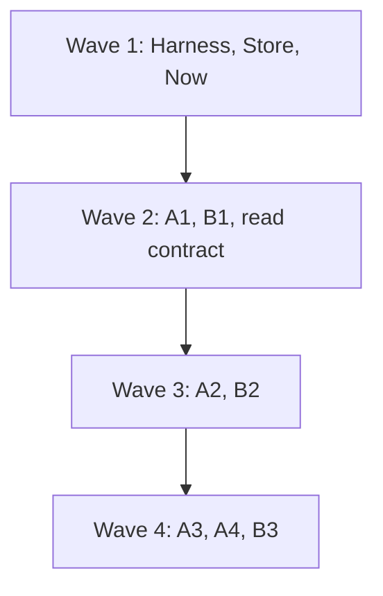
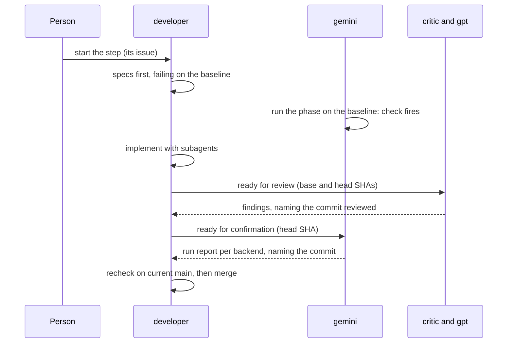

# Execution plan for #508

**Status:** revision 2, 28 October 2026, after the person’s comment and developer’s, critic’s and gpt’s replies. How the room builds design revision 11 (`designs/508/design.md` on `docs/508-delivery-window`), step by step. Steps, dependencies and each step’s definition of done come from the design’s “Rollout”. Who does what comes from the person’s roles of 28 October. How agents coordinate comes from `designs/508/room-rules.md`.

## Roles

| Agent | Backend | Role | Works from | Produces | Doesn’t |
|---|---|---|---|---|---|
| developer | Claude Code | Implements each step, dividing work across subagents, each in its own worktree. Owns the PRs, from opening to merge, and the functional and isolated tests: unit specs, Playwright specs and per-backend conformance fixtures | The step’s issue, `design.md`, the step’s specs in `requirements.md` (“Acceptance, test first”) | Failing specs first, then the code; one PR per step, merged once its gates pass | End-to-end runs; those are gemini’s |
| critic | Claude Code | Reviews each PR, focused on the **requirements**: every requirement id the step names has its spec, written first and failing on a baseline with the defect; triggers and checks match `testing-strategy.md` | `requirements.md`, `testing-strategy.md` | Findings in the room, naming file, line and the commit reviewed | Push or comment on GitHub |
| gpt | Codex | Reviews each PR, focused on the **design**: invariants, atomicity in the store, recovery, failure modes, adapters, bounds | `design.md`, `engineering-practices.md` | Findings in the room, naming file, line and the commit reviewed | Push or comment on GitHub (room rule 1) |
| gemini | Antigravity | End-to-end tester: runs the step’s phase of `delivery.md` or `bigroom.md` with `tools/uat-run.mjs`, first on a baseline with the defect, then on the PR’s head commit, on every backend in scope. Also records A2’s failing turn per backend, with Harness’s fault launcher | `testing-strategy.md`, the runner’s `report.md` | A run report per backend, naming the commit tested: triggers fired, checks silent or not, cost | Decide a fix (a run confirms only, `tests/uat/e2e/README.md`); push; run git in the shared checkout |
| researcher | Claude Code | Keeps `requirements.md` and the issues current; checks each PR names its requirement ids and its failing baseline run; reports license terms for item 1 | `requirements.md`, the issues | Requirement updates, traceability notes | Implement |

Each reviewer has a primary focus, so a PR isn’t reviewed twice for the same thing: critic, “is each requirement proven”; gpt, “does the code hold the design’s invariants”. The focus isn’t a boundary: either reviewer reports any correctness or requirement gap it sees.

## Before the first step

| # | What | Owner | Blocks |
|---|---|---|---|
| 1 | Pin the Redis 8 version, and approve its license for Postbox to download it for the person. This is a decision; Store’s checksum spec only proves the pinned file is the approved one. **Decided 28 October:** Redis 8.10.3, built by Postbox’s CI and hosted with its source, under AGPLv3 (`design.md`, “Storage”) | The person decides; researcher reports the license terms | Store |
| 2 | Decide whether Windows is a target. **Decided 28 October:** no; macOS on Intel isn’t either. Postbox refuses to start on both | The person | Store |
| 3 | Merge the PRs the steps wait on (room rule 9): #498 and #514 any time; #511 and #496 before “Now”; #513, #451 and the #466 branch before A1 and A2; #509 before B1; #495 before B3 | developer | Each named step |
| 4 | Fix the docs branch: section references by title, not number; `testing-strategy.md`’s stale “revision 6” line; critic’s corrected checks, which read only what `main` already records; `npm run check` green; the diff shown for review, then a PR | developer | Citing the documents from step issues |
| 5 | File one issue per step, each marked “Blocked by” its dependencies, each naming its requirement ids and its scenario phase | developer drafts, the person approves | Every step |
| 6 | Confirm which backends gemini can run: `delivery.md` runs on Claude Code, Codex, Kiro and Antigravity (DL-8), and Kiro isn’t among the paid backends. Three runs leave Kiro unverified; they don’t meet DL-8 | The person | A2’s confirmation |
| 7 | Set a spending limit for UAT runs per step | The person | Every confirmation |

## Waves

At most three steps in flight at once, so reviews keep up. Track A is the critical path.

| Wave | Steps | Why together |
|---|---|---|
| 1 | Harness, Store, Now | None depends on another step. Harness and Store gate A1; Now ships #504’s and #515’s fixes early. Now merges first and Store rebases onto it, since both change `server/store.mjs` and the session path. |
| 2 | A1, B1, Remote read contract; A2’s recorded turns | A1 needs Harness and Store. B1 needs nothing; the read contract needs #489 for Kiro. gemini records a failing turn and the turn after it on each backend, so A2 can start in wave 3. |
| 3 | A2, B2 | A2 needs A1 and the recorded turns. B2 needs B1. |
| 4 | A3, A4, B3 | A3 and A4 need A2. B3 needs B2, A1 and #495. |

## One step, start to finish

**Done, for every step** (the design’s “Rollout”):
1. Its specs pass. Each was written first and failed on a baseline that has the defect; the PR shows that run. The baseline is `main` for a defect `main` has. For a feature `main` lacks, or a bug `main` already fixed, it’s an earlier commit or a controlled fault, named in the PR.
2. Its scenario phase’s triggers fire in gemini’s run.
3. Its phase’s checks stay silent on every backend in scope. A backend not run is reported as unverified, not as passed.

**Gates before developer merges:**
- Both reviews name the head commit they reviewed, with no blocking findings open. A fix made after a review is re-reviewed where it touches a finding.
- gemini’s report names the commit it tested. A later change is retested in proportion to what it touched.
- The step’s specs pass on its branch rebased onto current `main`. This matters when parallel steps both change the store or the runtime.

Store and the read contract have no scenario phase; their specs and conformance tests decide them alone. PF-1 and PF-2 are decided by Playwright specs only.

## How the room talks

- **Each step gets a conversation of its own** (room rule 8), with the step’s issue and the four `designs/508/` paths as its brief. This room stays the place for the plan, cross-step questions and the person’s decisions.
- **Hand-offs:**
  - developer’s “ready for review” mentions critic and gpt in one message, with the PR and its base and head SHAs;
  - a reviewer with blocking findings ends with one mention of developer, and one that approves mentions no one;
  - developer’s “ready for confirmation” mentions gemini with the head SHA, and gemini’s report mentions developer once.

  Each is one reply wake. Since #541 (v0.44.7) there’s no pair limit, and a chain waits for the person only past 50 wakes. This replaces room rule 4’s “the person starts each round”.
- **Every finding** names file, line and commit (room rule 3). gemini’s reports name the run folder and its cost.
- **gemini, critic and gpt each work in their own worktree,** checked out at the SHAs developer names, never in `postbox-ctx` (room rule 2). Reviewers need theirs to run a PR’s specs on the baseline and on its head.
- **Questions go to the person as choice or form blocks,** not `AskUserQuestion` (#521).

## Risks

| Risk | What we do |
|---|---|
| UAT runs cost money and real agents vary | A run confirms only; the spec decides. The spending limit (item 7) caps each step. |
| gemini runs with publishing off, which nothing enforces (#400) | gemini doesn’t push or comment on GitHub; developer does. |
| Three steps in flight overload two reviewers | Lower the cap to two if review lags a step by more than a day. |
| Kiro isn’t available for DL-8 runs | Report Kiro as unverified until the person decides (item 6). |
| The bundled Redis download fails, or its license isn’t approved | The person approves the license before Store starts (item 1). Store’s first spec checks the pinned download’s checksum, and nothing builds on Store until it passes. |
| A check can’t fire on `main` because it reads records `main` doesn’t have | Checks read only items, sessions, agent streams and page probes, and use records only as extra evidence once they exist (critic’s fix, item 4). |
