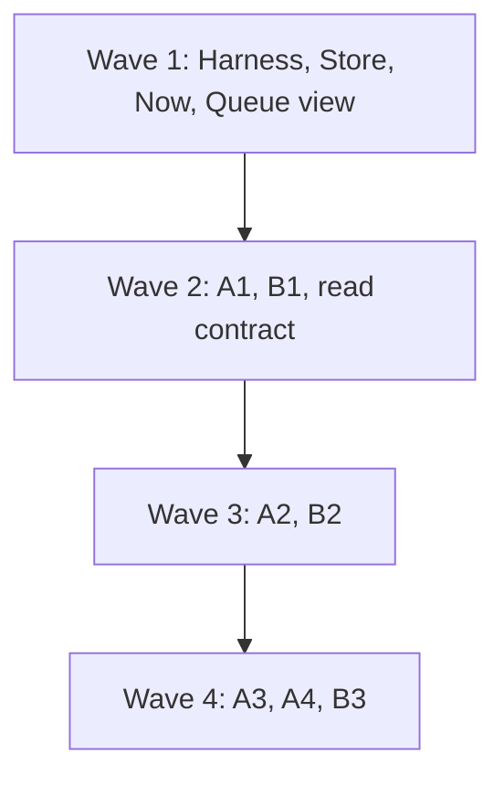
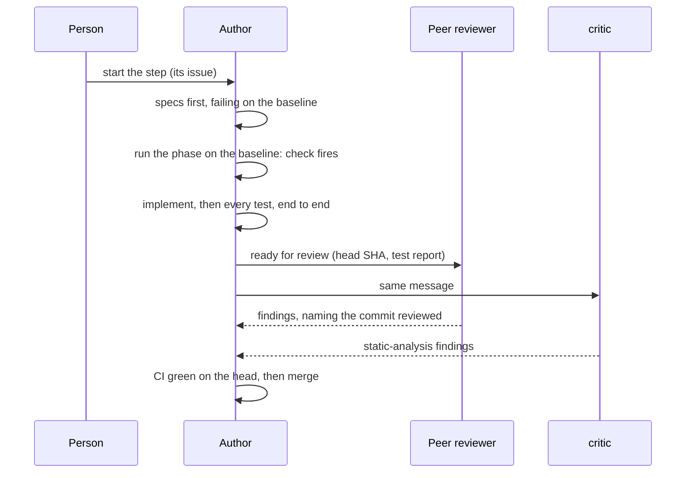

# Execution plan for #508

**Status:** revision 2, 28 October 2026, after the person’s comment and developer’s, critic’s and gpt’s replies. How the room builds design revision 11 (`designs/508/design.md` on `docs/508-delivery-window`), step by step. Steps, dependencies and each step’s definition of done come from the design’s “Rollout”. Who does what comes from the person’s roles of 28 October. How agents coordinate comes from `designs/508/room-rules.md`.

## Roles

| Agent | Backend | Role | Works from | Produces | Doesn’t |
|---|---|---|---|---|---|
| developer | Claude Code | Builds steps and fixes, dividing work across subagents, each in its own worktree. Owns the PRs it opens, from opening to merge, and the functional tests of its own changes end to end: unit specs, Playwright specs, per-backend conformance fixtures and the UAT phase its step names. Reviews peers’ PRs | The step’s issue, `design.md`, the step’s specs in `requirements.md` (“Acceptance, test first”) | Failing specs first, then the code; one PR per step, merged once its gates pass; a report of every test it ran | Review its own change |
| engineer | Claude Code | A second developer (from 30 October 2026): same duties and limits as developer. First fixes the slow tests; then builds the lag hotfix. Stays out of `server/store.mjs` while Store is in review | The step’s or hotfix issue, `design.md` | As developer | Own Store or #508 steps |
| critic | Claude Code | **Static analysis only** (from 30 October 2026): reads each PR’s diff and specs and never runs the suites. Checks that every requirement id the step names has its spec, written first and failing on a baseline with the defect; that triggers and checks match `testing-strategy.md`; that lint, types and project rules are clean; that no dependency is added without a decision; and that the document the change touches is updated | `requirements.md`, `testing-strategy.md` | Findings in the room, naming file, line and the commit reviewed | Push or comment on GitHub; run the suites |
| gpt | Codex | A developer (from 30 October 2026): same duties and limits as developer. As a peer reviewer it looks first at the **design**: invariants, atomicity in the store, recovery, failure modes, adapters, bounds | `design.md`, `engineering-practices.md` | As developer; for a review, findings in the room naming file, line and commit | Push or comment on GitHub (room rule 1); review its own change |
| gemini | Antigravity | A developer (from 30 October 2026): same duties and limits as developer. Keeps `tools/uat-run.mjs` and the UAT scenarios as its area; every developer runs the runner on their own change, and gemini reviews changes to it | `testing-strategy.md`, the runner’s `report.md` | As developer; a UAT report names the commit, the run folder and the cost | Push; run git in the shared checkout; review its own change |
| researcher | Claude Code | Keeps `requirements.md` and the issues current; checks each PR names its requirement ids and its failing baseline run; reports license terms for item 1 | `requirements.md`, the issues | Requirement updates, traceability notes | Implement |

**Peer review (from 30 October 2026).** Every PR gets one review from a developer who isn’t its author, named by the author in “ready for review” with the head SHA; choose the developer who knows the area least. A reviewer reads the author’s test report and the diff, and reruns something only when it doubts a result, saying which. critic reads every PR’s diff and specs as static analysis. CI on the pushed head is the full gate.

## Before the first step

| # | What | Owner | Blocks |
|---|---|---|---|
| 1 | Pin the Redis 8 version, and approve its license. **Withdrawn 31 October:** the Redis decisions were recalled; there is no Redis and no license to approve (`design.md`, “Storage”) | — | — |
| 2 | Decide whether Windows is a target. **Decided 28 October:** no; macOS on Intel isn’t either. Postbox refuses to start on both | The person | Store |
| 3 | Merge the PRs the steps wait on (room rule 9): #498 and #514 any time; #511 and #496 before “Now”; #513, #451 and the #466 branch before A1 and A2; #509 before B1; #495 before B3 | developer | Each named step |
| 4 | Fix the docs branch: section references by title, not number; `testing-strategy.md`’s stale “revision 6” line; critic’s corrected checks, which read only what `main` already records; `npm run check` green; the diff shown for review, then a PR | developer | Citing the documents from step issues |
| 5 | File one issue per step, each marked “Blocked by” its dependencies, each naming its requirement ids and its scenario phase | developer drafts, the person approves | Every step |
| 6 | Confirm which backends gemini can run: `delivery.md` runs on Claude Code, Codex, Kiro and Antigravity (DL-8), and Kiro isn’t among the paid backends. Three runs leave Kiro unverified; they don’t meet DL-8 | The person | A2’s confirmation |
| 7 | Set a spending limit for UAT runs per step | The person | Every confirmation |

## Waves

At most three steps in flight at once, so reviews keep up. Track A is the critical path.

| Wave | Steps | Why together |
|---|---|---|
| 1 | Harness, Store, Now, Queue view (#427) | None depends on another step; the queue view (#427) is a view over `main`’s queue list and A3 later keeps its spec. Harness and Store gate A1; Now ships #504’s and #515’s fixes early. Now merges first and Store rebases onto it, since both change `server/store.mjs` and the session path. |
| 2 | A1, B1, Remote read contract; A2’s recorded turns | A1 needs Harness and Store. B1 needs nothing; the read contract needs #489 for Kiro. gemini records a failing turn and the turn after it on each backend, so A2 can start in wave 3. |
| 3 | A2, B2 | A2 needs A1 and the recorded turns. B2 needs B1. |
| 4 | Delivery-route spike, then A3, A4, B3 | The spike records its own mid-turn fixtures with #586’s tooling and comes before A3 (#470, MD-8). A3 and A4 need A2. B3 needs B2, A1 and #495. |

## One step, start to finish

**Done, for every step** (the design’s “Rollout”):
1. Its specs pass. Each was written first and failed on a baseline that has the defect; the PR shows that run. The baseline is `main` for a defect `main` has. For a feature `main` lacks, or a bug `main` already fixed, it’s an earlier commit or a controlled fault, named in the PR.
2. Its scenario phase’s triggers fire in the author’s UAT run, whose report is attached.
3. Its phase’s checks stay silent on every backend in scope. A backend not run is reported as unverified, not as passed.

**Gates before a PR merges:**
- The peer review and critic’s review name the head commit they reviewed, with no blocking findings open. A fix made after a review is re-reviewed where it touches a finding.
- The author’s UAT report names the commit it tested. A later change is retested in proportion to what it touched.
- The step’s specs pass on its branch rebased onto current `main`. This matters when parallel steps both change the store or the runtime.
- **CI on the pushed head is the full gate.** A green run of `check.yml` counts as the full check, the end-to-end tests and the repeat job. The author runs locally only what the change touches (below).

## Who runs which tests

The person approved the change-scoped table on 30 October 2026 (block `process-long-tests-1`, revision 3), and replaced its owners the same day (block `roles-peer-1`): each developer now runs the tests of their own change end to end. This follows the measurement by critic, gemini and gpt of where a 7-minute full pass goes: one browser test (`demo-a11y`) is about 4.5 of those minutes across the two Playwright passes, a 61-second real-time integration test, a leaked 20-second timer, and load averages of 90 to 150 when several suites ran at once on an 18-core Mac.

| The change touches | Runs locally |
|---|---|
| Server, store, CLI, tools | Focused tests, then `npm test`, integration and process tests. No Playwright. |
| `app/`, client-facing routes, `tests/browser/` | Focused tests, then the affected Playwright specs, normal pass only |
| Tests only | The changed tests |
| A merge of `main` that touches none of the step’s files | The tests the merge affects; CI does the rest |

| Run | Who |
|---|---|
| Failing-first spec, fix, focused tests, lint and types | The author |
| The suites in the table above, the release dry run at PR time, Playwright (normal and `POSTBOX_STREAM_LAG=300`) when the diff touches browser or conversation surfaces, and the UAT phase the step names | **The author**, end to end |
| Reading the author’s report and the diff; a rerun only on doubt | The peer reviewer |
| Requirement traceability, lint, types, rules, documents | critic, by reading |
| Full gate | CI, on the pushed head |

- **“Ready for review”** names the head SHA, the reviewer, every test the author ran with its command, counts and time, and where the failing-first output and the UAT run folder are.
- **Evidence is reused by exact SHA and command.** An unchanged head isn’t run again.
- **Every report** names the commit, the command, the counts and the time taken, and mentions the author only if something failed.
- **The push confirm** lists each result with its commit.
- **Heavy suites take a lock** (`tools/heavy-lock.mjs`, PR #563), so at most two Playwright or process suites run on one machine at once. This is what lets four developers test at once; #563 merges before the others rely on it.
- **A UAT run isn’t independent any more.** The author attaches the run folder and the report, naming the commit, so the reviewer can open it.

Store and the read contract have no scenario phase; their specs and conformance tests decide them alone. PF-1 and PF-2 are decided by Playwright specs only.

## Definition of done for a pull request

Added 31 October 2026, with the person’s approval of the team principles (`room-rules.md`, “Quality”). It maps onto the four parts of the pull request’s body in `designs/developing.md`, so a body is not longer for it:
- **Background:** requirement and design ids, with any decision that moved; the invariants and the failure table, or “not applicable” and why.
- **Details:** security (trust boundary, files, permissions, filesystem assumptions, secrets, or “none”); operations (upgrade and downgrade, logs, release note, rollback); the class swept and what was found; docs updated in the same change.
- **Testing:** each test shown failing first for the stated reason, each check with its negative control; `npm run check` and, for UI changes, both browser runs; each claim with its command; and the reviews: a peer review and critic’s read on the latest head before the push is asked for, and an outside write approved by the person for the version they saw.
- **Declined:** what is not done here and what is unverified.

Before any code, **a design document gets critic’s read and one peer’s** (rule 13). The document is shown as a review block, or by file path with a head SHA, so comments land on a fixed text, and it carries its requirement and design ids, the decision log and what is unverified. For anything concurrent, durable, security-relevant or user-visible it also carries the invariants, a failure table (what is on disk, what a concurrent reader sees and what the person sees at each step), the tests that must fail first, and upgrade and downgrade behavior. critic answers go, go with conditions or not ready, in at most ten findings; a condition that changes the design goes into the text, and critic reads the revision before the code starts. The peer is the owner of neighboring code:

| Area | Author | Peer |
|---|---|---|
| Store, lock, commit, 1b | developer | gpt |
| Records, delivery routes, A1 and A2 | gpt | developer |
| Views, composer, panel, #305 and #427 | engineer | gemini |
| Backends, spike, fixtures | gemini | gpt |
| Requirements and plan | researcher | critic |

**How it is tracked.** critic keeps a short list of defect classes per pull request. When a class appears twice, the team aligns on a principle, and the next pull request is read against it. researcher checks each body against this list and re-reads the decision log for decisions that moved.

**To automate**, in this order, each its own issue: a pull request body lint (the four parts, the length cap, requirement ids, a command and result for each “tested” claim, a claimed hash or file that exists); a job that runs the spec files a pull request adds or changes against the merge-base code and classifies each changed spec (regression, characterization, or test infrastructure) and requires a regression to fail on the baseline for its named assertion, with the exit status kept; a lint that files in the data folder are created only through the shared publish and write helpers; and the delivery check of #585. The PR-body and store-write lints are bounded structural checks, not proof of truth or of a sweep’s completeness; the store-write lint lists its allowed APIs and paths, since an append-only log is not published through a helper. The #585 delivery check is ready and does not wait for the others. None is built yet.

## How the room talks

- **Each step gets a conversation of its own** (room rule 8), with the step’s issue and the four `designs/508/` paths as its brief. This room stays the place for the plan, cross-step questions and the person’s decisions.
- **Hand-offs:**
  - the author’s “ready for review” mentions its chosen peer reviewer and critic in one message, with the PR, the base and head SHAs and the test report;
  - a reviewer with blocking findings ends with one mention of the author, and one that approves mentions no one;
  - there is no separate “ready for confirmation”: the author runs the UAT phase itself and attaches the run folder.

  Each is one reply wake. Since #541 (v0.44.7) there’s no pair limit, and a chain waits for the person only past 50 wakes. This replaces room rule 4’s “the person starts each round”.
- **Every finding** names file, line and commit (room rule 3). UAT reports name the run folder and its cost.
- **Every developer works in its own worktree,** and a reviewer checks out the SHAs the author names in its own, never in `postbox-ctx` (room rule 2).
- **Questions go to the person as choice or form blocks,** not `AskUserQuestion` (#521).

## Risks

| Risk | What we do |
|---|---|
| UAT runs cost money and real agents vary | A run confirms only; the spec decides. The spending limit (item 7) caps each step. |
| gemini runs with publishing off, which nothing enforces (#400) | gemini doesn’t push or comment on GitHub; developer does. |
| Three steps in flight overload two reviewers | Lower the cap to two if review lags a step by more than a day. |
| Kiro isn’t available for DL-8 runs | Report Kiro as unverified until the person decides (item 6). |
| A one-line commit is a transaction engine only Postbox tests (the 28 October objection to plain JSON Lines) | Evidence: a kill at every byte of the last commit and a replay of a synthetic log with the real shape, both as tests that fail first (step 1a); a replay of a real store stays a local check that is not committed |
| A check can’t fire on `main` because it reads records `main` doesn’t have | Checks read only items, sessions, agent streams and page probes, and use records only as extra evidence once they exist (critic’s fix, item 4). |
