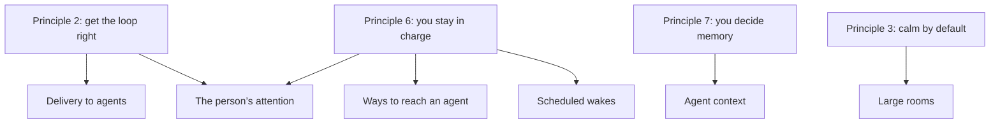
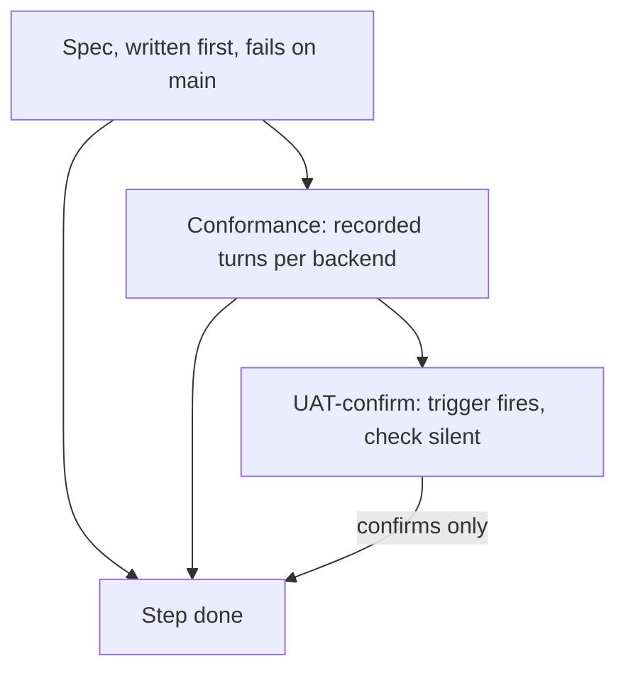

# Functional requirements behind #508

**Status:** revision 4.1, 28 October 2026 (names aligned with the UAT scenarios): adds “Acceptance, test first”, how each requirement is accepted, test first. Derived from #508, its integrator review, the linked issues and `designs/intent.md` at `main`. It says **what** Postbox must do and where each requirement comes from, not how. Use it to check that any version of the design, including the simplified one proposed in the room, covers every requirement and adds nothing that no requirement asks for.

**How to read it.** Each requirement has an id, a statement, a check that shows it’s met, and its sources. A requirement whose only source is #508 itself is marked **(design-only)**: nothing upstream asked for it, so it needs the person’s decision before it constrains the design. “Where the sources disagree” lists the places where the sources disagree.

## Sources

| Key | Source |
|---|---|
| INT | [`designs/intent.md`](https://github.com/HJeon139/postbox/blob/main/designs/intent.md), quoted by section and row |
| ENG | [`designs/engineering-practices.md`](https://github.com/HJeon139/postbox/blob/main/designs/engineering-practices.md) |
| D508 | [#508](https://github.com/HJeon139/postbox/issues/508), the design, by change number |
| R508 | The integrator review on #508 |
| CR | critic’s review of the simplified design, in the “Agent research” room, 28 October 2026 |
| #n | The issue with that number; P0/P1 where it’s labeled |

## How the requirements group

## 1. Delivery to agents

| Id | Requirement | Check | Sources |
|---|---|---|---|
| DL-1 | A message addressed to an agent reaches that agent. No cap, limit or open card drops it. | With more than 40 items since its last turn, one of them a mention of the agent and the oldest, the mention is in the agent’s context. | INT principle 2; #484; #439 (P0) |
| DL-2 | A message reaches an agent’s context in full once, whatever route it takes (queue, catch-up, mid-turn note). A repeat happens only as a resend after a failed turn, and is labeled as one (decision 8.2). | A mention given in catch-up and then drained from the queue appears in full once; the count of unlabeled repeats on a copied room is 0. | #484; #374; #470 item 4 (“a retry or reconnect can’t deliver it twice”) |
| DL-3 | A message counts as delivered only once it reached the agent, not when Postbox built the prompt. A turn that fails before the agent got it leaves it undelivered. A message given mid-turn (the urgent note on a tool result, a backend’s own input) counts as delivered when Postbox hands it over. | A run that fails at startup leaves its messages waiting, and the next turn carries them; a mid-turn note is marked delivered when its tool result returns. | #484 (marker moves past what was left out); #470; D508 change 7; R508 point 4; CR finding 5 |
| DL-4 | Each turn opens with the request being answered, where it was asked and where the reply goes; everything else is labeled background. | #504’s unit test and its `thread-request-first` check pass. | #504 (P0) |
| DL-5 | When catch-up leaves items out, the agent is told how many, what kind, and how to read them in order. | The summary names what it left out and a `read_conversation` cursor. | #484 proposal 2 |
| DL-6 | Messages waiting for a busy agent are delivered together in one turn, in order, with each sender and time. A waker’s newer post supersedes its own older queued wake. Superseded isn’t dropped: its content still reaches the agent. | Three queued wakes give one turn carrying all three; an overtaken wake is delivered once. | INT Conversation, “Messages sent mid-reply…”; #374 |
| DL-7 | Any change to an item reaches the agents it concerns once, as a change, not as a new request (decision 8.5). It starts no turn, except an answer to a block, which wakes the agent that asked, as today. Changes: an answer, an edit shown as a diff, a review verdict, a thread outcome, a reply in its thread, and a reaction, 🚩 included. A reaction reaches the same agents today’s catch-up tells. | An edited message is reported once in other agents’ next turn; a reaction starts no turn. | #212; #472 table (#212 row); #382; decision 8.5; the person’s 🚩 decision |
| DL-8 | Every rule above holds on every backend (Claude Code, Agent SDK, Kiro, Codex, Antigravity), local and remote. | Each backend passes the same delivery tests. | #470 item 5; INT Scope and order (remote hosts) |

## 2. Ways to reach an agent

| Id | Requirement | Check | Sources |
|---|---|---|---|
| MD-1 | Three modes: **notify** (no turn of its own), **wake** (a turn, or mid-turn if working), **interrupt** (the person’s Send now). | Notifying an idle agent starts no turn, and its next turn reads it once. | #472 |
| MD-2 | A message to a working agent reaches it at its next point of reading input, and the turn continues. If the turn ends first, a wake becomes a new turn and a notification waits. | A mid-turn wake is read without restarting the turn, on every backend’s universal path. | #470; #472 |
| MD-3 | Notifications are bounded by code: a cap per sender into an idle agent’s catch-up, with the rest folded and readable. | An idle agent’s catch-up shows at most the cap per sender. | #472 item 2; ENG “Bound everything an agent or app sends”, “Don’t rely on the agent to follow a rule the code could enforce” |
| MD-4 | A message names its recipients, and the transcript shows them, so who was asked what is readable without system lines. | A hand-off to two agents shows as one message naming both. | #481 |
| MD-5 | Agents address each other only with @-mentions; one message can hand separate requests to several agents. | No agent is offered `wake_agent`; a three-way hand-off wakes each once. | #481 |
| MD-6 | Who a message reaches: the agents it mentions (only those, #107), and in a topic thread its owner. A reply wakes its waker only if it mentions it. | Replying to one agent while mentioning another wakes only the second. | INT Conversation (composer row) and Attention (reply row); #107; #469 (P1) |
| MD-7 | Reactions and acknowledgments start no turn. Outcomes and edits notify. | A reaction wakes no one; an outcome post notifies the agents it names. | INT Attention (reactions row); #331; #382; #472 table |

## 3. The person’s attention and control

| Id | Requirement | Check | Sources |
|---|---|---|---|
| AT-1 | Nothing waiting on the person is dropped. Several requests can wait at once, and answering settles every message held by it. | With one card open, a second limited wake from another pair is shown, not dropped; Allow delivers both. | #439 (P0); #326 (closed) |
| AT-2 | The person can see when they’re the bottleneck: a held message shows in the conversation until they answer. | The waiting line shows and goes when answered. | #439 proposal 2 |
| AT-3 | A request that was settled some other way is retired, and delivers nothing twice. | A card whose target got a turn another way is retired. | #439 proposal 3 |
| AT-4 | “Needs you” is correct and complete in every conversation, open or not, whatever part of it is loaded: every open ask (a block, a permission, a tool ask, a held wake) and every session that failed or was denied, with when it started. | Counts, rings and “Next needs you” match for a conversation that isn’t open and a room whose items aren’t loaded. | INT principle 2 (“If ‘needs you’ can’t be trusted, nothing else matters”); INT Attention (two tiers of needs you); the seven kinds in `shared/needs.mjs:5`; D508 change 2 (`waitedSince`, `openAsks` undercount); CR findings 2 and 6 |
| AT-5 | Loop limits stop loops, not hand-offs. A wake that carries new work doesn’t count toward the pair limit; the chain limit stays. | A run of hand-offs with new text passes the old limit without a card; repeated acknowledgments still raise one. | INT principle 6 (“wake chains are capped”); #492 |
| AT-6 | The person’s own waiting messages can be edited, removed or sent now while waiting, stay out of the transcript until delivered, and many fold into one row. | Edit and Remove work on a queued message; it isn’t in the transcript until its agent gets it; ten queued messages take one row. | INT Conversation (“Messages sent mid-reply…”); #424; #427; CR finding 3 |
| AT-7 | An agent waking a persona not in the conversation asks the person first, for a notification as for a wake. | Notifying an absent persona raises the Add card. | INT principle 6; INT Attention (one-session row); D508 change 9 |

## 4. Scheduled wakes

| Id | Requirement | Check | Sources |
|---|---|---|---|
| SW-1 | An agent can cancel its own scheduled wakes. | An agent cancels a wake by the id it was given. | #458; INT Attention (schedule row: “shows as a line… with Cancel”) |
| SW-2 | A scheduled wake lost to a network drop fires when the network returns. If a tool had started, the retry asks the agent to check what ran instead of replaying it. | A wake failed by a drop fires on reconnect. | #466 |
| SW-3 | Archiving or deleting a conversation cancels its scheduled wakes, with a line saying so. | | #192 (closed); D508 change 9 |

## 5. Large rooms

| Id | Requirement | Check | Sources |
|---|---|---|---|
| PF-1 | A large room is as responsive as a small one: typing and painting cost about the same whatever the room’s size. | Key-to-frame p95 within 10% of a small room’s; Safari’s idle painting no higher, on copies of real rooms. | #305; D508 Why and “Decided” (budget is parity, the person’s choice) |
| PF-2 | Animations don’t keep the page repainting: an agent working doesn’t cost the whole transcript a repaint. | Safari’s painting share with one agent working is near idle. | INT principle 3 (“eases in, eases out, then rests”); #463 |
| PF-3 | Reading history stays put: nothing moves what you’re reading unless you scroll, and following the newest message keeps following. | The 13 scroll issues D508 change 3 lists each pass as a regression check. | INT Conversation (“Jump to latest”); #88, #91, #92, #232, #285, #297, #341, #356, #357, #360, #410, #422, #478 |
| PF-4 | Any message can be opened by link, ask or “Next needs you”, wherever it is in history. | An `m=` link to a message far back opens at it. | #168; INT Attention (ring goes to its ask) |
| PF-5 | The live connection loses or duplicates nothing, across reconnects and resyncs. | A reconnect after a snapshot leaves every open conversation complete. | INT Conversation (server-sent events row) |
| PF-6 | A revised block that asks again appears at the newest point, as its one live copy, with a line where it was. Its reactions, threads, links and work rows still point to it after it moves. | A block revised from far back appears at the bottom, even if its old place isn’t loaded; a reaction and an `m=` link made before the move still reach it. | INT Dynamic UI (append-only blocks row); #92; #168; CR finding 4 |
| PF-7 | Every app is checked before the person sees it, whether or not a page draws it. | An app in a thread nobody opened is checked. | #336; R508 point 1 |
| PF-8 | The person can find a message by its words in a long room. | Needed only if loading less of the room breaks the browser’s find-in-page. | D508 changes 5–6; R508 point 3 |
| PF-9 | No new runtime dependencies. | | ENG “Keep runtime dependencies at zero” |

## 6. Agent context

| Id | Requirement | Check | Sources |
|---|---|---|---|
| CX-1 | Nothing from a thread enters an agent’s context unless that agent chooses to read it or the person sends it. | | INT principle 7; #228 |
| CX-2 | An agent can read any earlier item of its conversation, in order, without loss, and read one item in full at its current revision, locally and on a remote host. | `read_conversation` reaches the first item, locally and on a host; `read_message` says when an item changed. | D508 change 6 (“Reading in order stays”); #484 proposal 2 |
| CX-3 | What changes during a room (the room list, other agents, the brief, the session’s model, tools turned off) is current in every turn, including on resumed sessions. | A tool turned off mid-session is reported as off in the next turn of a resumed Claude session. | #515; D508 change 7 |
| CX-4 | When a backend compacts or loses its context, the agent is told what it may have lost and how to read it back. | | INT Conversation (compaction divider row) for the person’s side; D508 change 7 **(design-only** for the agent’s side) |
| CX-5 | An agent can search its conversation by words. | | D508 change 6 **(design-only;** conflicts with INT “Not in scope”; see 8.1) |
| CX-6 | The person’s standing decisions for a room reach every turn. | | #14; D508 change 7 **(separate feature;** R508 point 6) |

## 7. Measurement

| Id | Requirement | Check | Sources |
|---|---|---|---|
| MS-1 | Delivery completeness, duplicate rate and lag can be counted for any room, before and after each step. | The counts come out for a copied room. | D508 change 10; R508 point 5 (keep the deterministic numbers) |
| MS-2 | Each step’s “done when” is a number, not a judgment. | | R508 point 5 |
| MS-3 | Every tuning setting is named in one place with its draft value, the metric that judges it and how it’s set, and each value cites a dated calibration report from copied rooms. | A check fails on a tuning value without a report. | D508 change 10 (calibration table, deterministic rows); the person’s decision, 28 October; critic’s review of revision 1 |

The probe sets, hand-labeled judgments, model judge and replays in D508 change 10 meet no requirement above; R508 moves them to a research issue.

## 8. Where the sources disagree

Each needed a decision before the design could satisfy both sides. Where it’s settled, the outcome is noted.

1. **Search across threads.** INT “Not in scope, for now” lists it; D508 records the person moving it into scope; R508 says it fixes neither root problem and should be its own design. **Decided:** agent search is its own issue, not part of this design; its scope and in-memory index were decided on 28 October. CX-5 stays a requirement of that issue.
2. **Lost or duplicated, when it’s unclear.** INT says the loop “never loses a message” and the stream “loses or duplicates nothing”; #470 says a retry “can’t deliver it twice”. When Postbox can’t tell whether an agent got a message, one must give. The developer’s draft picks “at worst lost, never twice”; D508 sets both duplicates 0 and completeness ≥ 99%. CR argues the other way, from principle 2: send at least once, and label a resend (“sent again after a failed turn”) so it’s recognizable; then DL-2 becomes “no *unlabeled* repeat”. It also notes a failed Claude Code or Codex turn may already have saved the prompt, unconfirmed until a recorded failing turn per backend. **Decided (8.2):** DL-1 holds. Delivery is at least once, and every resend is labeled; DL-2 is now “no unlabeled repeat”.
3. **One card at a time.** INT Attention says “Only one wake waits for your confirm at a time”; AT-1 (#439) needs several. **Settled:** INT’s row changes with the design’s step A1.
4. **`wake_agent`.** INT Attention says agents wake each other by mention “or its wake_agent message”; MD-5 (#481) removes it. **Settled:** INT’s row changes when #481 ships.
5. **Which changes reach agents.** D508 bumps an item’s revision on a reaction and delivers revision changes as amendments; MD-7 (INT, #331) says a reaction wakes no one. **Decided (8.5):** every change is delivered, as a notification that starts no turn, so a reaction still wakes no one. DL-7 lists the changes. Still open: whether “the agents it concerns” means an item’s author and recipients.
6. **“Seen.”** #470 defines a message state “seen: the agent’s stream moved on after it”. R508 and the developer find Postbox can’t observe it reliably. **Decided (8.6):** dropped.
7. **“Notify.”** The code already names the person’s toasts `notify` (`app/js/client.mjs:30`), and INT says “Notifications are an in-app toast”. MD-1’s notify is a different thing; D508 renames the toast event to `alert`. **Open;** it blocks only the later step that adds the modes.

## 9. What each part of the design answers

| Design part | Requirements it meets |
|---|---|
| Records of what’s addressed to whom (D508 changes 2, 7, 9; the developer’s one collection) | DL-1–3, DL-6–7, MD-1–3, AT-1–4, AT-7, SW-1–3, MS-1 |
| Remote read contract | CX-2 |
| Calibration entries in `shared/limits.mjs` | MS-3 |
| Task-first envelope, constant system prompt | DL-4, DL-5, CX-3 |
| Mentions with recipients, modes | MD-4–7, AT-5, AT-6 |
| Ring fix, animation clock | PF-2 |
| View state, item API, window | PF-1, PF-3–6, PF-8 |
| Agent search tool | CX-5 only |
| Standing decisions | CX-6 only |
| Probes, judges, replays | none |

## 10. Acceptance, test first

Each requirement is **decided** by a test that is written first and fails on `main` before its step starts. The agentic UAT only **confirms**: “A run confirms a fix; it doesn’t decide it” (`tests/uat/e2e/README.md:7`). Layers:
- **Spec:** `node:test`, or a Playwright spec in `tests/browser/` with the mock agent. Deterministic; decides.
- **Conformance:** recorded turns from each backend, replayed as fixtures through its adapter. Decides what a backend does.
- **UAT-confirm:** in a real-agent run, the trigger fires (the code path ran) and the check stays silent (no violation recorded).

Trigger and check names in *italics* are proposed and don’t exist yet. The others are already on `main` (`server/room-checks*.mjs`), or come with PR #511 (`thread-request-first`). “Not in rev 6” marks requirements that design revision 6 gives no test.

| Id | Decided by | Failing-first spec (case) | UAT trigger | UAT check | Design rev 6 |
|---|---|---|---|---|---|
| DL-1 | Spec | #484: 41 items, the oldest a mention of the agent, past the 16,000-character cap; it’s in the envelope whole | *mention-past-cap*, *held-behind-card* | *delivery-dropped*; `wake-text-clipped` | Covered |
| DL-2 | Spec + conformance | #484/#506: a mention given in catch-up then drained from the queue appears once; a failed-before-output resend carries its label | *edit-while-waiting*, *fail-before-output*, *resend-labeled* | *unlabeled-repeat* | Covered |
| DL-3 | Spec + conformance | A turn that fails before output leaves its deliveries waiting and the marker unmoved; the urgent note is delivered when its tool result returns | *fail-before-output*, *restart-mid-host-turn* | *marker-before-output* | Covered |
| DL-4 | Spec | #504: a thread turn’s first context block is the thread’s request | none (scenario `thread-focus.md`) | `thread-request-first` | Covered |
| DL-5 | Spec | The envelope names what it left out and a `read_conversation` cursor whose `skip` is right | *mention-past-cap* | *delivery-dropped* | Covered |
| DL-6 | Spec | #374: three wakes for a busy agent make one turn, in order, each with sender and time | *edit-while-waiting* | *unlabeled-repeat* | Covered |
| DL-7 | Spec | An edit to a delivered message reaches its author and recipients once, as a notify; a reaction starts no turn | *edit-while-waiting* | *unlabeled-repeat* | Covered |
| DL-8 | Conformance | Each backend’s recorded failing turn and successful turn give the same record states | *fail-before-output* on each backend | *marker-before-output* | Covered |
| MD-1 | Spec | A notify to an idle agent starts no turn and is read once at its next turn | none | none | Later (modes) |
| MD-2 | Spec + conformance | A delivery to a working agent arrives on the next Postbox tool result, and the turn continues | *urgent-note-delivered* | *delivery-dropped* | **Not in rev 6** (built in A2, never cited) |
| MD-3 | Spec | Past the cap, notifies fold into one line and one record, with a count | none | none | Covered |
| MD-4, MD-5 | Spec | A hand-off to two agents is one message naming both; no agent is offered `wake_agent` | none | none | Later (#481) |
| MD-6 | Spec | A reply in a topic thread wakes its owner; mentioning one agent wakes only that one | none | none | Covered |
| MD-7 | Spec | A reaction and an outcome post start no turn | none | none | Covered |
| AT-1 | Spec | #439: two held wakes behind one card; Allow delivers both, Don’t allow expires both and tells each sender | *held-behind-card*, *held-released* | *ask-dropped* | Covered |
| AT-2 | Playwright spec | The held line shows under the card and goes once it’s answered | *held-behind-card* | *ask-dropped* | Covered |
| AT-3 | Spec | A card whose target got a turn another way is withdrawn; nothing is delivered twice | none | *unlabeled-repeat* | Covered |
| AT-4 | Playwright spec | Rings, counts and ⌃J match the open asks with a conversation’s items not loaded | none (seed *big-room*) | *needs-mismatch*; `needs-jump-missed` | Covered |
| AT-5 | Spec | #492: hand-offs carrying new text pass the old limit; repeated acknowledgments still raise a card | none | none | **Not in rev 6** (non-goal; its own issue) |
| AT-6 | Playwright spec | A queued message can be edited and removed, isn’t in the transcript until delivered, and ten fold into one row | *person-queue-three* | none | Covered |
| AT-7 | Spec | A wake for a persona not in the conversation raises the Add card as an ask, and is held, not dropped | none | *ask-dropped* | **Not in rev 6** |
| SW-1 | Spec | #458: an agent cancels its own wake by id, including after a host replay (#498’s test) | *wake-scheduled*, *wake-canceled* | none | Covered |
| SW-2 | Spec | #466: a wake lost to a network drop is retried, labeled “check what ran” | *wake-after-drop* | *unlabeled-repeat* | Covered |
| SW-3 | Spec | Archiving a conversation expires its wakes and posts the line | none | none | Covered |
| PF-1 | Playwright spec only | Key-to-frame p95 within 10% of a small room’s on copies of three rooms | seed *big-room* (spec input, no agentic UAT) | none | Covered |
| PF-2 | Playwright spec only | With one agent working, the transcript isn’t repainted each frame (paint count over 5 s) | none | none | **Not in rev 6** |
| PF-3 | Playwright spec | The 13 scroll issues, one regression each | *window-paged-back* | *view-moved* | Covered |
| PF-4 | Playwright spec | An `m=` link, ⌃J and an open ask far back each load the page around the target | *jump-outside-window*, *needs-far-back* | `needs-jump-missed` | Covered |
| PF-5 | Spec + Playwright spec | A page fetched during patches, a reconnect after a snapshot, and a resync each leave the window complete | *switch-conversations* | `page-errors` | Covered |
| PF-6 | Spec | A block revised from an unloaded page appears at the bottom; reactions and `m=` links still reach it | *move-from-unloaded* | `updated-app-far-up` | Covered |
| PF-7 | Playwright spec | An app in a conversation nobody opened is checked (#495’s specs) | none | `check-starved` | Covered |
| PF-8 | Playwright spec | The search box finds a message outside the window and jumps to it | *search-outside-window* | none | Covered |
| PF-9 | Spec | `package.json` has no new runtime dependency | none | none | Constraint only, no test |
| CX-1 | Spec | Nothing from a thread enters another agent’s envelope unless it reads it or the person sends it | none | *thread-leak* | **Not in rev 6** |
| CX-2 | Spec | `read_conversation` reaches the first item, locally and on a host | none | none | Covered |
| CX-3 | Spec + conformance | #515: a tool turned off mid-session shows as off in a resumed Claude session’s next turn | none | none | Covered |
| CX-4 | Conformance | A recorded `compact_boundary` makes the next envelope say context may have been summarized | *compaction* | *context-loss-unannounced* | **Not in rev 6** |
| MS-1 | Spec | The metrics script’s counts on a copied room match a hand count on a small fixture | none | none | Covered |
| MS-2 | Review rule | Every step’s “done when” names a spec that fails on `main` first | none | none | **Not in rev 6** |
| MS-3 | Spec | A tuning value in `shared/limits.mjs` without a calibration report fails the check | none | none | **Not in rev 6** |

Trigger and check names match critic’s `testing-strategy.md`. DL-4’s check is `thread-request-first`, which #511 adds.
