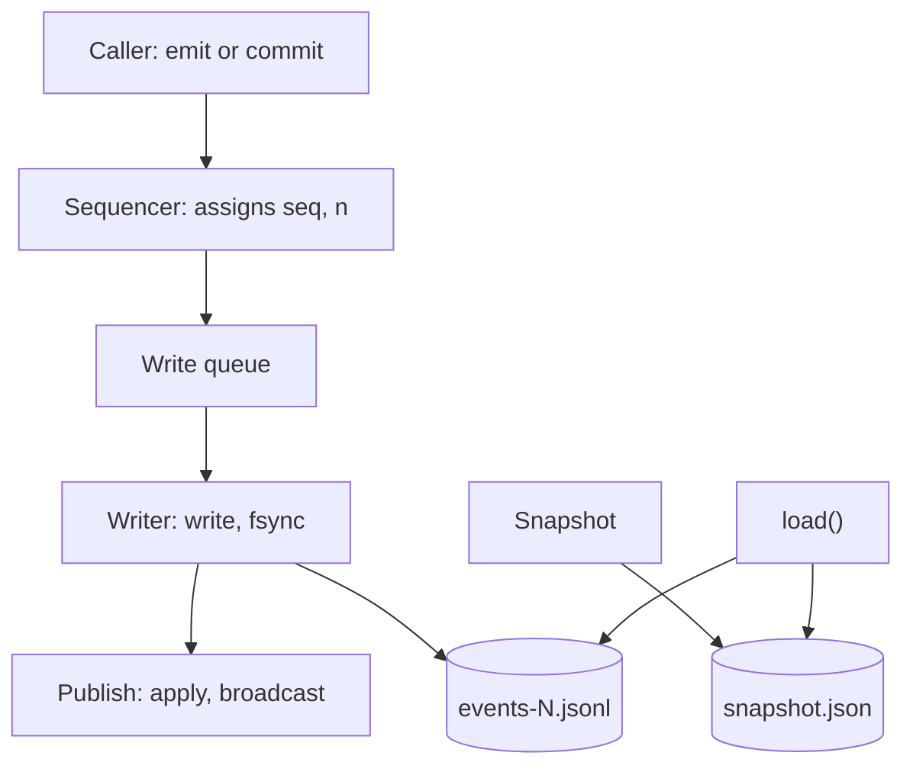
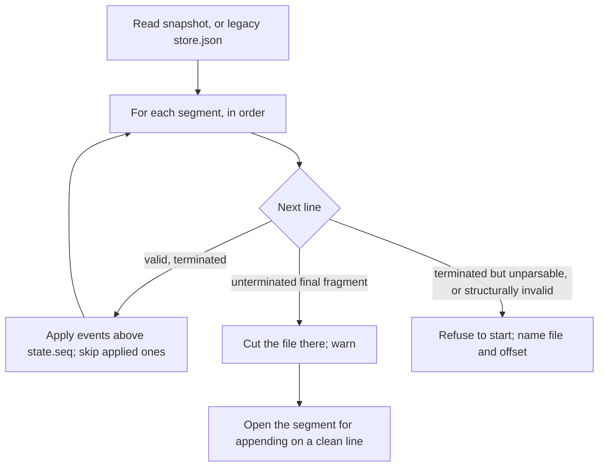
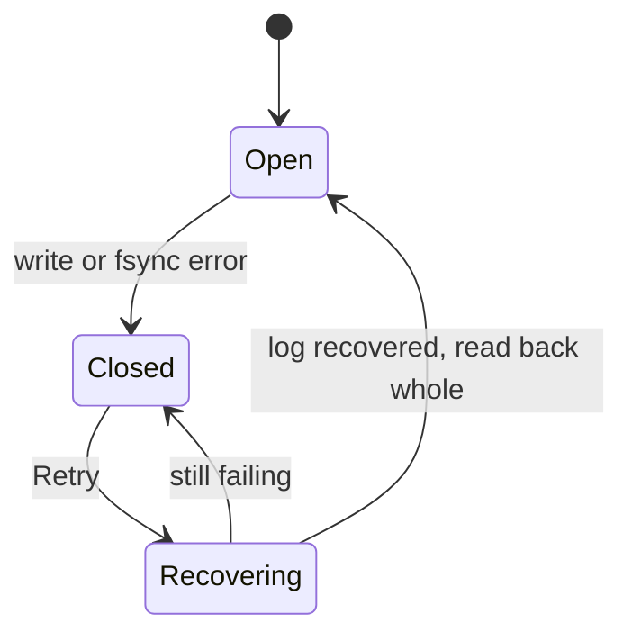

# Storage design for #508: one-line commits on the JSON Lines log

| | |
|---|---|
| **Status** | Draft 4, 31 October 2026, after peer review by all five developers and critic. Ready for principal-engineer review by the person and the integrator |
| **Editor** | researcher |
| **Contributors** | developer (writer and load), gpt (recovery contract and storage specs), engineer (measurements, positions), gemini (benchmark, UAT tools), critic (requirements audit) |
| **Replaces** | `design.md`, “Storage: a Redis 8 server that Postbox bundles and runs” (the 28 October decision, recalled on 31 October 2026) |
| **Relates to** | #508, #525, #553 (closed), #565, #567; requirements ST-1 to ST-4, SR-5, PF-9, INV-12, INV-13 in `requirements.md` |

**Step names used below**

| Name | What it is |
|---|---|
| 1a | The commit line: `commit(events)` as one fsynced write, recovery, the epoch and the lock |
| 1b | Failing closed: the status line, Retry, held turns |
| S2 | The sharded snapshot, started only when a budget is passed |
| A1 to A4 | #508 steps: ask records, deliveries and the turn’s outcome, the person’s queue, scheduled wakes |
| B1 to B3 | #508 steps: item positions and the view state, the items API, the windowed transcript |

## 1. Summary

Postbox keeps its state as an append-only JSON Lines log plus a snapshot, with all reads served from memory. This design keeps that, and adds what #508’s delivery records need and the log does not give today:

- **A commit is written whole and fsynced,** so a turn’s records and marker are all or nothing and are on disk before anything depends on them.
- **Recovery never drops acknowledged history:** it cuts an unterminated tail, and refuses to start on a corrupt line.
- **A write that fails closes writes,** with the page still readable.
- **A history epoch and a data-folder lock,** so a tab on a lost timeline resyncs and a second Postbox is refused.
- **A sharded snapshot (S2),** only if a measured stall or the store’s size passes a budget.

It replaces the 28 October decision to move onto a bundled Redis 8. That decision was recalled because the slow room it was not chosen for is fixed (#565), and the one thing only Redis gave, a second writer, has no user yet.

## 2. Context: the store today

`server/store.mjs` (199 lines, `main` at v1.5.0).

- **`emit(type, data)`** numbers an event (`seq = state.seq + 1`), applies it to the in-memory state with the shared reducer, keeps its JSON in a backlog of 20,000 events, tells subscribers, and **only then** queues its line for the writer. The caller never learns whether the line reached the disk.
- **`pump()`** appends the queued lines with `appendFile`, one write at a time. **A failed append is logged and the pump carries on:** memory is ahead of the disk, and nothing tells the page. There is no `fsync` of the log, except in `flush()`.
- **A snapshot** is written every 5,000 events: `JSON.stringify(state)` to a temp file, `fsync`, `rename`, then a new segment `events-<seq+1>.jsonl`, and the covered segments are deleted. Lines queued during a snapshot land in the new segment, so a segment can begin with events the snapshot already contains.
- **`load()`** reads `snapshot.json`, then each segment in order, splitting the text into lines. **On the first line that does not parse it truncates the file at that offset and stops reading that segment.** An event with `seq <= state.seq` is skipped, so a replayed duplicate is harmless.
- **`since(seq)`** serves a reconnecting browser from the in-memory backlog, or returns `null` (the browser refetches the state).
- **There is no lock** on the data folder in the store.

### 2.1 What is wrong with it for #508

| # | Problem | Why #508 needs it fixed |
|---|---|---|
| P1 | A turn’s records and marker are separate lines. A crash or a failed append between them leaves half | DL-3, INV-12: `sent` and the marker must commit together before an adapter starts |
| P2 | A failed append is only logged | ST-3: a full disk must close writes and say why |
| P3 | `emit` publishes before it writes, so a page can show a change the disk never gets | INV-12: nothing a lifecycle depends on may be visible before it is durable |
| P4 | `load()` truncates at the first bad line, wherever it is. A torn line left in the middle (a failed write that later writes passed) drops every later line in that segment; a later segment then replays onto a state that lacks them | ST-4, INV-12: acknowledged history must not be dropped silently |
| P5 | No `fsync` of the log | ST-4: an acknowledged commit survives a power cut |
| P6 | The snapshot is one whole-state `JSON.stringify` and a single write of the whole text | “Performance and budgets”: it blocks the server about 37 ms on a copy of this project’s store, grows with it, and about 17 ms of it is converting the text to bytes in one call |
| P7 | A second Postbox on the same folder is not refused | The guard for “one writer” (ST-2 deferred) |
| P8 | A browser on a lost timeline (it saw events the store lost) cannot tell | #567 |

## 3. Goals and non-goals

**Goals**
- G1. A commit is atomic across its events and durable once it resolves (P1, P5).
- G2. Nothing a commit does is published, applied to the lifecycle or started before the commit is durable (P3).
- G3. Recovery never drops acknowledged history, and says so when it cannot proceed (P4).
- G4. A failed write closes writes and the page says why (P2).
- G5. A tab on a lost timeline is told to resync (P8); a second Postbox is refused (P7).
- G6. No migration at startup, no new dependency, no new platform restriction (ST-1, PF-9).
- G7. The snapshot’s block is cut now by writing it in pieces, and a path to a sharded snapshot that is crash-safe and reversible, started by a measured budget (P6).

**Non-goals**
- A second writer (ST-2 is deferred until a design needs it).
- A relational schema, an embedded database, or a native binary.
- Protection from a process running as the person that sets out to read the data folder (the bar of `architecture.md`, “Writes need the page’s token”). SR-5 keeps the folder and files private.
- Guarantees against a drive that reports a flush it has not done. Node’s `fsync` on macOS requests `F_FULLFSYNC` and may fall back; the design states this limit and does not promise more.

## 4. Requirements traceability

| Requirement | How this design meets it | Check (“Test plan”) |
|---|---|---|
| PF-9 | No new package or binary | No `dependencies` entry is added |
| ST-1 | Each event and shard carries `v`; older shapes are lifted on read; nothing runs at startup | T-20 |
| ST-2 (deferred) | One writer; the lock file refuses a second Postbox | T-17 |
| ST-3 | “When a write fails (ST-3)”: a failed write closes writes; Retry recovers the tail and reads back whole | T-11 to T-14 |
| ST-4 | “The line format” and “The writer”: the commit is fsynced before it resolves, and a new segment’s directory entry is synced. **Limits kept:** `emit`’s streamed text and updates not yet acknowledged may be lost; a drive that reports a flush it has not done can still lose acknowledged writes | T-1 to T-4, T-24 |
| SR-5 | The data folder is 0700, its files 0600 | T-19 |
| INV-12 | The **store** half is “The writer”: nothing is visible before the sync. “No adapter starts before the commit resolves” is the **caller’s**: A2’s dispatch tests prove it | T-5, T-6; A2’s dispatch specs |
| INV-13 | Unchanged: attempt and `sentRev` fencing sit in the lifecycle, not the store | A1, A2 specs |

## 5. Overview



One serialized writer owns the queue, the open segment, rotation and snapshots. Every change enters through one sequencing function that assigns `seq`. A commit becomes visible only after its lines are synced; an `emit` with no commit in flight stays on today’s optimistic path.

## 6. Detailed design

### 6.1 Files

```
<data>/snapshot.json          the state at some seq (S2: a manifest and shards instead, “Snapshots and pruning”)
<data>/events-<from>.jsonl    events after the snapshot, one per line; a new segment per snapshot
<data>/lock                   the data-folder claim (“The data-folder lock”)
<data>/blobs/                 content-addressed attachments (unchanged)
```

Permissions: the folder 0700, files 0600 (SR-5). The lock, and in S2 the manifest and shards, are added to the lists of store files in `server/home.mjs:19` and `server/index.mjs:114`, so `--fresh` and a move of the data folder do not leave them behind.

### 6.2 The line format

A line is one JSON value followed by `\n`. **An event line** is today’s format, unchanged:

```json
{"seq":4121,"type":"item.add","data":{"threadId":"th_x","item":{"id":"it_y","text":"hi"}}}
```

A **commit** of more than one event has to be recognizable as a group on load. The operation id is a top-level `op` on the first event, so the event keeps its `seq` and the commit is not wrapped in an envelope (which would make `seq` hard to inspect and every reader unwrap it). `v` (a small integer) is carried in an event’s `data` where its shape may change, and lifted on read (ST-1).

**Open question Q2: how a multi-event commit is written.** Three options, and what an older Postbox does with each. *Reproduced by gpt on `main`'s `load()`:* a log with event 1, an **array** as event 2, and event 3 loads as `seq` 3 **with event 2 silently missing**; the array parses but `ev.seq > state.seq` is false for it. critic adds that the older build then reuses the array’s sequence numbers for new events, which the next load drops. Neither is a startup failure.

| Option | A one-event commit | A multi-event commit | A 1a folder read by today’s Postbox | Cost |
|---|---|---|---|---|
| (a) Always an array | An array | An array | Every commit silently skipped from the first one | Uniform; every reader must unwrap arrays |
| (b) Plain event for one, array for several | A plain event line with `op` on it | An array | Readable until the first multi-event commit (A1), then silent omission | Readers must unwrap arrays from A1 on |
| (c) Grouped plain lines | A plain event line with `op` | Plain event lines, each with `{op, i, of}` | Readable throughout: an older build applies them one by one | A longer recovery rule: apply a group only when all `of` lines are present, else cut back to its first line |

gpt, critic and developer prefer (b). critic offered (c) as the way to have no point of no return; developer rejects it: an older build would read a group’s lines one by one and apply a **partial group after a crash**, silently breaking the atomicity the commit exists for, so “readable throughout” means “half-applied throughout”. **Recommended: (b).** developer’s 1a switches from (a), its current code, to (b) with one expression. The `BREAKING CHANGE` note then belongs to A1, the first multi-event commit. **Whichever is chosen:** an older build must not be pointed at a folder a newer one wrote, the release notes say it silently omits commits as well as may fail to start, and a characterization test on `main` pins what the older loader does.

**The UAT log readers.** gemini found that `readLogged` (`tools/uat/run-files.mjs`) and `lines()` and `logged` (`tools/uat/history.mjs`) parse each line as one event and read `.type` and `.seq`. An array has neither, so `readReceived`, `readHistory` and `--recheck` would silently drop every commit under (a) or (b). The fix is one shared parse function that unwraps arrays, in 1a, so A1 does not have to touch the readers.

### 6.3 The writer

State: `queue` (entries), `open` (a file handle for the current segment, kept open), `held` (emits made while a commit is in flight), `writable`, `failed` (a cause or null).

**Sequencing.** `emit` and `commit` both pass through one function that assigns `seq` (and, from step B1, `n`), so the two cannot interleave their numbers. Because an event can be applied only after the events before it are, this function also decides **when** an event is applied:

- An `emit` with **no commit in flight** is applied, numbered and broadcast at call time, as today, and its line is queued.
- An `emit` made while a commit is **queued, in flight, or being settled after an uncertain write** is **held**: it is not numbered or applied until the commit has published, then it is, in order. Code that reads state right after such an `emit` sees the old state for up to one sync (4 to 6 ms) or, while a write is being settled, longer. `runtime.mjs:349` is one such call site; they are audited in 1a (“Failure modes”).
- A **commit’s** events are applied and broadcast **only after the sync**. Emits are never applied twice: an emit’s application happens once, at call time or at release.

**`commit(events | (state) => events, { opId })`.**
- **The array form** may share a pass with other commits.
- **The function form** decides on the current state, so it runs after every earlier commit has published, and one at a time. Two function-form commits issued back to back run in two passes; the second sees the first’s events (test T-22).
- A commit is validated and frozen before it is written (events are copied and frozen), and all its events are applied before any is published.

**One pass of the writer:**

```
take the queued entries (emits and commits, in order)
join their lines into one buffer
loop: write(buffer, offset) until every byte, including each final \n, is written    // check bytesWritten
if the file is new (the first segment, or a rotation): fsync the directory before acknowledging
if any entry is a commit: fsync(handle)                                                // once for the pass
on success: apply and broadcast each commit's events, in order; resolve its promise;
            then number, apply and broadcast the held emits, in order
on error: go to “When a write fails (ST-3)”
```

Rules this encodes:
- **Publish after the sync (settled).** `state`, API reads, `since()` and subscribers see a commit only after its lines are fsynced. Private staged state may validate a commit. critic ruled it from INV-12 and DL-2: an adapter started early cannot be taken back by the epoch, and the resend would lose its label. gpt added that API reads and subscribers must wait too.
- **Several commits in a pass share one `fsync`.**
- **A snapshot waits for every pending commit** before it runs, so it can never prune an unresolved one.
- **A held emit is applied from the JSON line made when it was called** (`JSON.parse(line)`), not from the caller’s object, so memory and the log cannot differ if the caller changes its object meanwhile (engineer, critic).
- **A complete batch is applied before its first subscriber is notified.**

### 6.4 `commit`

```js
store.commit(events | (state) => events, { opId? }) → Promise<{ seq, duplicate }>
```

- `seq` is the last sequence number of the commit.
- A repeated `opId` returns `{ seq: <earlier>, duplicate: true }` and writes nothing. The set of recent operation ids is rebuilt on load from the current segments and kept in memory only for commits newer than the latest snapshot. This suffices because there is one writer and a snapshot never passes an unresolved commit; across a restart the lifecycles’ persisted ids (A1) deduplicate older requests.
- **An uncertain outcome.** If `fsync` fails, the complete lines may still have reached the disk. Retry (“When a write fails (ST-3)”) recovers them rather than writing them again, and the caller of the failed commit gets its result only after they have been synced successfully through a fresh handle.

### 6.5 Recovery on load



- **An unterminated final fragment** of the last segment (no newline, whether or not it is valid JSON) is cut before any append. The writer writes the newline last, so a value without it was not acknowledged.
- **A newline-terminated line that does not parse** refuses to start, even when it is the last line: it could be damaged acknowledged history (gpt). So does an unparsable line in any segment that is not the last, and any bad line with lines after it. The message names the file and byte offset. This replaces today’s silent truncation (P4).
- **A group must be well formed:** a nonempty array of consecutive integer `seq`s, or under (c) all `of` lines present. An incomplete group at the tail is cut back to its first line; elsewhere it refuses to start.
- **The first unapplied `seq`** must be `state.seq + 1`. A group that overlaps the snapshot boundary is rejected, not partly applied.
- **A gap in `seq` is counted against the applied `seq`,** not against the previous line (a real segment begins with events the snapshot already holds, see “Context: the store today”). A gap means acknowledged history was lost, and refusing to start does not recover it. Today’s silent append failures (P2) can leave a gap in a user’s existing store, so refusing would brick it. **Recommended (developer): start anyway, log the range and the count lost, and show it once on 1b’s status line,** with no override flag for every such user to learn. Refusal stays for what refusing can protect: a damaged line, or a malformed group. critic proposed an explicit start-anyway override in the refusal message instead (Q8).
- A commit whose events’ `seq` are already applied is skipped as a whole, as single events are today.

### 6.6 When a write fails (ST-3)



- **Closed:** `writable = false` with a cause (`ENOSPC`, `EROFS`, `EIO`, or the error code). Commits and emits are refused with that cause (HTTP 503 and a tool error), turns do not start, the queue is kept, and the page shows one status line with a Retry. The page stays readable from memory. Today’s behavior, logging the error and carrying on with memory ahead of the disk, is removed; this is a fix on `main`, not only a Redis replacement.
- **Recovering (Retry), in this order:**
  1. **Open a new file handle.** After a failed `fsync`, a later `fsync` on the same descriptor can report success without the data being written (observed on Linux), so the old handle proves nothing. Read the segment back through the new handle.
  2. **Inspect the log before cutting.** Validate every complete line. Keep any complete commit that landed, including one whose `fsync` reported the error, and compare its **event contents** with the queued entry, not only its `seq`. Cut only an unterminated fragment.
  3. **Verify acknowledged history:** every acknowledged `seq` must be present and intact. If not, stay Closed and say so.
  4. **Sync what was kept**, through the new handle, and sync the directory. Only then resolve a recovered commit with its earlier result.
  5. **Write the rest of the queue** from where the log ends, and reopen. Nothing is written twice.
- **In-flight turns** stop and their records return to `waiting`, labeled (the lifecycle’s part, A2).

### 6.7 The history epoch (#567)

A random token is made at each `load()`. `/api/state` carries it, the stream sends it as its first frame, and the page echoes it as `?epoch=` (or `X-Postbox-Epoch`) on reconnect. A mismatch means `resync`, whatever the sequence number, also when it changes during the backlog read. The page adopts a new epoch only together with a state it loaded successfully; an advertised epoch alone does not certify synchronization (gpt). Event ids stay the plain `seq`.

### 6.8 The data-folder lock

A file `lock` created exclusively (`O_EXCL`) holds the process id and a start time. It is created before `load()` and removed at the final close, by its owner only, on every writable entry point (the command line and a direct server start; today’s claim covers the command line only, gpt). A **stale** lock (its process gone, or a reused pid with a different start time) is taken over by **renaming it to a unique name first**, so only one of two Postboxes that find it stale succeeds, and then creating the new lock exclusively (critic). A live holder refuses the second Postbox with a message naming the pid. A crash leaves the lock for the next start to find stale.

### 6.9 Snapshots and pruning

**Today’s snapshot stays** (one `snapshot.json`) until the budget triggers S2. It runs when 5,000 events have passed, after pending commits, captures an immutable copy of the state at its `seq`, and prunes a segment only when **every event in it is at or below that `seq`** (not merely when the segment starts below it), after the snapshot is renamed into place and its directory synced.

**Now, before S2: write the snapshot in pieces.** About 17 ms of the 37 ms block is converting the whole text to bytes when `writeSnapshot()` hands it to one `writeFile`. Writing the same text in 1 MB pieces measured **1.3 ms** instead of 17.3 ms on the same copy (engineer), so the block falls to about 21 ms, nearly all of it the stringify. A few lines in `writeSnapshot()`, done in 1a or a PR of its own, roughly doubles the headroom. The snapshot is still written to a temp file, synced and renamed.

**S2, the sharded snapshot (not started).** Triggered when a snapshot stall passes the budget (“Performance and budgets”, Q1). Shape, from the integrator’s proposal, gpt, developer and engineer:

- **Capture** an immutable state at one sequence number S **in one tick**: turn every dirty shard into text before the first `await`, so shards written across awaits cannot hold different sequence numbers (engineer). Neither later emits nor mutation of its objects may enter it. Write each **changed** conversation to a new immutable file `<conversation>.<S>.json`. A **core** shard holds sessions, personas, apps and records. **Receipts** go in their own shards (“Receipts”).
- **Names must not collide on a retry.** A crash before the manifest leaves `<conversation>.<S>.json`, and a restart with no new events retries at the same S. Add an attempt id to the name, or write through a temp file and rename it over a file the manifest does not name. Anything pending is keyed by the conversation and the file name together (one file name alone overwrote another conversation’s data in the abandoned hotfix, `c85fd777`).
- **Sync** each new shard file and its directory entry **before** replacing the manifest.
- **Publish** `manifest.json` last: write a temp name, sync, rename, sync the directory. It names S and every referenced shard with its size and a checksum. A shard not in the manifest is ignored at load. A missing referenced shard, or one whose contents do not match, is an error naming the shard, never an empty conversation.
- **Prune** log segments and old shards only after the manifest and its directory are durable, and decide it by S: the next segment is named after the live `state.seq` once the snapshot is written, which is harmless because replay skips by `seq`. Remove files the manifest does not name only after a manifest is durable, never one it names; a deleted conversation drops out of the manifest and its shard goes with that sweep.
- **A failed publish inside the process** keeps its dirty marks and every segment, and the next snapshot writes them again. Dirty marks clear only once the manifest and its directory are durable.
- **`thread.nextN`** is persisted in each conversation’s shard and restored on load, then advanced by replaying the log after S. It is a counter in the conversation’s header that the reducer sets to the larger of itself and `n + 1` whenever it applies an `item.add` or `item.move`, so replay always gives the same counter (engineer). Recomputing it as the largest surviving `n` plus one can reuse positions after a deletion; that calculation belongs only to lifting older data that has no counter (engineer, gpt).
- **Dirty tracking** decides which conversations changed. The sequencer marks a shard dirty by the event’s `threadId`; an event with none marks the core shard. A missed one leaves a stale shard and a pruned log, so it is tested by replaying a copy of a real log with snapshots at random points.
- **Rollback (one procedure).** An older Postbox reads `snapshot.json` and would start empty from a sharded folder without an error, which is silent data loss (gemini). S2 therefore (1) makes `snapshot.json` a path an older build cannot read as a file, so it **fails** at the read instead of starting empty (for example, the manifest and shards live in a folder named `snapshot.json`; an older `readFile` then throws `EISDIR`), and (2) ships a tool that rebuilds a whole `snapshot.json` from the shards, with a release note. The guard is **pinned**: engineer’s characterization test on `main` (`/tmp/dev2/q7-eisdir.test.mjs`, passing) shows `load()` rejects with “Couldn’t read the snapshot at …/snapshot.json: EISDIR” and changes nothing on disk, with a manifest inside the folder, a log segment, or a legacy `store.json` present; the read guard has thrown on any error but `ENOENT` since Stage 2 (`25058dc3`), so every released build fails closed. An older `--fresh` fails on the folder with `EISDIR`, also safe; S2’s own `--fresh` must remove it recursively.
- **Lazy loading** of only the open conversation is out of scope: it makes the items route, catch-up and the read tools wait on the disk (engineer). Load all shards at start; the 14.5 MB copy loads in 33 to 37 ms today.

### 6.10 Receipts

Receipts (`design.md`, “Receipts”) are **derived by the reducer** from the record events (`opened`, `delivered`, `superseded`, `expired`, `withdrawn`, `answered`, `resent`), not written as a second file, so a close and its receipt cannot disagree. They are server-only. The projection is **checkpointed** with the snapshot: an open receipt alone is not enough, because pruning the log would erase closed deliveries that MS-1’s completeness and lag still need (critic, gpt). With S2 the whole receipt lives in the shard of the month it **opened** in, and a month is pruned, oldest first, only if it holds no open record and no recently closed one still inside the retention period, so a later attempt row is never pruned from under its opening row. Test: open, snapshot, prune, close, and the metrics counts are unchanged.

### 6.11 Positions (B1)

Step B1 gives every item a position `n`, assigned where `seq` is: in the sequencing function, written into `item.add` and `item.move` events, so replay gives the same order. B1’s numbering of existing items at load is a pass after the snapshot is read and again after replay. It lands after 1a, so one change at a time touches `load()` and the sequencer. The replay rule of `design.md`, “Items: position and revision” applies: an `item.add` without `n` takes `nextN`; an `item.move` without `n` gives the moved item `nextN`, and its placeholder (`stub`) keeps the old `n`. **Assigned is not published:** with publish after the sync, the sequencer can have assigned a `seq` and an `n` that are not yet visible. B2’s pages, `since()` and the `seq` a page returns use the **published** `state.seq` and `state.items`, never the sequencer’s counter.

## 7. Crash points

What a kill at each step leaves, and what the next start does. Every row is a test (“Test plan”).

| The process is killed… | On disk | Next start |
|---|---|---|
| Before any byte of the commit | Nothing | The commit never happened; its records are still `waiting` |
| Part-way through the lines | A torn tail | Cut and warned; as if it never happened |
| After the lines, before the final newline | A complete value without its newline | Cut; as if it never happened |
| After the newline, before `fsync` returns | The whole commit, maybe not durable | If it is there it replays and the records are `sent`; otherwise `waiting`. Both are consistent; the adapter was not started (G2) |
| After `fsync`, before apply and publish | The whole commit, durable | Replays; the caller was never told, and a retry with the same `opId` returns `duplicate` |
| After apply and publish, before the caller is told | The same | The same |
| A new segment: after create, before its directory is synced | A file that may vanish | The commit was not acknowledged; nothing acknowledged is lost |
| After an uncertain `fsync` error, before Retry | The lines may be on disk | Replays if present; otherwise as if never written |
| During Retry, after the cut and before the rewrite | A log without the tail | Replays what is there; the caller was not told |
| After Retry’s successful sync, before returning the result | The recovered commit, durable | Replays; a retry finds it and returns `duplicate` |
| During a snapshot, before the rename | The old snapshot and all segments, plus a leftover temp file | Normal replay; the temp file is removed |
| After the rename, before the directory sync | The new snapshot, maybe not durable | Either snapshot with all segments replays correctly |
| After the rename, before segments are pruned | The new snapshot and old segments | Old events have `seq <= state.seq` and are skipped; the segments are pruned |
| During S2, before the manifest rename | The old manifest and shards | The old set is used; new shards are unreferenced and ignored |
| After the manifest, during pruning of old shards | The new manifest and some old shards | The new set is used; leftovers are removed |
| With the lock held | A `lock` file for a dead pid | Taken over by rename (“The data-folder lock”) |

## 8. Failure modes

| Failure | Result |
|---|---|
| Disk full, read-only folder, EIO on write | Writes close with the cause; the page stays readable; Retry (“When a write fails (ST-3)”) |
| `fsync` error | The same, with an uncertain outcome resolved by Retry (“commit”, “When a write fails (ST-3)”) |
| A corrupt line or a malformed group | Postbox refuses to start and names the file and offset |
| A gap in `seq` (history already lost) | Postbox starts, logs the range and count lost, and shows it once on the status line (Q8) |
| A second Postbox on the folder | Refused with a message naming the pid |
| A tab ahead of or behind the store | `resync`, by epoch or by sequence number |
| A missing or mismatched shard (S2) | An error naming the shard; never an empty conversation |
| An older Postbox on a newer folder | See “Rollout and compatibility”; the release notes say not to |
| **Read after `emit` during a commit** | Code that reads state right after an `emit` made while a commit syncs sees the old state for up to about 6 ms. 1a audits the call sites (`runtime.mjs:349` is one) and a spec covers the held path |
| **An `emit` applied in memory, then a write failure, then a restart while closed** | The change is lost; the epoch resyncs the page (T-23) |

## 9. Performance and budgets

All on this Mac (macOS, APFS) unless noted.

| Measure | Value | Source |
|---|---|---|
| `fsync` of a 2 KB line | 4.2 ms p50, 5.2 ms p95 (4.6 ms in another run) | critic, developer |
| Whole-state snapshot, `JSON.stringify` | 19.7 ms | engineer, corrected benchmark (#578), 13.85 MB copy |
| Whole-state snapshot, event-loop block | **about 37 ms** | the same; the extra 17 ms is converting the text to bytes as the write starts |
| One conversation’s shard (largest, about 4 MB of items) | Size measured by engineer; the time to write it as a shard is **not yet measured** (the 3 to 7 ms quoted earlier came from the integrator’s synthetic estimate) | the integrator, engineer |
| Load of the whole 14.5 MB copy, `main`’s `Store` | 33 to 37 ms, three runs (an earlier 212 ms included the abandoned hotfix’s archive and snapshot write) | engineer |
| Writing the 14 MB snapshot text in 1 MB pieces instead of one call | block 1.3 ms instead of 17.3 ms | engineer |
| Store size and growth | 16 MB; 13.4 to 16.6 MB in three days | critic |

Earlier quotes of 20 to 29 ms measured only the stringify. **The block grows with the store, about 2.7 ms per MB (37 ms at 13.85 MB).** gemini’s 22.66 ms stringify on the real 15.96 MB store suggests about 43 ms today, and at about 1 MB a day **50 ms is reached near 18.7 MB, days away, not weeks; 40 MB is not the binding limit.** This is an estimate from two points and is to be checked with the corrected benchmark on a fresh copy. **Writing the snapshot in pieces (“Snapshots and pruning”) cuts the block to about 21 ms, which roughly doubles the headroom.** Not measured: `fsync` on Linux, under load, or on a spinning disk.

**The trigger.** Starting S2 should not depend on someone running a tool by hand (gemini). Two measures: `tools/bench-snapshot-stall.mjs` (#578) runs in CI on a committed, standardized store fixture of about 15 MB, to catch regressions on runners; and `writeSnapshot()` records its real serialization time and the store size in server diagnostics, so the live room reports its own number.

## 10. Test plan

Written first and failing on `main`. The specs of gpt (branch `test/508-jsonl-recovery`, 14 failing on baseline) and developer (nine files, `feat/508-s1a-commit-line`) cover the rows marked. Faults are injected through a constructor seam, `new Store(dir, { io })`, where `io` defaults to `node:fs/promises` and `io.open()` returns a handle with `write`, `sync` and `close`, so a test can make one `write` partial or one `sync` fail without global mocks. These are deterministic cut and failure simulations, not physical power-cut tests.

| # | Test | Covered by |
|---|---|---|
| T-1 | A kill at every byte of the last commit (including inside a UTF-8 sequence and before the newline) leaves all of it or none | gpt, `store-jsonl-recovery` |
| T-2 | An unterminated tail is cut; the next append starts on a clean line | gpt |
| T-3 | Several commits in a pass share one `fsync` and keep their order | developer, `store-commit` |
| T-4 | An 80 KB commit survives short writes | gpt, `store-jsonl-durable` |
| T-5 | Nothing is applied, broadcast, returned by `since()` or visible in `state` before the sync; emits made during a sync are released in order after it | gpt, developer |
| T-6 | **No publication or acknowledgment before the sync. Before acknowledgment a kill leaves all or none of the commit; after acknowledgment, all** (real process kill, both sides of the sync) | `process/store-commit-kill` covers the unacknowledged side; **add the acknowledged-then-killed case** |
| T-7 | Plain event lines and multi-event commits replay together | gpt |
| T-8 | A newline-terminated unparsable line, a bad line with lines after it, or one in a non-last segment, refuses to start and names the file; nothing is truncated | gpt, developer `store-load` |
| T-9 | A gap in `seq` against the applied `seq` starts, logs the range and count lost, and shows it once on the status line (Q8); the real-segment fixture (head duplicates of the snapshot) starts without a warning | **add** |
| T-10 | A repeated `opId` writes once and returns `duplicate`; after an uncertain sync the line is found, synced, then returned | gpt, developer |
| T-11 | `EIO` on `fsync` closes writes with status and keeps the queue | gpt covers rejection and invisibility; **add** closed status and queue |
| T-12 | `ENOSPC` and `EROFS` on write: the same, with the cause | **1b** |
| T-13 | Retry opens a new handle, keeps a landed commit, cuts only a fragment, reads back whole, and reopens; nothing is written twice | **1b** |
| T-14 | The page stays readable while closed; the status line shows the cause and Retry (Playwright) | **1b** |
| T-15 | A snapshot waits for pending commits; a crash before the rename, after it before the directory sync, and before pruning, all recover | gpt, `store-jsonl-snapshot`; add snapshot-waits-for-commit |
| T-16 | The epoch changes at each `load()`; a mismatch resyncs; a page adopts an epoch only with a loaded state | `store-epoch`, `client-epoch`, `stream-epoch` |
| T-17 | A second Postbox is refused; a stale lock is replaced; **two simultaneous starts over a stale lock: exactly one wins**; release is owner-checked (real process kill) | `store-lock`; **add** |
| T-18 | A replay of a synthetic log generated by the test equals the live state (the room rule on fixtures forbids a copy of a real room) | **add** |
| T-19 | The folder is 0700 and its files 0600 | **add** |
| T-20 | An event and a shard written in an older shape lift on read, with nothing run at startup | partly legacy tests; **add** |
| T-21 (S2) | A crash between two shard writes uses the old manifest; a missing or mismatched shard is an error; a replay with snapshots at random points equals the live state; a rebuild of `snapshot.json` equals the original; the `EISDIR` guard holds on `main` | S2 |
| T-22 | Two function-form commits issued back to back: the second’s events depend on the first’s | **add** |
| T-23 | An `emit` applied in memory, a write failure, a restart while closed: the epoch resyncs the page | **add** |
| T-24 | A new segment’s directory entry is synced before a commit written there is acknowledged (the second `sync` on an old handle that succeeds without writing is also faked through `io`) | **add** |
| T-25 | A multi-event commit: invalid arrays (empty, non-consecutive `seq`, overlapping the snapshot boundary) are rejected | **add** |
| T-26 | Open, snapshot, prune, close: the metrics counts are unchanged | **add** |
| T-28 (S2) | Pause between two shard writes, edit, finish, restart: equals an in-memory store that never snapshotted; a crash at every step; a retry at the same S; a failed publish keeps its dirty marks | S2, engineer’s seam and real-room fixtures (`real-check.mjs`, `stall.mjs`) |
| T-29 | The snapshot is written in pieces: the block on a 14 MB state falls below the one-call figure | **add** |
| T-27 | **Characterization on `main`:** the older loader skips an array line, and reuses its sequence numbers. The old loader no longer exists on the 1a branch, so the run on `main` is recorded in 1a’s PR body and here, as Q7’s was | **record** |

gemini’s UAT checks: the at-rest rows of “Crash points” (leave a truncated segment, an un-renamed temp snapshot, unreferenced shards, or a stale lock, then restart) can be run end to end with `postbox.restart({ whileDown })`. The in-flight rows cannot, because the fault launcher wraps agent CLIs, not the store; they are unit specs. critic reads every PR against ST-3 and ST-4.

## 11. Rollout and compatibility

| Step | What ships | Compatibility |
|---|---|---|
| 1a | The commit, fsync, recovery, epoch, lock, shared log parse for the UAT readers | Depends on Q2. Under (b) or (c) a folder written by 1a is readable by today’s Postbox until the first multi-event commit; under (a) it is silently incomplete from the first commit |
| 1b | Fail closed with the status line and Retry | No format change |
| A1 | Ask records: the first multi-event commit and new `record` events | Under (b), the point of no return: an older Postbox silently omits the array and reuses its sequence numbers. The `BREAKING CHANGE` note and a release-notes line say not to point an older build at the folder |
| S2 | Sharded snapshot | An older Postbox fails at the read (`EISDIR`) instead of starting empty; a rebuild tool restores a whole snapshot |

Nothing needs a migration: events, segments and `snapshot.json` keep their format. Nobody ran a released Redis build; the Redis release and tag are deleted, and #553 is closed once 1a’s PR opens. The Redis branch is kept as a reference, and about a fifth of it carries over by path: the epoch, the fail-closed code and status line, the held-emit logic (reduced to a queue behind the sequencer), the release tool’s revert handling, the kill-test helpers, and `followEvents` in the UAT tools.

## 12. Alternatives considered

| Option | Why not |
|---|---|
| **Redis 8, bundled** (chosen 28 October, recalled 31 October) | Never needed for speed. It cost a native build on three platforms, a first-start download, AGPLv3 hosting, a refusal to run on Intel Macs and Windows, a supervised child with its own security rules (SR-1 to SR-8), a write-outage mode, a one-time import, and about 10,000 lines. It bought atomic scripts and a path to a second writer, which has no user yet |
| **SQLite (`node:sqlite`)** | A relational schema is its natural shape and the one that stopped an earlier Postbox with migrations between versions (the person, 28 October); synchronous writes block the event loop; single-process by nature |
| **JSON Lines with transaction framing, commit markers, a receipts file with its own rotation** (the 28 October objection) | Two files that must agree, and a transaction engine only Postbox tests. Writing a commit whole removes the framing; deriving receipts removes the second file. What remains is recovery code only Postbox tests, so the answer is the “Test plan”. The S2 manifest and the snapshot with its log are two sets of files that must agree; immutable names with the manifest as the last step is the answer to that |
| **`WAITAOF` or per-chunk `fsync`** | Specific to Redis, or an `fsync` per streamed chunk. Streamed text stays unsynced |

## 13. Open questions for review

1. **Q1. The S2 budget.** gemini: keep 50 ms and 40 MB. critic: trigger earlier, at 40 ms. engineer: write the snapshot in pieces now (“Snapshots and pruning”), which cuts the block to about 21 ms, and keep 50 ms; a 40 ms trigger without that fix would fire almost at once. The stall is about 37 ms today and the 50 ms line is days away without the fix. Recommended: **write in pieces now, keep 50 ms, and drop 40 MB as the binding limit** (the stall reaches 50 ms near 18.7 MB first); measure with the corrected benchmark on a fresh copy.
2. **Q2. How a multi-event commit is written:** (a), (b) or (c) (“The line format”). gpt, critic and developer prefer (b); developer rejects (c) because an older build would apply a partial group after a crash. Recommended: (b).
3. **Q3. Receipts.** Resolved in draft 2: derived, checkpointed with the snapshot, whole receipt in its opening month. For confirmation by the integrator, who proposed a shard of their own.
4. **Q4. Held emits.** Resolved: keep the JSON line taken when the event is made and apply it from `JSON.parse(line)` on release (critic, engineer); no deep snapshot of state is needed.
5. **Q5. ST-2.** Deferred with a lock file. Dropped, not deferred, if Postbox stays one process.
6. **Q6. The lock’s staleness test.** Resolved: pid plus start time, taken over by rename (critic). A heartbeat is not needed.
7. **Q7. The S2 rollback guard.** Resolved: `snapshot.json` as a folder is safe, pinned by a passing characterization test on `main`. Open only where the test lives, in 1a’s PR or S2’s.
8. **Q8. A gap in `seq`.** developer: start, log what was lost and show it once on the status line, with no override. critic: refuse, with an explicit override named in the message. A repair tool, if wanted later, fits S2’s rebuild tool. Which?

## 14. References

- Integrator’s review of the Store step: #508, comment 6539637357.
- Measurements: `/tmp/dev2/hotfix/stall.txt`, `/tmp/dev2/loop-check.txt` (engineer); PR #578 (gemini, corrected); critic’s read-only audit in the room.
- gpt’s storage specs: branch `test/508-jsonl-recovery`, `/tmp/gpt508/s1/failing-first.txt`.
- Node on `fsync` and `F_FULLFSYNC`: [libuv `fs.c`](https://github.com/nodejs/node/blob/v24.11.0/deps/uv/src/unix/fs.c#L158-L177); [Apple’s `fsync` man page](https://developer.apple.com/library/archive/documentation/System/Conceptual/ManPages_iPhoneOS/man2/fsync.2.html); [Node `filehandle.write`](https://nodejs.org/api/fs.html#filehandlewritebuffer-offset-length-position) (the actual bytes written must be checked).
- Related: `architecture.md` “The store”, `design.md`, “What is state, what is in the store, and what reaches the browser”, “Receipts”, “Invariants”, “Failure modes” and “Migration, compatibility and rollback”; `requirements.md` ST-1 to ST-4, SR-5, PF-9.
