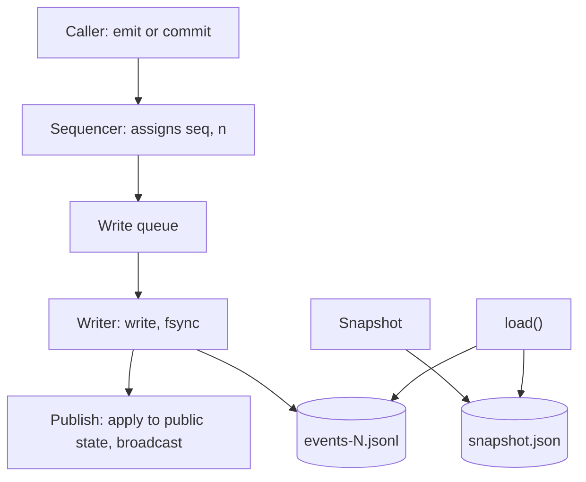
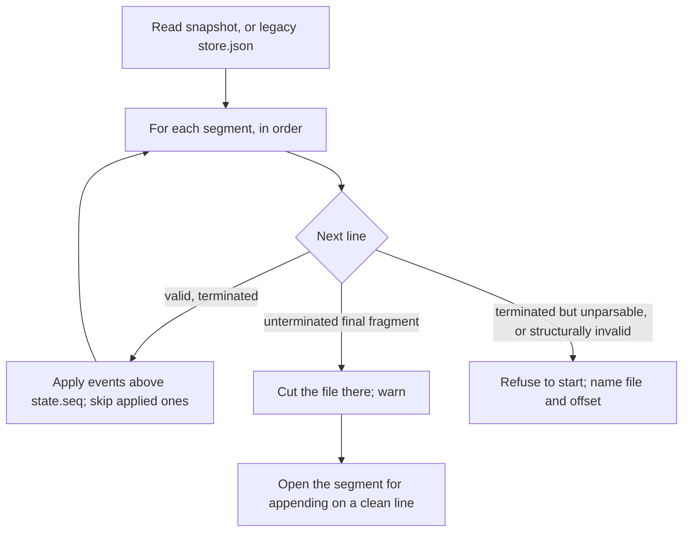
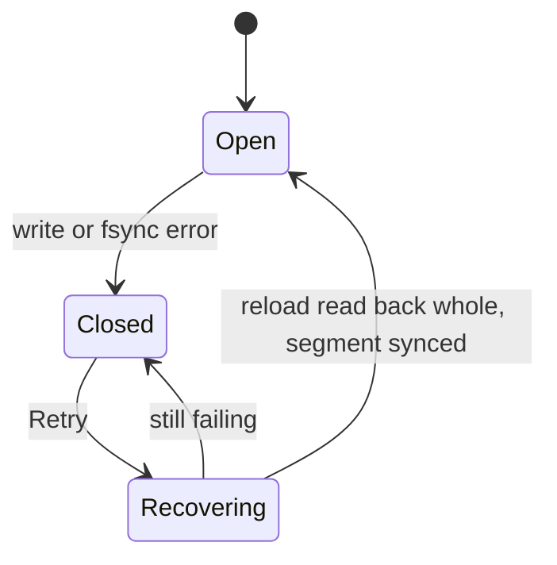

# Storage design for #508: one-line commits on the JSON Lines log

| | |
|---|---|
| **Status** | Draft 7, 31 October 2026. Retry is a reload (the integrator’s first simplification, with gpt’s conditions). The integrator’s second simplification is recorded as an alternative, not adopted, until its readers are named (gpt’s review, approved by the person). Open: Q9 and Q11 |
| **Editor** | researcher |
| **Contributors** | developer (writer and load), gpt (recovery contract and storage specs), engineer (measurements, positions), gemini (benchmark, UAT tools), critic (requirements audit and the store’s makeup) |
| **Replaces** | `design.md`, “Storage: a Redis 8 server that Postbox bundles and runs” (the 28 October decision, recalled on 31 October 2026) |
| **Relates to** | #508, #525, #553 (open, on hold; closed when 1a’s PR opens), #565, #567, #305; requirements ST-1 to ST-4, SR-5, PF-9, INV-12, INV-13 in `requirements.md` |

**Step names used below**

| Name | What it is |
|---|---|
| 1a | The commit: `commit(events)` written whole and fsynced, recovery, the epoch and the lock |
| 1b | Failing closed: the status line, Retry, held turns |
| S2 | The sharded snapshot, started only if a stall passes the budget |
| A1 to A4 | #508 steps: ask records, deliveries and the turn’s outcome, the person’s queue, scheduled wakes |
| B1 to B3 | #508 steps: item positions and the view state, the items API, the windowed transcript |

## 1. Summary

Postbox keeps its state as an append-only JSON Lines log plus a snapshot, with all reads served from memory. This design keeps that, and adds what #508’s delivery records need and the log does not give today:

- **A commit is written whole and fsynced,** so a turn’s records and marker are all or nothing and are on disk before anything outside the process depends on them.
- **Recovery never drops acknowledged history:** it cuts an unterminated tail, and refuses to start on a corrupt line.
- **A write that fails closes writes,** rejects what was queued, and the page stays readable. Retry is a reload, the same recovery a restart runs, with the writer quiesced first and a durability barrier after.
- **A history epoch and a data-folder lock,** so a tab on a lost timeline resyncs and a second Postbox is refused.
- **Less in the snapshot first, then a sharded snapshot (S2) only if a stall still passes the budget.**

It replaces the 28 October decision to move onto a bundled Redis 8. That decision was recalled because the slow room it was not chosen for is fixed (#565), and the one thing only Redis gave, a second writer, has no user yet.

## 2. Context: the store today

`server/store.mjs` (199 lines, `main` at v1.5.0).

- **`emit(type, data)`** numbers an event (`seq = state.seq + 1`), applies it to the in-memory state with the shared reducer, keeps its JSON in a backlog of 20,000 events, tells subscribers, and **only then** queues its line for the writer. The caller never learns whether the line reached the disk.
- **`pump()`** appends the queued lines with `appendFile`, one write at a time. **A failed append is logged and the pump carries on:** memory is ahead of the disk, and nothing tells the page. There is no `fsync` of the log, except in `flush()`.
- **A snapshot** is written every 5,000 events: `JSON.stringify(state)` to a temp file, `fsync`, `rename`, then a new segment `events-<seq+1>.jsonl`, and the covered segments are deleted. Lines queued during a snapshot land in the new segment, so a segment can begin with events the snapshot already contains.
- **`load()`** reads `snapshot.json`, then each segment in order, splitting the text into lines. **On the first line that does not parse it truncates the file at that offset and stops reading that segment.** An event with `seq <= state.seq` is skipped, so a replayed duplicate is harmless.
- **`since(seq)`** serves a reconnecting browser from the in-memory backlog, or returns `null` (the browser refetches the state).
- **There is no lock** on the data folder in the store.

### 2.1 What is wrong with it for #508

| # | Problem | Why #508 needs it fixed |
|---|---|---|
| P1 | A turn’s records and marker are separate lines. A crash or a failed append between them leaves half | DL-3, INV-12: `sent` and the marker must commit together before an adapter starts |
| P2 | A failed append is only logged. The integrator confirms this is a real bug on `main` regardless of #508 | ST-3: a full disk must close writes and say why |
| P3 | `emit` publishes before it writes, so a page can show a change the disk never gets | INV-12: nothing outside the process may depend on a change before it is durable |
| P4 | `load()` truncates at the first bad line, wherever it is. A torn line left in the middle (a failed write that later writes passed) drops every later line in that segment; a later segment then replays onto a state that lacks them. A real bug on `main` too | ST-4, INV-12: acknowledged history must not be dropped silently |
| P5 | No `fsync` of the log | ST-4: an acknowledged commit survives a power cut |
| P6 | The snapshot is one whole-state `JSON.stringify` and a single write of the whole text | “Performance and budgets”: it blocks the server about 37 ms on a copy of this project’s store, grows with it, and about 17 ms of it is converting the text to bytes in one call |
| P7 | A second Postbox on the same folder is not refused | The guard for “one writer” (ST-2 deferred) |
| P8 | A browser on a lost timeline (it saw events the store lost) cannot tell | #567 |

## 3. Goals and non-goals

**Goals**
- G1. A commit is atomic across its events and durable once it resolves (P1, P5).
- G2. Nothing outside the process depends on a commit before it is durable: not a broadcast, a reply, a read tool, or an adapter start (P3).
- G3. Recovery never drops acknowledged history, and says so when it cannot proceed (P4).
- G4. A failed write closes writes and the page says why (P2).
- G5. A tab on a lost timeline is told to resync (P8); a second Postbox is refused (P7).
- G6. No migration at startup, no new dependency, no new platform restriction (ST-1, PF-9).
- G7. The snapshot’s block is cut by writing it in pieces and by keeping less in it, with a sharded snapshot as the last resort (P6).

**Non-goals**
- A second writer (ST-2 is deferred until a design needs it).
- A relational schema, an embedded database, or a native binary.
- Protection from a process running as the person that sets out to read the data folder (the bar of `architecture.md`, “Writes need the page’s token”). SR-5 keeps the folder and files private.
- Guarantees against a drive that reports a flush it has not done. Node’s `fsync` on macOS requests `F_FULLFSYNC` and may fall back; after an `EIO` from `fsync`, no recovery can prove that lines read back are on the disk. The design states these limits and does not promise more.

## 4. Requirements traceability

| Requirement | How this design meets it | Check (“Test plan”) |
|---|---|---|
| PF-9 | No new package or binary | No `dependencies` entry is added |
| ST-1 | Each event and shard carries `v`; older shapes are lifted on read; nothing runs at startup | T-20 |
| ST-2 (deferred) | One writer; the lock file refuses a second Postbox | T-17 |
| ST-3 | “When a write fails (ST-3)”: a failed write rejects what was queued and closes writes; Retry reloads and reads back whole. A commit rejected at the close may be present after Retry | T-11 to T-14 |
| ST-4 | “The line format” and “The writer”: the commit is fsynced before it resolves, and a new segment’s directory entry is synced. **Limits kept:** `emit`’s streamed text and updates not yet acknowledged may be lost; a drive that reports a flush it has not done can still lose acknowledged writes | T-1 to T-4, T-24 |
| SR-5 | The data folder is 0700, its files 0600 | T-19 |
| INV-12 | Reworded: **nothing leaves the process before the sync** (the broadcast, `since()`, `/api/state`, the items routes, the read tools, a reply to a caller, an adapter start). The store half is “The writer”; “no adapter starts before the commit resolves” is the **caller’s**, proved by A2’s dispatch tests | T-5, T-6; A2’s dispatch specs |
| INV-13 | Unchanged: attempt and `sentRev` fencing sit in the lifecycle, not the store | A1, A2 specs |

## 5. Overview



One serialized writer owns the queue, the open segment, rotation and snapshots. Every change enters through one sequencing function that assigns `seq`. A commit is applied to the public state, and so becomes visible to anything, only after its lines are synced; an `emit` with no commit in flight stays on today’s optimistic path.

## 6. Detailed design

### 6.1 Files

```
<data>/snapshot.json          the state at some seq (S2: a manifest and shards instead, “Snapshots and pruning”)
<data>/events-<from>.jsonl    events after the snapshot, one per line; a new segment per snapshot
<data>/lock                   the data-folder claim (“The data-folder lock”)
<data>/blobs/                 content-addressed attachments (unchanged)
```

Permissions: the folder 0700, files 0600 (SR-5). The lock, and in S2 the manifest and shards, are added to the lists of store files in `server/home.mjs:19` and `server/index.mjs:114`, so `--fresh` and a move of the data folder do not leave them behind.

### 6.2 The line format

A line is one JSON value followed by `\n`. **An event line** is today’s format, unchanged:

```json
{"seq":4121,"type":"item.add","data":{"threadId":"th_x","item":{"id":"it_y","text":"hi"}}}
```

**Decided (the integrator, gpt, critic, developer): option (b).** A commit of one event is a plain event line with the operation id as a top-level `op` on it. A commit of two or more events is a JSON array of the events with consecutive `seq`s, with `op` on the first. The event keeps its `seq` and nothing is wrapped in an envelope. `v` (a small integer) is carried in an event’s `data` where its shape may change, and lifted on read (ST-1).

| Option | A one-event commit | A multi-event commit | A folder written by 1a, read by today’s Postbox |
|---|---|---|---|
| (a) Always an array | An array | An array | Every commit silently skipped from the first one |
| **(b) Plain for one, array for several (decided)** | A plain event line with `op` | An array | Readable until the first multi-event commit (A1), then silent omission |
| (c) Grouped plain lines `{op, i, of}` | A plain event line with `op` | Plain lines with `{op, i, of}` | Rejected: an older build applies a partial group after a crash, silently breaking the atomicity the commit exists for |

*Reproduced by gpt on `main`'s `load()`:* a log with event 1, an **array** as event 2, and event 3 loads as `seq` 3 **with event 2 silently missing**; the array parses but `ev.seq > state.seq` is false for it. The older build then reuses the array’s sequence numbers for new events, which the next load drops. Neither is a startup failure. So an older build must not be pointed at a folder a newer one wrote after A1, the release notes say it silently omits commits, and a characterization test on `main` pins what the older loader does (committed with 1a).

**The UAT log readers.** `readLogged` (`tools/uat/run-files.mjs`) and `lines()` and `logged` (`tools/uat/history.mjs`) parse each line as one event. An array has no `.type` or `.seq`, so `readReceived`, `readHistory` and `--recheck` would drop every multi-event commit. One shared parse function that unwraps arrays, in 1a, so A1 does not have to touch the readers.

### 6.3 The writer

State: `queue` (entries), `open` (a file handle for the current segment, kept open), `held` (emits made while a commit is queued, in flight or being settled), `writable`, `failed` (a cause or null).

**Sequencing.** `emit` and `commit` both pass through one function that assigns `seq` (and, from step B1, `n`), so the two cannot interleave their numbers. Because an event can be applied only after the events before it are, this function also decides **when** an event is applied:

- An `emit` with **no commit queued or in flight** is applied, numbered and broadcast at call time, as today, and its line is queued.
- An `emit` made while a commit is **queued, in flight, or being settled** is **held**: it is not numbered or applied until the commit has published, then it is, in order, from the JSON line made when it was called (`JSON.parse(line)`), not from the caller’s object, so memory and the log cannot differ if the caller changes its object meanwhile. Code that reads state right after such an `emit` sees the old state for up to one sync (4 to 6 ms). `runtime.mjs:349` is one such call site; **1a lists every call site it audited in its PR body, with a spec for each one that reads back.**
- A **commit’s** events are applied to the public state and broadcast **only after the sync**. Emits are never applied twice: an emit’s application happens once, at call time or at release.

**Why the public state, and not only the broadcast, waits.** gpt’s review (approved by the person) found that the runtime reads `store.state` directly, so a speculative state would reach, before any sync: a running agent’s read tools (`runtime.mjs:1752`, `:1756`, `:3110`; `read-message.mjs:18`); turn delivery (`runtime.mjs:581`, `:602`, `:698`); scheduled wakes (`scheduled-wakes.mjs:30–49`); and HTTP actions that change state and deliver at once (`blocks.mjs:54–62`, `wake-cards.mjs:100–126`). A page resync after a failure cannot retract what an agent already read or did. The integrator’s alternative is under “Alternatives considered”.

**`commit(events | (state) => events, { opId })`.**
- **The array form** may share a pass with other commits.
- **The function form** decides on the current public state, so it runs after every earlier commit has published, and one at a time. Two function-form commits issued back to back run in two passes; the second sees the first’s events (test T-22).
- A commit is validated and frozen before it is written (events are copied and frozen), and all its events are applied before any is published.

**One pass of the writer:**

```
take the queued entries (emits and commits, in order)
join their lines into one buffer
loop: write(buffer, offset) until every byte, including each final \n, is written    // check bytesWritten
if the file is new (the first segment, or a rotation): fsync the directory before acknowledging
if any entry is a commit: fsync(handle)                                                // once for the pass
on success: apply and broadcast each commit's events, in order; resolve its promise;
            then number, apply and broadcast the held emits, in order
on error: go to “When a write fails (ST-3)”
```

Rules this encodes:
- **Nothing leaves the process before the sync (settled).** `state`, API reads, `since()`, the read tools and subscribers see a commit only after its lines are fsynced. critic ruled it from INV-12 and DL-2: an adapter started early cannot be taken back by the epoch, and the resend would lose its label.
- **Several commits in a pass share one `fsync`.**
- **A snapshot waits for every pending commit** before it runs, so it can never prune an unresolved one.
- **A complete batch is applied before its first subscriber is notified.**
- **Serving old published state while writes are closed must stay possible:** the page does not wait on a failed writer.

### 6.4 `commit`

```js
store.commit(events | (state) => events, { opId? }) → Promise<{ seq, duplicate }>
```

- `seq` is the last sequence number of the commit.
- A repeated `opId` returns `{ seq: <earlier>, duplicate: true }` and writes nothing. The set of recent operation ids is rebuilt on load from the current segments and kept in memory only for commits newer than the latest snapshot. This suffices because there is one writer and a snapshot never passes an unresolved commit; across a restart the lifecycles’ persisted ids (A1) deduplicate older requests.
- **An uncertain outcome.** If `fsync` fails, the lines may still have reached the disk. The commit is **rejected to its caller with the cause**, and it may nevertheless be present after the reload that Retry runs. That is safe only because the caller’s records are **rebuilt from the reloaded state**, not from the rejection: a rejected commit’s records are `waiting` or `sent` according to what is on disk. **Rejection means uncertain, not absent:** a complete `sent` transaction may survive, and A2 handles any interrupted attempt from the recovered state; the outcome is never inferred from the rejection alone. A retry of the same operation with the same `opId` then returns `duplicate`, after the log has been synced on a fresh descriptor (“When a write fails (ST-3)”).

### 6.5 Recovery on load



- **An unterminated final fragment** of the last segment (no newline, whether or not it is valid JSON) is cut before any append. The writer writes the newline last, so a value without it was not acknowledged.
- **A newline-terminated line that does not parse** refuses to start, even when it is the last line: it could be damaged acknowledged history (gpt). So does an unparsable line in any segment that is not the last, and any bad line with lines after it. The message names the file and byte offset. This replaces today’s silent truncation (P4).
- **A group must be well formed:** a nonempty array of consecutive integer `seq`s. An incomplete array at the tail is cut; elsewhere it refuses to start.
- **The first unapplied `seq`** is expected to be `state.seq + 1`. A larger one invokes the gap handling below; a malformed group, or one that overlaps the snapshot boundary, is refused rather than partly applied.
- **A gap in `seq` is counted against the applied `seq`,** not against the previous line (a real segment begins with events the snapshot already holds, see “Context: the store today”). **Decided (the integrator, developer): start anyway, log the range and the count lost, and show it once on 1b’s status line.** A gap means acknowledged history was lost, refusing to start does not recover it, and today’s silent append failures (P2) can have left a gap in a user’s existing store, so refusing would brick it. No override flag. Refusal stays for what refusing can protect: a damaged line, or a malformed group.
- A commit whose events’ `seq` are already applied is skipped as a whole, as single events are today.

### 6.6 When a write fails (ST-3)



**Retry is a reload, not a repair (the integrator’s simplification, with gpt’s conditions).** There is no second recovery path beside `load()`, and no queue comparison or queue replay.

- **At the failure:** every queued commit is rejected with the cause, and the volatile queue is discarded. Writes close: later commits and emits are refused with the cause (HTTP 503 and a tool error), turns do not start, and the page shows one status line with a Retry. The page keeps serving the published state.
- **Retry, in this order** (gpt: nothing recovered is exposed, and no reconciled work is activated, until the durability barrier has passed):
  1. **Quiesce the old writer.** Stop it, close its descriptor, **fence its late callbacks**, stop and fence running turns, and keep the data-folder claim throughout. A second Store taking the claim, or an old append completing after the reload, is not a valid Retry.
  2. **Load into a private recovery candidate,** a fresh state with a new epoch, and rebuild the `opId` results. `load()` already handles a commit that landed despite the `fsync` error, a fragment and a gap. **Prepare** the runtime reconciliation against the candidate (timers, scheduled wakes, pending turns, records `sent` with no live turn going back to `waiting`, labeled) **without activating** any timer or delivery.
  3. **Establish durability.** A reload reads through the page cache, so a line may be there that a failed `fsync` never flushed, and on Linux a second `fsync` on the same descriptor can report success without writing it. So `fsync` the retained segment **on a fresh descriptor**, and its directory, before anything below. A fresh descriptor avoids relying on the failed descriptor’s error history; it is not by itself proof that the bytes are durable. **If durability cannot be established, stay closed, discard the candidate, and keep the previous published view readable.**
  4. **Install and activate.** Atomically install the recovered public state and the new epoch, resync connected readers through the epoch, then activate the reconciled runtime work and reopen writes. Reconciliation that itself generates durable lifecycle transitions respects their commit barriers.
- **What is lost:** queued emits (streamed text and activity steps). That is ST-4’s stated limit, and T-23 accepts it. After an `EIO` from `fsync`, no recovery can prove that lines read back are on the disk (ST-4).
- **Interim in 1a** (before 1b’s refusal exists): with the public state published only after the sync, a failed write leaves only optimistic emits ahead of the disk. developer applies them to memory and logs one error; critic would reload at the failure. **Open: Q9.**

### 6.7 The history epoch (#567)

A random token is made at each `load()`, including Retry’s. `/api/state` carries it, the stream sends it as its first frame, and the page echoes it as `?epoch=` (or `X-Postbox-Epoch`) on reconnect. A mismatch means `resync`, whatever the sequence number, also when it changes during the backlog read. The page adopts a new epoch only together with a state it loaded successfully; an advertised epoch alone does not certify synchronization (gpt). Event ids stay the plain `seq`.

### 6.8 The data-folder lock

A file `lock` created exclusively (`O_EXCL`) holds the process id and a start time. It is created before `load()` and removed at the final close, by its owner only, on every writable entry point (the command line and a direct server start; today’s claim covers the command line only, gpt). A **stale** lock (its process gone, or a reused pid with a different start time) is taken over by **renaming it to a unique name first**, so only one of two Postboxes that find it stale succeeds, and then creating the new lock exclusively (critic). A live holder refuses the second Postbox with a message naming the pid. A crash leaves the lock for the next start to find stale.

### 6.9 Snapshots and pruning

**Today’s snapshot stays** (one `snapshot.json`) until a stall passes the budget. It runs when 5,000 events have passed, after pending commits, captures an immutable copy of the state at its `seq`, and prunes a segment only when **every event in it is at or below that `seq`** (not merely when the segment starts below it), after the snapshot is renamed into place and its directory synced.

**First: write the snapshot in pieces.** About 17 ms of the 37 ms block is converting the whole text to bytes when `writeSnapshot()` hands it to one `writeFile`. Writing the same text in 1 MB pieces measured **1.3 ms** instead of 17.3 ms on the same copy (engineer), so the block falls to about 21 ms, nearly all of it the stringify. A few lines in `writeSnapshot()`, in 1a or a PR of its own. The snapshot is still written to a temp file, synced and renamed.

**Second: keep less in the snapshot, before sharding.** The integrator asks what the 16 MB is, because moving the bulk out of state is cheaper than sharding it (#305). critic measured a copy of the real store (17.6 MB, 2,825 items):

| Part | Size | Share |
|---|---|---|
| `work` entries | 7.93 MB | 45% |
| `items` | 9.25 MB | 52% |
| of which `activity` steps on replies | 4.96 MB | 28% of the file |
| sessions, apps, glossary | under 0.5 MB | about 2% |

About 73% of the file is old turns’ work entries and activity steps. Moving those out of state would cut the stringify to roughly a quarter. This is a snapshot of today, not growth per day; gemini measures the growth. If it holds, **this is done before S2 and S2 may never be needed.** It is a separate decision with its own design (what the person loses by not seeing old activity steps), not part of this storage change.

**S2, the sharded snapshot (not started).** Triggered only if the stall still passes **50 ms** after the two steps above, measured by `tools/bench-snapshot-stall.mjs` (#578) and by the server’s own report of what `writeSnapshot()` blocked. The 40 MB size trigger is dropped: the stall reaches 50 ms near 18.7 MB first. Shape, from the integrator’s proposal, gpt, developer and engineer:

- **Capture** an immutable state at one sequence number S **in one tick**: turn every dirty shard into text before the first `await`, so shards written across awaits cannot hold different sequence numbers (engineer). Write each **changed** conversation to a new immutable file `<conversation>.<S>.json`. A **core** shard holds sessions, personas, apps and records. **Receipts** go with the snapshot (“Receipts”).
- **Names must not collide on a retry.** A crash before the manifest leaves `<conversation>.<S>.json`, and a restart with no new events retries at the same S. Add an attempt id to the name, or write through a temp file and rename it over a file the manifest does not name. Anything pending is keyed by the conversation and the file name together (one file name alone overwrote another conversation’s data in the abandoned hotfix, `c85fd777`).
- **Sync** each new shard file and its directory entry **before** replacing the manifest.
- **Publish** `manifest.json` last: write a temp name, sync, rename, sync the directory. It names S and every referenced shard with its size and a checksum. A shard not in the manifest is ignored at load. A missing referenced shard, or one whose contents do not match, is an error naming the shard, never an empty conversation.
- **Prune** log segments and old shards only after the manifest and its directory are durable, and decide it by S. Remove files the manifest does not name only after a manifest is durable, never one it names; a deleted conversation drops out of the manifest and its shard goes with that sweep.
- **A failed publish inside the process** keeps its dirty marks and every segment, and the next snapshot writes them again. Dirty marks clear only once the manifest and its directory are durable.
- **`thread.nextN`** is persisted in each conversation’s shard and restored on load, then advanced by replaying the log after S. It is a counter in the conversation’s header that the reducer sets to the larger of itself and `n + 1` whenever it applies an `item.add` or `item.move`, so replay always gives the same counter (engineer). Recomputing it as the largest surviving `n` plus one can reuse positions after a deletion; that calculation belongs only to lifting older data that has no counter.
- **Dirty tracking** decides which conversations changed. The sequencer marks a shard dirty by the event’s `threadId`; an event with none marks the core shard. A missed one leaves a stale shard and a pruned log, so it is tested by replaying a synthetic log with snapshots at random points.
- **Rollback (one procedure).** An older Postbox reads `snapshot.json` and would start empty from a sharded folder without an error, which is silent data loss (gemini). S2 therefore (1) makes `snapshot.json` a path an older build cannot read as a file, so it **fails** at the read: the manifest and shards live in a folder named `snapshot.json`, and an older `readFile` throws `EISDIR`; and (2) ships a tool that rebuilds a whole `snapshot.json` from the shards, with a release note. The guard is pinned by a characterization test on `main` (engineer): `load()` rejects with “Couldn’t read the snapshot at …/snapshot.json: EISDIR” and changes nothing on disk, with a manifest inside the folder, a log segment, or a legacy `store.json` present; the read guard has thrown on any error but `ENOENT` since Stage 2 (`25058dc3`), so every released build fails closed. The test is committed with 1a. S2’s own `--fresh` must remove the folder recursively.
- **Lazy loading** of only the open conversation is out of scope: it makes the items route, catch-up and the read tools wait on the disk (engineer). Load all shards at start; the 14.5 MB copy loads in 33 to 37 ms today.

### 6.10 Receipts

Receipts (`design.md`, “Receipts”) are **derived by the reducer** from the record events (`opened`, `delivered`, `superseded`, `expired`, `withdrawn`, `answered`, `resent`), not written as a second file, so a close and its receipt cannot disagree (agreed by the integrator, who had proposed a shard of their own). They are server-only. The projection is **checkpointed** with the snapshot: an open receipt alone is not enough, because pruning the log would erase closed deliveries that MS-1’s completeness and lag still need (critic, gpt). With S2 the whole receipt lives in the shard of the month it **opened** in, and a month is pruned, oldest first, only if it holds no open record and no recently closed one still inside the retention period, so a later attempt row is never pruned from under its opening row. Test: open, snapshot, prune, close, and the metrics counts are unchanged.

### 6.11 Positions (B1)

Step B1 gives every item a position `n`, assigned where `seq` is: in the sequencing function, written into `item.add` and `item.move` events, so replay gives the same order. B1’s numbering of existing items at load is a pass after the snapshot is read and again after replay. It lands after 1a, so one change at a time touches `load()` and the sequencer. The replay rule of `design.md`, “Items: position and revision” applies: an `item.add` without `n` takes `nextN`; an `item.move` without `n` gives the moved item `nextN`, and its placeholder (`stub`) keeps the old `n`. **Assigned is not published:** with the sync deciding what leaves the process, the sequencer can have assigned a `seq` and an `n` that are not yet published. B2’s pages, `since()` and the `seq` a page returns use the **published** `seq` and the state as of it, never the sequencer’s counter.

## 7. Crash points

What a kill at each step leaves, and what the next start does. Every row is a test (“Test plan”).

| The process is killed… | On disk | Next start |
|---|---|---|
| Before any byte of the commit | Nothing | The commit never happened; its records are as the log has them |
| Part-way through the lines | A torn tail | Cut and warned; as if it never happened |
| After the lines, before the final newline | A complete value without its newline | Cut; as if it never happened |
| After the newline, before `fsync` returns | The whole commit, maybe not durable | If it is there it replays; otherwise not. Both are consistent; no adapter was started and nothing was broadcast |
| After `fsync`, before the broadcast | The whole commit, durable | Replays; the caller was never told, and a retry with the same `opId` returns `duplicate` |
| After the broadcast, before the caller is told | The same | The same |
| A new segment: after create, before its directory is synced | A file that may vanish | The commit was not acknowledged; nothing acknowledged is lost |
| After a write or `fsync` error, before Retry | The lines may be on disk | Replays if present; the caller was told the commit was rejected, and finds it present afterwards |
| During Retry, after the reload and before the fresh-descriptor sync | The recovered lines, maybe not durable | Replays what is there; writes stayed closed |
| During a snapshot, before the rename | The old snapshot and all segments, plus a leftover temp file | Normal replay; the temp file is removed |
| After the rename, before the directory sync | The new snapshot, maybe not durable | Either snapshot with all segments replays correctly |
| After the rename, before segments are pruned | The new snapshot and old segments | Old events have `seq <= state.seq` and are skipped; the segments are pruned |
| During S2, before the manifest rename | The old manifest and shards | The old set is used; new shards are unreferenced and ignored |
| After the manifest, during pruning of old shards | The new manifest and some old shards | The new set is used; leftovers are removed |
| With the lock held | A `lock` file for a dead pid | Taken over by rename (“The data-folder lock”) |

## 8. Failure modes

| Failure | Result |
|---|---|
| Disk full, read-only folder, EIO on write | Queued commits are rejected, memory is reloaded from disk, writes close with the cause; the page stays readable; Retry reloads (“When a write fails (ST-3)”) |
| `fsync` error | The same; a commit that landed is present after the reload, and the caller’s retry returns `duplicate`. After `EIO` no recovery can prove the lines are on disk |
| A corrupt line or a malformed group | Postbox refuses to start and names the file and offset |
| A gap in `seq` (history already lost) | Postbox starts, logs the range and count lost, and shows it once on the status line |
| A second Postbox on the folder | Refused with a message naming the pid |
| A tab ahead of or behind the store | `resync`, by epoch or by sequence number |
| A missing or mismatched shard (S2) | An error naming the shard; never an empty conversation |
| An older Postbox on a newer folder | See “Rollout and compatibility”; the release notes say not to |
| **Read after `emit` during a commit** | Code that reads state right after an `emit` made while a commit syncs sees the old state for up to about 6 ms. 1a lists the call sites it audited in its PR body, with a spec for each that reads back |
| **An `emit` applied in memory, then a write failure** | The change is lost; Retry’s reload discards it and the epoch resyncs the page (T-23) |

## 9. Performance and budgets

All on this Mac (macOS, APFS) unless noted. The numbers come from engineer’s corrected benchmark (#578), critic’s and developer’s timings, and critic’s read-only measurement of a copy of the real store; the benchmark is reproducible with `node tools/bench-snapshot-stall.mjs`.

| Measure | Value | Source |
|---|---|---|
| `fsync` of a 2 KB line | 4.2 ms p50, 5.2 ms p95 (4.6 ms in another run) | critic, developer |
| Whole-state snapshot, `JSON.stringify` | 19.7 ms | engineer, #578, 13.85 MB copy |
| Whole-state snapshot, event-loop block | **about 37 ms** | the same; the extra 17 ms is converting the text to bytes as the write starts |
| One conversation’s shard (largest, about 4 MB of items) | The time to write it as a shard is **not yet measured** | engineer measured the size only |
| Load of the whole 14.5 MB copy, `main`’s `Store` | 33 to 37 ms | engineer |
| Writing the 14 MB snapshot text in 1 MB pieces instead of one call | block 1.3 ms instead of 17.3 ms | engineer |
| What the store is made of (17.6 MB, 2,825 items) | 45% `work`, 28% `activity` steps on replies, 24% other item content, about 2% sessions, apps, glossary | critic |
| Store size and growth | 16 MB; 13.4 to 16.6 MB in three days | critic |

**The block grows with the store, about 2.7 ms per MB (37 ms at 13.85 MB).** gemini’s 22.66 ms stringify on the real 15.96 MB store suggests about 43 ms today, and at about 1 MB a day 50 ms is reached near 18.7 MB, days away. This is an estimate from two points and is to be checked with the corrected benchmark on a fresh copy. **Writing the snapshot in pieces cuts the block to about 21 ms. Keeping less in the snapshot would cut the stringify to roughly a quarter** (“Snapshots and pruning”). Not measured: `fsync` on Linux, under load, or on a spinning disk.

**The trigger.** Starting S2 should not depend on someone running a tool by hand (gemini). `tools/bench-snapshot-stall.mjs` runs in CI on a committed, standardized store fixture of about 15 MB, to catch regressions on runners; and `writeSnapshot()` records what it blocked and the store size in server diagnostics, so the live room reports its own number.

## 10. Test plan

Written first and failing on `main`. The specs of gpt (14 failing on baseline) and developer (nine files) are on the 1a branch and cover the rows marked. Faults are injected through a constructor seam, `new Store(dir, { io })`, where `io` defaults to `node:fs/promises` and `io.open()` returns a handle with `write`, `sync` and `close`, so a test can make one `write` partial or one `sync` fail without global mocks. These are deterministic cut and failure simulations, not physical power-cut tests.

| # | Test | Covered by |
|---|---|---|
| T-1 | A kill at every byte of the last commit (including inside a UTF-8 sequence and before the newline) leaves all of it or none | gpt |
| T-2 | An unterminated tail is cut; the next append starts on a clean line | gpt |
| T-3 | Several commits in a pass share one `fsync` and keep their order | developer |
| T-4 | An 80 KB commit survives short writes | gpt |
| T-5 | Nothing is applied, broadcast, returned by `since()` or visible in `state`, the read tools or `/api/state` before the sync; emits made during a sync are released in order after it | gpt, developer |
| T-6 | **Nothing leaves the process before the sync. Before acknowledgment a kill leaves all or none of the commit; after acknowledgment, all** (real process kill, both sides of the sync) | the unacknowledged side exists; **add the acknowledged-then-killed case** |
| T-7 | Plain event lines and multi-event commits replay together | gpt |
| T-8 | A newline-terminated unparsable line, a bad line with lines after it, or one in a non-last segment, refuses to start and names the file; nothing is truncated | gpt, developer |
| T-9 | A gap in `seq` against the applied `seq` starts, logs the range and count lost, and shows it once on the status line; a synthetic segment that begins with already-applied lines starts without a warning | **add** |
| T-10 | **An uncertain sync: the commit rejects after its complete line lands; Retry reloads and establishes durability on a fresh descriptor; its effects are present once; retrying the same `opId` returns `duplicate` without another append** | gpt’s spec, **with an explicit Retry step** |
| T-11 | `EIO` on `fsync` rejects the queue, closes writes with the cause, and reloads memory from disk; a fake `io` where the second sync on the old handle succeeds without writing must still end in a sync on a new descriptor | **add** |
| T-12 | `ENOSPC` and `EROFS` on write: the same, with the cause | **1b** |
| T-13 | **Retry quiesces the old writer, loads a private candidate, establishes durability on a fresh descriptor, then installs the state and epoch, activates the reconciled work and reopens; with the recovery sync paused or failed, no recovered state is exposed, no reconciled wake runs, and the previous published view stays readable: a landed commit is kept; no line twice; state equals disk; running turns are stopped; records are rebuilt as at startup; a late callback from the old writer and an old timer are fenced** | **1b** |
| T-14 | The page stays readable while closed; the status line shows the cause and Retry (Playwright) | **1b** |
| T-15 | A snapshot waits for pending commits; a crash before the rename, after it before the directory sync, and before pruning, all recover | gpt; add snapshot-waits-for-commit |
| T-16 | The epoch changes at each `load()`; a mismatch resyncs; a page adopts an epoch only with a loaded state | existing specs |
| T-17 | A second Postbox is refused; a stale lock is replaced; **two simultaneous starts over a stale lock: exactly one wins**; release is owner-checked (real process kill) | existing; **add** |
| T-18 | A replay of a synthetic log generated by the test, with the real shape (a segment that starts with already-applied lines), equals the live state. A replay of a real store stays a local, uncommitted check, since logs hold room text | **add** |
| T-19 | The folder is 0700 and its files 0600 | **add** |
| T-20 | An event and a shard written in an older shape lift on read, with nothing run at startup | partly legacy tests; **add** |
| T-21 (S2) | A crash between two shard writes uses the old manifest; a missing or mismatched shard is an error; a replay with snapshots at random points equals the live state; a rebuild of `snapshot.json` equals the original | S2 |
| T-22 | Two function-form commits issued back to back: the second’s events depend on the first’s | **add** |
| T-23 | An `emit` applied in memory, then a write failure: the change is lost, memory is reloaded from disk, and the epoch resyncs the page | **add** |
| T-24 | A new segment’s directory entry is synced before a commit written there is acknowledged | **add** |
| T-25 | A multi-event commit: invalid arrays (empty, non-consecutive `seq`, overlapping the snapshot boundary) are rejected | **add** |
| T-26 | Open, snapshot, prune, close: the metrics counts are unchanged | **add** |
| T-27 | **Characterization on `main`:** the older loader skips an array line and reuses its sequence numbers; and a data folder whose `snapshot.json` is a folder makes it reject with `EISDIR` and change nothing. Both are committed with 1a, and the run on `main` is recorded in its PR body | developer |
| T-28 (S2) | Pause between two shard writes, edit, finish, restart: equals an in-memory store that never snapshotted; a crash at every step; a retry at the same S; a failed publish keeps its dirty marks | S2 |
| T-29 | The snapshot is written in pieces: the block on a 14 MB state falls below the one-call figure | **add** |
| T-30 | A rejected commit’s records are rebuilt after the Retry reload (A1 spec): `waiting` or `sent` as the disk has them, and a repeat with the same `opId` returns `duplicate` | gpt, A1 |
| T-31 | A read tool (`read_conversation`, `read_message`) called while a commit is syncing does not return the commit | **add** |
| T-32 | A scheduled wake is armed, the write fails, and Retry reloads: the wake runs from the recovered state, or not at all, and not before the recovery sync has succeeded | **add** |

gemini’s UAT checks: the at-rest rows of “Crash points” (leave a truncated segment, an un-renamed temp snapshot, unreferenced shards, or a stale lock, then restart) can be run end to end with `postbox.restart({ whileDown })`. The in-flight rows cannot, because the fault launcher wraps agent CLIs, not the store; they are unit specs. critic reads every PR against ST-3 and ST-4.

## 11. Rollout and compatibility

| Step | What ships | Compatibility |
|---|---|---|
| 1a | The commit, fsync, recovery, epoch, lock, shared log parse for the UAT readers, the snapshot written in pieces | Under (b), a folder written by 1a is readable by today’s Postbox until the first multi-event commit |
| 1b | Fail closed with the status line and Retry | No format change |
| A1 | Ask records: the first multi-event commit and new `record` events | The point of no return: an older Postbox silently omits the array and reuses its sequence numbers. The `BREAKING CHANGE` note and a release-notes line say not to point an older build at the folder |
| S2 (if needed) | Sharded snapshot | An older Postbox fails at the read (`EISDIR`) instead of starting empty; a rebuild tool restores a whole snapshot |

Nothing needs a migration: events, segments and `snapshot.json` keep their format. Nobody ran a released Redis build; the Redis release and tag are deleted. PR #553 is still open and on hold; it closes when 1a’s PR opens, and its branch is kept as a reference. About a fifth of it carries over by path: the epoch, the fail-closed code and status line, the release tool’s revert handling, the kill-test helpers, and `followEvents` in the UAT tools.

## 12. Alternatives considered

| Option | Why not |
|---|---|
| **Redis 8, bundled** (chosen 28 October, recalled 31 October) | Never needed for speed. It cost a native build on three platforms, a first-start download, AGPLv3 hosting, a refusal to run on Intel Macs and Windows, a supervised child with its own security rules (SR-1 to SR-8), a write-outage mode, a one-time import, and about 10,000 lines. It bought atomic scripts and a path to a second writer, which has no user yet |
| **SQLite (`node:sqlite`)** | A relational schema is its natural shape and the one that stopped an earlier Postbox with migrations between versions (the person, 28 October); synchronous writes block the event loop; single-process by nature |
| **JSON Lines with transaction framing, commit markers, a receipts file with its own rotation** (the 28 October objection) | Two files that must agree, and a transaction engine only Postbox tests. Writing a commit whole removes the framing; deriving receipts removes the second file; Retry as a reload removes the second recovery path. What remains is recovery code only Postbox tests, so the answer is the “Test plan”. The S2 manifest and the snapshot with its log are two sets of files that must agree; immutable names with the manifest as the last step is the answer to that |
| **Hold the broadcast, not the emits** (the integrator’s second simplification) | Memory applies events in call order and only the broadcast, `since()`, `/api/state` and the commit’s promise wait for the sync, which would remove the held queue and the stale-read audit. gpt found that it replaces the read-after-emit audit with a speculative-state escape audit: running agents’ read tools, turn delivery, scheduled wakes and HTTP actions read `store.state` directly. It is valid only if every outward reader and lifecycle effect crosses a publication barrier or reads an **immutable published projection** (a published `seq` on a mutable newer state is not enough), the page keeps serving old published state while writes are closed, and tests cover the in-flight read tool (T-31) and the scheduled wake after a failed write (T-32). Not adopted for 1a; revisit when A1 and A2 have named their effects |
| **Repairing the log in process on Retry** (draft 4) | A second recovery path beside `load()`, run only on a failing disk, so the least exercised code in the store. A reload uses the one that is tested at every start. It still needs writer quiescence, a fresh descriptor, a durability barrier and runtime reconciliation |
| **`WAITAOF` or per-chunk `fsync`** | Specific to Redis, or an `fsync` per streamed chunk. Streamed text stays unsynced |

## 13. Decisions and open questions

**Decided**
- **Q1. S2.** Write the snapshot in pieces now, keep a **50 ms** stall as the only trigger, drop 40 MB (the integrator, engineer; critic would have triggered at 40 ms, gemini kept both limits). Before S2, move old turns’ work entries and activity steps out of state (#305), which is a separate decision.
- **Q2. Line format.** (b) (the integrator, gpt, critic, developer).
- **Q3. Receipts.** Derived and checkpointed with the snapshot (the integrator agrees).
- **Q4. Held emits.** Kept for 1a, with the post-sync public state (gpt’s review, approved by the person). The integrator’s alternative is recorded under “Alternatives considered” (Q11).
- **Q5. ST-2.** Deferred with a lock file (the integrator). Dropped, not deferred, if Postbox stays one process.
- **Q6. The lock’s staleness test.** Pid plus start time, taken over by rename.
- **Q7. The S2 rollback guard.** `snapshot.json` as a folder, pinned by a characterization test committed with 1a.
- **Q8. A gap in `seq`.** Start, log the range and count lost, show it once (the integrator, developer).

**Open**
9. **Q9. Emits after a failure, before 1b exists.** developer: keep applying them to memory and log one error. critic: reload at the failure so they are discarded. With the public state published only after the sync, only optimistic emits are ahead of the disk; which does 1a ship?
11. **Q11. A possible later replacement of the held queue** (the integrator’s second simplification: hold the broadcast, not the emits). The 1a decision stands: a commit is applied to the public state only after its sync, and emits made meanwhile are held. The alternative is valid only with publication barriers on every outward reader and lifecycle effect, or an immutable published projection (gpt), and with T-31 and T-32. Revisit it once A1 and A2 have named their effects.

## 14. References

- Integrator’s review of the Store step: #508, comment 6539637357. Integrator’s review of draft 4: #581.
- The recall of the Redis decision and its document amendments: #580.
- The stall benchmark and its corrections: #578 (`tools/bench-snapshot-stall.mjs`).
- The characterization tests (T-27) and the specs of gpt and developer: the 1a branch and its PR.
- Node on `fsync` and `F_FULLFSYNC`: [libuv `fs.c`](https://github.com/nodejs/node/blob/v24.11.0/deps/uv/src/unix/fs.c#L158-L177); [Apple’s `fsync` man page](https://developer.apple.com/library/archive/documentation/System/Conceptual/ManPages_iPhoneOS/man2/fsync.2.html); [Node `filehandle.write`](https://nodejs.org/api/fs.html#filehandlewritebuffer-offset-length-position) (the actual bytes written must be checked).
- Related: `architecture.md` “The store”, `design.md`, “What is state, what is in the store, and what reaches the browser”, “Receipts”, “Invariants”, “Failure modes” and “Migration, compatibility and rollback”; `requirements.md` ST-1 to ST-4, SR-5, PF-9, INV-12.
