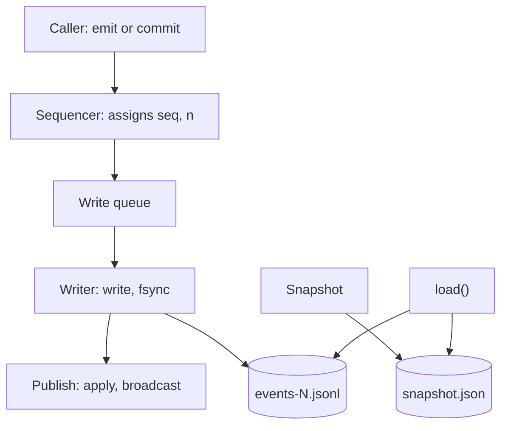
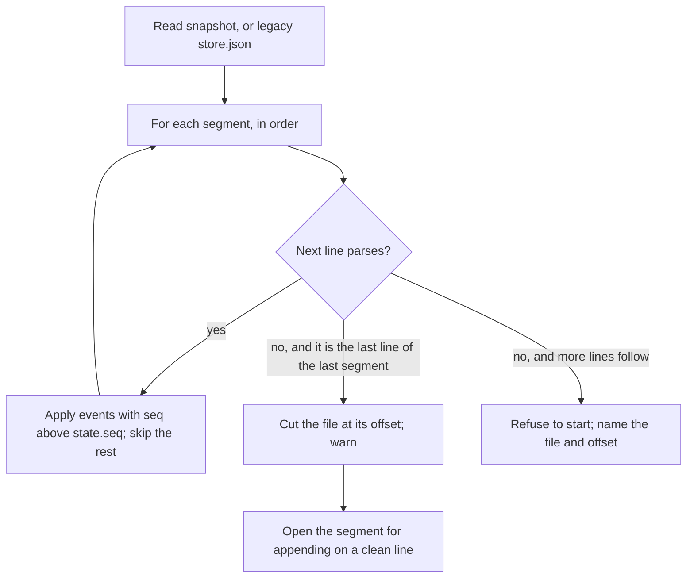
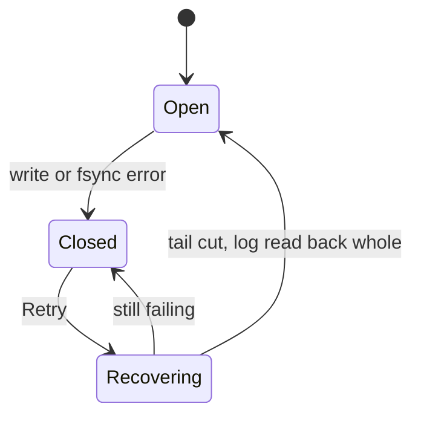

# Storage design for #508: one-line commits on the JSON Lines log

| | |
|---|---|
| **Status** | Draft 1, 31 October 2026, for peer review by the developers and critic, then principal-engineer review by the person and the integrator |
| **Editor** | researcher |
| **Contributors** | developer (writer and load), gpt (recovery contract and storage specs), engineer (measurements, positions), gemini (benchmark), critic (requirements audit) |
| **Replaces** | `design.md` §6.6 “Storage: a Redis 8 server…” (the 28 October decision, recalled on 31 October 2026) |
| **Relates to** | #508, #525, #553 (closed), #565, #567; requirements ST-1 to ST-4, SR-5, PF-9, INV-12, INV-13 in `requirements.md` |
| **Steps** | 1a (the commit line), 1b (fail closed), S2 (sharded snapshot, on a budget) |

## 1. Summary

Postbox keeps its state as an append-only JSON Lines log plus a snapshot, with all reads served from memory. This design keeps that, and adds what #508’s delivery records need and the log does not give today:

- **A commit is one line,** fsynced, so a turn’s records and marker are written all or nothing and are on disk before anything depends on them.
- **Recovery that never drops acknowledged history:** it cuts a torn tail, and refuses to start on a bad line in the middle.
- **A write that fails closes writes,** with the page still readable.
- **A history epoch and a data-folder lock,** so a tab on a lost timeline resyncs and a second Postbox is refused.
- **A sharded snapshot (S2),** only if a measured stall or the store’s size passes a budget.

It replaces the 28 October decision to move onto a bundled Redis 8. That decision was recalled because the slow room it was not chosen for is fixed (#565), and the one thing only Redis gave, a second writer, has no user yet.

## 2. Context: the store today

`server/store.mjs` (199 lines, `main` at v1.5.0). I read it to write this section.

- **`emit(type, data)`** numbers an event (`seq = state.seq + 1`), applies it to the in-memory state with the shared reducer, keeps its JSON in a backlog of 20,000 events, tells subscribers, and **only then** queues its line for the writer. The caller never learns whether the line reached the disk.
- **`pump()`** appends the queued lines with `appendFile`, one write at a time. **A failed append is logged and the pump carries on:** memory is ahead of the disk, and nothing tells the page. There is no `fsync` of the log, except in `flush()`.
- **A snapshot** is written every 5,000 events: `JSON.stringify(state)` to a temp file, `fsync`, `rename`, then a new segment `events-<seq+1>.jsonl`, and the covered segments are deleted.
- **`load()`** reads `snapshot.json`, then each segment in order. It splits the text into lines. **On the first line that does not parse it truncates the file at that offset and stops reading that segment.** An event with `seq <= state.seq` is skipped, so a replayed duplicate is harmless.
- **`since(seq)`** serves a reconnecting browser from the in-memory backlog, or returns `null` (the browser refetches the state).
- **There is no lock** on the data folder in the store; a second server on the same folder would write the same files.

### 2.1 What is wrong with it for #508

| # | Problem | Why #508 needs it fixed |
|---|---|---|
| P1 | A turn’s records and marker are separate lines. A crash or a failed append between them leaves half | DL-3, INV-12: `sent` and the marker must commit together before an adapter starts |
| P2 | A failed append is only logged | ST-3: a full disk must close writes and say why |
| P3 | `emit` publishes before it writes, so a page can show a change the disk never gets | INV-12: nothing a lifecycle depends on may be visible before it is durable |
| P4 | `load()` truncates at the first bad line, wherever it is. A torn line left in the middle (a failed write that later writes passed) drops every later line in that segment; a later segment then replays onto a state that lacks them | ST-4, INV-12: acknowledged history must not be dropped silently |
| P5 | No `fsync` on the log | ST-4: an acknowledged commit survives a power cut |
| P6 | The snapshot is one whole-state `JSON.stringify` and write | Budget (§9): it blocks the server about 37 ms on a copy of this project’s store, and grows with it |
| P7 | A second Postbox on the same folder is not refused | ST-2’s guard while there is one writer |
| P8 | A browser on a lost timeline (it saw events the store lost) cannot tell | #567 |

## 3. Goals and non-goals

**Goals**
- G1. A commit is atomic across its events and durable once it resolves (P1, P5).
- G2. Nothing is published, applied to the lifecycle or started before the commit is durable (P3).
- G3. Recovery never drops acknowledged history, and says so when it cannot proceed (P4).
- G4. A failed write closes writes and the page says why (P2).
- G5. A tab on a lost timeline is told to resync (P8); a second Postbox is refused (P7).
- G6. No migration at startup, no new dependency, no new platform restriction (ST-1, PF-9).
- G7. A path to a sharded snapshot that is crash-safe and reversible, started by a measured budget (P6).

**Non-goals**
- A second writer (ST-2 is deferred until a design needs it).
- A relational schema, an embedded database, or a native binary.
- Protection from a process running as the person that sets out to read the data folder (the bar of `architecture.md`, “Writes need the page’s token”). SR-5 keeps the folder and files private.
- Guarantees against a drive that reports a flush it has not done. Node’s `fsync` on macOS requests `F_FULLFSYNC` and may fall back; the design states this limit and does not promise more.

## 4. Requirements traceability

| Requirement | How this design meets it | Check (§10) |
|---|---|---|
| PF-9 | No new package or binary | `package.json` unchanged |
| ST-1 | Each event and shard carries `v`; older shapes are lifted on read; nothing runs at startup | T-20 |
| ST-2 (deferred) | One writer; the lock file refuses a second Postbox | T-17 |
| ST-3 | §6.6: a failed write closes writes; Retry cuts the tail and reads back whole | T-11 to T-14 |
| ST-4 | §6.2 and §6.3: the commit line is fsynced before it resolves | T-1 to T-4 |
| SR-5 | The data folder is 0700, its files 0600 | T-19 |
| INV-12 | §6.3: publication and adapter start follow the sync | T-5, T-6 |
| INV-13 | Unchanged: attempt and `sentRev` fencing sit in the lifecycle, not the store | A1, A2 specs |

## 5. Overview



One serialized writer owns the queue, the open segment, rotation and snapshots. Every change enters through one sequencing function that assigns `seq`. A commit becomes visible only after its line is synced; an `emit` stays on today’s optimistic path.

## 6. Detailed design

### 6.1 Files

```
<data>/snapshot.json          the state at some seq (S2: a manifest and shards instead, §6.9)
<data>/events-<from>.jsonl    events after the snapshot, one line each; a new segment per snapshot
<data>/lock                   the data-folder claim (§6.8)
<data>/blobs/                 content-addressed attachments (unchanged)
```

Permissions: the folder 0700, files 0600 (SR-5).

### 6.2 The line format

A line is one JSON value followed by `\n`.

**An event line** (today’s format, unchanged):

```json
{"seq":4121,"type":"item.add","data":{"threadId":"th_x","item":{"id":"it_y","text":"hi"}}}
```

**A commit line** is a JSON array of that commit’s events with consecutive `seq`s. The operation id is a top-level `op` on the first event, so the line stays an array and `seq` belongs only to real events:

```json
[{"seq":4122,"op":"op_k3","type":"record.open","data":{…}},{"seq":4123,"type":"turn.marker","data":{…}}]
```

`v` (a small integer) is carried inside an event’s `data` where its shape may change, and lifted on read (ST-1).

**Open question Q2 (compatibility).** Today’s `load()` treats a line as one event, so it will not apply an array and will treat it as bad. Two ways to write a commit of one event:
- **(a) Always an array.** Simple and uniform. A log written by 1a is unreadable by an older Postbox the first time anything commits.
- **(b) A one-event commit is a plain event line with `op` on it; only a commit of two or more events is an array.** A log written by 1a stays readable by today’s Postbox until the first multi-event commit, which arrives with A1 (ask records: a session and its recipient bound in one commit).

developer’s position is that 1a itself carries the `BREAKING CHANGE` note because the array is 1a’s format. researcher’s proposal is (b), so the point of no return moves to A1. Either way an older build must not be pointed at a folder a newer one wrote, and the release notes say so. To be settled in review.

### 6.3 The writer

State: `queue` (entries), `open` (a file handle for the current segment, kept open), `held` (emits made while a commit syncs), `writable`, `failed` (a cause or null).

An **entry** is `{ line, bytes, durable, resolve, reject, events }`: `durable` is true for a commit.

**Sequencing.** `emit` and `commit` both pass through one function that assigns `seq` (and, from step B1, `n`), so the two cannot interleave their numbers. `commit(events, { opId })` accepts `events` as an array or a function of the current state (so a lifecycle decides inside the serialization boundary, not before an `await`).

**One pass of the writer:**

```
take every queued entry (emits and commits, in order)
join their lines into one buffer
loop: write(buffer, offset) until every byte, including the final \n, is written   // check bytesWritten
if any entry is durable: fsync(handle)                                               // once for the pass
on success: for each entry in order: apply to state, add to backlog, notify subscribers; resolve durable ones
on error: go to §6.6
release held emits into the queue, in order
```

The rules this encodes:
- **Publish after the sync (settled).** A commit’s events are applied to `state`, broadcast, and kept for replay only after its line is fsynced. Private staged state can validate a commit, but `state`, API reads, `since()` and subscribers see nothing earlier. critic ruled it from INV-12 and DL-2: an adapter started early cannot be taken back by the epoch, and the resend would lose its label. gpt added that API reads and subscribers must wait too.
- **Emits made while a commit syncs are held** and released in order after it, so the log, memory and the stream keep one order. An emit with no commit in flight is written without waiting for a sync, as today. The cost is at most about one sync (4 to 6 ms) of delay on streamed text during a commit.
- **Several commits in a pass share one `fsync`.**
- **A snapshot waits for every pending commit** before it runs, so it can never prune an unresolved one.
- **No adapter starts before its `commit()` resolves** (INV-12). The caller awaits the commit.

### 6.4 `commit`

```js
store.commit(events | (state) => events, { opId? }) → Promise<{ seq, duplicate }>
```

- `seq` is the last sequence number of the commit.
- A repeated `opId` returns `{ seq: <earlier>, duplicate: true }` and writes nothing. The set of recent operation ids is rebuilt on load from the current segments and kept in memory only for commits newer than the latest snapshot. This is sufficient because there is one writer and a snapshot never passes an unresolved commit; across a restart the lifecycles’ persisted ids (A1) deduplicate older requests.
- **An uncertain outcome.** If `fsync` fails, the complete line may still have reached the disk. A retry with the same `opId` finds the line, syncs it again, and only then returns the earlier result. Finding the id alone is not enough (gpt).
- A commit is validated and frozen before it is written (events are deep-copied and frozen), and all its events are applied before any is published.

### 6.5 Recovery on load



- **An incomplete final line** (no newline, or not valid JSON) of the last segment is removed before any append.
- **A complete value without its newline** is cut with the incomplete line (the writer always writes the newline last, so a value without it was not acknowledged). It is never joined to the next write.
- **A bad line with lines after it,** or in a segment that is not the last, is corruption. Postbox does not start, and the message names the file and byte offset. This replaces today’s silent truncation (P4).
- A commit line whose events’ `seq` are already applied is skipped as a whole (`seq <= state.seq`), as single events are today.
- **A gap in `seq`** between consecutive lines is corruption too, with the same refusal.

### 6.6 When a write fails (ST-3)



- **Closed:** `writable = false` with a cause (`ENOSPC`, `EROFS`, `EIO`, or the error code). Commits and emits are refused with that cause (HTTP 503 and a tool error), turns do not start, the queue is kept, and the page shows one status line with a Retry. The page stays readable from memory.
- **Before reopening,** Retry cuts the segment back to the last offset that holds a whole acknowledged line (the writer remembers it), reads the segment back, and compares: every acknowledged `seq` must be present. Only then does it write again, starting with the kept queue. A line that landed during an uncertain `fsync` is found and kept rather than written twice (§6.4).
- **In-flight turns** stop and their records return to `waiting`, labeled (the lifecycle’s part, A2).
- Today’s behavior, logging the error and carrying on with memory ahead of the disk, is removed. This is a fix on `main`, not only a Redis replacement.

### 6.7 The history epoch (#567)

A random token is made at each `load()`. `/api/state` carries it, the stream sends it as its first frame, and the page echoes it as `?epoch=` (or `X-Postbox-Epoch`) on reconnect. A mismatch means `resync`, whatever the sequence number, also when it changes during the backlog read. The page adopts a new epoch only together with a state it loaded successfully; an advertised epoch alone does not certify synchronization (gpt). Event ids stay the plain `seq`.

### 6.8 The data-folder lock

A file `lock` created exclusively (`O_EXCL`) holds the process id and a start time. It is created before `load()` and removed at the final close, on every writable entry point (the command line and a direct server start; today’s claim covers the command line only, gpt). A stale lock (its process gone, or a reused pid with a different start time) is replaced. A live holder refuses the second Postbox with a message that names the pid. A crash leaves the lock for the next start to find stale.

### 6.9 Snapshots and pruning

**Today’s snapshot stays** (one `snapshot.json`) until the budget triggers S2. It runs when 5,000 events have passed, after pending commits, and prunes segments below its `seq` only after the snapshot is renamed into place (and its directory synced).

**S2, the sharded snapshot (not started).** Triggered when a snapshot stall passes **50 ms** or the store reaches **40 MB** (today about 37 ms and 16 MB; the store grows about 1 MB a day). Shape, from the integrator’s proposal, gpt and developer:

- **Capture** the state at one sequence number S. Write each **changed** conversation to a new immutable file `<conversation>.<S>.json`, synced. A **core** shard holds sessions, personas, apps and records. **Receipts** go in monthly shards.
- **Publish** a small `manifest.json` last, written to a temp name, synced, renamed, with the directory synced. It names S and every referenced shard with its size. A shard not in the manifest is ignored at load. A missing referenced shard is an error, never an empty conversation.
- **Prune** log segments below S only after the manifest and its directory are durable.
- **`thread.nextN`** is taken from each conversation’s own shard on load (largest `n` plus one), so a crash between two shard writes cannot hand out an `n` twice (engineer).
- **Dirty tracking** decides which conversations changed. A missed one leaves a stale shard and a pruned log, so it is tested by replaying a copy of a real log with snapshots at random points.
- **Rollback.** An older Postbox reads `snapshot.json` alone and would start empty from a sharded folder without an error. S2 keeps a validated whole `snapshot.json` as a fallback, or ships a tool that rebuilds it from the shards, with a release note.
- **Lazy loading** of only the open conversation is out of scope: it makes the items route, catch-up and the read tools wait on the disk (engineer). Load all shards at start; the 14.5 MB copy loads in about 200 ms today.

### 6.10 Receipts

Receipts (`design.md` §6.4) are **derived by the reducer** from the record events (`opened`, `delivered`, `superseded`, `expired`, `withdrawn`, `answered`, `resent`), not written as a second file, so a close and its receipt cannot disagree. They are server-only. Until S2 they are part of the snapshot; with S2 they are written to monthly shards. A month is pruned, oldest first, only if no open record’s `opened` row is in it, so an old opening month never expires pending work (DL-1).

### 6.11 Positions (B1)

Step B1 gives every item a position `n`, assigned where `seq` is: in the sequencing function, written into `item.add` and `item.move` events, so replay gives the same order. B1’s numbering of existing items at load is a pass after the snapshot is read and again after replay. It lands after 1a, so one change at a time touches `load()` and the sequencer.

## 7. Crash points

What a kill at each step of a commit leaves, and what the next start does. Every row is a test (§10).

| The process is killed… | On disk | Next start |
|---|---|---|
| Before any byte of the line | Nothing | The commit never happened; its records are still `waiting` |
| Part-way through the line | A torn last line | Cut and warned; as if it never happened |
| After the line, before the newline | A complete value without its newline | Cut; as if it never happened |
| After the newline, before `fsync` returns | The whole line, maybe not durable | If the line is there it replays, and the records are `sent`; otherwise `waiting`. Both are consistent. The adapter was not started (G2) |
| After `fsync`, before the caller is told | The whole line, durable | Replays; a retry with the same `opId` returns `duplicate` |
| During a snapshot, before the rename | The old snapshot and all segments | Normal replay |
| After the rename, before segments are deleted | The new snapshot and old segments | Old events have `seq <= state.seq` and are skipped; the segments are pruned |
| During S2, before the manifest rename | The old manifest and shards | The old set is used; new shards are unreferenced and ignored |

## 8. Failure modes

| Failure | Result |
|---|---|
| Disk full, read-only folder, EIO on write | Writes close with the cause; the page stays readable; Retry (§6.6) |
| `fsync` error | The same, with an uncertain outcome resolved by `opId` (§6.4) |
| A bad line in the middle | Postbox refuses to start and names the file and offset |
| A second Postbox on the folder | Refused with a message naming the pid |
| A tab ahead of or behind the store | `resync`, by epoch or by sequence number |
| A missing referenced shard (S2) | An error naming the shard; never an empty conversation |
| An older Postbox on a newer folder | See §11; the release notes say not to |

## 9. Performance and budgets

All on this Mac (macOS, APFS) unless noted.

| Measure | Value | Source |
|---|---|---|
| `fsync` of a 2 KB line | 4.2 ms p50, 5.2 ms p95 (4.6 ms in another run) | critic, developer |
| Whole-state snapshot, `JSON.stringify` | 19.7 ms | engineer, corrected benchmark (#578), 13.85 MB copy |
| Whole-state snapshot, event-loop block | **about 37 ms** | the same; the extra 17 ms is converting the text to bytes at the start of the write |
| One conversation’s shard (largest, 4 MB) | 3 to 7 ms | engineer, critic |
| Load of the whole 14.5 MB copy | about 200 ms | engineer |
| Store size and growth | 16 MB; 13.4 to 16.6 MB in three days | critic |

Earlier quotes of 20 to 29 ms measured only the stringify. **At 37 ms the headroom to the 50 ms budget is about 13 ms, and at about 1 MB a day the 40 MB limit is about three weeks away.** Not measured: `fsync` on Linux, under load, or on a spinning disk. The trigger is a number from `tools/bench-snapshot-stall.mjs` (#578), so S2 starts when the benchmark says so.

## 10. Test plan

Written first and failing on `main` (room rule: test first). gpt’s four specs files and developer’s nine are on `feat/508-s1a-commit-line`; this plan names what they cover.

| # | Test |
|---|---|
| T-1 | A kill at every byte of the last commit line (including inside a UTF-8 sequence and before the newline) leaves all of the commit or none of it |
| T-2 | A torn tail is cut; the next append starts on a clean line |
| T-3 | Several commits in a pass share one `fsync` and keep their order |
| T-4 | An 80 KB commit survives short writes (a write that consumes part of the buffer) |
| T-5 | Nothing is applied, broadcast, returned by `since()` or visible in `state` before the sync; emits made during a sync are released in order after it |
| T-6 | A kill before the sync loads none of the commit; a kill after it loads all |
| T-7 | Legacy single-event lines and array lines replay together |
| T-8 | A bad line in the middle, or in a segment that is not the last, refuses to start and names the file; it does not truncate |
| T-9 | A gap in `seq` refuses to start |
| T-10 | A repeated `opId` writes once and returns `duplicate`; after an uncertain sync the line is found, synced, then returned |
| T-11 | `EIO` on `fsync` closes writes; the queue is kept |
| T-12 | `ENOSPC` and `EROFS` on write: the same, with the cause in the status |
| T-13 | Retry cuts the tail, reads back whole, and reopens; nothing is written twice |
| T-14 | The page stays readable while closed; the status line shows the cause and Retry (Playwright) |
| T-15 | A snapshot waits for pending commits; a crash before the rename, and after it before pruning, both recover |
| T-16 | The epoch changes at each `load()`; a mismatch resyncs; a page adopts an epoch only with a loaded state |
| T-17 | A second Postbox against the same folder is refused; a stale lock is replaced |
| T-18 | A replay of a copy of a real log equals the live state |
| T-19 | The folder is 0700 and its files 0600 |
| T-20 | An event and a shard written in an older shape lift on read, with nothing run at startup |
| T-21 (S2) | A crash between two shard writes uses the old manifest; a missing referenced shard is an error; a replay of a real log with snapshots at random points equals the live state; a rebuild of `snapshot.json` from the shards equals the original |

Faults are injected through a constructor seam, `new Store(dir, { io })`, where `io` defaults to `node:fs/promises`, so a test replaces open, write, sync or rename at the fault boundary without global mocks (gpt, settled). These are deterministic cut and failure simulations, not physical power-cut tests. gemini’s benchmark gives the S2 trigger number. critic reads every PR against ST-3 and ST-4.

## 11. Rollout and compatibility

| Step | What ships | Compatibility |
|---|---|---|
| 1a | The commit line, fsync, recovery, epoch, lock | See Q2. Under (b), a folder written by 1a is readable by today’s Postbox until the first multi-event commit. Under (a), unreadable once anything commits |
| 1b | Fail closed with the status line and Retry | No format change |
| A1 | Ask records: the first multi-event commit, new `record` events | Point of no return under (b); an older Postbox truncates at the first array line and starts from the snapshot without an error. The `BREAKING CHANGE` note and a release-notes line say not to point an older build at the folder |
| S2 | Sharded snapshot | An older Postbox would start empty; a whole-snapshot fallback or a rebuild tool is part of S2 |

Nothing needs a migration: events, segments and `snapshot.json` keep their format. Nobody ran a released Redis build; the Redis release and tag are deleted, and #553 is closed once 1a’s PR opens. The Redis branch is kept as a reference, and about a fifth of it carries over by path: the epoch, the fail-closed code and status line, the held-emit logic (reduced to a queue behind the sequencer), the release tool’s revert handling, the kill-test helpers, and `followEvents` in the UAT tools.

## 12. Alternatives considered

| Option | Why not |
|---|---|
| **Redis 8, bundled** (chosen 28 October, recalled 31 October) | Never needed for speed. It cost a native build on three platforms, a first-start download, AGPLv3 hosting, a refusal to run on Intel Macs and Windows, a supervised child with its own security rules (SR-1 to SR-8), a write-outage mode, a one-time import, and about 10,000 lines. It bought atomic scripts and a path to a second writer, which has no user yet |
| **SQLite (`node:sqlite`)** | A relational schema is its natural shape and the one that stopped an earlier Postbox with migrations between versions (the person, 28 October); synchronous writes block the event loop; single-process by nature |
| **JSON Lines with transaction framing, commit markers, a receipts file with its own rotation** (the 28 October objection) | Two files that must agree, and a transaction engine only Postbox tests. The one-line commit removes the framing (the line is the frame, the newline the marker); deriving receipts removes the second file. What remains is code only Postbox tests, so the answer is the tests of §10 |
| **`WAITAOF` or per-chunk `fsync`** | Specific to Redis, or an `fsync` per streamed chunk. Streamed text stays unsynced |

## 13. Open questions for review

1. **Q1. The S2 budget.** 50 ms and 40 MB, or earlier (say 40 ms)? Headroom is 13 ms, and the store grows about 1 MB a day.
2. **Q2. Line compatibility.** (a) always an array, or (b) a plain event line for a one-event commit (§6.2)? Where is the point of no return, 1a or A1?
3. **Q3. Receipts.** Derived from the record events (this design), or a shard of their own as the integrator proposed? Derived cannot disagree with the events, at the cost of replaying the log to rebuild them after pruning. Is a snapshot that carries open receipts enough?
4. **Q4. The held emits.** A queue behind the sequencer with a snapshot of held objects, or a cheaper rule? (#553’s hold logic was 121 lines because documents had to exclude a held emit’s change; on the log the rule shrinks.)
5. **Q5. ST-2.** Deferred with a lock file. What would make it dropped rather than deferred: a statement that Postbox stays one process.
6. **Q6. The lock’s staleness test.** A pid plus a start time, or a heartbeat? Reused pids are the case that matters.

## 14. References

- Integrator’s review of the Store step: #508, comment 6539637357.
- Measurements: `/tmp/dev2/hotfix/stall.txt`, `/tmp/dev2/loop-check.txt` (engineer); PR #578 (gemini, corrected); critic’s read-only audit in the room.
- gpt’s storage specs: branch `test/508-jsonl-recovery`, `/tmp/gpt508/s1/failing-first.txt`.
- Node on `fsync` and `F_FULLFSYNC`: [libuv `fs.c`](https://github.com/nodejs/node/blob/v24.11.0/deps/uv/src/unix/fs.c#L158-L177); [Apple’s `fsync` man page](https://developer.apple.com/library/archive/documentation/System/Conceptual/ManPages_iPhoneOS/man2/fsync.2.html); [Node `filehandle.write`](https://nodejs.org/api/fs.html#filehandlewritebuffer-offset-length-position) (the actual bytes written must be checked).
- Related: `architecture.md` “The store”, `design.md` §6.3, §6.4, §7.2, §12, §13; `requirements.md` ST-1 to ST-4, SR-5, PF-9.
