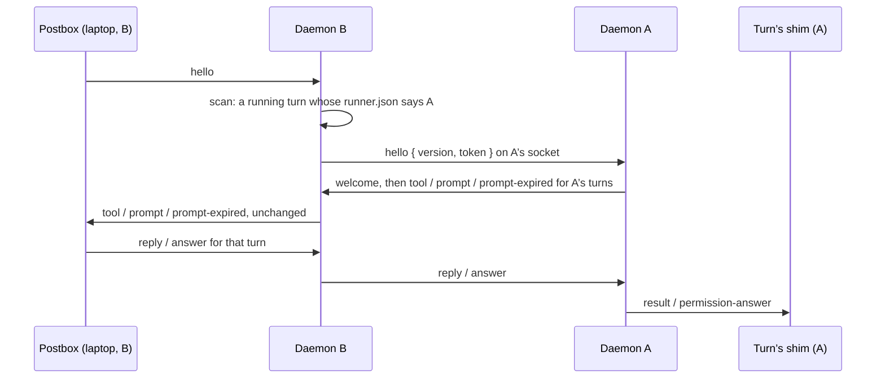

# Turns left under a host’s old Postbox (#759)

*Draft, revised after critic’s review, 21 November 2026. The person chose adoption: the new daemon takes over the old version’s turns, so their tool calls and prompts still reach the conversation.*

## The problem

A turn that started on a host under Postbox version A keeps running after version B is installed there (#464’s automatic install, or Install…). The laptop now talks only to B’s daemon. A’s daemon, which still holds the turn’s shim, has no Postbox attached, so for that turn:
- its Postbox tool calls are written to the turn folder’s `tools.jsonl` and never cross;
- its questions fail at once;
- its reads come from the snapshot;
- its permission prompts wait unanswered until `permissionWaitMax`, then are denied with no card.

## What an old version can’t do

Every fix has to work with versions already installed on hosts, which can’t be changed:
- **A’s shim talks only to A’s daemon.** Each version listens on its own socket, `~/.postbox-remote/<version>/daemon.sock`, and the shim reconnects only there.
- **A’s daemon stays up while its turns run.** Its idle exit waits until no turn is running.
- **What A’s daemon does share with B:** the host token (`~/.postbox-remote/token`), the turn folders (`~/.postbox-remote/turns/<turn>/`), and the Postbox-to-daemon protocol, as long as both have the same `PROTOCOL_VERSION`.

## The design: B relays A’s turns

B’s daemon connects to A’s daemon as Postbox would, and relays that turn’s tool calls, prompts and answers.

1. **When B relays.** After each hello from Postbox, B scans the turn folders, as it does today for the welcome. For each running turn whose `runner.json` names another version, B opens one relay connection per version to that version’s socket.
2. **The relay’s hello.** It’s Postbox’s own `hello { version: PROTOCOL_VERSION, token, instance }`, with the shared token and B’s own relay instance (`relay_` and random hex, the same for each of B’s relays, so a relay opened again replaces the one before it), and never `takeover`. The token proves the host account, not that B’s laptop owns A’s driver, so the relay never displaces a laptop still attached to A. A refuses it with `busy` while another Postbox drives it, and with `version` when its protocol differs. Either way B leaves A as it is and falls back to the notice below for those turns.
3. **Where B connects.** B reads the version from the turn’s `runner.json`, validated as start records are, derives A’s socket with `hostPaths(home, version)`, and connects only if that path is a Unix socket inside the account’s private `~/.postbox-remote/`. The token never goes into a log, an error or a forwarded frame.
4. **One relay per driver.** Each relay belongs to B’s current driver. It closes when that driver disconnects or is replaced, and the next driver’s hello opens it again. A relay connection is terminal: B never relays from a connection that is itself a relay, so two versions that both relay can’t loop through each other.
5. **Up, from A.** A sends `tool`, `prompt`, `prompt-expired` and its errors for A’s turns, and again after each hello, as it would to Postbox. B validates each frame, forwards only those broker types, and only for turns assigned to that relay. A call or prompt is (turn, id), and turn IDs are unique across versions, so Postbox applies each identity once, as it does now.
6. **Down, from Postbox.** B keeps a map from turn to relay. A `reply`, `answer`, `snapshot` or `snapshot-items` for a relayed turn is validated and goes to its relay, not to B’s own broker. Nothing else reaches A.
7. **A relay that drops mid-prompt.** A replays unanswered prompts at each hello, but sends an expiry only once. So if the relay or B’s laptop link drops while a prompt is open, Postbox can’t tell whether it expired. When a relayed turn’s relay ends after carrying anything, with prompts still open, Postbox marks their cards unavailable, with the interrupted notice below, rather than leaving them open. A card ended this way stays ended, as any ended card does: if the relay comes back and A sends one of its prompts again, A denies it at its own `permissionWaitMax`.
8. **What already works through B.** Reading a turn’s stream (`read`), its exit, and Stop use the shared turn folder and the runner’s own socket, so B serves them for A’s turns today. This design covers only what A’s broker holds.
9. **Ending.** A relay closes when A has no running turn left, or when A’s socket goes. B looks every 30 seconds whether a relayed turn has ended or been interrupted, so a relay ends even when Postbox doesn’t read that turn; a scan that can’t read the turn folders ends nothing. A then idles out on its own schedule.
10. **Fallback: the notice.** Postbox adds a line to the turn itself, in one of two wordings:
    - **Never relayed** (the protocol differs, A is busy with another Postbox, or its socket refuses): “This turn started under Postbox A on <host>. Its blocks, messages and questions after the update can’t reach this conversation.”
    - **Relay interrupted:** “Postbox lost its link to this turn’s older Postbox on <host>. A question or block it sent meanwhile may not have arrived.”

    That keeps the issue’s first “done when” for every case.
11. **B’s own broker leaves A’s turns alone.** At its start, B’s broker replays only its own turns’ records, so A’s queued calls and prompts reach Postbox only through A, and their answers can only go back there.
12. **Before the welcome.** B plans its relays before it welcomes Postbox, so the snapshot Postbox sends once welcomed goes to A. The relay holds Postbox’s lines until A welcomes it: A refuses a line it can’t read at once, with no turn, which would otherwise read as a refused hello. A broker frame A sends before its own welcome is relayed as any other.
13. **Settings.** The relay’s hello carries the driver’s `hello.settings`. An older daemon refuses a setting it doesn’t know as `bad-message`; the relay then says hello again without them, so A keeps its defaults, and sends A what Postbox sent meanwhile.
14. **A second laptop still on A** keeps it only while it stays connected. If its link drops, B’s next hello may take A’s free driver slot, and that laptop’s reconnect gets `busy`.
15. **A frame B can’t read.** A frame from A whose shape B no longer takes can’t reach Postbox, so B tells Postbox its turn’s relay is `lost`, once, rather than dropping it without a word.

## Security

- The relay holds no new secret. It uses the token every version on the host already reads from the same `0600` file, and connects only to sockets under `~/.postbox-remote/`, which only that user can write.
- Postbox gets nothing from A that it wouldn’t get with Postbox attached to A directly. Every message crosses unchanged, and goes through Postbox’s existing checks: the claim of a prompt by its stream (#353), and the shim’s key for a call’s result (#908).

## Tests

These follow the issue’s “done when”, deterministic, with two fake daemons of different versions on one fake host:
- A’s queued tool call and open prompt reach Postbox through B, and the answer reaches A’s shim.
- A’s tool call made after B connected reaches Postbox too.
- A daemon with another protocol version gives the turn its notice line, with nothing relayed.
- A Postbox restart while relaying doesn’t send a prompt twice or lose its answer.
- The relay drops with a prompt open: its card is marked unavailable, and the turn gets the interrupted notice.
- Two laptops: A stays connected to its own driver, the relay is refused as `busy`, and the turn gets the never-relayed notice.
- A frame for a turn not assigned to the relay, or of a type outside the broker’s, is dropped, and the token appears in no log.
- B’s own turns are unchanged.

## Scope

- **Backends:** this relays only the shim’s broker. Codex’s approval requests also go through A’s broker (`broker-codex.mjs`), so the same relay covers them. Kiro and Antigravity have no broker traffic of their own.
