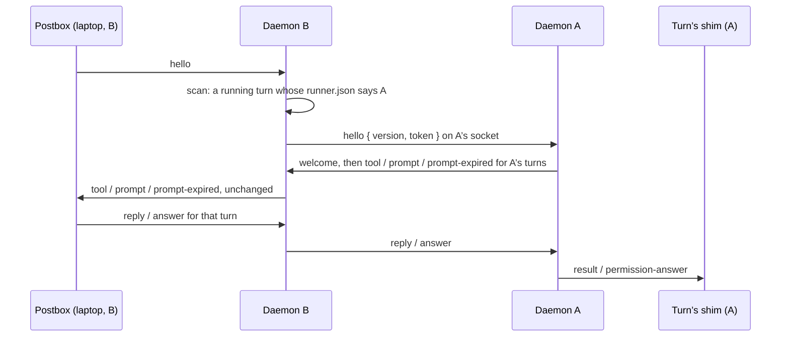

# Turns left under a host’s old Postbox (#759)

*Draft for review, 21 November 2026. The person chose adoption: the new daemon takes over the old version’s turns, so their tool calls and prompts still reach the conversation.*

## The problem

A turn that started on a host under Postbox version A keeps running after version B is installed there (#464’s automatic install, or Install…). The laptop now talks only to B’s daemon. A’s daemon, which still holds the turn’s shim, has no Postbox attached, so for that turn:
- its Postbox tool calls are written to the turn folder’s `tools.jsonl` and never cross;
- its questions fail at once;
- its reads come from the snapshot;
- its permission prompts wait unanswered until `permissionWaitMax`, then are denied with no card.

## What an old version can’t do

Every fix has to work with versions already installed on hosts, which can’t be changed:
- **A’s shim talks only to A’s daemon.** Each version listens on its own socket, `~/.postbox-remote/<version>/daemon.sock`, and the shim reconnects only there.
- **A’s daemon stays up while its turns run.** Its idle exit waits until no turn is running.
- **What A’s daemon does share with B:** the host token (`~/.postbox-remote/token`), the turn folders (`~/.postbox-remote/turns/<turn>/`), and the Postbox-to-daemon protocol, as long as both have the same `PROTOCOL_VERSION`.

## The design: B relays A’s turns

B’s daemon connects to A’s daemon as Postbox would, and relays that turn’s tool calls, prompts and answers.

1. **When B relays.** After each hello from Postbox, B scans the turn folders, as it does today for the welcome. For each running turn whose `runner.json` names another version, B opens one relay connection per version to that version’s socket.
2. **The relay’s hello.** It’s Postbox’s own `hello { version: PROTOCOL_VERSION, token }`, with the shared token and `takeover`, since A has no driver. A daemon whose protocol version differs refuses it with `version`. B then falls back to the notice below.
3. **Up, from A.** A sends `tool`, `prompt`, `prompt-expired` and its errors for A’s turns, and again after each hello, as it would to Postbox. B forwards each one to Postbox unchanged. A call or prompt is (turn, id), and turn IDs are unique across versions, so Postbox applies each identity once, as it does now.
4. **Down, from Postbox.** B keeps a map from turn to relay. A `reply`, `answer`, `snapshot` or `snapshot-items` for a relayed turn goes to its relay, not to B’s own broker.
5. **What already works through B.** Reading a turn’s stream (`read`), its exit, and Stop use the shared turn folder and the runner’s own socket, so B serves them for A’s turns today. This design covers only what A’s broker holds.
6. **Ending.** A relay closes when A has no running turn left, or when A’s socket goes. A then idles out on its own schedule.
7. **Fallback: the notice.** When B can’t relay, because the protocol differs, A’s socket refuses, or the token check fails, Postbox adds a line to that turn: “This turn started under Postbox A on <host>. Its blocks, messages and questions after the update didn’t reach the conversation.” That keeps the issue’s first “done when” for every case.

## Security

- The relay holds no new secret. It uses the token every version on the host already reads from the same `0600` file, and connects only to sockets under `~/.postbox-remote/`, which only that user can write.
- Postbox gets nothing from A that it wouldn’t get with Postbox attached to A directly. Every message crosses unchanged, and goes through Postbox’s existing checks: the claim of a prompt by its stream (#353), and the shim’s key for a call’s result (#908).

## Tests

These follow the issue’s “done when”, deterministic, with two fake daemons of different versions on one fake host:
- A’s queued tool call and open prompt reach Postbox through B, and the answer reaches A’s shim.
- A’s tool call made after B connected reaches Postbox too.
- A daemon with another protocol version gives the turn its notice line, with nothing relayed.
- A Postbox restart while relaying doesn’t send a prompt twice or lose its answer.
- B’s own turns are unchanged.

## Open questions for review

- **Takeover:** should B’s relay `hello` set `takeover`? A has no driver once the laptop has moved to B, but a second laptop could still be attached to A.
- **Backends:** this relays only the shim’s broker. Codex’s approval requests also go through A’s broker (`broker-codex.mjs`), so the same relay covers them. Kiro and Antigravity have no broker traffic of their own.
