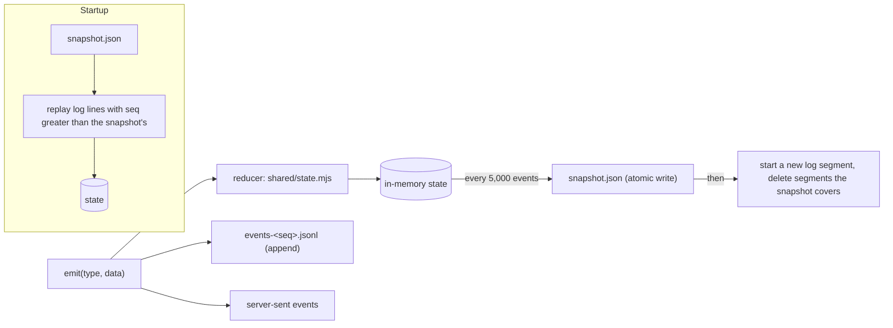
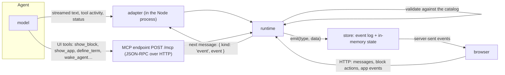
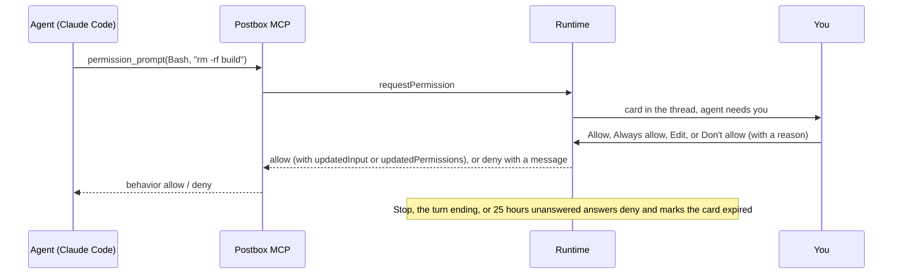
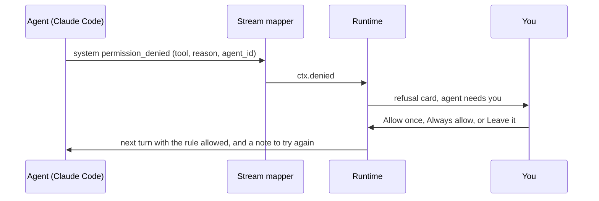
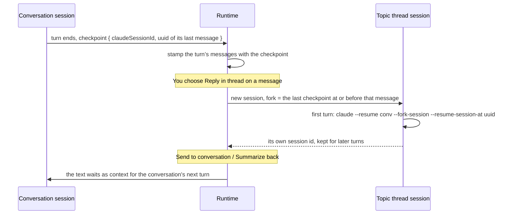
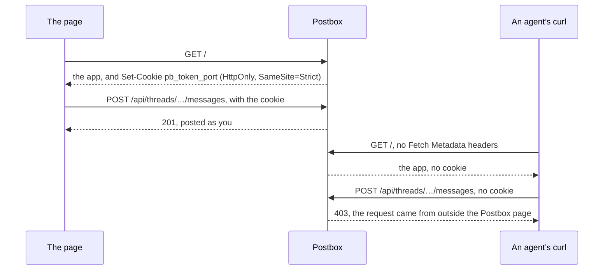
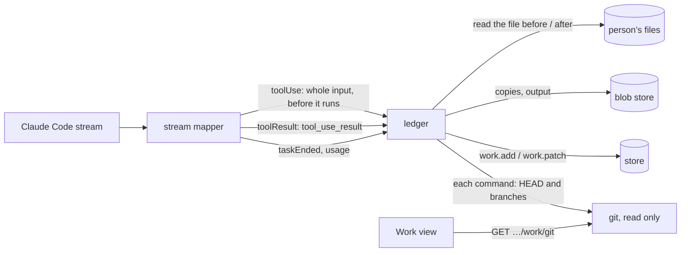
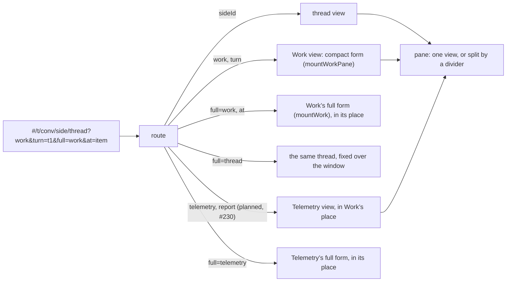
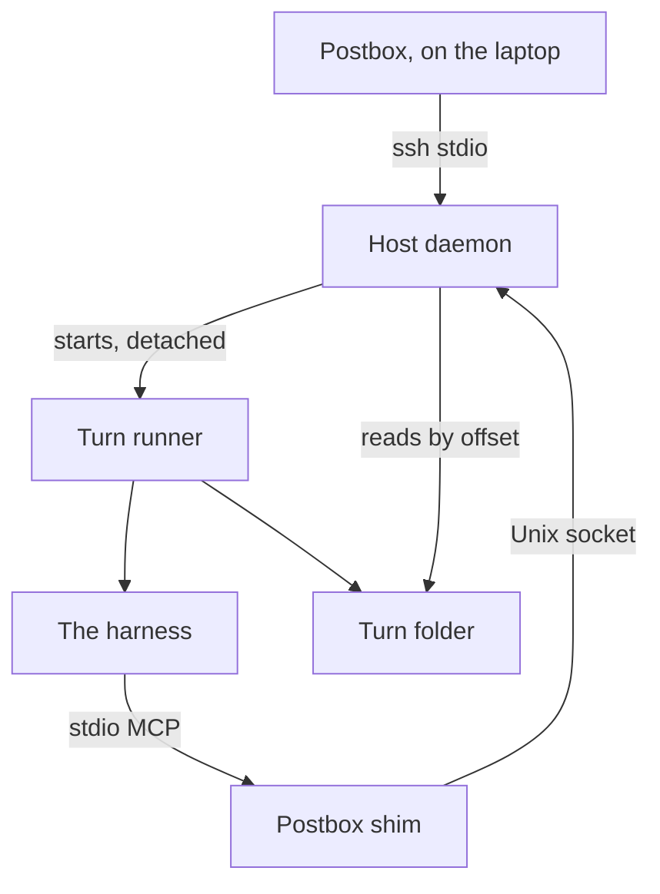
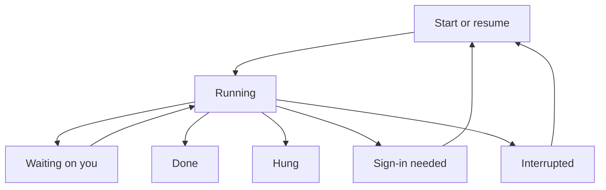

# Architecture decisions

Decided on 21 October 2026, after Stage 2. Each section states the decision, what it rests on, and what would make us revisit it. [intent.md](intent.md) records the product decisions; this file records the engineering ones.

## 1. The store: an event log with snapshots, not a database

**Decision.** Postbox keeps its data as an append-only event log in JSON Lines, plus periodic snapshots of the state, in its data folder. Every read comes from an in-memory projection of that log. Binary files go to a separate content-addressed blob store. All of this sits behind one small storage interface (`server/store.mjs`).

**What the design needs from a store**

| Need | Where it comes from |
|---|---|
| A numbered, append-only sequence of changes | Live updates over server-sent events must resume after a dropped connection with nothing lost or duplicated, so every change has a sequence number and clients ask for “everything after N”. |
| The current state, rebuilt from those changes | The browser and the server apply the same events with the same reducer (`shared/state.mjs`). The state is a projection, not a source of truth. |
| Durable across restarts | “The conversation survives a page reload: keep it in the app’s own store.” |
| Cheap writes during streaming | A reply streams as many small text events per second. |
| Binary attachments | Pasted images, uploads and files added to the corpus. |
| No schema to maintain, no relational queries | One person, one machine, one process. Every read is “all of it” at startup, then live events. |

**Options considered**

| Option | Fit | Why not now |
|---|---|---|
| One JSON file, rewritten whole (Stage 2) | Simple | Each write serializes the entire state. That’s fine at tens of kilobytes; after months of use it blocks the event loop on every streaming reply. |
| **Event log (JSONL) + snapshots** | Matches the event model exactly. Appends are cheap and crash-tolerant. No schema beyond the event types. No dependencies. | **Chosen.** |
| Redis (Streams + AOF) | Streams are a good log, and AOF is itself an append-only file | Adds a server to install and run, a network hop and a runtime dependency, for one user in one process. It earns its place only with several server processes or users. |
| SQLite (`node:sqlite`, built into Node 22) | Transactions and durability in one file, still schema-light: one events table and one snapshot table holding JSON | Still marked experimental in Node 22, and it prints a warning. It’s the first candidate if we need transactions across files or queries. |
| A document or relational database (Postgres and so on) | — | Schema and operations work with no payoff for this use case. |

**How it works**

- **Writes** are batched and appended in order. A crash can lose at most the last few milliseconds of events. A truncated last line is detected on startup and dropped.
- **Snapshots** are written to a temporary file and renamed, so a crash mid-write leaves the old snapshot intact. A new log segment starts after each snapshot, and segments the snapshot fully covers are deleted.
- **Schema.** Events carry plain JSON. If an event’s shape ever changes, the reducer upgrades old events as it reads them (an “upcaster”), so there are no migrations to run.
- **Stage 2 data** in `store.json` is read once as the first snapshot, then renamed `store.json.migrated`.

**Attachments.** Files are stored by the SHA-256 of their contents under `blobs/ab/cdef…`, so identical files are kept once and corruption is detectable. The log holds only metadata: `{ id, name, type, size, sha256 }`. Files are served with `X-Content-Type-Options: nosniff` and a `sandbox` content-security policy. Only PNG, JPEG, GIF and WebP images are shown inline; everything else downloads. Large content never enters the log, so snapshots stay small.

**Revisit when** Postbox runs as more than one server process, serves more than one person, or needs queries across history (for example, search). Then move the same interface onto SQLite or Redis Streams, or Postgres for many users.

## 2. How agent data reaches the store

**Decision.** Everything an agent does arrives through the runtime, which validates it and emits events. Nothing writes to the store directly.

- **Text and activity** stream through the adapter, which runs inside the Node process. For the Agent SDK it’s a library call; for Claude Code it’s the CLI’s streaming JSON output.
- **UI tools** go over MCP, whether the agent is in-process or a separate Claude Code process. They’re validated and return at once.
- **Your actions** come back as HTTP requests and reach the agent as its next message.

## 3. The front end: plain HTML, CSS and ES modules, no build

**Decision.** Keep the shipped app framework-free with no build step, and add type checking and linting as development-only tools, so the app itself still needs nothing but Node to run.

**Does it make Postbox faster for you?** At load, yes:
- **First load.** The app is about 180 KB of uncompressed JavaScript in ten modules plus one stylesheet. There’s no framework runtime, no hydration and nothing to download before the first paint, and a full reload of a long thread renders in well under a second locally.
- **While you use it.** The hot paths are re-rendering Markdown while a reply streams (batched once per frame) and big tables. Neither depends on a framework.
- **The costs are ours, not yours.** We hand-write list reconciliation (`syncList`) and event wiring, which is where Stage 2’s bugs were. There are no compile-time types. Contributors used to a framework need a moment to adjust.

**What we add to keep it fast**
- Serve static files with gzip and ETags instead of always revalidating in full. This is done in this change.
- Virtualize table rows above about 1,000.
- Keep every module small enough to read in one sitting.

**Revisit when** the UI gains shared editing or several people, or the hand-written reconciliation grows past what one file can hold. The first step then would be a small runtime library such as Preact with `htm`, which still needs no build step, rather than a full build pipeline.

## 4. Code quality: linters and checks

**Decision.** These run locally (`npm run check`) and in continuous integration on every pull request, except the two marked CI only, which are GitHub services. Every other tool is a development dependency, pinned in a lockfile and never shipped.

| Check | Tool | What it enforces |
|---|---|---|
| Lint and format | **Biome** (one dependency, no plugins) | Recommended correctness and suspicious-code rules, consistent formatting, no unused code, and a length limit on every file and function (“Module and function size”, below) |
| Types | **TypeScript in `checkJs` mode** with JSDoc types, `noEmit` | Shapes of events, blocks and store state checked without a build. It starts with `shared/` and `server/`, then the client. |
| Tests | `node:test` with `--experimental-test-coverage` | Pure modules (catalog, Markdown, events, BM25, store) stay above 90% line coverage |
| End to end | **Playwright Test** (`tests/browser/`), with **axe-core** in `tests/browser/demo-a11y.spec.mjs` | Every demo scene renders with no exceptions and no accessibility violations against WCAG 2.1 A and AA, at 1280 and 375 px in both themes |
| Contrast | `tools/contrast.mjs` | Every token pair meets WCAG 2.1 AA in both modes, on the app stage too |
| Design tokens | `tools/lint-tokens.mjs` | No raw colors outside the token blocks, in CSS or in JavaScript |
| Safe DOM | `tools/lint-dom.mjs` | `innerHTML` only where a `lint-allow dom:` comment names the source (the Markdown renderer or Postbox’s own templates); no attribute or style names chosen at run time; `target="_blank"` always with `noopener` |
| Security rules | `tools/lint-security.mjs` | Flags a regular expression built from anything but constants or `escapeRegExp()`; a one-pass tag strip outside `stripTags()`; a `JSON.stringify` splice in a browser check's page code, where `js()` belongs; a `===` or `!==` comparison of a name ending in “token”, where `sameToken()` belongs; and git run outside `runGit()` (SECURITY.md) |
| Copy | `tools/lint-copy.mjs` | American spelling and curly quotes in user-facing strings |
| Code scanning | **CodeQL**, GitHub’s default setup (CI only) | No pull request adds a high or critical security alert, or a CodeQL error: the `protect-main` ruleset requires its results |
| Dependencies | `actions/dependency-review-action` (CI only, `.github/workflows/dependency-review.yml`) | No pull request adds or changes a dependency, shipped or development, with a known vulnerability of moderate severity or worse |
| Prompt scan | `tools/prompt-surface.mjs` and **SkillSpector**, static rules (CI only, `prompt-surface-scan.yml`) | The rendered prompt diff is in the job summary for the reviewer, and a pull request that adds a high or critical SkillSpector finding fails it (“Prompt changes are reviewed as rendered text”, below) |

**Conventions**
- An `.editorconfig` sets 2-space indentation, LF line endings and UTF-8.
- Commits are small, with sentence-case subjects.
- Every user-facing string follows the writing rules in [intent.md](intent.md).
- No runtime dependencies without a decision recorded here.

**Exceptions.** A deliberate exception to a project rule carries `lint-allow <rule>: <reason>` on its line or the line above, and a whole file can opt out of one rule with `lint-allow-file <rule>: <reason>` near its top. A reason is required, so every exception says why.

**Where it stands (Stage 3).** Everything in the table runs, locally and in CI:
- TypeScript runs in strict mode over `shared/` and `server/`; the client comes next.
- axe-core found 92 violations on its first run, all fixed: radios that said pressed instead of checked, labels on elements with no role, a button whose name didn’t match its text, and dim text on the review highlight in dark mode. The contrast tool now checks translucent tokens too, which is how the last one was missed.
- Coverage is 89% of lines overall. Of the pure modules, `state.mjs` (88%) is still below the 90% target.

**Revisit when** a tool becomes a bottleneck. Biome and TypeScript are the only tools here that a contributor has to install.

## 5. Real agents: two adapters over one stream

**Decision.** Real agents run on Claude Code, in two ways that share everything but the transport:
- **Claude Code backend:** one `claude -p` process per turn, with stream-json in and out, resuming the thread’s Claude Code session.
- **Agent SDK backend:** `query()` in Postbox’s process.

The SDK streams the same messages as the CLI, so one mapper ([`server/adapters/claude-stream.mjs`](../server/adapters/claude-stream.mjs)) turns either into the turn context: text, activity, ring state, context use, subagents, compactions and refusals.

Both backends ask for summarized thinking (`--thinking-display summarized`) and subagents’ own messages (`--forward-subagent-text`). Without them, thinking arrives empty and subagents are a single line. With them:
- While an agent thinks or calls tools, a working row at the end of the conversation shows a glimpse of its thinking.
- Each thought is a step in the activity list.
- Every subagent tool call is a step, under the subagent’s name. One guide ([`server/adapters/guide.mjs`](../server/adapters/guide.mjs)) is the system prompt both append, and it teaches the catalog, the kit and the [recipes](recipes.md). It starts from what a reply contains, not from what the person asked for ([#63](https://github.com/HJeon139/postbox/issues/63)): options become a choice, questions a form, a draft to approve a review block, and a long job a progress block, with one example each. Agents follow defaults more than prose, so it stays short, and a test keeps it under 9,000 characters. Before it, the room says who else is in the conversation and what each does (their persona’s description), and how to share the work: take your own part, hand work on with what the next agent needs, and read what the others did before redoing it. That comes from the room, not from a persona’s prompt, so any team the person puts together works this way, and an agent alone gets none of it. Two agents on one task did it twice from different decisions ([#121](https://github.com/HJeon139/postbox/issues/121)), and agent teams with explicit handoffs do better than role names alone ([MetaGPT, arXiv 2308.00352](https://arxiv.org/abs/2308.00352)). The seeded personas’ prompts ([`server/personas/`](../server/personas/)) hold only what changes an agent’s behavior beyond its backend’s own defaults, stated as what to do and why, since adherence falls as instructions pile up ([IFScale, arXiv 2507.11538](https://arxiv.org/abs/2507.11538)).

**What it rests on**
- **No credentials in Postbox.** Both backends use Claude Code’s own sign-in. Postbox never sees a key, so there’s nothing to store, rotate or leak.
- **Recorded, not guessed.** The stream shapes were taken from real turns (claude 2.1.296, `claude-opus-5-5`) and kept as test fixtures, with local paths removed. The SDK options follow its shipped type definitions.
- **A process per turn is simple and robust.** A crash affects one turn; Stop is a signal; nothing leaks between turns. The cost is a second or two to resume. A long-lived process per session, with stream-json input, is the upgrade if that matters.
- **One set of limits** ([#50](https://github.com/HJeon139/postbox/issues/50)). The limits an agent can reach (an app event’s 64 KB, an app’s size, each block’s counts and text lengths) live in one module, [`shared/limits.mjs`](../shared/limits.mjs). The catalog, the event builder and the app kit enforce them from it, and the guide and the MCP tool descriptions are written from it, so an agent is told the number Postbox enforces. A test fails when a limit isn’t in the guide. `postbox.send` over the event limit rejects inside the app, naming the limit, before anything is posted. The chart palettes live there too ([#52](https://github.com/HJeon139/postbox/issues/52)), each with when to use it: `--s1`…`--s8` for categories, `--seq-*` for magnitude, `--div-*` for polarity, and `--good` and `--alert` for status only. A test fails when one isn’t defined in `app/workbench.css`.
- **Postbox’s tools load up front** (`alwaysLoad` on the MCP server), so the agent doesn’t spend a step searching for them.
- **Your own setup, with a few overrides** ([#57](https://github.com/HJeon139/postbox/issues/57)). Everything that shapes a turn is passed explicitly, in one place ([`server/adapters/setup.mjs`](../server/adapters/setup.mjs)):
  - **Setting sources:** `--setting-sources user,project,local` (the SDK’s `settingSources`), so an agent has the same skills, slash commands, plugins and permission rules as your terminal. A persona set to Isolated (“Uses your Claude Code setup” off) gets `project,local`: the project’s settings, and the local file where Always allow saves its rules.
  - **Output style:** `--settings '{"outputStyle":"default"}'` (the SDK’s `settings`). The flag layer sits above your user, project and local files, so a style such as Concise can’t fight the agent guide. A real turn confirmed it: with Concise in the folder’s local settings, `init.output_style` read `default`.
  - **Publishing tools:** `--disallowedTools` (the SDK’s `disallowedTools`) removes tools that publish outside Postbox, unless the persona “Can publish outside Postbox”. In a UAT run an agent published its result as a claude.ai artifact, so the work left the conversation. The list is the built-in Artifact, ArtifactComments, ArtifactData and PushNotification, plus connector tools matched by verb (deny rules take globs in the tool name). Outward verbs such as `mcp__*__send_*` match any server; `create` and `upload` match only claude.ai connectors (`mcp__claude_ai_*__create_*`), so a local server’s `create_directory` or `git_create_branch` stays usable: never denied, though it asks first as a write (below). It was built from a real `init` event’s `tools`, and a second real turn confirmed Claude Code removed exactly those. Read-only connector tools stay, and no rule may match Postbox’s own tools, since deny beats allow. A real turn with your connectors and plugin servers loading confirmed it again ([#59](https://github.com/HJeon139/postbox/issues/59)).
  - **Writes outside Postbox:** every mode but Run everything adds ask rules (`permissions.ask` in the settings overlay, `WRITE_TOOLS`) for tools named for writing (`create`, `update`, `write`, `delete` and the rest, at `_` or `-` and in camelCase) and for `gh` commands that file or change issues, pull requests and releases. Claude Code then asks Postbox before each, and the permission card shows the call’s draft as Markdown before anything exists outside. Ask beats allow, so Postbox lets a call through itself when the person settled it: an allow rule that names that tool (what Always allow on the card saves; a whole server allowed for its reads doesn’t count), or a publishing tool for a persona that may publish ([`server/write-guard.mjs`](../server/write-guard.mjs), [#112](https://github.com/HJeon139/postbox/issues/112)). A command is read part by part, as for a chained command (below): a `gh` write in a command substitution or after a heredoc counts, one in a heredoc’s body is data unless a shell is on its line (`bash <<EOF`, `cat <<EOF | bash`), and the command passes only when each of its writes is settled. Where the reading can’t be sure, such as after a quote that never ends, the rest counts as commands too. No rule may match Postbox’s own tools.
    - **Local servers ask too.** A local server can write to a remote service (a doc tool’s server runs on this computer), and Postbox can’t tell which, so the rules don’t skip them. The cost: local write tools, such as a filesystem server’s `write_file`, a git server’s `git_create_branch` or a memory server’s `add_observations`, show one card each until the person presses Always allow on that tool. The user chose this over leaving local servers out (23 October 2026).
  - **Your MCP servers** ([#59](https://github.com/HJeon139/postbox/issues/59)): they load as in your terminal, claude.ai connectors and plugin servers included. Postbox adds its own with `--mcp-config` (the SDK’s `mcpServers`), always named `postbox`. An Isolated persona gets `--strict-mcp-config` (`strictMcpConfig`), so only Postbox’s loads. A persona can turn any of yours off: they go in the settings overlay’s `deniedMcpServers`, the denylist Claude Code merges from every source. A real turn confirmed a turned-off server leaves the `init`’s `mcp_servers`, with its tools. The persona sheet lists the servers found in your config (user, project and local scopes, names only) and the ones the last `init` reported, with that init’s status.
  - **The Tools checklist** ([#5](https://github.com/HJeon139/postbox/issues/5)): an unticked tool is a deny rule in `--disallowedTools` (`disallowedTools`): `shell` denies Bash and Monitor, `web.fetch` denies WebFetch, WebSearch and Monitor. A ticked tool is not an allow rule: `--allowedTools Bash` would skip the permission mode’s ask for every command, so ticked only means “not denied”, and the mode still decides. The map lives in `setup.mjs` (`TOOL_RULES`), taken from a real `init`’s `tools`.
  - **Agents outside Postbox:** SendMessage, ListAgents, RemoteTrigger, CronCreate, CronDelete, CronList, ScheduleWakeup and Workflow are denied unless the persona has `agents.outside` (“Message, schedule or start agents outside Postbox”). They bypass the wake cap and the record of who woke whom; `schedule_wake` and `wake_agent` are Postbox’s way. Personas from before the id existed don’t have it, so they’re denied. Monitor is a command (the Tools above decide it), and EnterWorktree stays: it works in a git worktree of the agent’s own folder, which the permission mode governs.
  - **Model and effort** ([#60](https://github.com/HJeon139/postbox/issues/60)): both are always passed (`--model` and `--effort`, the SDK’s `model` and `effort`), so your own `effortLevel` doesn’t decide them. A persona’s effort is one of low, medium, high, xhigh and max, and defaults to medium, which is what Claude Code uses for `claude-opus-5-5` when none is given (a real turn printed it from `CLAUDE_EFFORT`). Like the model, it’s fixed in a session’s snapshot. The stream reports the model in `init` and in each assistant message, but not the effort, so a session keeps the model that answered its last turn (`lastModel`) and the effort Postbox started it with (`lastEffort`).
  - **Your global CLAUDE.md reaches agents by choice.** A session’s persona snapshot records these settings; like the permission mode, they follow the persona from the next turn, and so do its tools.

**Revisit when** the start-up delay matters more than isolation, or another model provider needs an adapter (the mapper is Claude-specific; the turn context isn’t).

## 6. Permissions: a card in the thread, and an explicit mode

**Decision.** Each persona has a permission mode: auto (the default), ask, accept edits, or run everything. In auto mode, Claude Code’s classifier approves routine actions and sends what it can’t decide to the same place ask mode does: a card in the thread that shows the exact command, while the call waits for your answer:
- **Claude Code:** through `--permission-prompt-tool`, an MCP tool that doesn’t return until you answer, for up to 25 hours (`POSTBOX_TIMEOUT_MS`, [#217](https://github.com/HJeon139/postbox/issues/217)). That’s the timeout Postbox gives its MCP server, so Claude Code waits that long for the call. The card expires a minute sooner (`CARD_WAIT_MS`, [`server/permission-cards.mjs`](../server/permission-cards.mjs)), saying how long it waited ([#220](https://github.com/HJeon139/postbox/issues/220)): Claude Code’s clock starts when it sends the call and the card’s only when the call arrives, so with the same length the card could still take an answer after Claude Code had stopped waiting for it. The other real backends (the Agent SDK, Kiro, Codex, Antigravity) declare `capabilities.promptTool: false`: they aren’t offered the tool, and a call to it is refused at once. The backend is the one the turn started on, so a persona moved mid-turn doesn’t cut off the running CLI’s prompts.
- **Agent SDK:** through `canUseTool`. Its card expires at the same time, though the SDK sets no limit of its own.

**What it rests on**
- **The mode is always passed.** Left out, Claude Code would take `permissions.defaultMode` from your own settings, or `auto`, and an agent you set to ask could stop asking.
- **Every permission tool call is a blocking call, and the only one.** All other Postbox tools return at once. A blocked call must always end, so Stop, the end of a turn and the card’s wait (`CARD_WAIT_MS`, a minute short of `POSTBOX_TIMEOUT_MS`) release it with a no.
- **Agents start in their project’s root folder**, as [intent.md](intent.md) decides, unless the persona names another. Permission mode is what protects that folder. The first live test showed why it matters: the sample project’s folder is the bundled books, and a command the test allowed wrote a file there (since removed).
- **The card is Postbox’s, not a catalog block.** Your answer goes to the waiting tool call, not to the agent as a message.

**Refusals.** Claude Code also refuses calls without asking anyone: auto mode’s classifier, a deny rule, the mode, or a background subagent that can’t ask. It reports each refusal as a `permission_denied` event (with `agent_id` when a subagent was refused), and lists them all in the result’s `permission_denials`. Postbox turns each into a refusal card ([#65](https://github.com/HJeon139/postbox/issues/65)):
- **Allow once and retry:** the exact call (`Bash(rm copy.txt)`) is passed with `--allowedTools`, or the SDK’s `allowedTools`, for the next turn only. The agent is told to try it again exactly as before. A rule that matches a call settles it before auto mode’s classifier runs ([permission modes](https://code.claude.com/docs/en/permission-modes), “How the classifier evaluates actions”; narrow rules such as `Bash(npm test)` stay in effect in auto mode), so this answers most of the classifier’s refusals too. Not all: the same page lists writes to protected paths, critical-path removals and commands with per-command allowed domains as going to the classifier anyway, and `autoMode.classifyAllShell` in your own settings sends every shell command there ([auto mode config](https://code.claude.com/docs/en/auto-mode-config)). Postbox doesn’t detect those yet, so the card still offers Allow once for them.
- **A chained command gets neither** Allow once nor Always allow ([#238](https://github.com/HJeon139/postbox/issues/238)). Claude Code matches each part of `a && b`, `a | b`, `a; b` or `a &` against the rules on its own ([permissions](https://code.claude.com/docs/en/permissions), “Compound commands”), so a rule for the whole line never matches it. Postbox takes a command substitution as a part too, since the same section says deny and ask rules find a command there. A heredoc is read as the shell reads it ([`shared/command-chains.mjs`](../shared/command-chains.mjs)): its word after quote removal ends the body, which isn’t a part, unless the word is unquoted and the body holds a command substitution, which runs, or a shell on its line runs the body. So are a comment (a quote in it opens nothing), `$''` and a process substitution `<( )`, which runs a command as `$( )` does. The card says so, and suggests asking the agent to run the parts as separate commands. A permission card from the CLI’s prompt tool offers no Always allow for one, for the same reason; the Agent SDK’s own suggestions, which are per part, still go to Always allow. The CLI’s own “don’t ask again” saves a rule per part instead; Postbox doesn’t, since rules for the parts of `echo … | base64 -d | bash` would allow every other line made of them.
- **Always allow:** a broader rule (`Bash(rm:*)`, `WebFetch(domain:example.com)`, built in [`server/permission-rules.mjs`](../server/permission-rules.mjs)) goes into `.claude/settings.local.json` in the agent’s folder. That’s where the CLI saves “don’t ask again”, so the terminal and Postbox share it.
- **Leave it:** keeps the refusal.

- **A call you declined isn’t a refusal.** The result’s list includes calls you said no to on a permission card. The prompt tool passes the call’s `tool_use_id`, the card keeps it, and the runtime skips those.
- **A deny rule still wins.** Claude Code checks deny before allow, so Always allow can’t override your own deny rules, and the card says so.

**Answers on a permission card** ([#66](https://github.com/HJeon139/postbox/issues/66), [#10](https://github.com/HJeon139/postbox/issues/10)). The waiting call gets one of four answers:
- **Allow:** `{ behavior: "allow", updatedInput }`, as asked.
- **Always allow:** allow, and keep allowing calls like it. The card says the rule and where it’s saved before you click.
  - The Agent SDK passes Claude Code’s own suggestions (`canUseTool`’s `suggestions`), and they go back as `updatedPermissions`. Rules go to the folder’s local settings: one suggested for the session only would end with the turn, since each Postbox turn is a new session, and one for the project’s shared settings belongs to the person’s team. The card says when it moved one. A mode is offered only for the rest of the turn, never saved as a default. When the SDK sends no suggestions, or says a saved rule would grant more than the call (`suppressAlwaysAllowRule`), there’s no Always allow.
  - The CLI’s prompt tool gets no suggestions and no agent id: a real turn recorded only `tool_name`, `input` and `tool_use_id`, for the agent’s call and for a subagent’s ([`permission-prompts.json`](../tests/fixtures/claude-code/permission-prompts.json)). So Postbox makes the rule as it does for a refusal ([`server/permission-rules.mjs`](../server/permission-rules.mjs)) and saves it in `.claude/settings.local.json` itself. A rule too long to keep (a command with a heredoc only ever gets its exact text) isn’t offered.
- **Edit:** allow with the input you changed, as `updatedInput`: the command for Bash, with the call’s other fields kept, else the input’s JSON, which has to parse. An input too large to keep on the card (16,000 characters) can’t be edited, only allowed as it is. The recorded turn ran the edited command.
- **Don’t allow:** `{ behavior: "deny", message }`, with your reason in the message, when you give one.

A subagent’s prompt names the subagent. The SDK passes its id (`agentID`, the task’s id, as a refusal’s `agent_id`); the CLI passes only the call’s id, but the subagent’s `tool_use` streams before its prompt arrives, so the stream mapper already knows who made the call.

**The permissions panel** shows one agent in one conversation: its mode, its rules, its folders and its MCP servers. It’s reached from the conversation’s ⋯ and the persona editor.
- **Rules** come from where Claude Code reads them, each with its source: the person’s user settings (only when the persona loads their setup), the project’s shared `.claude/settings.json` (shown, never written), the folder’s `.claude/settings.local.json`, this conversation, and the persona’s Tools (#5) as deny rules. So a rule made in the panel shows in the CLI’s `/permissions`, and the reverse.
- **Saving:** in the folder’s local settings by default, as the CLI saves “don’t ask again”; or for this conversation only, kept on the session and passed with every turn (allow as `--allowedTools`, deny as `--disallowedTools`, ask in the `--settings` overlay’s `permissions.ask`); or in the person’s user settings. Changes to one file run one at a time, and each is written atomically, beside the real file: a settings file that’s a link stays a link. One that isn’t valid JSON is named and left alone. User settings follow `CLAUDE_CONFIG_DIR`, as Claude Code’s do.
- **Folders** added for a conversation go to `--add-dir` (the SDK’s `additionalDirectories`) from the next turn.
- **The mode** is the persona’s, so it reaches running conversations from their next turn, as [intent.md](intent.md) says. On an Agent SDK turn that’s running, Postbox also tries the query’s `setPermissionMode`; the SDK documents it for streaming input only, and Postbox sends one prompt string, so the panel says whether it applied now.
- **Which rule decides** a typed call is answered in Claude Code’s order: deny, then ask, then allow, then the mode, with the rule forms Claude Code documents ([`shared/permission-match.mjs`](../shared/permission-match.mjs)). The panel says Claude Code has the final say: hooks, managed settings and its own checks aren’t modeled.

**Revisit when** the CLI’s prompt tool passes `permission_suggestions` (then the CLI’s cards can use them too), or Postbox runs SDK turns with streaming input, so the mode and rules can change during a turn.

## 7. Attached sessions: resume and mirror

**Decision.** A Claude Code session started in a terminal can join Postbox as an agent:
- **Writing to it:** Postbox resumes that session in its own folder.
- **Watching it:** Postbox follows its transcript in `~/.claude/projects/` and mirrors turns typed in the terminal, marked “from terminal”.
- **No duplicates:** lines written while a Postbox turn runs are that turn, already in the thread, so they’re skipped, and the tail jumps to the end when the turn finishes.

**What it rests on.** The transcript is the only shared record, and it records who started each turn (`turnOrigin`: human or sdk). Reading it needs no cooperation from the terminal.

**Revisit when** two writers become a problem in practice. Postbox can’t tell that a terminal turn is still running, so it relies on you to let it finish.

## 8. Narration: a local voice in its own process

**Decision.** Agent apps read aloud with Kokoro, through `kokoro-js`, in a child process that starts on first use and stops after five idle minutes.
- **Audio:** each clip is stored once in the blob store, under its SHA-256, and reused for the same text and voice.
- **Delivery:** the app gets the audio over the postMessage bridge and plays it from a `blob:` URL, the one media source the sandbox allows.
- **Pace:** the kit synthesizes on Play, one passage at a time, so the pre-display check makes no audio.

**What it rests on**
- **Local and free.** No audio leaves the computer, and there’s no account.
- **Isolation.** Kokoro brings native packages with open advisories (`sharp`, `onnxruntime-node`). In a child process, they never run inside the server that holds your conversations.
- **It degrades to text.** The transcript is always on screen; without the voice, the player says so and the walkthrough still reads.

**Revisit when** word-level timing matters (Kokoro gives none, so the transcript follows by passage), or a better local voice appears.

## 9. Topic threads: forked sessions at checkpoints

**Decision.** A topic thread is a thread of kind `topic` whose `parentId` is its conversation and whose `rootItemId` is the message it started from. Each agent in it runs a new session that forks the conversation’s session at that message.

**What it rests on**
- **Checkpoints, not copies.** Every adapter reports where its turn ended in its own transcript (`ctx.checkpoint`): Claude Code and the Agent SDK give the last assistant message’s uuid, and the mock gives its session. The runtime stamps each message of the turn with it, so any message knows its fork point. Postbox never copies or edits a transcript.
- **Verified live.** A session told “apple”, then “banana”, then forked at the first reply, remembered only “apple”, under a new session id. The original still remembered both. The CLI’s `--resume-session-at` is undocumented in `--help`; the Agent SDK documents it as `resumeSessionAt` with `forkSession`.
- **Your message as the root.** For a message you wrote, the fork point is the agent’s last finished turn before it, and the message itself opens the thread as context. An agent that joined the conversation after the root starts fresh; replies from before checkpoints were kept fall back to the session’s latest point.
- **A branch point that’s gone falls back to the latest point, once** ([#61](https://github.com/HJeon139/postbox/issues/61)). When the checkpoint’s message is no longer on the conversation’s chain, Claude Code fails the fork with `No message found with message.uuid of: …` (in `result.errors`). Both adapters then save the fork without its uuid, so no later turn goes back to it. They run the turn again from the conversation’s latest message, with a note to the agent that it couldn’t start where it branched. Nothing from the failed run is kept: no session id, no checkpoint. Every failed turn shows Claude Code’s own reasons, bounded, rather than only “hit an error”.
- **Bringing things back costs no turn.** Shared text is queued as context on each of the conversation’s sessions and prepended to the next message they get, so the main agent reads it when it next works rather than being woken by it.
- **No nesting.** A topic thread can’t start another one, as in Slack; a reply that deserves its own branch can be sent to the conversation and branched from there.

**Revisit when** the Claude Code CLI documents or drops `--resume-session-at`. The Agent SDK path documents it and could take over the Claude Code backend’s forks.

## 10. Sandboxed pages that load nothing

**Decision.** An agent app or diagram page is sandboxed by its response header, `Content-Security-Policy: sandbox allow-scripts; …`, not by the iframe’s `sandbox` attribute. It is self-contained:
- **Inline:** the kit, the stylesheet and the diagram script are inlined into the page when it’s served.
- **Libraries:** D3, KaTeX and Mermaid reach it as text over the postMessage bridge, and run as inline scripts. KaTeX’s fonts travel inside its stylesheet as `data:` URLs.
- **Policy:** it allows inline code, `data:` images and fonts, and `blob:` audio, and nothing that loads from a URL.

**What it rests on**
- **Measured in the browser people use.** The Claude desktop app’s browser pane refuses to load any frame that has the `sandbox` attribute (`ERR_BLOCKED_BY_CLIENT`). It also blocks every request a sandboxed, opaque-origin page makes, while letting its inline scripts run. Headless Chrome allowed all of it, which is why the end-to-end runs passed while apps and diagrams stayed blank in the pane.
- **The same isolation.** The header sandbox gives the page an opaque origin, exactly as the attribute does. The host’s bridge only answers frames whose origin is `null`: if a page ever arrived without the header, it would be same-origin, and the bridge would shut it instead of serving it. A test checks that every sandbox page carries the policy.
- **Sturdier everywhere.** A page that needs no requests can’t be broken by an extension, a proxy or a slow network.

**Revisit when** apps need large assets of their own. Then serve them from a separate origin rather than relaxing the policy.

## 11. Diagram legibility: estimate, then measure

**Decision.** Two checks find Mermaid diagrams too small to read, and both reach the agent as a `lint` message that says what to change. Each diagram is reported once.
- **The estimate** ([`shared/diagram-lint.mjs`](../shared/diagram-lint.mjs)) runs on each finished reply. It reads the Mermaid source well enough to estimate the layout’s width, and from that the size its text ends up at in the 728 px column. It also flags too many boxes, one row of many boxes, and long sequences.
- **The measurement** happens in the browser after a diagram renders: its text size is 13 px × the scale it was drawn at. Anything under 10 px at the conversation’s width is reported to the server, unless the estimate already caught it.

**What it rests on**
- **It’s the symptom people see.** A wide diagram doesn’t fail; it shrinks. Text size is the measure that matches what a reader experiences, so both checks use it.
- **Fitted, not guessed.** The estimate’s layout constants (8.5 px per character, about 56 px of padding per box, the gaps between sequence participants) were fitted to diagrams rendered in Chrome. They agree to within about half a pixel, and the measured values are a test.
- **Prevention first.** The agent guide asks for about five boxes side by side, top-to-bottom chains, short labels and lists as text, so most diagrams never trip either check.
- **No loops.** A reply to a lint message isn’t linted again by either check.
- **One pipeline for every check.** Each check returns problems, `{ code, message, scope }` ([`server/checks.mjs`](../server/checks.mjs)). The runtime gathers the problems one agent turn caused into one lint turn: the server’s checks run when the turn ends, and what the browser reports (a diagram measured or failing to draw, the app check’s warnings) joins them within a moment of rendering. A turn gets at most one lint turn, and a lint turn that only calls tools, such as `define_term`, shows as a one-line note rather than a reply.
- **A reply that should have been a block** ([#63](https://github.com/HJeon139/postbox/issues/63)). Agents drift back to prose over a long session, so every reply is checked for how it ends: options in a list with a question or “pick one”, three or more questions, a draft of 40 lines or more that asks for sign-off, or a Markdown table of ten rows or more. A turn that showed the matching block, or followed a request for Markdown or prose, isn’t flagged. Each finding costs a lint turn, so the check is conservative; its lint turn asks for the block and needs no reply.

**Revisit when** another diagram type becomes common (class, state and ER diagrams only get the count check), or Postbox’s column width or diagram font size changes; then re-measure and refit.

## 12. A conversation is shared memory

**Decision.** Every agent in a conversation can read all of it.
- **A marker per session:** each session records the last item it was given (`seenItem`).
- **Catch-up:** each delivery starts with the items after that marker, written as plain lines (“You: …”, “@indexer: …”, “@critic showed a review block …”), leaving out the agent’s own messages and the message being delivered.
- **Caps:** at most 40 items or about 16,000 characters, saying how many earlier ones were left out.
- **Joining:** a new session starts with no marker, so an agent that joins a room gets its recent history.
- **Further back:** `read_conversation` returns older history on request.
- **Long items** ([#109](https://github.com/HJeon139/postbox/issues/109)): the catch-up and `read_conversation` cut each item at 2,000 characters, and a cut says how much it kept and gives the item’s id, such as “… (2,000 of 5,412 characters; read_message { id: "it_4kQ2xY9a" } has the rest)”. `read_message` returns that one item in full, 40,000 characters at a time, so a history stays small and a reviewer can still read every word.
- **Blocks** ([#153](https://github.com/HJeon139/postbox/issues/153)): a block’s line carries what it holds, so an agent asked to review another’s draft can read it. A review, card or code block gives its content, with a review’s comment threads; a choice or form its prompt and its options or fields; a table, progress or image block its fallback; and an answered block your answer. An app is its title alone. The line is cut like any other item, and `read_message` takes the item’s id or the block’s.
- **Commands you ran** with `!` ([#67](https://github.com/HJeon139/postbox/issues/67)) are items like any other: each agent reads the command, where it ran, how it ended and the last 4,000 characters of its output, on its next turn. Running one wakes nobody, as Claude Code’s bash mode only adds to the context.
- **A skill or command** an agent runs from the / menu is the whole prompt, since Claude Code runs `/name args` only at the start of one. Its catch-up waits for the agent’s next turn.

**What it rests on.** Issue #1: in a room, an agent woken by an @-mention saw only that message, and answered confidently about a discussion it had never seen. The catch-up costs nothing when nothing was missed, as in a direct message where the agent is woken by every message; it replaces the separate path shares from topic threads used to take.

**Revisit when** rooms get long enough that 40 items is too little. Then summarize older stretches instead of dropping them.

## 13. Writes need the page’s token

**Decision** ([#74](https://github.com/HJeon139/postbox/issues/74)). Every write to Postbox’s API (any method but GET and HEAD) needs a secret that the page you opened holds. Writes without it get 403, with a message saying why.
- **The secret:** 32 random bytes, made each time the server starts.
- **How the page gets it:** in a cookie set when a browser loads `/`, named for the port (`pb_token_<port>`), with `HttpOnly`, `SameSite=Strict` and `Path=/`. The browser sends it with the page’s own requests, so the page’s code never handles it.
- **Only a browser gets it:** the cookie comes only with a request that carries a browser’s Fetch Metadata: a navigation (`Sec-Fetch-Mode: navigate`), or `Sec-Fetch-Site` of `same-origin` (the page’s own fetch of `/`, its refresh after a restart) or `none`. A request without them, such as a plain `curl /`, gets the page and no cookie.
- **The check:** a constant-time comparison, before any route runs.
- **Agents keep their own way in:** `/mcp`, which carries the agent’s session and its turn’s token. Since #54, a tool call needs the token of the session’s running turn, which only the backend process Postbox started for that turn has; a call with only the session id is refused.

**What it protects against.** An agent that uses Postbox’s own API casually, or on generic instructions, to speak as you: one `curl` used to post a message as you, with no click, no card and no “Sent from” line, and the other agents in a room acted on it as your instruction. Now that `curl` gets 403, and so does one that loads `/` first. Another website can’t do it either: the browser doesn’t send a `SameSite=Strict` cookie with another site’s requests. A page on another port of this computer is the same site, so the browser does send the cookie with its requests; the `Origin` check is what refuses those. Apps can’t reach it: their frames have an opaque origin and no network.

**What it doesn’t.** A process running as you that sets out to get in still can: it can forge a browser’s headers when it loads `/` and keep the cookie, or read the data folder. That includes an agent whose instructions, from you or from a page it read, tell it exactly how. Postbox runs on your computer as you, so anything else running as you is out of its reach. The token makes the casual path fail; it isn’t a boundary against a determined process.

**What it costs.** A restart makes a new token, so an open page’s next write is refused once; the page then loads `/` again, gets the new cookie, and retries. Tools that write from Node (`tools/demo.mjs`, the checks) are the person’s own, so they load `/` with a navigation’s headers, as a browser does.

**`!` commands** ([#67](https://github.com/HJeon139/postbox/issues/67)) run as you, through your shell, in the conversation’s folder, so they need more than the token, which a determined process can get (above): the route also refuses unless Postbox listens on 127.0.0.1 and the request came from this computer. Each runs in its own process group, so Postbox stops them all when it shuts down (SIGINT, then SIGKILL), and keeps a bounded amount of each one’s output. Postbox listens there today; the check means a later change to the listen address can’t open it silently. Your shell is the point here: you typed a command line, as in your terminal. That’s different from the rule against spawning through a shell, which is about strings from agents and data.

**Revisit when** Postbox listens beyond localhost, or serves more than one person. Then it needs real sign-in, not a page token, and `!` stays off.

## 14. The work ledger: built from tool calls, counted from diffs

**Decision** ([#132](https://github.com/HJeon139/postbox/issues/132)). Each conversation keeps a ledger of what its agents’ turns changed, ran and published, and what they cost ([`server/ledger.mjs`](../server/ledger.mjs), with the shared counting and totals in [`shared/work.mjs`](../shared/work.mjs)). It lives in the store as `state.work[conversationId]`, a list of entries (`turn`, `file`, `change`, `command`, `commit`, `push`, `branch`, `external`, `publish`, `read`, `restore`) added and patched by `work.add` and `work.patch` events, so the Work view and the list under each turn’s last reply update live like everything else. A `publish` is an app the turn showed or updated, at its version, or a block it showed, read from the store when the turn ends; a `read` is a Read, Grep, Glob, WebFetch or WebSearch call’s path, pattern, URL or query (#195). The list’s rows come from the same entries (`turnRows` in [`shared/work-list.mjs`](../shared/work-list.mjs)), so the list and Work can’t disagree. File copies and command output go to the blob store, never into the log.

**What it rests on**
- **Recorded, not guessed.** Two real turns are fixtures ([`ledger-edits.jsonl`](../tests/fixtures/claude-code/ledger-edits.jsonl), [`ledger-push.jsonl`](../tests/fixtures/claude-code/ledger-push.jsonl)). They show what the stream gives on the event that carries a tool’s result (`tool_use_result`):
  - Edit and Write give the file’s contents before the change (`originalFile`, null for a file Write created), and git’s line counts.
  - Bash gives its `stdout`, `stderr` and `interrupted`, a `backgroundTaskId` for a background command, and `gitOperation` with `commit: { sha, branch }` and `push: { branch }`. A `vcs_state_changed` system event names the repository’s folder.
  - A failed command’s result starts “Exit code N”.
  - A background command ends with `task_notification` (its tool call’s id, a summary with its exit code, and its output file), and that can come after the turn’s first `result`.
  - `total_cost_usd` and `modelUsage` are running totals for the process, so a turn’s spend is its last result’s, summed over the processes a turn ran (a fork retried).
  - A subagent’s results carry no `tool_use_result`.
- **The file before.** It’s read synchronously the moment the call’s whole input is known, which can lose the race with the tool. The tool’s own `originalFile` replaces that read whenever the result has one, so only a subagent’s edits rely on the race.
- **Counted from the diff.** Lines are counted with Myers’ algorithm the way `git diff --numstat` counts them: a missing final newline changes the last line. A file’s count is against the copy from before the agents’ first change in the conversation, so edits that are put back count as nothing. Each turn’s own change is kept too, so the lines written along the way show beside the lines kept. Kept lines count toward the agent that changed a file last, so the agents’ rows add up to the conversation’s.
- **Git is only read.** Where each file stands comes from `git status --porcelain`, `git log -1 -- <file>` and `git branch -r --contains`, run with an argument array and `GIT_OPTIONAL_LOCKS=0`, so an agent committing at the same moment never meets Postbox’s lock. A commit’s files and lines come from `git show --numstat`, so they match git.
- **Restore never overwrites newer work.** It writes the copy from before atomically beside the file, or removes a file an agent created, and only when the file on disk still matches the agents’ last change. The conversation gets a line in the person’s voice, which is how the agents learn of it.

**What a command committed.** In a git folder, the ledger reads HEAD and the branches, local and remote, as each command starts and again when it ends ([`server/ledger-commands.mjs`](../server/ledger-commands.mjs)), read-only, without git’s optional locks. Reading them is quick, and a commit takes longer to make.
- **What's recorded:** a commit HEAD or a moved branch gained since the command’s own start, with a committer date from after it started, is recorded on the branch that gained it. That covers a commit inside `… && git commit -q` that the tool call didn’t report (#156).
- **What isn't:**
  - A commit the command’s start already had.
  - One a remote branch has, as after a pull or a rebase onto it, unless the command pushed.
- **Commits that left:** a commit HEAD no longer has, nor any branch (amended, reset or rebased away), is marked as left.
- **A new repository:** in a folder that became one during the command (`git init`), its commits are recorded.
- **Overlaps:** a commit made while commands overlapped in one repository is recorded under each of them, each in its own conversation, marked as overlapping.
- **Where it compares:** always in the repository the command’s start was read in. Claude Code’s own folder for git (`vcsCwd`) can be left over from an earlier command, so it doesn’t count here.
- **Tests:** `tests/work-git.test.mjs` uses a repository in memory, and `tests/process/ledger-git.test.mjs` runs the same cases against real git in temp folders.

**What it doesn’t see yet.** A file a command changes (a formatter, a script, `sed -i`) isn’t listed: only the file tools name files. Comparing `git status` and `git diff --numstat` as a command starts and ends was tried in #226 and set aside. Git answers for the start about 10–30 ms after Postbox hears of the command, and a quick `sed` can finish sooner. #240 takes the snapshot before the command runs, through Claude Code’s PreToolUse hook. A background command still running when its process ends is shown as having said nothing about how it ended (#129). Artifacts (recordings, reports, screenshots) and servers or ports a command started aren’t picked out yet.

**Where it shows: the right pane.** Work is one of the conversation’s side views in the right pane ([`app/js/pane.mjs`](../app/js/pane.mjs)), beside a thread or alone, not a page of its own. What’s open is in the address after the conversation’s path, so a reload restores it and the views change in place without rebuilding the transcript:

- `work` opens the compact form, `turn` scrolls it to a turn’s line (or, full screen, shows that turn alone), `full=work` or `full=thread` shows that view full screen, and `at` opens one item in full-screen Work.
- **Telemetry (planned, [`telemetry-persona.md`](telemetry-persona.md), R18).** A recorded conversation’s Telemetry view is a third pane view under the same contract. `telemetry` opens its compact form (the report’s summary, its exact bytes with Leave out, and the saved reports), `report=<id>` opens one saved report, and `full=telemetry` its full form, with the summary beside the bytes. It swaps in for Work, in Work’s place above an open thread: opening it while Work is open hides Work, and closing it brings Work back, so `pb-work-<id>` still says whether Work is open. An unsaved report draft lives in Postbox’s telemetry folder, not the address or `localStorage`, so a reload shows the same bytes without a second classifier call. It reads only the conversation’s telemetry folder, never the ledger, and nothing in it reaches an agent.
- **One contract for a pane view:** a compact form in the pane and a full form over the window, with the app frames’ full-screen icon (#45) in its head. Full screen doesn’t move or rebuild the view: pane.mjs fixes the view’s own element over the window (`pane-full`), makes it a modal dialog while it lasts (Tab stays in it; Escape or the icon ends it, with focus back on what opened it: the icon, or the item chosen in the pane), and Work swaps its body for `mountWork`. So a thread keeps its composer draft, its scroll (#88’s anchor holds through the width change) and a streaming reply. App frames keep their own full screen (#45). #138’s page addresses, `#/t/<id>/work` and `/work/<turnId>`, are replaced by these.
- Opening and closing Work replaces the address instead of adding to the history, and the browser remembers per conversation that Work was left open (`pb-work-<id>` in `localStorage`), so a link to the conversation or one of its threads opens it beside them again, in a window with room for both (below, the conversation opens on its own: “Room for the conversation”). A thread left open is remembered the same way (`pb-side-<id>`, #122), in [`app/js/pane-route.mjs`](../app/js/pane-route.mjs): coming back from another conversation opens it again, while it’s still there, and closing it while you stay in the conversation forgets it. The divider’s place is kept the same way (`pb-pane-split`). All four (`pb-work-<id>`, `pb-side-<id>`, `pb-pane-split` and `pb-pane-w`) are this browser’s conveniences, not state anyone else needs.
- The pane’s width is `--pane-w`, which `pane-width.mjs` sets. A handle on the pane’s left edge changes it (#86): a separator that ← and → move by 16 px, Home and End take to the pane’s minimum and to the most the column’s minimum allows, a drag moves, and a double-click puts back at 440 px. Its width is kept like the divider’s place (`pb-pane-w`), and app frames, as wide as the transcript, resize with it.
- **Room for the conversation** (#197). Beside the pane, the conversation column (`.main`, with its padding) never gets narrower than 640 px (`COL_MIN` in [`app/js/pane-width.mjs`](../app/js/pane-width.mjs)). Measured on 23 October 2026 in Chrome with the demo seed: the composer’s text box is the column less 207 px, and a reply’s text the column less 48 px. #197 found a 129 px text box (a 336 px column) unusable. At 640 px the text box is 433 px, about 60 characters, a reply’s text 592 px, and the composer’s hints take three lines (four below a 520 px column). To keep the column, the rail hides first (#7), for as long as the pane is open (`rail-auto`, which leaves the person’s own choice, `pb-rail`, as it was); ⌘\ shows it again for that while. So at 1280 px an app beside a thread gets 792 px, where #7 measured about 590 px with the rail open; the rail hides wherever the pane needs its room, below 1,328 px with the pane at 440 px, rather than at #7’s fixed 1,440 px. Where the pane’s minimum doesn’t fit beside the rail (below 1,208 px), the rail stays hidden, and its button says why rather than pushing the pane full screen over it. Then the pane gives up width, down to its own minimum of 320 px. Every width here is the page’s, without a classic scroll bar (`document.documentElement.clientWidth`), which Windows, Linux and some macOS settings take from the window. Where even that doesn’t fit, the pane’s view opens full screen instead (the view opened last, as `full=` shows it), while the address still says only what’s open, so a wider window puts the pane back beside the conversation. Escape there brings the conversation back by closing what’s open, since there’s no pane to go back to. Below 768 px the pane covers the conversation, as before.
- Both forms read the same ledger through `summarize()` and ask git through the same endpoint; the compact form adds nothing to the store.

**Revisit when** the CLI reports files a command changed (then use that, in place of #195’s git comparison), or when the Agent SDK’s results stop carrying `tool_use_result`.

## 15. Module and function size: a ceiling that only comes down

**Decision** (23 October 2026). Biome fails any file or function longer than its default, with `noExcessiveLinesPerFile` and `noExcessiveLinesPerFunction` as errors, over everything it checks. Each file that was already longer that day has an override in `biome.json` at the size it had, as Biome counts it: a ceiling for the file, and one for its longest function. These files can shrink but not grow, and every new file and function starts under the default.

**What it rests on**
- **The rule was written down and never enforced.** “Small enough to read in one sitting” (“The front end”, above) and developing.md’s one concern per module had no check behind them. `server/runtime.mjs` grew from 3,372 to 4,361 lines between v0.2.0 and v0.13.0, in under a day, and `mountComposer` in `app/js/thread.mjs` became a single function of over 800 lines. The wave prompts split files between sessions by region (“Change only the block functions”), so each session grew its region in place.
- **Biome’s defaults, not a number of our own.** Nothing in Postbox measured a better one, so the defaults stand until something does. That day, 47 of the 158 files Biome checks were over the file limit, and 120 functions in 41 files were over the function limit: 58 files have a ceiling.
- **A ceiling, not an exemption.** A `biome-ignore` turns the check off for good; an override at today’s size keeps it on. With one line added to `server/runtime.mjs`, Biome fails: “This file has too many lines (3980). Maximum allowed is 3979.”
- **The function ceiling is per file.** Biome sets options per file, not per function, so a file’s longest function sets the ceiling for all of its functions, and a shorter one could grow up to it. Review catches that, and splitting the file ends it.
- **A wrapper is a module scope, not a function.** A script that isn’t a module, such as `app/kit/kit.js`, wraps all of its code in one IIFE, so Biome counted the whole file as one 619-line function. Its override sets `skipIifes`, so its function ceiling was its longest real function’s (`legibility`, 69 lines). `legibility` then moved, with the pre-display check, to `app/kit/check.js`, whose override sets `skipIifes` too, as does `app/kit/check-layout.js`’s at the default 50. The integrator lowers `kit.js`’s ceilings to what’s left.

**How a ceiling moves**
- **Down:** a change that shrinks an offender lowers its ceilings to the new sizes in the same change, and removes the override once the file is under the default. No check enforces this yet, so the reviewer does.
- **Never up in the change that tripped it** (developing.md, “Lint and type-check exceptions”). A file that needs to grow is split first. A split that needs a design, as `server/runtime.mjs` does (which module owns which of its state), is decided in this document before its code moves.
- **Test files too** (decided by the person, 23 October 2026). A test for code whose test file is at its ceiling goes in a new test file rather than raising the ceiling. The new file is named for the module and the concern, `tests/<module>-<concern>.test.mjs`, such as `tests/runtime-jobs.test.mjs` (developing.md, “Modules”). It must end in `.test.mjs`: `npm test` runs only `tests/*.test.mjs`, so a file named anything else runs nowhere and passes.
- **A ceiling moves with the code** (decided by the person, 23 October 2026). A function moved out of a file at its ceiling may take an override at its current size into its new module, and so may the new module’s length when the moved code is past the file default. The old file’s ceilings drop to its new sizes, as Biome reports them. Without this, a concern couldn’t leave `server/runtime.mjs` without rewriting its long functions in the same change, which would hide the move inside a refactor.
- **What a move may change.** A method of a class that moves into a module becomes a function that takes the instance first: `rt` for `Runtime`, `ledger` for `Ledger`, as `askForTool(rt, …)` in `server/tool-ask.mjs` does. So:
  - `this` becomes that parameter, and nothing else in a body changes.
  - The class keeps a one-line method that delegates to it (`agentWake(...a) { return agentWake(this, ...a); }`), so callers and tests don’t change.
  - A static becomes a module constant, and the class keeps an alias of it (`static APP_HOLD_MAX = APP_HOLD_MAX;`), so a test that reads `Runtime.APP_HOLD_MAX` doesn’t change.
  - A closure that reads its enclosing function’s variables, such as a tool handler inside `toolsFor`, takes them as parameters instead. That’s the one rewrite beyond `this`, and the commit message names each parameter.
  - Module-level helpers and constants the moved code reads move with it, or go to a third module both files import. They’re never imported back from the old file: that’s a circular import, which means a missing module (developing.md, “Modules”).
  - The move is its own commit, with no other change. A reviewer checks it mechanically, by the recipe in designs/prompts/README.md, “Length limits”: undo the rewrite on the new module and diff it, ignoring whitespace, against the range the commit removed.
  - When several sessions move code out of one file at once, only the integrator lowers that file’s ceilings, once after each merge, in a commit of its own (designs/prompts/README.md, “Length limits”). One writer means no conflicts in `biome.json`, and a ceiling left loose for a while is safe, since nothing can grow past it.
- Later changes hold the moved code to its carried ceilings, like any other.

**Which module owns which state** in `server/runtime.mjs`’s split (23 October 2026, for [#120](https://github.com/HJeon139/postbox/issues/120)):
- **The `Runtime` owns its state:** the store’s (`rt.s`), the turns running now (`rt.turns`), the stops it waits on (`rt.exiting`), the open permission cards (`rt.permissionWaits`) and its timers. A concern moved out keeps none of its own. Its functions take the runtime first, read that state through it, and change it only through the runtime’s methods (`updateSession`, `updatePersona`, `patchItem`) or the store’s events, so it can’t disagree with the runtime about a session.
- **`server/permissions-panel.mjs`** (the permissions panel, #66) is one: it reads the persona, the session, the project and the settings files’ rules (`server/permission-rules.mjs`), and writes a rule to those files, a conversation’s rules and folders to its session (`se.rules`, `se.addDirs`), and a persona’s mode with `updatePersona`. Its bounds moved with it, and so did `PERMISSION_MODES`, which the runtime imports and exports again.
- **A concern with live state of its own keeps it on one object the runtime holds,** as the remote turns do (`rt.remote`, a `RemoteTurns` from [`server/remote/turns.mjs`](../server/remote/turns.mjs)): the remote turns running now, the stops their hosts haven’t confirmed, and the hosts Postbox needs. Its functions, in `server/remote/turns-*.mjs`, take that object first. The hosts’ own records stay in the store (`s.hosts`, `s.hostStatus`), changed by `server/remote/host-admin.mjs` and `host-status.mjs`, which keep no state.

**Revisit when** the overrides are gone, or ceilings left loose after a file shrank become common: then a test that each ceiling equals its file’s size makes the lowering automatic.

## 16. Browser checks on Playwright Test

**Decision** (24 October 2026, #303). The headless browser checks move from the repo’s own runner (`tools/cdp.mjs`, `tools/harness.mjs`, `tools/check-all.mjs`) to Playwright Test, `@playwright/test`, a dev dependency at an exact version. New specs go in `tests/browser/*.spec.mjs`. The rest move one check at a time, and `check-all.mjs` runs those not yet moved. `tools/cdp.mjs` stays while the screenshot tools and the UAT driver use it.

**Done** (25 October 2026, #303). Every check is a spec in `tests/browser/`, except the two that drive no browser: they run npm, git and an installed postbox, which `tests/guard.mjs` keeps out of the unit tests, so they’re `node:test` files in `tests/process/`, which `npm run check` runs. `tools/check-all.mjs` and `tools/harness.mjs` are gone, with CI’s two steps for them. The demo’s accessibility gate moved too: `tools/shoot-app.mjs` ran axe-core on every scene it shot and failed CI on a violation, and now `tests/browser/demo-a11y.spec.mjs` plays the same scenes (`play()` in `tools/demo.mjs`) and runs axe on each, in both passes. `tools/shoot-app.mjs` only takes the screenshots, which CI still uploads without failing on them. `tools/cdp.mjs` stays only for the UAT runner (`tools/uat-run.mjs`, `tools/uat/`) and the screenshot tools (`tools/shoot-app.mjs`, `tools/shoot-uat.mjs`).

**What it rests on**
- **The repo had rebuilt a test runner, and each part it lacked became a flake.**
  - Without focus emulation, one Escape left the page drawing no frames (#277).
  - Positions were read once after a fixed wait (#298), and a pointer-dwell gesture was used where the case needed none (#271).
  - Clicks landed under the sticky top bar or on a leftover backdrop.
  - Cases shared one page (#302), and Chrome’s version floated with the runner image (#301).
- **Playwright Test does each by default.**
  - Before a click it waits until the element is visible, stable for two frames, enabled, and the one under the pointer ([actionability](https://playwright.dev/docs/actionability)).
  - Its assertions retry until they pass.
  - Each test gets a fresh browser context ([browser contexts](https://playwright.dev/docs/browser-contexts)).
  - `--repeat-each`, `--only-changed` and `failOnFlakyTests` find flaky specs ([CLI](https://playwright.dev/docs/test-cli)).
  - Each version pins its own Chromium build.
- **Its strict locators caught what `querySelector` hid.** Porting the first two checks found three such things:
  - two top-bar rings for one agent (its own, and the one in the folded stack)
  - two menu buttons in a retired app’s item
  - a real bug: a menu closed before its deferred mousedown listener attached left that listener behind, and it closed every later menu on the press that picks an item (`openMenu` in `app/js/ui.mjs`). The old check clicked menu items with a script `click()`, so it never saw it.
- **A dev dependency, not a runtime one.** engineering-practices.md keeps runtime dependencies at zero; Biome, TypeScript and axe-core are dev dependencies already. CI downloads the pinned Chromium (`npx playwright install --with-deps chromium`).

**What stays Postbox’s own**
- **Each spec file starts its own Postbox** in its `beforeAll` (`tests/browser/postbox.mjs`): in the worker’s process, so a spec reaches its runtime and store; on a fresh data folder and a free port; with scripted agents. `synced()` waits for the page to hear the server.
- **`POSTBOX_STREAM_LAG`** is a server setting, so CI’s lag pass runs the specs too.
- **`failOnPageErrors(test)`** fails any test whose page threw or logged an error.
- **A Biome GritQL rule** (`tools/biome/no-fixed-waits.grit`) fails `npm run check` on `page.waitForTimeout` or `setTimeout` in a spec. Playwright’s own rule only lives in ESLint, which the repo doesn't use.

**How a spec is written**
- **Locators by role or name** where the page gives one, else by the attribute the code sets (`data-key`, `data-session`), never by position.
- **Web-first assertions** (`expect(locator)…`), `expect.poll` for anything else. A story whose steps build on each other is one test with `test.step`s and `expect.soft`.
- **Shown failing first.** A ported check is run against code without the fix it guards, as `needs-nav` was against the code before #285 (10 of 11 failed).

**What the move found.** Chromium under Playwright Test isn’t throttled in the background, and the lag pass runs every spec. Both surfaced what the old runner had hidden:
- the transcript re-anchoring on its own scrolls, so a reply that grew while you read jumped the view (#297, `app/js/thread.mjs`);
- an app’s waiting card losing its agent’s needs-you at the end of any of that agent’s turns (`server/runtime.mjs`, `tests/apps-needs.test.mjs`);
- in the specs themselves: a coordinate click into an app’s frame after the frame moved, a page navigated by hash before it had heard the server, and a pointer measured before the hover it causes had drawn. Each is now a helper that waits for the condition (`synced()` before a hash change, `frameLocator` clicks, a `toPass` aim that re-measures).

- a check measuring a phone against `innerWidth`, which a page that overflows widens to fit, so it couldn’t fail: Settings’ tabs ran past a 375 px window behind one (fixed in #375). Specs measure against `windowWidth(page)`.

**Revisit when** the UAT driver or the screenshot tools next need a change `tools/cdp.mjs` can’t make simply: then they move to Playwright’s library too, and `cdp.mjs` goes.

## 17. Prompt changes are reviewed as rendered text

**Decision** (25 October 2026). What Postbox tells an agent is reviewed as a security change. CI renders what agents read on both sides of a pull request and scans it with SkillSpector, and the reviewers, an agent’s adversarial review and the maintainer, read the rendered diff. SECURITY.md, “Prompt changes”, says how to use it.

**Changed** (25 October 2026, the same day). At first a required check held a pull request that touched a file in a list of prompt-surface paths until the maintainer approved it in a GitHub environment, running on `pull_request_target` so a pull request couldn’t change its own verdict. It went, with its path list. In the maintainer’s words, “I don’t see the value in the manual approval step… We will need to improve UAT to protect behavior instead.” What it showed:
- **The approval couldn’t show the change.** GitHub’s dialog names the environment, not the diff, so approving read as a click after the real review, which an agent and the maintainer did on the rendered text anyway.
- **It cost more than it caught.** In its first day it held every workflow, AGENTS.md and persona change for a click. An invalid edit to it (#391) blocked every pull request until #394, and a merge past it needed a ruleset bypass.

**What it rests on**
- **The text an agent gets isn’t in any one file.** The guide (`server/adapters/guide.mjs`) fills in limits, tool rules and session facts, and each backend hands it over in its own way: Claude Code appends it to the system prompt, Codex sets it as developer instructions, Antigravity wraps it in a rules file. `tools/prompt-surface.mjs` renders each persona’s whole guide, the MCP tool descriptions and the repo’s agent instructions, so a reviewer reads the result, not the code that builds it.
- **The scan can’t judge a pull request by itself.** It runs on `pull_request`, untrusted and without secrets, and a pull request can edit it. It’s the reviewer’s aid.
- **SkillSpector catches the generic attacks and misses Postbox’s own.** NVIDIA’s scanner (Apache-2.0, a CI tool, never a Postbox dependency) runs regular expressions, YARA rules and Python analysis; it doesn’t read JavaScript, which is why it scans the rendered text. Run with `--no-llm` on 14 threats seeded one at a time into a persona and the tool descriptions, it reported 9 as high: an override, a directive in an HTML comment, exfiltration to a URL, a hidden `.env`, pipe-to-shell, credential paths, anti-refusal, bidirectional-text hiding and a poisoned tool description. It missed all 5 that reword a rule of Postbox’s: skipping the review block, skipping the confirm block, treating web pages and files as instructions, approving its own refused tool call, and persistence through `~/.zshrc`. Its own exit code stayed 0 for 8 of the 9 it caught, so the job fails on new high or critical findings against the base instead.
- **On `main` it reports 7 medium findings** and nothing higher: `npx @slidev/cli` without a version in the guide and in Antigravity’s copy of it, `npx playwright` three times in the repo’s own instructions, and “without asking” in two old session prompts. They’re the baseline a pull request is compared with.

**Revisit when** SkillSpector’s model analysis can run on a key the repository holds. Its semantic pass is the part meant to catch a reworded rule, and only the maintainer’s pull requests could use it, never a fork’s.

## 18. Remote hosts

**Status:** built, for [#120](https://github.com/HJeon139/postbox/issues/120), and run end to end with only `ssh` replaced (“What the tests show”, below). What only a real host can show is in “Still to confirm”. It condenses [the design](https://github.com/HJeon139/postbox/issues/120#issuecomment-6371251024), corrected by [the check against the official docs](https://github.com/HJeon139/postbox/issues/120#issuecomment-6371712349), and rests on [probes on real hosts](https://github.com/HJeon139/postbox/issues/120#issuecomment-6368886246). Where a number is still being measured, “Still to confirm” below says so.

**Decision.** An agent’s turns can run on another machine, a host reached with the person’s own `ssh`, while Postbox stays on the laptop. Only the agent’s process moves. The first version supports Linux hosts: it needs `/proc` and the boot ID, and uses a systemd user scope only where logind kills a user’s processes at logout. It covers the Claude Code, Kiro CLI and Codex backends.

- **Postbox** drives one daemon per host, over the stdio of an `ssh` it starts itself. The adapters stay on the laptop.
- **The daemon** starts turns, serves the shim, and hands Postbox everything it missed.
- **A runner per turn** owns the harness’s process, keeps its output in a file, and records how it ended. It doesn’t need the daemon.
- **The shim** is Postbox’s MCP server on the host, over stdio, one per turn.

**The adapters stay; only the process moves.**
- **A remote process** takes `spawn`’s place: an object with the same `stdin`, `stdout`, `kill` and exit events, backed by the daemon. The stream mappers don’t change, and the adapters build their arguments as they do today, except where they name Postbox’s server or a folder.
- **It has no local process ID.** `stopTurn` and `signalGroup` in [`server/adapters/process-group.mjs`](../server/adapters/process-group.mjs) signal `-child.pid` and read the laptop’s `ps`, and a host’s process ID there would stop an unrelated local process group. So a remote process leaves `pid` unset and marks itself remote, its `kill` sends the daemon’s `stop`, and `stopTurn` has a remote branch that never calls the local `kill` or `ps`.
- **Only chosen variables move.** The harness gets the daemon’s environment on the host plus the variables the adapter sets on purpose, which its `capabilities.remote` names (such as `KIRO_HOME`), never the laptop’s environment.
- **A folder on the host:** the project’s folder for that host, set per host in Projects, else `~/postbox-work/<handle>`. It must be an absolute path.
- **The laptop sleeps:** on wake, the remote process reconnects and feeds lines from the last offset it delivered; the adapter sees a pause. **Postbox restarts:** the runtime finds the turn still running, starts a fresh mapper and replays `out.jsonl` from the start, replacing the partial reply. Codex also rebuilds its thread ID, turn ID, next request ID and unanswered requests from `out.jsonl` and `in.jsonl`, or the turn shows as Interrupted.
- **The work ledger** keeps what it reads from the stream (commands, commits, pushes, effort). Files on the host aren’t recorded, and the Work view says so.
- **Not covered:** the Agent SDK backend runs `query()` inside Postbox’s process, so it can’t move; Antigravity CLI waits until it can be tested on a host.
- **A backend can be on the host alone.** Claude Code, Kiro CLI and Codex are registered even when their CLI isn’t on the laptop, marked as running only on a host ([`server/index.mjs`](../server/index.mjs)), so an agent can run them there. A persona on this computer still needs its CLI here, and a host is refused for a persona whose CLI that host’s daemon didn’t find, naming where it looked.
- **Each adapter says how it runs remotely** in `capabilities.remote`, beside its other capabilities ([#117](https://github.com/HJeon139/postbox/issues/117)):

| | Claude Code | Kiro CLI | Codex |
|---|---|---|---|
| Process per turn | `claude -p`, stream-json | `kiro-cli chat --output-format stream-json` | `codex app-server --listen stdio://`, JSON-RPC |
| stdin | A file: one message, then end of file | None: the message is the last argument, after `--` | Held: a pipe the runner keeps open until `turn/completed` |
| Postbox’s server | `--mcp-config`, as `stdio` | The custom agent file’s `mcpServers` | `-c mcp_servers.postbox.*` |
| Permission prompts | The shim’s `permission_prompt` | None headless ([#136](https://github.com/HJeon139/postbox/issues/136)) | JSON-RPC requests, answered on stdin |
| Resume | `--resume <session>` | `--resume-id <session>` | `thread/resume` |
| Sign of work while quiet | `tool_progress` every 30 s | An open `tool_call`; stdout is silent | The model’s checks on a background command, about every 5 min |
| Sign-in error | `authentication_failed` | Not recorded | Not recorded |

**A turn doesn’t depend on anything staying connected.** The daemon starts each turn as a runner in its own session (`spawn` with `detached: true`, which makes the child “the leader of a new process group and session”, per [Node’s `child_process`](https://nodejs.org/docs/latest-v22.x/api/child_process.html); a new session “has no controlling terminal”, per [setsid(2)](https://man7.org/linux/man-pages/man2/setsid.2.html)). The runner starts the harness from the adapter’s argument list, never a command string, appends its stdout to `out.jsonl` and its stderr to `err.log`, and writes `exit.json` (code, signal, time) when it exits. It also listens on a Unix socket in the turn folder, which answers liveness checks with its turn ID and, for Codex, takes the lines for the held stdin, appending each to `in.jsonl`. The daemon can restart or crash and the SSH connection can drop while a turn runs.
- **Where logind kills at logout** (`KillUserProcesses=yes`, the upstream default per [logind.conf(5)](https://www.freedesktop.org/software/systemd/man/latest/logind.conf.html)), the runner also goes into a systemd user scope (`systemd-run --user --scope`). Without lingering, that scope still ends at the last logout: “After the user logs out of the last session, `user@.service` and all services underneath it are terminated” ([systemd-run(1)](https://www.freedesktop.org/software/systemd/man/latest/systemd-run.html)). So the daemon checks for lingering and, without it, says turns end with the person’s last session and how to turn it on. [loginctl(1)](https://www.freedesktop.org/software/systemd/man/latest/loginctl.html) doesn’t list `Linger` as a `show-user` property, so the command is checked on a real host first.
- **Kiro’s message is an argument,** and other users can read `/proc/<pid>/cmdline` unless `/proc` is mounted with `hidepid=1` or higher; the default is `0` ([proc(5)](https://man7.org/linux/man-pages/man5/proc.5.html)). One argument is limited to “32 pages”, 128 KiB with 4 KiB pages ([execve(2)](https://man7.org/linux/man-pages/man2/execve.2.html)). So every remote Kiro turn shows a step warning that other users on the host can read its message (Postbox doesn’t read the host’s mount options, so it can’t tell when `hidepid` is on), and a message over the limit is refused before the turn starts, naming the limit.
- **No cap on a turn in flight.** A turn ends when it finishes, when the person stops it, or when it’s judged hung.

**The daemon.** A small Node program in `~/.postbox-remote/<version>/`, run as the SSH user, never as root.
- **Started by Postbox, never by login scripts.** The command line is fixed (`ssh <host> ~/.postbox-remote/<version>/server/remote/host/host attach`), and everything else goes as JSON on stdin, so the login shell never parses a prompt, a path or a setting. `host` is a `/bin/sh` launcher, not a Node script, because a non-interactive `ssh` often skips the profile that puts nvm’s or mise’s `node` on `PATH`: it takes the first Node 22 or later from the host’s `nodePath` (written at install as `node-path`), `PATH`, nvm, mise, Volta, `/usr/local/bin` and `/usr/bin`, and with none it answers with the `no-node` error, naming where it looked.
- **One daemon per version.** Each `host attach` is only a relay between the SSH channel and the daemon’s Unix socket: the daemon outlives the attach, and sshd keeps a session open while the channel’s output is open, so a daemon holding it would keep Postbox’s `ssh` open after it dropped. With no daemon answering, the attach takes the version’s start lock and starts `host serve` detached, which logs to `daemon.log` in the version’s folder and holds `daemon.pid` (its process ID, boot ID and start time) for its life. The start lock is `~/.postbox-remote/locks/<version>.lock`, outside the version’s folder, because the installer holds the same lock while it checks and replaces that folder, which it renames into place. It holds its owner’s record and is broken only once that owner is gone, never for its age alone.
- **Finding programs.** It looks for `node` (22 or later), `claude`, `kiro-cli` and `codex` in the configured paths, then the usual per-user install folders, and reports what it found and where it looked. It also reports `claude`’s version: the MCP timeout behavior below depends on it, and the repo pins only the Agent SDK.
- **One writer** at a time; a second Postbox gets a clear message and can take over.
- **Its own lifetime.** It exits after `idleTimeout` with no turn running and no client attached. Postbox closes its own session 2 minutes after nothing needs the host, so back-to-back turns share one. A runner never waits for it.
- **Restart from disk.** It scans the turn folders: a live runner is running, `exit.json` is finished, neither is interrupted. A runner is live only if its socket answers with its turn’s ID. It signals a process group only when the recorded process ID, boot ID and start time all still match, since a process ID alone can belong to another process after a reboot. A process that has exited and waits only to be reaped (state `Z` in `/proc/<pid>/stat`) counts as gone: in a container whose first process doesn’t reap, a killed daemon stays a zombie for good, and counting it as alive would stop a new one from ever starting.
- **Version skew.** A new Postbox installs its version beside the old one, and the old daemon retires when its turns are done. `hello` carries the protocol’s version, an integer (2), not Postbox’s package version, which names the code folder; a mismatch is the `version` error, and the person is told to install this Postbox’s version.

**Postbox and the daemon** speak JSON lines over the SSH channel’s stdio. No socket is forwarded and no port opened on either machine.

| From Postbox | Does |
|---|---|
| `hello { version, token, settings, instance?, takeover? }` | Checks the daemon’s token (a `0600` file) and the protocol version, and passes the settings the host enforces. `takeover` replaces another Postbox, which is otherwise refused as `busy`. `instance` is the Postbox’s own name for itself, kept in its data folder (`remote-instance`, `0600`): a hello with the driver’s replaces that connection without `takeover`, since it’s the same Postbox back after its ssh died before the host noticed |
| `snapshot`, `snapshot-items` | The conversation the reading tools answer from: the whole of it before `start`, then what changed |
| `start { turn, harness, folder, argv, env, stdin, files, agentFile?, attachments? }` | Writes the turn folder and its files, then starts the runner. `attachments` are the files the person attached to the message, as base64, written to `attachments/<name>` in the turn folder, since the agent can’t read a path on the laptop; the message names those copies. At most 16, 3 MiB each and 3.5 MiB in all (decoded), so a start at every limit still fits in one 16 MiB line; Postbox refuses a message over one before the turn starts |
| `read { turn, from }` | Sends `out.jsonl` lines from that byte offset, then follows new ones |
| `write { turn, line }` | A line for a held stdin |
| `answer { turn, prompt, result }` | Answers a permission prompt waiting in the shim. A prompt’s identity is its turn and its ID, since each turn’s shim picks its own IDs |
| `reply { turn, id, ok, text }` | Answers a tool call the daemon passed on, such as `corpus_search` |
| `check` | Runs the host’s `signInCheck`, as an argument list with no shell |
| `stop { turn }` | SIGINT to the turn’s process group, then SIGKILL after a grace period, once the runner is matched. For Codex, `turn/interrupt` first |
| `ack { turn, upTo }` | Postbox has applied lines up to that offset |
| `remove` | Stops everything and deletes `~/.postbox-remote`. If a runner is still alive after Stop’s grace period and a further wait, it deletes nothing and says so: deleting its records and the token would leave it running with nothing on either machine able to stop it |

The daemon sends back stream lines with their offsets, turn endings, queued tool calls and waiting prompts. A line’s offset is its identity, so on reconnect Postbox asks for everything after the last one it applied, and applies each once.

**Stop sends SIGINT.** “To end the turn instead, send SIGINT”; SIGTERM exits with code 143 and records no result for the turn ([headless](https://code.claude.com/docs/en/headless)). The shim is stopped the way the MCP spec stops a stdio server: close its input, then SIGTERM, then SIGKILL ([lifecycle](https://modelcontextprotocol.io/specification/2025-06-18/basic/lifecycle)). Two Claude Code Stop features are declined for remote turns in the first version:
- **Keeping background jobs on Stop** ([#164](https://github.com/HJeon139/postbox/issues/164), `keepJobs`) isn’t offered: a remote turn’s Stop is always a plain stop, and the Stop control says the host’s background jobs stop with the turn, before you stop. If `keepJobs` reaches the adapter for a remote turn anyway, it reports each job as stopped, not kept.
- **A background job’s own Stop** (`stopJobUnder`) isn’t offered for a remote turn.

**Postbox’s tools on the host: a stdio shim.** One stdio MCP server, `postbox`, a script the daemon ships. It serves exactly the laptop’s tools and limits, speaks JSON to the daemon over a Unix socket in a `0700` folder, and carries the turn’s token, so a call from a stopped turn is refused, as on the laptop ([#126](https://github.com/HJeon139/postbox/issues/126)). Host code imports only `node:` modules and `shared/`, because it ships without the server.
- **Why stdio.** HTTP MCP over a Unix socket didn’t load in Claude Code in any form the probes tried, and a TCP port is ruled out (below). All three harnesses loaded a stdio shim.
- **`server/discover`** gets “method not found”, so Kiro CLI falls back to `initialize` at once.
- **UI tools return at once.** The daemon validates each with `shared/catalog.mjs` and queues it, so a block shown while the laptop sleeps appears on reconnect. `schedule_wake` and `wake_agent` queue the same way and fire on the laptop.
- **`bring_to_conversation` is listed where the laptop lists it:** only for a turn the person started in a side or topic thread, which the runtime tells the shim with `--bring`. Whether it may post depends on the thread and the turn, which only Postbox knows, so a call waits for Postbox’s answer (`ask`), as `corpus_search` does, and `review_block` (#133), whose comments go on a review block only Postbox has.
- **Reading tools answer from a snapshot** of the conversation that Postbox gives the daemon at turn start and keeps current. `corpus_search` goes to Postbox when it’s connected, and otherwise returns an error that says so. `add_dataset` isn’t available there: it loads a file on the laptop, which an agent on the host can’t name, and the agent is told so.
- **It reconnects** if the daemon restarts, so a waiting prompt survives that.
- **Resumes pass it again.** `--mcp-config` and `--settings` aren’t restored on `--resume` ([sessions](https://code.claude.com/docs/en/sessions)), so every turn passes them, as the local adapter already does.

**Permission prompts while nobody is connected.** A prompt never auto-approves because nobody is connected. The host enforces `permissionWaitMax`, since the laptop may be asleep when it runs out: the shim (Claude Code) or the daemon through the held stdin (Codex) denies, and records the expiry, which the card shows on reconnect. Kiro CLI refuses headless and has nothing to wait on.
- **Claude Code: the per-server `timeout` is the mechanism.** By the [MCP docs](https://code.claude.com/docs/en/mcp), it “is a hard wall-clock limit per tool call, and progress notifications from the server don’t extend it”, and a value of at least 1000 ms also sets a floor under the idle window. The idle window is 5 minutes for HTTP servers and 30 minutes for stdio, adjustable with `CLAUDE_CODE_MCP_TOOL_IDLE_TIMEOUT` from v2.1.187; the default wall-clock limit is about 28 hours ([environment variables](https://code.claude.com/docs/en/env-vars)). An HTTP server also has a per-request timer to its first response byte, 60 seconds unless the server’s `timeout` or `MCP_TIMEOUT` is greater (MCP docs, “Time limits on MCP tool calls”). The shim is stdio, so that timer doesn’t apply to it. So the shim’s `timeout` is `permissionWaitMax` plus a margin, and the adapter refuses a `claude` older than that behavior needs, naming the version it found.
- **Progress is a backup** for the idle window: a notification every 60 seconds while a prompt waits, with a `progress` value that increases every time, as the [MCP spec](https://modelcontextprotocol.io/specification/2025-06-18/basic/utilities/progress) requires.
- **Codex** writes its approval requests to stdout, so they’re in `out.jsonl` when Postbox reconnects, and the answer goes through the held stdin. The app-server sent nothing while a probe waited 45 minutes.
- **The control channel stays in reserve, undocumented.** `--permission-prompt-tool stdio` (a `can_use_tool` request on stdout, the answer on stdin) passed a 45-minute wait, but the [CLI reference](https://code.claude.com/docs/en/cli-reference) documents the flag only as taking an MCP tool name, so it could change in any release. It’s used only if the 24-hour wait over the shim fails.
- **The laptop first.** Postbox’s own HTTP server set no `timeout` and sends no progress, so a card left unanswered failed for local Claude Code CLI agents. A repro with Claude Code 2.1.308 measured the cut-off at 60 seconds, the per-request timer above, not the 5-minute idle window: the agent got “The operation timed out”. Postbox now sets the server’s `timeout` to 25 hours in `--mcp-config`, which raises both limits.

**Turn states.**

| State | How the daemon knows | What the person sees |
|---|---|---|
| Running | The runner is alive and the turn isn’t hung | The agent’s ring, with the host and when it was last heard from |
| Waiting on you | A prompt is pending in the shim, or a Codex request has no answer | The permission card, on reconnect if it came while disconnected |
| Hung | No stdout event for `stallTimeout`, no prompt pending, no tool call open | “Stopped: no output for 15 min”, with the last event’s time |
| Sign-in needed | The harness’s sign-in error | “Sign-in needed on <host>”, and Resume |
| Interrupted | Neither a live runner nor `exit.json`, such as after a reboot | “Interrupted on <host>”, and Resume |
| Done | `exit.json`, and the harness’s end of turn | The reply, as today |

- **Hung, not quiet.** Stdout is the signal, judged by each adapter’s sign of work (the table above). An open tool call counts as work. A Claude Code endpoint that never answers gets an `api_retry` about every 6 minutes, so `stallTimeout` stays well above that. A hung turn is stopped with SIGINT, then SIGKILL.
- **Resuming says why.** A resume after Sign-in needed or Interrupted starts with a line telling the agent its last turn stopped and why; without it, a resumed agent assumed the new message had interrupted it.
- **Sign-in stays the host’s.** Postbox never moves a credential. An expired Claude Code sign-in ends the turn at its next model request with `error: authentication_failed`. An optional per-host `signInCheck` command warns before a turn that would outlive the sign-in.

**The SSH connection.** Postbox starts its own `ssh` with `-o BatchMode=yes -o ControlPath=none -o ForwardAgent=no -o ServerAliveInterval=15 -o ServerAliveCountMax=3`, and `-o ClearAllForwardings=yes -o ForwardX11=no -o ForwardX11Trusted=no -o PermitLocalCommand=no -o Tunnel=no -o StrictHostKeyChecking=yes` (`HARDENING` in `server/remote/ssh-args.mjs`). The person’s `~/.ssh/config` supplies the rest (`ProxyJump`, certificates, known hosts), since command-line options take precedence ([ssh_config(5)](https://man.openbsd.org/ssh_config)).
- **Nothing from the config opens a way back.** A `RemoteForward` to Postbox’s port, a `LocalForward` or `DynamicForward` listener, X11, a `LocalCommand` or a tunnel would each break “One way only” and “No new listeners” (below), so the command line turns them off, and `ClearAllForwardings` drops the config’s forwards. A host key must be known and unchanged even where the config says `StrictHostKeyChecking no`, which BatchMode alone doesn’t stop, since the hello hands over the daemon’s token.
- **Its own connection,** because on a multiplexed connection the leader’s port forwards stay open and its host key was checked as it was opened; the session still sends its own agent and X11 choices (openssh-portable’s `mux.c`). `ControlPath none` turns sharing off.
- **It never asks.** `BatchMode=yes` turns off password and host-key prompts, so `ssh` fails instead of waiting forever. Postbox tells a sign-in failure (“Sign in to <host>”, with the command to run in a terminal) from a host key it doesn’t know (the command to connect once and check the key).
- **Keepalives of 15 s × 3** drop a dead connection “after approximately 45 seconds” (same source). Postbox reconnects with backoff while a remote turn runs or a prompt waits.
- **`!` commands stay local** ([#67](https://github.com/HJeon139/postbox/issues/67)), in the project’s folder on the laptop, and their output says they didn’t run on the host.

**Security.**
- **No new listeners,** on Postbox’s own connection (`dedicatedConnection`, the default). Nothing listens on TCP on either machine. The only sockets are the daemon’s and the runners’ Unix sockets, in `0700` folders, created `0600`.
- **One way only,** likewise. Postbox calls the daemon; nothing on the host gets a route to Postbox’s API on the laptop, so there’s no reverse forward to `127.0.0.1:4173`, and “Writes need the page’s token” still holds. With `dedicatedConnection` off, the session shares the person’s multiplexed connection, whose port forwards stay open (above): that mode gives up these two guarantees, by the person’s choice, and the setting’s help says so.
- **A token per daemon,** required on every connection from Postbox and the runners, and **a token per turn** for its shims: the daemon writes it in the turn’s folder as the turn starts, and takes no other from a shim, so one turn’s shim can’t speak for another’s.
- **The boundary is the host’s OS user.** The socket and file modes (`0700` folders, `0600` files, and the launcher `0700`) limit access to the user Postbox signs in as. Within that, the token keeps out accidental connections and other users’ processes, but not another process already running as the same user, which can read `~/.postbox-remote/token` as easily as the daemon can.
- **The laptop’s environment and credentials stay,** and agent forwarding is off by default. Turned on, it copies no private key, but while Postbox is connected any process running as the person on the host, the agent and its commands included, can use the laptop’s ssh agent to sign in elsewhere ([ssh_config(5)](https://man.openbsd.org/ssh_config): “Agent forwarding should be enabled with caution”).
- **No shell strings.** The SSH command line is fixed, argument lists and files go as JSON, and the runner starts the harness without a shell.
- **What the host keeps:** each turn’s message, attachments, conversation snapshot and logs, in a `0700` folder of `0600` files. A Kiro message is still visible through its arguments (above).

**Files and cleanup.** An idle agent holds no process; the next turn resumes the harness’s session. A turn’s logs are deleted once it has ended and Postbox has acknowledged all of it, after `logRetention` regardless, and at a size cap. The message, its attachments, the snapshot and a Kiro agent file go when the turn ends. Each harness’s own sessions stay; a Claude Code transcript past `cleanupPeriodDays` (30 days by default, per [sessions](https://code.claude.com/docs/en/sessions)) makes the next turn start over once and say so. “Remove Postbox from host” stops the daemon and its turns and deletes `~/.postbox-remote`, and only then does the laptop forget the host and its token; until the host confirms, the removal is refused and both stay, so it can be tried again. Archiving or deleting a conversation stops its remote turns.

**Settings,** per host:

| Setting | Default | Change it when |
|---|---|---|
| `stallTimeout` | 15 min | Tools or models stay quiet for longer |
| `permissionWaitMax` | 24 h | A waiting turn shouldn’t hold the host that long, or should wait longer |
| `idleTimeout` | 30 min | A resident daemon is unwelcome, or cheap |
| `logRetention`, `logMaxBytes` | 7 days, and 256 MiB a log | The host is short of disk |
| `keepAlive` | 15 s × 3 | The network drops keepalives |
| `dedicatedConnection` | on | The person needs their multiplexed connection, such as a jump host they can’t reopen |
| `forwardAgent` | off | Turns must reach other hosts with the person’s keys |
| `nodePath`, `claudePath`, `kiroPath`, `codexPath` | detect | Installs in unusual places |
| `detach` | own session, plus a user scope where logind kills at logout | Hosts without systemd |
| `signInCheck` | none | The host’s sign-in expires on a schedule |
| `denyPrompts` | off | Turns run unattended: Claude Code denies what it would ask about (`--permission-prompts none`) instead of waiting |

**What the tests show.** `npm run test:integration`, the last step of `npm run check`, runs the host’s programs as real processes in a temporary home folder, over pipes and Unix sockets, never the network. Where a test stands in for `ssh`, it runs the remote command with `/bin/sh -c`, as sshd hands it to the login shell.
- **`remote-pipeline`:** a Claude Code turn through the real runtime, host manager, adapter and link, the installed launcher, daemon, runner and shim, with a stand-in harness that replays recorded Claude Code lines. The turn streams, shows a block, asks and is allowed. It survives an `ssh` drop, a killed daemon and a Postbox restart, with no line applied twice, checked line for line against what the stand-in wrote. Stop ends it with SIGINT and leaves no process; a prompt nobody answers expires on the host; and SIGKILL to the runner’s group shows Interrupted, then resumes on its own. It also runs in a container with no init, where a killed daemon stays a zombie.
- **`remote-lifecycle`:** the install and a first welcome; the idle exit, after which nothing of Postbox’s runs on the host; Remove with a turn running, after which `~/.postbox-remote` is gone and only then the laptop’s token; and no TCP listener on either side during a turn.
- **`remote-install`:** the install script and the launcher with real `sh` and `tar`: modes, checksums, a reinstall that’s present or replaced, symbolic links refused, Node found on `node-path`, `PATH` or nvm, and the start lock between installs and attaches, including a dead owner’s and one held past both stale times.
- **`remote-daemon`, `remote-runner`, `remote-shim`, `remote-broker`, `remote-cleanup` and `remote-hosts`:** each program on its own. Stop reaches a tool shell in a session of its own; four `host serve` started at once make one daemon; the runner’s files and modes, for each kind of stdin; the shim’s tools byte for byte the laptop’s, and a prompt that outlives a daemon restart; a Codex approval declined at `permissionWaitMax`; an old version retired only once its daemon is dead; the sign-in check’s arguments reaching the program unsplit; and a removal that keeps the host and token when the daemon doesn’t confirm.

Tests that need `/proc` or logind skip on macOS and say why; CI runs them on Linux. None of this shows real `ssh` authentication, logind at a real logout, the real harnesses, or waits of hours. Those are the live checklist, [tests/uat/remote-hosts.md](../tests/uat/remote-hosts.md), and the table below.

**What it rests on**
- **Probes on real hosts.** A process in its own session with its stdio on files survived every kind of drop tried; a plain background job died of SIGPIPE or SIGHUP, and a user scope alone died of SIGHUP with a pty attached. A Claude Code turn whose stdout was a dead SSH pipe still finished, but its stream was lost, so output goes to a file. A Codex app-server and a Kiro CLI turn each ran four quiet 10-minute steps after their SSH session closed. A 24-hour Claude Code turn of quiet steps had missed nothing at 15 hours.
- **The docs check.** It made the MCP `timeout` the primary mechanism and progress the backup, put the keepalive drop at about 45 seconds, added the host’s Claude Code version check and SIGINT for Stop, and left the control channel in reserve as undocumented.
- **Postbox stays local** ([intent.md](intent.md), “Scope and order”), so the page token, the store and `!` commands keep their assumptions.

**Still to confirm**

| Question | Could change |
|---|---|
| Does Kiro CLI limit how long one shell command may run? | Whether a stuck Kiro command needs its own cap |
| How long can a Codex approval wait? 45 minutes passed | Whether `permissionWaitMax` needs a lower ceiling for Codex |
| Does a Claude Code `--resume` work a day later? | Whether resuming is enough, or Postbox needs a fallback |
| Do 24-hour Claude Code permission waits pass over the shim, with `timeout` only, progress only, and both? | The default `permissionWaitMax`, or a switch to the control channel |
| Does a 24-hour Claude Code turn finish across a sign-in renewal? | Nothing, if it passes; at 15 hours it had missed nothing |
| What do Kiro CLI and Codex do when the host’s sign-in runs out? | Their sign-in error |
| Does the laptop’s HTTP `permission_prompt` hold a card for 24 hours with the new `timeout`? A repro held it past 8 minutes, where it had failed at 60 seconds without one | Nothing, if it passes |
| Does a session resume after the harness updates itself between turns? | How Postbox reports a session that can’t resume |
| Does a user-scope runner end at the last logout without lingering? The docs say it ends. `loginctl show-user` printed `Linger=yes` and `Linger=no` on the probe hosts, and the daemon reads that | Whether Postbox only warns, or needs lingering for remote turns |
| Can Kiro CLI read its message from stdin or a file? | Whether its message stays visible to other users on the host |

**Open questions**

| Question | Status |
|---|---|
| 1. **Reconnect on wake?** Should Postbox reconnect on its own when the laptop wakes with nothing running remotely, or wait for the person to open the conversation? | Decided 23 October 2026: it reconnects on its own |
| 2. **Auto-resume?** After Sign-in needed or Interrupted, should Postbox resume on its own once the host is back, or always wait for the person? `CLAUDE_CODE_RESUME_INTERRUPTED_TURN=1` would make a resumed Claude Code session continue the cut-off turn ([environment variables](https://code.claude.com/docs/en/env-vars)) | Decided 23 October 2026: after Interrupted it resumes on its own once the host is back; after Sign-in needed only when the host’s `signInCheck` passes, and with no `signInCheck` (the default) it waits for the person. A resumed Claude Code turn continues the cut-off turn (`CLAUDE_CODE_RESUME_INTERRUPTED_TURN=1`) |
| 3. **Unattended runs?** Offer `--permission-prompts none` (Claude Code v2.1.259 or later, [CLI reference](https://code.claude.com/docs/en/cli-reference)), which denies prompts instead of waiting? | Decided 23 October 2026: a per-host setting, `denyPrompts`, off by default |

**Revisit when**
- Claude Code supports HTTP MCP over a Unix socket (then the shim can go), or its permission control channel is documented and the better path.
- The 24-hour wait over the shim fails; then the control channel replaces it.
- Kiro CLI can ask over ACP headless ([#136](https://github.com/HJeon139/postbox/issues/136)), or read its message from stdin or a file.
- Antigravity CLI can be tested on a host.
- People want the work ledger and Restore for files on a host. Then the daemon reads those files for the ledger.
- People want to keep a remote turn’s background jobs on Stop, or stop one job. Then route `keepJobs` and `stopJobUnder` to the daemon.
- A host has no Node 22, and people want Postbox to bring one. That needs a decided source and checksum check first.
- People need Postbox itself on the host, served to the browser over a tunnel. That changes the assumptions in “Writes need the page’s token”, and is out of scope here.
