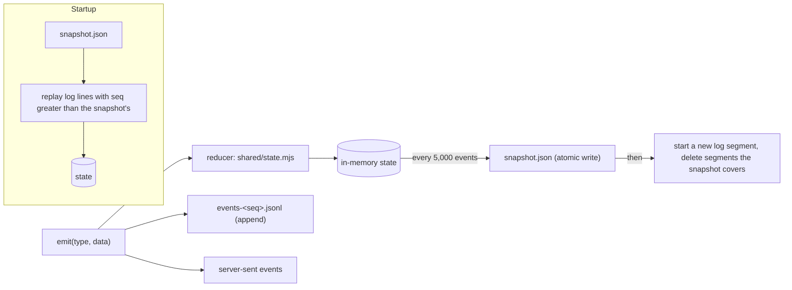
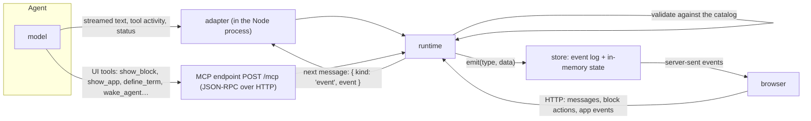

# Architecture decisions

Decided on 21 October 2026, after Stage 2. Each section states the decision, what it rests on, and what would make us revisit it. [intent.md](intent.md) records the product decisions; this file records the engineering ones.

## 1. The store: an event log with snapshots, not a database

**Decision.** Postbox keeps its data as an append-only event log in JSON Lines, plus periodic snapshots of the state, in its data folder. Every read comes from an in-memory projection of that log. Binary files go to a separate content-addressed blob store. All of this sits behind one small storage interface (`server/store.mjs`).

**What the design needs from a store**

| Need | Where it comes from |
|---|---|
| A numbered, append-only sequence of changes | Live updates over server-sent events must resume after a dropped connection with nothing lost or duplicated, so every change has a sequence number and clients ask for “everything after N”. |
| The current state, rebuilt from those changes | The browser and the server apply the same events with the same reducer (`shared/state.mjs`). The state is a projection, not a source of truth. |
| Durable across restarts | “The conversation survives a page reload: keep it in the app’s own store.” |
| Cheap writes during streaming | A reply streams as many small text events per second. |
| Binary attachments | Pasted images, uploads and files added to the corpus. |
| No schema to maintain, no relational queries | One person, one machine, one process. Every read is “all of it” at startup, then live events. |

**Options considered**

| Option | Fit | Why not now |
|---|---|---|
| One JSON file, rewritten whole (Stage 2) | Simple | Each write serializes the entire state. That’s fine at tens of kilobytes; after months of use it blocks the event loop on every streaming reply. |
| **Event log (JSONL) + snapshots** | Matches the event model exactly. Appends are cheap and crash-tolerant. No schema beyond the event types. No dependencies. | **Chosen.** |
| Redis (Streams + AOF) | Streams are a good log, and AOF is itself an append-only file | Adds a server to install and run, a network hop and a runtime dependency, for one user in one process. It earns its place only with several server processes or users. |
| SQLite (`node:sqlite`, built into Node 22) | Transactions and durability in one file, still schema-light: one events table and one snapshot table holding JSON | Still marked experimental in Node 22, and it prints a warning. It’s the first candidate if we need transactions across files or queries. |
| A document or relational database (Postgres and so on) | — | Schema and operations work with no payoff for this use case. |

**How it works**

- **Writes** are batched and appended in order. A crash can lose at most the last few milliseconds of events. A truncated last line is detected on startup and dropped.
- **Snapshots** are written to a temporary file and renamed, so a crash mid-write leaves the old snapshot intact. A new log segment starts after each snapshot, and segments the snapshot fully covers are deleted.
- **Schema.** Events carry plain JSON. If an event’s shape ever changes, the reducer upgrades old events as it reads them (an “upcaster”), so there are no migrations to run.
- **Stage 2 data** in `store.json` is read once as the first snapshot, then renamed `store.json.migrated`.

**Attachments.** Files are stored by the SHA-256 of their contents under `blobs/ab/cdef…`, so identical files are kept once and corruption is detectable. The log holds only metadata: `{ id, name, type, size, sha256 }`. Files are served with `X-Content-Type-Options: nosniff` and a `sandbox` content-security policy. Only PNG, JPEG, GIF and WebP images are shown inline; everything else downloads. Large content never enters the log, so snapshots stay small.

**Revisit when** Postbox runs as more than one server process, serves more than one person, or needs queries across history (for example, search). Then move the same interface onto SQLite or Redis Streams, or Postgres for many users.

## 2. How agent data reaches the store

**Decision.** Everything an agent does arrives through the runtime, which validates it and emits events. Nothing writes to the store directly.

- **Text and activity** stream through the adapter, which runs inside the Node process. For the Agent SDK it’s a library call; for Claude Code it’s the CLI’s streaming JSON output.
- **UI tools** go over MCP, whether the agent is in-process or a separate Claude Code process. They’re validated and return at once.
- **Your actions** come back as HTTP requests and reach the agent as its next message.

## 3. The front end: plain HTML, CSS and ES modules, no build

**Decision.** Keep the shipped app framework-free with no build step, and add type checking and linting as development-only tools, so the app itself still needs nothing but Node to run.

**Does it make Postbox faster for you?** At load, yes:
- **First load.** The app is about 180 KB of uncompressed JavaScript in ten modules plus one stylesheet. There’s no framework runtime, no hydration and nothing to download before the first paint, and a full reload of a long thread renders in well under a second locally.
- **While you use it.** The hot paths are re-rendering Markdown while a reply streams (batched once per frame) and big tables. Neither depends on a framework.
- **The costs are ours, not yours.** We hand-write list reconciliation (`syncList`) and event wiring, which is where Stage 2’s bugs were. There are no compile-time types. Contributors used to a framework need a moment to adjust.

**What we add to keep it fast**
- Serve static files with gzip and ETags instead of always revalidating in full. This is done in this change.
- Virtualize table rows above about 1,000.
- Keep every module small enough to read in one sitting.

**Revisit when** the UI gains shared editing or several people, or the hand-written reconciliation grows past what one file can hold. The first step then would be a small runtime library such as Preact with `htm`, which still needs no build step, rather than a full build pipeline.

## 4. Code quality: linters and checks

**Decision.** These run locally (`npm run check`) and in continuous integration on every pull request. Every tool is a development dependency, pinned in a lockfile and never shipped.

| Check | Tool | What it enforces |
|---|---|---|
| Lint and format | **Biome** (one dependency, no plugins) | Recommended correctness and suspicious-code rules, consistent formatting, no unused code |
| Types | **TypeScript in `checkJs` mode** with JSDoc types, `noEmit` | Shapes of events, blocks and store state checked without a build. It starts with `shared/` and `server/`, then the client. |
| Tests | `node:test` with `--experimental-test-coverage` | Pure modules (catalog, Markdown, events, BM25, store) stay above 90% line coverage |
| End to end | `tools/shoot-app.mjs` in headless Chrome, plus **axe-core** | Every demo scene renders with no browser errors and no serious or critical accessibility violations |
| Contrast | `tools/contrast.mjs` | Every token pair meets WCAG 2.1 AA in both modes, on the app stage too |
| Design tokens | `tools/lint-tokens.mjs` | No raw colors outside the token blocks, in CSS or in JavaScript |
| Safe DOM | `tools/lint-dom.mjs` | `innerHTML` only in the files allowed to use it, with output from the Markdown renderer or Postbox’s own templates |
| Copy | `tools/lint-copy.mjs` | American spelling and curly quotes in user-facing strings |

**Conventions**
- An `.editorconfig` sets 2-space indentation, LF line endings and UTF-8.
- Commits are small, with sentence-case subjects.
- Every user-facing string follows the writing rules in [intent.md](intent.md).
- No runtime dependencies without a decision recorded here.

**Revisit when** a tool becomes a bottleneck. Biome and TypeScript are the only tools here that a contributor has to install.
