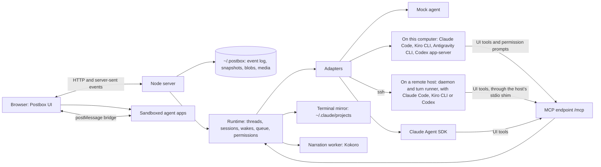

# Architecture decisions

Decided on 21 October 2026, after Stage 2. Each section states the decision, what it rests on, and what would make us revisit it. [intent.md](intent.md) records the product decisions; this file records the engineering ones.

Each decision is in a child document under `architecture/`:
- [The store](architecture/store.md)
- [Attachments and assets](architecture/assets.md)
- [The front end](architecture/front-end.md)
- [Code quality: linters and checks](architecture/code-quality.md)
- [Real agents: two adapters over one stream](architecture/adapters.md)
- [What shapes an agent’s turn](architecture/agent-setup.md)
- [Permissions: a card in the thread, and an explicit mode](architecture/permissions.md)
- [Attached sessions: resume and mirror](architecture/attached-sessions.md)
- [Narration: a local voice in its own process](architecture/narration.md)
- [A conversation is shared memory](architecture/shared-memory.md)
- [Sandboxed pages that load nothing](architecture/sandbox.md)
- [Diagram legibility](architecture/diagram-legibility.md)
- [Security boundaries: the page’s token and what reaches the browser](architecture/security-boundaries.md)
- [The work ledger: built from tool calls, counted from diffs](architecture/work-ledger.md)
- [Module and function size: a ceiling that only comes down](architecture/code-size.md)
- [Folders by concern](architecture/folders.md)
- [Browser checks on Playwright Test](architecture/browser-checks.md)
- [Prompt changes are reviewed as rendered text](architecture/prompt-review.md)
- [Remote hosts](architecture/remote-hosts.md)
- [Agents see their app: a pinned headless browser, on request](architecture/view-app.md)

## 22. The system at a glance

**Decision.** One diagram of the whole system, with the three choices that shape everything else, beside the decisions they follow from (“The front end: plain HTML, CSS and ES modules, no build”, “Sandboxed pages that load nothing”, “What reaches the browser”). What agents send, the block catalog and the event shape, is in [agent-apps.md](agent-apps.md).

- **No front-end framework and no build step.** It’s plain HTML, one stylesheet ([`app/workbench.css`](../app/workbench.css)) and native ES modules.
- **Agents never send HTML to Postbox itself.** A reply is Markdown plus blocks from a fixed catalog that Postbox validates and renders with its own code. Anything richer is an agent-written app that runs in a sandboxed iframe with no network access.
- **Everything is a numbered event.** The browser loads the state once, then applies events from a server-sent event stream with the same reducer the server uses ([`shared/state.mjs`](../shared/state.mjs)). After a dropped connection it resumes from the last number it saw, so nothing is lost or applied twice.
