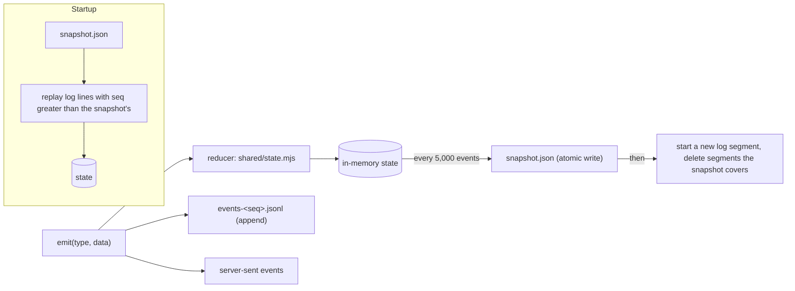
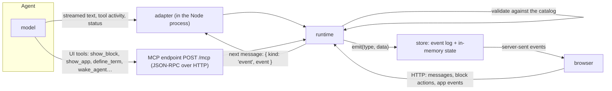
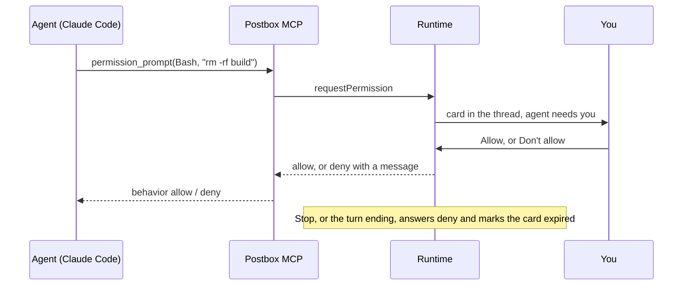
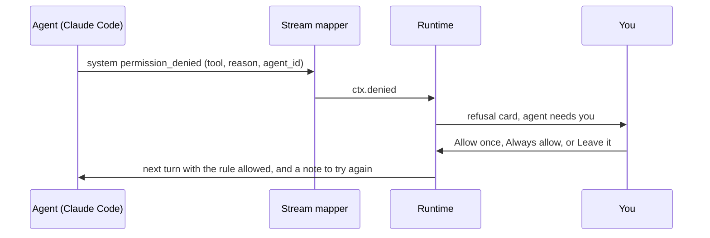
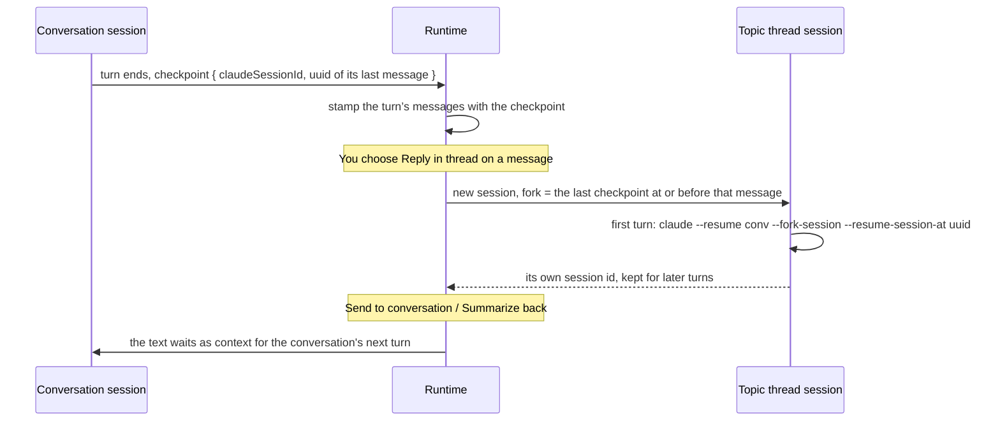

# Architecture decisions

Decided on 21 October 2026, after Stage 2. Each section states the decision, what it rests on, and what would make us revisit it. [intent.md](intent.md) records the product decisions; this file records the engineering ones.

## 1. The store: an event log with snapshots, not a database

**Decision.** Postbox keeps its data as an append-only event log in JSON Lines, plus periodic snapshots of the state, in its data folder. Every read comes from an in-memory projection of that log. Binary files go to a separate content-addressed blob store. All of this sits behind one small storage interface (`server/store.mjs`).

**What the design needs from a store**

| Need | Where it comes from |
|---|---|
| A numbered, append-only sequence of changes | Live updates over server-sent events must resume after a dropped connection with nothing lost or duplicated, so every change has a sequence number and clients ask for “everything after N”. |
| The current state, rebuilt from those changes | The browser and the server apply the same events with the same reducer (`shared/state.mjs`). The state is a projection, not a source of truth. |
| Durable across restarts | “The conversation survives a page reload: keep it in the app’s own store.” |
| Cheap writes during streaming | A reply streams as many small text events per second. |
| Binary attachments | Pasted images, uploads and files added to the corpus. |
| No schema to maintain, no relational queries | One person, one machine, one process. Every read is “all of it” at startup, then live events. |

**Options considered**

| Option | Fit | Why not now |
|---|---|---|
| One JSON file, rewritten whole (Stage 2) | Simple | Each write serializes the entire state. That’s fine at tens of kilobytes; after months of use it blocks the event loop on every streaming reply. |
| **Event log (JSONL) + snapshots** | Matches the event model exactly. Appends are cheap and crash-tolerant. No schema beyond the event types. No dependencies. | **Chosen.** |
| Redis (Streams + AOF) | Streams are a good log, and AOF is itself an append-only file | Adds a server to install and run, a network hop and a runtime dependency, for one user in one process. It earns its place only with several server processes or users. |
| SQLite (`node:sqlite`, built into Node 22) | Transactions and durability in one file, still schema-light: one events table and one snapshot table holding JSON | Still marked experimental in Node 22, and it prints a warning. It’s the first candidate if we need transactions across files or queries. |
| A document or relational database (Postgres and so on) | — | Schema and operations work with no payoff for this use case. |

**How it works**

- **Writes** are batched and appended in order. A crash can lose at most the last few milliseconds of events. A truncated last line is detected on startup and dropped.
- **Snapshots** are written to a temporary file and renamed, so a crash mid-write leaves the old snapshot intact. A new log segment starts after each snapshot, and segments the snapshot fully covers are deleted.
- **Schema.** Events carry plain JSON. If an event’s shape ever changes, the reducer upgrades old events as it reads them (an “upcaster”), so there are no migrations to run.
- **Stage 2 data** in `store.json` is read once as the first snapshot, then renamed `store.json.migrated`.

**Attachments.** Files are stored by the SHA-256 of their contents under `blobs/ab/cdef…`, so identical files are kept once and corruption is detectable. The log holds only metadata: `{ id, name, type, size, sha256 }`. Files are served with `X-Content-Type-Options: nosniff` and a `sandbox` content-security policy. Only PNG, JPEG, GIF and WebP images are shown inline; everything else downloads. Large content never enters the log, so snapshots stay small.

**Revisit when** Postbox runs as more than one server process, serves more than one person, or needs queries across history (for example, search). Then move the same interface onto SQLite or Redis Streams, or Postgres for many users.

## 2. How agent data reaches the store

**Decision.** Everything an agent does arrives through the runtime, which validates it and emits events. Nothing writes to the store directly.

- **Text and activity** stream through the adapter, which runs inside the Node process. For the Agent SDK it’s a library call; for Claude Code it’s the CLI’s streaming JSON output.
- **UI tools** go over MCP, whether the agent is in-process or a separate Claude Code process. They’re validated and return at once.
- **Your actions** come back as HTTP requests and reach the agent as its next message.

## 3. The front end: plain HTML, CSS and ES modules, no build

**Decision.** Keep the shipped app framework-free with no build step, and add type checking and linting as development-only tools, so the app itself still needs nothing but Node to run.

**Does it make Postbox faster for you?** At load, yes:
- **First load.** The app is about 180 KB of uncompressed JavaScript in ten modules plus one stylesheet. There’s no framework runtime, no hydration and nothing to download before the first paint, and a full reload of a long thread renders in well under a second locally.
- **While you use it.** The hot paths are re-rendering Markdown while a reply streams (batched once per frame) and big tables. Neither depends on a framework.
- **The costs are ours, not yours.** We hand-write list reconciliation (`syncList`) and event wiring, which is where Stage 2’s bugs were. There are no compile-time types. Contributors used to a framework need a moment to adjust.

**What we add to keep it fast**
- Serve static files with gzip and ETags instead of always revalidating in full. This is done in this change.
- Virtualize table rows above about 1,000.
- Keep every module small enough to read in one sitting.

**Revisit when** the UI gains shared editing or several people, or the hand-written reconciliation grows past what one file can hold. The first step then would be a small runtime library such as Preact with `htm`, which still needs no build step, rather than a full build pipeline.

## 4. Code quality: linters and checks

**Decision.** These run locally (`npm run check`) and in continuous integration on every pull request. Every tool is a development dependency, pinned in a lockfile and never shipped.

| Check | Tool | What it enforces |
|---|---|---|
| Lint and format | **Biome** (one dependency, no plugins) | Recommended correctness and suspicious-code rules, consistent formatting, no unused code |
| Types | **TypeScript in `checkJs` mode** with JSDoc types, `noEmit` | Shapes of events, blocks and store state checked without a build. It starts with `shared/` and `server/`, then the client. |
| Tests | `node:test` with `--experimental-test-coverage` | Pure modules (catalog, Markdown, events, BM25, store) stay above 90% line coverage |
| End to end | `tools/shoot-app.mjs` in headless Chrome, plus **axe-core** | Every demo scene renders with no browser errors and no serious or critical accessibility violations |
| Contrast | `tools/contrast.mjs` | Every token pair meets WCAG 2.1 AA in both modes, on the app stage too |
| Design tokens | `tools/lint-tokens.mjs` | No raw colors outside the token blocks, in CSS or in JavaScript |
| Safe DOM | `tools/lint-dom.mjs` | `innerHTML` only where a `lint-allow dom:` comment names the source (the Markdown renderer or Postbox’s own templates); no attribute or style names chosen at run time; `target="_blank"` always with `noopener` |
| Copy | `tools/lint-copy.mjs` | American spelling and curly quotes in user-facing strings |

**Conventions**
- An `.editorconfig` sets 2-space indentation, LF line endings and UTF-8.
- Commits are small, with sentence-case subjects.
- Every user-facing string follows the writing rules in [intent.md](intent.md).
- No runtime dependencies without a decision recorded here.

**Exceptions.** A deliberate exception to a project rule carries `lint-allow <rule>: <reason>` on its line or the line above, and a whole file can opt out of one rule with `lint-allow-file <rule>: <reason>` near its top. A reason is required, so every exception says why.

**Where it stands (Stage 3).** Everything in the table runs, locally and in CI:
- TypeScript runs in strict mode over `shared/` and `server/`; the client comes next.
- axe-core found 92 violations on its first run, all fixed: radios that said pressed instead of checked, labels on elements with no role, a button whose name didn’t match its text, and dim text on the review highlight in dark mode. The contrast tool now checks translucent tokens too, which is how the last one was missed.
- Coverage is 89% of lines overall. Of the pure modules, `state.mjs` (88%) is still below the 90% target.

**Revisit when** a tool becomes a bottleneck. Biome and TypeScript are the only tools here that a contributor has to install.

## 5. Real agents: two adapters over one stream

**Decision.** Real agents run on Claude Code, in two ways that share everything but the transport:
- **Claude Code backend:** one `claude -p` process per turn, with stream-json in and out, resuming the thread’s Claude Code session.
- **Agent SDK backend:** `query()` in Postbox’s process.

The SDK streams the same messages as the CLI, so one mapper ([`server/adapters/claude-stream.mjs`](../server/adapters/claude-stream.mjs)) turns either into the turn context: text, activity, ring state, context use, subagents, compactions and refusals.

Both backends ask for summarized thinking (`--thinking-display summarized`) and subagents’ own messages (`--forward-subagent-text`). Without them, thinking arrives empty and subagents are a single line. With them:
- While an agent thinks or calls tools, a working row at the end of the conversation shows a glimpse of its thinking.
- Each thought is a step in the activity list.
- Every subagent tool call is a step, under the subagent’s name. One guide ([`server/adapters/guide.mjs`](../server/adapters/guide.mjs)) is the system prompt both append, and it teaches the catalog, the kit and the [recipes](recipes.md).

**What it rests on**
- **No credentials in Postbox.** Both backends use Claude Code’s own sign-in. Postbox never sees a key, so there’s nothing to store, rotate or leak.
- **Recorded, not guessed.** The stream shapes were taken from real turns (claude 2.1.296, `claude-opus-5-5`) and kept as test fixtures, with local paths removed. The SDK options follow its shipped type definitions.
- **A process per turn is simple and robust.** A crash affects one turn; Stop is a signal; nothing leaks between turns. The cost is a second or two to resume. A long-lived process per session, with stream-json input, is the upgrade if that matters.
- **Postbox’s tools load up front** (`alwaysLoad` on the MCP server), so the agent doesn’t spend a step searching for them.

**Revisit when** the start-up delay matters more than isolation, or another model provider needs an adapter (the mapper is Claude-specific; the turn context isn’t).

## 6. Permissions: a card in the thread, and an explicit mode

**Decision.** Each persona has a permission mode: auto (the default), ask, accept edits, or run everything. In auto mode, Claude Code’s classifier approves routine actions and sends what it can’t decide to the same place ask mode does: a card in the thread that shows the exact command, while the call waits for your answer:
- **Claude Code:** through `--permission-prompt-tool`, an MCP tool that doesn’t return until you answer.
- **Agent SDK:** through `canUseTool`.

**What it rests on**
- **The mode is always passed.** Left out, Claude Code would take `permissions.defaultMode` from your own settings, or `auto`, and an agent you set to ask could stop asking.
- **Every permission tool call is a blocking call, and the only one.** All other Postbox tools return at once. A blocked call must always end, so Stop and the end of a turn release it with a no.
- **Agents start in their project’s root folder**, as [intent.md](intent.md) decides, unless the persona names another. Permission mode is what protects that folder. The first live test showed why it matters: the sample project’s folder is the bundled books, and a command the test allowed wrote a file there (since removed).
- **The card is Postbox’s, not a catalog block.** Your answer goes to the waiting tool call, not to the agent as a message.

**Refusals.** Claude Code also refuses calls without asking anyone: auto mode’s classifier, a deny rule, the mode, or a background subagent that can’t ask. It reports each refusal as a `permission_denied` event (with `agent_id` when a subagent was refused), and lists them all in the result’s `permission_denials`. Postbox turns each into a refusal card ([#65](https://github.com/HJeon139/postbox/issues/65)):
- **Allow once and retry:** the exact call (`Bash(rm copy.txt)`) is passed with `--allowedTools`, or the SDK’s `allowedTools`, for the next turn only. The agent is told to try again.
- **Always allow:** a broader rule (`Bash(rm:*)`, `WebFetch(domain:example.com)`, built in [`server/permission-rules.mjs`](../server/permission-rules.mjs)) goes into `.claude/settings.local.json` in the agent’s folder. That’s where the CLI saves “don’t ask again”, so the terminal and Postbox share it.
- **Leave it:** keeps the refusal.

- **A call you declined isn’t a refusal.** The result’s list includes calls you said no to on a permission card. The prompt tool passes the call’s `tool_use_id`, the card keeps it, and the runtime skips those.
- **A deny rule still wins.** Claude Code checks deny before allow, so Always allow can’t override your own deny rules, and the card says so.
- **Revisit when** the permissions panel lands ([#66](https://github.com/HJeon139/postbox/issues/66)): the prompt’s own `permission_suggestions` can replace the rules Postbox builds, and cards gain Edit.

## 7. Attached sessions: resume and mirror

**Decision.** A Claude Code session started in a terminal can join Postbox as an agent:
- **Writing to it:** Postbox resumes that session in its own folder.
- **Watching it:** Postbox follows its transcript in `~/.claude/projects/` and mirrors turns typed in the terminal, marked “from terminal”.
- **No duplicates:** lines written while a Postbox turn runs are that turn, already in the thread, so they’re skipped, and the tail jumps to the end when the turn finishes.

**What it rests on.** The transcript is the only shared record, and it records who started each turn (`turnOrigin`: human or sdk). Reading it needs no cooperation from the terminal.

**Revisit when** two writers become a problem in practice. Postbox can’t tell that a terminal turn is still running, so it relies on you to let it finish.

## 8. Narration: a local voice in its own process

**Decision.** Agent apps read aloud with Kokoro, through `kokoro-js`, in a child process that starts on first use and stops after five idle minutes.
- **Audio:** each clip is stored once in the blob store, under its SHA-256, and reused for the same text and voice.
- **Delivery:** the app gets the audio over the postMessage bridge and plays it from a `blob:` URL, the one media source the sandbox allows.
- **Pace:** the kit synthesizes on Play, one passage at a time, so the pre-display check makes no audio.

**What it rests on**
- **Local and free.** No audio leaves the computer, and there’s no account.
- **Isolation.** Kokoro brings native packages with open advisories (`sharp`, `onnxruntime-node`). In a child process, they never run inside the server that holds your conversations.
- **It degrades to text.** The transcript is always on screen; without the voice, the player says so and the walkthrough still reads.

**Revisit when** word-level timing matters (Kokoro gives none, so the transcript follows by passage), or a better local voice appears.

## 9. Topic threads: forked sessions at checkpoints

**Decision.** A topic thread is a thread of kind `topic` whose `parentId` is its conversation and whose `rootItemId` is the message it started from. Each agent in it runs a new session that forks the conversation’s session at that message.

**What it rests on**
- **Checkpoints, not copies.** Every adapter reports where its turn ended in its own transcript (`ctx.checkpoint`): Claude Code and the Agent SDK give the last assistant message’s uuid, and the mock gives its session. The runtime stamps each message of the turn with it, so any message knows its fork point. Postbox never copies or edits a transcript.
- **Verified live.** A session told “apple”, then “banana”, then forked at the first reply, remembered only “apple”, under a new session id. The original still remembered both. The CLI’s `--resume-session-at` is undocumented in `--help`; the Agent SDK documents it as `resumeSessionAt` with `forkSession`.
- **Your message as the root.** For a message you wrote, the fork point is the agent’s last finished turn before it, and the message itself opens the thread as context. An agent that joined the conversation after the root starts fresh; replies from before checkpoints were kept fall back to the session’s latest point.
- **Bringing things back costs no turn.** Shared text is queued as context on each of the conversation’s sessions and prepended to the next message they get, so the main agent reads it when it next works rather than being woken by it.
- **No nesting.** A topic thread can’t start another one, as in Slack; a reply that deserves its own branch can be sent to the conversation and branched from there.

**Revisit when** the Claude Code CLI documents or drops `--resume-session-at`. The Agent SDK path documents it and could take over the Claude Code backend’s forks.

## 10. Sandboxed pages that load nothing

**Decision.** An agent app or diagram page is sandboxed by its response header, `Content-Security-Policy: sandbox allow-scripts; …`, not by the iframe’s `sandbox` attribute. It is self-contained:
- **Inline:** the kit, the stylesheet and the diagram script are inlined into the page when it’s served.
- **Libraries:** D3, KaTeX and Mermaid reach it as text over the postMessage bridge, and run as inline scripts. KaTeX’s fonts travel inside its stylesheet as `data:` URLs.
- **Policy:** it allows inline code, `data:` images and fonts, and `blob:` audio, and nothing that loads from a URL.

**What it rests on**
- **Measured in the browser people use.** The Claude desktop app’s browser pane refuses to load any frame that has the `sandbox` attribute (`ERR_BLOCKED_BY_CLIENT`). It also blocks every request a sandboxed, opaque-origin page makes, while letting its inline scripts run. Headless Chrome allowed all of it, which is why the end-to-end runs passed while apps and diagrams stayed blank in the pane.
- **The same isolation.** The header sandbox gives the page an opaque origin, exactly as the attribute does. The host’s bridge only answers frames whose origin is `null`: if a page ever arrived without the header, it would be same-origin, and the bridge would shut it instead of serving it. A test checks that every sandbox page carries the policy.
- **Sturdier everywhere.** A page that needs no requests can’t be broken by an extension, a proxy or a slow network.

**Revisit when** apps need large assets of their own. Then serve them from a separate origin rather than relaxing the policy.

## 11. Diagram legibility: estimate, then measure

**Decision.** Two checks find Mermaid diagrams too small to read, and both reach the agent as a `lint` message that says what to change. Each diagram is reported once.
- **The estimate** ([`shared/diagram-lint.mjs`](../shared/diagram-lint.mjs)) runs on each finished reply. It reads the Mermaid source well enough to estimate the layout’s width, and from that the size its text ends up at in the 728 px column. It also flags too many boxes, one row of many boxes, and long sequences.
- **The measurement** happens in the browser after a diagram renders: its text size is 13 px × the scale it was drawn at. Anything under 10 px at the conversation’s width is reported to the server, unless the estimate already caught it.

**What it rests on**
- **It’s the symptom people see.** A wide diagram doesn’t fail; it shrinks. Text size is the measure that matches what a reader experiences, so both checks use it.
- **Fitted, not guessed.** The estimate’s layout constants (8.5 px per character, about 56 px of padding per box, the gaps between sequence participants) were fitted to diagrams rendered in Chrome. They agree to within about half a pixel, and the measured values are a test.
- **Prevention first.** The agent guide asks for about five boxes side by side, top-to-bottom chains, short labels and lists as text, so most diagrams never trip either check.
- **No loops.** A reply to a lint message isn’t linted again by either check.

**Revisit when** another diagram type becomes common (class, state and ER diagrams only get the count check), or Postbox’s column width or diagram font size changes; then re-measure and refit.

## 12. A conversation is shared memory

**Decision.** Every agent in a conversation can read all of it.
- **A marker per session:** each session records the last item it was given (`seenItem`).
- **Catch-up:** each delivery starts with the items after that marker, written as plain lines (“You: …”, “@indexer: …”, “@critic showed a review block …”), leaving out the agent’s own messages and the message being delivered.
- **Caps:** at most 40 items or about 16,000 characters, saying how many earlier ones were left out.
- **Joining:** a new session starts with no marker, so an agent that joins a room gets its recent history.
- **Further back:** `read_conversation` returns older history on request.

**What it rests on.** Issue #1: in a room, an agent woken by an @-mention saw only that message, and answered confidently about a discussion it had never seen. The catch-up costs nothing when nothing was missed, as in a direct message where the agent is woken by every message; it replaces the separate path shares from topic threads used to take.

**Revisit when** rooms get long enough that 40 items is too little. Then summarize older stretches instead of dropping them.
