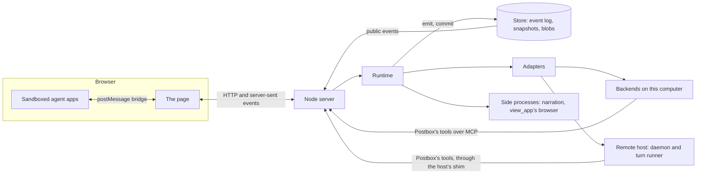
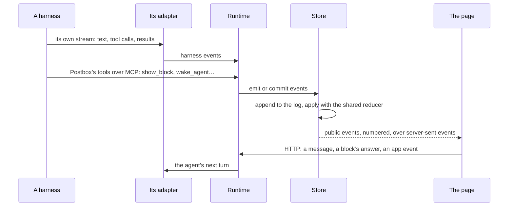

# Architecture

The high-level design of Postbox: what it’s made of, how data moves through it, the boundaries it keeps, and the decisions that shape it. Each concern has a child document under [`architecture/`](architecture/) with the detail, the evidence and when to revisit it. [intent.md](intent.md) records the product decisions; this document and its children record the engineering ones.

## What Postbox is

Postbox is a local web app where one person directs two to four AI agents on their own computer. They talk to the agents in conversations; the agents answer in Markdown, in blocks from a fixed catalog that Postbox renders, and in apps they write that run sandboxed in the conversation. The agents run on real harnesses (Claude Code, the Agent SDK, Kiro, Codex and Antigravity), on this computer or on a remote host, and work together without waiting on the person. Postbox is Node with zero required runtime dependencies (the Agent SDK, the local voice and view_app’s browser are optional ones), plain ES modules and no build step. Its quality bar is intent.md’s: the loop right before the looks, nothing lost or applied twice, and what’s checked today in intent.md, “Quality bar”.

## The system at a glance

What each box holds is under “The main components”; what moves along the arrows is under “How data flows”.

## The main components

**The page** (`app/`). Plain HTML, one stylesheet and native ES modules, with no framework and no build. It loads the state once, then applies numbered events from a server-sent event stream with the same reducer the server runs (`shared/state.mjs`), and it mounts only the part of a long conversation near the view. Everything the person does goes back as an HTTP request. See [front-end.md](architecture/front-end.md).

**The server** (`server/index.mjs`). One Node process, listening on 127.0.0.1. It serves the page and its files, answers the page’s API and stream, and serves the MCP endpoint (`/mcp`) where agents call Postbox’s own tools. A request gate runs before any route: the address, the origin, and the page’s token for every write. See [security-boundaries.md](architecture/security-boundaries.md).

**The runtime** (`server/runtime.mjs` and the modules split out of it). Conversations, threads, sessions, wakes, queues, permission cards and the checks on what agents send. It owns the live state of the turns running now, and it is the only way into the store: everything an agent does arrives through it, is validated against the catalog, and becomes events. See [store.md](architecture/store.md), “How agent data reaches the store”, and [code-size.md](architecture/code-size.md), “Which module owns which state”.

**The store** (`server/store.mjs`). An append-only event log in JSON Lines plus periodic snapshots, in the person’s data folder, with every read served from an in-memory projection of it. Files go to a content-addressed blob store beside it, and agents’ published files to an asset folder. One Postbox writes it at a time. See [store.md](architecture/store.md) and [assets.md](architecture/assets.md).

**The adapters and backends** (`server/adapters/`). One adapter per backend behind one interface: Claude Code, the Agent SDK, Kiro CLI, Antigravity CLI and Codex, plus the mock agent. Each starts its harness for a turn with everything that shapes the turn passed explicitly, reads the harness’s own stream, and reports it through the harness-event contract, from which Postbox builds the reply, the steps, the work ledger and the ring. See [adapters.md](architecture/adapters.md) and [agent-setup.md](architecture/agent-setup.md).

**Permissions** (`server/permission-*.mjs`). Each persona has a mode, and the harness decides in it; when the harness asks, the call waits on a card in the thread for the person’s answer. Postbox adds no gate of its own on top. See [permissions.md](architecture/permissions.md).

**Remote hosts** (`server/remote/`). An agent’s turns can run on another machine reached with the person’s own `ssh`. Only the agent’s process moves: the adapter stays on the laptop and drives a daemon on the host, which runs each turn detached and serves Postbox’s tools through a stdio shim. Nothing on the host can reach back. See [remote-hosts.md](architecture/remote-hosts.md), and [the person’s guide to hosts](remote-hosts.md).

**Sandboxed apps** (`server/sandbox.mjs`, `app/kit/`). An agent’s app or diagram runs in a page sandboxed by its `Content-Security-Policy` header that loads nothing from a URL. The kit and libraries reach it inline or over the postMessage bridge, the only way it talks to the page. See [sandbox.md](architecture/sandbox.md) and [agent-apps.md](agent-apps.md).

**Side processes.** Work with native code runs outside the server that holds the conversations, started on first use and stopped when idle: narration’s local voice ([narration.md](architecture/narration.md)) and the pinned headless browser that shows an agent its app ([view-app.md](architecture/view-app.md)).

**The work ledger** (`server/ledger.mjs`). What each turn changed, ran, committed, pushed and published, built from its tool calls and counted from diffs, with git only read. See [work-ledger.md](architecture/work-ledger.md).

**What agents read** (`server/catch-up.mjs`, `server/read-message.mjs`). Every agent in a conversation can read all of it: each turn catches the agent up on what it missed, and its read tools reach further back. An agent has one session per conversation, and answers in its topic threads from it. A Claude Code session started in a terminal can join as an agent. See [shared-memory.md](architecture/shared-memory.md) and [attached-sessions.md](architecture/attached-sessions.md).

## How data flows

- **The event log is the record.** Every change is an event with a sequence number. Streamed text is emitted on a fast path; a commit of several events is written as one line and fsynced, and nothing in it leaves the process until the disk has it. Snapshots bound how much a restart replays ([store.md](architecture/store.md)).
- **State is a projection.** The server and the page apply the same events with the same reducer (`shared/state.mjs`), so the page’s state is the server’s, as far as the page may see it.
- **What reaches the browser is decided once.** Each event type says whether it’s public, and each state key is listed as public or private, in `shared/state.mjs`. `/api/state`, a conversation’s items by range and the event stream go through one projection (`server/public-state.mjs`); anything else reaches the page only as a cursor that keeps the sequence. It fails closed ([security-boundaries.md](architecture/security-boundaries.md), “What reaches the browser”).
- **The page resumes, never reloads.** After a dropped connection it asks for everything after the last number it applied, so nothing is lost or applied twice. A history epoch made at each load tells a tab on a lost timeline to resync.
- **Agents get their turn as an envelope.** The request it answers comes first, then what changed in the room, then background; the system prompt holds only what’s fixed for a persona ([shared-memory.md](architecture/shared-memory.md)).

## Security boundaries

Postbox runs on the person’s computer, as them, for one person. A change to any of these is reviewed as a security change; AGENTS.md, “Security boundaries”, holds the same list as rules, and SECURITY.md what a report may cross.
- **This computer alone.** Postbox listens on 127.0.0.1 and answers only requests addressed to `127.0.0.1` or `localhost` on its port. It refuses other `Host` headers and cross-site `Origin`s, and every write needs the page’s token ([security-boundaries.md](architecture/security-boundaries.md)).
- **Agent and app content is data.** It reaches the DOM as text through `h()`, and as HTML only from `renderMarkdown()` wrapped in `trusted()`. Agent apps run only in CSP-sandboxed pages that load nothing ([sandbox.md](architecture/sandbox.md)).
- **No shell strings.** Processes are spawned with an argument array. The person’s own `!` commands run through their shell, only while Postbox listens on this computer alone.
- **What reaches the browser** is decided by the `public` flag in `EVENTS` and the state-key lists, and the bulk paths go through `server/public-state.mjs` ([security-boundaries.md](architecture/security-boundaries.md)).
- **A remote host is reached one way.** Postbox calls the host’s daemon over its own `ssh`; nothing listens on TCP on either machine, and the boundary there is the person’s OS user ([remote-hosts.md](architecture/remote-hosts.md), “Security”).
- **No credentials.** Postbox never reads, stores or passes an API key or token: each harness uses its own sign-in.

## Key decisions

Each is one line: the decision, why, and where its detail is.
- **An event log with snapshots, not a database:** the event model needs a numbered, append-only sequence and one person needs no server to run ([store.md](architecture/store.md)).
- **A commit is whole and fsynced before anything sees it:** a turn’s records and marker land together or not at all ([store.md](architecture/store.md)).
- **No framework and no build step:** the app needs nothing but Node to run, and its hot paths don’t depend on a framework ([front-end.md](architecture/front-end.md)).
- **One harness-event contract for every backend:** a behavior fixed once is fixed for all five, and a new backend maps only its stream ([adapters.md](architecture/adapters.md)).
- **Everything that shapes a turn is passed explicitly:** an agent gets the person’s own setup, with only the overrides Postbox needs ([agent-setup.md](architecture/agent-setup.md)).
- **The harness decides, in the mode the person set:** Postbox shows what agents did rather than adding a gate of its own ([permissions.md](architecture/permissions.md)).
- **One session per agent per conversation:** agents never fork themselves, and the person chooses what an agent remembers by where they talk to it ([shared-memory.md](architecture/shared-memory.md)).
- **Every agent reads the whole conversation:** an agent woken by a mention answered about a discussion it had never seen ([shared-memory.md](architecture/shared-memory.md)).
- **Apps are sandboxed by header and load nothing:** the desktop app’s browser pane refuses a frame with the `sandbox` attribute, and a page that needs no requests can’t be broken by one ([sandbox.md](architecture/sandbox.md)).
- **Writes need the page’s token:** an agent’s casual `curl` can’t speak as the person ([security-boundaries.md](architecture/security-boundaries.md)).
- **The page sees only what’s listed public:** one table, beside the reducer, fails closed ([security-boundaries.md](architecture/security-boundaries.md)).
- **Only the agent’s process moves to a host:** the adapters, the store and the page stay local, so their assumptions hold ([remote-hosts.md](architecture/remote-hosts.md)).
- **Native code runs in its own process:** narration and view_app’s browser bring native packages that never run inside the server ([narration.md](architecture/narration.md), [view-app.md](architecture/view-app.md)).
- **The work ledger is built from tool calls and counted from diffs, and git is only read:** recorded streams, not guesses ([work-ledger.md](architecture/work-ledger.md)).
- **Checks on a reply measure what the reader sees:** a diagram too wide doesn’t fail, it shrinks ([diagram-legibility.md](architecture/diagram-legibility.md)).
- **A length ceiling only comes down:** the limits are for the reader, and a file that needs to grow is split by concern first ([code-size.md](architecture/code-size.md)).
- **One folder per concern:** a proposed map of where every module goes, for review before anything moves ([folders.md](architecture/folders.md)).
- **Linters and checks run in one gate, locally and in CI:** every tool is a pinned dev dependency ([code-quality.md](architecture/code-quality.md)).
- **Browser checks on Playwright Test:** the repo’s own runner turned each part it lacked into a flake ([browser-checks.md](architecture/browser-checks.md)).
- **Prompt changes are reviewed as rendered text:** the text an agent gets isn’t in any one file ([prompt-review.md](architecture/prompt-review.md)).
- **A new dependency or a new boundary is decided in a child document before its code lands.**

## Where to start reading the code

- `server/index.mjs`: the server starting, the request gate and the routes.
- `shared/state.mjs`: the state’s shape, the reducer both sides run, and what’s public.
- `server/store.mjs`: emit, commit, snapshots and recovery.
- `server/runtime.mjs`: the runtime, and the modules it delegates to.
- `server/adapters/adapter.mjs` and `server/harness-events.mjs`: the adapter interface and the contract every backend reports through.
- `app/js/main.mjs`: the page starting, and `app/js/client.mjs`, its copy of the state and its stream.

## What’s next

- **Folders by concern** is a proposal: no module has moved yet ([folders.md](architecture/folders.md)).
- **Concerns as services** is a planned design, drafted in its own pull request ([services.md](architecture/services.md)).
- **Delivery records** are designed and not built: deliveries become a record per recipient, and receipts outlive the snapshot ([shared-memory.md](architecture/shared-memory.md), [store.md](architecture/store.md)).

## The child documents

| Document | What it holds |
|---|---|
| [store.md](architecture/store.md) | The event log, snapshots, commits, recovery and the writer’s lock; how agent data reaches the store |
| [assets.md](architecture/assets.md) | Attachments, agents’ assets, their retention and their search |
| [front-end.md](architecture/front-end.md) | The page without a framework or build, the transcript window, and the right pane |
| [adapters.md](architecture/adapters.md) | The five backends, the harness-event contract, the guide and the shared limits |
| [agent-setup.md](architecture/agent-setup.md) | What a turn is given: setting sources, publishing tools, writes outside Postbox, MCP servers, skills, hooks, tools, model and effort |
| [permissions.md](architecture/permissions.md) | Modes, permission cards, prompts bound to their calls, refusals, answers and the permissions panel |
| [shared-memory.md](architecture/shared-memory.md) | Catch-up, the turn envelope, deliveries and topic threads |
| [attached-sessions.md](architecture/attached-sessions.md) | A terminal’s Claude Code session as an agent |
| [narration.md](architecture/narration.md) | The local voice in its own process |
| [sandbox.md](architecture/sandbox.md) | Sandboxed pages that load nothing |
| [diagram-legibility.md](architecture/diagram-legibility.md) | The checks on a reply, and the pipeline that brings their findings to the agent |
| [security-boundaries.md](architecture/security-boundaries.md) | This computer alone, the page’s token, `!` commands, and what reaches the browser |
| [work-ledger.md](architecture/work-ledger.md) | The work ledger, what a command committed, and Restore |
| [remote-hosts.md](architecture/remote-hosts.md) | The daemon, its protocol, the shim, turn states, the SSH connection, security and keeping a host up to date |
| [view-app.md](architecture/view-app.md) | An agent sees its app, in a pinned headless browser |
| [code-quality.md](architecture/code-quality.md) | The linters and checks, and how an exception is written |
| [code-size.md](architecture/code-size.md) | Length ceilings, what a split is for, what a move may change, and which module owns which state |
| [folders.md](architecture/folders.md) | Folders by concern: the rule, the map and the move plan |
| [browser-checks.md](architecture/browser-checks.md) | Browser checks on Playwright Test, and how a spec is written |
| [prompt-review.md](architecture/prompt-review.md) | Prompt changes, reviewed as rendered text |
| [services.md](architecture/services.md) | Concerns as services: planned, drafted in its own pull request |

A child document holds one concern. Its decisions say what they rest on and when to revisit them; when one changes, its child changes in the same change, and this document only when the summary above stops being true.
