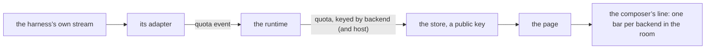
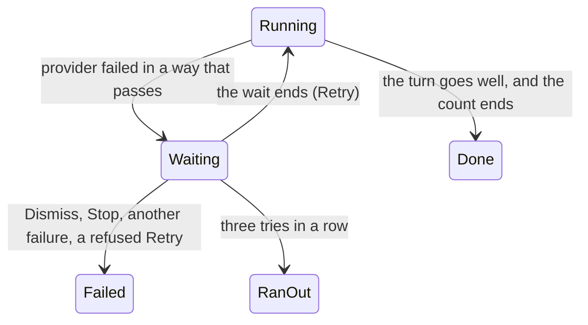

# Real agents: five backends, one harness-event contract

Part of [the architecture](../architecture.md). How an agent’s harness runs, and how what it does reaches Postbox.

## Five backends behind one interface

**Decision.** A persona runs on one of five real backends, each behind an adapter with one interface ([`server/adapters/adapter.mjs`](../../server/adapters/adapter.mjs)), registered as Postbox starts ([`server/backends.mjs`](../../server/backends.mjs)). The mock agent is a sixth adapter, for the demo and the tests. What each needs and how it differs for the person is in [backends.md](../backends.md).
- **Claude Code:** one `claude -p` process per turn, with stream-json in and out, resuming the thread’s Claude Code session.
- **Agent SDK:** `query()` in Postbox’s process.
- **Kiro CLI:** one headless `kiro-cli chat` process per turn, with stream-json out and a custom agent file Postbox writes for the turn.
- **Antigravity CLI:** one headless `agy` process per turn, with stream-json out and a plugin Postbox writes into the agent’s folder for the turn.
- **Codex:** `codex app-server`, spoken to over JSON-RPC on stdio.

Each adapter declares what its harness can do in `capabilities` (resume, permissions, tools, the permission prompt tool, skills, how it runs on a remote host, and the rest; `adapter.mjs`), and the runtime and the page read that rather than the backend’s name.

## The harness-event contract

**Decision.** Every adapter tells Postbox what its harness did in a turn one way: it reads its harness’s own stream and calls `event()` with the contract’s kinds, in its harness’s order ([`server/harness-events.mjs`](../../server/harness-events.mjs)): text, thinking, tool calls, their results and output, background work ending, refusals, a subagent’s id, context use, progress, status, the end of a message, compactions and the turn’s end. From these, and only there, Postbox builds what it shows and keeps: the reply’s text, each step and its label, the work ledger’s calls, background jobs, the subagents on the ring, the glimpse and the ring’s state. So a behavior fixed there is fixed for every backend, and a new backend maps its stream and gets the rest.

The Agent SDK streams the same messages as the Claude Code CLI, so one mapper ([`server/adapters/claude-stream.mjs`](../../server/adapters/claude-stream.mjs)) turns either into the contract. The others have their own (`codex-events.mjs`, the Kiro and Antigravity adapters).

**Adding an event kind.** Add the kind to `KINDS` in `server/harness-events.mjs`, with an `on_<kind>` method that builds what it means, and emit it from each adapter whose harness reports it. A kind that shows something new on the page also needs:
- a field on the step a turn keeps (`turnStep` in [`server/step-text.mjs`](../../server/step-text.mjs)), bounded there;
- its drawing in the live view ([`app/js/activity-live.mjs`](../../app/js/activity-live.mjs)) or the step list ([`app/js/activity-steps.mjs`](../../app/js/activity-steps.mjs));
- if it’s live detail rather than the record, its removal when the turn ends ([`shared/step-fold.mjs`](../../shared/step-fold.mjs)).

A harness that doesn’t report a thing never gets a guess at it: Antigravity’s edits name only their file, so they show no diff (#1239).

**Two blocks of the reply at once.** Most harnesses write the reply one block at a time, so a new block means the last one ended. Codex can stream two agent messages at once, narrating parallel calls, and their deltas interleave. Its adapter marks such text `open` until the message ends, which it reports as `text_end`. While an open block is mid-sentence, another block’s words wait, and follow as their own paragraph once it ends a sentence or its message: the reply takes turns by whole sentences, never spliced word by word (#1293). A long open block that never ends a sentence holds the others until its message ends, and whatever is still waiting is written when the turn ends, by Stop, a crash or its end. A harness that never marks text open streams exactly as it did.

## Quota: each backend’s usage, in the composer

**Decision** (16 November 2026, for [#442](https://github.com/HJeon139/postbox/issues/442); built on #1436’s `session.quota`). The line under the composer’s input ([#1437](https://github.com/HJeon139/postbox/issues/1437)) shows one bar for each backend that the room’s agents run on. It shows how much of that backend’s quota is used and when it resets. A quota belongs to the harness’s account, not to an agent: four agents on Claude Code share one quota. So the bars are labeled with the backend’s name and sit in the composer, not in an agent’s row, where its context use is. Running out stays where #1407 put it: the row of the agent whose turn failed. While a contextual hint applies (who a draft reaches, a command, offline), the hint takes the line instead.

**What each harness reports.** Claude Code, the Agent SDK, Codex and Antigravity report a quota. Postbox never makes up a figure for a harness that doesn’t report one:

| Backend | What it sends | Source |
|---|---|---|
| Claude Code, Agent SDK | `rate_limit_event` with `rate_limit_info`: `status` (`allowed`, `allowed_warning`, `rejected`), `unifiedWindows.five_hour` and `.seven_day`, each `{ utilization, resetsAt }`. `resetsAt` is in seconds, and `utilization` is a fraction from 0 to 1 | `tests/fixtures/claude-code/*.jsonl`; `SDKRateLimitInfo` in the SDK’s `sdk.d.ts`; the bundled CLI shows a window as `Math.round(utilization * 100)` |
| Codex | the `account/rateLimits/updated` notification, `rateLimits.primary` and `.secondary`, each `{ usedPercent, windowDurationMins, resetsAt }`, with `usedPercent` from 0 to 100 | `codex app-server generate-json-schema` (codex-cli 0.167.0), `RateLimitWindow`; the fixture’s params are scrubbed |
| Kiro CLI | only the credits each turn spent (`promptTurnSummaries[].usage`), with no limit and nothing remaining | `tests/fixtures/kiro-cli/` |
| Antigravity CLI | nothing in its turn stream, but `agy --print /usage --output-format json` (agy 1.5.10) answers, running no model, with `command.data.groups`: each model pool (“Gemini Models”, “Claude and GPT models”, …) with its `5h` and `weekly` windows, each `{ remaining_fraction, reset_time }`, the share left from 0 to 1 and an ISO time | [#1466](https://github.com/HJeon139/postbox/issues/1466); `tests/fixtures/antigravity-cli/usage.json`, scrubbed |

So Kiro gets no bar. Antigravity’s adapter asks `/usage` as a turn starts, at most once a minute and only of agy 1.5.10 or newer (an older one could take `/usage` as a paid prompt). It reports the answer before the turn ends, a failed turn too, while the turn can still record it, with the time it asked as its `seenAt`, so the bar is never shown fresher than it is. A stopped turn doesn’t wait for it ([`server/adapters/agy-usage.mjs`](../../server/adapters/agy-usage.mjs)). Postbox also asks once as it starts, without waiting, when a persona runs on Antigravity on this computer, so the bar shows after a restart before that agent’s next turn; the start and the turns share the once-a-minute limit (`askAgyQuota` in [`server/backends.mjs`](../../server/backends.mjs), [#1494](https://github.com/HJeon139/postbox/issues/1494)). A probe stops with what asked it: a turn’s Stop, or Postbox’s close, before its store closes, ends agy at once and records nothing after. agy has no host turns yet, so it asks only on this computer. Every recorded Claude window reads 0, so the first real nonzero value must confirm the 0-to-1 scale. Until then each event’s scale is read once: if any of its figures is over 1.5, all are percents, up to 100, and a larger one draws no bar; otherwise they’re fractions, and one just over 1, as overage can give, is a full bar. A lone figure between 1.5 and 100 is read as a percent, so 1.6 reads as 1.6%: the rule can’t tell that from a fraction of 1.6, and only real events will show which Claude sends (`share` in [`server/adapters/quota-windows.mjs`](../../server/adapters/quota-windows.mjs)).

**The data.**
- A new harness-event kind, `quota`, carries `{ status: 'ok' | 'warning' | 'out', windows: [{ name, used, resetsAt }] }`. `used` is from 0 to 1, and `resetsAt` is in milliseconds, or null. Each adapter maps its harness’s shape into it: Claude’s `five_hour` and `seven_day`, Codex’s windows named from `windowDurationMins` (300 is “5 h”, 10,080 is “7 d”), and Antigravity’s `5h` and `weekly` as “5 h” and “7 d”, used as one less what’s left. A Codex window also carries its `limitId`, and its `limitName` where Codex gives one, when it isn’t the default limit; the bar names that limit after the window. Antigravity reports every pool, so the backend’s bar shows whichever is most used, and a pool other than Gemini’s is a limit named after the pool.
- The runtime keeps one record per backend and host in a new public state key, `quota`: `{ id, backend, host, status, windows, seenAt }`. The id is the backend, or `backend@host` for an agent on a remote host, since a host signs in to its own account ([remote-hosts.md](remote-hosts.md)). Like `hostStatus`, it is live state that a newer report replaces.
- A report is merged with the last by window, its limit and name, since Codex’s updates are sparse: a window an update leaves out keeps its figure, and the time it was last reported, so it grows old on its own. Past six windows, the one reported least recently goes. A report is written only when its status or a window’s whole percent or reset time changes, or when the record is more than 10 minutes old. Claude Code sends one event per turn, so this keeps the log from growing with every turn.

**What the bars show.**
- Each bar shows its backend’s most-used window, as a bar and in a few words: “Claude Code 42% of 5 h”. A screen reader and the bar’s title read the whole of it: “Claude Code 42% of 5 h · resets 3:10 pm”, with “on build-box” after the window for an agent on a host. A click on a bar, or on the chevron at the line’s end, which a touch screen shows and the keyboard reaches, opens Settings › Backends. Nothing covers the bars, so each keeps its title for the pointer. The tab lists every window each backend reported, in columns that line up from one backend to the next: its limit, the share used, when it resets and when it was updated. It says which backends here report none, and stays current while it’s open ([`app/js/quota-details.mjs`](../../app/js/quota-details.mjs), [#1496](https://github.com/HJeon139/postbox/issues/1496): three bars’ longer words were cut off in the owner’s room, and a title can’t be read by touch). The line spans the input card’s width, split into equal parts, one per backend (two get half each). Each bar’s track fills its part, with its words below it, and the two together are the hint’s 20 px row, which the line lies over, so the space under the card is that one row whichever shows ([#1463](https://github.com/HJeon139/postbox/issues/1463), from the owner’s live room: a 40 px track with its words beside it didn’t read as dividing the input). The percent is never clipped. How they fit is measured, not set at fixed widths: the line’s width from a ResizeObserver, and each label’s width in the line’s font, on a canvas, so painting reads no layout ([`app/js/quota-fit.mjs`](../../app/js/quota-fit.mjs)). A canvas can’t draw tabular figures, as the page does, so it measures each digit as a “0” ([`app/js/canvas-font.mjs`](../../app/js/canvas-font.mjs)). Where they don’t fit, they give way together, in this order: backend names go short (“Claude”, “SDK”, “Codex”), with the shortest start of a host’s name that tells two bars apart (“@workstation-1”, “@workstation-2”), never ending on a hyphen or a dot, only where they would read the same, and the level passed over where nothing can; then each shows its percent alone, and nothing after it. After the name and percent comes only the window, which clips at the row’s end if it must. The bar is in the neutral color, never `--alert` or amber. It isn’t an alarm, and no notice, toast or “needs you” comes from it.
- **A stale figure is never shown as current.** A window last reported over an hour ago is marked with a “~” before its percent, at every width, and its label says its age (“Codex 30% of 7 d, as of 2 h ago”), which the title explains; Settings › Backends gives each window’s. The mark isn’t a shade: a dimmed fill was under 3:1, and a dimmer text under AA. A window whose reset time has passed shows “reset” with no number, since the old figure no longer holds.
- Claude Code and the Agent SDK sign in to the same account, so in a room with both, their bars may read alike. They stay two bars, one per backend, as the owner chose for #442.

**What it rests on**
- **The figures are the person’s own, on their own computer.** They reach only the page Postbox serves on 127.0.0.1 ([security-boundaries.md](security-boundaries.md), “This computer alone”), so a public key is right. Recorded fixtures stay scrubbed, as the privacy scan requires, so the specs drive the bars from the mock adapter with made-up values.
- **Per backend, not per agent.** Agents sharing a backend share its quota. A per-agent figure would repeat one number across rows and read like the context use already there.
- **One line, shared with the hints.** The composer has room for one line under its input (#1437). A hint applies only while you type, and quota matters between messages.

**Where it is built**
- [`server/adapters/quota-windows.mjs`](../../server/adapters/quota-windows.mjs) reads Claude’s and Codex’s reports into the `quota` kind, and the Claude and Codex mappers emit it.
- [`server/quota-usage.mjs`](../../server/quota-usage.mjs) checks and bounds a report and keeps it, under [`shared/quota-key.mjs`](../../shared/quota-key.mjs)’s key, the one the agents’ out-of-quota marks use ([`server/turn-quota.mjs`](../../server/turn-quota.mjs)). A record’s `out` changes no agent’s `quota`: only a refused turn marks them.
- [`app/js/composer-quota.mjs`](../../app/js/composer-quota.mjs) draws the line in the conversation’s composer. How the bars fit is [`app/js/quota-fit.mjs`](../../app/js/quota-fit.mjs)’s, and a width sweep holds it (`tests/browser/quota-sweep.spec.mjs`).
- Where a thread panel opens full screen over the conversation, the column behind it keeps its width, so its composer has room for the line ([`app/js/pane-width.mjs`](../../app/js/pane-width.mjs)).

**Revisit when** Kiro reports a limit or what remains, Antigravity puts its usage in its turn stream (then the extra `/usage` run can go), a harness reports a quota per model that the person needs to see apart, or the first real Claude events show `utilization` on another scale.

## A provider’s passing failure: the turn goes again on its own

**Decision** (23 November 2026, for [#1713](https://github.com/HJeon139/postbox/issues/1713)). When a harness reports that its provider failed in a way that passes, such as 529 Overloaded or 429, the turn goes again on its own after 30 s, 2 min and 8 min ([`shared/limits.mjs`](../../shared/limits.mjs), `TRANSIENT_RETRY`). The adapter marks the error from the harness’s own status field (Claude Code’s and the Agent SDK’s `api_error_status`), never from its words ([`server/harness-failure.mjs`](../../server/harness-failure.mjs), `withTransient`). While it waits, the agent’s row says when it retries, its reply says so without an alert, and nothing asks the person, who could do no more than Retry (#1218’s rule). A turn that had started a tool goes again too, told first to check what those calls changed or sent. A scheduled wake’s turn isn’t retried this way.

**Where it is built** [`server/turn-transient.mjs`](../../server/turn-transient.mjs) decides the wait, arms it in `rt.watchdogs` and again after a restart, and ends it (`forgetWait`); [`server/turn-finish.mjs`](../../server/turn-finish.mjs) calls it when a turn fails; [`shared/agent-state.mjs`](../../shared/agent-state.mjs) gives the row its `retrying` state.

**Revisit when** a harness other than Claude Code and the Agent SDK reports its provider’s status, or the waits prove too short for a provider’s outages.

## Thinking, subagents and the guide

The Claude backends ask for summarized thinking (`--thinking-display summarized`, the SDK’s `thinking.display`) and subagents’ own messages (`--forward-subagent-text`, the SDK’s `forwardSubagentText`). Without them, thinking arrives empty and subagents are a single line. With them:
- While a turn runs, its reply shows each thought between its steps as it’s written, capped at a few lines with the whole one a click away. The working row at the end of the conversation shows a glimpse of its thinking only while the agent has no live reply here.
- Each thought is a step, kept in the turn’s work record when it ends.
- Every subagent tool call is a step, under the subagent’s name. 

One guide ([`server/adapters/guide.mjs`](../../server/adapters/guide.mjs)) is what every backend gives its agent, each in its own way ([prompt-review.md](prompt-review.md)), and it teaches the catalog, the kit and the [recipes](../recipes.md). It starts from what a reply contains, not from what the person asked for ([#63](https://github.com/HJeon139/postbox/issues/63)): options become a choice, questions a form, a draft to approve a review block, and a long job a progress block, with an example of the shape where one helps. When options make different things, each description starts with what the person gets ([#203](https://github.com/HJeon139/postbox/issues/203)). Agents follow defaults more than prose, so it stays short, and a test keeps it under 9,250 characters (`tests/guide.test.mjs`). With it, the room says who else is in the conversation and what each does (their persona’s description), and how to share the work: take your own part, hand work on with what the next agent needs, and read what the others did before redoing it. That comes from the room, not from a persona’s prompt, so any team the person puts together works this way, and an agent alone gets none of it. Two agents on one task did it twice from different decisions ([#121](https://github.com/HJeon139/postbox/issues/121)), and agent teams with explicit handoffs do better than role names alone ([MetaGPT, arXiv 2308.00352](https://arxiv.org/abs/2308.00352)). The seeded personas’ prompts ([`server/personas/`](../../server/personas/)) hold only what changes an agent’s behavior beyond its backend’s own defaults, stated as what to do and why, since adherence falls as instructions pile up ([IFScale, arXiv 2507.11538](https://arxiv.org/abs/2507.11538)).

**What it rests on**
- **No credentials in Postbox.** Every backend uses its harness’s own sign-in (backends.md). Postbox never sees a key, so there’s nothing to store, rotate or leak.
- **Recorded, not guessed.** The stream shapes were taken from real turns (for Claude Code, claude 2.1.296 with `claude-opus-5-5`) and kept as test fixtures in `tests/fixtures/`, with local paths removed. The SDK options follow its shipped type definitions.
- **A process per turn is simple and robust.** A crash affects one turn; Stop is a signal; nothing leaks between turns. The cost is a second or two to resume. A long-lived process per session, with stream-json input, is the upgrade if that matters.
- **One set of limits** ([#50](https://github.com/HJeon139/postbox/issues/50)). The limits an agent can reach (an app event’s 64 KB, an app’s size, each block’s counts and text lengths) live in one module, [`shared/limits.mjs`](../../shared/limits.mjs). The catalog, the event builder and the app kit enforce them from it, and the guide and the MCP tool descriptions are written from it, so an agent is told the number Postbox enforces. A test fails when a limit isn’t in the guide. `postbox.send` over the event limit rejects inside the app, naming the limit, before anything is posted. The chart palettes live there too ([#52](https://github.com/HJeon139/postbox/issues/52)), each with when to use it: `--s1`…`--s8` for categories, `--seq-*` for magnitude, `--div-*` for polarity, and `--good` and `--alert` for status only. A test fails when one isn’t defined in `app/workbench.css`.
- **Postbox’s tools load up front** (`alwaysLoad` on the MCP server), so the agent doesn’t spend a step searching for them.

What each turn is given (setting sources, tools, MCP servers, skills, hooks, model and effort) is in [agent-setup.md](agent-setup.md).

**Revisit when** the start-up delay matters more than isolation, or a harness reports something the contract has no kind for.
