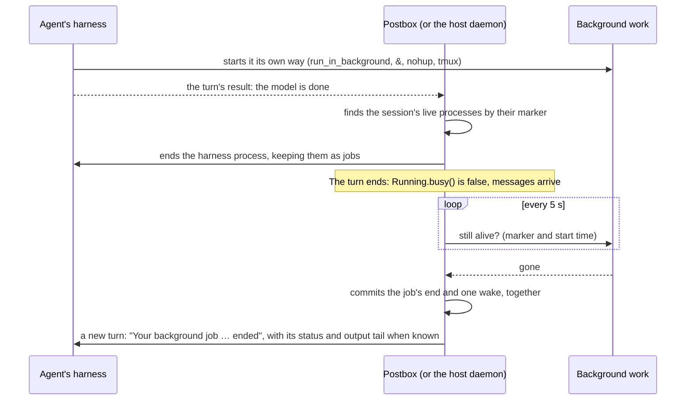
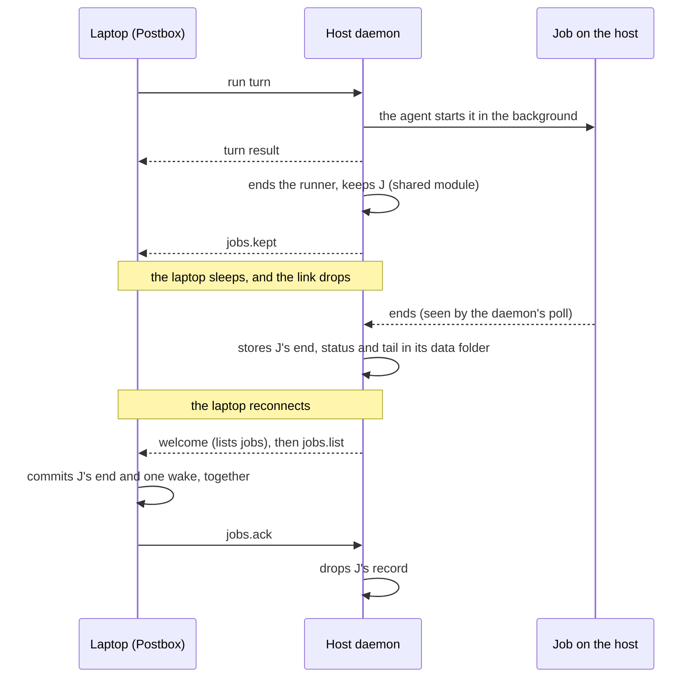

# Background work that outlives a turn

When an agent starts work in the background, such as a gate, a CI watch or a server, its turn should end once the model is done. The work keeps running, the room can see it, and the agent that started it is woken when it ends. This holds on every harness Postbox runs, and on remote hosts. Postbox adds no tool for it. The agent starts background work its harness’s own way (`run_in_background`, `&`, `nohup`, `tmux`), and Postbox finds that work and keeps it.

Status: proposed for [#1614](https://github.com/HJeon139/postbox/issues/1614), and not built. It replaces an earlier draft of this doc that added four Postbox tools and a launcher. On [#1615](https://github.com/HJeon139/postbox/pull/1615), the owner directed that Postbox integrate with each harness instead, because agents use their harness’s own way and fumble Postbox-specific mechanisms. It also covers the attribution and cleanup [#1606](https://github.com/HJeon139/postbox/issues/1606) asks for, for the processes a session started.

## The problem

**Claude Code waits for its background tasks.** A Claude Code agent can start a command with `run_in_background` and finish its answer. The CLI then stays alive until the task ends, and reports it in a turn of its own. Postbox ends a turn only when the CLI’s process closes (`server/adapters/claude-code.mjs`, `child.on('close', settle)`). So `Running.busy()` stays true, `Delivery.ready()` (`server/delivery.mjs`) returns false, and every message to the agent waits.
- **Measured with the real CLI in #1614:** a reply with no background command exited at 7.6 s. The same reply after `sleep 90` with `run_in_background` exited at 98.2 s.
- **In the room on 21 and 22 November 2026:** agents’ messages waited 26 to 167 minutes behind their own background gates and CI watches.

**The other harnesses fail the other way.** Codex, Kiro and Antigravity each run in their own process group. Stop and the turn’s end kill that group (#126), so background work dies with the turn. On a host, the daemon owns that group (`server/remote/host/daemon-kill.mjs`). The guide’s “When your turn ends” section (`server/adapters/guide.mjs`, `TURN_ENDS`) tells agents that nothing wakes them when a command ends.

## What already exists on `main`

- **Recognizing jobs:** Claude Code’s `run_in_background` tasks are recognized from the stream (`server/adapters/claude-stream.mjs`) and recorded as jobs, with each one’s output file (`server/harness-events.mjs`, `startJob`). At the turn’s result, `on_turn_end` lists the jobs still running (`tools.waiting`).
- **Keeping jobs:** Send now stops the CLI with `jobs: 'keep'` (`server/message-queue.mjs`, `stopForSendNow`). Each kept job has its own Stop.
- **Seeing jobs end:** a 5-second poll of the kept jobs’ process groups sees each one end (`server/kept-jobs.mjs`, #129, #164).
- **Identity on a host:** the daemon records a turn’s tool shells’ groups. It matches each group by its members’ start times, so a reused pid is never signaled (`daemon-kill.mjs`, `liveGroups` and `sameProcess`).

The design extends those. It adds no tool, no listener and no permission surface. Every command is still one the agent ran through its harness’s own shell tool, judged in the persona’s mode.

## The design

### 1. End the turn when the model is done, and keep what still runs

- **Claude Code and the Agent SDK.** At the turn’s `result`, `on_turn_end` already knows which jobs still run. When background jobs are the only thing keeping the CLI alive, Postbox ends the CLI as Send now does, through the existing stop path with `jobs: 'keep'`. The turn ends there. Its jobs keep running, and each stays in the room with its own Stop. That fixes #1614’s wait of 98.2 s against 6.9 s.
  - It doesn’t apply while the model is still working: before the `result`, while a subagent runs, or while a permission card waits.
  - The Monitor tool is covered once the live check below shows it survives the same stop.
- **Codex, Kiro and Antigravity.** At the turn’s end, before its process group is killed, Postbox lists the session’s live processes by their marker (see 2). It leaves out the harness’s own process, and anything a tool call still open at the end owns. What’s left was started in the background, and it is kept as jobs:
  - the group kill skips those processes;
  - each is signaled on its own, and only after the same identity check;
  - anything else in the group is killed as today.

### 2. Find a session’s processes by an inherited marker

Each harness process Postbox starts gets two variables in its environment: `POSTBOX_SESSION=<session id>` and `POSTBOX_TURN=<turn id>`. Neither is a secret. The turn’s MCP token never goes into the environment (#54, #126). Every descendant inherits the two variables, including after `setsid`, `nohup` or reparenting to `launchd` or `init`, which the process group can’t follow.

- **Reading it.**
  - **On macOS,** `ps -Eww -ax -o pid=,ppid=,pgid=,lstart=,command=` prints each process’s environment after its command. Measured on this Mac:
    - a process started with the variable, directly or as a `nohup` child of a subshell, showed it under `ps -Eww -ax`;
    - `ps -Eww -p <pid>` printed the same process without its environment.

    So the scan lists every process, with `-ax`, and filters.
  - **On Linux,** the marker comes from `/proc/<pid>/environ`.
  - **Either way,** the scan is one more column in the existing `listProcesses` read (`server/adapters/process-group.mjs`), with the same 2 s timeout and 16 MB cap.
- **Identity.** A job is recorded as each process’s pid and start time (`lstart`), with the marker it carried. Postbox signals a process only while that pid has the same start time and still carries the marker. That’s the rule `liveGroups` already applies on hosts.
- **What an agent can see or change, and what that costs.** An agent can read its own marker, drop it with `env -u`, or set another session’s.
  - **Dropping it:** that process isn’t tracked. It runs on unseen and wakes no one, as a `nohup` process does today.
  - **Setting another session’s marker:** the process is tracked as that session’s job, so that session’s Stop or end can stop it. A process can only volunteer for that. The person’s own processes, and other programs’, carry no marker unless an agent’s turn started them.
  - **Nothing is decided by the marker alone:** only the session’s own turn end keeps a job, and stopping another session’s job stays the person’s decision (#1606).

### 3. Wake on exit

When a kept job ends, the agent that started it gets one wake, sent the way a scheduled wake is (`server/scheduled-wakes.mjs`, `rt.delivery.send`):

> Your background job “npm run check” ended after 4 min 12 s, with exit code 1. Its last 50 lines: …

- **Exit status, where Postbox can know it.** Postbox can’t read the status of a process that isn’t its own child when it ends. So the status comes only from a known place: a Claude Code task notification seen before the CLI ended, or an exit file the command writes itself. Otherwise the wake says “exit status unknown”.
- **The output tail, where the output went to a known place.**
  - **Where it can come from:** Claude Code’s output file (the `outputFile` its tool result names), a redirect on the job’s own command line, or a `tmux` pane through `tmux capture-pane -p`.
  - **How it’s read:** at most the last 8 KB and 50 lines, from a regular file opened without following links.
  - **How it’s shown:** quoted as data, so an @-mention in it wakes no one.
  - **With none of those,** the wake says where to look, or that the output wasn’t kept.
- **Once.** The job’s end and its wake are committed together. A restart or a host reconnect that finds the job already ended wakes no one again.
- **Quiet in the room.** The wake goes only to the agent that started the job. It counts as no hop and raises no “needs you”. Each job stays visible in the room with its Stop until it ends, and then shows its end. That isn’t an alarm: the agent it wakes acts on it (AGENTS.md, “No unactionable alarms”).

### 4. Remote hosts use the same code

The keep decision, the marker scan, the poll and the job record live in one module under `shared/`. The server and the host daemon both load it, and `shared/` modules already reach the host through `hostFiles` (`server/remote/install-bundle.mjs`).
- **On a host, the daemon does the work.** It ends the runner while keeping the jobs, polls them, and keeps each job’s record, output tail and status in its own data folder, never in the workspace. It does this while the laptop sleeps or the link is down.
- **On reconnect, the laptop and the daemon reconcile.** A job that ended while they were apart wakes its agent once, from the stored record, in one commit. Jobs still running reappear as they are.
- **Protocol messages it adds:**
  - `jobs.kept`: from the laptop to the daemon, the jobs a turn’s end kept.
  - `jobs.list`: from the daemon to the laptop on reconnect, every job’s record.
  - `jobs.ended`: from the daemon to the laptop, while connected.
  - `jobs.stop`: from the laptop to the daemon.
  - `jobs.ack`: from the laptop to the daemon, once the end and its wake are committed, so the daemon can drop the record.
- **Older daemons.** A daemon from before this change doesn’t list `jobs` in its welcome. With one, the laptop keeps today’s behavior, as #1583 does with `claudeChecks`.
- **While a host is disconnected,** its jobs show in the room as unknown, last seen at a given time, never as an alarm.

### 5. tmux is welcome, not required

If an agent uses `tmux new -d`, the marker finds the session’s processes, `capture-pane` gives their output, and tmux keeps them alive across a Postbox restart. Postbox doesn’t make tmux the mechanism, because it isn’t on every host and agents would have to choose it.

### 6. Restart

After a Postbox or daemon restart, a kept job is adopted again if its recorded pid still has its start time and its marker, so a long run survives an upgrade. A job that doesn’t match is recorded as ended, with “Postbox restarted while it ran: exit status unknown”, and wakes its agent once.

## The guide

`TURN_ENDS` becomes one line for every harness: background work is fine, and you’ll be woken when it ends. The “Attention and wakes” row in `intent.md` adds a kept job’s end to what wakes an agent.

## To verify live, per harness, and record here

Each check is a local run of up to 3 turns (contract §8). A harness keeps today’s behavior until its check passes.
- **Claude Code:** with `-p` stream-json, does ending the CLI after the turn’s `result` keep every task, Monitor included? Does each task’s output file go on filling?
- **Codex:** does the app-server end a turn while a backgrounded child runs, and what does it do to that child?
- **Kiro and Antigravity:** what happens to `&` and `nohup` at the end of a turn? Does the marker reach their tool shells?

## How it’s tested

- **The room outcome, through the normal turn path,** with recorded or scripted streams:
  - a turn that leaves a background job ends at its `result`;
  - a room message reaches the agent while the job runs;
  - the job’s end wakes the agent exactly once, including with a restart between seeing the end and queuing the wake.

  #1614’s recorded native stream, where the message waits, is the baseline.
- **`tests/process/`, with real processes:**
  - the marker survives `nohup` and `setsid`, and the scan finds it;
  - the turn end’s group kill spares the kept process and kills the rest;
  - the identity check refuses a pid whose start time or marker changed;
  - a job that drops its marker isn’t tracked.
- **Unit tests:**
  - the keep decision for each harness’s end event;
  - the bounded, quoted tail;
  - no hop and no “needs you”;
  - Stop on another session’s job is refused to agents.
- **On a host:** a fake daemon goes through a disconnect, an exit while away, and a reconnect. A second reconnect wakes no one, and an old daemon’s welcome keeps today’s behavior.
- **A browser spec** for the job items and their Stop, run plain and with `POSTBOX_STREAM_LAG=300`.

## When to revisit

- If A′ live input ([delivery-routes.md](../508/delivery-routes.md)) is proven for a harness, the CLI could stay alive and take messages between turns. Ending it at the `result` would then no longer be needed there.
- If agents drop the marker often enough that their work goes untracked, find out why before adding any mechanism they would have to choose.
