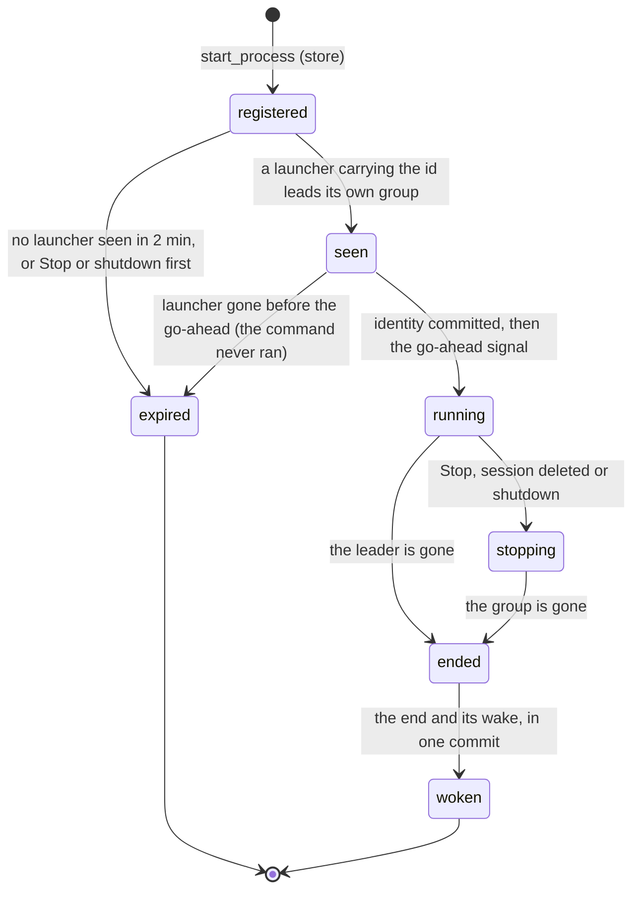

# Background processes

How an agent starts work that outlives its turn, such as a gate, a CI watch or a server, without staying busy for the whole run. Postbox tracks the process, the room sees it, and the agent that started it is woken when it ends. This doc covers every harness Postbox runs (Claude Code, the Agent SDK, Codex, Kiro and Antigravity), not only Claude Code.

Status: proposed for [#1614](https://github.com/HJeon139/postbox/issues/1614), and not built yet. It takes the process attribution and cleanup that [#1606](https://github.com/HJeon139/postbox/issues/1606) asks for, for the processes it starts.

## The problem

When a Claude Code agent starts a command with `run_in_background` and finishes its answer, the CLI stays alive until that command ends, then reports it in a turn of its own. Postbox ends a turn only when the CLI’s process closes (`server/adapters/claude-code.mjs`, `child.on('close', settle)`). So `Running.busy()` stays true, `Delivery.ready()` (`server/delivery.mjs`) returns false, and every message to the agent waits.

In #1614’s measurement with the real CLI, a reply with no background command exited at 7.6 s. The same reply after `sleep 90` with `run_in_background` exited at 98.2 s. In the room on 21 and 22 November 2026, agents’ messages waited 26 to 167 minutes behind their own background gates and CI watches. A review posted at 21:40 UTC reached its agent at 00:27.

The other harnesses fail the other way. On Codex, the turn’s process group stops when the turn completes (`server/adapters/codex.mjs`), so the background work dies with it. The guide’s “When your turn ends” section (`server/adapters/guide.mjs`, `TURN_ENDS`) tells agents that nothing wakes them when a command ends, and to call `schedule_wake` and poll instead.

[delivery-routes.md](../508/delivery-routes.md) designs live input into a background-waiting CLI (A′ `background-wait`). That route is per harness, unverified, and disabled until a spike proves it. This doc takes the other route: work that outlives a turn runs outside it, so the turn ends when the model is done, on every harness.

## The decision to review: who judges the command

Postbox decides nothing about an agent’s commands. “The harness decides, in the mode the person set” ([architecture.md](../architecture.md), “Key decisions”; [permissions.md](permissions.md)). In Auto, Claude Code’s classifier judges each Bash call, and Codex, Kiro and Antigravity apply their own approvals. A persona with “Run commands” (`shell`) unticked has its shell tools denied (`TOOL_RULES` in `server/adapters/setup.mjs`).

Postbox’s own MCP tools are allowed wholesale (`--allowedTools mcp__postbox` in `server/adapters/claude-code-args.mjs`; `sdk-permission.mjs` allows `mcp__postbox__*`). So an MCP tool that ran a command the agent passed would be a second way to run commands. No harness would judge it, and it would bypass every persona’s permission mode. That rules out the obvious design, a `start_process { argv }` tool that Postbox spawns. The two options:

| | A. The harness runs a Postbox launcher (proposed) | B. Postbox spawns from an MCP call |
|---|---|---|
| Who judges the command | The agent’s harness, through its own shell tool, in the persona’s mode, as any command | Postbox, which can apply only the deny rules (`shared/permission-match.mjs`, `decide`), not the harness’s Auto classifier |
| A persona without `shell` | Can’t start one: it has no shell | Must be refused by a new check that mirrors `TOOL_RULES` |
| Steps for the agent | Two: `start_process`, then run the command line it returns | One |
| New execution authority in the server | None. The server never spawns what an agent wrote | A new spawn path for agent strings, reviewed as a security change |
| Every harness | Any harness with a shell tool | Any harness with MCP, with permission parity unverified per harness |

Proposed: A. It keeps the permission decision where it is today, and adds no path from an agent’s words to a spawn in the server. B is simpler for the agent, but it moves a security decision from the harness into Postbox. That is the person’s call (contract §1, a security-boundary trade-off), and this doc asks for it only if review prefers B.

## How it works (option A)

```mermaid
sequenceDiagram
  participant A as Agent (any harness)
  participant S as Postbox server
  participant H as Agent's shell tool
  participant L as Launcher (tools/postbox-process.mjs)
  participant P as The process group
  A->>S: start_process { note, wake }
  S-->>A: id, and the command line to run
  A->>H: node …/postbox-process.mjs run <id> <output> -- npm run check
  Note over H: The harness judges this call in the persona's mode
  H->>L: runs
  L->>L: forks the leader into a new session (setsid), and waits
  S->>S: binds the leader by ancestry in ps, commits its identity
  S->>L: go-ahead (SIGUSR1) to the leader; the shell call returns
  Note over A: The turn ends: Running.busy() is false, messages arrive
  L->>P: runs the command as its child, in its group
  P-->>L: output, which the leader streams to Postbox over its socket
  P-->>L: exits; the launcher stops what is left in its group
  S->>S: sees the leader gone (ps), commits the end and the wake
  S->>A: a wake with the exit status and the output's last lines
```

### The tools

Four MCP tools in `shared/mcp-tools.mjs`. A backend gets them only once its permission parity check passes (see “Permission parity, per harness”). A persona without `shell` doesn’t get them at all: `TOOL_RULES.shell` lists them, so the same deny that removes Bash removes them. `start_process` also refuses on its own when the persona lacks `shell`, so a stale tool list can’t register a launch.

- `start_process { note, wake? }` registers a process the agent is about to start. It returns the process’s `id` and the exact command line to run with the agent’s own shell tool: `node <postbox>/tools/postbox-process.mjs run <id> <socket> -- <the command, as words>`. `note` (up to 300 characters) says what it is, and `wake` defaults to true.
- `list_processes` lists the conversation’s processes: the owner, note, state, start time, run time, and the exit status once ended. It only reads, so it joins `READ_TOOLS` (`server/tool-gate.mjs`).
- `read_process { id, lines? }` returns the end of a process’s output: 50 lines by default, at most 400, and at most 16 KB.
- `stop_process { id }` stops a process the calling agent started. A process another agent started can be stopped only by the person, on its item. #1606: “Stopping another session’s processes stays a decision only the person can make.”

### Permission parity, per harness

The launcher’s command line has to be judged as the command it carries would be. Seeing the launcher call proves nothing on its own: a harness might judge only `node …/postbox-process.mjs` and wave the real command through, or the detached child might leave the harness’s sandbox. So each backend has a capability, `backgroundProcesses`, which is off until a live check on this computer passes for it. The four tools aren’t offered to a backend with it off. The check runs through the normal turn path, with one persona in Auto and one with `shell` unticked. It has six cases, and all of them must hold:

1. A command the persona’s rules allow runs, and its end wakes the agent.
2. A command a deny rule names, such as `Bash(rm:*)`, is refused when it comes through the launcher, exactly as it is when run bare.
3. A persona with `shell` unticked can’t register a launch: the tools are missing, and a direct call to `start_process` is refused.
4. The launcher needs no approval the bare command didn’t: it writes no file, and its harness lets it connect to Postbox’s socket (see “Output, over a socket”). Postbox’s go-ahead signal reaches the sandboxed launcher. A harness whose sandbox refuses the socket stays off.
5. The detached child stays under the harness’s sandbox. On Codex in Auto (workspace-write), the launched command can’t write outside the workspace, just as the bare command can’t.
6. The shell command descends from the turn’s backend process that Postbox holds, so a launch can be bound by ancestry (see “One lifecycle”).

A backend that fails any case stays off, and the result is recorded with the run. Each run is a local recording of up to 3 turns (contract §8), and each backend is a separate run. On Codex, the turn’s process group is stopped when the turn completes (`server/adapters/codex.mjs`), so case 1 also checks that the detached launcher survives that stop.

### The launcher

`tools/postbox-process.mjs` is a small Node script with no dependencies. It runs its command as an argument array, never through a shell. A command that needs a pipe or `&&` says so itself, as `sh -c '…'`, and the harness then judges it as written.

The launcher is started as `node …/postbox-process.mjs run <id> <socket> -- <command>`. The foreground copy forks the leader into a new session (`setsid`) and stays until Postbox has bound the leader and sent its go-ahead (see “Identity, bound by process ancestry”). Then it exits, and the shell call returns. After that, neither a CLI that tracks its children nor Codex’s turn-group stop holds the leader or ends it. After the go-ahead it runs the command as its own child, in the same process group, and it stays the group’s leader until the command ends.

### Output, over a socket

Postbox creates nothing and reads nothing in the workspace. A file Postbox made or read there would be made or read with the server’s own permissions, at a path the agent’s command can change under it. Node has no `openat` to anchor such a walk to a verified directory. So output doesn’t go through files at all.

- **The socket.** At start, Postbox makes a private folder with `mkdtemp` in the system temp folder: new, unique and mode 0700. It listens on a Unix socket there (`<that folder>/s`), whose short path fits the platform’s socket path limit. It accepts nothing on TCP, so “Postbox listens on 127.0.0.1 only” is unchanged. The socket’s mode and folder limit it to the person’s own user, which is the same boundary as their processes (security-boundaries.md, “This computer alone”). This is a new local listener, so it is reviewed as a security change.
- **A connection is bound to the verified leader by the OS, before any of it is read.** The folder’s mode limits the socket to the person’s user, and that user can run several agents. A connection’s first frame, the process’s id, only names a run, so it authenticates nothing. Node can’t ask a Unix socket for its peer’s pid, so Postbox asks the OS’s socket table instead.
  1. For each new connection, Postbox takes the kernel address of the accepted socket. It finds that address in `lsof -a -U -p <its own pid> -F fdn`, by the descriptor Node holds for the socket.
  2. It then lists the bound leader’s sockets with `lsof -a -U -p <leader pid> -F fdn`. It binds the connection only if one of the leader’s sockets is connected to that address (`n->0x…`), and the leader still has its recorded start time.
  3. Until then, Postbox reads nothing from the connection: no frame of it becomes output or an exit status.

  Measured on this Mac with lsof 4.91: an accepted connection’s kernel address appears as `->0x…` on the connecting process’s own socket, and on no other. The leader opens its socket close-on-exec, so the command it runs doesn’t inherit it.
- **Work before authentication is bounded.** Before a connection is bound, all Postbox does with it is hold it and run `lsof`. Both are capped in `shared/limits.mjs`:
  - **Who may connect at all.** Postbox accepts connections only while some bound, running process is still waiting for its channel. Otherwise it closes them on arrival, with no lookup.
  - **Pending connections.** At most 2 per waiting process, and 16 in all. A connection past either cap is closed on arrival, with no lookup.
  - **Lookups.** One `lsof` runs at a time, each with a 2 s timeout, and at most 4 run per second across the server. Its output is capped at 1 MB, as `listProcesses` caps `ps`.
  - **Timeout.** A pending connection that isn’t bound within 5 s is closed unread.

  The channel uses none of what turns and process control need. Delivery, the startup handshake, the `ps` poll and Stop don’t wait on a lookup or a connection. So a flood of connections can at worst use up the channel’s own caps. The processes whose channels didn’t bind in time then end with “output and exit status unavailable”, and every turn and every Stop goes on as before.
- **Rejection leaves the job alone.** The leader retries its own connection up to its own limit (5 tries, 1 s apart). It never stops its command because of the channel: whether the channel works or not, the command runs to its end. An unverified peer can neither fill the item nor stop the job.
- **When there’s no binding.** If `lsof` fails or isn’t there, or a platform reports no peer address, the process still runs, is watched and is stopped as before. Its end is reported with “output and exit status unavailable: Postbox couldn’t verify the launcher’s channel”. Whether this works on Linux (`ss -xp` reports peers by inode) is checked when that platform is supported. Until then, there it is this unavailable mode.
- **Bounded by Postbox.** Postbox keeps the last 64 KB of each process’s output in memory (`MAX_COMMAND_OUTPUT`, the bound of `!` commands). It sends output to the process’s item the way `commandOutput` in `server/shell-runs.mjs` does for a `!` command, and it stops reading a connection that sends faster than it keeps up. One frame per message. A frame over 16 KB closes the connection, and the process’s output then ends with “output cut: its channel misbehaved”.
- **The exit status** is the last frame: a code that’s an integer, or a signal that’s a signal name. Anything else reads as “exit status unknown”. The status is the launcher’s report, labeled “as its launcher recorded”. Whether and when the process ended is still decided only by `ps` (see “One lifecycle”).
- **No disk.** Neither Postbox nor the launcher writes the output to a file, so there is nothing to cap on disk and nothing to clean up in the workspace. A leader that can’t connect keeps its command running, and keeps only the last 64 KB of its output in memory.
- **After a restart.** The socket folder is new, so no old connection carries over, and the item keeps the output Postbox last stored. The end reads “exit status unknown: Postbox restarted while it ran”. A restart stops every process it can confirm (“Restart”), so no process is left running without a channel.
- **While it runs and after.** `read_process` reads Postbox’s in-memory end of the output while the process runs, and from the item after it ends.

Postbox gives the agent’s environment no token and no URL: [#54](https://github.com/HJeon139/postbox/issues/54) and [#126](https://github.com/HJeon139/postbox/issues/126) closed that path, and the launcher never calls the server.

### One lifecycle, from registration to cleanup

Every decision about a process rests on two things the command can’t forge:
- **Postbox’s store,** in the person’s data folder, outside every workspace.
- **What the operating system reports:** `ps`, with the start time (`lstart`) added to `listProcesses` in `server/adapters/process-group.mjs`.



**Identity, bound by process ancestry.** A command line is something a process supplies about itself, so it only names a candidate. What ties a candidate to the registered launch is its ancestry, which the OS reports and a process can’t rewrite. Postbox holds the owning turn’s backend process as its own child, the CLI or app-server that `rt.turns` keeps, so that pid can’t be reused while the turn runs.

The launch has two stages, and the shell call doesn’t return until Postbox has bound them:
1. The **foreground launcher** is what the agent’s shell tool runs. It forks the **leader** into a new session (`setsid`), and then waits. It doesn’t exit.
2. Postbox polls `ps` every 250 ms while any registration is waiting. It binds a candidate only when a single snapshot shows all of these:
   - the leader’s parent is the foreground launcher;
   - the foreground launcher descends, through parent pids, from the backend process of the turn that called `start_process`;
   - the leader leads its own group (pid = pgid), and both processes started after the registration.
3. Postbox commits that identity to the store (the leader’s pid, which is also its pgid, and its start time), and only then sends the go-ahead, SIGUSR1, to the leader.
4. The leader starts the command only on that signal. The foreground launcher exits once the leader has it, and the shell call returns “started”. With no go-ahead within 30 s, both exit and nothing runs, and the agent sees “Postbox couldn’t confirm this launch, so it didn’t start”.

**Candidates that don’t match are never signaled.** A process carrying the id that isn’t bound this way gets no signal at all, not even a SIGTERM. It times out by itself, because without a go-ahead it runs nothing. One registration binds one identity, the first one committed, and a second matching candidate is left to time out the same way.

The binding ties a launch to the owning agent’s turn, not to one particular shell call in it. Another command in the same turn could start a matching launcher, but that command ran under the same agent’s permissions, which its harness judged.

A backend whose shell commands don’t run under the process Postbox holds can’t give this binding. That covers a harness whose tools run in a separate daemon, and remote hosts. Such a backend keeps `backgroundProcesses` off, and the parity check (“Permission parity, per harness”, case 6) is where that is found.

**Continuity.** From then on, a group is this process’s group only while its leader is alive with the recorded pid and start time, whatever any file says.

So a launcher that dies before the go-ahead never ran the command, and a restart at any point finds either no identity and no command, or an identity it can check. Expiry, Stop and shutdown during startup all win the same way: Postbox never sends the go-ahead. The single-use claim is Postbox’s commit of one identity per registration, not a file in the workspace.

**Caps count registrations.** At most 4 processes per agent and 12 per conversation, in `shared/limits.mjs`, counting registered, seen and running processes alike. A `start_process` past a cap is refused, and the refusal says which processes hold the slots.

**Stopping, and failing closed.** In the usual case, Postbox signals the group only after the leader check passes, and runs the check again before the SIGKILL that follows SIGINT after `GRACE_MS` (`stopPgid`).

When the leader is gone, the group id alone proves nothing. Postbox then signals only processes it saw as members of that group at an earlier poll, each one by its own pid, and only while that pid still has the start time recorded for it. Each poll of a running process records its group’s members. A member that appeared after the last poll isn’t signaled.

When Postbox can’t establish identity, it signals nothing. The item then says “Postbox couldn’t confirm this process was still its own, so it didn’t stop it”, and lists the pids it last saw. That covers a leader whose start time doesn’t match, and a group with no leader and no recorded member left. This is a fact on the item, with no card and no notification.

A `ps` result is a snapshot, so this design doesn’t promise that a reused pid can never be signaled. The start-time check narrows it to a pid reused between the snapshot and the signal. That is a window of milliseconds, and the design doesn’t claim it is zero.

**The command exits with descendants still running.** The command’s exit is the process’s end. The launcher sends the exit status, then stops what is left in its own group: SIGINT, then SIGKILL after the grace period. It can do that safely, because it still leads the group. It then exits.

If the launcher has died before it could do that, Postbox stops the leftovers it saw as members, as above. The wake says “3 processes it left running were stopped”. A process meant to outlive its command, such as a server that forks into the background, is out of scope: its command has to stay in the foreground.

**Watching, and what decides the end.** Postbox polls every 5 s while any process runs, as it watches kept jobs (`server/kept-jobs.mjs`, `KEPT_POLL_MS`). A process has ended when its recorded leader is gone, and only then. The exit code comes from the leader’s last frame, and the wake labels it “as its launcher recorded”. A missing or malformed one gives “exit status unknown”.

`start_process` and `stop_process` write, so `closedTo` refuses them while the store is closed. No go-ahead is sent then. An end seen while the store is closed is recorded at the first poll after it reopens, as `pollKept` does.

**Restart.** The store has every open process and its recorded identity. At start, Postbox reconciles each one:
- A registration with no recorded identity is expired. Any launcher still waiting gets no go-ahead, and exits after its 60 s.
- A recorded identity whose leader is alive is stopped, after the leader check, so nothing Postbox started outlives it unseen.
- A recorded identity whose leader is gone has its leftover members stopped, as above.

Each of these ends is committed with its wake, once.

### Wake on exit

An end wakes the owning agent as its scheduled wake does (`server/scheduled-wakes.mjs`). The agent asked for that wake, so it follows the existing rule that “a scheduled wake … go[es] only where [it] say[s]” ([intent.md](../intent.md), “Attention and wakes”). It reaches no other agent, and it adds no hop to a chain. The message says:

> Your process “npm run check” (`p_…`) ended after 4 min 12 s, with exit code 1 as its launcher recorded.  Its last 50 lines: …

The tail is cut to 50 lines and 8 KB, followed by “read_process for more”. It’s quoted as data, so an @-mention in it wakes no one, as with any copied line. A busy agent gets the wake through its inbox, never as a second session. With `wake: false`, the end is recorded and no one is woken.

**Once, across a restart.** The process’s `ended` state and its wake message go in one store commit. Each poll and the startup reconciliation skip a process the store already has as ended. So a restart between seeing the end and queuing the wake makes one wake. The store still has the process open, so the next poll sees the end and makes the wake. A restart after the commit makes none, because the process is already ended.

### Room visibility

Each process is an item in the conversation where it started. It has the `command` kind that `!` commands already use (`server/shell-runs.mjs`): its command line, its status while it runs, the end of its output, and its exit status. It names the agent that started it, and the person can Stop any process there.

The session ring shows an agent waiting on its processes as idle with a count (“2 processes running”), not as busy. A process that fails shows as a status on its item. It raises no “needs you”, no notification and no focus move: the agent it wakes acts on it, and the person can’t act on it beyond what the item offers (AGENTS.md, “No unactionable alarms”).

### The guide

For backends with `backgroundProcesses` on, `TURN_ENDS` changes from “never because a command you started finished” to: start work that outlives your turn with `start_process`, end your turn, and you’ll be woken when it ends. It also says not to use `run_in_background` or `nohup` for that: the first keeps the turn and the agent’s messages waiting, and the second leaves a process nobody sees. For the others, the text stays as it is. The “Attention and wakes” row in `intent.md` adds the process end to what wakes an agent.

## Remote hosts

On a remote host, the agent’s shell runs on the host. The launcher and its socket would live on the host, the host daemon would hold the identities, and the daemon would report ends over its channel. That is a separate change to the remote protocol, so remote agents have `backgroundProcesses` off for now.

## How it’s tested

**The room outcome, through the normal turn path.** They use a scripted agent (the mock backend, or a recorded stream) in the ordinary turn lifecycle, which runs the launcher as its shell step. The CLI closes normally, because the launched process isn’t one of its background tasks. Tests that end the turn early are a different mechanism and don’t count here.
1. The owner calls `start_process` and runs the launcher, and its turn ends when its process closes, while the managed process still runs.
2. A room message to the owner arrives in a new turn before the managed process ends.
3. The process’s end wakes the owner exactly once.
4. With a restart between seeing the end and queuing the wake (the store is closed and reopened, then Postbox is restarted from its data folder), there is still exactly one wake. After the commit, there are none.

**Baseline.** A recorded Claude Code stream that uses native `run_in_background` (`background_tasks_changed` in #1614’s probe) shows the room message waiting until the task ends.

**`tests/process/`, with the real launcher:**
- The parent shell returns in under a second, and the command doesn’t start until the go-ahead.
- With no go-ahead, the launcher exits after its wait, and the command never ran.
- **Binding by ancestry:**
  - A launcher started from a process outside the owning turn carries the right id, and gets no signal and runs nothing.
  - Two launchers in the owning turn: exactly one is bound and runs.
- Stop, expiry and shutdown before the go-ahead each leave no process.
- A launcher killed after the go-ahead has its recorded members stopped.
- A command that exits with a grandchild still running has the grandchild stopped.
- Under a command that writes without end, Postbox’s memory for it stays at 64 KB, and a slow reader doesn’t block the command beyond the socket’s buffer.
- After the end commits, the process’s connection is closed.
- **Cleanup touches only this instance’s socket folder.** Several Postbox instances can run as one user, each with its own data folder. Each instance records its socket folder’s path in its own store. At shutdown, an instance removes only the folder it recorded. At start, it removes only the folder its own store recorded from the previous run. It knows that run is gone because the data folder’s writer lock (`store.lock`, [store.md](store.md), “One writer”) refuses a second Postbox on the same data folder. It never scans the temp folder for anyone else’s. A test starts a second instance with another data folder, and the first instance’s socket stays reachable and its folder stays in place.
- **Under a flood of connections:** 200 same-user connections that never bind, opened during a run. The test checks:
  - pending connections stay at or below the caps, and lookups stay at or below their rate;
  - a room message still reaches the owner in a new turn within its usual time;
  - `stop_process` still stops a process;
  - a process whose channel couldn’t bind ends with “output and exit status unavailable”.
- **An unverified peer can neither fill the item nor stop the job:**
  - another process of the same user connects first with the right id, sends output and an exit frame, and holds its connection open. None of it reaches the item. The real leader’s connection binds and its output arrives, and the command runs to its end.
  - with `lsof` made to fail, the process ends with “output and exit status unavailable”, and its command was never stopped by the channel.
  - a connection for an unbound or ended id is closed unread.
- **Zero changes in the file system outside Postbox’s own socket folder.** A snapshot (paths, inodes, sizes and modification times) is taken of the agent’s folder, its parents and a decoy folder outside, before a whole launch and run and after it. Parents are swapped for links at each step by a hook in the test build. The test’s command writes nothing, so the two snapshots must match exactly.
- An oversized frame and a malformed exit frame are each handled within the limits.
- **Failing closed:** a leader whose start time doesn’t match, and a group with no leader and no recorded member, are each left unsignaled, and the item says why.

**Unit tests, with a fake process list:**
- The caps count registrations.
- `stop_process` on another agent’s process is refused.
- With the store closed, no go-ahead is sent.
- The wake’s tail is bounded and quoted.

**A browser spec** for the item and the ring’s count, run plain and with `POSTBOX_STREAM_LAG=300`.

**Per harness:** the parity check in “Permission parity, per harness” enables each backend. Until a backend has passed it, the backend stays off and is reported as unverified.

## When to revisit

- If A′ live input ([delivery-routes.md](../508/delivery-routes.md)) is proven for a harness, its native background tasks may serve there, and this stays the route for the others.
- If agents skip the second step, starting the process with `start_process` but never running the command, measure it from the dropped registrations, and weigh option B again with the person.
