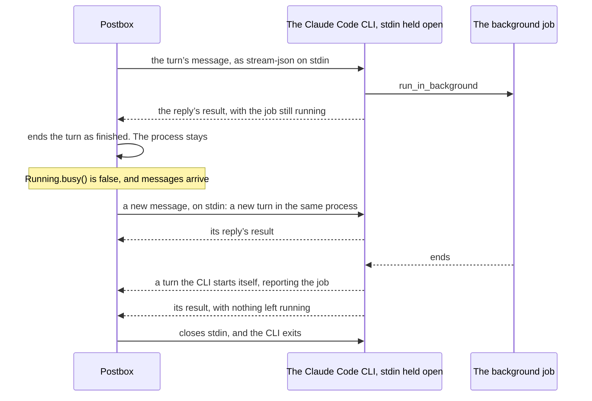
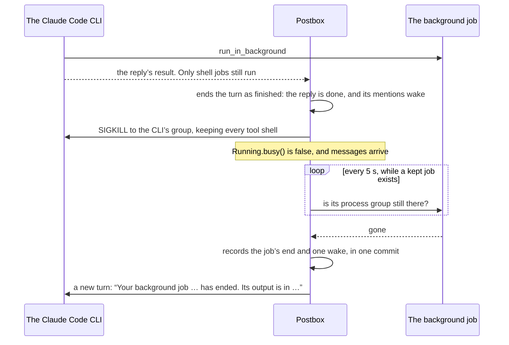
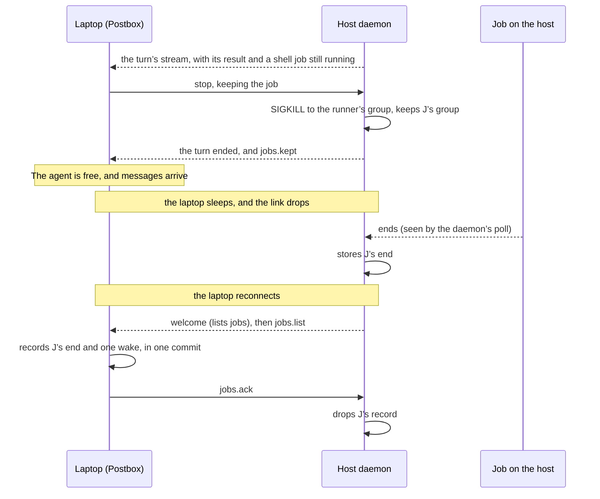

# Background work that outlives a turn

An agent whose background job is still running takes new messages right away. That’s the one outcome this design is for, on every backend and on remote hosts. A background job exists to free its agent for other work while it runs, so holding the agent busy until the job ends defeats it (designs/intent.md, “Function first”).

How, in one of two ways. Where a harness is shown to take a new message while its background work runs, its process stays alive and gets the message: that’s live input, and it comes first, for Claude Code on this computer. Where that isn’t proven, the turn ends when the model has replied, the job runs on, and its end wakes the agent that started it, once. Agents start background work their harness’s own way, with `run_in_background`, `&`, `nohup` or `tmux`, and Postbox adds no tool for it.

**Where it stands:** proposed for [#1614](https://github.com/HJeon139/postbox/issues/1614), and nothing here is built. On `main` an agent is held busy for its background work on every backend but Codex, as “The problem” lists. **What’s next:** the checks in “Checks before the first step is built”, then that step.

**How this document got here:**
- An earlier draft added four Postbox tools and a launcher. On [#1615](https://github.com/HJeon139/postbox/pull/1615) the owner directed that Postbox integrate with each harness instead, because agents use their harness’s own way and fumble Postbox-specific mechanisms.
- The draft after that ended a turn early only when every task bound to exactly one process group under strict rules, and otherwise kept the wait. A review on 26 November 2026, summarized in [#1824](https://github.com/HJeon139/postbox/pull/1824), found that it left agents busy in the usual cases, such as a gate run in the foreground, fixed, then run again in the background. It also carried work that doesn’t stop the pile-up, which is now under “Later, not part of #1614”.
- The owner then stated the rule in the room, as #1824 quotes it: “the purpose of background jobs is to free up the agent to take new messages while the job is running in the background”, and holding the agent busy “must be removed”.
- Live input had one passing run on `main` for the Claude Code CLI. Asked on #1824 “For Claude Code, which goes first: live input, or ending the turn at its reply?”, the owner answered: “Live input first”.
- The probe figures below that cite #1615’s review (456 ms and 3,004 ms, status 141, 4.7 to 4.9 ms) are in that pull request’s record. No fixture in the repo holds them, and they weren’t measured again for this rewrite.

## The problem

Postbox ends a turn only when the harness’s process closes (the `child.on('close', …)` handler in `server/adapters/claude-code.mjs`, `kiro-cli.mjs` and `antigravity-cli.mjs`). Until then `Running.busy()` stays true, `Delivery.ready()` (`server/delivery.mjs`) returns false, and every message to the agent waits in its inbox.

| Backend | What holds the agent after its reply, on `main` | The longest a message waits |
|---|---|---|
| Claude Code, this computer | The CLI stays alive until its background tasks end, then reports them in a turn of its own | The job’s whole run. Postbox sets no bound |
| Agent SDK | The same wait, inside the SDK | 2 h (`QUIET.backgroundMax` in `shared/limits.mjs`, passed by `server/adapters/sdk-background.mjs`, #1801). Then the SDK stops the work |
| Claude Code, on a host | The same wait, on the host | 2 h. Then the turn is stopped as hung (#847, `server/remote/turns-background.mjs`) |
| Kiro and Antigravity, this computer | An unredirected `cmd &` holds the CLI’s pipes, so `close` comes only when `cmd` ends | The job’s whole run. No bound |
| Kiro, on a host | Not verified. The host’s runner ends the harness at `exit`, not `close` (`server/remote/host/runner-turn.mjs`), so the held-`close` wait probably doesn’t exist there | Not verified. A quiet turn on a host with no running step is stopped as hung after the host’s `stallTimeout`, 15 minutes by default (`shared/remote-settings.mjs`, `server/remote/turns-resume.mjs`) |
| Codex | Nothing: the turn ends at the reply. But Postbox kills the turn’s process group then (`stopTurn` in `server/adapters/codex.mjs`), so background work dies, and the guide tells Codex agents to wait in the foreground (`TURN_ENDS` in `server/adapters/guide.mjs`) | The command’s whole run, as a foreground call |

The evidence:
- **Measured with the real CLI in #1614:** a Claude Code reply with no background command exited at 7.6 s. The same reply after `sleep 90` with `run_in_background` exited at 98.2 s.
- **In the room on 21 and 22 November 2026:** agents’ messages waited 26 to 167 minutes behind their own background gates and CI watches (#1614). The record doesn’t say how many of those watches were shell jobs and how many were Monitors or background subagents, and that split isn’t known. Live input frees an agent behind all three. Ending the turn at the reply frees it only behind shell jobs.
- **The Agent SDK’s limit** ([#1714](https://github.com/HJeon139/postbox/issues/1714)): after the last result the SDK waits for background work only up to `CLAUDE_CODE_PRINT_BG_WAIT_CEILING_MS`, 10 minutes by default, and then stops that work. Two review rounds run as background subagents were lost that way on 22 November 2026. #1801 raised the limit to 2 h, which saved the work and lengthened the wait.
- **Kiro and Antigravity:** Node fires `close` only once the child’s stdio streams have closed. A probe of a fake harness that ran an unredirected `cmd &` measured `exit` at 456 ms and `close` at 3,004 ms (during #1615’s review). With `cmd > log 2>&1 &`, `close` follows `exit`, and `cmd` runs on with no wake.

## What `main` already has

The steps are built from these.
- **One passing run of live input.** `tests/fixtures/delivery-routes.md`, “Claim 3”: with `claude -p --input-format stream-json` and stdin held open, Claude Code 2.1.296 took a message written 1 s after its result as a new turn, while a background `sleep 10` ran on. One run, existence only.
- **How the adapter sends its prompt.** It writes the prompt and ends stdin (`child.stdin.end` in `server/adapters/claude-code.mjs`), so nothing more can be sent to that process.
- **Recognizing a task.** Claude Code’s `run_in_background` calls, timed-out calls moved to the background, Monitors and background subagents are recognized from the stream (`server/adapters/claude-stream.mjs`). Each command is recorded as a job with its task id, command and output file (`server/harness-events.mjs`). At the turn’s result, `on_turn_end` lists the jobs and the subagents still running. The Agent SDK streams the same messages.
- **Keeping a job.** Send now stops the CLI with `jobs: 'keep'` (`stopForSendNow` in `server/message-queue.mjs`). `stopTurn`’s `keep` (`server/adapters/process-group.mjs`) sends the CLI SIGKILL at once, since its SIGINT handler would stop the jobs. It finds each job’s tool shell by its command, and keeps that shell’s process group. It’s lenient: a job it can’t tell apart is kept with every unmatched shell, so it’s never killed (#164). Once every job is found, it sends SIGKILL to every other tool shell, since in the middle of a turn those are foreground calls.
- **What Send now’s keep records.** It’s reachable only through `rt.stop(…, { jobs: 'keep' })`, which aborts the turn and records a stop (`server/turn-stop.mjs`, `server/stop-record.mjs`): the reply reads “Stopped”, its @-mentions wake no one (`server/mention-entries.mjs`), no `turn.ended` is raised, and the agent’s next turn is told the person stopped its last one (`server/job-records.mjs`). That’s right for a stop, and none of it is reused here.
- **What a resumed CLI says.** Claude Code, resumed, marks a background command it has no end for as stopped, and says so to the agent (#249). Postbox’s note at the next turn corrects it (`job-records.mjs`).
- **What the kill does to a job,** recorded with `ps` on Claude Code 2.1.296 for #126 (`process-group.mjs`’s opening comment): after SIGKILL to the CLI, its tool shells live on with init as their parent, and a background job keeps writing to its output file.
- **Seeing a job end.** A 5-second poll of the kept jobs’ process groups sees each one end (`server/kept-jobs.mjs`, #129, #164). The agent is told at its next turn, with the output file’s path (`endJob` in `server/job-records.mjs`). Nothing wakes it.
- **The agent’s state.** With a kept job and no turn, an agent already reads “waiting on a job: …” (`shared/agent-state.mjs`), after Send now or a Stop that kept jobs.
- **In the room.** Each kept job is listed under its reply with its own Stop (designs/intent.md, “Decisions and why”, the row that begins “Stop reaches every process of the turn”).
- **On a host.** The daemon records a turn’s tool shells’ groups and matches them by their members’ start times (`server/remote/host/daemon-kill.mjs`). `stopTurn` on a host ignores `keep`, so Send now keeps no jobs there today.

## The first step: live input for Claude Code on this computer

This is where the pile-up was measured, and the owner’s decision is that live input goes first here. The CLI already stays alive while its background work runs. Postbox stops treating that as a turn still running, and hands the live process the next message.

- **The adapter holds stdin open.** It starts the CLI with `--input-format stream-json`, writes the turn’s message as one user message, and doesn’t end stdin.
- **A turn ends at its `result`, and the process doesn’t.** The turn ends through `endTurn` with no error (`server/turn-finish.mjs`), as a turn whose CLI closed does today: its reply is `done`, its @-mentions wake, it goes back to its wakers, and its lint and checks run. A result with `is_error` fails the turn. While `on_turn_end` lists anything still running, a shell job, a Monitor or a background subagent, the process is kept as the agent’s live execution, and the agent is free. This is the `background-wait` state of designs/508/delivery-routes.md, “Model turns and a live backend execution (A′)”, built on the `openExecution` seam that section proposes.
- **A message while it waits** starts a turn the usual way, and the adapter writes it to the live process instead of starting a new one. One model turn runs at a time in a process: a message and a job’s end that arrive together go through one ordered queue for that process, as A′ requires.
- **What a later turn in the same process carries.** The CLI’s arguments are fixed when it starts: the model, effort and permission mode, the guide, and the MCP URL with the first turn’s token (`server/adapters/claude-code.mjs`’s opening comment, `server/turn-context.mjs`). Postbox runs a tool call only with the token of the session’s running turn (`server/mcp.mjs`, #54), so a later turn’s Postbox tools would be refused as it stands. How a new turn’s authority reaches the live process, and what a change of model, effort or mode since it started does, aren’t designed here yet. Both are decided in the step’s own change, by designs/508/delivery-routes.md, “Caller sweep: one lifetime used for two facts”, and reviewed as a security change.
- **A job’s end** is reported by the CLI itself, in a turn it starts (measured in #1614, and the third turn of the recorded run). Postbox opens a turn for it, and its reply is the agent’s like any other. That turn is the wake: Postbox sends none, the exit status is the harness’s own, and no resumed CLI calls the job stopped.
- **When a result lists nothing still running,** Postbox closes stdin and the CLI exits, as it does today.
- **No wait is left.** A background subagent and a Monitor live inside the process, and it stays alive, so neither holds the agent. Claude Code on this computer needs no 2 h bound.
- **Stop.** Stopping a running turn is `main`’s Stop, with its question about the turn’s jobs. With no turn running, each job keeps its row and its own Stop, which reaches it under the live CLI as today (`stopJobUnder` in `server/adapters/process-group.mjs`).
- **Shutdown and restart.** A clean shutdown stops the live process and its jobs, as it stops the waiting turn on `main`. But there the restart reopens that turn once as a resend (`server/turn-stop.mjs`, `server/delivery.mjs`), so the agent learns its job is gone. Here the turn has ended and the agent is idle, and nothing would start a turn. So an agent whose jobs a shutdown stopped is woken once after the start, and told which. Each merge to `main` is a release, so restarts are frequent.
- **What the step adds.** No marker in the environment, no process matching, no tool, no protocol message, and no new item in the room. It adds the held-open stdin, a turn’s token and settings for a process that outlives the turn, the split between a turn’s end and its process’s, the one queue per process, and the wake after a shutdown.

### Checks before the first step is built

Each is a local run of a few turns with the real CLI, costs real usage, and is recorded here with its date, the CLI’s version and its fixture when it’s run.

| Check | What a pass shows | Result |
|---|---|---|
| A new message after the result, while a background job runs | The CLI takes it as a new turn, and the job runs on | **Passed once** (n=1, existence only), Claude Code 2.1.296: a message written to stdin 1 s after the result started a new turn in 46 ms, with its first token at 1,379 ms, while a `sleep 10` ran on. The job’s end then started a third turn, and the CLI exited 0. `tests/fixtures/delivery-routes.md`, “Claim 3”, with `tests/fixtures/delivery-routes/scenarioa-prime-framing1-plain-postresult.jsonl`, `scenarioa-prime-framing2-attributed-postresult.jsonl`, `scenarioa-prime-control-noinject.jsonl` and `timing-manifest.json`. To run again on the CLI version Postbox ships with |
| The adapter no longer ends stdin | A turn with no background work still ends: the CLI exits once stdin is closed after its result. The prompt is recorded as sent, as today | Not run |
| Stream-json input behaves as the prompt on stdin does | `--resume`, `--session-id`, forks, slash commands, attachments, images and permission prompts each work as they do today (`tests/fixtures/delivery-routes.md`, “Claim 3”, “Scope & Limitations”) | Not run |
| A message and a job’s end that arrive together | Two turns, one after the other, each with its own reply, and neither input lost | Not run. The recording names it as unexercised |
| The same first check with a background subagent running, and with a Monitor | The message starts a turn, and the subagent or Monitor runs on. The recorded run had only a shell job | Not run |

A check that fails changes the step in the same change that records it. If the step can’t be built, Claude Code on this computer takes “Ending the turn at the reply” instead, with a 2 h timer of Postbox’s own for the two waits in “When a turn still waits”, since the CLI here sets no bound.

## Ending the turn at the reply, where live input isn’t proven

For a backend with no passing run of live input after a result, Claude Code on a host first. The turn ends as a finished turn at its reply, and the CLI is stopped with its jobs kept.

- **When.** The reply’s `result` has arrived, and everything `on_turn_end` lists as still running is a shell job: a `run_in_background` Bash call, or one moved to the background at its timeout. With a background subagent or a Monitor running, see “When a turn still waits”.
- **The turn ends as a finished turn, not a stopped one.** It ends through `endTurn` with no error, as in the first step: its reply is `done`, its @-mentions wake, it goes back to its wakers, its lint and checks run, a scheduled wake’s turn settles as done, and nothing reads “Stopped”. A result with `is_error` still fails the turn. So the adapter needs a way to end the CLI that isn’t the turn’s abort signal: today `done()` returns early on an aborted signal, before the result’s error is read (`claude-code.mjs`). No stop is recorded and no stop reason is added.
- **Ending the CLI.** Only the process half of Send now is reused: `stopTurn`’s `keep`, with every listed job. It signals the CLI’s own group and no tool shell:
  - a job whose shell is found is kept in that shell’s group;
  - a job it can’t tell apart is kept with every unmatched shell, as Send now keeps it. So a gate that ran in the foreground, was fixed, and runs again in the background ends the turn like any other. Which shell is the job’s decides what its row is called and what its Stop reaches, never whether work is lost;
  - a listed job with no shell left has already ended, and its end and wake are recorded at once;
  - no shell is killed. At the result no foreground call is left to stop, so a shell that matches no job is left running, with no row and no Stop. That’s a change to `stopTurn` for this caller alone: Send now in the middle of a turn keeps killing the other shells.
- **The note at the next turn.** Every job kept at a reply gets Postbox’s counter-note, since the resumed CLI will say the job was stopped, and an agent that believes it runs the job again. Today’s two variants both name a stop, which would be false here. This path’s words: “Your background job … is still running: your turn ended at your reply, and the job runs on. If your CLI says it was stopped, that’s only because the process that started it has ended: it wasn’t stopped. Its output is in …. You’re woken when it ends.” The wake carries the same correction.
- **The wake.** When the kept-jobs poll sees a job’s group gone, Postbox records the end and one wake in one commit, sent the way a scheduled wake is delivered (`server/scheduled-wakes.mjs`). It’s an inbox entry with no schedule line and no Cancel, and it doesn’t count toward the agent’s 20 scheduled wakes. It carries the text the agent is told today: the job’s id, its command and its output file’s path. The agent reads the file with its own tools.
  - It goes only to the agent that started the job, counts as no hop, and raises no “needs you”.
  - A restart between seeing the end and sending the wake sends it once.
  - A job the person stopped wakes no one. The agent hears of it at its next turn, as today.
  - A job Postbox stopped at a clean shutdown, or recorded as stopped at a start after a crash, wakes its agent once after the start, and says which.
  - Send now’s kept jobs wake their agent the same way, since they’re the same record.
- **Shutdown and restart.** A clean shutdown stops kept jobs (`stopKeptJobs` in `server/kept-jobs.mjs`, called from `server/turn-stop.mjs`), and a start after a crash records them as stopped, saying they may still run (`expireStaleJobs` in `server/job-records.mjs`). That stays, with the first step’s wake after the start, for the same reason: the agent is idle, and its guide says it’s woken when the job ends.
- **What the step adds.** Not a marker in the environment, strict binding, an output tail read by Postbox, a new item in the room, a tool or a protocol message. It does add these, none of which `main` has:
  - a finished end for a turn whose CLI Postbox ends, above;
  - `stopTurn`’s keep without the kill of unmatched shells, for this caller;
  - the kind of each job. A Monitor is recorded as a job like any other today (`claude-stream.mjs`, `server/harness-tools.mjs`), so telling that everything listed is a shell job needs the job to carry its tool;
  - the wake at a kept job’s end, and after a shutdown or a start;
  - the counter-note’s words for this path.

### Checks before it’s built

None of these has been run.

| Check | What a pass shows | Result |
|---|---|---|
| The CLI is stopped after its `result`, while a `run_in_background` job runs | The job survives, and its output file keeps filling. Also what else sits under the CLI then, such as hooks or MCP servers, and whether any leads a process group of its own. #126’s recording stopped the CLI in the middle of a turn, not after a result | Not run |
| The session’s next turn, after that stop | It resumes, with a task id in its history that no CLI will ever report. The check records what the resumed CLI says about that task (#249), and that the agent, given Postbox’s counter-note, doesn’t run the job again | Not run |

If either fails, this section isn’t built as written, and this document says what was seen.

## When a turn still waits

A wait that costs the agent its messages needs a real risk, and says what it protects against. With live input none is left after a reply. On a backend that ends the turn at the reply, these are the only ones left:

| The turn waits | What the wait protects | What removes it |
|---|---|---|
| Before the model’s reply | Nothing to protect: the model is at work, and that’s what busy means. A message for it waits in its queue | Not a wait this design removes |
| A background subagent is still running | The subagent runs inside the CLI’s own process, with no process of its own to keep. Ending the CLI ends it, and its work is lost, as the two review rounds of #1714 were | Live input for that backend |
| A Monitor is still running | A Monitor’s lines reach the model only through the CLI that started it. Its script would survive the CLI, but nothing would read it, so the watch the agent asked for would be silently gone | Live input for that backend |

Both of the last two are bounded at 2 h (`QUIET.backgroundMax`), which a turn on a host has today (#847), and a host is where this applies. Past it the turn is stopped as hung, naming the task, as `server/remote/turns-background.mjs` does today. The bound protects against an agent deaf for good behind work inside its CLI that hung. The person’s Send now still ends such a wait at any moment.

Nothing else waits. In particular, a turn never waits because Postbox couldn’t tell which process is a job’s.

## The order, and what each backend does until its step

Each step is its own change, with its own checks, and lands in this order. The order follows the evidence: the measured wait first, by the fix that has a passing run; then the same wait where it’s already bounded; then the wait that’s reasoned from a probe; then the backend where no message waits today.

| Order | Backend | Its step | Until it lands | The bound until then | After it |
|---|---|---|---|---|---|
| 1 | Claude Code, this computer | Live input | Today’s wait | None | No wait after a reply |
| 2 | Claude Code on a host | Ending the turn at the reply, kept by the daemon. Live input isn’t proven on a host: the daemon has no channel that sends input to a running harness (`tests/fixtures/delivery-routes.md`, the backend table) | Today’s wait | 2 h (#847) | Free behind shell jobs. A subagent or a Monitor: at most 2 h |
| 3 | Kiro and Antigravity, here and on a host | Ending the turn at the CLI’s exit | Today’s wait for an unredirected `cmd &`. A redirected job already frees the agent, with no wake | None on this computer. Not verified on a host: see “The problem” | Free at the reply, with a wake |
| 4 | Codex, here and on a host | Keeping background work at the turn’s end | No message waits behind a background job, since none survives the turn: the guide says to run the command in the foreground, and a message waits for that call | The command’s run | Background work is kept, with a wake |
| 5 | Live input for a backend above that ends its turn at the reply, once it’s proven there | Live input | The two waits in “When a turn still waits” | 2 h | No wait after a reply |

The Agent SDK gets no step: the owner decided on 26 November 2026 to remove that backend ([#1831](https://github.com/HJeon139/postbox/issues/1831)), so no work is planned for it here. While it’s on `main` it keeps today’s wait and its 2 h bound (#1801).

Kiro and Codex run on hosts today, and Antigravity doesn’t yet (`server/adapters/adapter.mjs`, the `remote` capability). Each gets its step on a host in the same change as on this computer, and Antigravity’s host step comes with its host support.

### Hosts

A turn on a host waits up to 2 h today, and Send now keeps nothing there. The step for a host:
- **The laptop decides, and the daemon keeps.** Postbox on the laptop already reads the turn’s stream, so it applies the rule of “Ending the turn at the reply” and sends the daemon’s `stop` with the jobs to keep. A message can reach an agent only while the laptop is up, because delivery runs there. So deciding there loses nothing: if the result came while the laptop slept, the stop goes out when it reconnects and reads the stream.
- **The daemon’s stop gains `keep`** (`daemon-kill.mjs`): SIGKILL to the runner’s group at once, and the tool shells’ groups it already records are kept, each matched by its members’ start times as today.
- **The daemon polls its kept groups** and stores each job’s end in its own data folder, never in the workspace, while the laptop sleeps or the link is down.
- **Send now on a host keeps jobs too,** since it’s the same stop.
- **Kiro’s step on a host runs in the daemon:** it reads the runner’s group after the harness’s `exit`, and again 1 s later, as “Kiro and Antigravity” says.
- **Codex’s step on a host runs in the daemon too:** the signals by pid, each checked against its start time, as “Codex” says.

The protocol messages: `jobs.kept` and `jobs.ended` (daemon to laptop, live), `jobs.list` (daemon to laptop on reconnect), `jobs.stop` and `jobs.ack` (laptop to daemon). A daemon from before this change doesn’t list `jobs` in its welcome, and with one the laptop keeps today’s wait and its 2 h bound. That follows the welcome-field pattern `claudeChecks` uses (`server/adapters/claude-code-remote.mjs`, and remote-hosts.md, “Postbox and the daemon”). While a host is disconnected its jobs read as last seen at a time, never as an alarm.

Its live check: the second and third checks of “Ending the turn at the reply”, run on a host, and a job that ends while the laptop is disconnected. For Kiro on a host: what a turn does today while an unredirected `cmd &` runs, and Kiro’s own check. For Codex on a host: Codex’s own check.

### Kiro and Antigravity

These CLIs exit by themselves after the reply, and Postbox sends no signal at a normal end. The wait is only the held `close`.
- **The turn ends at the terminal event and `exit`, not at `close`.** The terminal event is Kiro’s `runFinished` or `runError` (`kiro-cli.mjs`; `runError` sets no `finished` today, so the step treats it as terminal too), or Antigravity’s `result` event.
- **When the terminal event lags `exit`,** Postbox keeps reading stdout for up to 2 s. If the event arrives, the outcome follows `main`’s order for a closed CLI. If not, the turn ends as `main` ends a CLI that exited without its final event: the reply read so far is kept, and the turn fails with the exit error.
- **The pipes stay drained.** Postbox doesn’t close its ends of the CLI’s stdio, because a job writing to a pipe with no reader gets SIGPIPE and dies: a probe killed a backgrounded `echo` that way, status 141 (during #1615’s review). Postbox reads each pipe to EOF and discards what comes after the turn’s end. So the job runs to its end exactly as on `main`, where the turn would have waited for it.
- **What’s kept is what’s left.** After the CLI’s exit, whatever is still in its process group is work the turn left running. Nothing is signaled, as on `main`. The group is recorded as one kept job, with the command of each member as its label, only if it’s still there at a second read 1 s later, so a helper that outlives its CLI by milliseconds wakes no one. The turn’s end doesn’t wait for that read.
- **The wake** is the one in “Ending the turn at the reply”, when the group is empty. Its text names no output file: a job that redirected its output is the agent’s to read, and one fed through the CLI’s pipes had its output discarded, which the wake says.
- **Stop is `main`’s Stop.** It kills the turn’s group, background work included, between the CLI’s exit and its `close` too.

Its live check, per CLI: at a normal end, does the CLI exit with `&` and `nohup` work left in its group? Does `close` fire while an unredirected `cmd &` runs, or only when it ends? Does a turn with no background command leave nothing in the group?

### Codex

Codex’s turn already ends at the reply, so no message waits. What’s missing is the job: Postbox stops the app-server’s whole group at each turn’s end, so an agent that wants a long command to finish has to hold its turn open for it.
- **At the turn’s end the app-server is still alive,** so its group holds two kinds of member, and the parent tells them apart:
  - **Background:** a member whose parent is init or the subreaper, and whose start time falls inside the turn. Its shell exited and left it running, which is what `cmd &` and `nohup cmd &` do. A fake harness running `/bin/sh -c 'node -e … & echo $!'` showed the shell living 4.7 to 4.9 ms and its child’s parent becoming pid 1, in the group the shell had (during #1615’s review). It’s kept, with its descendants.
  - **Everything else:** the app-server, its helpers and any call still running. It’s stopped, as on `main`.
- **A group that holds a kept member can’t take a group signal,** so each other member is signaled by its own pid: SIGINT, then SIGKILL after `GRACE_MS` to whatever a fresh read of the group still shows, kept members and their descendants spared. Before each pid signal Postbox reads that pid’s start time again and skips one that changed, since a reused pid is the risk of signaling by pid. The local `ps` read (`listProcesses`) gains `lstart` for this.
- **A group with no background member** gets the group signal `main` sends.
- **The wake** is the one in “Ending the turn at the reply”. `TURN_ENDS` goes from Codex’s guide in the same change.

Its live check: does the app-server end a turn while a backgrounded child runs, and what does it do to that child? Is a backgrounded child still in the app-server’s group, with init as its parent? Does a turn with no background command keep nothing?

### Live input on the other backends

The first step’s design is the native fix on any harness that can take a message while its background work runs: nothing is stopped, subagents and Monitors are covered, the harness reports each task’s end itself, and no wake from Postbox is needed.

designs/508/delivery-routes.md, “Model turns and a live backend execution (A′)”, names the state `background-wait`; its “Caller sweep: one lifetime used for two facts” makes it “eligible only through proven live input”. So a backend gets it only with a passing run of its own after a result. Today that’s the Claude Code CLI on this computer alone: Codex’s `turn/steer` is recorded only at a turn’s start, Kiro and Antigravity have no input route recorded, and every route on a host is unverified (`tests/fixtures/delivery-routes.md`, the backend table). Where it’s proven and built for a backend:
- the backend takes live input in place of ending the turn at the reply;
- the waits in “When a turn still waits” go, for that backend;
- the 2 h bound on a host’s waiting turn goes, for Claude Code there.

## What the room shows

No step adds a surface. A job already has its row under its reply, with its Stop, whether its CLI is alive or Postbox kept it, and shows its end there. Where Postbox sends a wake, it’s an inbox entry like any other.

One line changes, because it’s wrong. An agent with a job running and no turn reads “waiting on a job: …” (`jobOf` in `shared/agent-state.mjs`, `stateWords` in `app/js/agents.mjs`). That state is reached only when no turn runs, so it’s already said of a free agent on `main`, after Send now or a Stop that kept jobs. The agent isn’t waiting on anything, and a person or an agent who reads “waiting” would hold their message back. The state reads “job running: …” on every backend, in the first step’s change, which also updates the two docs that name the state: designs/rooms-at-scale.md, “Live state: what each agent is doing”, and designs/architecture/services.md, “Delivery and Turns, built as the inbox”. Where a turn is still held by a subagent or a Monitor, it keeps its running step, “Waiting for a background subagent” or “Waiting for a background job”, which is true of it.

Stopping a job:
- **The person** stops any listed job with its row’s Stop.
- **An agent** has no Postbox tool for it, and gets none. It stops a job it started the way it stops any process, with its harness’s shell tool, under its persona’s mode.

## The guide and intent.md

- **A backend whose step has landed** gets one line in its guide: “Background work is fine: you’re woken when it ends.” It’s true under both fixes: with live input the harness starts the turn that reports the job, and otherwise Postbox sends the wake. For Codex it replaces `TURN_ENDS`. Without it an agent that doesn’t know it’s woken polls its job with `sleep`, which holds its turn open as before.
- **A backend whose step hasn’t landed** keeps what its guide says today.
- **designs/intent.md** states the rule under “Function first”, says in its sessions row that background work isn’t busy, and says in its scheduled-wake row that a kept job’s end wakes its agent. Each marks what’s planned.

## How it’s tested

The first step, live input for Claude Code on this computer:
- **The room outcome, through the normal turn path,** with the recorded streams of `tests/fixtures/delivery-routes/` and a fake CLI that holds stdin open. #1614’s recorded stream, where the message waits, is the baseline, and the test fails on `main`.
  - A turn whose result lists a job still running ends at its `result`, with its reply `done`, and the process stays.
  - An @-mention in that reply wakes its agent, and the turn goes back to its wakers.
  - A result with `is_error` still fails the turn.
  - A room message reaches the agent while the job runs, as a new turn in the same process.
  - The job’s end starts a turn the CLI began, and its reply is the agent’s.
  - A message and a job’s end that arrive together make two turns, one after the other.
  - A result that lists nothing still running closes stdin, and the CLI exits.
  - The same with a background subagent, and with a Monitor: the agent is free.
  - An agent whose jobs a clean shutdown stopped is woken once after the start.
  - A Postbox tool call in the second turn of a process runs, and one that carries an ended turn’s token is refused.
- **`tests/process/`, with real processes:** Stop of a running turn reaches the live process and its shells, and a job’s own Stop reaches it while no turn runs.
- **Unit tests:** the one queue per process, and the agent’s state words.
- **A browser spec** for “job running: …” on a free agent, run plain and with `POSTBOX_STREAM_LAG=300`.

Ending the turn at the reply:
- **The room outcome, through the normal turn path,** with recorded Claude Code streams.
  - A turn whose result lists only shell jobs ends at its `result`, and its reply is `done`, not stopped.
  - An @-mention in that reply wakes its agent, and the turn goes back to its wakers.
  - A result with `is_error` still fails the turn.
  - The agent’s next turn is told its job runs on, and not that anyone stopped its turn.
  - A room message reaches the agent while the job runs.
  - The job’s end wakes the agent exactly once, including with a restart between seeing the end and sending the wake.
  - A job stopped by a clean shutdown, and one recorded as stopped at a start, each wake their agent once after the start.
  - A turn whose result lists a background subagent or a Monitor doesn’t end early, and is stopped at 2 h with the agent told.
- **`tests/process/`, with real processes:**
  - the same command run in the foreground earlier in the turn, then in the background: the turn ends, and the job survives;
  - two background jobs with the same command: both survive, and each wakes once;
  - a listed job that has already exited: its end and wake are recorded at once;
  - Send now in the middle of a turn still kills the turn’s foreground shells.
- **Unit tests:** the wake counts as no hop, raises no “needs you”, and doesn’t count toward the 20 scheduled wakes; a job the person stopped wakes no one; the agent’s state words.

Each later step adds its own, on the same pattern:
- **Hosts:** a fake daemon through a kept stop, a disconnect, an exit while away and a reconnect. A second reconnect wakes no one, and an old daemon’s welcome keeps today’s wait.
- **Kiro and Antigravity:** a fake harness in both stdio layouts. With `cmd` unredirected, the turn ends at `exit`, the job keeps writing, isn’t killed by SIGPIPE, and wakes its agent once. A CLI that exits without its terminal event fails the turn after 2 s with the reply read so far. A helper gone at the second read wakes no one.
- **Codex:** a mixed group, where the background member survives and a foreground child stops, each signaled by its own pid. A child started during the grace period is reaped. A reused pid is skipped.

## Later, not part of #1614

None of these stops messages piling up behind a background job, so none is part of #1614 or blocks a step above. Each needs its own evidence and its own issue before it’s built, and the earlier draft’s detail for each is in this file at [f749d8aed](https://github.com/HJeon139/postbox/blob/f749d8aed2c3ec4062b19a5ee9e6dcc683f8439a/designs/architecture/background-processes.md).

- **Whose process is this?** ([#1606](https://github.com/HJeon139/postbox/issues/1606)). Processes that escape a harness’s group, after `setsid` or as the orphan of a tool shell that led its own group, belong to no session Postbox can name. The earlier draft marked every harness process with `POSTBOX_SESSION` and `POSTBOX_TURN` in its environment and scanned for them (`ps -E` on macOS, where Apple’s own binaries hide their environment; `/proc/<pid>/environ` on Linux). That is #1606’s design to make. Until then such a process is what it is on `main`: untracked, with no wake. Ending the turn at the reply adds one small source of these: a tool shell that matches no listed job is left running at the reply, where on `main` the live CLI still owns it.
- **Processes Postbox can see but can’t stop or wake for.** The earlier draft showed them in the room as “informational”. A row nobody can act on isn’t added (AGENTS.md, “No unactionable alarms”).
- **Telling one job’s shell from another’s exactly.** The strict rules (one matching shell, started inside its call, no other call with the same command) would sharpen a job’s label and its Stop. They never decide whether a turn ends. Worth building only if the lenient keep is seen to stop the wrong job.
- **An output tail in the wake.** Postbox reading a job’s output file needs the checks that keep it from reading a file the agent’s Read rules deny. The wake names the file, and the agent reads it.
- **`tmux`.** A session started with `tmux new -d` outlives its turn on every backend today. Naming it in a wake needs the marker above.
- **Jobs that survive a Postbox restart.** A kept job is stopped at a clean shutdown, as on `main`. Keeping it across an upgrade means telling a job fed through a CLI’s pipes from one that isn’t (`lsof` at shutdown) and adopting it again at startup.

## When to revisit

- When a live check is run: its result goes in its table here, pass or fail, and a failed check changes its step in the same change.
- If a kept job’s Stop is seen to stop the wrong shell, or a wake names the wrong job, build the exact matching under “Later, not part of #1614”.
- If agents are seen holding their turns open with `sleep` after their backend’s step lands, the guide line isn’t working, and the fix is there.
- If a wait in “When a turn still waits” is measured holding messages after its backend’s step, it moves up the order ahead of whatever is next.
