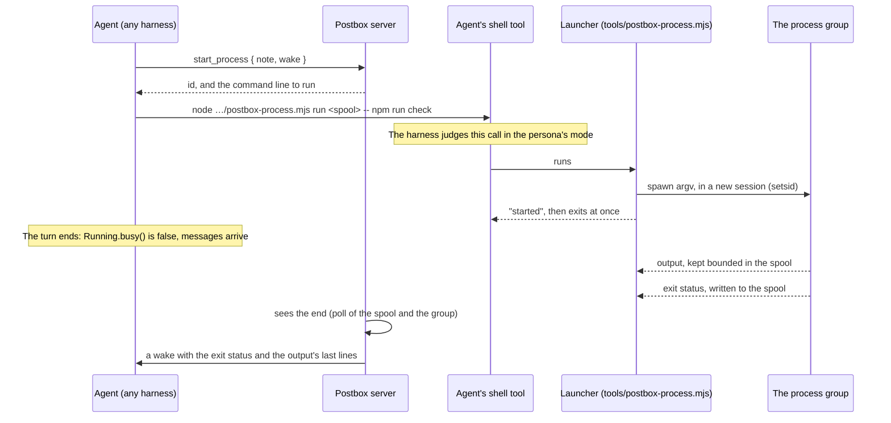
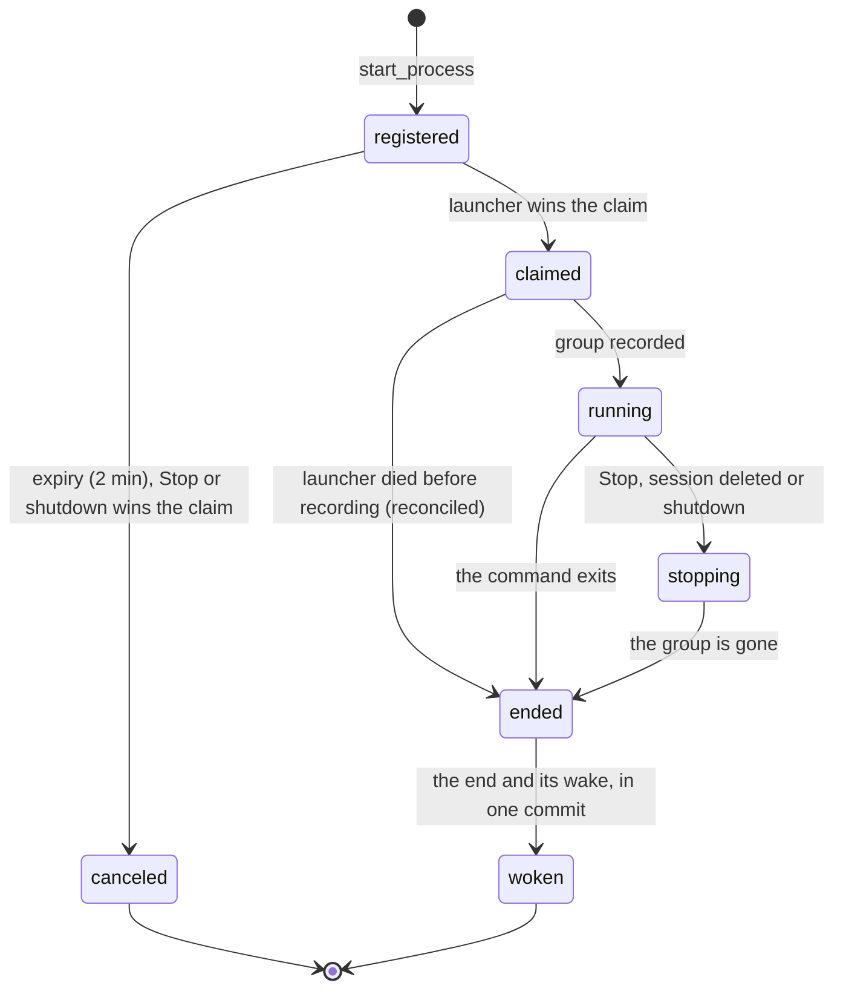

# Background processes

How an agent starts work that outlives its turn, such as a gate, a CI watch or a server, without staying busy for the whole run. Postbox tracks the process, the room sees it, and the agent that started it is woken when it ends. This doc covers every harness Postbox runs (Claude Code, the Agent SDK, Codex, Kiro and Antigravity), not only Claude Code.

Status: proposed for [#1614](https://github.com/HJeon139/postbox/issues/1614), and not built yet. It takes the process attribution and cleanup that [#1606](https://github.com/HJeon139/postbox/issues/1606) asks for, for the processes it starts.

## The problem

When a Claude Code agent starts a command with `run_in_background` and finishes its answer, the CLI stays alive until that command ends, then reports it in a turn of its own. Postbox ends a turn only when the CLI’s process closes (`server/adapters/claude-code.mjs`, `child.on('close', settle)`). So `Running.busy()` stays true, `Delivery.ready()` (`server/delivery.mjs`) returns false, and every message to the agent waits.

In #1614’s measurement with the real CLI, a reply with no background command exited at 7.6 s. The same reply after `sleep 90` with `run_in_background` exited at 98.2 s. In the room on 21 and 22 November 2026, agents’ messages waited 26 to 167 minutes behind their own background gates and CI watches. A review posted at 21:40 UTC reached its agent at 00:27.

The other harnesses fail the other way. On Codex, the turn’s process group stops when the turn completes (`server/adapters/codex.mjs`), so the background work dies with it. The guide’s “When your turn ends” section (`server/adapters/guide.mjs`, `TURN_ENDS`) tells agents that nothing wakes them when a command ends, and to call `schedule_wake` and poll instead.

[delivery-routes.md](../508/delivery-routes.md) designs live input into a background-waiting CLI (A′ `background-wait`). That route is per harness, unverified, and disabled until a spike proves it. This doc takes the other route: work that outlives a turn runs outside it, so the turn ends when the model is done, on every harness.

## The decision to review: who judges the command

Postbox decides nothing about an agent’s commands. “The harness decides, in the mode the person set” ([architecture.md](../architecture.md), “Key decisions”; [permissions.md](permissions.md)). In Auto, Claude Code’s classifier judges each Bash call, and Codex, Kiro and Antigravity apply their own approvals. A persona with “Run commands” (`shell`) unticked has its shell tools denied (`TOOL_RULES` in `server/adapters/setup.mjs`).

Postbox’s own MCP tools are allowed wholesale (`--allowedTools mcp__postbox` in `server/adapters/claude-code-args.mjs`; `sdk-permission.mjs` allows `mcp__postbox__*`). So an MCP tool that ran a command the agent passed would be a second way to run commands. No harness would judge it, and it would bypass every persona’s permission mode. That rules out the obvious design, a `start_process { argv }` tool that Postbox spawns. The two options:

| | A. The harness runs a Postbox launcher (proposed) | B. Postbox spawns from an MCP call |
|---|---|---|
| Who judges the command | The agent’s harness, through its own shell tool, in the persona’s mode, as any command | Postbox, which can apply only the deny rules (`shared/permission-match.mjs`, `decide`), not the harness’s Auto classifier |
| A persona without `shell` | Can’t start one: it has no shell | Must be refused by a new check that mirrors `TOOL_RULES` |
| Steps for the agent | Two: `start_process`, then run the command line it returns | One |
| New execution authority in the server | None. The server never spawns what an agent wrote | A new spawn path for agent strings, reviewed as a security change |
| Every harness | Any harness with a shell tool | Any harness with MCP, with permission parity unverified per harness |

Proposed: A. It keeps the permission decision where it is today, and adds no path from an agent’s words to a spawn in the server. B is simpler for the agent, but it moves a security decision from the harness into Postbox. That is the person’s call (contract §1, a security-boundary trade-off), and this doc asks for it only if review prefers B.

## How it works (option A)

### The tools

Four MCP tools in `shared/mcp-tools.mjs`. A backend gets them only once its permission parity check passes (see “Permission parity, per harness”). A persona without `shell` doesn’t get them at all: `TOOL_RULES.shell` lists them, so the same deny that removes Bash removes them. `start_process` also refuses on its own when the persona lacks `shell`, so a stale tool list can’t register a launch.

- `start_process { note, wake? }` registers a process the agent is about to start. It returns the process’s `id` and the exact command line to run with the agent’s own shell tool: `node <postbox>/tools/postbox-process.mjs run <spool folder> -- <the command, as words>`. `note` (up to 300 characters) says what it is, and `wake` defaults to true.
- `list_processes` lists the conversation’s processes: the owner, note, state, start time, run time, and the exit status once ended. It only reads, so it joins `READ_TOOLS` (`server/tool-gate.mjs`).
- `read_process { id, lines? }` returns the end of a process’s output: 50 lines by default, at most 400, and at most 16 KB.
- `stop_process { id }` stops a process the calling agent started. A process another agent started can be stopped only by the person, on its item. #1606: “Stopping another session’s processes stays a decision only the person can make.”

### Permission parity, per harness

The launcher’s command line has to be judged as the command it carries would be. Seeing the launcher call proves nothing on its own: a harness might judge only `node …/postbox-process.mjs` and wave the real command through, or the detached child might leave the harness’s sandbox. So each backend has a capability, `backgroundProcesses`, which is off until a live check on this computer passes for it. The four tools aren’t offered to a backend with it off. The check runs through the normal turn path, with one persona in Auto and one with `shell` unticked. It has five cases, and all of them must hold:

1. A command the persona’s rules allow runs, and its end wakes the agent.
2. A command a deny rule names, such as `Bash(rm:*)`, is refused when it comes through the launcher, exactly as it is when run bare.
3. A persona with `shell` unticked can’t register a launch: the tools are missing, and a direct call to `start_process` is refused.
4. Writing the spool doesn’t ask for, or need, any approval the bare command didn’t. The spool sits where every workspace sandbox already lets the agent write (see “The launcher”).
5. The detached child stays under the harness’s sandbox. On Codex in Auto (workspace-write), the launched command can’t write outside the workspace, just as the bare command can’t.

A backend that fails any case stays off, and the result is recorded with the run. Each run is a local recording of up to 3 turns (contract §8), and each backend is a separate run. On Codex, the turn’s process group is stopped when the turn completes (`server/adapters/codex.mjs`), so case 1 also checks that the detached launcher survives that stop.

### The launcher

`tools/postbox-process.mjs` is a small Node script with no dependencies. It runs its command as an argument array, never through a shell. A command that needs a pipe or `&&` says so itself, as `sh -c '…'`, and the harness then judges it as written.

The spool is `<the agent’s folder>/.postbox/processes/<id>/`, made by `start_process`, with a random 128-bit id. It sits inside the workspace, so a workspace-write sandbox allows writing it. It uses the folder view_app already writes its pictures to (`server/view-app/view-app.mjs`), and it ignores itself in git the same way. Postbox gives the agent’s environment no token and no URL: [#54](https://github.com/HJeon139/postbox/issues/54) and [#126](https://github.com/HJeon139/postbox/issues/126) closed that path, and the launcher never calls the server.

### One lifecycle, from registration to cleanup

**A single-use claim.** The spool has one `claim` file. The first writer to create it, with an exclusive create (`O_EXCL`), owns the registration. The launcher writes `launcher <pid>`. Postbox writes `canceled` when the registration expires, when its agent or the person stops it, or when Postbox shuts down. A second launcher loses the claim, and refuses with “Process p_… already started”. A launcher that finds `canceled` refuses with the cause. Because Postbox and the launcher race for one exclusive create, no Stop can land between a check and a start.

**Stop during startup.** Stop can arrive after the launcher claims and before it records the group. Postbox then writes a `stop` file. The launcher records the group first (`group`: the pgid, the leader’s pid and start time, and its own pid), then checks for `stop`, and if it’s there, stops the group itself. Postbox stops the group too once `group` appears. Two stops of one group do no harm.

**Caps count claims.** At most 4 processes per agent and 12 per conversation, in `shared/limits.mjs`, counting registered, claimed and running ones alike. A `start_process` past a cap is refused, and the refusal says which processes hold the slots.

**Durable state.** The store records each process at registration: the spool path, the owner, the conversation and the turn that called `start_process`, which is the attribution #1606 asks for. Each later step is in the spool (`claim`, `group`, `stop`, `exit`), so state survives a Postbox restart. At start, Postbox reconciles every process its store still has open:

- **No claim:** the registration is canceled.
- **A claim, no `group`, and the launcher gone:** the process ended with “didn’t start”.
- **A claim, no `group`, and the launcher alive:** Postbox writes `stop` and waits for the launcher to record the group, then stops it.
- **A recorded `group`:** Postbox checks it and stops it, as below.

Nothing Postbox started outlives it unseen.

**Identity before every signal.** A `ps` match is a snapshot, so this design doesn’t promise that a reused pid can never be signaled. What it does instead:
- The launcher signals its own child’s group while it still holds the child. That is the common case.
- Postbox signals a group only when the launcher is gone, such as after a crash. Then it signals only if the group exists and either its leader (pid = pgid) is absent or the leader’s start time matches the one recorded in `group`.
- Postbox runs the check before SIGINT and again before the SIGKILL after `GRACE_MS` (`stopPgid` in `server/adapters/process-group.mjs`).

POSIX doesn’t reuse a process group’s id while the group has members (“Process Group Lifetime”), so the check rules out a reused id once the leader has gone. The remaining window is between the snapshot and the signal, if the group empties in that window and its id is reused at once. That window is a few milliseconds, and the doc doesn’t claim it’s zero.

**The command exits with descendants still running.** The leader’s exit is the process’s end. The launcher records `exit` with the code or signal, then stops what is left in the group: SIGINT, then SIGKILL after the grace period. The wake says “3 processes it left running were stopped”. A process meant to outlive its leader, such as a server that forks into the background, is out of scope. Its command has to stay in the foreground.

**Watching.** Postbox polls every 5 s while any process is open, as it watches kept jobs (`server/kept-jobs.mjs`, `KEPT_POLL_MS`). The poll reads each spool’s `exit`. If the group is gone and no `exit` was written, the process ended with an unknown status. `start_process` and `stop_process` write, so `closedTo` refuses them while the store is closed. An end seen then is recorded at the first poll after the store reopens, as `pollKept` does.

### Wake on exit

An end wakes the owning agent as its scheduled wake does (`server/scheduled-wakes.mjs`). The agent asked for that wake, so it follows the existing rule that “a scheduled wake … go[es] only where [it] say[s]” ([intent.md](../intent.md), “Attention and wakes”). It reaches no other agent, and it adds no hop to a chain. The message says:

> Your process “npm run check” (`p_…`) ended with exit code 1 after 4 min 12 s. Its last 50 lines: …

The tail is cut to 50 lines and 8 KB, followed by “read_process for more”. It’s quoted as data, so an @-mention in it wakes no one, as with any copied line. A busy agent gets the wake through its inbox, never as a second session. With `wake: false`, the end is recorded and no one is woken.

**Once, across a restart.** The process’s `ended` state and its wake message go in one store commit. Each poll and the startup reconciliation skip a process the store already has as ended. So a restart between seeing the end and queuing the wake makes one wake. The store still has the process open, so the next poll sees the end and makes the wake. A restart after the commit makes none, because the process is already ended.

### Room visibility

Each process is an item in the conversation where it started. It has the `command` kind that `!` commands already use (`server/shell-runs.mjs`): its command line, its status while it runs, the end of its output, and its exit status. It names the agent that started it, and the person can Stop any process there.

The session ring shows an agent waiting on its processes as idle with a count (“2 processes running”), not as busy. A process that fails shows as a status on its item. It raises no “needs you”, no notification and no focus move: the agent it wakes acts on it, and the person can’t act on it beyond what the item offers (AGENTS.md, “No unactionable alarms”).

### The guide

For backends with `backgroundProcesses` on, `TURN_ENDS` changes from “never because a command you started finished” to: start work that outlives your turn with `start_process`, end your turn, and you’ll be woken when it ends. It also says not to use `run_in_background` or `nohup` for that: the first keeps the turn and the agent’s messages waiting, and the second leaves a process nobody sees. For the others, the text stays as it is. The “Attention and wakes” row in `intent.md` adds the process end to what wakes an agent.

## Remote hosts

On a remote host, the agent’s shell runs on the host. The launcher and spool would live in the host daemon’s folder, and the daemon would report ends over its channel. That is a separate change to the remote protocol, so remote agents have `backgroundProcesses` off for now.

## How it’s tested

**The room outcome, through the normal turn path.** They use a scripted agent (the mock backend, or a recorded stream) in the ordinary turn lifecycle, which runs the launcher as its shell step. The CLI closes normally, because the launched process isn’t one of its background tasks. Tests that end the turn early are a different mechanism and don’t count here.
1. The owner calls `start_process` and runs the launcher, and its turn ends when its process closes, while the managed process still runs.
2. A room message to the owner arrives in a new turn before the managed process ends.
3. The process’s end wakes the owner exactly once.
4. With a restart between seeing the end and queuing the wake (the store is closed and reopened, then Postbox is restarted from its data folder), there is still exactly one wake. After the commit, there are none.

**Baseline.** A recorded Claude Code stream that uses native `run_in_background` (`background_tasks_changed` in #1614’s probe) shows the room message waiting until the task ends.

**`tests/process/`, with the real launcher:**
- The parent shell returns in under a second while `sleep 5` runs.
- Two launchers race for one registration, and exactly one runs.
- Stop, expiry and shutdown each land at the moments during startup described in “One lifecycle”, and each leaves no process.
- A command that exits with a grandchild still running has it stopped.
- A launcher killed before writing `group` is reconciled at start.
- The identity check refuses to signal a group whose leader has the wrong start time.

**Unit tests, with a fake spool:** the caps count claims; `stop_process` on another agent’s process is refused; the store is closed; the tail is bounded and quoted.

**A browser spec** for the item and the ring’s count, run plain and with `POSTBOX_STREAM_LAG=300`.

**Per harness:** the parity check in “Permission parity, per harness” enables each backend. Until a backend has passed it, the backend stays off and is reported as unverified.

## When to revisit

- If A′ live input ([delivery-routes.md](../508/delivery-routes.md)) is proven for a harness, its native background tasks may serve there, and this stays the route for the others.
- If agents skip the second step, starting the process with `start_process` but never running the command, measure it from the dropped registrations, and weigh option B again with the person.
