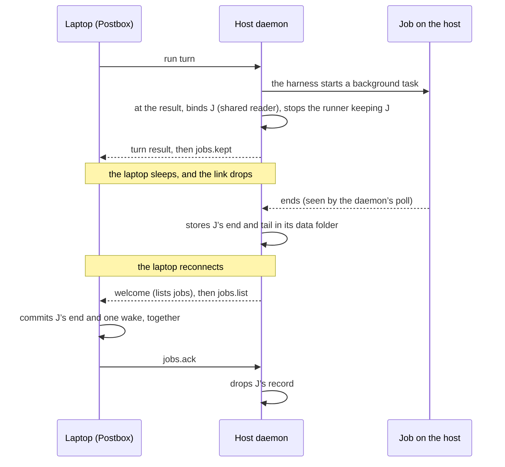

# Background work that outlives a turn

When an agent starts work in the background, such as a gate, a CI watch or a server, its turn should end once the model is done. The work keeps running, the room can see it, and the agent that started it is woken when it ends.

The approach is native harness first, and Postbox adds no tool for it. Agents start background work their harness’s own way: `run_in_background`, `&`, `nohup` or `tmux`. Postbox keeps what the harness reports, and finds the rest by a marker that each harness process inherits. Each harness gets this only after a live check passes for it, and keeps today’s behavior until then. Where a step can’t be shown safe, it falls back to today’s behavior too, never to losing work.

Status: proposed for [#1614](https://github.com/HJeon139/postbox/issues/1614), not built. It replaces an earlier draft, which added four Postbox tools and a launcher. On [#1615](https://github.com/HJeon139/postbox/pull/1615), the owner directed that Postbox integrate with each harness instead, because agents use their harness’s own way and fumble Postbox-specific mechanisms. It also covers the attribution [#1606](https://github.com/HJeon139/postbox/issues/1606) asks for, for the processes a session leaves behind.

## The problem

**Claude Code waits for its background tasks.** When an agent starts a command with `run_in_background` and finishes its answer, the CLI stays alive until the task ends. Then it reports the task in a turn of its own. Postbox ends a turn only when the CLI’s process closes (`server/adapters/claude-code.mjs`, `child.on('close', settle)`). Until then `Running.busy()` stays true, `Delivery.ready()` (`server/delivery.mjs`) returns false, and every message to the agent waits.
- **Measured with the real CLI in #1614:** a reply with no background command exited at 7.6 s. The same reply after `sleep 90` with `run_in_background` exited at 98.2 s.
- **In the room on 21 and 22 November 2026:** agents’ messages waited 26 to 167 minutes behind their own background gates and CI watches.

**Codex, Kiro and Antigravity differ from Claude Code, and from each other.** Each runs in its own process group (#126).
- **Codex:** Postbox kills that group at each turn’s end (`stopTurn`, `server/adapters/codex.mjs`), so background work dies with the turn.
- **Kiro and Antigravity:** a turn ends at the CLI’s `close` (`child.on('close', settle)` in `kiro-cli.mjs` and `antigravity-cli.mjs`), and Postbox sends no signal then. `stopTurn` runs only on Stop (`stopOnAbort`), and Antigravity also stops a turn whose session is missing (`stop.now()` in `antigravity-cli.mjs`). Node fires `close` only once the child’s stdio streams have closed, so it depends on where the background work’s output goes:
  - **`cmd > log 2>&1 &`:** `close` comes right after the CLI exits, and `cmd` survives a normal end untracked. That’s #1606’s orphan, with no wake and no Stop.
  - **An unredirected `cmd &`:** `cmd` holds the CLI’s pipes, so `close` waits until it ends. The critic’s probe of a fake harness measured `exit` at 456 ms and `close` at 3,004 ms. The turn stays busy the whole time, which is #1614’s wait on these harnesses too.

Stop kills the group on all three. On a host, the daemon owns that group (`server/remote/host/daemon-kill.mjs`).

**On any harness, some work escapes.** A foreground call can start `cmd &`, `nohup cmd &` or `setsid cmd` and then let its shell exit. The child is reparented to init. It’s no longer under the CLI, so `shellGroups` (`server/adapters/process-group.mjs`) doesn’t find it, and nothing tracks it. Stop still reaches it while it stays in the harness’s group. It doesn’t once its shell led a group of its own, or it ran `setsid`. That’s #1606’s orphan.

## What `main` already has

- **Recognizing a task.** Claude Code’s `run_in_background` tasks are recognized from the stream (`server/adapters/claude-stream.mjs`). Each is recorded as a job with its task id, command and output file (`server/harness-events.mjs`, `startJob`). At the turn’s result, `on_turn_end` lists the jobs still running (`tools.waiting`). The Agent SDK reports the same tasks.
- **Keeping a job.** Send now stops the CLI with `jobs: 'keep'` (`server/message-queue.mjs`, `stopForSendNow`). `stopTurn`’s `keep` (`server/adapters/process-group.mjs`) finds each kept job by its command among the CLI’s tool shells (`shellGroups`), and keeps it. It’s lenient: it takes the first match, and if any job goes unmatched, it keeps every unmatched shell.
- **Seeing a job end.** A 5-second poll of the kept jobs’ process groups sees each one end (`server/kept-jobs.mjs`, #129, #164). Each kept job has its own Stop.
- **On a host:**
  - the daemon records a turn’s tool shells’ groups, and matches them by their members’ start times (`daemon-kill.mjs`, `liveGroups`, `sameProcess`);
  - it doesn’t parse the harness’s stream, and stores `out.jsonl` for Postbox to read (`server/remote/host/cleanup.mjs`);
  - `stopTurn` on a host returns `stopRemote(child)`, which ignores `keep`, so Send now keeps no jobs on a host today.

This design extends those pieces. It adds no tool, no listener and no permission surface. Every command is still one the agent ran through its harness’s own shell tool, judged in the persona’s mode.

## The design

```mermaid
sequenceDiagram
  participant H as The harness (Claude Code CLI)
  participant S as Postbox
  participant J as The background work
  H->>J: run_in_background (the harness reports the task)
  H-->>S: the turn’s result; on_turn_end lists the tasks still running
  S->>S: binds each task to one group, and scans for marked processes
  alt every listed task binds
    S->>H: stops the CLI and its other shells, keeping the bound groups
    Note over S: The turn ends: Running.busy() is false, messages arrive
  else any task doesn’t bind
    Note over S,H: the turn waits, as on main today
  end
  loop every 5 s
    S->>J: still alive? (members with their recorded start times)
  end
  J-->>S: gone
  S->>S: commits the job’s end and one wake, together
  S->>H: a new turn: “Your background job … ended”
```

### 1. Binding a harness task to its group

Postbox binds a task the harness reported to exactly one live process group. Every rule below must hold in one `ps` snapshot, taken at the `result` while the CLI that Postbox holds as its own child is still alive:
- **The task is live, by the harness’s own account.** The owning turn’s stream reported it starting, with `task_started` and its tool call id, and hasn’t reported it ending. There’s no `task_notification` for it yet.
- **Exactly one shell matches.** Among the CLI’s tool shells (`shellGroups`: children of the CLI that lead their own groups), exactly one runs the task’s command.
- **That shell started inside the task’s own call.** Its leader’s start time (`lstart`, to the second) falls between two moments: when Postbox read the call’s `tool_use` line, and when it read that call’s result. Each end is widened by one second. These are Postbox’s receive times, because the stream carries no timestamp of its own.
- **No other call could account for it.** No other tool call in the turn ran the same command, foreground or background, including calls by the turn’s subagents. The stream records every call’s input, so this reads the harness’s own record. It covers a task that exited before its notification arrived, while another call’s shell runs the same command.

A bound job is recorded with its task id, its group id, each member’s pid and start time, the owning session and the owning turn.

### 2. When the turn ends early, and when it waits

**Claude Code and the Agent SDK.** At the `result`, Postbox ends the CLI early only when every task `on_turn_end` lists binds by section 1. Then it stops the CLI through a strict mode of `stopTurn`:
- **Kept:** each bound job’s whole group survives.
- **Stopped:** the CLI and every other tool-shell group under it. They get SIGINT, then SIGKILL after `GRACE_MS`, as today.

If any listed task doesn’t bind, Postbox leaves the turn as `main` does: it waits for the CLI to report its tasks and exit. So the strict rules can cost latency, never work: an unbound task is never killed. The same wait applies while the model still works:
- before the `result`;
- while a subagent runs;
- while a permission card waits;
- while a Monitor runs, until its live check passes.

The strict mode is apart from Send now’s lenient keep, which stays as it is, because the person chose to keep those jobs. Whether Send now should also be strict is a question for its own issue.

**Stop is `main`’s Stop.** On every harness, Stop kills the turn’s group as `main` does, and binds nothing. The person or the agent asked for the work to stop, and a background job begun in that turn goes with it. Jobs bound at earlier turns’ ends are in other groups, so Stop doesn’t reach them, and each keeps its own Stop. This rule is decided by what Stop means, not by whether the harness is still alive, so it holds between the CLI’s exit and its `close` too. It’s the same locally and on a host.

**The snapshot decides how a turn’s end treats its group.** At the turn’s end, Postbox reads the group in one `ps` snapshot. What it does depends on whether the harness’s pid is in that snapshot with its recorded start time, not on which harness it is.
- **The harness is still alive, as Codex’s app-server is when Postbox stops it:** case (a)’s foreground test in section 3 applies. A group with no bound job gets the group signal `main` sends there. A group holding a bound job is signaled member by member, as below.
- **The harness has exited, as a Kiro or Antigravity CLI has at a normal end:** every member left has init as its parent, so the foreground test can’t tell a leftover helper from `cmd &`. Postbox doesn’t guess, and adds no kill that `main` doesn’t send. Every member that passes section 3’s other rules binds, and nothing is signaled. Those rules are a start time inside the turn, the same user, and still alive at the second read.

**Kiro and Antigravity end at `exit`, not at a held `close`.** Waiting for `close` would keep #1614’s wait wherever `cmd &` holds the CLI’s pipes. So once the CLI has exited, and its stream has given its last event, Postbox takes the snapshot, closes its own ends of the CLI’s stdio, and ends the turn. Output that a bound job goes on writing to those pipes is then dropped, like any job whose output wasn’t kept. The wake says so. Whether `close` fires while an unredirected `cmd &` runs is one of these harnesses’ live checks.

**How many wakes a turn can cause.** A wake counts as no hop, so it needs a bound of its own:
- **A job must outlive the turn by more than a moment.** It binds only if it’s still alive at a second read, 1 s after the snapshot. A helper that outlives its CLI by milliseconds doesn’t bind.
- **A session holds at most 4 bound jobs** (`shared/limits.mjs`, as the kept-job limit). A job past that isn’t bound, and runs on as on `main`.
- **One wake per bound job, when it ends.** So a chain of wakes needs every turn in it to leave new work running for at least a second, which is background work the agent chose to start, as a scheduled wake is. The live check for each harness includes a turn with no background command, which must bind nothing.

**Identity is checked again before every pid signal.** Once Postbox signals by pid, a reused pid is the risk, so no pid is signaled on an old reading. Before each signal, Postbox reads that pid’s start time in a fresh `ps` read and signals only if it still matches the one recorded. That covers the first SIGINT, the SIGKILL `GRACE_MS` later, a job’s own Stop, and the startup reconciliation in section 6. A pid whose start time changed, or that is gone, is skipped and recorded as ended. The window left is between that read and the signal itself: milliseconds, and not zero.

**Group signals get the same check.** On `main` only the host daemon matches a group by its members’ start times. The local `liveGroups` (`server/kept-jobs.mjs`) checks only the leader’s command line. `listProcesses` reads no start time, and `stopTurn`’s group signals don’t go through `liveGroups` at all. `stopPgid` sends its delayed SIGKILL with no second check. So the local `ps` read gains `lstart`. Before each group signal, including the delayed SIGKILL, the kept-job poll and the strict stop check that a member still has its recorded start time, as the daemon does.

### 3. The marker, for work the harness doesn’t report

Postbox starts every harness process with two variables in its environment: `POSTBOX_SESSION=<session id>` and `POSTBOX_TURN=<turn id>`. Neither is a secret, and the turn’s MCP token never goes into the environment (#54, #126). Every descendant inherits both at exec, including after `setsid`, `nohup` or reparenting to init, which the process group can’t follow.

**What binds.** A tool shell that backgrounds a command exits within milliseconds, and its child is reparented to init. The integrator measured this with a fake harness running `/bin/sh -c 'node -e … & echo $!'`. The shell lived 4.7 to 4.9 ms. Its child’s parent became pid 1, and its group stayed whichever group the shell had: its own, or the harness’s. A 5-second poll almost never sees such a shell, so ancestry recorded by polling can’t bind it. At a turn’s end, a process is bound as this turn’s background work in two cases:
- **(a) It’s in the harness’s own process group, and its shell has exited.** Membership in that group is ancestry: only the harness and its descendants are in it. But membership alone doesn’t tell background work from a foreground child, so the parent decides:
  - **Background:** a member whose parent is init or the subreaper. Its shell exited and left it running, which is what `cmd &` and `nohup cmd &` do. It binds when its start time falls inside the turn, with or without a readable marker. On macOS that covers #1614’s own `sleep 90 &`, whose `/bin/sleep` hides its environment.
  - **Foreground:** a member whose parent chain still reaches the harness, or a tool shell that is still alive. It never binds, and it is stopped at the turn’s end. This test applies only while the harness is alive at the snapshot, as at Codex’s turn end. Once the harness has exited, section 2’s exited rule applies instead.
- **(b) It’s outside that group,** after `setsid` or as the orphan of a tool shell that led its own group. It binds when all of these hold:
  - its marker names this session and this turn;
  - its start time falls inside the turn;
  - its parent is init or the subreaper;
  - it belongs to the user running the harness on that machine (its real uid, `ruid`, matches the harness’s).

**Why case (b) binds: the owner’s decision.** Case (b) gives no tie to the harness that Postbox observed. The marker is the process’s own account, and the start time and parent show only timing. The integrator asked for it in the [fourth-round review of #1615](https://github.com/HJeon139/postbox/pull/1615#pullrequestreview-6011596385). Critic disagreed, and the owner decided in the room on 22 November 2026 that it binds:
- **The reasoning:** a forged marker can only come from a process of the person’s own user. That process can already signal these processes, so a forger gains at most a spurious wake for the agent the marker names.
- **The concern weighed against it:** permission to send a Unix signal isn’t, by itself, authority for Postbox to wake an agent or to offer a Stop across sessions.

The owner chose coverage for `setsid` jobs and the orphans of tool shells that led their own groups, on Codex, Kiro and Antigravity, over that concern. A process that binds this way wakes its agent and has a Stop, like any bound job. A Claude Code task that section 1 handled is left to section 1.

**Nothing leaks that `main` reaps, and a kept job isn’t signaled with the rest.** A group signal (`signalPgid`) reaches every member, so it can’t be used on a group that holds a bound job. At a turn’s end that uses pid signals:
- **A harness group with no bound job** gets that harness’s group signal where `main` sends one: at Codex’s turn end. At a normal Kiro or Antigravity end, `main` sends none, and neither does this design. Stop is section 2’s `main` Stop.
- **A harness group that holds a bound job:** the first SIGINT goes to each member that didn’t bind, by its own pid, after the identity check in section 2. It spares the same members the delayed sweep below spares: the bound jobs and their descendants, meaning any member whose parent chain reaches a bound job’s pid with that pid’s recorded start time. The members it signals include the harness, its foreground children, and a marked process inside the turn that fails a rule above.
- **The delayed SIGKILL sweeps the group again, not the old list.** A foreground process can start a child in the group during `GRACE_MS`, which the first list doesn’t name. So at SIGKILL time, Postbox reads the group’s members again in a fresh `ps` read. It sends SIGKILL to every member, by pid and after its identity check, except two kinds:
  - a bound job;
  - a descendant of a bound job, meaning its parent chain reaches a bound job’s pid with that pid’s recorded start time.

  A member that appeared during the grace period and descends from no bound job is reaped, as the old group signal would have reaped it. Postbox repeats the sweep once more, 100 ms later, for a child started during the first sweep. After that, anything left is what a `fork` loop keeps spawning. Postbox records it on the job as “still spawning at the turn’s end”, the same limit the group signal has on `main`. A process outside the group that carries the marker but doesn’t bind stays informational: shown in the room with its pid as last seen, with no wake, no signal and no Stop. That’s the same as `main`, which never reached it either.

**The poll’s cost.** On `main`, `pollKept` runs `ps` only while a kept job exists (`server/kept-jobs.mjs`). This design adds the marker scan at each turn’s end, and at each 5-second tick only while kept jobs exist. One scan per tick serves every turn and job. The implementation PR measures the scan, `ps -Eww -ax`, whose output is larger than today’s read, against `main`’s poll, and holds it to a budget stated there.

**What the scan reads.** The scan keeps only the two marker variables from its output, and nothing else of any process’s environment. Raw scan output is never logged or stored.
- **On macOS:** `ps -Eww -ax -o pid=,ppid=,pgid=,ruid=,lstart=,command=`. In macOS `ps`, `uid` is the effective user id and `ruid` the real one.
- **On Linux:** `/proc/<pid>/environ`, with the owner from `/proc/<pid>/status` (`Uid:`).

The owner is read so that case (b)’s same-user rule is checked, not assumed. A process of another user never binds, wakes no one and gets no Stop, whatever marker it carries.

It’s one more read beside `listProcesses`, with the same 2 s timeout and 16 MB cap.

**What it costs, measured.** On macOS (Darwin 25.6), `ps -E` prints no environment for Apple platform binaries. Four processes were started with `POSTBOX_SESSION=probe123`, then read with `ps -E -p <pid> -o command=`:

| Process | Marker visible |
|---|---|
| `/bin/sleep 30` | no |
| `nohup /bin/sh -c '/bin/sleep 31'` (exec’d to `sleep`) | no |
| Xcode’s `python3`, after `os.setsid()` | yes |
| `node -e …` | yes |

So on macOS a job is found through any member that isn’t a platform binary, such as node, npm, gh, cargo or python. Its group is then found by its group id. A job made only of `/bin/sh` and `/bin/sleep`, like #1614’s own `sleep 90`, isn’t found by the marker. That’s why the marker is combined with the ancestry recorded while the harness is alive, and why a Claude Code task is bound by section 1, not by the marker.

Other ways the marker is lost or misused:
- **A fresh environment.** A process that execs with a new environment drops the marker and isn’t tracked. That includes `env -i`, `sudo`, `launchctl`, `systemd-run`, and work handed to `docker` or `ssh`. Changing the environment after exec changes nothing, because the scan reads the kernel’s exec-time copy.
- **Linux, not verified here.** `/proc/<pid>/environ` is readable for the same user’s dumpable processes, but not for setuid processes or under `hidepid`. Each host’s live check confirms it.
- **A process that drops or forges its marker.** One that drops it isn’t tracked, as a `nohup` process isn’t today. One outside the harness’s group that copies another session’s marker, with a start time inside that session’s turn and init as its parent, binds to that session by case (b). At worst it wakes that session’s agent once, spuriously. The one-wake limit holds per bound job: each bound job wakes its agent once, at its own end. A forger can only be the person’s own user, which case (b) checks and which could already signal it. A marker never makes a process bind to a session other than the one it names.

### 4. Wake on exit

When a kept job ends, the agent that started it gets one wake, sent the way a scheduled wake is (`server/scheduled-wakes.mjs`, `rt.delivery.send`):

> Your background job “npm run check” ended after 4 min 12 s. Its last 50 lines: …

- **The end.** A job has ended when no member of its group still has its recorded start time.
- **The exit status** comes only from the harness, in a `task_notification` the CLI sent before it was ended. Otherwise the wake says “exit status unknown”.
- **The output tail** comes from the harness’s own output file, and only within the harness’s own authority:
  - **The folder:** derived from what Postbox knows, not from text. It’s Claude Code’s per-session task folder, found from the user id, the working folder and the `init` event’s session id. The path in the tool result’s text (`BACKGROUND_FILE` in `claude-stream.mjs`) is only a hint, accepted inside that folder alone. A structured `output_file` in a `task_notification`, if one arrives, must name the same file.
  - **Off the turn end’s path:** the keep decision comes first and never waits on the file. Postbox verifies the file afterward, asynchronously, within a 1 s budget.
  - **Opening:** with `O_RDONLY | O_NOFOLLOW | O_NONBLOCK`, so a FIFO or device can’t block the open. Postbox keeps the descriptor.
  - **Checks:** `fstat` must show a regular file, owned by the person’s user, with one link. `realpath.native` of the path must lie inside the folder and have the descriptor’s device and inode. Postbox records that device and inode.
  - **Reading:** at the end, through the descriptor only, at most the last 8 KB and 50 lines.
  - **What the checks guard:** an agent could swap its task’s output file for a link to a file that its persona’s Read rules deny while its shell rules allow it. The checks keep Postbox from reading that file for it.
- **After a restart,** the descriptor is gone. Postbox reopens the path with the same flags and checks, and reads it only if the device and inode match what it recorded. Otherwise the wake says the output isn’t available.
- **A redirect.** With `cmd > log 2>&1`, the harness’s file is empty. Postbox doesn’t read the redirect target: the wake names it, unread (“Its output went to `log`”), and the agent reads it with its own tools at no extra cost. So Postbox never reads a path the agent chose, which the agent’s Read rules might deny.
- **`tmux` is welcome, not required.** A `tmux new -d` session’s processes are found by the marker. The wake names the session, unread (“Its output is in tmux session `build`”), and the agent can run `tmux capture-pane` itself. tmux isn’t the mechanism, because it isn’t on every host and agents would have to choose it.
- **Quoted as data:** an @-mention in the tail wakes no one.
- **Once.** The job’s end and its wake are committed together. A restart or a host reconnect that finds the job already ended wakes no one again.
- **Quiet in the room.**
  - The wake goes only to the agent that started the job. It counts as no hop and raises no “needs you”.
  - Each job stays visible in the room until it ends, then shows its end. That isn’t an alarm: the agent it wakes acts on it (AGENTS.md, “No unactionable alarms”).
  - The person can Stop any bound job. An agent can stop only its own session’s.

### 5. Remote hosts use the same code

A host gets the turn-end path only with both of these. Until then it keeps today’s behavior.
- **A stream reader in `shared/`.** Section 1’s binding needs `task_started`, `task_notification`, each tool call with its input and result, and the `result`. On `main`, the parser is `server/adapters/claude-stream.mjs`, and `hostFiles` (`server/remote/install-bundle.mjs`) ships only `shared/` and `server/remote/host/`. A small reader of just those events moves to `shared/`, and both the server and the daemon load it. Then the daemon can bind a result that arrives while the laptop sleeps.
- **A stop that keeps.** `daemon-kill.mjs` gains the strict keep: it stops the runner and its other shells, and keeps the bound groups. For Codex, Kiro and Antigravity on a host, it also gains section 2’s pid signal, gated by the same live check. On `main` it signals the runner’s group. The binding rule, the marker scan, the poll and the job record live in one `shared/` module.

The daemon keeps polling, and keeps each job’s record, tail and status in its own data folder, never in the workspace. It does this while the laptop sleeps or the link is down. On reconnect, a job that ended while the two were apart wakes its agent once, from the stored record, in one commit. Jobs still running reappear as they are.

The protocol messages:
- **`jobs.kept`:** daemon to laptop, the jobs a turn’s end kept.
- **`jobs.list`:** daemon to laptop on reconnect, every job’s record.
- **`jobs.ended`:** daemon to laptop, live.
- **`jobs.stop`:** laptop to daemon.
- **`jobs.ack`:** laptop to daemon, once the end and its wake are committed, so the daemon can drop the record.

A daemon from before this change doesn’t list `jobs` in its welcome. With one, the laptop keeps today’s behavior. That follows the welcome-field pattern that `claudeChecks` uses (`server/adapters/claude-code-remote.mjs`, and remote-hosts.md, “Postbox and the daemon”). While a host is disconnected, its jobs show in the room as unknown, last seen at a time, never as an alarm.



### 6. Restart

**A clean shutdown keeps bound jobs.** On `main`, a clean shutdown stops every kept job (`stopKeptJobs` in `server/turn-stop.mjs`). This design changes that for jobs it bound: they keep running, and their records stay in the store, so a long run survives an upgrade, as the owner asked. Send now’s kept jobs keep `main`’s stop at shutdown.

**Startup reconciliation.** After a Postbox restart, whether clean or after a crash, and after a daemon restart, each kept job is adopted again only if a member of its recorded group still has its recorded start time. A job that doesn’t match is recorded as ended, with “Postbox restarted while it ran: exit status unknown”, and wakes its agent once. Nothing is adopted that wasn’t bound before the restart.

## The guide

`TURN_ENDS` (`server/adapters/guide.mjs`) is Codex-only on `main`.
- **A harness with this design on** gets one line: “Background work is fine: you’re woken when it ends.” For Codex it replaces `TURN_ENDS`; for the others it’s the only addition.
- **A harness without it** keeps what its guide says today. Codex keeps `TURN_ENDS`, and Kiro and Antigravity get nothing new.
- **`intent.md`:** the “Attention and wakes” row adds a kept job’s end to what wakes an agent.

## Live checks, per harness, to record here

Each check is a local run of up to 3 turns, so the cost is bounded: up to 3 turns per harness, with real agents, as AGENTS.md asks of any run that costs real usage. A harness gets this design only once its check passes. The check goes through the normal turn path and shows three things:
- the background job survives the turn’s end;
- an ordinary foreground child the turn left behind is stopped, at Codex’s turn end. At a normal Kiro or Antigravity end, where the CLI has exited, the check is instead that `cmd &` binds and nothing is signaled. Stop on every harness kills the group, as on `main`;
- a turn with no background command binds nothing;
- a room message reaches the owner while the job still runs, and the job’s end wakes it once.

What each check answers:
- **Claude Code:** with `-p` stream-json, does ending the CLI after the `result` keep every task, Monitor included? Does each task’s output file go on filling?
- **Codex:** does the app-server end a turn while a backgrounded child runs, and what does it do to that child? Does the marker reach its tool shells?
- **Kiro and Antigravity:** at a normal end, does the CLI exit with `&` and `nohup` work left in its group, and does that work bind and wake once? Does `close` fire while an unredirected `cmd &` runs, or only when it ends? Does the turn end at `exit` either way? Does the marker reach their tool shells?
- **Each Linux host:** is `/proc/<pid>/environ` readable for the agent’s processes?

## How it’s tested

- **The room outcome, through the normal turn path,** with recorded Claude Code streams. #1614’s recorded native stream, where the message waits, is the baseline.
  - A turn whose tasks all bind ends at its `result`.
  - A room message reaches the agent while the task runs.
  - The task’s end wakes the agent exactly once, including with a restart between seeing the end and queuing the wake.
- **`tests/process/`, with real processes:**
  - **Binding:** at the result, the bound job’s group survives, and the CLI and a foreground shell stop.
  - **Nothing binds, so nothing is lost:** two calls ran the same command, so nothing binds. The CLI isn’t ended, and both shells live.
  - **The late-notification case:** the task has exited, no `task_notification` has come, and another call’s shell runs the same command. Nothing binds, and the turn waits.
  - **A shell from before its call** doesn’t bind.
  - **The marker:**
    - it survives `nohup` and `setsid` on a non-platform binary, and the scan finds it;
    - `sh -c 'cmd &'`, with the shell in the harness’s group: `cmd` binds by group membership and wakes the agent;
    - **A mixed group:** a bound background job and a foreground child of a live tool shell in the same harness group. The job survives, and the foreground child stops, each signaled by its own pid;
    - **A child started during the grace period:** the bound job starts its own child before the first SIGINT, and the foreground child starts a new child in the group after it. Neither pass signals the bound job or its child. The delayed sweep reaps the foreground child’s new child;
    - `sh -c 'cmd &'`, with the shell leading its own group: `cmd`, reparented to init, binds by its marker and wakes the agent;
    - a process in the harness’s group that doesn’t bind is still stopped at Codex’s turn end;
    - **A Stop after the CLI has exited, before `close`:** Stop kills the group as `main` does, and nothing binds;
    - **A helper that outlives its CLI by milliseconds:** it’s gone at the second read, so it doesn’t bind and no wake comes;
    - **A fifth job in a session** isn’t bound;
    - **A clean shutdown:** a bound job keeps running and is adopted at the next start;
    - a marked process outside the group that doesn’t bind isn’t signaled, and its exit queues no wake;
    - one whose marker names session B, inside B’s turn, binds to B and never to the session whose turn is ending. It wakes only B’s agent, once;
    - one owned by another user isn’t bound, whatever its marker;
    - **A harness that exits by itself, in both stdio layouts:** a fake Kiro-style harness starts a long-lived helper and runs `cmd &`, then exits.
      - With `cmd` redirected, `close` follows `exit`.
      - With `cmd` unredirected, `cmd` holds the pipes, and the turn ends at `exit` anyway.

      Either way both processes bind, nothing is signaled, and the turn ends before `cmd` does.
  - **Codex, Kiro and Antigravity by pid:** the harness and its children stop, and a bound marked process survives.
  - **A reused pid is skipped:** a pid whose start time changes between the first SIGINT and the delayed SIGKILL, or before a Stop, isn’t signaled.
  - **The output file:**
    - swapping the path for a link after binding, or replacing the file, changes nothing read;
    - a file outside the folder, a link, or a file with a second link gives no tail;
    - a FIFO doesn’t delay the turn end;
    - after a restart, a matching device and inode keep the tail.
- **Unit tests:**
  - the early-end decision for each end event;
  - the wake naming a redirect or a tmux session, unread;
  - the bounded, quoted tail;
  - no hop and no “needs you”;
  - Stop on another session’s job refused to agents;
  - only the marker variables kept from a scan.
- **The host:** a fake daemon, with the shared reader, through a disconnect, an exit while away and a reconnect. A second reconnect wakes no one, and an old daemon’s welcome keeps today’s behavior.
- **A browser spec** for the job items and their Stop, run plain and with `POSTBOX_STREAM_LAG=300`.

## When to revisit

- If live input is proven for a harness (designs/508/delivery-routes.md, “Model turns and a live backend execution (A′)”), its CLI could stay alive and take messages between turns. Ending it at the `result` would then no longer be needed there.
- If unbound tasks often keep a turn waiting, measure which rule fails them before loosening any.
