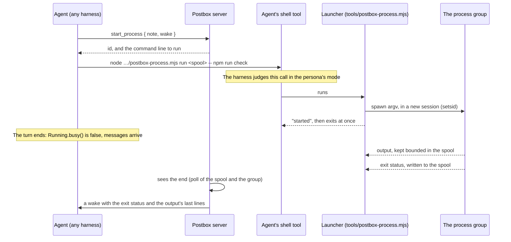

# Background processes

How an agent starts work that outlives its turn, such as a gate, a CI watch or a server, without staying busy for the whole run. Postbox tracks the process, the room sees it, and the agent that started it is woken when it ends. This doc covers every harness Postbox runs (Claude Code, the Agent SDK, Codex, Kiro and Antigravity), not only Claude Code.

Status: proposed for [#1614](https://github.com/HJeon139/postbox/issues/1614), and not built yet. It takes the process attribution and cleanup that [#1606](https://github.com/HJeon139/postbox/issues/1606) asks for, for the processes it starts.

## The problem

When a Claude Code agent starts a command with `run_in_background` and finishes its answer, the CLI stays alive until that command ends, then reports it in a turn of its own. Postbox ends a turn only when the CLI’s process closes (`server/adapters/claude-code.mjs`, `child.on('close', settle)`). So `Running.busy()` stays true, `Delivery.ready()` (`server/delivery.mjs`) returns false, and every message to the agent waits.

In #1614’s measurement with the real CLI, a reply with no background command exited at 7.6 s. The same reply after `sleep 90` with `run_in_background` exited at 98.2 s. In the room on 21 and 22 November 2026, agents’ messages waited 26 to 167 minutes behind their own background gates and CI watches. A review posted at 21:40 UTC reached its agent at 00:27.

The other harnesses fail the other way. On Codex, the turn’s process group stops when the turn completes (`server/adapters/codex.mjs`), so the background work dies with it. The guide’s “When your turn ends” section (`server/adapters/guide.mjs`, `TURN_ENDS`) tells agents that nothing wakes them when a command ends, and to call `schedule_wake` and poll instead.

[delivery-routes.md](../508/delivery-routes.md) designs live input into a background-waiting CLI (A′ `background-wait`). That route is per harness, unverified, and disabled until a spike proves it. This doc takes the other route: work that outlives a turn runs outside it, so the turn ends when the model is done, on every harness.

## The decision to review: who judges the command

Postbox decides nothing about an agent’s commands. “The harness decides, in the mode the person set” ([architecture.md](../architecture.md), “Key decisions”; [permissions.md](permissions.md)). In Auto, Claude Code’s classifier judges each Bash call, and Codex, Kiro and Antigravity apply their own approvals. A persona with “Run commands” (`shell`) unticked has its shell tools denied (`TOOL_RULES` in `server/adapters/setup.mjs`).

Postbox’s own MCP tools are allowed wholesale (`--allowedTools mcp__postbox` in `server/adapters/claude-code-args.mjs`; `sdk-permission.mjs` allows `mcp__postbox__*`). So an MCP tool that ran a command the agent passed would be a second way to run commands. No harness would judge it, and it would bypass every persona’s permission mode. That rules out the obvious design, a `start_process { argv }` tool that Postbox spawns. The two options:

| | A. The harness runs a Postbox launcher (proposed) | B. Postbox spawns from an MCP call |
|---|---|---|
| Who judges the command | The agent’s harness, through its own shell tool, in the persona’s mode, as any command | Postbox, which can apply only the deny rules (`shared/permission-match.mjs`, `decide`), not the harness’s Auto classifier |
| A persona without `shell` | Can’t start one: it has no shell | Must be refused by a new check that mirrors `TOOL_RULES` |
| Steps for the agent | Two: `start_process`, then run the command line it returns | One |
| New execution authority in the server | None. The server never spawns what an agent wrote | A new spawn path for agent strings, reviewed as a security change |
| Every harness | Any harness with a shell tool | Any harness with MCP, with permission parity unverified per harness |

Proposed: A. It keeps the permission decision where it is today, and adds no path from an agent’s words to a spawn in the server. B is simpler for the agent, but it moves a security decision from the harness into Postbox. That is the person’s call (contract §1, a security-boundary trade-off), and this doc asks for it only if review prefers B.

## How it works (option A)

### The tools

Four MCP tools in `shared/mcp-tools.mjs`, served to local and remote agents alike:

- `start_process { note, wake? }` registers a process the agent is about to start, and returns its `id` and the exact command line to run with the agent’s own shell tool: `node <postbox>/tools/postbox-process.mjs run <spool folder> -- <the command, as words>`. `note` (up to 300 characters) says what it is. `wake` defaults to true. A registered process the launcher hasn’t started within 2 minutes is dropped.
- `list_processes` lists the conversation’s processes: the owner, note, state, start time, run time, and the exit status once ended. It reads only, so it joins `READ_TOOLS` (`server/tool-gate.mjs`).
- `read_process { id, lines? }` returns the end of a process’s output: 50 lines by default, at most 400, and at most 16 KB.
- `stop_process { id }` stops a process the calling agent started. A process another agent started can be stopped only by the person, on its item (#1606: “Stopping another session’s processes stays a decision only the person can make”).

### The launcher

`tools/postbox-process.mjs` is a small Node script with no dependencies. It runs its command as an argument array, never through a shell. A command that needs a pipe or `&&` says so itself, as `sh -c '…'`, which the harness then judges as written. The launcher:

1. checks that the spool folder exists, is Postbox’s, and is registered but not started;
2. spawns itself again, detached (a new session and process group), and returns “started” at once, so neither a CLI that tracks its children nor Codex’s turn-group stop holds it or ends it;
3. runs the command in the new group, keeps the last 64 KB of its output in the spool (the same bound as `!` commands, `MAX_COMMAND_OUTPUT`), and writes `pid`, `pgid` and, at the end, `{ code, signal, endedAt }`.

The spool is `<data>/processes/<id>/`, made by `start_process`, with a random 128-bit id. Postbox gives the agent’s environment no token and no URL: [#54](https://github.com/HJeon139/postbox/issues/54) and [#126](https://github.com/HJeon139/postbox/issues/126) closed that path, and the launcher never calls the server.

### Lifecycle and no orphans

- **Owner.** Each process records the session, the conversation and the turn that called `start_process`, which is the attribution #1606 asks for.
- **Watching.** One poll every 5 s while any process runs, as kept jobs are watched (`server/kept-jobs.mjs`, `KEPT_POLL_MS`). The poll reads each spool’s exit file, and checks with `listProcesses` (`server/adapters/process-group.mjs`) that the recorded group still runs the launcher with that spool path. A group that is gone with no exit file ended with an unknown status.
- **Stop.** `stopPgid` sends SIGINT, then SIGKILL after `GRACE_MS`, to the recorded group, only after the same check, so a reused pid is never signaled.
- **Session deleted, or Postbox shut down.** Its processes are stopped, as kept jobs are (`stopKeptJobs`). After a crash, Postbox at start reads every spool and stops any group still running, so nothing it started outlives it unseen.
- **Bounds.** At most 4 running per agent and 12 per conversation, in `shared/limits.mjs`. A `start_process` past them is refused, and the refusal says which ones run.
- **Store closed.** `start_process` and `stop_process` write, so `closedTo` refuses them. An end seen while the store is closed is recorded at the first poll after it reopens, as `pollKept` does.

### Wake on exit

An end wakes the owning agent as its scheduled wake does (`server/scheduled-wakes.mjs`). The wake is one the agent asked for, so it follows the existing rule: “a scheduled wake … go[es] only where [it] say[s]” ([intent.md](../intent.md), “Attention and wakes”). It reaches no other agent, and it adds no hop to a chain. The message says:

> Your process “npm run check” (`p_…`) ended with exit code 1 after 4 min 12 s. Its last 50 lines: …

The tail is cut to 50 lines and 8 KB, with “read_process for more”, and is quoted as data: an @-mention in it wakes no one, as in any copied line. A busy agent gets it through its inbox, never as a second session. `wake: false` records the end and wakes no one.

### Room visibility

Each process is an item in the conversation where it started, of the `command` kind that `!` commands already use (`server/shell-runs.mjs`): its command line, its status while it runs, the end of its output, and its exit status. It names the agent that started it. The person can Stop any of them there.

The session ring shows an agent waiting on its processes as idle with a count (“2 processes running”), not as busy. A process that fails is a status on its item. It raises no “needs you”, no notification and no focus move: the agent it wakes acts on it, and the person can’t act on it beyond what the item offers (AGENTS.md, “No unactionable alarms”).

### The guide

`TURN_ENDS` changes, for every harness, from “never because a command you started finished” to: start work that outlives your turn with `start_process`, end your turn, and you’ll be woken when it ends. It also says not to use `run_in_background` or `nohup` for that, since one keeps the turn and the agent’s messages waiting, and the other is a process nobody sees. `intent.md`’s “Attention and wakes” row adds the process end to what wakes an agent.

## Remote hosts

On a remote host, the agent’s shell runs on the host. The launcher and spool would live in the host daemon’s folder, and the daemon would report ends over its channel. That is a separate change to the remote protocol, so this one serves the four tools to remote agents with a refusal: “Background processes run only for agents on this computer for now ([#1614](https://github.com/HJeon139/postbox/issues/1614)).”

## How it’s tested

- Unit, with a fake spool: a registration that is never started is dropped; an exit file becomes one wake with the right status and a bounded tail; a busy owner gets it queued, never forked; `stop_process` on another agent’s process is refused; the bounds; a closed store.
- `tests/process/`: the real launcher detaches, so the parent shell returns in under a second while `sleep 5` runs; the exit file is written; stopping the group stops a grandchild too; and after a simulated crash, the start-up sweep stops the leftover group.
- #1614’s own check: a recorded Claude Code stream with `background_tasks_changed` replayed through the adapter shows the turn ending at the first `result` once the agent uses `start_process`, and a message to it delivered before the process ends.
- A browser spec for the item and the ring’s count, plain and with `POSTBOX_STREAM_LAG=300`.
- Not verified until a live run: that each harness’s Auto mode lets the launcher’s command through as it would the bare command. A local run of up to 3 turns per harness is within contract §8.

## When to revisit

- If A′ live input ([delivery-routes.md](../508/delivery-routes.md)) is proven for a harness, its native background tasks may serve there, and this stays the route for the others.
- If agents skip the second step, starting the process with `start_process` but never running the command, measure it from the dropped registrations, and weigh option B again with the person.
