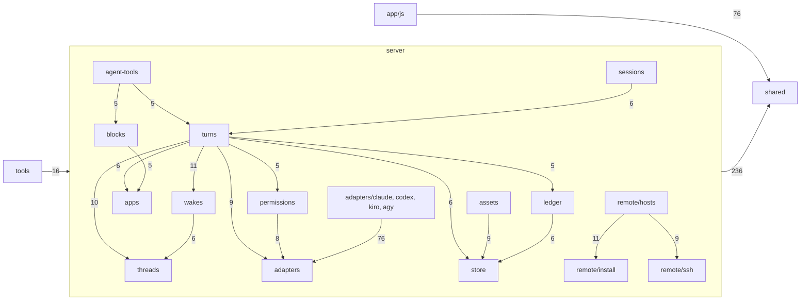

# Folders by concern

Part of [the architecture](../architecture.md).

**Status** (12 November 2026). A proposal, drafted for the person’s review before anything moves. Nothing has moved yet. The map below is the target; the move plan says when each part moves.

**Why.** The person asked whether Postbox could nest folders and organize by concern, since its structure is mostly flat. On `main` at bb48dd76:
- `server/` has 148 modules at its root, next to 7 subfolders; `app/js/` has 156 with no subfolder; `shared/` has 60, and `tools/` 50 at its root.
- `tests/` has 596 test files and 54 helpers and fixtures at its root, and `tests/browser/` 192 specs and 17 helpers.
- Name prefixes stand in for folders: `store-*`, `permission-*`, `ledger-*`, `thread-*` and `turn-*` in `server/`, and `view-*`, `window-*`, `work-*`, `hosts-*`, `review-*` and `pane-*` in `app/js/`. A reader finds a concern by guessing its prefix, and a concern whose modules don’t share one (the store’s `ids`, `blobs` and `home`) is found by reading headers.

“Module and function size”, above, keeps each file to one concern. This keeps each folder to one.

**The rule**
- **A folder owns one concern you can name**, in a few words, as a module does. It holds roughly 5 to 25 modules. There’s no `misc`, `utils` or `helpers` folder: a helper lives with the concern that uses it, or in `shared/` when both sides do.
- **A module lives in the folder of the concern it serves.** A route lives with its concern (`server/sessions/routes.mjs`), not in a routes folder. The root of a tree holds only its entry point: `server/index.mjs` and `app/js/main.mjs`.
- **A folder’s `AGENTS.md` holds that concern’s rules,** when it has rules of its own, such as the store’s write path or the host code’s limits. The tree’s `AGENTS.md` keeps the rules for the whole tree.
- **Tests mirror the folder of the code they test** (“Tests”, below).
- **A prefix that only stands in for the folder is dropped inside it:** `server/store-commit.mjs` becomes `server/store/commit.mjs`, and `app/js/view-jump.mjs` becomes `app/js/view/jump.mjs`. A prefix that says something the folder doesn’t stays: `review-comments.mjs` in `server/blocks/`.
- **A prefix stays where dropping it would confuse a reader:**
  - when the bare name is also a folder in the same tree, or a top-level folder: `server/ledger/ledger-remote.mjs`, not `remote.mjs` beside `server/remote/`; `server/assets/asset-tools.mjs`, not `tools.mjs`; `app/js/review/review-view.mjs`, not `view.mjs` beside `app/js/view/`;
  - when it would leave two modules in one folder with the same name, or with names a reader would mix up: `tools/uat/uat-stats.mjs`, since `tools/uat/stats.mjs` exists; `server/remote/hosts/host-status.mjs` beside `hosts-status.mjs`;
  - when the bare name would say nothing alone (`index`, `main`, `shared`, `lib`): `server/remote/turns/turns-shared.mjs`, `tools/lint/lint-lib.mjs`, `server/remote/host/daemon/daemon-main.mjs`.
- **A folder’s main module keeps its name,** as `server/store/store.mjs` and `app/js/work/work.mjs`, never `index.mjs`, so a search or an editor tab names the concern.

**The map**

Every module under `server/` (its root and subfolders), `app/js/`, `shared/` and the root of `tools/`, with the folder it moves to. It was generated from `git ls-files` on bb48dd76, and checked: each of its 570 modules appears exactly once, no two land on one path, and no dropped prefix leaves a name a folder already has. The pull request that added this section gives the command. Modules a row lists by path come from that subfolder; the rest come from the tree’s root. Italic names are new: wave 2 of #1236’s split of `server/runtime.mjs`, which hasn’t merged, and the four pieces of `server/helpers.mjs`.

Out of scope here: `tools/uat/` (128 modules) and `tools/tally/` keep their place for now, and `app/kit/`, `bin/` and `agent-plugin/` don’t move. `tools/uat/` is past 25 modules and needs a map of its own.

The folders’ main dependencies, counted from today’s imports between the modules each would hold (an arrow is “imports from”, with the number of imports; the server’s edges of fewer than 5 are left out):

`turns/` sits in the middle because `server/runtime.mjs` does; #1236’s split moves its concerns out, and its edges thin as they go. Imports between folders may run both ways (`turns/` and `threads/` import each other), which is fine: `tools/import-cycles.mjs` counts cycles between modules, and folders don’t change them.

**`server/`**

| Folder | Modules | What it owns | Its modules: where each is now, relative to the tree, → its new name |
|---|---|---|---|
| `server/` | 1 | The server’s entry point, which `node server/index.mjs` starts. | `index` |
| `server/http/` | 8 + 1 new | Serving the page: listening, the static files, the state the page loads and its live stream, what reaches the browser. | `build-info`, `listen`, `live-streams`, `page-state`, `public-state`, `served-files`, `upload-name`, `folders`, *http-error* (from `helpers`) |
| `server/store/` | 16 | The event log, its snapshots, its lock, recovery, and where the person’s data lives. | `store`, `store-commit` → `commit`, `store-held` → `held`, `store-lock` → `lock`, `store-outage` → `outage`, `store-recover` → `recover`, `store-reject` → `reject`, `store-replay` → `replay`, `store-retry` → `retry`, `store-snapshot` → `snapshot`, `store-snapshot-lines` → `snapshot-lines`, `ids`, `blobs`, `home`, `data-folder`, `unarchive` |
| `server/threads/` | 17 + 2 new | Conversations, topic and side threads, and what an agent reads of them. | `conversations`, `thread-erase` → `erase`, `thread-headers` → `headers`, `thread-lineage` → `lineage`, `thread-search` → `search`, `thread-summary` → `summary`, `thread-write` → `write`, `summary-model`, `topic-open`, `bring`, `share-back`, `item-lines`, `read-message`, `items-routes`, `reactions`, `shell`, `shell-runs`, *clip* (from `helpers`), *retired* (from `helpers`) |
| `server/sessions/` | 5 | An agent’s session in a conversation: its writes, its lifecycle and its routes. | `session-lifecycle` → `lifecycle`, `session-patch` → `patch`, `session-write` → `write`, `session-routes` → `routes`, `held-session` |
| `server/wakes/` | 12 + 1 new | Who answers and when: messages you send, queues, mentions, wake limits, scheduled wakes and catch-ups. | `send-message`, `message-attachments`, `message-queue`, `queue-batch`, `mention-wakes`, `newer-waiting`, `side-threads`, `wake-cards`, `room-chain-limit`, `scheduled-wakes`, `catch-up`, `catch-up-keep`, *sending* (from `helpers`) |
| `server/turns/` | 11 + 5 new | The runtime and one turn’s life: starting it, its steps, its jobs, stopping and ending it. | `runtime`, `turn-marks` → `marks`, `turn-steps` → `steps`, `empty-reply`, `reply-segment`, `subagent-end`, `kept-jobs`, `restart-sweep`, `step-diff`, `step-text`, `tool-labels`, *deliver* (planned, #1236), *context* (planned, #1236), *stop* (planned, #1236), *finish* (planned, #1236), *job-records* (planned, #1236) |
| `server/checks/` | 6 | The checks on what an agent sends, and when their findings reach it. | `checks`, `diagram-check`, `image-check`, `lint`, `lint-delivery`, `turn-checks` |
| `server/ledger/` | 11 | The work ledger: what each turn changed, ran and published, its git reading, and its archive of old turns. | `ledger`, `ledger-answers` → `answers`, `ledger-commands` → `commands`, `ledger-git` → `git`, `ledger-io` → `io`, `ledger-remote`, `work-view` → `view`, `work-archive` → `archive`, `archive-runtime`, `turn-work`, `turn-end-work` |
| `server/blocks/` | 8 | Blocks and cards the person acts in, and agents’ updates and reviews of them. | `blocks`, `block-show` → `show`, `progress-steps`, `review-comments`, `review-files`, `review-person`, `ask-question`, `card-needs` |
| `server/agent-tools/` | 6 | Postbox’s own tools that agents call: the MCP endpoint, the UI tools, and the write gate in front of them. | `mcp`, `ui-tools`, `tool-gate` → `gate`, `tool-ask` → `ask`, `host-tool`, `schedule-tools` |
| `server/permissions/` | 13 | Permission cards, rules, modes, hooks and the permissions panel. | `permission-always` → `always`, `permission-cards` → `cards`, `permission-edit` → `edit`, `permission-expiry` → `expiry`, `permission-hooks` → `hooks`, `permission-modes` → `modes`, `permission-prompt` → `prompt`, `permission-rules` → `rules`, `permissions-panel` → `panel`, `prompt-claim`, `key-shapes`, `host-rules`, `read-folders` |
| `server/requests/` | 5 | What a request the person made lets run without a card (#296), and writes outside Postbox. | `request-floor` → `floor`, `request-words` → `words`, `write-guard`, `write-intent`, `push-on-request` |
| `server/apps/` | 8 | Agents’ apps: their files, checks, sends, retirement and the sandbox pages they run in. | `apps`, `app-check-status` → `check-status`, `app-retire` → `retire`, `app-send-limits` → `send-limits`, `agent-files`, `read-capped`, `sandbox`, `sandbox-routes` |
| `server/view-app/` | 4 | view_app: an agent sees its app in a pinned headless browser. Kept as it is. | `view-app/browser`, `view-app/consent`, `view-app/view-app`, `view-app/view-of` |
| `server/assets/` | 5 | A conversation’s assets: storage, retention, search and the asset tools. | `assets`, `asset-orphans` → `orphans`, `asset-retention` → `retention`, `asset-search` → `search`, `asset-tools` |
| `server/personas/` | 9 | Personas, projects and the setup an agent starts with. It already holds the seed personas’ prompts. | `persona-checks`, `persona-delete` → `delete`, `persona-write` → `write`, `agent-commands`, `setup-context`, `setup-routes`, `seed`, `projects`, `folder-path` |
| `server/narration/` | 2 | Narration in its own process. Kept as it is. | `narration/narrator`, `narration/worker` |
| `server/adapters/` | 18 | What every backend shares: the adapter interface, the harness-event contract, the folder and setup an agent loads. | `adapters/adapter`, `adapters/agent-plugin`, `adapters/arg-prompt`, `adapters/context-usage`, `adapters/folder`, `adapters/guide`, `adapters/mcp-config`, `adapters/process-group`, `adapters/queued-messages`, `adapters/remote-turn`, `adapters/setup`, `adapters/skill-config`, `adapters/tools-down`, `adapters/work-calls`, `backends`, `harness-events`, `harness-text`, `harness-tools` |
| `server/adapters/claude/` | 13 | Claude Code’s CLI and the Agent SDK, local, remote and attached. | `adapters/claude-code`, `adapters/claude-code-args` → `args`, `adapters/claude-code-remote`, `adapters/claude-content` → `content`, `adapters/claude-init` → `init`, `adapters/claude-permission` → `permission`, `adapters/claude-stream` → `stream`, `adapters/claude-usage` → `usage`, `adapters/agent-sdk`, `adapters/sdk-commands`, `adapters/sdk-permission`, `adapters/terminal-mirror`, `claude-mirror` → `mirror` |
| `server/adapters/codex/` | 9 | The Codex app-server backend. | `adapters/codex`, `adapters/codex-always` → `always`, `adapters/codex-approval` → `approval`, `adapters/codex-events` → `events`, `adapters/codex-mcp-policy` → `mcp-policy`, `adapters/codex-models` → `models`, `adapters/codex-network` → `network`, `adapters/codex-remote`, `adapters/codex-thread` → `thread` |
| `server/adapters/kiro/` | 8 | The Kiro CLI backend. | `adapters/kiro-cli`, `adapters/kiro-cli-agent` → `agent`, `adapters/kiro-cli-models` → `models`, `adapters/kiro-cli-remote`, `adapters/kiro-display-error` → `display-error`, `adapters/kiro-errors` → `errors`, `adapters/kiro-session-info` → `session-info`, `adapters/kiro-tools` |
| `server/adapters/agy/` | 9 | The Antigravity CLI backend. | `adapters/antigravity-cli`, `adapters/agy-auto` → `auto`, `adapters/agy-capabilities` → `capabilities`, `adapters/agy-hook` → `hook`, `adapters/agy-paths` → `paths`, `adapters/agy-plugin` → `plugin`, `adapters/agy-refusals` → `refusals`, `adapters/agy-settings` → `settings`, `adapters/agy-tools` |
| `server/adapters/mock/` | 4 | The mock agent that runs Postbox offline, and the apps it writes. | `adapters/mock`, `adapters/mock-explainer` → `explainer`, `adapters/mock-ledger`, `mock/apps` |
| `server/remote/hosts/` | 9 | The laptop’s host manager: each host’s record, status, placement and routes. | `remote/hosts`, `remote/hosts-links` → `links`, `remote/hosts-requests`, `remote/hosts-status`, `remote/host-admin` → `admin`, `remote/host-status`, `remote/placement`, `remote/serve`, `hosts-routes` → `routes` |
| `server/remote/ssh/` | 7 | The laptop’s connection to one host: ssh, its link and reconnecting after sleep. | `remote/ssh`, `remote/ssh-args` → `args`, `remote/ssh-connection` → `connection`, `remote/ssh-failures` → `failures`, `remote/ssh-reconnect` → `reconnect`, `remote/link`, `remote/wake` |
| `server/remote/install/` | 7 | Installing and updating Postbox’s host code on a host. | `remote/install`, `remote/install-bundle` → `bundle`, `remote/install-record` → `record`, `remote/install-script` → `script`, `remote/install-token` → `token`, `remote/hosts-update` → `update`, `remote/update-withdrawn` |
| `server/remote/turns/` | 20 | A remote turn’s life on the laptop, and its process in spawn’s shape. | `remote/turns`, `remote/turns-background` → `background`, `remote/turns-end` → `end`, `remote/turns-messages` → `messages`, `remote/turns-need` → `need`, `remote/turns-origin` → `origin`, `remote/turns-prompts` → `prompts`, `remote/turns-replay` → `replay`, `remote/turns-restore` → `restore`, `remote/turns-resume` → `resume`, `remote/turns-shared`, `remote/turns-snapshot` → `snapshot`, `remote/turns-start` → `start`, `remote/turns-stops` → `stops`, `remote/turns-tools`, `remote/process`, `remote/process-receive`, `remote/process-send`, `remote/process-stdin`, `remote/attachments` |
| `server/remote/host/` | 18 | The code installed on a host, outside the daemon and its broker: the entry, the runner, the shim and cleanup. | `remote/host/host`, `remote/host/login-path`, `remote/host/paths`, `remote/host/proc`, `remote/host/programs`, `remote/host/cleanup`, `remote/host/cleanup-files`, `remote/host/cleanup-root`, `remote/host/cleanup-turn`, `remote/host/runner`, `remote/host/runner-client`, `remote/host/runner-serve`, `remote/host/runner-turn`, `remote/host/shim`, `remote/host/shim-calls`, `remote/host/shim-harness`, `remote/host/shim-link`, `remote/host/shim-state` |
| `server/remote/host/daemon/` | 21 | The daemon on a host: its connections, turns, files and locks. | `remote/host/daemon`, `remote/host/daemon-main`, `remote/host/daemon-check` → `check`, `remote/host/daemon-conn` → `conn`, `remote/host/daemon-constants` → `constants`, `remote/host/daemon-create` → `create`, `remote/host/daemon-files` → `files`, `remote/host/daemon-follow` → `follow`, `remote/host/daemon-hello` → `hello`, `remote/host/daemon-kill` → `kill`, `remote/host/daemon-locks` → `locks`, `remote/host/daemon-login` → `login`, `remote/host/daemon-read` → `read`, `remote/host/daemon-remove` → `remove`, `remote/host/daemon-reply` → `reply`, `remote/host/daemon-running` → `running`, `remote/host/daemon-scan` → `scan`, `remote/host/daemon-silence` → `silence`, `remote/host/daemon-start` → `start`, `remote/host/daemon-stop` → `stop`, `remote/host/daemon-write` → `write` |
| `server/remote/host/broker/` | 13 | The daemon’s broker: each turn’s tool calls, prompts and snapshot. | `remote/host/broker`, `remote/host/broker-codex`, `remote/host/broker-files` → `files`, `remote/host/broker-offline` → `offline`, `remote/host/broker-postbox` → `postbox`, `remote/host/broker-prompts` → `prompts`, `remote/host/broker-reading` → `reading`, `remote/host/broker-records` → `records`, `remote/host/broker-replay` → `replay`, `remote/host/broker-shim` → `shim`, `remote/host/broker-snapshot` → `snapshot`, `remote/host/broker-state` → `state`, `remote/host/broker-tools` |
| (split) | 1 | Four concerns in one file, so its pieces go to the folders that use them, as new modules. | `helpers` → *http-error*, *clip*, *retired*, *sending* |

**`app/js/`**

| Folder | Modules | What it owns | Its modules: where each is now, relative to the tree, → its new name |
|---|---|---|---|
| `app/js/` | 1 | The page’s entry point, which index.html loads. | `main` |
| `app/js/page/` | 9 | The page’s foundations: the client store, DOM helpers, shared UI pieces, notices and repaint timing. | `client`, `dom`, `ui`, `toast-stack`, `notify-toast`, `lag-log`, `store-line`, `held-frame`, `held-weakly` |
| `app/js/shell/` | 13 | The frame around a conversation: the top bar, the rail, the palette, keys and routing. | `shell`, `topbar-refresh`, `topbar-sig`, `rail-collapse`, `places-menu`, `palette`, `message-hits`, `threads-page`, `keys`, `needs-nav`, `last-place`, `go-when-there`, `install-line` |
| `app/js/thread/` | 14 | The conversation view: its transcript lines, the side panel, and what a reply shows. | `thread`, `thread-host` → `host`, `speaker-line`, `system-line`, `side-line`, `side-panel`, `scheduled-wake-line`, `welcome`, `rerender-state`, `reply-stop`, `failed-actions`, `focus-clear`, `reactions`, `go-to-item` |
| `app/js/composer/` | 7 | The composer: its draft, attachments, the # menu, who it sends to, and messages not sent yet. | `composer-host` → `host`, `composer-size` → `size`, `composer-to` → `to`, `draft-attachments`, `offline-queue`, `thread-menu`, `attachment-chip` |
| `app/js/activity/` | 6 | A running turn as it happens: its steps, its working row, its ring and the live replies off screen. | `activity-live` → `live`, `activity-paint` → `paint`, `activity-steps` → `steps`, `working-rows`, `reply-rings`, `live-in-view` |
| `app/js/view/` | 11 | The transcript’s view: following, jumps, skipped items and the jump pill. | `view-state`, `view-box` → `box`, `view-changes` → `changes`, `view-geometry` → `geometry`, `view-jump` → `jump`, `view-jumpable` → `jumpable`, `view-new` → `new`, `view-pill` → `pill`, `view-publish` → `publish`, `view-skip` → `skip`, `view-smooth` → `smooth` |
| `app/js/window/` | 13 | The transcript window: which items a long conversation keeps mounted, and loading them in time. | `window`, `window-cost` → `cost`, `window-entry` → `entry`, `window-flag` → `flag`, `window-heights` → `heights`, `window-keep` → `keep`, `window-keys` → `keys`, `window-limits` → `limits`, `window-live` → `live`, `window-shrink` → `shrink`, `item-ranges`, `kept-items`, `open-threads` |
| `app/js/markdown/` | 6 | Rendered Markdown in the page: diagrams, math, images, patching, and hover cards. | `agent-markdown`, `md-enhance` → `enhance`, `md-images` → `images`, `md-patch` → `patch`, `hovercards`, `hover-content` |
| `app/js/blocks/` | 9 | Catalog block renderers and their parts. | `blocks`, `block-close` → `close`, `choice-layout`, `code-block`, `form-field`, `table-cells`, `table-scroll`, `progress-clock`, `open-asks` |
| `app/js/review/` | 8 | The review block: its views, drafts and comment threads. | `review`, `review-draft` → `draft`, `review-draft-store` → `draft-store`, `review-inline` → `inline`, `review-preview` → `preview`, `review-table` → `table`, `review-threads` → `threads`, `review-view` |
| `app/js/apps/` | 10 | Agents’ apps on the page side: frames, the bridge, the pre-display check, sends and capture. | `apps`, `app-check` → `check`, `app-crash` → `crash`, `app-pointer` → `pointer`, `app-send-card` → `send-card`, `send-chain`, `capture-view`, `view-ask-card`, `sandbox-libs`, `tab-stop` |
| `app/js/work/` | 10 | The Work view and a turn’s work list. | `work`, `work-commands` → `commands`, `work-diff` → `diff`, `work-git` → `git`, `work-hosts`, `work-list` → `list`, `work-memory` → `memory`, `work-record` → `record`, `work-sections` → `sections`, `work-window` |
| `app/js/pane/` | 6 | The right pane beside a conversation: its views, focus, route, split and width. | `pane`, `pane-focus` → `focus`, `pane-late-thread` → `late-thread`, `pane-route` → `route`, `pane-split` → `split`, `pane-width` → `width` |
| `app/js/agents/` | 8 | The agents list: rows, rings, queues, the agent tree and the wake limit. | `agents`, `agent-facts`, `agent-menu-lines`, `agent-queue`, `agent-tree`, `ring`, `chain-limit`, `hop-card` |
| `app/js/permissions/` | 7 | Permission cards, refusals, and the permissions panel. | `permissions`, `permission-cards` → `cards`, `permission-hooks` → `hooks`, `permission-mcp` → `mcp`, `run-choice`, `denial-card`, `allowed-call` |
| `app/js/hosts/` | 11 | Remote hosts in Settings, and an agent on a host. | `hosts`, `hosts-confirm` → `confirm`, `hosts-editor` → `editor`, `hosts-fields` → `fields`, `hosts-parts` → `parts`, `hosts-settings` → `settings`, `hosts-short` → `short`, `hosts-status` → `status`, `keep-updated`, `agent-host`, `remote` |
| `app/js/sheets/` | 7 | Dialogs: new agent, new conversation, persona and Settings tabs. | `sheets`, `sheets-place` → `place`, `sheets-settings` → `settings`, `check-field`, `skills-field`, `persona-delete`, `projects-tab` |

**`shared/`**

| Folder | Modules | What it owns | Its modules: where each is now, relative to the tree, → its new name |
|---|---|---|---|
| `shared/state/` | 10 | The state shape and the reducer both sides run, the log’s line format, and what the page reads of the state. | `state`, `state-archive` → `archive`, `state-assets` → `assets`, `state-hosts` → `hosts`, `log-lines`, `item-index`, `conversation`, `thread-header`, `needs`, `step-fold` |
| `shared/blocks/` | 10 | The block catalog and its schema, block events and updates, reactions and review shapes. | `catalog`, `schema`, `block-updates` → `updates`, `events`, `number-range`, `reactions`, `review-comments`, `review-diff`, `review-files`, `review-lines` |
| `shared/markdown/` | 8 | The Markdown renderer and what it draws: math, code, diagrams, links, file types. | `markdown`, `markdown-inline` → `inline`, `math`, `highlight`, `diagram-lint`, `urls`, `invisible`, `files` |
| `shared/text/` | 7 | Text helpers and search: parts, regular expressions, BM25 and the search index. | `text`, `text-parts` → `parts`, `regex`, `bm25`, `search-index`, `search-text`, `slash-line` |
| `shared/work/` | 5 | The work ledger’s shape, its index and a turn’s list. | `work`, `work-index`, `work-list` → `list`, `diff`, `git-push` |
| `shared/agents/` | 9 | What agents run with and are limited by: tools, permission matching, CLI versions, limits. | `agent-facts`, `mcp-tools`, `mcp-tools-assets`, `permission-match`, `command-chains`, `hook-modes`, `cli-version`, `versions`, `limits` |
| `shared/remote/` | 11 | The laptop–host protocol and a host’s settings. | `remote-protocol` → `protocol`, `remote-protocol-channels-host` → `protocol-channels-host`, `remote-protocol-channels-postbox` → `protocol-channels-postbox`, `remote-protocol-checks` → `protocol-checks`, `remote-protocol-constants` → `protocol-constants`, `remote-protocol-files` → `protocol-files`, `remote-protocol-framing` → `protocol-framing`, `remote-protocol-messages` → `protocol-messages`, `remote-protocol-parts` → `protocol-parts`, `remote-settings` → `settings`, `host-badge` |

**`tools/`**

| Folder | Modules | What it owns | Its modules: where each is now, relative to the tree, → its new name |
|---|---|---|---|
| `tools/lint/` | 16 | The project lints `npm run lint:project` and `npm run check` run, and what they share. | `lint-caps` → `caps`, `lint-copy` → `copy`, `lint-dom` → `dom`, `lint-lib`, `lint-security` → `security`, `lint-ternary` → `ternary`, `lint-tokens` → `tokens`, `contrast`, `import-cycles`, `diff-added-lines`, `synthetic-fixtures`, `privacy-check`, `joined-deltas`, `scan-commits-privacy`, `prompt-surface`, `prompt-findings` |
| `tools/gate/` | 5 | Running the gate: `npm run check`, its temp folder and lock, CI’s repeated specs and the sign-off checks. | `check`, `gate-tmp` → `tmp`, `heavy-lock`, `repeat-specs`, `signoff-checks` |
| `tools/git/` | 6 | Commits, releases and hooks: Conventional Commits, the merge base, cited commits. | `commits`, `lint-commits`, `release`, `cited-commits`, `merge-base`, `hooks` |
| `tools/bench/` | 10 | Benchmarks and measurements of rooms at scale. | `bench-room` → `room`, `bench-server`, `bench-server-report`, `bench-key-frame` → `key-frame`, `bench-snapshot-stall` → `snapshot-stall`, `key-frame-measure`, `key-frame-report`, `key-frame-stats`, `measure-archive-policies`, `seed-archive-snapshot` |
| `tools/demo/` | 9 | The demo and the pictures made from it: the headless browser, screenshots, the README GIF, icons. | `demo`, `demo-client` → `client`, `demo-ui` → `ui`, `browser`, `page-still`, `readme-gif`, `shoot-app`, `shoot-uat`, `rim-reactions` |
| `tools/uat/` | 4 | The UAT runner’s commands, beside the modules already in tools/uat/. | `uat-run`, `uat-pairs`, `uat-stats`, `uat-verdict` |

**Open questions for the review.** Where the map had to choose, it took the first option; each is a one-line change to it.
- `tools/uat-run.mjs`, `uat-pairs`, `uat-stats` and `uat-verdict`: into `tools/uat/`, keeping their prefix (`tools/uat/stats.mjs` exists), or stay at the root of `tools/` as the commands people type, which AGENTS.md and the UAT docs name.
- `server/runtime.mjs`: in `turns/`, beside the turn it runs, or a `runtime/` folder of its own until #1236 has moved its concerns out.
- `server/read-capped.mjs` (a read that stops past a size): `apps/`, beside `agent-files.mjs`, which uses it, or `store/`.
- `server/shell.mjs` and `shell-runs.mjs` (the person’s `!command`): `threads/`, or `sessions/`.
- `server/ask-question.mjs` (Claude Code’s AskUserQuestion): `blocks/`, since it becomes a question block, or `permissions/`, since it arrives through the permission prompt tool.
- `server/card-needs.mjs` (what an agent needs you for, read from its cards): `blocks/`, or `wakes/`.
- `server/folders.mjs` (the folder picker’s route): `http/`, or `personas/` beside `projects.mjs`.
- `shared/files.mjs` (the file types shown inline): `markdown/`, or `blocks/`.
- The host code (`server/remote/host/`) splits into `daemon/` and `broker/`. Its bundle ships every file under that folder at its path, so the split changes the layout a host installs; a host keeps each version’s code apart, so it is a new version, not a migration. Leaving the host code whole would also be defensible.

**Tests.** Tests mirror the code’s folders: `tests/server/store/commit.test.mjs` tests `server/store/commit.mjs`.
- Why not flat per area: a module and its tests are then one path apart, so a reader and a review find them without a search; a flat `tests/server/` would hold over 400 files, the same problem one level down.
- A test file is named as its module is, and drops the same prefix: `tests/store-commit-retry.test.mjs` becomes `tests/server/store/commit-retry.test.mjs`. A test of more than one module goes with the concern it tests; a test of the whole server over HTTP goes in `tests/server/`.
- A helper or fixture goes with the tests that use it. Those every tree uses (`guard.mjs`, `guard-tmp.mjs`, `temp-dirs.mjs`, `png.mjs`) stay at the root of `tests/`, and so do `tests/integration/`, `tests/process/`, `tests/uat/` and `tests/fixtures/`.
- `npm test` runs `tests/*.test.mjs` today, so a nested test would run nowhere and pass. The tests’ pull request changes the glob to `tests/{server,app,shared,tools}/**/*.test.mjs`, and `test:coverage`’s with it, and checks the summary’s `tests` count is the same before and after. The notes on that glob in “Module and function size”, above, developing.md, “Tests”, and tests/AGENTS.md change in the same pull request.
- **Browser specs** move into folders named for the `app/js/` folder of the view each drives: `tests/browser/view/jump.spec.mjs`, `tests/browser/work/…`. A helper only one folder’s specs use moves with them; the rest (`postbox.mjs`, `pane.mjs` and the other shared helpers) stay at the root of `tests/browser/`. Playwright’s `testMatch` is `**/*.spec.mjs` and `tools/repeat-specs.mjs`’s `isSpec` already accepts subfolders, so neither changes.

**What changes with a move.** Every place that names a module by its path, counted on bb48dd76 by grep (the pull request that added this section has the script). The imports themselves are the bulk: 5,014 lines in 1,462 files.

| Place | On main | What a move changes |
|---|---|---|
| `biome.json`’s per-file overrides | 43 of its 65 overrides name a module in these trees (57 paths), and 17 name a test (19 paths) | The `includes` path, nothing else. |
| `tools/lint-caps.mjs` | Names one module path (its own, in `SKIP`) | It matches an override to the base by its `includes`, so a moved file’s override reads as a removed one and a new one over the default, which fails. It needs to follow renames (git’s `-M` against the merge base) before the first move, in a pull request of its own with a failing test first. |
| Guard tests with module lists | `store-held-guard` (90 entries), `session-write-guard` (15) and `thread-write-guard` (4), keyed by path under `server/`; `tests/server-sources-fixture.mjs` skips `store.mjs`, `store-held.mjs` and `remote/host` by path | Each key, by the same map. A key left behind fails the test, which lists the file it can’t place. |
| Other tests naming a module outside an import | 158 lines in 68 files: a spawned `server/index.mjs`, a source read to check, a path in an assertion | Rewritten with the imports. |
| Browser specs importing by URL | 100 lines in 49 specs (`import('/app/js/client.mjs')`, `/shared/…`) | Rewritten with the imports. |
| `app/js/` importing `shared/` by URL | 76 lines (`from '/shared/agent-facts.mjs'`) | Rewritten with the imports. |
| `server/sandbox.mjs`’s inlined kit | 5 lines name `app/kit/*.js` | Nothing: `app/kit/` doesn’t move. |
| `package.json` | `files` lists folders only; 15 lines of `scripts` name a module (`tools/*.mjs`, `server/build-info.mjs`) | `files` doesn’t change. The scripts change with their tree’s pull request. |
| Static routes | `server/index.mjs` serves `/app/`, `/shared/` and `/kit/` by folder; `app/index.html` loads `/app/js/main.mjs` | Nothing: the folders and the entry stay. |
| The host bundle | `server/remote/install-bundle.mjs` starts from `shared/mcp-tools.mjs` and `shared/remote-protocol.mjs`, by path | Those two paths, in the shared pull request. |
| CI, hooks and types | 23 lines in `.github/workflows/check.yml`, `release.yml`, `prompt-surface-scan.yml`, `.githooks/commit-msg` and `jsconfig.json` | Paths. `prompt-surface-scan.yml` runs the base’s `tools/prompt-surface.mjs` and the head’s, so for the tools pull request it tries both paths; a workflow change is proven by a real run. |
| `designs/` | 333 lines in 28 docs | Rewritten by the same map; a doc that cites a module by its old path still reads, but points nowhere. |
| AGENTS.md files | 11 lines in the `AGENTS.md` of `app/`, `server/`, `tests/` and `tools/`, and 15 in the root `AGENTS.md` and SECURITY.md | Rewritten; a folder that gets rules of its own gets its `AGENTS.md` in a later change. |
| Code comments | 1,066 lines in 466 files | Rewritten by the same map. |
| Code that names a module in a string | 43 lines in 26 files: a spawned script, a read source, a worker’s path | Rewritten, and each is run by a test. |

**The move plan**
- **It starts after #1236’s wave 2 merges,** so the turn’s modules move once, to `server/turns/`, and no open split of `server/runtime.mjs` has to follow them. Before it, `tools/lint-caps.mjs` learns to follow renames.
- **One tree per pull request:** `server/`, then `app/js/`, then `shared/` and the root of `tools/`, then `tests/`.
- **Each is pure:** `git mv`, then a scripted rewrite of import paths and of the path-keyed lists above, with no other change. The script is the map, and the pull request carries it, so a reviewer runs it on the base and diffs the result with the head. Code, comments and names don’t change beyond the paths; `server/helpers.mjs`’s split is a commit of its own after the moves.
- **Each is proven** by `npm run check`, both Playwright runs (plain, and with `POSTBOX_STREAM_LAG=300`), and `npm pack --dry-run` shipping the same files as on the base, moved by the map and nothing else.
- **Other pull requests that touch that tree wait** for the day it merges, then merge `main` and move their own changes with the same script.

**Revisit when** a folder grows past about 25 modules, or a concern no longer fits the folder it’s in: split or move it by this rule, and update the map here in the same change.
