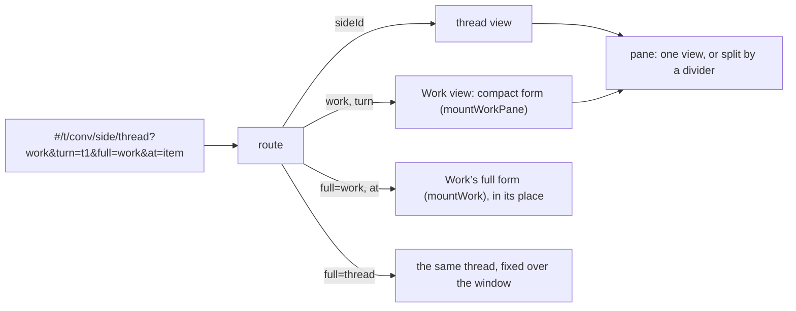

# The front end: plain HTML, CSS and ES modules, no build

Part of [the architecture](../architecture.md).

**Decided next** (28 October 2026, [#508](https://github.com/HJeon139/postbox/issues/508); built in steps B1 to B3, [#531](https://github.com/HJeon139/postbox/issues/531) to [#533](https://github.com/HJeon139/postbox/issues/533)). The page stops holding every item of every conversation. It holds every conversation’s header and open records, and a contiguous window of items for the conversations it shows, paged from a new items API with a filtered stream. An explicit view state, following the newest item or reading at an anchor, is changed only by the person’s input and re-applied after every change to the DOM. Only the window module reads items. The window’s size is calibrated against a budget the person chose: typing and painting in a large room within 10% of a small one’s. Still no framework and no build step. Detail: `designs/508/design.md`, “Browser”.

**Decision.** Keep the shipped app framework-free with no build step, and add type checking and linting as development-only tools, so the app itself still needs nothing but Node to run.

**Does it make Postbox faster for you?** At load, yes:
- **First load.** The app is about 180 KB of uncompressed JavaScript in ten modules plus one stylesheet. There’s no framework runtime, no hydration and nothing to download before the first paint, and a full reload of a long thread renders in well under a second locally.
- **While you use it.** The hot paths are re-rendering Markdown while a reply streams (batched once per frame) and big tables. Neither depends on a framework.
- **The costs are ours, not yours.** We hand-write list reconciliation (`syncList`) and event wiring, which is where Stage 2’s bugs were. There are no compile-time types. Contributors used to a framework need a moment to adjust.

**What we add to keep it fast**
- Serve static files with gzip and ETags instead of always revalidating in full. This is done in this change.
- Virtualize table rows above about 1,000.
- Keep every module small enough to read in one sitting.

**Revisit when** the UI gains shared editing or several people, or the hand-written reconciliation grows past what one file can hold. The first step then would be a small runtime library such as Preact with `htm`, which still needs no build step, rather than a full build pipeline.

**Where it shows: the right pane.** Work is one of the conversation’s side views in the right pane ([`app/js/pane.mjs`](../../app/js/pane.mjs)), beside a thread or alone, not a page of its own. What’s open is in the address after the conversation’s path, so a reload restores it and the views change in place without rebuilding the transcript:

- `work` opens the compact form, `turn` scrolls it to a turn’s line (or, full screen, shows that turn alone), `full=work` or `full=thread` shows that view full screen, and `at` opens one item in full-screen Work.
- **One contract for a pane view:** a compact form in the pane and a full form over the window, with the app frames’ full-screen icon (#45) in its head. Full screen doesn’t move or rebuild the view: pane.mjs fixes the view’s own element over the window (`pane-full`), makes it a modal dialog while it lasts (Tab stays in it; Escape or the icon ends it, with focus back on what opened it: the icon, or the item chosen in the pane), and Work swaps its body for `mountWork`. So a thread keeps its composer draft, its scroll (#88’s anchor holds through the width change) and a streaming reply. App frames keep their own full screen (#45). #138’s page addresses, `#/t/<id>/work` and `/work/<turnId>`, are replaced by these.
- Opening and closing Work replaces the address instead of adding to the history, and the browser remembers per conversation that Work was left open (`pb-work-<id>` in `localStorage`), so a link to the conversation or one of its threads opens it beside them again, in a window with room for both (below, the conversation opens on its own: “Room for the conversation”). A thread left open is remembered the same way (`pb-side-<id>`, #122), in [`app/js/pane-route.mjs`](../../app/js/pane-route.mjs): coming back from another conversation opens it again, while it’s still there, and closing it while you stay in the conversation forgets it. The divider’s place is kept the same way (`pb-pane-split`). All four (`pb-work-<id>`, `pb-side-<id>`, `pb-pane-split` and `pb-pane-w`) are this browser’s conveniences, not state anyone else needs.
- The pane’s width is `--pane-w`, which `pane-width.mjs` sets. A handle on the pane’s left edge changes it (#86): a separator that ← and → move by 16 px, Home and End take to the pane’s minimum and to the most the column’s minimum allows, a drag moves, and a double-click puts back at 440 px. Its width is kept like the divider’s place (`pb-pane-w`), and app frames, as wide as the transcript, resize with it.
- **Room for the conversation** (#197). Beside the pane, the conversation column (`.main`, with its padding) never gets narrower than 640 px (`COL_MIN` in [`app/js/pane-width.mjs`](../../app/js/pane-width.mjs)). Measured on 23 October 2026 in Chrome with the demo seed: the composer’s text box is the column less 207 px, and a reply’s text the column less 48 px. #197 found a 129 px text box (a 336 px column) unusable. At 640 px the text box is 433 px, about 60 characters, a reply’s text 592 px, and the composer’s hints take three lines (four below a 520 px column). To keep the column, the rail hides first (#7), for as long as the pane is open (`rail-auto`, which leaves the person’s own choice, `pb-rail`, as it was); ⌘\ shows it again for that while. So at 1280 px an app beside a thread gets 792 px, where #7 measured about 590 px with the rail open; the rail hides wherever the pane needs its room, below 1,328 px with the pane at 440 px, rather than at #7’s fixed 1,440 px. Where the pane’s minimum doesn’t fit beside the rail (below 1,208 px), the rail stays hidden, and its button says why rather than pushing the pane full screen over it. Then the pane gives up width, down to its own minimum of 320 px. Every width here is the page’s, without a classic scroll bar (`document.documentElement.clientWidth`), which Windows, Linux and some macOS settings take from the window. Where even that doesn’t fit, the pane’s view opens full screen instead (the view opened last, as `full=` shows it), while the address still says only what’s open, so a wider window puts the pane back beside the conversation. Escape there brings the conversation back by closing what’s open, since there’s no pane to go back to. Below 768 px the pane covers the conversation, as before.
- Both forms read the same ledger through `summarize()` and ask git through the same endpoint; the compact form adds nothing to the store.
