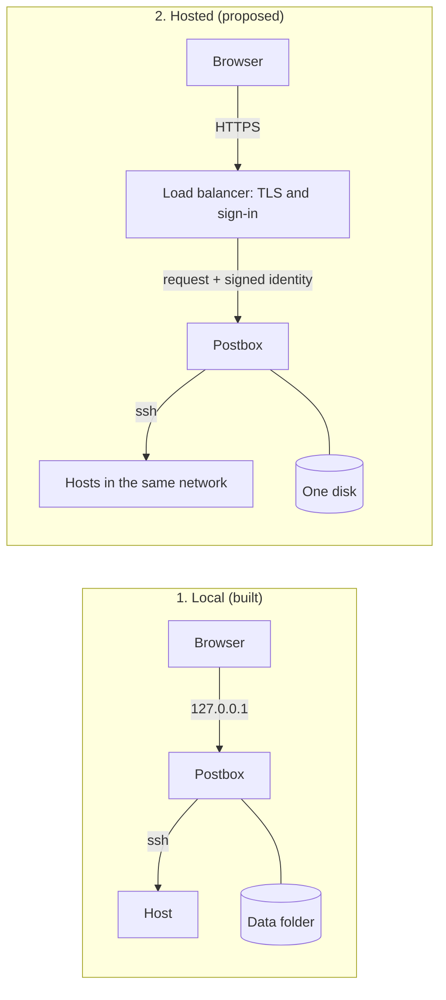
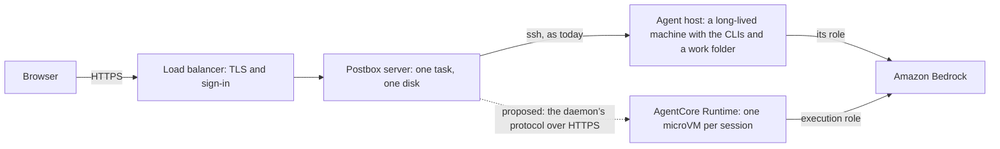
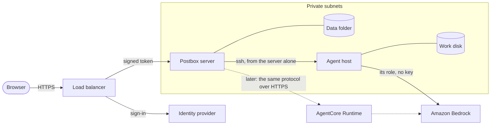

# Hosted: one Postbox for a team, on a server

Part of [the architecture](../architecture.md). How the same Postbox that runs on your own computer runs on a server for a team, what changes at its edge, and what stays exactly as it is. Who is asking is in [people.md](people.md); the request gate this changes is in [security-boundaries.md](security-boundaries.md), “This computer alone”; hosts are in [remote-hosts.md](remote-hosts.md).

**Status.** Proposed, and partly built. A Postbox can be started hosted with `postbox --hosted <settings file>` (`server/hosted-settings.mjs`), and `infra/` deploys one to AWS for a test (“The test deployment on AWS”). Built:

- **The address:** one public origin, listening on every address, `!` and app links refused, the cookie `Secure` (`server/request-gate.mjs`).
- **Sign-in:** the token check of “The check, whole” (`server/identity/alb-token.mjs`), the key lookup and its real fetch with a time and size bound (`server/identity/alb-keys.mjs`, `server/identity/alb-key-fetch.mjs`), the provider behind `identify(req)` with the allow list of #1733 (`server/identity/alb.mjs`, `server/identity/sign-in-settings.mjs`), the health check, `/mcp` refused, and a line in the server’s log for each reason a sign-in was refused (`server/identity/refusal-log.mjs`).

Not built, so a hosted Postbox is for a test and not yet for a team:

- **Rooms by membership.** Everyone on the allow list reaches every room.
- **A page for a navigation that isn’t signed in,** which gets the API’s JSON today. A stream does end at its token’s `exp` (`server/identity/stream-end.mjs`).
- **Postbox’s own browser.** A request addressed to loopback is refused like any other, so an agent’s view of its app (`view_app`) fails when hosted until “Postbox’s own browser” under “Open questions for the owner” is answered.
- **The mock agent and the first start.** The mock is still registered and seeded when hosted.
- **Every row of “What assumed one computer”** but the first.

Without `--hosted`, every rule in AGENTS.md and security-boundaries.md is true as it was, and each test file of a hosted behavior starts a local Postbox beside the hosted one and checks it is unchanged. Sign-in and the address landed together, so nothing answers a public origin before it can tell who is asking. The owner set the direction on 26 November 2026 ([the frame and the answers, in the owner’s words](https://github.com/HJeon139/postbox/issues/1733#issuecomment-7207630150), called “the owner’s answers” below), and each slice under “The slices, in order” is its own pull request. “Open questions for the owner” lists what this document does not settle.

## Three ways to run, and which this serves

The owner’s framing (the owner’s answers, “The three ways to run”):

| | Way to run | Status |
|---|---|---|
| 1 | **Local.** Postbox on your own computer, with agents here or on hosts it reaches over SSH | Built. Every change here leaves it as it is |
| 2 | **Hosted.** Postbox on a server in the cloud for a team, with agents on hosts in the same cloud | This document |
| 3 | **Bring your own agents.** A person’s own computer runs agents in a hosted room | Not planned. Nothing here may make it impossible (“What keeps bring your own agents possible”) |

The owner’s concern with hosting is function, not deployment (the owner’s answers, “The purpose”): putting the page behind a load balancer is the small part. The work is in what Postbox assumes because the browser and the server have always been one computer.

**People come to a room; they aren’t in every room.** The owner, on [#1742](https://github.com/HJeon139/postbox/issues/1742#issuecomment-7198554497): “the postbox server should behave more similarly to postbox remote ssh agents. where users from ‘some remote location’ can be added to the current postbox runtime’s room.” And, asked whether a person may be in some rooms and not others ([the ruling on rooms](https://github.com/HJeon139/postbox/issues/1733#issuecomment-7207754214)): “Permissions to a room is managed by the user who created the room and membership controls authorization to access the room, not a global access to all rooms for all users.” So signing in gets a person into the Postbox, and a room’s membership gets them into a room (“Who may reach a room”).

## One system, and the difference is at the edge

**Decision.** A hosted Postbox is the same process, the same store and the same hosts as a local one. Three things differ, all at the edge and all set by the deployment’s configuration, never by a flag that says who someone is:

- **the address it answers:** one public origin;
- **who is asking:** a provider that reads the load balancer’s signed sign-in, behind the same `identify(req)` seam (`server/identity/index.mjs`);
- **where agents run:** on hosts only, because the server’s image carries no agent CLI, and the mock agent isn’t registered.

**What it rests on.**
- The owner’s direction of 23–25 November 2026, in [people.md](people.md), “Status”: one system that handles both, with no shortcut or back door for one over the other.
- [#1733](https://github.com/HJeon139/postbox/issues/1733): a hosted Postbox starts only with a sign-in allow list. Its body also says everyone on the list sees every room; [the ruling on rooms](https://github.com/HJeon139/postbox/issues/1733#issuecomment-7207754214) replaces that with membership, and the issue’s body says so at its top (“Rescoped again on 26 November 2026”).
- The owner’s ruling of 26 November 2026 on [#1742](https://github.com/HJeon139/postbox/issues/1742#issuecomment-7198554497): a person’s name is the identity provider’s. Postbox manages no names.
- The host machine’s own security is outside Postbox ([#1733](https://github.com/HJeon139/postbox/issues/1733), “The security posture, stated and not built around”).

**What it costs.** Every slice carries a test that a local run is unchanged, and the request gate gains a second configuration to review.

## The address it answers

**Today.** Postbox listens on 127.0.0.1, answers only a `Host` of `127.0.0.1:<port>` or `localhost:<port>`, and refuses a write whose `Origin` is anything else (`server/request-gate.mjs`, `admit`). Its own origin is fixed as `http://127.0.0.1:<port>` (`server/index.mjs`), and that string goes into the page’s and the sandbox’s content security policy, the MCP address a local agent is given (`server/turn-context.mjs`), `POSTBOX_ORIGIN`, and `config.origin` on the page.

**Decision.** A deployment sets one public origin, such as `https://postbox.example.com`. Then:

- **It listens on every address of its container,** loopback among them: Postbox’s own headless browser loads it over loopback ([view-app.md](view-app.md)), and the load balancer reaches it on the container’s address. What `hereAlone` reads as the listen address (`host()` in `server/request-gate.mjs`) is then not a loopback address, so `!` commands and an app’s links are refused by the check that exists, for every request, one from loopback included.
- **No proxy beside it.** A proxy in the same container group, forwarding to a Postbox that listened on loopback alone, would keep “listens on 127.0.0.1” true in words and break it in fact: `hereAlone` would allow `!` for every request.
- `admit` answers the public origin’s `Host` and accepts its `Origin` on writes. A `Host` of loopback is refused like any other, Postbox’s own browser’s included, until “Postbox’s own browser” under “Open questions for the owner” is answered.
- Everything built from the origin is built from the public one: the two policies, `config.origin`, `POSTBOX_ORIGIN`, the page token’s cookie, which gains `Secure`. One thing is built from the request’s `Host` with `http://` written in, the page that may frame an app (`server/index.mjs`), and it is built from the public origin too, or behind TLS the browser refuses every app and diagram.
- With no public origin set, nothing changes: 127.0.0.1, and the gate as it is.

**What it costs.** The port is reachable by whatever the network lets reach it, not only by the load balancer, and loopback is a second way to it for whatever shares the container’s network: a sidecar, or `kubectl port-forward`, which connects to the pod’s localhost. So the sign-in below is checked by Postbox on every request and is the boundary; the network’s rules, and what runs beside Postbox in its pod, are the second line and the deployment’s to set.

## Who is asking

**Decision.** Sign-in is the load balancer’s. On AWS, an Application Load Balancer signs people in with the team’s identity provider over OIDC and forwards each request with the person’s claims in `x-amzn-oidc-data`, a JWT it signs. A second provider behind `identify(req)` verifies it. Source for what the balancer sends: [Authenticate users using an Application Load Balancer](https://docs.aws.amazon.com/elasticloadbalancing/latest/application/listener-authenticate-users.html), read 26 November 2026. Node verifies ES256 with `node:crypto`, so no dependency is added.

**The check, whole.** A request is a person’s only when all of this holds, and a failure of any part refuses the request:

- **The algorithm is ES256,** whatever the token’s `alg` says, and the key fetched is a P-256 key.
- **`signer`** is the deployment’s own load balancer, by its ARN, from configuration; and **`client` and `iss`** are the deployment’s own, since one balancer can front several applications with different sign-ins, and a token minted for another of them verifies against the same key. All three are read before a key is looked up. That believes nothing, since a token is only ever refused for them and acceptance still needs the signature over the same bytes; it means a request has to name this deployment’s own load balancer before Postbox looks anything up for it.
- **The key** is the one the token’s `kid` names, fetched from `https://public-keys.auth.elb.<region>.amazonaws.com/<key-id>`. The region comes from the deployment’s configuration, never from the token, and is a region of AWS’s main partition (GovCloud and China serve keys elsewhere, unconfirmed, and are refused). `kid` is checked to have a key id’s shape before it goes into the URL. A key is kept once had; an answer that isn’t a P-256 key is never kept. A fetch that fails refuses the request, and what made-up key ids can make Postbox do is bounded (`server/identity/alb-keys.mjs`): a failed id isn’t fetched again for a minute, fetches of ids not yet had are bounded in any minute and at once, and a key in use stays kept. A flood that reaches the port without the load balancer, and names its ARN, client and issuer, can still take each fetch as the minute frees it, so a key Postbox hasn’t had yet (after a start or a key change) is refused for as long as the flood lasts. The network’s rules are what close that (“What it costs”, above).
- **The signature** is checked before any claim is believed. The token’s parts are base64url with padding, which the page says and a strict decoder refuses.
- **`exp`** is in the future, read from under the signature, and a token without one is refused: without it, a header seen once is good forever against the open port.
- **The person** is on the allow list ([#1733](https://github.com/HJeon139/postbox/issues/1733), unchanged: a hosted Postbox refuses to start without one, and someone signed in who isn’t on it gets a page that says so).

The unsigned headers the balancer also adds (`x-amzn-oidc-identity`, `x-amzn-oidc-accesstoken`) prove nothing and are never read. Postbox receives the access token on every request and never logs it, keeps it or sends it on (AGENTS.md: Postbox never reads, stores or passes a token).

**Who the principal is.** `issuer` is the token’s `iss`, and `subject` its `sub`: the two together are the person’s key. `username`, which a mention of the person goes by (`server/person-mentions.mjs`), and `name` each come from a claim the deployment names in its configuration, since identity providers differ in what they call them. Whether a claim that changes at the provider changes the person’s record is “A name that changes at the provider” under “Open questions for the owner”: people.md keeps a name as it was when the record was first kept, and the owner’s ruling is that the name is the provider’s.

**Three requests have no signed identity, and each is named.** Everything else without one gets no route, reads included. That is new: locally a read needs no token ([security-boundaries.md](security-boundaries.md), “Writes need the page’s token”).

- **The health check** (the owner’s answers: “Yes, health check only”):
  - one fixed path, matched exactly, for GET and HEAD only;
  - a fixed status and body, the same whatever the store’s state: no version, no uptime, no counts, and none of the store’s status, whose cause can name a path on the server;
  - answered before `admit`’s `Host` check as well as before sign-in, since the balancer’s check comes from its own nodes with the target’s private address and port as its `Host` ([Troubleshoot your Application Load Balancers](https://docs.aws.amazon.com/elasticloadbalancing/latest/application/load-balancer-troubleshooting.html), read 26 November 2026). It is the one route that answers any `Host`. The path is `/health`;
  - there only when hosted, so a local gate is unchanged;
  - liveness only. When every target fails its check the balancer sends traffic anyway, so a check tied to the store gains nothing and risks a restart that drops every stream.

  It gives away one bit: something answers on this port.
- **Postbox’s own browser.** An agent sees its app in a headless browser on the server, which loads the whole page, not a sandbox page (`server/view-app/browser.mjs`: `page.goto` of the origin with `?nocheck`), so its exception is every read, state and stream included. Proposed, with its limits:
  - told by two things together: the request’s socket is from loopback, never a header that says so, and it carries a secret Postbox makes at each start and gives only to the browser it launches. Loopback alone would admit whatever else reaches the pod’s loopback;
  - the secret goes to the browser as a header Postbox sets on the browser’s context, never in a URL, an argument or the environment, which every child inherits; it is compared in constant time and never logged. It keeps out what shares the pod’s network, not what runs as the server’s account, which has the data folder and the server’s key already; that holds because no agent runs in the server’s container;
  - GET only, as the browser’s own route filter already holds it to;
  - it reads as no person: `me` is none, nothing is stamped with a person, and no need is read by it. With rooms behind membership (“Who may reach a room”), it is given the one room whose app it captures, not every room.

  This is a second way in, and the owner’s direction is “no shortcut or back door”. The alternative is to take the view another way, answering the capture browser’s requests inside Postbox’s process with no socket, which is more to build. It is “Postbox’s own browser” under “Open questions for the owner”.
- **`/mcp`** is an agent’s way in and no person’s (`server/identity/session.mjs`), and the page’s token check skips it. Hosted it has no caller: a turn on a host reaches its tools through the daemon’s shim, never this address (`server/adapters/adapter.mjs`), and the mock isn’t registered. So hosted it is refused, with a test in the sign-in slice.

**What a refused request gets.** An API call and the event stream get a status, with nothing that says more than “sign in”; a navigation gets a page that says so. The test deployment’s listener uses `authenticate`, so a request with no session, a background one included, is redirected to the provider; with the balancer’s `deny` it would get 401, but one whose session has expired is still redirected. So the page has to handle both, by noticing either on a background request and reloading, which isn’t built.

**A stream outlives nothing.** `/api/stream` is checked as it opens and then lives as long as the page. Hosted, a stream ends no later than its token’s `exp`, and the page reconnects with a fresh one, so a person removed from the allow list, or signed out, stops receiving within one token’s life. The event stream sends a keep-alive every 15 seconds (`server/live-streams.mjs`), which sits under the balancer’s idle timeout: 60 seconds by default, reset by any data either way ([Edit attributes for your Application Load Balancer](https://docs.aws.amazon.com/elasticloadbalancing/latest/application/edit-load-balancer-attributes.html), read 26 November 2026).

**The hop from the balancer is clear text unless Postbox serves TLS.** The AWS page: to encrypt the claims, the target group uses HTTPS. With no proxy beside it and Postbox speaking plain HTTP, the signed header and the access token cross the cluster’s network unencrypted on every request. Proposed: accept the clear hop inside the cluster’s private network, state it in the deployment recipe as the network’s to protect, and revisit if a deployment can’t. Serving TLS itself would give Postbox a certificate to hold and renew.

**The page’s token stays,** as what it always was: proof that a write came from Postbox’s own page and not another site. It is one secret per server start, shared by every page, and it was never who you are.

## Who may reach a room

**Decision** (the owner, 26 November 2026: [the ruling on rooms](https://github.com/HJeon139/postbox/issues/1733#issuecomment-7207754214)). Signing in says who a person is; it does not put them in any room. A room has members, and a person reaches a room only as a member of it.

- **A room’s admins manage who is in it:** they add and remove people in the room’s form in the main menu, and only an admin deletes the room. Every member still adds and removes its agents and renames it, as any write does today (`server/session-routes.mjs`): only its people and its deletion are an admin’s. Admin is a status of a member, given and taken away by an admin, not a fixed owner (the owner, 26 November 2026, [on #1733](https://github.com/HJeon139/postbox/issues/1733#issuecomment-7207766371): “make the admin status something that can be assigned to members of the room instead of a hard coded owner status”). Two points here are this document’s proposal and not the owner’s words: whoever creates a room is its first member and its first admin, and a room keeps at least one admin, as it keeps at least one agent, so the last admin can’t leave or give the status up until another member has it.
- **A room a person isn’t in doesn’t exist for them.** It is in no state their page is given, no event on their stream, no search and no list, and a route that names it answers as if there were no such room. That is every route that carries a room’s data: its items and files, its Work, its apps and their pages, its agents’ sessions and their permissions. That is so whether the route names the room or an id that leads to one (an app, a session, an item, an upload, a schedule, or a room id in the request’s body), and for every event type and live frame on the stream, with the conversations a page has open or without: what a page has open is what it shows, not what it may see. A topic or side thread has its conversation’s members. Nothing a person does to a shared agent or project reaches a room they can’t: deleting a project or an agent is refused while it is in such a room, and an edit to an agent is the agent’s, which “What else follows membership” leaves open.
- **An @-mention of a person, and what needs a person, stay within the room’s members.**
- **On your own computer membership costs nothing:** the one person is a member and an admin of every room, those made before membership included, and the room’s form shows them so, as a local run shows every people surface; no check ever refuses them.

**Proposed, where the ruling doesn’t reach.** Each of these is this document’s proposal:

- **Whom an admin can add:** anyone who has signed in. Hosted, a person’s record is kept at their first sign-in, where on `main` it is kept only once they save a profile or send a message ([people.md](people.md)): otherwise a newcomer with no room to write in is someone no admin can pick. An allow list can admit people by a group’s claim (#1733), so it has no list of names to offer before they sign in, and the names stay the provider’s.
- **A person taken off the allow list is taken out of every room,** as an admin’s removal does it. A room left with no admin gives the status to the member who joined first, which its form shows, with no notice: no one has anything to decide. Postbox sees a person leave only when the allow list names them, or at their next sign-in. An admin deleted at the provider, or admitted by a group’s claim they have since left, stays an admin no one can be. So the operator can name a room’s admin in the deployment’s configuration, as they add a member to a room left with none, since nothing in the page can.
- **A removal moves what waited on the person.** They stop being the room’s last person to write (`lastPerson`, `server/sessions.mjs`), which is then no one until a member writes, and they are taken out of the people each open need is for (`need.for`). A need left naming no one is every member’s, not everyone’s.
- **An agent that @-mentions someone who isn’t a member is told so,** as a Postbox notice its next turn reads (`tell`, `server/sessions.mjs`), so it can ask a member or an admin to add them. The mention asks no one, and a need it carried that names only non-members is every member’s. This tells the agent nothing a page doesn’t show, since every person’s profile reaches every page.
- **An upload belongs to each room it is sent in,** and to its uploader alone until it is sent. A message attaches only an upload its sender may reach, so knowing an id reaches nothing. An upload on `main` has no room (`GET /api/files/:id` serves by id, and its record names none), so every room’s attachment names and bytes would reach every page.
- **Images agents save for their apps are kept per room.** `/media/` on `main` is one folder for the whole data folder (`server/data-folder.mjs`), which every agent writes to and anyone who knows a name reads. Hosted, each turn’s `$POSTBOX_MEDIA` names its room’s folder, and an image’s address names the room, so it is served to that room’s members. An app in another room that loads it shows it only to those who can reach the first room, so an agent copies the image instead. That a sandboxed frame’s request says who is asking at all is the sign-in slice’s test (“What assumed one computer”).
- **A room’s people are kept apart from `members`,** which on `main` is the room’s agents’ sessions (`server/threads.mjs`) and is read to tell a direct message from a room (`server/catch-up.mjs`).
- **What the filter looks up.** Items, the glossary, Work and assets are kept by room. Apps and schedules name their room (`threadId`, `server/apps.mjs`, `server/scheduled-wakes.mjs`); sessions, the inbox and run clocks reach it through the session; a topic or side thread through its `parentId`.

**What membership is not.** It is who may reach a room in Postbox. It is not a wall between the rooms’ agents: agents of two rooms that run on one host run as one account there and can read each other’s files (“Where agents run”, “What everyone on one Postbox shares”). Nor is it a wall inside one agent: an agent in two rooms works in one folder with one harness memory (`server/adapters/folder.mjs`, `server/personas.mjs`), so what it read in one room it can repeat in the other. Where an agent runs is the agent’s, not the room’s (`server/remote/placement.mjs`), so a team that needs a wall gives the rooms different agents, on different hosts.

**What this document assumes stays shared by everyone signed in,** since the ruling is about rooms: the agents (personas), the projects, the hosts, and each person’s profile, which the owner ruled reaches every page ([people.md](people.md), “`people` is a public state key”). “What else follows membership” under “Open questions for the owner” asks what of this is wrong.

**What it rests on.** What reaches a page is decided today in one place, the public keys of `shared/state.mjs` through `server/public-state.mjs` ([security-boundaries.md](security-boundaries.md), “What reaches the browser”), for one reader. Membership makes that a decision per person, for the state, the stream’s live and backlog frames, and every route that answers with a room’s data.

**What it costs.** Every route that reaches a room’s data gains a check, and a missed one is a leak, so the slice needs a test that walks every route of every method with a non-member, read from the source as `tests/published-kept-out.test.mjs` reads the GET routes for private keys, with each module `route` delegates to found from its imports rather than listed, and a route without a case failing it; and the stream’s backlog, live and snapshot frames, for a page that names the room among those it has open and one that names none, and for a member removed while their stream is open. The stream is filtered per connection. This is the largest slice here.

## What assumed one computer

An audit of the code on 26 November 2026 (`main` at e7d50596e), corrected against the first review’s reading of each row. Each row is a decision for the slice named; none is decided here beyond the column “Hosted”.

| What | Today | Hosted | Slice |
|---|---|---|---|
| `!` commands, an app’s links | Allowed only while listening on and asked from loopback (`hereAlone`) | Off, by the same check | Address |
| Local agent backends | Found on the server’s `PATH` (`server/backends.mjs`); the mock is always registered (`server/index.mjs`) | The image carries no CLI, so agents run on hosts, and a host’s daemon looks for `claude`, `kiro-cli` and `codex` only. **Antigravity isn’t among them:** it waits until it can be tested on a host ([remote-hosts.md](remote-hosts.md), “The adapters stay; only the process moves”). The Agent SDK runs inside Postbox’s process and can’t move, and is being removed ([#1834](https://github.com/HJeon139/postbox/pull/1834)). It is “Antigravity doesn’t run on a host yet” under “Open questions for the owner”. The mock isn’t registered when hosted (the owner’s answers: “Hide it”), so no agent can be made on it through the API either: it runs in the server’s own process | Cloud hosts |
| The first start | Seeds agents on the first real backend found here, else the mock (`server/seed.mjs`) | There is neither. A hosted first start seeds no agents, and says to add a host first | Cloud hosts |
| Terminal sessions as agents | Read from `~/.claude/projects` on the server every 1.5 s (`server/claude-mirror.mjs`) | Nothing to find; the surface says so or is hidden | Same-machine |
| Claude Code’s settings, MCP servers, skills, the permissions panel | Read and written in the server account’s home (`claudeHome`) | The server’s account has none of a person’s; what the panel shows for an agent on a host is the slice’s to decide | Same-machine |
| Project and agent folders, the folder picker, attachments from a folder | Paths on the server’s disk (`server/folder-path.mjs`, `server/folders.mjs`) | A project’s folder on each host exists already (`PUT /api/projects/:p/hosts/:h/folder`); the server-side folder has no meaning | Same-machine |
| The work ledger’s git, pushes with `gh` | Run on the server, with its account’s sign-in (`server/ledger-git.mjs`, `server/push-on-request.mjs`) | Off for work on a host today ([remote-hosts.md](remote-hosts.md), “Revisit when”); unchanged | None |
| Whose name is on a commit or a push from a host | The host account’s git and `gh` identity | Every person’s work is one author’s, and the version history is part of what a person comes back to | Several people |
| What to do when a host fails | “Sign in to … in a terminal”, “Run `ssh …` in a terminal” (`server/remote/ssh-failures.mjs`, `server/remote/install.mjs`) | The person has no terminal on the server: the next step has to be one they can take | Same-machine |
| Who may add a host, and what a host is named by | Any write with the page’s token (`server/hosts-routes.mjs`); the record’s name is the SSH destination, resolved by the server account’s SSH configuration (`server/remote/host-admin.mjs`) | Anyone signed in points the server’s key at any destination it knows. Hosts are shared by everyone on the Postbox, as this document assumes, and the recipe says so | Cloud hosts |
| What reaches a page | Every public key of the state, to the one reader there is (`server/public-state.mjs`) | Only the rooms a person is a member of, in the state, the stream and every route (“Who may reach a room”) | Rooms by membership |
| Who has a room open, for reading an ask | One person per room, the last to say so (`viewers` in `server/threads.mjs`); a page says what it has open every ten seconds | With two people in a room, an ask of the one who isn’t the last isn’t read as it lands; their page’s next word, within ten seconds, reads it. A need shows for up to ten seconds; no read is lost | Several people |
| Whether a room is open, for telling anyone | One time per room, for anyone (`viewing` in `server/threads.mjs`). While it is open, no unread is counted and no “mentioned you” or “finished” notice is raised (`server/turn-needs.mjs`) | **The larger half:** a person who is away is told nothing because someone else is looking. Per person | Several people |
| Unread marks, the theme | One of each for the install (the theme in `shared/state.mjs`; unread counts on the thread and the session, `server/threads.mjs`, `server/turn-needs.mjs`) | Each person’s own (the owner’s answers: “Per person”). The theme can live in the browser, which is nothing to build on the server. Unread is one mark per person per room, written when they look, not a count per person written on every reply, or a room of many people writes once per person per reply. On a local run there is one person, so both read as they do now | Several people |
| Usage and quota | The server account’s own figures (`server/backends.mjs`) | A host’s account’s, not a person’s | Several people |
| An agent’s view of its app | A headless browser on the server loads the whole page over loopback with no sign-in (`server/view-app/browser.mjs`), downloaded once a person agrees on a card (`server/view-app/consent.mjs`) | The exception named under “Who is asking”. And one person’s answer on the card is everyone’s, with the download landing in a container: the image carries the browser, and the card goes | Address |
| Images in agents’ blocks and replies | Checked against the origin (`imageOrigins`, `server/index.mjs`); plain http only for loopback, and a URL is moved only between the two loopback names (`shared/urls.mjs`, `shared/catalog.mjs`) | Stored items carry the origin they were written under: decide what an image saved under another origin does | Address |
| An app’s images from its sandboxed frame | `/media/` needs no token, because a sandboxed frame’s request carries no `SameSite=Strict` cookie ([security-boundaries.md](security-boundaries.md), “Writes need the page’s token”) | `/media/` is behind sign-in. Whether a sandboxed frame’s request carries the balancer’s session cookie, in each browser, decides whether any app image loads: a test in the sign-in slice | Sign-in |
| What apps fetch | Private, loopback and link-local addresses refused, the cloud’s metadata address among them (`server/net-address.mjs`) | The block list holds as it is. The server’s network is now the hosts’ network, so the grant planned in [#1610](https://github.com/HJeon139/postbox/issues/1610) (the person’s network, folders on disk) is decided again for hosted before it lands there | None |
| The build shown in the sidebar | Read from the clone (`buildInfo`, `server/index.mjs`) | An image has no clone: the build is written into the image | Deployment |
| The data folder’s lock | One writer, found stale by its process id and start time (`server/store-lock.mjs`) | It does not hold across containers (“One server, one disk”) | Deployment |

Kept only in the browser, and so already per person: drafts, the outbox, the pane layout.

## Where agents run

**Decision.** Hosted agents run on hosts, added in Settings › Hosts as they are today. The server dials out to each over `ssh`, as now: the daemon, its protocol and a turn that outlives a disconnect are unchanged ([remote-hosts.md](remote-hosts.md)).

What the deployment brings, since `ssh` runs with `BatchMode=yes` and `StrictHostKeyChecking=yes` (`server/remote/ssh-args.mjs`) and so never asks:

- an SSH client in the image, and `known_hosts` filled in ahead of time;
- a key the hosts accept, given to the server as it starts and never built into the image;
- hosts that are Linux with Node 22 or later, reachable from the server;
- each agent CLI signed in on its host. How that is done is outside Postbox (the owner’s answers, “Earlier”).

**What everyone on one Postbox shares,** which an operator reads before adding someone to the allow list. Membership keeps a person out of a room; it does not keep them from what the hosts hold:

- **One sign-in per CLI per host, shared by everyone.** It is the host account’s, and so is the usage it spends.
- **The server’s key reaches every host,** and the data folder holds each host’s daemon token.
- **Leaving the allow list ends the sign-in, not the reach.** A member could have had an agent read the host account’s credentials while they were one.
- **The data folder holds every room, upload and profile, unencrypted by Postbox.** It is set with `--data` on the attached volume; the default is the account’s home, which a container loses.

## Agents on AWS: Bedrock for the models, and where AgentCore fits

**Proposed, for the owner to rule on** (the owner, 26 November 2026: “Consider the system architecture and the need to integrate to AgentCore and Bedrock as the hosting of the models for Claude Code, Codex, and Kiro”). Each fact below was read from the vendor’s documentation on 26 November 2026, and what couldn’t be confirmed says so.

**The models: Amazon Bedrock in the deployment’s own account, by the host’s role and no key.**

| Backend | On Bedrock | What the host sets | Source |
|---|---|---|---|
| Claude Code | Yes. Credentials come from the AWS default chain, an ECS task role or an instance profile among them | `CLAUDE_CODE_USE_BEDROCK=1`, `AWS_REGION`, and a pinned model (`ANTHROPIC_MODEL` and the `ANTHROPIC_DEFAULT_*_MODEL` settings); the role may `bedrock:InvokeModel` and `InvokeModelWithResponseStream`. Its WebSearch tool isn’t available there | [Claude Code on Amazon Bedrock](https://code.claude.com/docs/en/amazon-bedrock) |
| Codex | Yes, from Codex 0.128.0, in the few regions that host OpenAI’s models | `model_provider = "amazon-bedrock"` in the host’s `config.toml`, and no `OPENAI_API_KEY`. That a task role alone is enough isn’t in OpenAI’s documentation: to confirm on a host | [Codex with Amazon Bedrock](https://developers.openai.com/codex/amazon-bedrock) |
| Kiro CLI | No. It signs in with `KIRO_API_KEY` and spends Kiro credits; nothing documents it using Bedrock in your own account | A key on the host, which is the host’s secret and never Postbox’s | [Kiro CLI, headless](https://kiro.dev/docs/cli/headless/) |

This keeps the rule that Postbox never reads, stores or passes a key: the role and the settings are the host’s, set by the deployment. It changes nothing in Postbox’s code, since a host’s daemon starts the CLI in the host account’s environment ([remote-hosts.md](remote-hosts.md)).

**Where the CLIs run: a host image first, AgentCore Runtime as a second way in.**

- **First, an agent host is a machine of our own** in the same VPC: Node, an SSH server, the three CLIs and a work folder on a volume, with a role that may call Bedrock. Postbox dials it over `ssh` exactly as it dials any host, so nothing in the protocol changes and the local way to run is untouched. This is the “Cloud hosts” slice, and “What runs an agent host, weighed” says what the machine is.
- **AgentCore Runtime doesn’t take SSH.** It runs an ARM64 container that answers `POST /invocations` and `GET /ping` on port 8080, one microVM per session, at most 8 hours a session and 60 minutes a stream, with a filesystem that is gone when the session ends unless session storage (a preview, 1 GB) or a volume is attached ([the service contract](https://docs.aws.amazon.com/bedrock-agentcore/latest/devguide/runtime-service-contract.html), [sessions](https://docs.aws.amazon.com/bedrock-agentcore/latest/devguide/runtime-sessions.html), [filesystems](https://docs.aws.amazon.com/bedrock-agentcore/latest/devguide/runtime-filesystem-configurations.html)). So it is not a host as Postbox knows one.
- **What it would take:** the host daemon’s protocol, JSON lines that resume from a byte offset, carried over the runtime’s HTTP stream instead of `ssh`. That is the same split “What keeps bring your own agents possible” names: the protocol apart from the connection. A stream cut at 60 minutes is a disconnect the protocol already resumes from.
- **What it would buy:** each agent’s session in its own microVM, which is the wall between rooms’ agents that one shared host doesn’t give (“What membership is not”); no SSH key for the server to hold; and pay for the seconds a turn runs.
- **What it would cost:** a second transport to build and review; a session’s 8-hour limit against rooms that run for days, so the work folder must live on an attached volume; and Kiro still needs its key.
- **AgentCore Identity, Gateway and Memory aren’t needed for this.** Identity’s outbound credentials are the natural answer to “Whose name is on a commit or a push from a host” in the table above, when that row is taken up.

The question for the owner is “AgentCore as a second way to run agents” under “Open questions for the owner”.

### What runs an agent host, weighed

The owner, 27 November 2026, after a project couldn’t be made on the test deployment (“The test deployment on AWS”, “What a real sign-in showed”): “we need a hosting solution that works”, and “this is not like a typical web server. it’s more like a remote host machine”. Both are so, of two different parts:

- **The server is a web server with one disk.** It answers pages, keeps the event log and dials hosts. Its read-only disk on the test deployment is a default this deployment set, not a limit of Fargate, and nothing it does needs more than its data folder.
- **An agent host is a machine.** A CLI holds a session for hours, clones repositories, installs dependencies, runs builds, tests and browsers, and may need Docker. It needs a fast disk that outlives a restart, and the freedom a developer’s computer has.

They stay apart for a reason that is a boundary, not tidiness: an agent has a shell, and a shell in the server’s container would hold the data folder, which is every room and each host’s daemon token, and the server’s SSH key beside it (“What everyone on one Postbox shares”). So “make the server writable and run agents in it” would end membership before it is built. What was missing on the test deployment is the second part, which this slice doesn’t build.

| What would run the agent host | A disk that outlives a restart | Docker and builds as on a developer’s computer | What it adds to build and run | Fit |
|---|---|---|---|---|
| A Fargate task | EFS only. An EBS volume on a service’s task is “always deleted upon task termination”, and a task can’t attach an existing one ([EBS volumes with ECS](https://docs.aws.amazon.com/AmazonECS/latest/developerguide/ebs-volumes.html)) | No: “privileged containers or access are currently unavailable on Fargate” ([Fargate security considerations](https://docs.aws.amazon.com/AmazonECS/latest/developerguide/fargate-security-considerations.html)) | The least: one more construct beside the server’s | Works for Claude Code and Codex editing and running tests; a network disk under `git` and `node_modules`, and no Docker |
| **An EC2 instance (proposed)** | Its own EBS volume | Yes | One construct: an instance in the private subnets, a role that may call Bedrock, SSH admitted from the server’s security group alone | What “a remote host machine” means, and what Postbox’s hosts are already: a Linux account reached over `ssh` ([remote-hosts.md](remote-hosts.md)) |
| Kubernetes (EKS on EC2), a StatefulSet a host | A volume claim per host | Yes, on nodes that allow it | A control plane at $0.10 an hour ([EKS pricing](https://aws.amazon.com/eks/pricing/)), node groups, and for hosts made on demand, Postbox calling the cluster’s API, which is new code and a new credential | Earns its cost when hosts are many and made per team or per room, or when the team runs a cluster already. With a fixed handful of hosts it runs the same container as the row above with more to operate |
| Ray Serve | No: it is “a scalable model serving library for building online inference APIs”, scaled “by adjusting the number of replicas” ([Ray Serve](https://docs.ray.io/en/latest/serve/index.html)) | No | A Ray cluster, which on AWS is usually itself on Kubernetes, and Python in a project that has none | Not a fit. Its replicas are interchangeable and answer requests; an agent’s session is one process with one folder, which no other replica can pick up |
| AgentCore Runtime | No, unless a volume is attached; a session ends at 8 hours | No | A second transport for the daemon’s protocol (above) | A wall between agents and pay by the second, for turns that fit in a session. Second, not first |

**Proposed.** Keep the server on Fargate. Make the agent host an EC2 instance from a construct of its own, `PostboxAgentHost`: Node, the CLIs, a work folder on its own volume, Claude Code and Codex reaching Bedrock by the instance’s role, and the server’s key the only one it accepts. Nothing in Postbox’s protocol changes, the host is added in Settings › Hosts as any host is, and a project’s folder is set on that host, which is what the form on the test deployment had no answer for. What the host installs is written once, as a script an image can run too, so the same host can become a pod when a team wants a cluster. Kubernetes is taken up when hosts are made on demand; AgentCore Runtime after, as the second transport; Ray Serve isn’t.

The question for the owner is “What runs an agent host” under “Open questions for the owner”.

## The test deployment on AWS

`infra/` holds a CDK app, and `Dockerfile` the server’s image ([infra/README.md](../../infra/README.md) is the recipe). It is four constructs, the network, the data folder’s disk, the edge and the server, each in a stack of its own so that one that fails rolls back alone (the owner, 27 November 2026: “multiple stacks and atomic constructs instead of an all or nothing stack”), and it uses the hosted zone, identity provider and VPC a team already has. Together they are the least that proves the hosted edge against a real load balancer:

- one Application Load Balancer with an HTTPS listener whose only action signs a person in and then forwards, at the identity provider the team has (a Cognito user pool or any OIDC provider) or a new user pool, to
- one Fargate task of the server’s image, with no public address, with the data folder on an EFS file system only its role can mount, and a security group that admits its port from the load balancer’s alone (the owner, 26 November 2026: “Network rules”);
- one task at a time, the old one stopped before the new one starts, which is how the deployment keeps one writer (“One server, one disk”).

**What a real sign-in showed** (the owner, at the deployment, 27 November 2026: “sign in works. but path doesn’t seem writable”). A person on the allow list signed in at the team’s existing Cognito user pool and got Postbox’s page, so the check holds against a token a real load balancer signed and the key its endpoint serves, and the server’s log recorded no refusal. Without a sign-in, every request, `/health` included, was redirected to the provider. What didn’t work is a project: its root folder has to exist on the server’s disk (`server/projects.mjs`), and this server’s container has a read-only disk and no folder for work, since no agent runs in it. That is the “Project and agent folders” row of “What assumed one computer”: a hosted project needs its folder on an agent host, which is the “Cloud hosts” slice, and until then the form asks a hosted person for a path that means nothing there. The deployment was deleted after the test.

**A dependency, and where it stops.** `infra/` depends on `aws-cdk-lib` and the `aws-cdk` command, in a `package.json` of its own. They build the deployment and never run in Postbox: the `postbox` package still lists no dependency and ships nothing from `infra/`, and the image installs none, since it is Node and Postbox’s own folders. The app is plain JavaScript, so there is still no build step.

**Secure by default, and not by the network alone** (the owner, 27 November 2026, asking for an independent adversarial review: the construct “does not rely heavily on security perimeter”). What admits a person is three checks a request can’t skip by reaching the port: the load balancer’s sign-in, Postbox’s check of the signed token against this deployment’s own load balancer, client and provider, and Postbox’s allow list of subjects. The review found no way past them, and what it did find is fixed in the construct’s defaults: no admission by a claim a person could write for themselves, a verified email address, a stream that ends with its sign-in, a container with a read-only disk and no capability, and a disk no principal but the task’s role can mount. **Still leaning on the network:** the hop from the load balancer to the task is plain HTTP inside the VPC, as “The hop from the balancer is clear text unless Postbox serves TLS” proposes; AWS’s own guidance is HTTPS to the target, and it is “TLS on the hop from the load balancer” under “Open questions for the owner”.

It is ECS, not the Kubernetes cluster this document’s first notes named, because it is the least to run for a test and the image is the same on either. Whether a team’s deployment stays on ECS or moves to a Kubernetes cluster is “What runs an agent host” under “Open questions for the owner”.

## One server, one disk

**Decision.** A hosted Postbox is one process on one disk. The store is one append-only log with one writer, read from memory ([store.md](store.md)), and the event streams, who has what open and the running turns live in that process. On AWS that is one replica with one attached volume, on a Kubernetes cluster (the owner’s answers, “Earlier”).

**The lock does not refuse a second replica in another container:** it tells a live holder by its process id and start time (`server/store-lock.mjs`), and each container has its own. A second replica finds process 1 alive, itself, with another start time, judges the lock stale and takes it over while the first still writes. A rolling update does exactly this. So the deployment keeps one writer: one replica, stopped before its replacement starts, on a volume one pod can mount. A lock that holds across containers is the deployment slice’s to decide, not to assume. And a takeover file left by a start that died is never removed by Postbox, so a container killed mid-start refuses every restart until someone removes the file: the recipe says so.

**What it costs.** No failover beyond a restart, and a restart drops every page’s stream for a moment; pages reconnect on their own, and a turn on a host keeps running meanwhile.

**Revisit when** one server can’t hold a team’s rooms, which the scale work measures per room ([rooms-at-scale.md](../rooms-at-scale.md)).

## What keeps bring your own agents possible

Nothing is built for it. What is true of `main`, and the one promise hosted work makes:

- **The protocol is separate from SSH:** JSON lines that resume from a byte offset. The connection (`server/remote/ssh*.mjs`) and a host’s record, whose name is its SSH destination, are not yet, and a host that dials in would need both split.
- **Hosted work adds no field that only makes sense when the server dials out.**

What it would need, noted so no one mistakes it for small: a host with an owner, a daemon that starts only what its owner allows instead of the command the server sends, and a rule for who spends the owner’s usage.

## The slices, in order

| Slice | Done when |
|---|---|
| This document | Merged |
| **Address:** the public origin, and listening on every address | A Postbox started with a public origin answers it and refuses others; `!` and app links are refused from every address; with none, the gate’s tests pass unchanged. The rules it changes are changed with it |
| **Sign-in:** the load balancer’s provider, with the allow list of [#1733](https://github.com/HJeon139/postbox/issues/1733) | Each part of “The check, whole” has a test that fails without it; a request with no identity gets no route but the three named; `/mcp` is refused; a stream ends at its token’s `exp`; a local run asks nothing. The rules it changes are changed with it |
| **Rooms by membership:** a room’s members, managed by its admins | A person who isn’t a member finds the room in no state, no event and no route, by a test that walks every route of every method and the stream (“What it costs”, above); an admin adds and removes people and gives and takes the admin status in the room’s form, and the last admin can’t be removed; an @-mention and a need stay within its members; a local run is unchanged. The rules it changes are changed with it |
| **Same-machine:** each row above marked for it | Each surface works on a host’s agent or says plainly that it doesn’t apply here |
| **Several people:** whether a room is open and unread, per person, then the rest of its rows | A person who is away is told of a mention and a finished turn while another has the room open; each clears only their own unread marks |
| **Cloud hosts and deployment:** the image, the recipe, a real start on AWS | The owner starts it, signs in, adds a host and runs a room; one writer is kept by the deployment, and the recipe says what a team shares |

The address, sign-in and membership slices change a security boundary and are reviewed as such. The deployment slice costs real money to prove and is the owner’s to start.

**The rules the address, sign-in and membership slices change,** each with its section in the same change (AGENTS.md: when a rule and its section disagree, fix both):

- AGENTS.md, “Security boundaries”: “Postbox listens on 127.0.0.1 only”.
- [security-boundaries.md](security-boundaries.md), “This computer alone” and “Writes need the page’s token”, and for membership “What reaches the browser”, with AGENTS.md’s rule from it.
- SECURITY.md: “for one person”.
- [running.md](../running.md), “There’s no sign-in”.
- [intent.md](../intent.md): “There is no sign-in and there are no other people in rooms”, and “Several people, sign-in or presence” under what is not in scope.
- [people.md](people.md): “There is no environment variable or header that says who is asking”, which a signed header ends; and for membership, “Anyone can still see and answer any ask” and “for something private a room has no human members”, with the comment on `people` in `shared/state.mjs` and the room form’s “The people of this Postbox are in every room” (`app/js/rooms-tab.mjs`). And for a record kept at first sign-in, “from the first time they have something to keep: a saved profile, or a message they sent” and “loading a page stays a read, on a local run and for a person signing in to a hosted one for the first time”, where a hosted first sign-in now keeps the record and a store that can’t be written still lets them in.

## Open questions for the owner

- **What else follows membership.** This document puts only rooms behind membership, and keeps the agents, the projects, the hosts and people’s profiles shared by everyone signed in. That costs this: anyone signed in can add an agent of a room they can’t reach to a room of their own and ask it what it knows, and can edit that agent’s instructions. Keep them shared, and say plainly that membership keeps a person from a room’s page, not from what its agents know; or have agents follow membership too, so an agent is added to a room, edited or deleted only by someone who is a member of every room it is in, which costs a team the reuse of one agent across rooms with no member in common?
- **A name that changes at the provider.** A person’s record keeps the name it was first kept with. Hosted, should the record follow the provider’s claims at each sign-in, which is what “the name is the provider’s” reads as, though an agent that goes on writing the old user name then asks no one (a mention resolves by the current one); or keep the first, and show a name the provider no longer gives?
- **Postbox’s own browser.** Let it in over loopback with a secret made at each start, reading as no person, or build the view another way so nothing but a signed request is answered? The other way: the capture’s browser already routes every request through Postbox’s process (`server/view-app/browser.mjs`), so it can answer each from Postbox’s handler there, with no socket; a fulfilled request can’t stream, so the capture page reads state once instead of following the stream.
- **AgentCore as a second way to run agents.** Build the agent host image first and reach it over SSH, as proposed, and take AgentCore Runtime up after as a second transport for the daemon’s protocol; or go to AgentCore first, which delays any agent running on AWS until that transport exists? And is Kiro, which can’t use Bedrock in your own account, wanted on a hosted Postbox with a Kiro key on the host?
- **TLS on the hop from the load balancer.** Postbox speaks plain HTTP to the load balancer inside the VPC, so the signed token and the provider’s access token cross it unencrypted. Have Postbox serve TLS with a certificate made at each start, which the load balancer accepts without checking, so the hop is encrypted and nothing is held or renewed; or keep the clear hop inside private subnets?
- **What runs an agent host.** The test stack is ECS on Fargate, and it runs the server alone. “What runs an agent host, weighed” proposes that the server stays there and that an agent host is an EC2 instance with a disk of its own, with Kubernetes taken up only when hosts are made on demand, Ray Serve not at all, and AgentCore Runtime later as a second transport. Is that the order, or should a team’s deployment be a Kubernetes cluster from the start?
- **Antigravity doesn’t run on a host yet.** A hosted Postbox offers Claude Code, Kiro and Codex; the Agent SDK, which runs in Postbox’s own process, is being removed ([#1834](https://github.com/HJeon139/postbox/pull/1834)). Leave Antigravity out of a hosted Postbox until a host runs it, which costs a team that backend, or make running it on a host part of the cloud hosts slice, which adds it to the daemon and needs a test on a host?

## Revisit when

- A room needs kinds of member beyond admin and not, such as one who reads and can’t write. Nothing here builds that.
- A person’s own computer should run agents in a hosted room (“What keeps bring your own agents possible”).
- Another cloud’s load balancer is wanted. It is another provider behind the same seam.
- A deployment can’t keep the hop from the balancer inside a private network. Then Postbox serves TLS.
