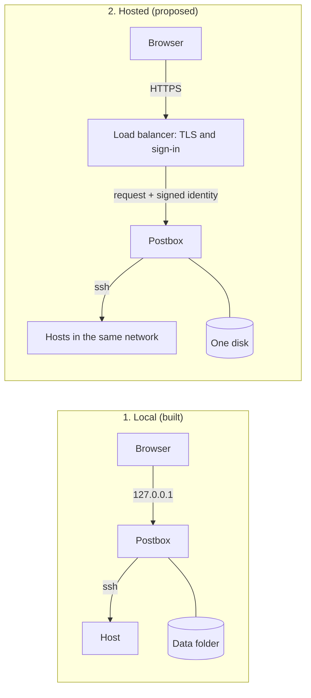

# Hosted: one Postbox for a team, on a server

Part of [the architecture](../architecture.md). How the same Postbox that runs on your own computer runs on a server for a team, what changes at its edge, and what stays exactly as it is. Who is asking is in [people.md](people.md); the request gate this changes is in [security-boundaries.md](security-boundaries.md), “This computer alone”; hosts are in [remote-hosts.md](remote-hosts.md).

**Status.** Proposed, not built. Nothing here is in the code yet. The owner set the direction on 26 November 2026, and each slice under “The slices, in order” is its own pull request.

## Three ways to run, and which this serves

The owner’s framing (26 November 2026):

| | Way to run | Status |
|---|---|---|
| 1 | **Local.** Postbox on your own computer, with agents here or on hosts it reaches over SSH | Built. Every change here leaves it as it is |
| 2 | **Hosted.** Postbox on a server in the cloud for a team, with agents on hosts in the same cloud | This document |
| 3 | **Bring your own agents.** A person’s own computer runs agents in a hosted room | Not planned. Nothing here may make it impossible (“What keeps bring your own agents possible”) |

The owner’s concern with hosting is function, not deployment: putting the page behind a load balancer is the small part. The work is in what Postbox assumes because the browser and the server have always been one computer.

## One system, and the difference is at the edge

**Decision.** A hosted Postbox is the same process, the same store and the same hosts as a local one. Three things differ, all at the edge and all set by the deployment’s configuration, never by a flag that says who someone is:

- **the address it answers:** one public origin, beside loopback;
- **who is asking:** a provider that reads the load balancer’s signed sign-in, behind the same `identify(req)` seam (`server/identity/index.mjs`);
- **where agents run:** on hosts only, because the server’s image carries no agent CLI, and the mock agent is hidden.

**What it rests on.**
- The owner’s direction of 23–25 November 2026, in [people.md](people.md), “Status”: one system that handles both, with no shortcut or back door for one over the other.
- [#1733](https://github.com/HJeon139/postbox/issues/1733): a hosted Postbox is one trusting team. Everyone who signs in sees every room and directs every agent; signing in is attribution, not isolation.
- The owner’s ruling of 26 November 2026 on [#1742](https://github.com/HJeon139/postbox/issues/1742): a person’s name is the identity provider’s. Postbox manages no names.
- The host machine’s own security is outside Postbox ([#1733](https://github.com/HJeon139/postbox/issues/1733), “The security posture, stated and not built around”).

**What it costs.** Every slice carries a test that a local run is unchanged, and the request gate gains a second configuration to review.

## The address it answers

**Today.** Postbox listens on 127.0.0.1, answers only a `Host` of `127.0.0.1:<port>` or `localhost:<port>`, and refuses a write whose `Origin` is anything else (`server/request-gate.mjs`, `admit`). Its own origin is fixed as `http://127.0.0.1:<port>` (`server/index.mjs`), and that string goes into the page’s and the sandbox’s content security policy, the MCP address a local agent is given (`server/turn-context.mjs`), and `config.origin` on the page.

**Decision.** A deployment sets one public origin, such as `https://postbox.example.com`, and the address to listen on. Then:

- `admit` answers that origin’s `Host` and accepts its `Origin` on writes, beside loopback, which Postbox still uses to reach itself (the headless browser of [view-app.md](view-app.md) loads `http://127.0.0.1:<port>`).
- Everything built from the origin (the two policies, `config.origin`, the page token’s cookie, which gains `Secure`) is built from the public one.
- With neither set, nothing changes: 127.0.0.1, and the gate as it is.

**Postbox listens on the server’s own address, with no proxy beside it.** A proxy in the same container group, forwarding to loopback, would keep “listens on 127.0.0.1” true in words and break it in fact: `hereAlone` in `server/request-gate.mjs` allows `!` commands and an app’s links when Postbox listens on loopback and the request comes from loopback, and behind such a proxy every request does. Listening on the real address keeps both off with the check that exists.

**What it costs.** The port is reachable by whatever the network lets reach it, not only by the load balancer. So the sign-in below is checked by Postbox on every request, and is the boundary; the network’s rules are the second line, and the deployment’s to set.

## Who is asking

**Decision.** Sign-in is the load balancer’s. On AWS, an Application Load Balancer signs people in with the team’s identity provider over OIDC and forwards each request with the person’s claims in `x-amzn-oidc-data`, a JWT it signs with ES256. A second provider behind `identify(req)` verifies it:

- the signature, with the key the JWT’s `kid` names, fetched from `https://public-keys.auth.elb.<region>.amazonaws.com/<key-id>`;
- that the header’s `signer` is the deployment’s own load balancer;
- then takes `sub` and the issuer as the person’s key, and the name the provider gives as their name.

The unsigned headers the load balancer also adds (`x-amzn-oidc-identity`, `x-amzn-oidc-accesstoken`) are never read. Source for all of this: [Authenticate users using an Application Load Balancer](https://docs.aws.amazon.com/elasticloadbalancing/latest/application/listener-authenticate-users.html), read 26 November 2026. Node verifies ES256 with `node:crypto`, so no dependency is added.

A request with no valid signed identity gets no route at all, reads included, with one exception: a health check for the load balancer, which answers only that Postbox is up and carries no state (the owner, 26 November 2026). That is new: locally a read needs no token ([security-boundaries.md](security-boundaries.md), “Writes need the page’s token”).

**The allow list** is [#1733](https://github.com/HJeon139/postbox/issues/1733), unchanged: a hosted Postbox refuses to start without one, and someone signed in who isn’t on it gets a page that says so.

**The page’s token stays,** as what it always was: proof that a write came from Postbox’s own page and not another site. It is one secret per server start, shared by every page, and it was never who you are.

**Open, for the slice.** When a sign-in session ends, the load balancer answers a page’s background requests with a redirect or a 401 depending on its setting; the page has to notice and reload. The event stream sends a keep-alive every 15 seconds (`server/live-streams.mjs`), which should sit under the load balancer’s idle timeout; that number isn’t on the page cited above and is confirmed in the deployment slice.

## What assumed one computer

An audit of the code on 26 November 2026 (`main` at e7d50596e). Each row is a decision for the slice named; none is decided here beyond the column “Hosted”.

| What | Today | Hosted | Slice |
|---|---|---|---|
| `!` commands, an app’s links | Allowed only while listening on and asked from loopback (`hereAlone`) | Off, by the same check | Address |
| Local agent backends | Found on the server’s `PATH` (`server/backends.mjs`); the mock is always there | The image carries none, so real agents run on hosts. The mock is hidden (the owner, 26 November 2026): it runs in the server’s own process and is no one’s agent to direct | Cloud hosts |
| Terminal sessions as agents | Read from `~/.claude/projects` on the server every 1.5 s (`server/claude-mirror.mjs`) | Nothing to find; the surface says so or is hidden | Same-machine |
| Claude Code’s settings, MCP servers, skills, the permissions panel | Read and written in the server account’s home (`claudeHome`) | The server’s account has none of a person’s; what the panel shows for an agent on a host is the open question | Same-machine |
| Project and agent folders, the folder picker, attachments from a folder | Paths on the server’s disk (`server/folder-path.mjs`, `server/folders.mjs`) | A project’s folder on each host exists already (`PUT /api/projects/:p/hosts/:h/folder`); the server-side folder has no meaning | Same-machine |
| The work ledger’s git, pushes with `gh` | Run on the server, with its account’s sign-in (`server/ledger-git.mjs`, `server/push-on-request.mjs`) | Off for work on a host today ([remote-hosts.md](remote-hosts.md), “Revisit when”); unchanged | None |
| Who has a room open | One viewer per room, the last to say so (`viewers` in `server/threads.mjs`) | Two people in one room: only one is seen, so an ask of the other isn’t read as it lands ([people.md](people.md), “Reading is its answer, and only reading”) | Several people |
| Unread marks, the theme | One of each for the install (`shared/state.mjs`) | Each person’s own (the owner, 26 November 2026): one person’s view clears only their unread marks, and each keeps their theme. On a local run there is one person, so both read as they do now | Several people |
| Usage and quota | The server account’s own figures (`server/backends.mjs`) | A host’s account’s, not a person’s | Several people |
| An agent’s view of its app | A headless browser on the server, loading loopback with no sign-in (`server/view-app/`) | Still loopback; the gate must let Postbox’s own browser in without the load balancer | Address |
| What apps fetch | Private, loopback and link-local addresses refused, the cloud’s metadata address among them (`server/net-address.mjs`) | Holds as it is | None |
| The data folder’s lock | One writer, found stale by process id and start time (`server/store-lock.mjs`) | One server, one disk. A restart in a fresh container, where process ids start again, needs a test | Deployment |

Kept only in the browser, and so already per person: drafts, the outbox, the pane layout.

## Where agents run

**Decision.** Hosted agents run on hosts, added in Settings › Hosts as they are today. The server dials out to each over `ssh`, as now: the daemon, its protocol and a turn that outlives a disconnect are unchanged ([remote-hosts.md](remote-hosts.md)).

What the deployment brings, since `ssh` runs with `BatchMode=yes` and `StrictHostKeyChecking=yes` (`server/remote/ssh-args.mjs`) and so never asks:

- an SSH client in the image, a key the hosts accept, and `known_hosts` filled in ahead of time;
- hosts that are Linux with Node 22 or later, reachable from the server;
- each agent CLI signed in on its host. How that is done is outside Postbox (the owner, 23 November 2026).

Every person on the allow list directs every agent, and an agent acts as its host’s account. That is the trusting-team model of [#1733](https://github.com/HJeon139/postbox/issues/1733), not a gap.

## One server, one disk

**Decision.** A hosted Postbox is one process on one disk. The store is one append-only log with one writer, read from memory ([store.md](store.md)), and the event streams, who has what open and the running turns live in that process. On AWS that is one replica with one attached volume, on the Kubernetes cluster the owner named (23 November 2026). A second replica is refused by the lock, by design.

**What it costs.** No failover beyond a restart, and a restart drops every page’s stream for a moment; pages reconnect on their own, and a turn on a host keeps running meanwhile.

**Revisit when** one server can’t hold a team’s rooms, which the scale work measures per room ([rooms-at-scale.md](../rooms-at-scale.md)).

## What keeps bring your own agents possible

Nothing is built for it. Two things in this design stay as they are so it can be added:

- **How Postbox reaches a host is one module** (`server/remote/ssh-connection.mjs`), under a protocol of JSON lines that resumes from a byte offset and never names SSH. A host that dials in would be a second connection beside it.
- **A host’s record assumes nothing about direction.** Hosted work adds no field that only makes sense when the server dials out.

What it would need, noted so no one mistakes it for small: a host with an owner, a daemon that starts only what its owner allows instead of the command the server sends, and a rule for who spends the owner’s usage.

## The slices, in order

| # | Slice | Done when |
|---|---|---|
| 1 | This document | Merged |
| 2 | **Address:** the public origin and listen address | A Postbox started with them answers that origin and refuses others; `!` and app links are refused; with neither, the gate’s tests pass unchanged |
| 3 | **Sign-in:** the load balancer’s provider, with the allow list of [#1733](https://github.com/HJeon139/postbox/issues/1733) | A request with a valid signed identity is that person; one without gets no route but the health check; a local run asks nothing |
| 4 | **Same-machine:** each row above marked for it | Each surface works on a host’s agent or says plainly that it doesn’t apply here |
| 5 | **Several people:** who has a room open, per person, then the rest of its rows | Two people in one room each read their own asks, each clear only their own unread marks, and each keep their own theme |
| 6 | **Cloud hosts and deployment:** the image, the recipe, a real start on AWS | The owner starts it, signs in, adds a host and runs a room |

Slices 2 and 3 change a security boundary and are reviewed as such. Slice 6 costs real money to prove and is the owner’s to start.

## Revisit when

- A team needs rooms some members can’t see. That is membership, dropped for now in [#1733](https://github.com/HJeon139/postbox/issues/1733).
- A person’s own computer should run agents in a hosted room (“What keeps bring your own agents possible”).
- Another cloud’s load balancer is wanted. It is another provider behind the same seam.
