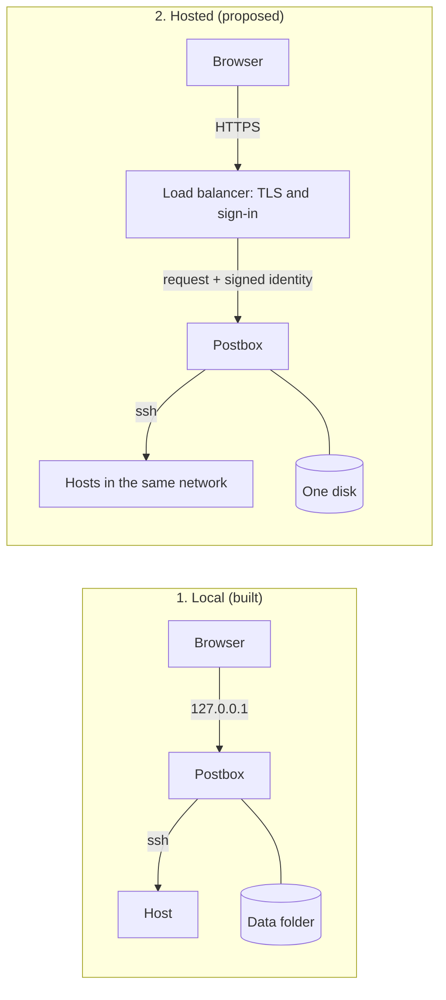

# Hosted: one Postbox for a team, on a server

Part of [the architecture](../architecture.md). How the same Postbox that runs on your own computer runs on a server for a team, what changes at its edge, and what stays exactly as it is. Who is asking is in [people.md](people.md); the request gate this changes is in [security-boundaries.md](security-boundaries.md), “This computer alone”; hosts are in [remote-hosts.md](remote-hosts.md).

**Status.** Proposed, not built. Nothing here is in the code yet, so every rule in AGENTS.md and security-boundaries.md is still true of `main`. The owner set the direction on 26 November 2026 ([the frame and the answers, in the owner’s words](https://github.com/HJeon139/postbox/issues/1733#issuecomment-7207630150), called “the owner’s answers” below), and each slice under “The slices, in order” is its own pull request. “Open questions for the owner” lists what this document does not settle.

## Three ways to run, and which this serves

The owner’s framing (the owner’s answers, “The three ways to run”):

| | Way to run | Status |
|---|---|---|
| 1 | **Local.** Postbox on your own computer, with agents here or on hosts it reaches over SSH | Built. Every change here leaves it as it is |
| 2 | **Hosted.** Postbox on a server in the cloud for a team, with agents on hosts in the same cloud | This document |
| 3 | **Bring your own agents.** A person’s own computer runs agents in a hosted room | Not planned. Nothing here may make it impossible (“What keeps bring your own agents possible”) |

The owner’s concern with hosting is function, not deployment (the owner’s answers, “The purpose”): putting the page behind a load balancer is the small part. The work is in what Postbox assumes because the browser and the server have always been one computer.

**People come to a room; they aren’t in every room.** The owner, on [#1742](https://github.com/HJeon139/postbox/issues/1742#issuecomment-7198554497): “the postbox server should behave more similarly to postbox remote ssh agents. where users from ‘some remote location’ can be added to the current postbox runtime’s room.” And, asked whether a person may be in some rooms and not others ([the ruling on rooms](https://github.com/HJeon139/postbox/issues/1733#issuecomment-7207754214)): “Permissions to a room is managed by the user who created the room and membership controls authorization to access the room, not a global access to all rooms for all users.” So signing in gets a person into the Postbox, and a room’s membership gets them into a room (“Who may reach a room”).

## One system, and the difference is at the edge

**Decision.** A hosted Postbox is the same process, the same store and the same hosts as a local one. Three things differ, all at the edge and all set by the deployment’s configuration, never by a flag that says who someone is:

- **the address it answers:** one public origin;
- **who is asking:** a provider that reads the load balancer’s signed sign-in, behind the same `identify(req)` seam (`server/identity/index.mjs`);
- **where agents run:** on hosts only, because the server’s image carries no agent CLI, and the mock agent isn’t registered.

**What it rests on.**
- The owner’s direction of 23–25 November 2026, in [people.md](people.md), “Status”: one system that handles both, with no shortcut or back door for one over the other.
- [#1733](https://github.com/HJeon139/postbox/issues/1733): a hosted Postbox starts only with a sign-in allow list. Its body also says everyone on the list sees every room; [the ruling on rooms](https://github.com/HJeon139/postbox/issues/1733#issuecomment-7207754214) replaces that with membership, and the issue’s body is yet to follow.
- The owner’s ruling of 26 November 2026 on [#1742](https://github.com/HJeon139/postbox/issues/1742#issuecomment-7198554497): a person’s name is the identity provider’s. Postbox manages no names.
- The host machine’s own security is outside Postbox ([#1733](https://github.com/HJeon139/postbox/issues/1733), “The security posture, stated and not built around”).

**What it costs.** Every slice carries a test that a local run is unchanged, and the request gate gains a second configuration to review.

## The address it answers

**Today.** Postbox listens on 127.0.0.1, answers only a `Host` of `127.0.0.1:<port>` or `localhost:<port>`, and refuses a write whose `Origin` is anything else (`server/request-gate.mjs`, `admit`). Its own origin is fixed as `http://127.0.0.1:<port>` (`server/index.mjs`), and that string goes into the page’s and the sandbox’s content security policy, the MCP address a local agent is given (`server/turn-context.mjs`), `POSTBOX_ORIGIN`, and `config.origin` on the page.

**Decision.** A deployment sets one public origin, such as `https://postbox.example.com`. Then:

- **It listens on every address of its container,** loopback among them: Postbox’s own headless browser loads it over loopback ([view-app.md](view-app.md)), and the load balancer reaches it on the container’s address. What `hereAlone` reads as the listen address (`host()` in `server/request-gate.mjs`) is then not a loopback address, so `!` commands and an app’s links are refused by the check that exists, for every request, one from loopback included.
- **No proxy beside it.** A proxy in the same container group, forwarding to a Postbox that listened on loopback alone, would keep “listens on 127.0.0.1” true in words and break it in fact: `hereAlone` would allow `!` for every request.
- `admit` answers the public origin’s `Host` and accepts its `Origin` on writes. A `Host` of loopback is answered only for Postbox’s own browser (“Who is asking”, the requests with no signed identity).
- Everything built from the origin is built from the public one: the two policies, `config.origin`, `POSTBOX_ORIGIN`, the page token’s cookie, which gains `Secure`. One thing is built from the request’s `Host` with `http://` written in, the page that may frame an app (`server/index.mjs`), and it is built from the public origin too, or behind TLS the browser refuses every app and diagram.
- With no public origin set, nothing changes: 127.0.0.1, and the gate as it is.

**What it costs.** The port is reachable by whatever the network lets reach it, not only by the load balancer, and loopback is a second way to it for whatever shares the container’s network: a sidecar, or `kubectl port-forward`, which connects to the pod’s localhost. So the sign-in below is checked by Postbox on every request and is the boundary; the network’s rules, and what runs beside Postbox in its pod, are the second line and the deployment’s to set.

## Who is asking

**Decision.** Sign-in is the load balancer’s. On AWS, an Application Load Balancer signs people in with the team’s identity provider over OIDC and forwards each request with the person’s claims in `x-amzn-oidc-data`, a JWT it signs. A second provider behind `identify(req)` verifies it. Source for what the balancer sends: [Authenticate users using an Application Load Balancer](https://docs.aws.amazon.com/elasticloadbalancing/latest/application/listener-authenticate-users.html), read 26 November 2026. Node verifies ES256 with `node:crypto`, so no dependency is added.

**The check, whole.** A request is a person’s only when all of this holds, and a failure of any part refuses the request:

- **The algorithm is ES256,** whatever the token’s `alg` says, and the key fetched is a P-256 key.
- **The key** is the one the token’s `kid` names, fetched from `https://public-keys.auth.elb.<region>.amazonaws.com/<key-id>`. The region comes from the deployment’s configuration, never from the token. `kid` is checked to have a key id’s shape before it goes into the URL. A key is cached by its `kid`. A fetch that fails refuses the request.
- **The signature** is checked before any claim is read. The token’s parts are base64url with padding, which the page says and a strict decoder refuses.
- **`signer`** is the deployment’s own load balancer, by its ARN, from configuration.
- **`client` and `iss`** are the deployment’s own, from configuration: one balancer can front several applications with different sign-ins, and a token minted for another of them verifies against the same key.
- **`exp`** is in the future, read from under the signature, and a token without one is refused: without it, a header seen once is good forever against the open port.
- **The person** is on the allow list ([#1733](https://github.com/HJeon139/postbox/issues/1733), unchanged: a hosted Postbox refuses to start without one, and someone signed in who isn’t on it gets a page that says so).

The unsigned headers the balancer also adds (`x-amzn-oidc-identity`, `x-amzn-oidc-accesstoken`) prove nothing and are never read. Postbox receives the access token on every request and never logs it, keeps it or sends it on (AGENTS.md: Postbox never reads, stores or passes a token).

**Who the principal is.** `issuer` is the token’s `iss`, and `subject` its `sub`: the two together are the person’s key. `username`, which a mention of the person goes by (`server/person-mentions.mjs`), and `name` each come from a claim the deployment names in its configuration, since identity providers differ in what they call them. Whether a claim that changes at the provider changes the person’s record is “A name that changes at the provider” under “Open questions for the owner”: people.md keeps a name as it was when the record was first kept, and the owner’s ruling is that the name is the provider’s.

**Three requests have no signed identity, and each is named.** Everything else without one gets no route, reads included. That is new: locally a read needs no token ([security-boundaries.md](security-boundaries.md), “Writes need the page’s token”).

- **The health check** (the owner’s answers: “Yes, health check only”):
  - one fixed path, matched exactly, for GET and HEAD only;
  - a fixed status and body, the same whatever the store’s state: no version, no uptime, no counts, and none of the store’s status, whose cause can name a path on the server;
  - answered before `admit`’s `Host` check as well as before sign-in, since the balancer’s check comes from its own nodes with a `Host` that isn’t the public origin (to confirm in the deployment slice). It is the one route that answers any `Host`;
  - there only when hosted, so a local gate is unchanged;
  - liveness only. When every target fails its check the balancer sends traffic anyway, so a check tied to the store gains nothing and risks a restart that drops every stream.

  It gives away one bit: something answers on this port.
- **Postbox’s own browser.** An agent sees its app in a headless browser on the server, which loads the whole page, not a sandbox page (`server/view-app/browser.mjs`: `page.goto` of the origin with `?nocheck`), so its exception is every read, state and stream included. Proposed, with its limits:
  - told by two things together: the request’s socket is from loopback, never a header that says so, and it carries a secret Postbox makes at each start and gives only to the browser it launches. Loopback alone would admit whatever else reaches the pod’s loopback;
  - GET only, as the browser’s own route filter already holds it to;
  - it reads as no person: `me` is none, nothing is stamped with a person, and no need is read by it.

  This is a second way in, and the owner’s direction is “no shortcut or back door”. The alternative is to take the view another way (the page drawn for the capture without a request to Postbox’s own port), which is more to build. It is “Postbox’s own browser” under “Open questions for the owner”.
- **`/mcp`** is an agent’s way in and no person’s (`server/identity/session.mjs`), and the page’s token check skips it. Hosted it has no caller: a turn on a host reaches its tools through the daemon’s shim, never this address (`server/adapters/adapter.mjs`), and the mock isn’t registered. So hosted it is refused, with a test in the sign-in slice.

**What a refused request gets.** An API call and the event stream get a status, with nothing that says more than “sign in”; a navigation gets a page that says so. With the balancer’s `deny`, a request with no session gets 401, but one whose session has expired is still redirected to the provider, so the page handles both: it notices either on a background request and reloads.

**A stream outlives nothing.** `/api/stream` is checked as it opens and then lives as long as the page. Hosted, a stream ends no later than its token’s `exp`, and the page reconnects with a fresh one, so a person removed from the allow list, or signed out, stops receiving within one token’s life. The event stream sends a keep-alive every 15 seconds (`server/live-streams.mjs`), which should sit under the balancer’s idle timeout; that number isn’t on the page cited above and is confirmed in the deployment slice.

**The hop from the balancer is clear text unless Postbox serves TLS.** The AWS page: to encrypt the claims, the target group uses HTTPS. With no proxy beside it and Postbox speaking plain HTTP, the signed header and the access token cross the cluster’s network unencrypted on every request. Proposed: accept the clear hop inside the cluster’s private network, state it in the deployment recipe as the network’s to protect, and revisit if a deployment can’t. Serving TLS itself would give Postbox a certificate to hold and renew.

**The page’s token stays,** as what it always was: proof that a write came from Postbox’s own page and not another site. It is one secret per server start, shared by every page, and it was never who you are.

## Who may reach a room

**Decision** (the owner, 26 November 2026: [the ruling on rooms](https://github.com/HJeon139/postbox/issues/1733#issuecomment-7207754214)). Signing in says who a person is; it does not put them in any room. A room has members, and a person reaches a room only as a member of it.

- **A room’s admins manage who is in it:** they add and remove people, as they add and remove its agents, in the room’s form in the main menu. Admin is a status of a member, given and taken away by an admin, not a fixed owner (the owner, 26 November 2026: “make the admin status something that can be assigned to members of the room instead of a hard coded owner status”). Whoever creates a room is its first member and its first admin, and a room keeps at least one admin, as it keeps at least one agent: the last admin can’t leave or give the status up until another member has it.
- **A room a person isn’t in doesn’t exist for them.** It is in no state their page is given, no event on their stream, no search and no list, and a route that names it answers as if there were no such room. That is every route that carries a room’s data: its items and files, its Work, its apps and their pages, its agents’ sessions and their permissions.
- **An @-mention of a person, and what needs a person, stay within the room’s members.**
- **On your own computer nothing changes:** there is one person, who created every room.

**What membership is not.** It is who may reach a room in Postbox. It is not a wall between the rooms’ agents: agents of two rooms that run on one host run as one account there and can read each other’s files (“Where agents run”, “What everyone on one Postbox shares”). A team that needs that wall gives the rooms different hosts.

**What this document assumes stays shared by everyone signed in,** since the ruling is about rooms: the agents (personas), the projects, the hosts, and each person’s profile, which the owner ruled reaches every page ([people.md](people.md), “`people` is a public state key”). “What else follows membership” under “Open questions for the owner” asks what of this is wrong.

**What it rests on.** What reaches a page is decided today in one place, the public keys of `shared/state.mjs` through `server/public-state.mjs` ([security-boundaries.md](security-boundaries.md), “What reaches the browser”), for one reader. Membership makes that a decision per person, for the state, the stream’s live and backlog frames, and every route that answers with a room’s data.

**What it costs.** Every route that takes a room’s id gains a check, and a missed one is a leak, so the slice needs a test that walks every route with a non-member, as `tests/published-kept-out.test.mjs` walks them for private keys. The stream is filtered per connection. This is the largest slice here.

## What assumed one computer

An audit of the code on 26 November 2026 (`main` at e7d50596e), corrected against the first review’s reading of each row. Each row is a decision for the slice named; none is decided here beyond the column “Hosted”.

| What | Today | Hosted | Slice |
|---|---|---|---|
| `!` commands, an app’s links | Allowed only while listening on and asked from loopback (`hereAlone`) | Off, by the same check | Address |
| Local agent backends | Found on the server’s `PATH` (`server/backends.mjs`); the mock is always registered (`server/index.mjs`) | The image carries no CLI, so agents run on hosts, and a host’s daemon looks for `claude`, `kiro-cli` and `codex` only. **That is three of the five backends:** the Agent SDK runs inside Postbox’s process and can’t move, and Antigravity waits until it can be tested on a host ([remote-hosts.md](../remote-hosts.md)). It is “Two backends don’t run on a host” under “Open questions for the owner”. The mock isn’t registered when hosted (the owner’s answers: “Hide it”), so no agent can be made on it through the API either: it runs in the server’s own process | Cloud hosts |
| The first start | Seeds agents on the first real backend found here, else the mock (`server/seed.mjs`) | There is neither. A hosted first start seeds no agents, and says to add a host first | Cloud hosts |
| Terminal sessions as agents | Read from `~/.claude/projects` on the server every 1.5 s (`server/claude-mirror.mjs`) | Nothing to find; the surface says so or is hidden | Same-machine |
| Claude Code’s settings, MCP servers, skills, the permissions panel | Read and written in the server account’s home (`claudeHome`) | The server’s account has none of a person’s; what the panel shows for an agent on a host is the slice’s to decide | Same-machine |
| Project and agent folders, the folder picker, attachments from a folder | Paths on the server’s disk (`server/folder-path.mjs`, `server/folders.mjs`) | A project’s folder on each host exists already (`PUT /api/projects/:p/hosts/:h/folder`); the server-side folder has no meaning | Same-machine |
| The work ledger’s git, pushes with `gh` | Run on the server, with its account’s sign-in (`server/ledger-git.mjs`, `server/push-on-request.mjs`) | Off for work on a host today ([remote-hosts.md](remote-hosts.md), “Revisit when”); unchanged | None |
| Whose name is on a commit or a push from a host | The host account’s git and `gh` identity | Every person’s work is one author’s, and the version history is part of what a person comes back to | Several people |
| What to do when a host fails | “Sign in to … in a terminal”, “Run `ssh …` in a terminal” (`server/remote/ssh-failures.mjs`, `server/remote/install.mjs`) | The person has no terminal on the server: the next step has to be one they can take | Same-machine |
| Who may add a host, and what a host is named by | Any write with the page’s token (`server/hosts-routes.mjs`); the record’s name is the SSH destination, resolved by the server account’s SSH configuration (`server/remote/host-admin.mjs`) | Anyone signed in points the server’s key at any destination it knows. Hosts are shared by everyone on the Postbox, as this document assumes, and the recipe says so | Cloud hosts |
| What reaches a page | Every public key of the state, to the one reader there is (`server/public-state.mjs`) | Only the rooms a person is a member of, in the state, the stream and every route (“Who may reach a room”) | Rooms by membership |
| Who has a room open, for reading an ask | One person per room, the last to say so (`viewers` in `server/threads.mjs`); a page says what it has open every ten seconds | With two people in a room, an ask of the one who isn’t the last isn’t read as it lands; their page’s next word, within ten seconds, reads it. A need shows for up to ten seconds; no read is lost | Several people |
| Whether a room is open, for telling anyone | One time per room, for anyone (`viewing` in `server/threads.mjs`). While it is open, no unread is counted and no “mentioned you” or “finished” notice is raised (`server/turn-needs.mjs`) | **The larger half:** a person who is away is told nothing because someone else is looking. Per person | Several people |
| Unread marks, the theme | One of each for the install (the theme in `shared/state.mjs`; unread counts on the thread and the session, `server/threads.mjs`, `server/turn-needs.mjs`) | Each person’s own (the owner’s answers: “Per person”). The theme can live in the browser, which is nothing to build on the server. Unread is one mark per person per room, written when they look, not a count per person written on every reply, or a room of many people writes once a person a reply. On a local run there is one person, so both read as they do now | Several people |
| Usage and quota | The server account’s own figures (`server/backends.mjs`) | A host’s account’s, not a person’s | Several people |
| An agent’s view of its app | A headless browser on the server loads the whole page over loopback with no sign-in (`server/view-app/browser.mjs`), downloaded once a person agrees on a card (`server/view-app/consent.mjs`) | The exception named under “Who is asking”. And one person’s answer on the card is everyone’s, with the download landing in a container: the image carries the browser, and the card goes | Address |
| Images in agents’ blocks and replies | Checked against the origin (`imageOrigins`, `server/index.mjs`); plain http only for loopback, and a URL is moved only between the two loopback names (`shared/urls.mjs`, `shared/catalog.mjs`) | Stored items carry the origin they were written under: decide what an image saved under another origin does | Address |
| An app’s images from its sandboxed frame | `/media/` needs no token, because a sandboxed frame’s request carries no `SameSite=Strict` cookie ([security-boundaries.md](security-boundaries.md), “Writes need the page’s token”) | `/media/` is behind sign-in. Whether a sandboxed frame’s request carries the balancer’s session cookie, in each browser, decides whether any app image loads: a test in the sign-in slice | Sign-in |
| What apps fetch | Private, loopback and link-local addresses refused, the cloud’s metadata address among them (`server/net-address.mjs`) | The block list holds as it is. The server’s network is now the hosts’ network, so the grant planned in [#1610](https://github.com/HJeon139/postbox/issues/1610) (the person’s network, folders on disk) is decided again for hosted before it lands there | None |
| The build shown in the sidebar | Read from the clone (`buildInfo`, `server/index.mjs`) | An image has no clone: the build is written into the image | Deployment |
| The data folder’s lock | One writer, found stale by its process id and start time (`server/store-lock.mjs`) | It does not hold across containers (“One server, one disk”) | Deployment |

Kept only in the browser, and so already per person: drafts, the outbox, the pane layout.

## Where agents run

**Decision.** Hosted agents run on hosts, added in Settings › Hosts as they are today. The server dials out to each over `ssh`, as now: the daemon, its protocol and a turn that outlives a disconnect are unchanged ([remote-hosts.md](remote-hosts.md)).

What the deployment brings, since `ssh` runs with `BatchMode=yes` and `StrictHostKeyChecking=yes` (`server/remote/ssh-args.mjs`) and so never asks:

- an SSH client in the image, and `known_hosts` filled in ahead of time;
- a key the hosts accept, given to the server as it starts and never built into the image;
- hosts that are Linux with Node 22 or later, reachable from the server;
- each agent CLI signed in on its host. How that is done is outside Postbox (the owner’s answers, “Earlier”).

**What everyone on one Postbox shares,** which an operator reads before adding someone to the allow list. Membership keeps a person out of a room; it does not keep them from what the hosts hold:

- **One sign-in per CLI per host, shared by everyone.** It is the host account’s, and so is the usage it spends.
- **The server’s key reaches every host,** and the data folder holds each host’s daemon token.
- **Leaving the allow list ends the sign-in, not the reach.** A member could have had an agent read the host account’s credentials while they were one.
- **The data folder holds every room, upload and profile, unencrypted by Postbox.** It is set with `--data` on the attached volume; the default is the account’s home, which a container loses.

## One server, one disk

**Decision.** A hosted Postbox is one process on one disk. The store is one append-only log with one writer, read from memory ([store.md](store.md)), and the event streams, who has what open and the running turns live in that process. On AWS that is one replica with one attached volume, on a Kubernetes cluster (the owner’s answers, “Earlier”).

**The lock does not refuse a second replica in another container:** it tells a live holder by its process id and start time (`server/store-lock.mjs`), and each container has its own. A second replica finds process 1 alive, itself, with another start time, judges the lock stale and takes it over while the first still writes. A rolling update does exactly this. So the deployment keeps one writer: one replica, stopped before its replacement starts, on a volume one pod can mount. A lock that holds across containers is the deployment slice’s to decide, not to assume. And a takeover file left by a start that died is never removed by Postbox, so a container killed mid-start refuses every restart until someone removes the file: the recipe says so.

**What it costs.** No failover beyond a restart, and a restart drops every page’s stream for a moment; pages reconnect on their own, and a turn on a host keeps running meanwhile.

**Revisit when** one server can’t hold a team’s rooms, which the scale work measures per room ([rooms-at-scale.md](../rooms-at-scale.md)).

## What keeps bring your own agents possible

Nothing is built for it. What is true of `main`, and the one promise hosted work makes:

- **The protocol is separate from SSH:** JSON lines that resume from a byte offset. The connection (`server/remote/ssh*.mjs`) and a host’s record, whose name is its SSH destination, are not yet, and a host that dials in would need both split.
- **Hosted work adds no field that only makes sense when the server dials out.**

What it would need, noted so no one mistakes it for small: a host with an owner, a daemon that starts only what its owner allows instead of the command the server sends, and a rule for who spends the owner’s usage.

## The slices, in order

| Slice | Done when |
|---|---|
| This document | Merged |
| **Address:** the public origin, and listening on every address | A Postbox started with a public origin answers it and refuses others; `!` and app links are refused from every address; with none, the gate’s tests pass unchanged. The rules it changes are changed with it |
| **Sign-in:** the load balancer’s provider, with the allow list of [#1733](https://github.com/HJeon139/postbox/issues/1733) | Each part of “The check, whole” has a test that fails without it; a request with no identity gets no route but the three named; `/mcp` is refused; a stream ends at its token’s `exp`; a local run asks nothing. The rules it changes are changed with it |
| **Rooms by membership:** a room’s members, managed by its admins | A person who isn’t a member finds the room in no state, no event and no route, by a test that walks every route; an admin adds and removes people and gives and takes the admin status in the room’s form, and the last admin can’t be removed; an @-mention and a need stay within its members; a local run is unchanged. The rules it changes are changed with it |
| **Same-machine:** each row above marked for it | Each surface works on a host’s agent or says plainly that it doesn’t apply here |
| **Several people:** whether a room is open and unread, per person, then the rest of its rows | A person who is away is told of a mention and a finished turn while another has the room open; each clears only their own unread marks |
| **Cloud hosts and deployment:** the image, the recipe, a real start on AWS | The owner starts it, signs in, adds a host and runs a room; one writer is kept by the deployment, and the recipe says what a team shares |

The address, sign-in and membership slices change a security boundary and are reviewed as such. The deployment slice costs real money to prove and is the owner’s to start.

**The rules the address, sign-in and membership slices change,** each with its section in the same change (AGENTS.md: when a rule and its section disagree, fix both):

- AGENTS.md, “Security boundaries”: “Postbox listens on 127.0.0.1 only”.
- [security-boundaries.md](security-boundaries.md), “This computer alone” and “Writes need the page’s token”, and for membership “What reaches the browser”, with AGENTS.md’s rule from it.
- SECURITY.md: “for one person”.
- [running.md](../running.md), “There’s no sign-in”.
- [intent.md](../intent.md), “Several people, sign-in or presence” under what is not in scope.
- [people.md](people.md): “There is no environment variable or header that says who is asking”, which a signed header ends.

## Open questions for the owner

- **What else follows membership.** This document keeps the agents, the projects, the hosts and people’s profiles shared by everyone signed in, and puts only rooms behind membership. A person who can’t reach a room can still see that its project exists and direct the same agents in a room of their own. What of that should follow a room’s membership, if anything?
- **A name that changes at the provider.** A person’s record keeps the name it was first kept with. Hosted, should a changed claim change the name and the user name on their record, since the name is the provider’s?
- **Postbox’s own browser.** Let it in over loopback with a secret made at each start, reading as no person, or build the view another way so nothing but a signed request is answered?
- **Two backends don’t run on a host.** The Agent SDK runs in Postbox’s own process, and Antigravity isn’t tested on a host, so a hosted Postbox offers Claude Code, Kiro and Codex. Offer the Agent SDK hosted as the one agent in the server’s process, or leave both out until they run on a host? ([#1834](https://github.com/HJeon139/postbox/pull/1834), open as this is written, removes the Agent SDK backend, which would leave Antigravity alone.)

## Revisit when

- A room needs kinds of member beyond admin and not, such as one who reads and can’t write. Nothing here builds that.
- A person’s own computer should run agents in a hosted room (“What keeps bring your own agents possible”).
- Another cloud’s load balancer is wanted. It is another provider behind the same seam.
- A deployment can’t keep the hop from the balancer inside a private network. Then Postbox serves TLS.
