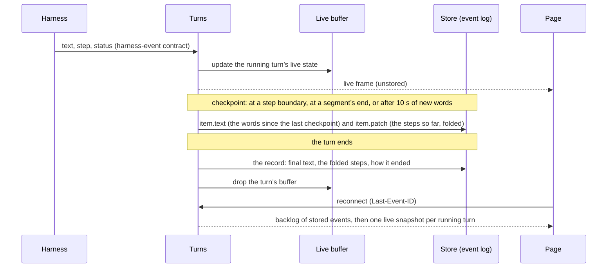

# Live-only progress

**Status:** design, for review before any code ([`rooms-at-scale.md`](../rooms-at-scale.md), “Live state”, “Still to do”). Nothing here is built.

## Why

A running turn writes its progress to the event log as it goes:
- each text delta as `item.text`;
- each step as an `item.patch` with `activityStep`;
- each change to the ring, the current step, the tool calls, the glimpse and the subagents as a `session.patch`.

The log is the record ([store.md](store.md)), so all of it is kept, replayed at every start, and counted in every snapshot. Most of it is never read again: when the turn ends, its steps fold to the record the reply keeps (`foldSteps`, `server/turn-steps.mjs`).

**Measured on `main` at 7460688d.** The 25 recorded Claude Code streams in `tests/fixtures/claude-code/` were replayed through the real stream mapper (`createStreamMapper`) into a runtime, summing each event’s bytes as the log writes it:

| What | Bytes | Share of the log |
|---|---|---|
| Progress: `session.patch` of ring, step, calls, glimpse and subagents | 88,126 | 23% |
| Progress: `item.patch` with `activityStep` | 57,722 | 15% |
| Progress: `item.text` deltas | 43,307 | 11% |
| **All progress**, 1,065 events | **189,155** | **49.6%** |
| Everything else, 674 events | 192,354 | 50.4% |

- The replies’ final text was 8,020 characters, carried by 43 KB of deltas: most of the cost is per-event overhead on small writes.
- The folded records the replies keep came to 17,335 bytes, 9% of the progress written.
- This matches the UAT run `2026-11-08T06-08-26-real-q1`, where progress was about half the log (`rooms-at-scale.md`, “Live state”).
- The script was a throwaway test over the fixtures. Its method is in “Proving it costs nothing new”, and the first code pull request commits it as a tool.

## The decision

Progress goes to the page on live frames that aren’t stored. The log keeps what is the conversation, plus a checkpoint of each running reply, so a restart loses at most a few seconds of words.

**What stays stored**, unchanged:
- messages, replies (their text at each checkpoint and at the end), blocks, asks, entries, the work ledger;
- a session’s state at its edges: running when a turn starts, and idle, failed, stopping or needs when it ends or waits;
- the folded record of a turn’s steps.

**What becomes live only:**
- text deltas between checkpoints;
- each step’s updates;
- the ring’s state while running (think, gen, tool), the current step, the tool calls, the glimpse and the subagents.

### Checkpoints

A checkpoint commits what the turn has said and done since the last one, as two events:
- `item.text`, with the words since the last checkpoint: the same event the reducer and every reader take today, fewer and larger;
- `item.patch` with the steps so far, folded, as `foldSteps` folds them.

A checkpoint comes:
- at a step boundary: when a call starts, the words before it are whole;
- at a reply segment’s end (`item.final`);
- or after 10 s of new words with no step, so a long reply with no calls loses no more than that.

The interval is a constant in `shared/limits.mjs`. The measurement below decides its value, within the bound that every checkpoint together writes less than `main` writes for the same turn.

## What reaches the browser

This crosses a security boundary ([security-boundaries.md](security-boundaries.md), “What reaches the browser”), so it’s decided once, as events are.

**One new frame, `live`,** unnumbered like `header` and `status`. Its name joins `STREAM` in `shared/state.mjs`, so no event type can take it. Its data is `{ kind, … }`. Each kind is listed in a new `LIVE` table in `shared/state.mjs` with a `public` flag, as `EVENTS` lists event types. A kind with no entry, or one not public, is dropped, never sent: it fails closed, as `publicEvent` does.

| Kind | Fields | Today the same data reaches the page as |
|---|---|---|
| `text` | `threadId`, `itemId`, `turnId`, `from` (the reply’s offset since its last checkpoint), `text` | `item.text` |
| `step` | `threadId`, `itemId`, `turnId`, and the step as `turnStep` (`server/step-text.mjs`) shapes it: `id`, `label`, `state`, `ms`, `who`, `parent`, `detail`, `kind`, `job`, `input`, `output`, `part`, `at`, `added`, `deleted`, `diff` | `item.patch` with `activityStep` |
| `session` | `sessionId`, `state` (think, gen, tool), `currentStep`, `toolCalls`, `toolCount`, `glimpse`, `subagents` | `session.patch` |
| `snapshot` | `turnId`, `sessionId`, `threadId`, `itemId`, and that turn’s buffer: the `text` since the checkpoint, its live `steps`, its `session` fields | the events above, replayed from the backlog |

**No field reaches the browser that doesn’t today.** Every field above is one a public event carries now (`item.text`, `item.patch` and `session.patch` are all `public: true`). The live frames carry the same data unstored.

**`server/public-state.mjs` decides it**, with one new function, `publicLiveFrame(frame, open)`:
1. The kind must be in `LIVE` and public, or the frame is dropped.
2. `text`, `step` and `snapshot` frames go only to a stream that has their thread open, as item events do (#1155, `publicFrame`’s `open`).
3. `session` frames go to every stream, as `session.patch` does, since the rail shows every agent.
4. `/api/state` adds `live`, the snapshots of the running turns, built by `publicLive(buffers, open)` with the same rules.

A test beside `tests/public-state.test.mjs` and `tests/live-streams-public.test.mjs` holds a private `LIVE` kind dropped at both, as they hold a private event type sent only as a cursor.

**Agent content stays data.** Text reaches the DOM through `renderMarkdown()` and steps through `h()`, as they do now (`app/js/md-stream.mjs`, `app/js/activity-live.mjs`).

## The buffer, and what a reconnect gets

**Turns keeps one buffer per running turn**, in memory, and drops it when the turn ends. Its bounds are in `shared/limits.mjs`:
- **Text:** the words since the last checkpoint, which the 10 s checkpoint bounds. Past a 64 KB ceiling, a checkpoint comes early.
- **Steps:** the steps since the last checkpoint, in full. Older ones are folded into the checkpoint.
- **Session fields:** one set, the latest.

At 100 running turns, the ceiling is 6.4 MB of text at most. The measurement records the real figure.

**A page that reconnects** asks for everything after its Last-Event-ID, as now:
- it gets the backlog of stored events, which now includes each checkpoint;
- then one `snapshot` frame per running turn in a conversation it has open, and a `session` frame for every running session.

A page that resyncs gets the same from `/api/state`’s `live`. Either way it draws what it would have drawn had it never left. A snapshot replaces that turn’s live state on the page; it’s never applied on top.

## A restart mid-turn

**A turn on this computer** can’t outlive Postbox: its harness is a child of the server, and a restart ends it ([`restart-sweep.mjs`](../../server/restart-sweep.mjs), `settleInterrupted`). After the restart:
- the reply keeps its text and its steps to the last checkpoint, which is at most 10 s or one step behind;
- the words after it, and the steps since, are gone, since they were never stored;
- the reply reads as cut off by a restart, as today, and the entries the turn took reopen once as a resend (Delivery’s start, [services.md](services.md), “Delivery and Turns, built as the inbox”), so the agent picks the work up again;
- a failed reply with no words says what its turn held from the record (#1451, `server/turn-held.mjs`). After a restart, the record has the entries the turn took, which are stored, and the steps to the last checkpoint.

Today, the same restart keeps every word, because each delta was written. This design gives up the last few seconds of a reply that’s being redone anyway, in exchange for about half the log.

**A turn on a host** goes on there. Postbox attaches again after the restart and replays the turn from the host’s `out.jsonl`, replacing what the reply had ([`turns-resume.mjs`](../../server/remote/turns-resume.mjs), `reattach`). So its words and steps come back whole, as today.

## What reads a reply while it runs

- **Other agents** (catch-up, `read_message`, `read_conversation`) read the stored text, up to the last checkpoint, and the line says the reply is still being written. Today they read every delta as it lands. A partial reply was never a reliable read, and a step boundary is where its words are whole.
- **Search** indexes the stored text, as today.
- **The server’s own code** reads a running session’s fine-grained state in two places. `turn-stop.mjs` checks `currentStep === 'Stopping'`, and `stopping` stays a stored state at the edge. The Kiro adapter’s status reads its own patch, not the store. Turns keeps `currentStep` in the buffer for any reader that needs it.

## Proving it costs nothing new

Each code pull request is measured against `main`, back to back on the same machine, with the numbers in its body. A number worse than `main` on any row fails it ([rooms-at-scale.md](../rooms-at-scale.md); the scale target is 10x to 100x real rooms).

| What | How it’s measured | At |
|---|---|---|
| Log bytes and events a turn | The fixture replay above, committed as a tool, over the 25 recorded streams, plus the event log of a UAT run’s recorded room | 1x |
| Log bytes in a crowded room | The same turns run by 8 and by 40 agents at once in one room | 10x, 100x |
| Restart time and memory | Start on a log built from those turns: replay time and heap after start | 1x, 10x, 100x |
| The page’s work a step and a turn | `tests/browser/live-cost.spec.mjs` and `live-event-cost.spec.mjs`: layouts a step, the page’s time a turn | 1x, 10x |
| A reconnect | Time from reconnect to the running turns drawn, with 1, 10 and 100 running turns, and the frames sent | 1x, 10x, 100x |
| The server a delta | Event-loop time a delta, live frame against `emit`, at 4 and 40 agents streaming | 1x, 10x |
| The buffers | Heap held by the buffers at 100 running turns | 100x |

The first code pull request commits the measurement tool and records `main`’s numbers before any change, so every later one compares with the same baseline.

## Order of work

Each item is its own pull request, test first:
1. **The measurement tool** and `main`’s numbers. It changes nothing in Postbox.
2. **`LIVE`, the `live` frame and `publicLiveFrame`**, with the private-kind test, before anything is sent on it.
3. **The buffer, checkpoints, and `session` and `step` going live.** The text still goes as `item.text`.
4. **Text going live,** with checkpoints, the reconnect snapshot and `/api/state`’s `live`.
5. **The readers:** catch-up’s line for a reply still being written, and this document’s “Status” moved to built, with `architecture.md`’s summary (“Streamed text is emitted on a fast path”) and `security-boundaries.md` updated in the same change.

## What this doesn’t do

- **It doesn’t store less of what finished turns keep.** The folded record is the same.
- **It doesn’t change how a host turn is recorded on its host.**
- **It doesn’t add Postbox’s own tool calls as steps, or a step’s elapsed time,** which rooms-at-scale lists beside this. Both ride the `step` frame once it exists, as their own changes.

## When to revisit

- If a checkpoint interval that keeps the log under `main` loses more than a step of words on a restart, in a recorded run.
- If a reader is found that needs a reply’s words between checkpoints.
